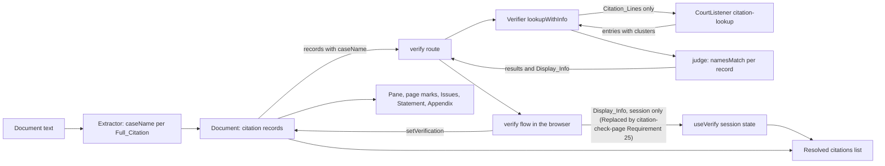
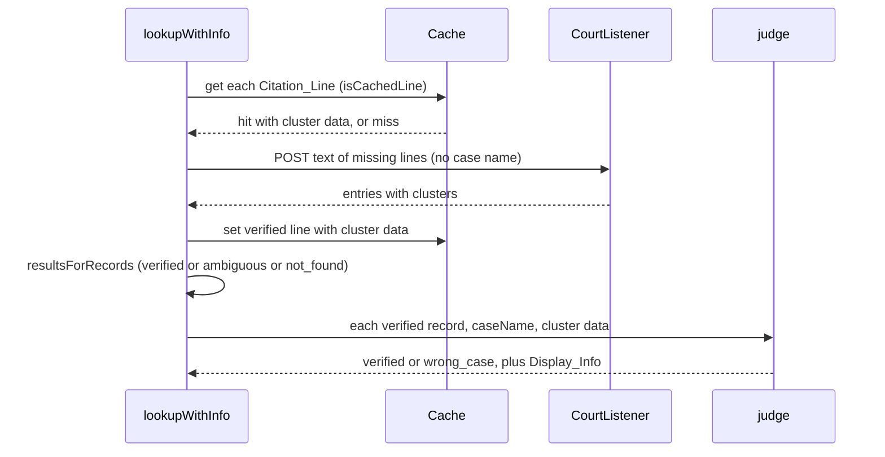
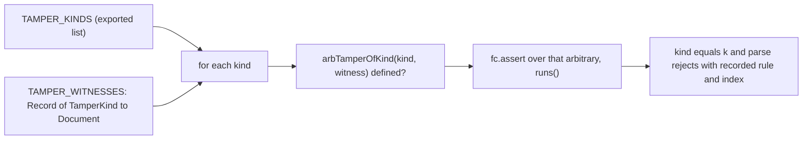
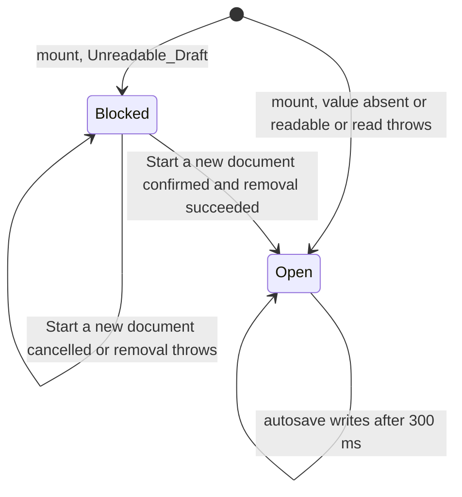

# Design Document

## Overview

A citation that resolves to a real decision with a different name than the one the filing gives must fail the way a citation that cannot be found fails. Today the Verifier asks only whether a citation exists. This design adds three things and changes everything that switches on a verification status.

1. **The Extractor records the name written before each Full_Citation** (`ExtractedCitation.caseName`). The name is read from the text and the matches, after the match layer, so the incremental rescan is untouched. The strict rule of `party.ts` and `case-name.ts` reads it first; a tolerant read inside the new module reads names the strict rule cannot (`Mgmt.`, `Dep't`), so that no citation with a written name escapes the comparison for lack of a name.
2. **The Verifier compares that name with the name CourtListener returns** and produces the new status `wrong_case` (code `CIT ≠`). The comparison is one pure function, `namesMatch`, and it runs once per record after the lookup entry is read. The request to CourtListener stays the formatted Citation_Lines, so no case name leaves the machine.
3. **`wrong_case` is treated exactly like `not_found`** in the Engine (an Issue that blocks export until an Override), the Reveal Codes form, the Pane, the page underline, the Issues region, the Statement, the Appendix and the Sentinel.

Two display features complete the work. A non-blocking `Resolved citations` list shows each citation that matched a decision, with a link to it. A second worked example, the six-citation Avianca sample, joins the Demo_Motion on the empty page, backed by six new recorded lookups so that demo mode answers like live mode.

### Reading confirmations chosen as defaults

The requirements summary left two readings to confirm. The design adopts these defaults and the tasks implement them. A reviewer who wants the other reading changes one function (`resolvedRows`, Components and Interfaces, "Resolved list").

| Reading | Default adopted | Where it shows |
| ------- | --------------- | -------------- |
| After a reload, is the Resolved list shown? | **No.** It stays hidden until a Verify_Run completes in the current browser session. The list is driven by a session flag held in `useVerify`, not by `verifiedAt`, because `verifiedAt` is autosaved and survives a reload. | Requirement 7, criteria 12 and 13 |
| Which citations does the list hold? | **Every `verified` Full_Citation** of the current Document in document order, whether or not the latest run changed it. A citation that was already verified before the run, or that was verified and then loaded into the same session, is listed. Its found name shows only while the session's Display_Info is usable (Requirement 7, criterion 5). | Requirement 7, criteria 13 to 15 |

### Decisions and interpretations

Each decision below resolves a point where the requirements leave room or two documents disagree. The reason is given so a reviewer can overturn it.

| Id | Decision | Reason |
| -- | -------- | ------ |
| D1 | `namesMatch(cited: string, found: readonly string[]): boolean`, as Requirement 4, criterion 1 states. The Glossary line that writes `found: string` is read as the same function with one Found_Name. | Criterion 1 is the normative sentence and the rule needs all three Found_Names. |
| D2 | The code the requirements write as `[CIT ≠…]` is the code name `CIT ≠` followed by a Payload_Section, the same way `[CIT ✓{k=…;cl=…}]` is written in full form. The new payload fields are `nm` (found name) and `yr` (found year). The `…` is not part of the code name. | The code name list in `product.md` has no `…` in any name other than `CIT …`, which is a different code. |
| D3 | `DisplayInfo` carries `clusterId` as well as `foundName`, `foundYear?` and `absoluteUrl?`. | Requirement 7, criterion 5 compares "the cluster id of the Display_Info" with the citation's `clusterId`. |
| D4 | The verify route answers `{ results: [[key, result], …], info: [[key, DisplayInfo], …] }` instead of the bare array of pairs. | A JSON array has no room for a second list. The client guard in `api.ts` and its tests change (listed under "Existing tests that change"). |
| D5 | The Verifier sets `foundYear` only when the first four characters of `date_filed` are digits **and** the integer is at least 1000. | The Engine rejects a `wrong_case` result whose `foundYear` is outside 1000 to 9999 (Requirement 2, criterion 4), and one rejected result would make `setVerification` skip a whole line. |
| D6 | `caseName` is computed in `extractFromMatches`, by a new engine module `citations/cited-name.ts`, from `text` and each match's `start`. It is not a field of the scan-layer `Match`. | Requirement 1, criterion 9. `matchesOf` rebuilds matches without it, so the incremental path needs no change. |
| D7 | The Verifier gains `lookupWithInfo(records, deps)` returning `{ results, info }`. `lookup(records, deps)` stays as a wrapper that returns `lookupWithInfo(records, deps).results`, so **`lookup` applies the comparison** (Requirement 5, criterion 14). | The Sentinel's `reverify` and the MCP tool call `lookup`. Both receive `wrong_case` through it with no change to how they call it. The MCP tool needs one output change (D14); the Sentinel needs none beyond Requirement 9. |
| D8 | The cluster data is added to the cache with a new guard `isCachedLine`; `isTerminalResult` is unchanged. A `verified` entry without a `cluster` record fails the guard and counts as a miss. | Requirement 5, criterion 7. Keeping `isTerminalResult` and `mapEntry` untouched leaves the existing cache and status-mapping tests as they are. |
| D9 | `[Property N]` markers for this spec live in files named `case-match.properties.test.ts` in each package, and the existing inventory tests of the engine and the verifier skip files with that name. One new aggregate inventory test (`apps/web/test/static/case-match-inventory.test.ts`, task 13.6) reads this design and the five property files and requires all nineteen markers, 1 to 19 (Property 19 was added by the follow-up, Requirement 18), each exactly once, in the package the table in "Testing Strategy" assigns it to. | The existing inventories require every `// Property N` marker in a package to match the provenance-engine design (engine) or to be exactly 1 to 12 (verifier). Requirement 13 fixes Property 1 and Property 2 as numbers. Without this change the markers collide. |
| D10 | In the initialism arbitrary of Property 1, an initialism that equals a Dropped_Word or a Name_Expansion_Table key is excluded from the generator. | The rule cannot represent such a word (`inc` for `Insurance Network Co`). The exclusion states the domain; it does not weaken the assertion. |
| D11 | The strict rule reads no name for the Demo_Motion's Alvarez and Okafor citations, because their parties hold `Mgmt.` and `Props.`, which are neither Legal_Abbreviations nor Capitalised_Words (derived by reading `case-name.ts` and `party.ts`). Instead of leaving them without a `caseName`, the Tolerant_Read of D13 reads them, so both carry a `caseName`. Their outcome stays `not_found`, because a 404 line is never compared. | Requirement 1, criteria 13 to 15 and Requirement 12, criterion 3. A citation with an unlisted abbreviation must not pass on existence alone. |
| D12 | The case name travels from the browser to the app's own verify route in the request body and stops in the Verifier. It is never part of a CourtListener request. The README bullet under "What leaves your machine" (the heading stays verbatim) becomes: `Verify sends only citation records to this app's own server, and each record includes the case name written before the citation; from there only citation strings go to CourtListener. The rest of your draft text is not sent.` The existing docs test matches `Verify sends only citation records to this app's own server` and `from there only citation strings go to CourtListener`, and both still match. Any in-app privacy copy that says only citation strings leave the browser changes in the task that adds the route field (task 3.3). | Principle 3 as Requirement 5, criterion 6 states it. |
| D13 | `cited-name.ts` runs the strict read first, then a tolerant read over a larger token set (Components and Interfaces, "Engine: the cited name"). The strict result is used, unless the tolerant result is longer, ends with it (the strict name is its right-hand suffix) and the words it adds on the left contain no token ending in a period (rule A), in which case the tolerant result is used. When the strict read finds nothing, the tolerant result is used. `party.ts`, `case-name.ts`, the Segmenter and quote attachment are unchanged. | The Party_Run rule serves quote attachment and segmentation, so widening it would move properties that must stay green unedited. A second reader in the one new module has no such reach. The suffix rule exists because the strict read can stop inside the first party (`Nnnn de Bbbb v. Nnnn` reads as `Bbbb v. Nnnn`); the tolerant read recovers the dropped words, and since it only adds words to the first party, a match can only become easier. Rule A refuses the extension over a period-ending word, because such a word cannot be told from the end of a sentence: without it, `New. Intro. Roe v. Wade` would read in full, and the `caseName`, and with it the anchor key of the citation, would change when an earlier sentence is edited. Keeping the strict name keeps keys stable. |
| D14 | `handleLookupCitations` in `packages/courtlistener-mcp/src/tools/lookup-citations.ts` already builds a Document from each input string and passes the records (a spread of `r`, so `r.citation.caseName` travels) to `lookup`. It therefore reports `wrong_case` once `lookup` applies the rule (D7). The one code change is that `describeDoc` adds `caseName` to each Full_Citation it describes, when there is one. There is no output schema and no switch over statuses in that package, so nothing else changes. | Requirement 5, criteria 12 and 13. An earlier version of this design said the MCP tool builds records without a `caseName`; that was wrong. |
| D15 | The empty-page link list is rendered after the Editor's content element so that tree order paints it above, is limited to its links' own boxes with `pointer-events: none` on the list and `auto` on the links, and each link cancels `mousedown`. No `z-index`. See "The empty-page links". | Requirement 17. The cause is a paint-order tie between two positioned elements, not a missing handler. A `z-index` would also lift the list above the Modal overlay, which has none. |
| D16 | The value keeps the First_Page as `pincite`. A Pincite_Expression only moves the match `end`. `ExtractedCitation`, `CitationValue`, `format`, the Citation_Line and the Reveal Codes payload do not change. | Requirement 18, criteria 4, 5 and 17. Every site that reads a pincite already stores one number and takes `end` from the read, so extending `end` is the whole change. Nothing reads the second page. |
| D17 | `normalisedOf` is not changed, so a citation written with a range or list gets `normalised` equal to the Canonical_Form of its value (the First_Page form). | Requirement 18, criterion 9. Suppressing it would need a new field on `Match`. Only `citationCarries` reads `normalised`, and it compares the field with itself. |
| D18 | The two mismatch lines are written without a trailing full stop: `Cited as <caseName>` and `This citation is <foundName> (<foundYear>)`. | The existing Requirement 7 line has none, existing tests match it, and a name that ends in `Co.` would otherwise read `Co..`. The full stop in the author's request is read as punctuation of the sentence that lists the lines. |
| D19 | The fifteen Role_Words join `DROPPED_WORDS`. No other table changes. | Requirement 20. A dropped word can only remove shared words, so no `wrong_case` outcome of the worked tables can become `verified`. |
| D20 | Reveal Codes written before the pincite change that close a citation code inside a Pincite_Expression fail `parse` with `extractor_mismatch`. No migration is written. | Requirement 18, criterion 16. The code check compares code ranges with Extractor ranges, which is its job. The product is unreleased; the one affected value is the author's own draft. |
| D21 | Reachability of a kind is shown by drawing from an arbitrary that produces only that kind, over a fixed Witness_Document, never by collecting kinds over a random run. `arb-codes.ts` exports `arbTamperOfKind(kind, doc)`, which returns the builder's arbitrary or `undefined`. The weights of `arbTamperDocument` and the choice in `arbSemanticTamper` do not change. | Requirement 22. The old test needed every kind to turn up in 1,500 draws; the chance of missing the rarest kind is a fixed number, not zero, and it grows with every kind added. A per-kind draw cannot miss. |
| D22 | The Witness_Documents live in `packages/engine/test/support/tamper-witnesses.ts` as a table typed `Record<TamperKind, Document>`, built from fixed texts with `createDocument` and fixed state writes. | A kind added without a witness fails `typecheck`. The table is test support, so `src/testing` stays free of fixed texts. |
| D23 | `arb-codes-syntax.ts` exports `arbSyntaxFaultOf(rendering, kinds, { minFaults, maxFaults })`. `arbSyntaxFault(rendering, maxFaults)` becomes a call of it with all kinds and `minFaults` 1, so existing callers (`arb-api.ts`, `codes.properties.test.ts`) are untouched. | Requirement 22, criteria 5 and 6. The kind and the count of faults become arguments instead of luck. |
| D24 | Seeded `fc.sample` reachability checks elsewhere (`arb-edit`, `arbitraries`, `arb-citation`, `arb-segment-inputs`, `arb-text-citations`, `rate-limit`) are left as they are and are listed in the BUILD_LOG. The tamper ones in `codes.properties.test.ts` and `arb-codes.test.ts` are replaced. | A seeded draw gives the same result on every machine, so it cannot be red in CI and green locally; a change to its arbitrary shows locally first. The tamper checks are replaced because they are the same family as the failing test and their seed hides how rare a kind is. |
| D25 | The Draft_Gate is a small observable in `apps/web/src/draft-gate.ts` (`blocked()`, `block()`, `release()`, `subscribe`), created beside the Store in `useShellParts` and read with `useSyncExternalStore`. It is not a field of `StoreState`. | `StoreState` is replaced, undone and checked by properties that enumerate its fields and actions, and the gate must not be undone, replaced by New or persisted (Requirement 23, criterion 20). |
| D26 | The gate is set only for `not_json`, `bad_shape` and `bad_codes`. `absent` and a throwing `getItem` leave it open. | An absent value has nothing to protect. A throwing read means storage is disabled, so the claim "still stored in this browser" would be false, and the existing `AUTOSAVE_FAILED` notice already covers the write. |
| D27 | Only the Start_New_Action opens the gate. Save a copy leaves it blocked, and a sample load leaves it blocked. | Requirement 23, criteria 10 and 17. Save a copy changes nothing about the stored value, and the author may still want it. A sample load is not a decision about the stored draft. |
| D28 | Save a copy reads the stored value again at click time, encodes it with `TextEncoder` (UTF-8), and calls `services.download(bytes, "reveal-codes-saved-draft.txt", "text/plain;charset=utf-8")`. `browserDownload` and `AppServices.download` gain an optional third argument for the media type, defaulting to the DOCX type, so existing callers and test doubles are unchanged. | Reading at click time means the file is what is stored now, with no copy held in memory. A value this app wrote is well-formed JSON text, so UTF-8 is exact. A value written by something else could hold a lone surrogate, which UTF-8 cannot carry and which becomes U+FFFD; the BUILD_LOG records this limit. |
| D29 | While the gate is blocked, the Toolbar's New button opens the Start_New_Action dialog (the copy of Requirement 23, criterion 12), and a confirmed New runs `startNew` and releases the gate. | The ordinary New copy says "Discard the current draft", which is untrue here, because the stored draft is deleted too. One action, one copy. |
| D30 | The Draft_Notice is a block at the top of the Issues region body: a paragraph in a `role="status"` element, then two `button`s outside it. They are buttons because they act and do not navigate. It is not an Issue, so no count, heading or Next_Step reads it. | `ui.md`: state is shown as text, with 24px buttons in an Issue row. A live region that holds buttons announces them awkwardly, so only the sentence is live. |
| D31 | `printFlow` in `use-export.tsx` checks `gate.blocked()` first and shows `PRINT_BLOCKED` without calling `autosave` or `openPrint`. | The print view reads the stored draft, so opening it would show only "The saved document could not be read." and the flow writes the stored key before opening it, which the gate forbids. |
| D32 | The subscription and the page-hide listeners of `useAutosave` move into a plain function `startAutosave(services, store, autosave, gate)` that returns its stop function, and the hook calls it from its effect. `loadAutosave(services, store, gate?)` gains an optional third argument. | Property 20 then runs the real wiring with no React and no DOM, and `autosave-old-pincite.test.ts` keeps calling `loadAutosave` with two arguments. |
| D33 | `Autosave.clear()` returns `boolean` (true when the key was removed) and `createAutosave` takes an optional `gate`; with no `gate` it behaves as before. The gate is released only after `clear()` returned true. | Requirement 23, criterion 15. A failed removal must not resume saving over the unreadable value. An optional dependency leaves every existing `createAutosave` call in the tests unedited. |

## Architecture

### Data flow of one Verify_Run



### One record through the Verifier



The first two steps are the existing cache-then-gate flow. The new step is the last one. `judge` receives a record whose combined result is already `verified` and either keeps it or turns it into `wrong_case`. Statuses 300, 400, 404 and 429 and malformed data never reach it, so no name comparison runs for them (Requirement 5, criterion 3).

### Where each change lands

| Area | Packages and files | Requirements |
| ---- | ------------------ | ------------ |
| Extractor and Document | `packages/engine/src/types.ts`, `citations/cited-name.ts` (new; strict and tolerant read), `citations/extract.ts`, `anchor.ts`, `verification.ts`, `issues.ts`. `party.ts` and `case-name.ts` do not change. | 1, 2 |
| Reveal Codes form | `packages/engine/src/codes/syntax.ts`, `lex.ts`, `decode.ts`, `decode-types.ts`, `build.ts`, `check-citations.ts`, `render.ts` | 3 |
| Name rule | `packages/verifier/src/name-expansion.ts`, `name-normalise.ts`, `name-initials.ts`, `name-match.ts` (all new) | 4 |
| Verifier rule | `packages/verifier/src/clusters.ts`, `judge.ts`, `link.ts` (new), `lookup.ts`, `index.ts`, `fixtures.ts`, `package.json` exports | 5 |
| MCP tool | `packages/courtlistener-mcp/src/tools/lookup-citations.ts` (`describeDoc` adds `caseName`), `src/server.ts` (tool description) | 5 |
| Pane, page, Issues, Resolved list | `apps/web/src/pane/*`, `editor/marks.ts`, `components/issues-list.tsx`, `issues-region.tsx`, `export-issues.tsx`, `resolved-list.tsx` (new), `use-verify.ts`, `client/*`, `server/verify-route.ts` | 6, 7 |
| Statement and Appendix | `packages/export/src/wording.ts`, `render-statement.ts`, `statement-parts.ts`, `types.ts` | 8 |
| Sentinel | `crew/sentinel/src/status-text.ts`, `findings.ts` | 9 |
| Avianca sample and empty page | `packages/engine/fixtures/avianca-citations.txt`, `apps/web/scripts/copy-demo.ts`, `components/editor-surface.tsx`, `use-document-actions.tsx`, `client/api.ts` | 10 |
| Recording | `packages/verifier/scripts/record-lookups.ts` (new), `fixtures/lookup/*`, `fixtures/manifest.json`, `fixtures/README.md` | 11 |
| Docs and steering | `README.md`, `docs/CERTIFICATION.md`, `docs/KIRO_USAGE.md`, `BUILD_LOG.md`, `.kiro/steering/product.md`, `citations.md`, `structure.md` | 6, 14 |

The boundaries of `tech.md` hold. `packages/engine` stays free of runtime dependencies, `node:` imports and the DOM. The Verifier takes `fetch` as an injected dependency, and its tests use recorded fixtures only. `apps/web` imports the Verifier's browser-safe subpaths (`@reveal-codes/verifier/quote`, and the new `@reveal-codes/verifier/link`) and never the package index in client code.

## Components and Interfaces

### Engine: the cited name (Requirement 1)

New module `packages/engine/src/citations/cited-name.ts`. It uses `partyStartFor` from `party.ts` for the left edge and `isCaseName` from `case-name.ts` for the shape check. It adds no rule for where a name begins, and `case-name.ts` gets no `In re` rule.

```ts
/** The Cited_Name written immediately before the Full_Citation that starts at `start`, or undefined. */
export function citedNameFor(text: string, start: number): string | undefined;
```

The steps, in order:

1. **The tail comma.** Walk left from `start` over whitespace only. The code unit before that run must be `,`. Call its offset `c`. Otherwise return `undefined` (Requirement 1, criterion 2: "only whitespace lies between the closing comma and the start").
2. **The Case_Name.** `s = partyStartFor(text, c)`. When `s` is not `null` and `isCaseName(text, s, c + 1)` is true, return `text.slice(s, c)`. `partyStartFor` strips Signals and the lead-ins `In`, `As`, `Under`, `Following`, `Applying` and `The court in` through the Party_Stop_List, so criterion 3 needs no new list. The semicolon of a string cite stops the Party_Run because the token before the name is not a Capitalised_Word, so criterion 5 needs no new rule.
3. **The In_Re_Name.** Otherwise look for the last occurrence of `In re ` or `In Re ` in `text[c − 86 .. c)` that starts at offset 0 or after a whitespace code unit or `(`. Let `n` be the text between that occurrence's `re ` and `c`. When `isPartyName(text, n.start, c)` is true, return `text.slice(occurrence, c)`. The window is `MAX_PARTY` plus the six code units of `In re `. Commas inside the name are allowed because `isPartyName` allows them, which is what Requirement 1, criterion 4 needs for `In re Air Crash Disaster Near New Orleans, LA`.
4. **The Tolerant_Read.** Run the tolerant read below on the same tail comma `c` (Requirement 1, criteria 13 and 14). When steps 2 and 3 return nothing, return its result, if any. When they return a name, return the tolerant result only if it is longer than the strict name, ends with it, and the words it adds on the left contain no token ending in a period (rule A); otherwise return the strict name (Requirement 1, criterion 15).
5. Otherwise return `undefined`.

Steps 2 and 3 are the Strict_Read. Their result stands unless the tolerant result extends it to the left by the suffix rule and rule A of step 4; a tolerant result that is not such an extension never replaces it. The returned string has no closing comma and no lead-in word. The function reads only `text[start − 170 .. start)` and never throws. `citedNameFor` stays under 40 lines by calling three functions of the module, `tailComma`, `strictName` and `tolerantName`. If the module nears 300 lines, `tolerantName` and its helpers move to a new sibling `cited-name-tolerant.ts`; no existing file other than `extract.ts` and `anchor.ts` changes.

#### The Tolerant_Read

The tolerant read exists because the Party_Run automaton of `party.ts` accepts only Capitalised_Words, Legal_Abbreviations and Connectors. A name such as `Alvarez v. Cascade Residential Mgmt., LLC` stops it at `Mgmt.,`, so it reads no name and the citation would pass on existence alone (D11). The automaton can also stop inside the first party and return a shortened name (`Aaaa. Aaaa v. Dep't` gives `Aaaa v. Dep't`, `Nnnn de Bbbb v. Nnnn` gives `Bbbb v. Nnnn`); the tolerant read then supplies the full name by the suffix rule of step 4 when the words it adds contain no period-ending token (`Nnnn de Bbbb v. Nnnn`); otherwise the strict name stands (`Aaaa v. Dep't`). `party.ts` and `case-name.ts` cannot be widened, because quote attachment and sentence segmentation use them and their properties must stay green unedited. The tolerant read is a second reader in `cited-name.ts` over a larger token set.

**Scan.** Starting at the tail comma `c`, read tokens right to left. Tokens are separated by exactly one space (U+0020). A token is a maximal run of code units that holds no space and no line break. Accept a token when it is one of:

| Class | Rule | Examples |
| ----- | ---- | -------- |
| Name_Token | `^\p{Lu}[\p{L}\p{N}'’.-]*$`. When the token ends in `.` it may carry one trailing comma, which is part of the name as written. | `Cascade`, `Mgmt.`, `Mgmt.,`, `Co.,`, `U.S.`, `Dep't`, `Ass'n`, `Comm'r`, `Int'l`, `Nat'l`, `Gov't` |
| Digits | `^[0-9]+$` | `1199` |
| Connector | exactly one of `of`, `the`, `and`, `for`, `&`, `de`, `la` | `of`, `&` |
| Versus | exactly `v.`, accepted once | `v.` |
| In re pair | lowercase `re` directly right of `In`. Both tokens are taken and the scan ends. (`Re` after `In` is a Name_Token and needs no rule.) | `In re` |

The scan stops at the first token that is not accepted, at a line break (the code unit before the token is a line break, or is a space that follows a line break or another space), at a second `v.`, and when taking the next token would make the name longer than 164 code units (`MAX_CASE_NAME − 1`). The 164 limit keeps every `caseName`, from either read, under the 200 code unit cap of the verify route (Requirement 5, criterion 10), so the Extractor can never cause a 400 for a whole run.

**Trim.** From the leftmost accepted token, remove leading Party_Stop_List entries and Connectors in the way `strippedWordIndex` does in `party.ts` (the exported `PARTY_STOP_LIST` and `CONNECTORS` constants are read; the file is not changed). This removes `See`, `Cf.`, `In`, `As`, `Under` and the other lead-ins, so the result carries no lead-in word (Requirement 1, criterion 3).

**Accept.** The trimmed text, up to `c`, is the `caseName` only when it holds `v.` with at least one token to its left and one to its right, or begins with `In re` or `In Re` followed by at least one token. Otherwise there is no name and the key is absent (Requirement 1, criterion 14).

**What the scan reads in the worked texts.**

| Text before the tail comma | Tokens read, right to left | `caseName` |
| -------------------------- | -------------------------- | ---------- |
| `…asks for an accommodation. Alvarez v. Cascade Residential Mgmt., LLC` (Demo_Motion) | `LLC`, `Mgmt.,`, `Residential`, `Cascade`, `v.`, `Alvarez`; stop at the lowercase `accommodation.` | `Alvarez v. Cascade Residential Mgmt., LLC` |
| `…is in writing. Okafor v. Lindqvist Props.` (Demo_Motion) | `Props.`, `Lindqvist`, `v.`, `Okafor`; stop at the lowercase `writing.` | `Okafor v. Lindqvist Props.` |
| `The Court said so in Twombly. Alvarez v. Cascade Residential Mgmt., LLC` | the six tokens above, then `Twombly.` (a Name_Token that ends in a period); stop at the lowercase `in` | `Twombly. Alvarez v. Cascade Residential Mgmt., LLC` |
| `See Dep't of Homeland Sec. v. Regents of the Univ. of Cal.` after a line break | `Cal.`, `of`, `Univ.`, `the`, `of`, `Regents`, `v.`, `Sec.`, `Homeland`, `of`, `Dep't`, `See`; stop at the line break; trim removes `See` | `Dep't of Homeland Sec. v. Regents of the Univ. of Cal.` (the same string whichever rule reads it) |
| `Aaaa. Aaaa v. Dep't` (the Strict_Read gives `Aaaa v. Dep't`) | `Dep't`, `v.`, `Aaaa`, `Aaaa.`; stop at the line break or a lowercase word. The result is longer than the strict name and ends with it, but the added `Aaaa.` ends in a period | `Aaaa v. Dep't` (rule A keeps the strict name) |
| `Nnnn de Bbbb v. Nnnn` (the Strict_Read gives `Bbbb v. Nnnn`) | `Nnnn`, `v.`, `Bbbb`, `de`, `Nnnn`; stop at the line break. The result ends with the strict name | `Nnnn de Bbbb v. Nnnn` (suffix rule; the added `Nnnn` and `de` end in no period) |
| `Smith v. Jones v. Brown Mgmt.` | `Mgmt.`, `Brown`, `v.`, `Jones`; stop at the second `v.` | `Jones v. Brown Mgmt.` |
| `Cascade Residential Mgmt., LLC` after a line break | `LLC`, `Mgmt.,`, `Residential`, `Cascade`; stop at the line break | none: no `v.` |
| `(Alvarez v. Cascade Mgmt.` | `Mgmt.`, `Cascade`, `v.`; stop at `(Alvarez` | none: nothing to the left of `v.` |

The third row is the sentence-boundary case. The Strict_Read finds no name there (`Mgmt.,` is unreadable to it), so the tolerant result stands and rule A does not apply. Where the Strict_Read does read a name, a period-ending word to its left is never added, so inserting a sentence before `Intro. Roe v. Wade` leaves `Roe v. Wade`. The extra word `Twombly.` joins the first party only, and the second party's words (`cascade residential management`, with `llc` dropped) are exactly those of the name as written, so the comparison of the right-hand party is unaffected.

**Why extra words on the left are safe, and what is not claimed.**

- *Scope of the tolerant read.* Where the Strict_Read found nothing, the tolerant result is used. Where it found a name, the tolerant result replaces it only when the tolerant result is longer, the strict name is its right-hand suffix, and none of the prepended words ends in a period (rule A), so the replacement only prepends period-free words to the strict name (Requirement 1, criterion 15). Any other tolerant result is ignored.
- *Claim made (extension).* Take a name N that the strict rule reads in full, and suppose the tolerant scan, applied to the same text, accepted extra tokens X to its left (for example the last word of the previous sentence). The only ` v. ` is inside N, so X joins the first party and nothing else changes: the second party and the found words are the same. `namesMatch` needs, for each party, one shared Normalised_Word or one Initialism_Match, and each is an "exists" condition over the party's words and over the windows of its consecutive words. Prepending tokens keeps every old word and every old window and adds new ones. So if N matches, X plus N matches. There is one exception, Joined_Letters: if X ends in a single-letter token and the first party begins with spaced single-letter tokens, normalisation joins the two runs into one word (`A. U. S. Steel` joins `a u s` to `aus`, and the old `us` is lost). That needs a one-letter token directly before a spaced initial group, which is rare. An Override clears it.
- *Claim made (suffix replacement is safe).* When the tolerant result T is longer than the strict result S and ends with S, T is X plus S with X added on the left. The only ` v. ` is inside S (the tolerant scan accepts one `v.`, and S contains it), so X joins the first party and the second party is unchanged. By the extension argument above, if S matches then T matches, apart from the Joined_Letters exception. The replacement therefore only makes a match easier, and it restores words that the strict rule dropped (`Nnnn de Bbbb v. Nnnn` instead of `Bbbb v. Nnnn`), so the `caseName` is the name as written, which Property 3 requires of the names it generates. Rule A withholds the replacement when an added word ends in a period (`Aaaa. Aaaa v. Dep't` stays `Aaaa v. Dep't`); this is the same claim with fewer replacements, and Property 3 does not generate a dotted word directly left of a name the Strict_Read accepts.
- *Claim not made (truncation).* Neither read is a superset of the name the author wrote in every case. Both stop at the first token they cannot read. If that token lies inside the first party (`Doe, Roe v. Smith Mgmt.` stops at `Doe,`, giving `Roe v. Smith Mgmt.`) and the tolerant read stops at the same token, the first party loses words and a match can become a mismatch. The suffix rule recovers the words only when the tolerant read reaches further left than the strict read and the added words end in no period (rule A). The tolerant read adds no new case of truncation beyond names the strict rule did not read at all.
- *Claim not made (no new `wrong_case`).* Where the Strict_Read reads no name, the tolerant read newly produces a `caseName`. A citation that was `verified` because it had no `caseName` may therefore become `wrong_case`. That is the intended detection (`Alvarez v. Cascade Residential Mgmt., LLC, 556 U.S. 662` is now `wrong_case`, not `verified`). It is limited to citations with a written name that the strict rule cannot read, and an Override clears each one.

`extract.ts` changes in one place. `toCitation(text, m)` adds `caseName` for a Full_Citation, with a conditional spread so the field is absent and never `undefined`:

```ts
const name = isFull(m.value) ? citedNameFor(text, m.start) : undefined;
return name === undefined ? withNormalised : { ...withNormalised, caseName: name };
```

A Short_Form and an Other_Reference never get the field (criterion 6). A Parallel_Citation is one match whose `start` is its first member, so the one ExtractedCitation that holds all members gets the one `caseName` (criterion 8). Every other field is produced by the same code as before, which is Requirement 1, criterion 10. Because `extractFromMatches` recomputes `caseName` from the text for every match, the incremental rescan returns the same citations as a full scan (criterion 9).

### Engine: carry-over (Requirement 1, criterion 11)

`citationCarries` in `anchor.ts` gains one condition for a Full_Citation:

```ts
return (
  c.value.kind !== "short" &&
  c.value.kind !== "other" &&
  structuralEqual(prev.value, c.value) &&
  prev.normalised === c.normalised &&
  prev.caseName === c.caseName   // both absent, or equal strings
);
```

An edit that changes the written name leaves the citation's range untouched, so `mapRange` still maps it. Without the new condition the citation would keep its key and a `verified` result for a name the author has changed. With it the record gets a fresh key, the status `unchecked` and no Override, and the Override cleanup in `keptOverrides` drops the old one.

### Engine: the `wrong_case` status (Requirement 2)

`types.ts`:

```ts
export type VerificationResult =
  | Readonly<{ status: "verified"; clusterId: string }>
  | Readonly<{ status: "wrong_case"; clusterId: string; foundName: string; foundYear?: number }>
  | Readonly<{ status: "ambiguous"; candidates: readonly string[] }>
  | Readonly<{ status: "not_found"; reason?: string }>
  | Readonly<{ status: "unchecked"; waitUntil?: string }>;

export type IssueCode = "CIT ✘" | "CIT ≠" | "CIT ?" | "CIT …" | "QUO ✘" | "QUO …";
```

`verification.ts`:

- `badVerificationField` becomes a table typed `Readonly<Record<VerificationResult["status"], (v: Fields) => string | null>>` and the function looks up `table[status]`, returning `"status"` only for a status that is not a key. This removes the `default` branch that would hide a missing case (Requirement 2, criterion 12) and still handles malformed input, which arrives as data.
- The `wrong_case` checker returns `"clusterId"` when `clusterId` is not a non-empty string, then `"foundName"` when `foundName` is not a non-empty string, then `"foundYear"` when the key is present and the value is not an integer from 1000 to 9999 (criteria 3 and 4).
- `setVerification` treats `wrong_case` like `verified` for the `not_verifiable` check: a Short_Form, or a Database_Citation whose Lexis court is unlisted, is rejected (criterion 5). The Override rule is the existing one. `statusChanged` compares `status` strings, so `wrong_case` to `wrong_case` keeps the Override and any change to or from `wrong_case` drops it (criterion 9).
- `verificationOf` needs no change. A Short_Form reports its target's result, so it reports `wrong_case` (criterion 10).

`issues.ts`: `FULL_CODES` is retyped as `Readonly<Record<Exclude<VerificationResult["status"], "verified">, IssueCode>>` and gains `wrong_case: "CIT ≠"`. A `wrong_case` Full_Citation is an Issue of kind `citation` in the same order position as the others (criterion 6). It is blocking until `recordOverride` stores an Override for it (criteria 7 and 8). `canExport` in the Export package reads `blockingIssues`, so it needs no change (criterion 11). A Short_Form that links to it lists no Issue because `citationIssue` returns `null` for a linked Short_Form (criterion 10).

### Engine: Reveal Codes form (Requirement 3)

| File | Change |
| ---- | ------ |
| `codes/syntax.ts` | `CODE_NAMES.citWrongCase = "CIT ≠"`. |
| `codes/lex.ts` | `SCHEMAS[citWrongCase] = { retained: false, required: ["k"], optional: ["cl", "nm", "yr"] }`; `OPENS[citWrongCase] = "cit"`. |
| `codes/decode-types.ts` | `DraftStatus` gains `{ status: "wrong_case"; clusterId?: string; foundName?: string; foundYear?: number }`. |
| `codes/decode.ts` | `decodeStatus` gains `case citWrongCase`: `cl` and `nm` through `readText`, `yr` through `readInt`. The old `default` branch, which decoded every other name as `unchecked`, becomes `case citUnchecked` plus an explicit failing fallback, so a missing case is a compile or test failure. |
| `codes/build.ts` | `resultOf` gains the `wrong_case` case, with `foundYear` only when `yr` is present. |
| `codes/check-citations.ts` | `fullPayloadOk` requires non-empty `clusterId` and `foundName` and a `foundYear` that is absent or an integer from 1000 to 9999, otherwise `bad_field` at the code's index. The Short_Form rule (`short_form_code`) rejects a payload on a Short_Form and a status that differs from its target's. The unlisted-Lexis rule covers `wrong_case`. |
| `codes/render.ts` | `citationOpening` gains `case "wrong_case"`: `{ name: citWrongCase, retained: null, fields: full ? [k, cl, nm, yr?] : [k] }`. `yr` is omitted when `foundYear` is absent. |

Full form of the code, for the Ashcroft example: `[CIT ≠{k=c3;cl=145875;nm=Ashcroft v. Iqbal;yr=2009}]`. Display form: `[CIT ≠]`. A Short_Form that links to it renders `[CIT ≠{k=c4}]` in full form and `[CIT ≠]` in display form. The Override of a `wrong_case` citation follows the opening code (rank `citOvr`), as it does for `CIT ✘`. `[/CIT]` closes it. `strip` and `stripPositions` lex generically, so they remove it with no change once the schema exists.

`foundName` goes through `escapePayload`, which escapes `\ [ ] { } ; = ,`. The characters `"` and `:` need no escape inside a Payload_Section value, and non-ASCII letters pass through, so `parse` returns the identical string (criterion 5, Property 2). The Appendix prints `render(document, "full").text` unchanged (criterion 9), so the found name and cluster id appear in it without change to the two introductory sentences.

### Verifier: name matching (Requirement 4)

Four new modules, each under 300 lines, none importing `node:` or reading a clock.

| Module | Holds |
| ------ | ----- |
| `name-expansion.ts` | `NAME_EXPANSION_TABLE`, `DROPPED_WORDS`, `INITIALS_SKIP_WORDS` |
| `name-normalise.ts` | `prepareName(name): Prepared`, `splitParties(name)` |
| `name-initials.ts` | `initialisms(joined): ReadonlySet<string>`, `initialismMatch(a, b)` |
| `name-match.ts` | `namesMatch(cited, found)` |

```ts
type Prepared = Readonly<{
  /** After lower-casing, punctuation removal, whitespace split and joining of single letters; before expansion and dropping. */
  joined: readonly string[];
  /** `joined` after expansion and dropping: the Normalised_Words. */
  words: readonly string[];
}>;
```

**Normalisation** (`prepareName`, criterion 2), in this order:

1. `name.normalize("NFC").toLowerCase()`.
2. Delete every character that is not a letter, a digit or whitespace: `replace(/[^\p{L}\p{N}\s]/gu, "")`. `O'Brien` becomes `obrien`, `U.S.` becomes `us`, `Jones & Laughlin` becomes `jones laughlin` after the split, and `Smith-Jones` becomes `smithjones`.
3. Split on whitespace and drop empty strings.
4. Join each run of two or more consecutive one-letter words into one word. `u s` becomes `us`, `n l r b` becomes `nlrb`. A one-letter word is a single `\p{L}` code point. A digit never joins.
5. This is `joined`. Replace each word that is a key of `NAME_EXPANSION_TABLE` with its expansion (which may be two words), then drop each Dropped_Word. This is `words`.

**Parties** (criterion 5): `cited.split(" v. ")`. A cited name with no ` v. ` (an In_Re_Name) has one party. Each party is prepared separately. For `found`, each Found_Name is prepared as a whole, and `foundWords` is the union of their `words` (criterion 6). A found name is not split into parties: its words are pooled.

**The rule** (`namesMatch`, criteria 7 to 9):

```ts
export function namesMatch(cited: string, found: readonly string[]): boolean {
  const parties = splitParties(cited).map(prepareName).filter((p) => p.words.length > 0);
  if (parties.length === 0) return true;                       // criterion 9
  const names = found.map(prepareName);
  const pool = new Set(names.flatMap((n) => n.words));
  return parties.every((p) => shares(p, names, pool));          // criteria 7 and 8
}

function shares(p: Prepared, names: readonly Prepared[], pool: ReadonlySet<string>): boolean {
  return p.words.some((w) => pool.has(w)) || names.some((n) => initialismMatch(p, n));
}
```

A party with no Normalised_Word is skipped; every other party must share a word with the pool or have an Initialism_Match with at least one Found_Name. One shared word per party is enough. That is deliberately lenient: a correct citation flagged as the wrong case is the failure that matters most, and both parties must still agree, so `Henderson v. Pacific Housing Authority` fails against `Ashcroft v. Iqbal` because `henderson` shares nothing.

**Initialism_Match** (`initialismMatch(a, b)`, criterion 10). `initialisms(joined)` removes the Initials_Skip_Words (`of`, `and`, `the`, `for`) from `joined`, then returns the set of initials of every window of two or more consecutive remaining words. Initials are taken from `joined`, so a Dropped_Word such as `corp` or `v` still counts as a word, and only the four skip words are skipped. The candidates on one side are its `words` plus its `joined` words that are not Dropped_Words, of at least two letters. The match holds when a candidate of `a` is in `initialisms(b.joined)`, or a candidate of `b` is in `initialisms(a.joined)`. Adding the `joined` words as candidates lets a cited `US` (expanded to `united states` in `words`) still match the initials of `Union Steel`. A name of n words has O(n²) windows; the cited name is capped at 200 code units by the route, so this is bounded.

**Name_Expansion_Table, final entries** (criteria 3 and 4). Every key is punctuation-free and lower-case. No key stands for two different words. The table holds exactly the thirty entries that Requirement 4, criterion 4 requires: the seventeen of the first draft and the thirteen that name-style abbreviations such as `Mgmt.`, `Props.`, `Ass'n`, `Int'l` and `Nat'l` need.

| Key | Expansion | Key | Expansion |
| --- | --------- | --- | --------- |
| `dept` | `department` | `servs` | `services` |
| `us` | `united states` | `sch` | `school` |
| `commr` | `commissioner` | `ry` | `railway` |
| `govt` | `government` | `rr` | `railroad` |
| `bd` | `board` | `hous` | `housing` |
| `educ` | `education` | `fedn` | `federation` |
| `ins` | `insurance` | `socy` | `society` |
| `mfg` | `manufacturing` | `ctr` | `center` |
| `sys` | `system` | `hosp` | `hospital` |
| `mgmt` | `management` | `auth` | `authority` |
| `assn` | `association` | `cnty` | `county` |
| `intl` | `international` | `commn` | `commission` |
| `natl` | `national` | `props` | `properties` |
| `bros` | `brothers` | `cos` | `companies` |
| `univ` | `university` | `assocs` | `associates` |

The apostrophe contractions of the Tolerant_Read reach these keys through normalisation step 2, which deletes the apostrophe: `Dep't` gives `dept`, `Ass'n` gives `assn`, `Comm'r` gives `commr`, `Comm'n` gives `commn`, `Int'l` gives `intl`, `Nat'l` gives `natl` and `Gov't` gives `govt`. No expansion is another entry's key, so expansion is one pass. The rule is lenient (one shared word per party), so an unlisted abbreviation fails a match only when a party consists of nothing else, which is rare. A later entry needs a requirement change so that the "no key stands for two words" check stays true. `ins` is a known near-collision (`INS` is also an agency's initials), and it stays because the requirement lists it. The Initialism_Match covers the agency reading.

**Dropped_Words** (Glossary): `v, vs, in, re, the, of, and, et, al, ex, rel, inc, co, corp, corporation, company, llc, ltd, lp, llp, plc, na`, and since the follow-up (D19, Requirement 20) the Role_Words `plaintiff, plaintiffs, defendant, defendants, appellant, appellants, appellee, appellees, petitioner, petitioners, respondent, respondents, individually, deceased, no`. **Initials_Skip_Words**: `of, and, the, for`.

#### Name-match examples (Requirement 4, criterion 11)

| Cited | Found_Names | Party 1 | Party 2 | `namesMatch` |
| ----- | ----------- | ------- | ------- | ------------ |
| `NLRB v. Jones & Laughlin Steel Corp.` | `National Labor Relations Board v. Jones & Laughlin Steel Corp.` | words `nlrb`. Found `joined` holds `national labor relations board v jones laughlin steel corp`, whose window `n l r b` gives initials `nlrb`: Initialism_Match. | words `jones laughlin steel` (`corp` dropped). `jones` is in the pool. | `true` |
| `SEC v. Chenery Corp.` | `Securities and Exchange Commission v. Chenery Corporation` | words `sec`. The window of `securities exchange commission` (`and` skipped) gives `sec`. | words `chenery`. In the pool. | `true` |
| `U.S. v. Lopez` | `United States v. Lopez` | `us` expands to `united states`; `united` is in the pool. | `lopez` is in the pool. | `true` |
| `U. S. v. Lopez` | `United States v. Lopez` | `u s` joins to `us`, then as above. | `lopez` | `true` |
| `Henderson v. Pacific Housing Authority` | `Ashcroft v. Iqbal` | `henderson`: not in the pool, no window of `ashcroft v iqbal` gives it. | `pacific housing authority`: not in the pool | `false` |
| `Zicherman v. Korean Air Lines Co.` | `Zicherman ex rel. Estate of Kole v. Korean Air Lines Co.` | `zicherman`: in the pool. | `korean air lines`: in the pool. | `true` |
| `Petersen v. Iran Air` | `United States of America v. ISS Marine Services, Inc.` | `petersen`: not in the pool, and `petersen` has one word so it has no window. | not reached | `false` |
| `Miller v. United Airlines, Inc.` | `Greenleaf v. Garlock, Inc.` | `miller`: not in the pool. | not reached | `false` |
| `Smith v. Jones` | found names: `Smith v. Brown` | `smith`: in the pool. | `jones`: not in the pool | `false` |
| `Dep't of Homeland Sec. v. Regents of the Univ. of Cal.` | `Department of Homeland Security v. Regents of Univ. of Cal.` | `dep't` loses its apostrophe to give `dept`, a table key, so `joined` is `dept of homeland sec` and `words` is `department homeland sec` (`of` dropped). The found pool is `department homeland security regents university cal` (`univ` expands to `university`; `of` and `v` dropped). `department` is in the pool, so the party shares a word. | `regents of the univ of cal` gives `regents university cal`. `regents` is in the pool. | `true` (no initialism needed; `sec` and `security` do not match each other, and the rule does not require them to) |
| `Alvarez v. Cascade Residential Mgmt., LLC` | `Ashcroft v. Iqbal` | `alvarez`: not in the pool. | not reached (`mgmt` would give `management`, `llc` is dropped) | `false` |

A name that matches only through `case_name_full` or `case_name_short` is the sixth row's shape: the found array holds the three Found_Names and the pool is their union. The Requirement 13, criterion 5 example test uses a recorded-style entry whose `case_name` alone would fail and whose `case_name_full` matches.

### Verifier: the rule, the cache and Display_Info (Requirement 5)

**Cluster data** (`clusters.ts`). A second pass over the raw lookup body, so `parseLookupBody` and `LineEntry` stay as they are:

```ts
export type ClusterData = Readonly<{
  caseName?: string; caseNameFull?: string; caseNameShort?: string;
  dateFiled?: string; absoluteUrl?: string;
}>;
/** Entry index to the data of its one cluster, only for entries with status 200 and exactly one distinct cluster id. */
export function clusterDataByIndex(body: unknown): ReadonlyMap<number, ClusterData>;
export function foundNames(c: ClusterData): readonly string[];   // non-blank case_name, case_name_full, case_name_short, in that order, without duplicates
export function foundYear(c: ClusterData): number | undefined;   // four leading digits, integer >= 1000 (D5)
```

Each string field is kept only when it is a string. `foundNames` drops blank strings.

**The cache** (D8). A resolved line is cached as:

```ts
type CachedVerified = Readonly<{ status: "verified"; clusterId: string; cluster: ClusterData }>;
type CachedLine = CachedVerified | Exclude<TerminalResult, { status: "verified" }>;
```

`isCachedLine(v)` is `isTerminalResult(v)` plus: for `verified`, `v.cluster` is a record whose present fields are all strings. A `verified` entry with no `cluster` record fails the guard, so `cacheGet(deps, line, isCachedLine)` counts a miss and the line is fetched again (criterion 7). A `cluster` of `{}` (a response with no name fields) is a valid hit and skips the comparison, so such an entry does not become a permanent miss. `cacheSet` writes the line's result and, for a resolved line, its `cluster`. The 24-hour expiry and the rule that `unchecked` is never written are unchanged. A live lookup and a cache hit give the same `ClusterData` because both paths build it with the same function (Property 10).

**The comparison** (`judge.ts`). It runs once per Full_Record after `resultsForRecords` has produced the record's combined result:

```ts
export function judgeRecords(
  records: readonly CitationRecord[],
  index: LineIndex,
  results: ReadonlyMap<IssueKey, VerificationResult>,
  clusters: ReadonlyMap<string, ClusterData>,      // by Citation_Line
): Readonly<{ results: ReadonlyMap<IssueKey, VerificationResult>; info: ReadonlyMap<IssueKey, DisplayInfo> }>;
```

For each Full_Record whose result is `verified`:

1. Find the cluster data: the first member line (in member order) whose cached or fetched cluster has the same `id` as `result.clusterId`. For a Parallel_Citation this is the common cluster; members that resolve to different clusters were already combined to `ambiguous` by `combineParallel`, which is unchanged (criterion 5).
2. If the record has no `caseName`, or the data has no non-blank `caseName` (the `case_name`), keep `verified` (criterion 2).
3. Otherwise, if `namesMatch(caseName, foundNames(data))` keep `verified`; else the result is `{ status: "wrong_case", clusterId, foundName: data.caseName, foundYear? }`, with `foundYear` set by `foundYear(data)` when defined (criterion 1).

Two records of one lookup line with different `caseName` values are judged separately because the judgement is per record and the line's cluster data is shared (criterion 4). The Display_Info of a Resolved_Citation (`verified` or `wrong_case`) is added when the data has a non-blank `caseName`:

```ts
export type DisplayInfo = Readonly<{
  clusterId: string;
  foundName: string;
  foundYear?: number;
  absoluteUrl?: string;   // present only when isSafeAbsoluteUrl(data.absoluteUrl)
}>;
```

`isSafeAbsoluteUrl(s)` is `typeof s === "string" && s.startsWith("/") && !s.startsWith("//")` (criterion 8). `combineParallel`, `map-status.ts`, `chunk.ts`, `bucket.ts`, `transport.ts` and `request.ts` do not change.

**`lookupWithInfo`** wraps the existing flow. The request body is built by `buildLookupRequest(deps, lines)` from Citation_Lines, so it is byte-for-byte the body before this feature (criterion 6, Property 11). The exported `lookup` is the wrapper `(records, deps) => lookupWithInfo(records, deps).then((o) => o.results)`, so **`lookup` applies the comparison**: it runs the same cache read, request, `resultsForRecords` and `judgeRecords` steps and drops only the Display_Info (criterion 14). The Sentinel's `reverify` and the MCP tool call `lookup`, so both receive `wrong_case` through it with no change to the call.

**`link.ts`** (browser-safe, no imports; exported as `@reveal-codes/verifier/link`):

```ts
export const COURTLISTENER_ORIGIN = "https://www.courtlistener.com";
export function isSafeAbsoluteUrl(v: unknown): v is string;
export function isDisplayInfo(v: unknown): v is DisplayInfo;     // used by the client guard
export function courtListenerLink(clusterId: string, absoluteUrl?: string): string | null;
```

`courtListenerLink` returns `null` unless `clusterId` is a string of ASCII digits (`/^[0-9]+$/`). Otherwise it returns `COURTLISTENER_ORIGIN + absoluteUrl` when `isSafeAbsoluteUrl(absoluteUrl)`, and `COURTLISTENER_ORIGIN + "/opinion/" + clusterId + "/x/"` when not (Requirement 7, criterion 4). The origin is a constant, so a response can never point the link at another host (Property 13).

**The route** (`apps/web/src/server/verify-route.ts`). `isFullRecord` gains one check: when `citation` has a `caseName` key, it must be a string of at most 200 code units, else `parseVerifyBody` returns the existing `BAD_BODY` (400, `Request body is not valid.`) (criterion 10). The handler calls `lookupWithInfo` and answers `200` with `{ results: [...], info: [...] }` (D4). The client guard in `client/api.ts` accepts the five statuses, requires `wrong_case` to carry a non-empty `clusterId` and `foundName` and an integer `foundYear` from 1000 to 9999 when present, and treats any other status as a shape error (criterion 11). It checks each `info` item with `isDisplayInfo`.

### MCP: `lookup_citations` (Requirement 5, criteria 12 and 13)

`packages/courtlistener-mcp/src/tools/lookup-citations.ts` builds a Document from each input string with `createDocument`, so the Extractor reads the name written in the string. `prefixed` spreads each Full_Record (`{ ...r, key }`), which keeps `r.citation.caseName`, and passes the records to `lookup`. Because `lookup` applies the rule (D7), the tool reports `wrong_case` with no change to this flow. The only code change is in `describeDoc`, which adds the name the Extractor read to each citation it describes:

```ts
const citations = doc.citations.map((r, n) => ({
  index: n,
  text: r.citation.text,
  start: r.citation.start,
  end: r.citation.end,
  kind: r.kind,
  ...(r.citation.caseName === undefined ? {} : { caseName: r.citation.caseName }),
  result: r.kind === "other" ? null : verificationOf(doc, r.key),
}));
```

The spread keeps the key absent when there is no name (Requirement 5, criterion 13), and a Short_Form or an Other_Reference never has one. `setVerification` accepts `wrong_case` through the Engine's new checker, and a Short_Form reports its target's `wrong_case` through `verificationOf`, so the tool needs no other change. The package has no output schema and no `switch` over statuses (the only status literals are in `check-quote.ts`, which is the quote status and unrelated), so nothing else needs an exhaustive-case edit. `server.ts` gains the words `and the case name read before each full citation` in the tool description. The tool sends CourtListener the Citation_Lines only, as before.

Two outcomes follow for the recorded fixtures, which both tests run against. `Henderson v. Pacific Housing Authority, 556 U.S. 662, 678 (2009)` gives `{ status: "wrong_case", clusterId: "145875", foundName: "Ashcroft v. Iqbal", foundYear: 2009 }`. `556 U.S. 662` alone has no name and gives `{ status: "verified", clusterId: "145875" }`. The existing tests of the package keep passing unedited: they match with `toMatchObject` or read statuses only, and `See Ashcroft v. Iqbal, 556 U.S. 662, 678 (2009).` still resolves to `verified` because its name matches.

### Web: Pane, page underline and tables (Requirement 6)

| File | Change |
| ---- | ------ |
| `pane/failing.ts` | `FAILING_OPENERS` gains `"CIT ≠"`. A Failing_Block is drawn from the opener through the closer, and a Short_Form's `[CIT ≠]` is a failing opener too (criteria 1 and 2). |
| `pane/layout.ts` | `"CIT ≠"` maps to the family `failed` and the plain-words text `Citation is a different case` (criterion 4). The two maps are retyped over the code union where they are not yet, so a missing code fails `typecheck`. |
| `pane/pane-header.tsx` | The Legend gains `{ code: "[CIT ≠]", words: "wrong case", family: "failed", failing: true }` directly after `[CIT ✘] not found`. The other seven entries and their order stay (criterion 3). |
| `editor/marks.ts` | `MarkRange["code"]` and `isMarked` gain `"CIT ≠"`. The title is built from the record: `This citation is <foundName> (<foundYear>)`, or `This citation is <foundName>` when `foundYear` is absent (criterion 5). `markRanges` reads the `wrong_case` result from the Document. |

No new colour literal, Token, icon or CSS rule is needed. `isFailingOpener` already drives the Failing_Block styling from a set of code names, so the Pane and the page mark pick the new code up through the existing selectors (criterion 6). `product.md` and `citations.md` change as Requirement 6, criteria 7 and 8 list.

### Web: the Issues row, the link and the Verify result (Requirement 7)

`issues-list.tsx`:

- `SEVERITY["CIT ≠"] = "wrong case"`. The words line reads `blocking, wrong case` and, after an Override, `overridden, wrong case`.
- For a `wrong_case` Issue the row adds, under the citation text, the line `This citation is <foundName> (<foundYear>)` or `This citation is <foundName>` (criteria 1 and 2). It reads the name and year from the Document result, which is autosaved, so the row is the same after a reload (criterion 7). The `Go` and `Override…` buttons and the `Overridden: <reason>` line are the existing ones (criterion 3).
- The row and each Resolved list row show the link when `courtListenerLink` returns a string: an `a` element with `href`, `target="_blank"`, `rel="noreferrer"` and the text `View on CourtListener` (criterion 4). The `absoluteUrl` comes from the session Display_Info only while its `clusterId` equals the result's `clusterId` (criterion 5). Otherwise the link is built from the stored `clusterId`.

`export-issues.tsx` shows the chip `CIT ≠` already (it prints `issue.code`). It gains the same words line as the Issues row, taken from one exported function `issueWords(code, blocking)` that `issues-list.tsx` also uses (criterion 10). No row text, link text or title contains an exclamation mark, an icon or an emoji (criterion 11).

`client/verify-summary.ts`: `CitationTally` gains `wrong_case`, `tallyDocument` counts it, and the `Citations:` line reads `[found, wrong case, not found, ambiguous, not checked]` in that order, omitting any term whose count is 0 (criterion 9). The `VerifyOutcome.citations` type and `NO_CITATIONS` gain the field. Because `citations[c.result.status] += 1` is indexed by the status type, `typecheck` fails until the field exists (Requirement 2, criterion 12).

### Web: the Resolved list (Requirement 7, criteria 12 to 18)

State. `useVerify` keeps one session value, never persisted:

```ts
type ResolvedSession = Readonly<{ epoch: number; info: ReadonlyMap<IssueKey, DisplayInfo> }> | null;
```

It is `null` on mount, so a reload hides the list (reading confirmation 1). When a run ends with status `completed`, `useVerify` sets it to `{ epoch, info }`, with `epoch` the Store's epoch at the start of the run and `info` the map the verify flow returned. A `failed` or `discarded` run leaves it as it was. `VerifyControl` gains `resolved: ResolvedSession`.

Selection is one pure function in `client/resolved.ts`:

```ts
export type ResolvedRow = Readonly<{ key: IssueKey; text: string; clusterId: string; found: string | null; href: string | null }>;
export function resolvedRows(doc: Document, session: ResolvedSession, currentEpoch: number): readonly ResolvedRow[] | null;
```

- It returns `null` (render nothing) when `session` is `null` (criterion 12).
- It returns `[]` when no Full_Citation is `verified`; the component renders nothing for `[]`, so the heading is absent (criterion 17).
- Otherwise it returns one row per `verified` Full_Citation in document order. It never includes a `wrong_case` citation, a Short_Form, an Other_Reference or a citation with any other status (criterion 15).
- `found` is `<foundName> (<foundYear>)` or `<foundName>` only when `session.epoch === currentEpoch` and the Display_Info for the key has the same `clusterId` as the result; otherwise `null` (criteria 5 and 14). The epoch condition protects a Document replaced by New, Load or restore, because `reduceReplace` bumps `epoch` and issue keys can repeat after it.
- `href` is `courtListenerLink(clusterId, usable ? info.absoluteUrl : undefined)`.

`resolved-list.tsx` renders the heading `Resolved citations` and the rows below `IssuesList` in `IssuesRegion`. A row has the citation text shortened with `shorten`, the found text, and the link. It has no `Override…` and no `Go` button, adds nothing to `blockingIssues`, and leaves the Export button, the Next_Step and the `No issues.` line as they are, because it reads the Document and changes none of them (criteria 8 and 16). Its CSS module uses only existing Tokens and the existing link colour (criterion 18).

### Web: the Avianca sample and the empty page (Requirement 10)

`packages/engine/fixtures/avianca-citations.txt` is the sample. It is a passage written for this app, with the required first line, and it must not contain a citation-like string other than the six, because the Extractor would read one as a seventh. The proposed text:

```text
The first four citations are from the Affirmation in Opposition in Mata v. Avianca, Inc., No. 22-cv-1461 (S.D.N.Y. 2023), as listed in the court's Opinion and Order on Sanctions, ECF 54 at 7. The last two are real decisions, added for comparison.

Varghese v. China Southern Airlines Co., Ltd., 925 F.3d 1339 (11th Cir. 2019)
Petersen v. Iran Air, 905 F. Supp. 2d 121 (D.D.C. 2012)
Miller v. United Airlines, Inc., 174 F.3d 366, 371-72 (2d Cir. 1999)
Zicherman v. Korean Air Lines Co., Ltd., 516 F.3d 1237, 1254 (11th Cir. 2008)

The citation above and the one below share a name. The one above is invented. The one below is the real decision of the Supreme Court.

Zicherman v. Korean Air Lines Co., 516 U.S. 217 (1996)

A second real decision, for comparison:

Chambers v. NASCO, Inc., 501 U.S. 32 (1991)
```

The first paragraph is the exact first line of Requirement 10, criterion 1, on one line, followed by one blank line. Each citation sits on its own line after a blank line, so both reads stop at the line break and neither reaches back into the first paragraph or into the explanatory sentences. The first paragraph holds `Mata v. Avianca, Inc., No. 22-cv-1461 (S.D.N.Y. 2023)` and `ECF 54 at 7`, which have no reporter and are not Full_Citations. The Tolerant_Read runs only before a Full_Citation, so that paragraph is never scanned, and the Extractor example test asserts that it contributes no citation and no `caseName`. For the six citations the Strict_Read and the Tolerant_Read agree: for `Varghese v. China Southern Airlines Co., Ltd.` the tolerant scan reads `Ltd.`, `Co.,`, `Airlines`, `Southern`, `China`, `v.`, `Varghese` and stops at the line break, which is the same string. The wording says the two Zicherman citations share a name and that the first is invented, and says nothing that implies the brief cited the fifth or the sixth (criterion 4). The text is final only after the example test of criterion 5 passes against the real Extractor. If any line reads differently from the six expected citations and `caseName` values, the task reports which line and why before it changes the text (Requirement 10, criterion 15).

`apps/web/scripts/copy-demo.ts` copies the sample byte for byte to `apps/web/public/avianca-citations.txt`. With no argument it copies both files; with explicit arguments it copies one pair, as today, so its existing tests keep their meaning. `.gitignore` gains the second public file next to `demo-motion.txt`.

`client/api.ts` gains `aviancaCitations: () => request(fetchFn, "/avianca-citations.txt", { method: "GET" }, readText)`, next to `demoMotion`. `use-document-actions.tsx` generalises the demo action to a `sample` action keyed `"demo" | "avianca"` that fetches the text and replaces the Document with one `PST` span through the same code path. When the fetch fails, the Document is unchanged and the notice region shows `The Avianca citations could not be loaded. Your document is unchanged.` (criterion 10).

`editor-surface.tsx`: while `empty`, the page shows the existing `aria-hidden` placeholder and, as a sibling outside it, a list of two links in this order: `Load demo motion` and `Load the Avianca citations`. Each is an `a` element with an `href` to its public file and an `onClick` that prevents default and runs the action, so it is keyboard-focusable and reachable by assistive technology. It uses the link colour and has no icon. When the text is not empty the links are not rendered (criterion 11). `toolbar.tsx` does not change (criterion 13). In demo mode the six lines are answered by the new recorded fixtures, so the statuses equal live mode's (criterion 14).

### Statement and Appendix (Requirement 8)

`packages/export/src/types.ts`: `StatementCitation` gains `foundName?: string` and `foundYear?: number`, and its `clusterId` comment becomes "present when status is `verified` or `wrong_case`". `statement-parts.ts#citationsOf` fills them from a `wrong_case` result and reads only the Document (criterion 8).

`wording.ts` (the only module that holds fixed wording, criterion 6):

```ts
export const CITATION_CODES = { verified: "CIT ✓", wrong_case: "CIT ≠", not_found: "CIT ✘", ambiguous: "CIT ?", unchecked: "CIT …" } as const;

export type CitationCounts = Readonly<{ date: string | null; verified: number; wrongCase: number; notFound: number; ambiguous: number; unchecked: number }>;

// `${verified} resolved to a single reported decision, ${wrongCase} resolved to a different case than the one named, ${notFound} could not be found, ${ambiguous} matched more than one decision, and ${unchecked} were not checked.`

export function citationStatusCell(c: StatementCitation): string;
// wrong_case with year: "CIT ≠ (Ashcroft v. Iqbal, 2009)"; without: "CIT ≠ (Ashcroft v. Iqbal)"; other statuses: CITATION_CODES[status]
```

`render-statement.ts#citationBlocks` adds `wrongCase: countOf(s.citations, "wrong_case")` and builds rows with `citationStatusCell(c)` and `c.clusterId ?? ""` (criteria 1 to 4). The table keeps its three columns. A `wrong_case` citation is counted in its own term only (criterion 3). Because `CITATION_CODES` is a `const` object indexed by `c.status`, `typecheck` fails if a status is missing. `overridesOf` lists a `wrong_case` Override with the code `CIT ≠`, the citation text, the reason and the local timestamp in Issue order, with no change, because it iterates `issues(document)` (criterion 5). The DOCX builder and the `/print` view both render the blocks that `renderStatement` returns, so the new paragraph and Status cell appear in both (criterion 7). `docs/CERTIFICATION.md` carries the new sentence (criterion 9).

### Sentinel (Requirement 9)

`status-text.ts` adds `case "wrong_case": return \`wrong_case ${result.clusterId} ${result.foundName}\`;`. In `findings.ts`, `citationDiffers` becomes:

```ts
function citationDiffers(old: VerificationResult, now: VerificationResult): boolean {
  if (old.status !== now.status) return true;
  if ((old.status === "verified" || old.status === "wrong_case") && now.status === old.status) {
    return old.clusterId !== now.clusterId;       // foundName is never compared
  }
  return false;
}
```

That gives the four outcomes of criteria 2 to 5: a change between `verified` and `wrong_case` is a finding whose Before and After are `statusText` of each side; two `wrong_case` results with different cluster ids are a finding; two with the same cluster id are not, whatever the names are. The function is exported for Property 15. `reverify.ts`, `recorded.ts`, `split.ts` and `analyse.ts` do not change: `recordedDocument` parses the Appendix with `parse`, whose Extractor derives `caseName` from the recorded text, and `reverify` calls `lookup` with those records (criterion 6). `split.ts` locates the Appendix by the paragraph count of its introduction and never reads the Statement's citation paragraph, so a filing exported before this feature splits and parses as before (criterion 8, reworded by the follow-up). Such a filing sweeps clean while every recorded `verified` citation's written name still matches the re-check data. A recorded `verified` citation whose written name now resolves to a different case is reported as one `citation_changed` finding with Before `verified <clusterId>` and After `wrong_case <clusterId> <foundName>`. No Sentinel source file changes for this: `recordedDocument` re-derives each `caseName` from the recorded text and `reverify` calls `lookup`, which applies the rule. The follow-up adds one example test for each outcome and no code. A filing exported before the pincite change whose appendix closes a citation code inside a range reports `appendix_unparseable` (D20). The Sentinel's tests that the old paragraph text appears in fixtures are unaffected for the same reason.

### Recording script and token handling (Requirement 11)

`packages/verifier/scripts/record-lookups.ts`, placed next to the package it records for, as `apps/web/scripts/` sits next to its package (criterion 1). `packages/verifier/tsconfig.json` gains `scripts` in `include`, and `structure.md` gains the line `scripts/` under `packages/verifier/` (Requirement 14, criterion 5).

```ts
export type RecordInput = Readonly<{
  fetch: FetchLike; token: string; baseUrl: string; now: () => Date;
  lines: readonly string[]; existing: (line: string) => unknown;     // reads an existing fixture entry
}>;
export type RecordedLine = Readonly<{ line: string; fixture: unknown; report: ReportRow }>;
export function trimEntry(entry: unknown): unknown;                    // pure
export function recordLookups(input: RecordInput): Promise<readonly RecordedLine[]>;
export function checkExpected(rows: readonly ReportRow[]): readonly string[];   // pure; the differences, or []
```

- **Token.** `main()` is the only reader of `process.env["COURTLISTENER_TOKEN"]` and passes it into `recordLookups` as a value. The script never prints it, logs it or writes it to a file. It builds the request with `buildLookupRequest({ baseUrl, token }, lines)`, the one place `Authorization` is added. It writes only `trimEntry` output, which holds no request or response header. When the variable is unset, `main()` prints one line telling the author to run the script in their own terminal and exits with code 1 before any request (criterion 4).
- **One request.** The seven lines go in one chunk (`556 U.S. 662` and the six new ones), well inside the 60-lines-per-minute throttle. No cluster or opinion endpoint is called, so the 5-requests-per-minute limit does not apply.
- **`trimEntry`** keeps `citation`, `normalized_citations`, `start_index`, `end_index`, `status`, `error_message` and, for each cluster, only `id`, `absolute_url`, `case_name`, `date_filed`, and `case_name_full` and `case_name_short` when the response has them (criterion 5). It is pure.
- **Lines.** `925 F.3d 1339`, `905 F. Supp. 2d 121`, `174 F.3d 366`, `516 F.3d 1237`, `516 U.S. 217`, `501 U.S. 32`, plus `556 U.S. 662` for comparison only. The script never records `360 N.J. Super. 360` or `821 F.2d 1147` (criterion 6).
- **556 U.S. 662.** Its fixture stays the existing file. The script re-fetches the line, compares the live entry (after `trimEntry`, on the identifying fields) with the committed one and reports `matches` or `differs` (criterion 8).
- **Stop-and-report gate.** The script runs as a dry run unless `--write` is given. It prints one row per line: status, cluster id, found name and year, and the rule outcome from `namesMatch` against the cited name of the Avianca sample. `checkExpected` compares each row with the Expected_Outcomes (Worked outcomes, below), covering the status, the cluster id and the outcome the rule gives. On any difference the script prints the differences and exits with code 2, writes nothing, and the task stops and reports (Requirement 11, criteria 9 and 10; Requirement 12, criterion 5). It never edits the sample, the rule, the Expected_Outcomes or a fixture to make a result fit.
- **Writing.** With `--write` and no difference, the script writes `fixtures/lookup/<slug>.json` for the six new lines, in the shape `{ "line": …, "entry": … }` of the existing fixtures. The manifest gains one entry per file with `source` `courtlistener-live`, `recorded` set to the run date and a note, `fixtures/README.md` gains a line each, and `fixtures.ts` imports and routes each file in `BODIES`, as it does for the existing seven (criterion 7).
- **Credential scan.** A test in `packages/verifier/test/` reads every file under `fixtures/` and fails when any contains a `Token ` or `Bearer ` credential value or the word `authorization` in any case (criterion 3). The token stays out of every file, log, fixture and commit (criterion 11).

If the agent that runs the task has no token in its shell environment, the task stops and tells the author, who runs the script in their own terminal and commits the fixtures.

## Data Models

```ts
// packages/engine/src/types.ts
export type ExtractedCitation = Readonly<{
  start: number; end: number; text: string; value: CitationValue;
  normalised?: string;
  /** The Cited_Name written before a Full_Citation, without its closing comma or lead-in. Absent otherwise. */
  caseName?: string;
}>;

// packages/verifier/src/link.ts and judge.ts
export type DisplayInfo = Readonly<{ clusterId: string; foundName: string; foundYear?: number; absoluteUrl?: string }>;

// packages/verifier/src/lookup.ts
export type LookupOutcome = Readonly<{
  results: ReadonlyMap<IssueKey, VerificationResult>;
  info: ReadonlyMap<IssueKey, DisplayInfo>;
}>;
export function lookupWithInfo(records: readonly CitationRecord[], deps: Deps): Promise<LookupOutcome>;
export function lookup(records: readonly CitationRecord[], deps: Deps): Promise<ReadonlyMap<IssueKey, VerificationResult>>;

// apps/web: verify route response, and the browser session value
export type VerifyResponse = Readonly<{
  results: readonly (readonly [IssueKey, VerificationResult])[];
  info: readonly (readonly [IssueKey, DisplayInfo])[];
}>;
export type ResolvedSession = Readonly<{ epoch: number; info: ReadonlyMap<IssueKey, DisplayInfo> }> | null;

// packages/export/src/types.ts
export type StatementCitation = Readonly<{
  text: string; status: VerificationResult["status"];
  clusterId?: string; foundName?: string; foundYear?: number;
}>;
```

What is stored where:

Replaced by citation-check-page Requirement 25.

| Datum | Document | Autosave | Appendix and Statement | Memory only |
| ----- | -------- | -------- | ---------------------- | ----------- |
| `caseName` of a citation | derived from text, not stored separately | no (re-derived by `parse`) | no | |
| `wrong_case` `clusterId`, `foundName`, `foundYear` | yes, in the citation result | yes, in the codes | yes | |
| found name of a `verified` citation | no | no | no | Display_Info |
| `absoluteUrl` of any citation | no | no | no | Display_Info |

The Appendix prints the full rendering of the Document, which is why it holds the `wrong_case` payload and nothing else new (Requirement 7, criterion 6).

## Worked outcomes

The outcomes below are what the rule gives for the found names of the Expected_Outcomes table in Requirement 12, criterion 2, which came from CourtListener's public pages. The recording of Requirement 11 is the authority. A recorded name that changes an outcome stops the work (Requirement 11, criterion 10). "Cited name" is the `caseName` the Extractor is expected to read. A dash means no name is read or no comparison runs.

### The five rows of the Introduction, and the Haines and Iqbal cases

| Cited name | Citation line | Lookup status | Found name (cluster) | Outcome |
| ---------- | ------------- | ------------- | -------------------- | ------- |
| Henderson v. Pacific Housing Authority | 556 U.S. 662 | 200 | Ashcroft v. Iqbal (145875), 2009 | `wrong_case` (`henderson` shares nothing) |
| Varghese v. China Southern Airlines Co., Ltd. | 925 F.3d 1339 | 404 | none | `not_found` |
| Petersen v. Iran Air | 905 F. Supp. 2d 121 | 200 | United States of America v. ISS Marine Services, Inc. (2661490) | `wrong_case` |
| Miller v. United Airlines, Inc. | 174 F.3d 366 | 200 | Greenleaf v. Garlock, Inc. (3011108) | `wrong_case` |
| Zicherman v. Korean Air Lines Co., Ltd. | 516 F.3d 1237 | 404 | none | `not_found` |
| Ashcroft v. Iqbal (the user's Iqbal case) | 556 U.S. 662 | 200 | Ashcroft v. Iqbal (145875) | `verified` |
| Haines v. Kerner (the user's Haines case) | 404 U.S. 519 | 200 | Haines v. Kerner (108432), 1972 | `verified` |

Henderson and Ashcroft share one lookup line. They are two records, each judged on its own `caseName`, so the Document shows `CIT ≠` for one and `CIT ✓` for the other (Requirement 5, criterion 4).

### The Demo_Motion

| Citation as written | Kind | Cited name read | Line | Status | Found name | Outcome |
| ------------------- | ---- | --------------- | ---- | ------ | ---------- | ------- |
| Ashcroft v. Iqbal, 556 U.S. 662, 678 (2009) | Full | Ashcroft v. Iqbal | 556 U.S. 662 | 200 | Ashcroft v. Iqbal | `verified` |
| Haines v. Kerner, 404 U.S. 519, 520 (1972) | Full | Haines v. Kerner | 404 U.S. 519 | 200 | Haines v. Kerner | `verified` |
| Alvarez v. Cascade Residential Mgmt., LLC, 1047 F.3d 212, 219 (5th Cir. 2019) | Full | Alvarez v. Cascade Residential Mgmt., LLC (Tolerant_Read, D11) | 1047 F.3d 212 | 404 | none | `not_found`; no comparison |
| Id. at 221 | Short_Form, target Alvarez | none | not sent | none | none | takes its target's result: `not_found` |
| Brennan v. Harbor Point Apartments, 1012 F. Supp. 2d 88, 95 (N.D. Tex. 2015) | Full | Brennan v. Harbor Point Apartments | 1012 F. Supp. 2d 88 | 404 | none | `not_found` |
| Okafor v. Lindqvist Props., 912 F. 4th 33, 41 (5th Cir. 2023) | Full | Okafor v. Lindqvist Props. (Tolerant_Read, D11) | 912 F.4th 33 | 404 | none | `not_found`; no comparison |
| Iqbal, 556 U.S. at 679 | Short_Form, target Ashcroft | none | not sent | none | none | takes its target's result: `verified` |

The two statutes of the motion (`42 U.S.C. § 3617`, `Fed. R. Civ. P. 12(b)(6)`, `Fed. R. Civ. P. 15(a)(2)`) are Other_References: `[REF]`, never verified, no `caseName`. The fabricated Iqbal quotation keeps its `QUO ✘` as before.

### The Tolerant_Read cases (example tests)

These rows are not in the Demo_Motion. Each has one example test (Requirement 12, criterion 7; Requirement 13, criterion 5). The first two run against the recorded `556 U.S. 662` fixture. The third calls `namesMatch` on the `caseName` the Extractor returns.

| Text as written | Cited name read | Line | Found name | Outcome |
| --------------- | --------------- | ---- | ---------- | ------- |
| `Alvarez v. Cascade Residential Mgmt., LLC, 556 U.S. 662, 678 (2009)` | `Alvarez v. Cascade Residential Mgmt., LLC` | 556 U.S. 662 | Ashcroft v. Iqbal (145875), 2009 | `wrong_case` (`alvarez` is not in the pool `ashcroft iqbal`). Before this feature it was `verified`. |
| `The Court said so in Twombly. Alvarez v. Cascade Residential Mgmt., LLC, 556 U.S. 662, 678 (2009)` | `Twombly. Alvarez v. Cascade Residential Mgmt., LLC` | 556 U.S. 662 | Ashcroft v. Iqbal (145875), 2009 | `wrong_case`. The first party now holds `twombly alvarez`, the second party's words are unchanged (`cascade residential management`), and neither is in the pool. |
| `See Dep't of Homeland Sec. v. Regents of the Univ. of Cal., 591 U.S. 1 (2020)`, name only | `Dep't of Homeland Sec. v. Regents of the Univ. of Cal.` | not looked up | `Department of Homeland Security v. Regents of Univ. of Cal.` | `namesMatch` is `true`, by the hand work in "Name-match examples". |

The hand work for the third row found no gap. Both parties share a word without any initialism, because `dept` is a table key and `univ` expands to `university`. Without the restored entries the first party would still match through `homeland` and the second through `regents`.

### The Avianca sample (six citations, in order)

| Cited name | Citation line | Lookup status | Found name (cluster) | Outcome |
| ---------- | ------------- | ------------- | -------------------- | ------- |
| Varghese v. China Southern Airlines Co., Ltd. | 925 F.3d 1339 | 404 | none | `not_found` |
| Petersen v. Iran Air | 905 F. Supp. 2d 121 | 200 | United States of America v. ISS Marine Services, Inc. (2661490) | `wrong_case` |
| Miller v. United Airlines, Inc. | 174 F.3d 366 | 200 | Greenleaf v. Garlock, Inc. (3011108) | `wrong_case` |
| Zicherman v. Korean Air Lines Co., Ltd. | 516 F.3d 1237 | 404 | none | `not_found` |
| Zicherman v. Korean Air Lines Co. | 516 U.S. 217 | 200 | Zicherman ex rel. Estate of Kole v. Korean Air Lines Co. (117990) | `verified` |
| Chambers v. NASCO, Inc. | 501 U.S. 32 | 200 | Chambers v. NASCO, Inc. (112616) | `verified` |

The fifth row works through the lenient rule: `zicherman` and `korean air lines` are all in the pool, while `ex`, `rel`, `of` and `co` are dropped from both sides. The miss that the rule is built for is the third row: `miller` shares nothing with `greenleaf garlock`.

### The existing verifier fixtures, every line

| Line | Fixture | Status | Found name | Outcome |
| ---- | ------- | ------ | ---------- | ------- |
| 556 U.S. 662 | `lookup/556-us-662.json` | 200, cluster 145875 | Ashcroft v. Iqbal | `verified` for Ashcroft v. Iqbal, `wrong_case` for Henderson (above) |
| 404 U.S. 519 | `lookup/404-us-519.json` | 200, cluster 108432 | Haines v. Kerner | `verified` for Haines v. Kerner |
| 1047 F.3d 212 | `lookup/1047-f3d-212.json` | 404 | none | `not_found`; no comparison |
| 1012 F. Supp. 2d 88 | `lookup/1012-f-supp-2d-88.json` | 404 | none | `not_found`; no comparison |
| 912 F.4th 33 | `lookup/912-f4th-33.json` | 404 | none | `not_found`; no comparison |
| 1 Hill 150 | `lookup/1-hill-150.json` (hand-authored) | 300, clusters 999000003 and 999000004 | none | `ambiguous`; no comparison |
| 576 U.S. 644 | `lookup/576-us-644.json` (hand-authored) | 429 inside HTTP 200, with `wait_until` | none | `unchecked` with `waitUntil`; no comparison |

The new fixtures `925 F.3d 1339` (404), `905 F. Supp. 2d 121`, `174 F.3d 366`, `516 F.3d 1237` (404), `516 U.S. 217` and `501 U.S. 32` complete the table. Each row has one example test (Requirement 12, criterion 6). `fixtures.ts` already answers an unrouted line with a 404 entry, so the six lines would show `not_found` in demo mode until the fixtures are routed; the Avianca row in the tests runs against the routed fixtures.

### The three initialism pairs

See "Name-match examples" under Components and Interfaces. All three, and the spaced form `U. S.`, return `true`.

### Existing tests that change (Requirement 13, criterion 9)

The task that changes each of these lists it in the BUILD_LOG entry. Every other existing test passes unedited.

| Test | Why it changes |
| ---- | -------------- |
| `packages/export/test/render-statement.test.ts`, `packages/export/test/null-order.test.ts`, `apps/web/test/export-flow.test.tsx` | They assert the old citation paragraph, which gains the `resolved to a different case than the one named` term. |
| `packages/verifier/test/inventory.test.ts`, `packages/engine/test/inventory.test.ts` | They skip files named `case-match.properties.test.ts` (D9). A new `case-match-inventory.test.ts` in each package checks that file's markers. |
| `apps/web/test/` verify-flow and api tests that build a verify response | The response is now `{ results, info }` (D4). |
| `apps/web/test/` verify-summary tests and any test that enumerates the five statuses | `tallyDocument` and the `Citations:` line gain `wrong_case`. |
| Tests that enumerate the Legend entries or the failing opener set | The Legend gains one entry and `FAILING_OPENERS` one member. |
| `packages/verifier/test/fixtures.test.ts`, `demo-corpus.test.ts` | They enumerate the manifest and fixtures. Six entries are added. The task re-checks each count they assert. |
| `packages/engine/test/avianca.test.ts`, `packages/verifier/test/worked-outcomes.test.ts` (follow-up) | The Miller citation's text is now `174 F.3d 366, 371-72 (2d Cir. 1999)`. Tests that slice or compare the Miller text change; the lookup outcomes do not. |
| Tests of the Issues row, Export dialog row and Override dialog (follow-up) | They gain the line `Cited as <caseName>` and the `This citation is …` line in two more places. Tests that match the exact paragraphs of a `wrong_case` row are edited. |
| Existing engine properties that opt in to range arbitraries (follow-up) | Property 2 (round trip) and the incremental-equals-full property are given the range option so ranges are covered. The option is off by default, so every other existing property keeps its domain. |
| `apps/web/test/static/docs.test.ts` | One assertion is added: the "What leaves your machine" section says a record includes the case name written before the citation. The two existing assertions about Verify (`Verify sends only citation records to this app's own server` and `from there only citation strings go to CourtListener`) still match the new sentence and are not edited. |

The existing tests of `packages/courtlistener-mcp` pass unedited: they match with `toMatchObject` or read statuses of citation strings that carry no name.

## Follow-up: walkthrough findings (Requirements 17 to 21)

The author's browser walkthrough of 2026-11-12 found four faults. This section is the design for each. It was written after reading the code named in each part, and it changes no earlier decision except where D15 to D20 say so.

### The empty-page links (Requirement 17)

**Cause.** `EditorSurface` renders, inside `.page` (`position: relative`), the placeholder, the link list `.samples` (`position: absolute; top: 172px`, `z-index` unset) and then `EditorContent`. `EditorContent` renders `.content` and, inside it, the element `.ProseMirror`. TipTap's core stylesheet and `prosemirror-view`'s `prosemirror.css` both declare `.ProseMirror { position: relative }`, and our `.content :global(.ProseMirror)` rule gives it `min-height: 24em`, so its box starts at the top of the page's content box (96px down) and covers the link list (76px further down). Both the list and the editor are positioned with `z-index: auto`, so they paint in tree order, and the later one, the editor, paints on top. `document.elementFromPoint` at a link therefore returns the editor. Tab and script `click()` reach the link without hit testing, which is why the keyboard path and the tests worked. jsdom does no layout and no hit testing, so no existing test could see it.

**Fix (D15).** Two changes in `editor-surface.tsx` and `editor-surface.module.css`:

1. Render the link list **after** `EditorContent` inside `.page`, not before it. With both positioned and `z-index: auto`, the later element in tree order paints on top, so the list paints over the editor instead of under it. No `z-index` is added.
2. Limit the list's pointer target to the links:

```css
.samples { pointer-events: none; /* existing position rules stay */ }
.samples a { pointer-events: auto; display: inline-block; }
```

`pointer-events: none` on the list and `auto` on the links make the links the only hit targets of the list, so a click on the page next to a link, or on the blank part of a list row, still reaches the editor and places the caret (criterion 2). `display: inline-block` gives each link a box of its own that `pointer-events: auto` applies to. The list stays outside the editor's DOM subtree, so ProseMirror never sees it. No colour, token, outline or transition is added, so the `ui.md` rules hold.

**Why not `z-index`.** Raising the list with `z-index: 1` was the first idea, and the code rules it out. No stylesheet in `apps/web` sets a `z-index`, and the Modal overlay (`modal.module.css`, `position: fixed`) has `z-index: auto` and relies on tree order to cover the page. A list at `z-index: 1` would paint above that overlay and take its clicks while the page is empty (for example with the Export dialog open). Tree order keeps the list on the same layer as the editor it sits above, so the overlay still covers both. The cost is that the links come after the editor in tab and reading order while the page is empty. That is acceptable: the editor is the first control on an empty page and the links follow it.

**Focus.** Chrome and Firefox move focus to an `a[href]` on `mousedown`, which blurs the editor and drops its caret. Each link gets `onMouseDown={(e) => { e.preventDefault(); }}`. Cancelling `mousedown` keeps focus and selection where they were, still allows `click`, and does nothing in Safari, which does not focus links on click. Keyboard activation (Tab, Enter) never fires `mousedown`, so it is unchanged, and `onClick` keeps its own `preventDefault` and the load call.

**Alternatives rejected.** A `z-index` on the list (above). Making `.ProseMirror` `position: static` would remove the tie, but TipTap's gap cursor, widget decorations and placeholder code assume a positioned editor. Moving the links into the Document would put chrome text in the Document. `tabIndex={-1}` would stop focus theft and break keyboard access.

**What each test proves.**

| Test | Proves | Cannot prove |
| ---- | ------ | ------------ |
| Static rule test in `editor-surface-css.test.ts`: `.samples` is `position: absolute` with `pointer-events: none`, `.samples a` has `pointer-events: auto`; no rule in the stylesheet or `modal.module.css` sets a `z-index` (so tree order is what decides, and the overlay still wins); no `outline` or colour literal is added | The rules the fix relies on are in the stylesheet and cannot be removed unnoticed | That the browser honours them |
| Structure test (render `EditorSurface` with a stub editor): the list is a sibling of the editor content inside `.page`, comes after it in DOM order (`compareDocumentPosition`), is not a descendant of `.content`; it renders only while `empty`; the two links are `a` elements in order | The list is outside the editor's subtree and later in tree order, which is the precondition of the paint order | The paint order itself |
| Event test: `fireEvent.mouseDown` on each link is default-prevented and `document.activeElement` is unchanged; `click` and keyboard `click` call `onLoadSample` with the key | The handler cancels the default and activation still works | Whether a real mouse press would move focus; jsdom never moves focus on `mousedown` itself |

**Real-browser check.** The repository has no browser driver (`apps/web/package.json` lists only `jsdom`; no Playwright or Puppeteer), and the follow-up adds no dependency. The BUILD_LOG entry records this and lists the manual check for the author: run `pnpm dev`, open the empty page, run `document.elementFromPoint` at the centre of each link in the console and expect an `A` element; click each link and expect the sample to load; type text, delete it, and click empty page space next to the links and expect the caret there; with the caret in the page, press the mouse on a link and expect the caret to stay.

### The pincite expression (Requirement 18)

**Does the value change? No (D16).** All four sites that read a pincite do the same thing: they read one number with `PINCITE_RANGE` (or `PAGE_RANGE`, the same range), check it is not followed by a letter or number, store it as `pincite`, and take the match `end` from the read: `readPincite` and `readMember` in `grammar.ts` for reporter and parallel members, `matchIdAt` and `matchPartyTailAt` in `grammar-short.ts` for `Id. at` and party Short_Forms, `readPincite` in `grammar-db.ts` for `, at *`. `format()` prints the stored number only, `lines.ts` builds the Citation_Line from volume, reporter and page without any pincite, and the Reveal Codes payload carries no pincite (the codes check compares code ranges with Extractor ranges). Nothing reads a second page. So the smallest change keeps the First_Page as `pincite` and moves only `end`. `types.ts`, `format.ts`, `codes/*` and `verifier/src/lines.ts` do not change.

**Grammar.** A new module `packages/engine/src/citations/pincite.ts` with no imports from the other grammar modules (so there is no import cycle):

```ts
export type PinciteRead = Readonly<{ first: number; end: number }>;
export type PinciteOptions = Readonly<{
  /** Read `, <item>` repeats (reporter and Short_Form sites). False for a Database_Citation. */
  list: boolean;
  /** True when `at` starts a Parallel_Citation member; passed in by the caller (`startsMember`). */
  startsMember: (text: string, at: number) => boolean;
}>;
export function readPinciteExpression(text: string, at: number, o: PinciteOptions): PinciteRead | null;
```

```text
expression = item { ", " item }            at most 5 items, at most 24 code units in all
item       = page [ dash short ]
page       = ASCII digits, 1 to 99,999, no leading zero (readInt with PINCITE_RANGE)
dash       = "-" | "–"                     U+002D or U+2013, no spaces
short      = 1 to 5 ASCII digits           leading zero allowed (371-05)
```

- An item is accepted only when its last digit is not followed by a letter or a number (Req 9.8, as the single page is today). When `dash short` fails that check or is absent, the item is the page alone and the expression ends there, which is today's behaviour for `371-A`, `371-` and `371-72a` (criterion 7).
- A further item after `, ` is refused when `startsMember(text, itemStart)` is true (`93 S. Ct. 705`), or when the item is a four-digit number from 1600 to 2999 followed by a space and an uppercase letter (the start of `2010 WL 123456` or `2010 U.S. Dist. LEXIS 9`) (criterion 6). The first item keeps the check the grammar makes today.
- `first` is the first item's page. `end` is one past the last accepted item. The short second number and later items are not stored.

Callers: `grammar.ts#readPincite` returns `{ value: first, end }` shaped like its current `IntRead` and passes `{ list: true, startsMember }` (the function is exported from `grammar.ts`); `grammar-short.ts` passes the same options for `Id. at` and for the party tail, where `first` becomes `pincite` and `end` the tail end; `grammar-db.ts` passes `{ list: false, startsMember: () => false }`. After the expression `matchParenthetical` reads the court-and-year parenthetical at the new end, so `174 F.3d 366, 371-72 (2d Cir. 1999)` is one match. A parallel member's expression stops at `, 93 S. Ct. 705`, which `matchParallelTail` then reads as the next member, as today.

**Bounds.** A member is at most 5 + 1 + 40 + 1 + 5 = 52 code units; a pincite adds `, ` and at most 24, so 78. Four members, three joining `, ` and a parenthetical of at most 47 code units come to 4 × 78 + 6 + 47 = 365, under `MAX_MATCH` (512). The look-ahead of `startsMember` for an item at most 52 code units past its start keeps every read inside `LOOKAHEAD` (1,024). The header comments of `grammar.ts`, `grammar-short.ts` and `grammar-db.ts` get the new figures, and an example test builds the maximal parallel citation and asserts it is extracted whole. If the test shows a match over 512, the cap of 24 is lowered; `MAX_MATCH` is not raised.

**Consequences.** `normalised` (D17): a citation written with a range or list is not in Canonical_Form, so it records `format(value)`, the First_Page form. A string cite is not read as a list: `410 U.S. 113, 116; 411 U.S. 5` ends at `116` because `;` is not `, `. A prose number after a citation that follows `, ` (`410 U.S. 113, 116, 118 and 120`) is read as a list item; that is the author's stated list form. Short_Form linking uses the volume and reporter and never the pincite. Quote attachment uses citation `end`, so a quotation after a ranged citation attaches as it does for a single page. Reveal Codes written before this change (D20): `check-extractor` reports `extractor_mismatch` when a code range does not equal an Extractor range, so an autosaved draft or an Appendix that closed `[/CIT]` inside `371-72` fails `parse`; `persist.ts` turns that into the error `bad_codes`, and the Sentinel reports `appendix_unparseable`. The task that adds the example test also reads the autosave load path and records in the BUILD_LOG what the author sees for a `bad_codes` draft (the design has not traced that path). An example test pins the `parse` result. No migration is written because the product is unreleased and the only such value is the author's draft.

**Arbitraries.** `arb-citation.ts` and `arb-text-builder.ts` gain `arbPinciteExpression`, which returns `{ text, first }`: a single page, a range with `-` or `–` and a full or shortened second number, or a list of two to five items drawn from those, with items that would start a member or a database citation filtered out. The existing builders take an option `pinciteStyle: "single" | "expression"` that defaults to `"single"`, so every existing property keeps its domain, including those that assert `normalised` is absent for canonical text. Property 2 (round trip) and the incremental-equals-full property opt in to `"expression"`.

### The mismatch lines (Requirement 19)

A new module `apps/web/src/client/mismatch.ts` holds the one function all three places use:

```ts
export type Mismatch = Readonly<{ cited: string | null; found: string; clusterId: string }>;
/** The wrong_case citation `key` of `document`: `cited` read from the record's `caseName`, `found` as `<foundName> (<foundYear>)`. */
export function mismatchOf(document: Document, key: IssueKey): Mismatch | null;
/** The lines in order: `Cited as <cited>` when `cited` is not null, then `This citation is <found>`. */
export function mismatchLines(m: Mismatch): readonly string[];
```

`mismatchOf` returns `null` unless the key is a Full record with the status `wrong_case`. `cited` is `rec.citation.caseName ?? null`, read from the Document passed in, never from the result, so it is never stored (D18, Requirement 19, criterion 4). When `cited` is `null` the first line is left out (criterion 5). A `wrong_case` result can exist without a `caseName` only when `parse` accepts a `[CIT ≠]` code for a citation that has none, since a changed `caseName` resets the result. No line ends in a full stop (D18), and no name is shortened.

A small component `components/mismatch-lines.tsx` renders the lines as `p` elements with a `className` prop, so each consumer keeps its own CSS module class. `issues-list.tsx` drops `wrongCaseFor`'s line and uses `mismatchOf`, `mismatchLines` and `courtListenerLink` (unchanged). `ExportIssues` renders the same component and the `CourtListenerLink` in a `wrong_case` row, and takes an optional `info` prop (the session's usable Display_Info) and falls back to the link built from `clusterId` when it has none (Requirement 7, criterion 4); no new state is added to get it. `OverrideDialog` gains the prop `mismatch: readonly string[] | null`, rendered inside the `describedBy` block between the issue text and the printed-statement line, so the lines sit above the reason box. Both `OverrideSlot` sites, in `issues-region.tsx` and `export-dialog.tsx`, compute it from the current Document. An Override opened for a key whose citation changed in the meantime gets `null` and shows no lines; saving it fails as today. The Resolved_List, the Statement and the Appendix are not touched.

### Role words (Requirement 20)

`DROPPED_WORDS` gains `plaintiff, plaintiffs, defendant, defendants, appellant, appellants, appellee, appellees, petitioner, petitioners, respondent, respondents, individually, deceased, no`. `name-normalise.ts` and `name-initials.ts` read the set, so nothing else changes. The engine's copy in `arb-case-match.ts` (`DROPPED`, today a private constant) is extended with the same words and exported, and a verifier test compares it with `DROPPED_WORDS` so the two cannot drift. Property 1's generator already reserves every word of that list and the table keys (D10), so the new words are kept out of generated words and initialisms and the property stays as written.

**Effect on outcomes.** A dropped word can only remove words from a party or from the found pool. It cannot make a failing match pass, except that a cited party made only of dropped words has no Normalised_Word and is skipped (Requirement 4, criterion 9). Walking the tables: Henderson (`henderson` shares nothing), Petersen and Miller (`miller` shares nothing with `greenleaf garlock …`; the thirty-party `case_name_full` holds `plaintiffs`, `defendants`, `appellant`, `deceased` but none is shared with `miller`) stay `wrong_case`. Ashcroft v. Iqbal and Haines v. Kerner stay `verified` through their surnames. Zicherman v. Korean Air Lines Co. stays `verified` through `zicherman` and `korean air lines`; the found `individually` is dropped and unused. Chambers v. NASCO stays `verified`. No outcome changes. The word `no` is dropped only as a whole token after normalisation, so `No.` in a docket (`No. 97-1820`) becomes `no` and is dropped, and `97-1820` becomes `971820` as before; no cited name in the tests or fixtures contains `no` as a word. Initialism windows still use `joined`, which keeps dropped words, so `NLRB` still matches `National Labor Relations Board, Appellant`.

**Example test.** The cited name `Kowalski, Appellant v. Quimby, Defendants` has the words `kowalski` and `quimby` after dropping, which share nothing with the three Found_Names of the recorded `174 F.3d 366` (the `case_name_full` holds `Appellant`, `Defendants` and `Deceased`). Before the change `appellant` and `defendants` were shared words and the name matched. The test calls `namesMatch` with the three names read from the fixture and expects `false`, and runs `lookupWithInfo` for a record whose `caseName` the Extractor reads from `Kowalski Appellant v. Quimby Defendants, 174 F.3d 366 (3d Cir. 1999)` and expects `wrong_case` with cluster 3011108. If the Extractor reads no name for that text the task picks a text it reads and reports the change.

### Where each follow-up change lands

| Area | Files | Requirements |
| ---- | ----- | ------------ |
| Links | `apps/web/src/components/editor-surface.tsx`, `editor-surface.module.css`, `apps/web/test/static/editor-surface-css.test.ts`, a new component test | 17 |
| Pincite | `packages/engine/src/citations/pincite.ts` (new), `grammar.ts`, `grammar-short.ts`, `grammar-db.ts`, `testing/arb-citation.ts`, `testing/arb-text-builder.ts` | 18 |
| Mismatch | `apps/web/src/client/mismatch.ts` (new), `components/mismatch-lines.tsx` (new), `issues-list.tsx`, `export-issues.tsx`, `export-dialog.tsx`, `override-dialog.tsx`, `issues-region.tsx` | 19 |
| Role words | `packages/verifier/src/name-expansion.ts`, `packages/engine/src/testing/arb-case-match.ts` | 20 |
| Sentinel examples | `crew/sentinel/test/` (tests only) | 9.8 |
| Docs | `BUILD_LOG.md`, `.kiro/steering/citations.md`, `docs/KIRO_USAGE.md` | 21 |

## Second follow-up: reachability and the unreadable draft (Requirements 22 to 24)

### Reachability tests without a seed (Requirement 22)

**Cause.** `arbSemanticTamper(doc)` picks one kind with `fc.constantFrom` over the kinds whose builder applies to `doc`. The Document comes from `arbTamperDocument`, which draws `arbDocument` with weight 4 and three targeted Documents with weights 1, 1 and 2. A kind that applies only to a targeted Document (the unlisted LEXIS citation, the Other_Reference) is drawn with probability about `(1/8) × 1/(kinds that apply to it)` per run. The test asserted that all kinds appeared in 1,500 fixed-size runs of a random seed. With p the rate of the rarest kind, the chance of missing it is `(1 − p)^1500`, which is small but not zero, and every kind added lowers the rate of the others. A run in CI missed one kind. The 1,500 is a literal `numRuns`, not `FC_NUM_RUNS`; the syntax-fault test uses `max(runs().numRuns, 400)`. The tree has 23 `TamperKind` members; the author counted 22 in the failing run, so task 22.1 reports the count it finds.

**Shape of the fix.**



- `arb-codes.ts` exports `arbTamperOfKind(kind: TamperKind, doc: Document): Arbitrary<SemanticTamper> | undefined`, which is `BUILDERS[kind]({ doc, s: scanRendering(render(doc, "full").text) })`. `arbSemanticTamper` is rewritten to call it for each kind in `TAMPER_KINDS`, so there is one construction path, and its draws keep the same distribution (Requirement 22, criterion 9).
- `packages/engine/test/support/tamper-witnesses.ts` exports `TAMPER_WITNESSES: Readonly<Record<TamperKind, Document>>`. Task 22.3 reads each builder in `arb-codes-tampers.ts`, `arb-codes-citations.ts` and `arb-codes-extractor.ts`, picks the smallest fixed Document on which it returns an arbitrary, and builds it with `createDocument` and fixed state writes (`applyStateWrites` with fixed writes, not drawn ones). Many kinds share one Document. Where a builder needs a state (a Short_Form in a given state, an Override), the Document is built with `setVerification` and `recordOverride` directly.
- The Reachability_Test is one `it` per kind (`it.each(TAMPER_KINDS)`), so a failure names the kind. Each case asserts `arbTamperOfKind(k, TAMPER_WITNESSES[k]) !== undefined`, then `fc.assert(fc.property(arb, (t) => { expect(t.kind).toBe(k); parse rejects with { kind: "malformed_codes", index: t.index, rule: t.rule } }), runs())`. The assertion that `kind` equals `k` is true by construction of the builders and guards a builder that returns a tamper of another kind.
- One test compares `Object.keys(TAMPER_WITNESSES).sort()` with `[...TAMPER_KINDS].sort()`. `TAMPER_KINDS` is derived from the builder table (`Object.keys(BUILDERS)`), and `BUILDERS` is typed `Record<TamperKind, Builder>`, so a kind added to the union without a builder fails `typecheck`, and one without a witness fails the table's type. One pure helper `missingWitnesses(kinds, witnesses)` returns the kinds without a witness, and an example test calls it with one key removed to show it reports that key.
- The random rejection property stays as it is, minus the set assertion and the `seen` collection. The seeded `ref_payload` test and the seeded test in `codes.properties.test.ts` are replaced by the per-kind test for `ref_payload` (which asserts `rule` `bad_field` and that the text starts with `[REF{k=k0}]` at `index`) and by the loop over all kinds.

**Syntax faults.** `arbSyntaxFaultOf(rendering, kinds, { minFaults = 1, maxFaults = 3 })` draws the array of kinds from `kinds` with the given length bounds and otherwise follows the code of `arbSyntaxFault`. Its `fc.array(fc.constantFrom(...kinds), { minLength: minFaults, maxLength: maxFaults })` replaces the fixed `{ minLength: 1, maxLength: maxFaults }`. `arbSyntaxFault(rendering, maxFaults = 3)` returns `arbSyntaxFaultOf(rendering, SYNTAX_FAULT_KINDS, { minFaults: 1, maxFaults })`; the draw sequence of the kinds is the same. The Reachability_Test runs `it.each(SYNTAX_FAULT_KINDS)` over `arbDocument.chain((d) => arbSyntaxFaultOf(render(d, "full").text, [kind], { maxFaults: 1 }))` and asserts `f.injected.every((i) => i.rule === kind)` and that `parse` rejects with `{ index: f.index, rule: f.rule }`. The multi-fault claim is one test over a fixed Witness_Document with at least three cut points, using `minFaults: 2`, asserting `f.injected.length >= 2` for every draw. A `missing_doc` fault records index 0 and replaces the `[DOC]` code; the existing property already proves the rejection for every mixture, so the per-kind test adds the guarantee that each kind is drawn.

**What is not changed.** Kind frequencies, the weights of `arbTamperDocument` and the random properties stay as they are, so the measurement of task 22.1 describes the arbitrary that the rejection property still draws from. Seeded `fc.sample` checks are listed in D24 and left.

**Measurement (task 22.1).** Before any change, a throwaway script under `packages/engine/` (not committed, deleted at the end of the task) draws 100,000 values of `arbTamperDocument.chain(arbSemanticTamper)` with `fc.sample`, counts `t.kind`, prints the table sorted by count, and prints `(1 − p)^1500` for the lowest. It also prints the number of `TAMPER_KINDS`. If 100,000 draws take too long, the script runs 20,000 and says so. The BUILD_LOG entry gives the Rare_Kind, its rate, the miss probability and the count, and says that the rate comes from document applicability (which Documents the builder applies to) rather than from the choice among kinds.

### The unreadable draft (Requirement 23)

**State and flow.**



**Modules.**

| File | Change |
| ---- | ------ |
| `apps/web/src/draft-gate.ts` (new) | `type DraftGate = Readonly<{ blocked: () => boolean; block: () => void; release: () => void; subscribe: (fn: () => void) => () => void }>` and `createDraftGate()`. It notifies only when the value changes. |
| `apps/web/src/autosave.ts` | `AutosaveDeps` gains `gate?: DraftGate`. `schedule` starts no timer and keeps no pending job while the gate is blocked; `write` drops any pending job while the gate is blocked; `clear()` returns `boolean`. With no `gate` the behaviour is as before (D33). |
| `apps/web/src/components/use-autosave.ts` | `loadAutosave(services, store, gate?)`: when `readRaw` returns a value and `deserialise` fails with a kind other than `absent`, call `gate?.block()`. The subscription and listeners move to `startAutosave(services, store, autosave, gate)`, which loads, subscribes, adds the page-hide listeners and returns the stop function (flush, unsubscribe, remove listeners). `useAutosave(store, services, autosave, gate)` calls it from its effect. Below `NARROW_WIDTH` nothing runs (Requirement 23, criterion 19). |
| `apps/web/src/components/app-shell.tsx` | `useShellParts` creates the gate, passes it to `createAutosave` and `useAutosave`, and returns it. The shell reads it with `useSyncExternalStore` and passes `draft` props to `IssuesSlot` and the gate to `useShellFlows`. |
| `apps/web/src/saved-draft.ts` (new) | `saveDraftCopy(svc: Pick<AppServices, "storage" | "download">): boolean`: reads `AUTOSAVE_KEY` with `readRaw`; returns `false` for a thrown read or a `null` value; otherwise calls `svc.download(new TextEncoder().encode(raw), SAVED_DRAFT_FILE, SAVED_DRAFT_MIME)` and returns `true`. The thrown download is caught at the boundary and turned into `false` as `use-export` does for its download. |
| `apps/web/src/client/download.ts`, `services.ts` | `browserDownload(bytes, fileName, mime = DOCX_MIME)` and `AppServices["download"]` take an optional `mime`. |
| `apps/web/src/notices.ts` | `UNREADABLE_DRAFT`, `SAVE_COPY_FAILED`, `PRINT_BLOCKED`. |
| `apps/web/src/components/unreadable-draft.tsx` and its CSS module (new) | The Draft_Notice. Props: `onSaveCopy`, `onStartNew`. It renders a wrapper, a `p role="status"` with `UNREADABLE_DRAFT`, and two `button type="button"`: `Save a copy` and `Start a new document`. The module uses existing Tokens only, 24px buttons, the spacing of the `note` class of the Issues region. |
| `apps/web/src/components/issues-region.tsx` | New optional prop `draft: Readonly<{ blocked: boolean; onSaveCopy: () => void; onStartNew: () => void }> | undefined`; when `blocked`, renders the Draft_Notice first in the body. It does not affect `issuesHeading`. |
| `apps/web/src/components/use-document-actions.tsx` | `Pending` gains `"newBlocked"` with the copy of Requirement 23, criterion 12. `onNew` asks `"newBlocked"` when the gate is blocked, and `"new"` otherwise. A confirmed `newBlocked` runs `startNew` and then `gate.release()` only when `autosave.clear()` returned `true`. The hook returns `onStartNewDraft` (`ask("newBlocked")`) and `onSaveDraftCopy` (calls `saveDraftCopy`, dispatching `SAVE_COPY_FAILED` on `false`). `loadSample` is unchanged and never touches the gate. |
| `apps/web/src/components/use-export.tsx` | `printFlow` first checks `gate.blocked()`, and then dispatches `PRINT_BLOCKED` and returns before `autosave.schedule`. |

**Why the gate cannot be bypassed.** The only writer of `AUTOSAVE_KEY` is `writeJob` in `autosave.ts`, reached from `schedule` (timer), `flush` (visibility, pagehide, unmount, print) and no other path; `clear` removes it and is reached only from `startNew`. All of them check the gate (`clear` is the Start_New_Action by definition). A test scans `apps/web/src` for `setItem(`/`removeItem(` on `AUTOSAVE_KEY` and expects exactly the two calls in `autosave.ts`, so a future writer fails it.

**Copy.**

| Item | Text | Where |
| ---- | ---- | ----- |
| Notice | `A saved draft could not be read, so it was not loaded. It is still stored in this browser. Nothing you type is saved until you choose.` | `notices.ts` |
| Buttons | `Save a copy`, `Start a new document` | `unreadable-draft.tsx` |
| Confirm | title `Start a new document`; message `Delete the saved draft that could not be read and start a new document? Anything on the page is discarded too.`; confirm `Delete and start new` | `COPY` in `use-document-actions.tsx` |
| Copy failed | `The saved draft could not be copied. It is still stored in this browser.` | `notices.ts` |
| Print blocked | `Choose Save a copy or Start a new document before opening the print view.` | `notices.ts` |

**Edge cases decided.** A stored value that is valid JSON of a later version is `bad_shape` and is protected. A value removed by another tab between load and Save a copy gives `SAVE_COPY_FAILED`. Several tabs are out of scope. Reload while blocked shows the notice again and the typed text is gone, as the notice says. Save a copy does not release the gate: the author who saved a copy and wants to type on must choose Start a new document, which also clears the page, as the confirm says. The wording "until you choose" is the author's; it is accurate for Start a new document only (see the report to the author).

**Stability of the old pincite draft.** `autosave-old-pincite.test.ts` keeps passing unedited: the load leaves the empty Document with no store notice and keeps the stored value; the Draft_Notice is not a store notice.

**Existing tests that change.**

| Test | Why it changes |
| ---- | -------------- |
| Tests that build `AppServices` with a `download` double, or call `Autosave.clear()` through a fake | The optional third argument and the boolean return are compatible; only a double typed with an exact signature changes. Task 23.6 lists any edit. |
| `apps/web/test/document-actions.test.tsx` | The New dialog copy is unchanged when the gate is open. It gains no edit unless a fake `createAutosave` dependency is typed against the old `clear(): void`. |
| `apps/web/test/static/case-match-inventory.test.ts` | Requires twenty properties (task 24.1). |

### Correctness Property 20 (summary)

Property 20 sits with the other web properties in `apps/web/test/case-match.properties.test.ts`. Its input is a stored string built by one of three arbitraries: text that is not JSON (a random string, checked to throw in `JSON.parse` by construction from a fixed set of prefixes such as `{`, `[1`, `v1:`), JSON of the wrong shape or version (`arbWrongShape`, built from `fc.jsonValue()` with `version` forced away from 1, a missing or non-string `codes`, or a bad `runLog`), and a well-formed envelope whose `codes` is a tampered rendering from `arbSemanticTamper` or `arbSyntaxFault` of the engine. The property runs `startAutosave` over `createMemoryStorage`, `createManualTimers`, and a `createDraftGate`, with edits drawn from `arbOpSequence`. It needs no filter: each construction yields a string that `deserialise` rejects, and the property asserts that first as a precondition check on the generator (`expect(deserialise(raw).ok).toBe(false)` inside the property, a relationship, not a filter).

## Correctness Properties

*A property is a characteristic or behavior that should hold true across all valid executions of a system-essentially, a formal statement about what the system should do. Properties serve as the bridge between human-readable specifications and machine-verifiable correctness guarantees.*

The prework found that most of the testable criteria reduce to a few relationships between generated input and output. After reflection, these merges apply:

- Criteria 1.1 to 1.8 are one property, because each is "the name written before a citation is read back, or no name is read".
- Criteria 2.6, 2.7, 2.8 and 2.11 are one property about Issues, blocking and the export gate.
- Criteria 4.2 and 4.5 to 4.13 are Property 1. Its positive half covers the transformations of criterion 12 and its negative half the disjoint names.
- Criteria 5.1 to 5.5 are one property of the rule. Criteria 5.8 and 5.9 are one property of Display_Info.
- Criteria 8.1 to 8.4 are one property of the Statement. Criteria 9.2 to 9.5 are one property of the Sentinel rule.
- Criterion 3.8 subsumes the round-trip part of 3.1 and 3.5, so one round-trip property covers them.
- Criteria 1.10, 1.12 and the Pane, wording, fixture and document criteria are served by existing properties passing unedited, by example tests, or by `typecheck`, and add no property.

The numbers below are scoped to this spec. Each property lives in a file named `case-match.properties.test.ts` in the package that owns the code, with a marker comment that gives its number above one `fc.assert(fc.property(...))` (D9).

### Property 1: Name matching

*For any* generated Case_Name, `namesMatch` returns `true` when the cited name is the found name itself, the found name with its letter case changed, the found name with its punctuation removed, the found name with any Name_Expansion_Table expansion written as its abbreviation (and the same with the roles exchanged), or the found name with one party replaced by the initialism of at least three of its words; and `namesMatch` returns `false` when the cited parties are built from words that share no Normalised_Word and no Initialism_Match with the found name (the two names come from disjoint letter pools). Calling it twice with the same inputs returns the same value.

**Validates: Requirements 4.2, 4.5, 4.6, 4.7, 4.8, 4.10, 4.12, 4.13**

### Property 2: Reveal Codes round trip with `wrong_case`

*For any* Document built from the shared arbitraries, in which some Full_Citations carry a `wrong_case` result with a `foundName` drawn from an alphabet that includes `[`, `]`, `{`, `}`, `;`, `:`, `"`, `\`, backslash escape sequences and non-ASCII letters and an optional `foundYear`, `parse(render(d, "full").text)` returns a Document structurally equal to `d`.

**Validates: Requirements 3.1, 3.5, 3.8**

### Property 3: The cited name is read back

*For any* generated Case_Name or In_Re_Name (including names with commas, names with unlisted dotted abbreviations such as `Mgmt.` and `Props.`, and names with apostrophe contractions such as `Dep't`, `Ass'n`, `Comm'r`, `Int'l`, `Nat'l` and `Gov't`), any lead-in from the Signal and lead-in lists, any run of whitespace between the closing comma and the citation, any text before the name that ends at a line break, the start of the text, or a lowercase word that is not one of `of`, `the`, `and`, `for`, `de` and `la` (so that the left edge of the name is the left edge of the scan), and any Full_Citation (reporter, parallel or database), `extract` returns for that citation a `caseName` equal to the name as written, without the closing comma and without the lead-in; the `caseName` is at most 164 code units; for a citation in a string cite after a semicolon the same holds; for a Short_Form, an Other_Reference, or a Full_Citation not immediately preceded by a name (or preceded by a name whose scan holds no `v.` with a token on each side), the `caseName` key is absent.

**Validates: Requirements 1.1, 1.2, 1.3, 1.4, 1.5, 1.6, 1.7, 1.8, 1.13, 1.14, 1.15**

### Property 4: A kept citation keeps its name

*For any* Document and any sequence of Insert, Delete and Replace operations, every Full_Citation of the resulting Document whose key also belonged to the previous Document has a `caseName` equal to that of the previous record with the same key (both absent, or the same string), and every Full_Citation's `caseName` equals the `caseName` that `extract` returns for the Document's text at the same start offset.

**Validates: Requirements 1.9, 1.11**

### Property 5: `wrong_case` blocks export until overridden

*For any* Document and any subset of its Full_Citations given a valid `wrong_case` result, with Overrides recorded for any subset of those, `issues` lists each such citation exactly once with the code `CIT ≠` and kind `citation`, `blockingIssues` holds exactly those without an Override, and `canExport` accepts the Document if and only if `blockingIssues` is empty.

**Validates: Requirements 2.6, 2.7, 2.8, 2.11**

### Property 6: A malformed `wrong_case` result is rejected and named

*For any* Document, any Full_Citation key and any `wrong_case` payload, `setVerification` returns the Document with the result stored when `clusterId` and `foundName` are non-empty strings and `foundYear` is absent or an integer from 1000 to 9999; otherwise it returns `invalid_verification_result` naming the first failing field among `clusterId`, `foundName` and `foundYear`, and the Document is unchanged. For a Short_Form key it returns `not_verifiable`.

**Validates: Requirements 2.3, 2.4, 2.5**

### Property 7: An Override survives only an unchanged status

*For any* Document with an Override on a Full_Citation and any verification result applied to that citation, the Override remains if and only if the new result's `status` equals the citation's previous `status`; a change from `wrong_case` to another status, or from another status to `wrong_case`, removes it, and `wrong_case` to `wrong_case` with a different cluster or name keeps it.

**Validates: Requirements 2.9**

### Property 8: A Short_Form follows a `wrong_case` target

*For any* Document in which Short_Forms link to a Full_Citation with a `wrong_case` result, `verificationOf` returns that result for each of them, `issues` lists no Issue for any of them, and `render` writes each as the code `[CIT ≠{k=<key>}]` in full form and `[CIT ≠]` in display form with no other payload.

**Validates: Requirements 2.10, 3.2**

### Property 9: The verifier rule

*For any* lookup entry, any `caseName` (or none) on the record and any cluster data (with or without `case_name`, `case_name_full`, `case_name_short`, `date_filed`), the result of `lookupWithInfo` for a record that resolves to exactly one cluster is `verified` when the record has no `caseName`, or the cluster has no non-blank `case_name`, or `namesMatch(caseName, foundNames)` is true, and otherwise `wrong_case` with that cluster's id, its `case_name` as `foundName` and `foundYear` from `date_filed`; the result for an entry with status 300, 400, 404 or 429 or malformed data equals the result for the same entry without any `caseName`; two records of one line with different `caseName` values are judged separately; and a Parallel_Citation whose members resolve to different clusters is `ambiguous`; and `lookup` called with the same records and the same fixture `fetch` returns a map equal to the `results` of `lookupWithInfo`.

**Validates: Requirements 5.1, 5.2, 5.3, 5.4, 5.5, 5.14**

### Property 10: A cache hit gives the live result

*For any* set of records and recorded lookup entries, running `lookupWithInfo` a second time on the same cache returns the same `results` and `info` as the first run and makes no request, and a cached `verified` entry without a `cluster` record counts as a miss that triggers one request.

**Validates: Requirements 5.7**

### Property 11: The lookup request carries no case name

*For any* records, with any `caseName` values, the body of every lookup request equals the body built from the same records with their `caseName` removed, and no request body, URL or header contains any `caseName` value that is not also part of a formatted Citation_Line.

**Validates: Requirements 5.6, 15.7**

### Property 12: Display_Info derivation

*For any* `date_filed` string and any `absolute_url` value in cluster data, the Display_Info (and `foundYear` of a `wrong_case` result) has a year if and only if the first four characters of `date_filed` are digits whose integer value is at least 1000, equal to that integer; and has `absoluteUrl` if and only if the value is a string that begins with a single `/`, equal to that string.

**Validates: Requirements 5.8, 5.9**

### Property 13: CourtListener link construction

*For any* `clusterId` string and any `absoluteUrl` value, `courtListenerLink` returns `null` if and only if `clusterId` is not a string of ASCII digits; otherwise it returns `https://www.courtlistener.com` followed by `absoluteUrl` when that is a string beginning with a single `/`, and `https://www.courtlistener.com/opinion/<clusterId>/x/` when not, so the result always begins with `https://www.courtlistener.com/`.

**Validates: Requirements 7.4**

### Property 14: Statement counts and status cell

*For any* Document, the citation paragraph of the Statement states five counts whose sum is the number of Full_Citations, each citation is counted in exactly the term of its status (a `wrong_case` citation only in `resolved to a different case than the one named`), the paragraph equals the fixed sentence with those counts, the Status cell of a `wrong_case` row equals `CIT ≠ (<foundName>, <foundYear>)` or `CIT ≠ (<foundName>)` when the year is absent, and the Cluster id cell equals its `clusterId`.

**Validates: Requirements 8.1, 8.2, 8.3, 8.4**

### Property 15: Sentinel finding rule

*For any* recorded result and re-checked result (neither `unchecked`) drawn from `verified`, `wrong_case`, `ambiguous` and `not_found` with any cluster ids and found names, `citationDiffers` is true if and only if their statuses differ, or both are `verified` or both are `wrong_case` and their cluster ids differ; the found names never affect the outcome.

**Validates: Requirements 9.2, 9.3, 9.4, 9.5**

### Property 16: Resolved list selection

*For any* Document, any session value (none, or an epoch with Display_Info) and any current epoch, `resolvedRows` returns `null` when the session is none; otherwise it returns one row for each `verified` Full_Citation in document order and for no other citation (never a `wrong_case` citation, a Short_Form, an Other_Reference or a citation of any other status); and a row's found text is present if and only if the session's epoch equals the current epoch and the Display_Info for the key has the same `clusterId` as the citation's result.

**Validates: Requirements 7.5, 7.12, 7.13, 7.14, 7.15, 7.17**

### Property 17: The `wrong case` term of the Citations line

*For any* Document and any counts of statuses, the `Citations:` line lists its terms in the order found, wrong case, not found, ambiguous, not checked, shows each term if and only if its count is greater than 0, and shows `<n> wrong case` with `n` equal to the number of `wrong_case` Full_Citations.

**Validates: Requirements 7.9**

### Property 18: Recorded fixtures carry no credentials

*For any* token string, any recorded response and any response headers (including an `Authorization` header holding the token), the text that the Recording_Script writes for a line contains neither the token nor any header name or value, and keeps exactly the identifying fields `id`, `absolute_url`, `case_name`, `date_filed`, `case_name_full` and `case_name_short` of each cluster.

**Validates: Requirements 11.2, 11.5, 11.11**

### Property 19: A pincite expression extends the citation and leaves its value

*For any* generated Full_Citation (reporter, parallel, or database with a range and no list) or Short_Form (`Id.` or party form), *for any* Pincite_Expression with First_Page `p` written in place of the single page `p` (a single page, a range with a hyphen or an en dash and a full or shortened second number, or a list of up to five such items), and *for any* parenthetical that follows, `extract` of the text returns the same number of citations as for the single-page text, and each citation `c` satisfies two relations. First, `c.text` is the whole written citation, from its first code unit through the last code unit of the Pincite_Expression and of the parenthetical. Second, `c.value` equals the value extracted from the single-page text, so the Citation_Line and the Reveal Codes payload, which are functions of the value, are the same as for the single-page form.

**Validates: Requirements 18.1, 18.2, 18.3, 18.4, 18.5, 18.14, 18.15**

### Property 20: An unreadable stored draft is never changed by load, typing or saving

*For any* stored string that `deserialise` rejects with an error other than `absent` (text that is not JSON, JSON of the wrong shape or version, or a well-formed envelope whose codes do not parse), and *for any* sequence of edits of the Document, the sequence of a mount-time load, those edits, an advance of the clock by at least 300 ms, a flush, a hidden visibility change and an unmount leaves the stored value equal to the string that was stored and makes no call to `setItem`.

**Validates: Requirements 23.1, 23.3, 23.4, 23.23**

## Error Handling

Errors are values in the Engine and the Verifier. Only the app boundary throws.

| Situation | Behaviour |
| --------- | --------- |
| `caseName` cannot be read by the Strict_Read, or the Party_Run is too long (over 80 code units) | The Tolerant_Read runs. When it also finds no `v.` with a token on each side and no `In re` name, or the name would pass 164 code units, `citedNameFor` returns `undefined`; the citation verifies by existence alone, as before this feature. `extract` stays total (Requirement 1, criterion 12). |
| A `wrong_case` payload with an empty `clusterId` or `foundName`, or a `foundYear` outside 1000 to 9999 | `setVerification` returns `invalid_verification_result` naming the field and the Document is unchanged. The store counts the pair as `skipped`, and the Verify result line prints its existing "some items were skipped" sentence. |
| A `[CIT ≠…]` code in an Appendix or autosave with a bad field | `parse` returns `malformed_codes` with rule `bad_field` and the input index. The existing load path shows its existing corrupt-draft notice. |
| `lookup` entry with status 300, 400, 404, 429 or malformed data | The existing mapping, with no name comparison (Requirement 5, criterion 3). |
| Cluster data missing some fields | The comparison uses the Found_Names that exist. With no `case_name` the result is `verified`; with a `case_name` but a failing match the result is `wrong_case` and `foundYear` is absent when `date_filed` has no usable year. |
| A cached `verified` entry from before this feature (no `cluster`) | `isCachedLine` fails and it counts as a miss; the line is requested again. |
| A verify request whose `caseName` is not a string or is over 200 code units | 400 with the fixed message `Request body is not valid.`, which never echoes the input. |
| A verify response with an unknown status, or a `wrong_case` with a bad field, or a bad `info` item | The client returns the existing shape error and the run fails with its existing notice. A `wrong_case` guard failure never reaches the Document. |
| `absolute_url` not beginning with a single `/` | `absoluteUrl` is left out of the Display_Info; the link is built from the `clusterId`. |
| `clusterId` not ASCII digits | No link is shown (`courtListenerLink` returns `null`). |
| Display_Info for a replaced Document, or for a changed cluster | `resolvedRows` ignores it (epoch or cluster id differs), so the found text is dropped and the row keeps its link built from the `clusterId`. |
| The Avianca sample cannot be fetched | One plain sentence in the notice region; the Document is unchanged (Requirement 10, criterion 10). |
| The recording token is unset | `main` prints one line and exits with code 1 before any request. |
| The recording differs from the Expected_Outcomes | The script prints each difference, exits with code 2 and writes nothing. The task stops and reports. It changes no sample, rule or fixture to make a result fit. |
| The Sentinel re-checks a filing whose recorded `verified` now resolves to another name | One `citation_changed` finding with Before `verified <id>` and After `wrong_case <id> <name>`. |
| A name rule that gives a false `wrong_case` for a correct citation | The author clears it with a written Override, which the certification lists. This is the reason the rule is lenient and the reason `wrong_case` blocks rather than warns. |
| A dash in a pincite not followed by one to five digits, or a second number followed by a letter or number | The expression ends before the dash; the citation ends where it ended before the follow-up. |
| A list item that starts a parallel member or a database citation | The expression ends before the comma; the next reader takes the item. |
| A pincite expression that would pass five items or 24 code units | The expression ends at the last item that fits. |
| Reveal Codes from before the pincite change that close a citation inside a range | `parse` returns `malformed_codes` with `extractor_mismatch`; `persist` returns `bad_codes`; the Sentinel reports `appendix_unparseable`. |
| A `wrong_case` citation with no `caseName` | The `Cited as` line is left out; the `This citation is` line shows. |
| A role word is the only word of a cited party | The party has no Normalised_Word and is skipped (Requirement 4, criterion 9). |
| The Stored_Draft is not JSON, has the wrong shape or version, or its codes do not parse | The Draft_Gate is blocked, the editor opens empty, the stored value stays, and the Draft_Notice shows (Requirement 23). |
| `getItem` throws on load | The gate stays open and the empty Document shows; a later write failure shows `AUTOSAVE_FAILED` as before. |
| Save a copy cannot read the stored value, or `download` throws | `SAVE_COPY_FAILED`; the stored value and the gate are unchanged. |
| Start a new document confirmed and `removeItem` throws | `AUTOSAVE_FAILED`; the gate stays blocked and nothing is written. |
| Open print view while the gate is blocked | `PRINT_BLOCKED`; no write and no print tab. |
| A tamper or fault kind has no witness or no arbitrary | The Reachability_Test or `typecheck` fails and names the kind (Requirement 22). |

## Testing Strategy

This feature has pure functions with large input spaces (the name rule, the cited-name reader, the Reveal Codes round trip, the Issue and Override rules, the verifier rule, the link and Display_Info derivations, the Statement counts, the Sentinel rule), so property-based testing applies. It does not apply to the Pane colours, the Legend, the page underline, the empty-page links or the copy of a row: those use example tests and the existing static scans, as the UI rules say.

### Property tests

- **Library:** fast-check 4.10.2 with vitest, the version the packages already use. No property is written from scratch and no Python is used.
- **Shape:** one `fc.assert(fc.property(...))` per property, in `case-match.properties.test.ts` of the owning package, with these comment lines above it and a describe title that ends in `_Requirements: x.y_`:

  ```ts
  // Feature: case-match, Property 1: names match through case, punctuation, abbreviation and initialism
  // Property 1
  describe("Property 1: Name matching _Requirements: 4.12_", () => { … });
  ```

- **Runs:** `numRuns` from the shared `runs` helper: at least 200 locally and 500 in CI (`FC_NUM_RUNS`). The seed is logged on failure and reproduces with `fc.assert(..., { seed })`.
- **Failures:** a shrunk counterexample becomes a named example test next to the property and the code is fixed. A property is never weakened. If a requirement is wrong, the work stops and says which requirement and why.

| Package | File | Properties |
| ------- | ---- | ---------- |
| `packages/engine` | `test/case-match.properties.test.ts` | 2, 3, 4, 5, 6, 7, 8, 19 |
| `packages/verifier` | `test/case-match.properties.test.ts` | 1, 9, 10, 11, 12, 13, 18 |
| `packages/export` | `test/case-match.properties.test.ts` | 14 |
| `crew/sentinel` | `test/case-match.properties.test.ts` | 15 |
| `apps/web` | `test/case-match.properties.test.ts` | 16, 17, 20 |

Property 13 sits with the verifier because `link.ts` lives there. Property 18 tests `trimEntry` and the script's writer through an injected `fetch` and an in-memory writer, so it makes no network call.

**Inventory (D9).** This design lists exactly twenty properties, numbered 1 to 20 once each; the table above assigns them as 8 (engine), 7 (verifier), 1 (export), 1 (Sentinel) and 3 (web), which sum to 20. The second follow-up adds Property 20 (the unreadable draft) to the web file and task 24.1 makes the aggregate test require twenty; the per-kind reachability tests of Requirement 22 are example-style tests over the shared arbitraries and are not numbered properties. The paragraph below describes the state after the first follow-up and is kept for its other rules. The follow-up adds Property 19 and renumbers none; Requirements 17, 19 and 20 add no property (the prework found their criteria are examples or static rules, and the role words are covered by Property 1 and one example). The tolerant read extends Property 3, and `lookup` extends Property 9. The follow-up's aggregate test (task 20.2) requires 1 to 19 with 19 in the engine file. `packages/engine/test/inventory.test.ts` and `packages/verifier/test/inventory.test.ts` skip files named `case-match.properties.test.ts`. One aggregate inventory test, `apps/web/test/static/case-match-inventory.test.ts` (task 13.6), reads this file and the five property files above. It requires that this file holds exactly eighteen `### Property N` headings numbered 1 to 18, that all eighteen `// Property N` markers are present across the five files, each exactly once and in the package the table assigns it to, that each marker is followed by exactly one `fc.assert(fc.property(...))`, and that each describe title ends in `_Requirements: x.y_`. A missing marker fails the test, so skipping an optional property sub-task is caught at the final checkpoint. The two changed existing inventory tests are listed in the BUILD_LOG entry (Requirement 13, criterion 9).

**Arbitraries** (shared, in `packages/engine/src/testing/arbitraries.ts`, built from fast-check combinators so shrinking works):

| Arbitrary | Produces |
| --------- | -------- |
| `arbPartyWords(pool)` | One to four words of 4 to 8 lower-case letters from a pool of letters (`a-m` or `n-z`), capitalised for the written form, never a Dropped_Word or one of the thirty table keys |
| `arbCaseName(pool)` | `<Party> v. <Party>` over `arbPartyWords`, with an optional Entity_Suffix |
| `arbUnlistedAbbreviation` | A capital letter, three to six lower-case letters and a period, filtered against the Engine's Legal_Abbreviation index (`Mgmt.`, `Props.`, `Hldgs.`); optionally followed by a comma when it is not the last word of the name |
| `arbContraction` | One of `Dep't`, `Ass'n`, `Comm'r`, `Int'l`, `Nat'l`, `Gov't`, or a capital letter, lower-case letters, `'` and one lower-case letter |
| `arbTolerantCaseName(pool)` | `arbCaseName` whose party words are drawn from `arbPartyWords`, `arbUnlistedAbbreviation` and `arbContraction`, and Connectors from `of`, `the`, `and`, `for`, `&`, `de`, `la`; at most 164 code units |
| `arbNameBoundary` | The text before a name: empty, a line break, or a lowercase word that is not a Connector followed by one space (optionally with a period); it makes the left edge of the scan the left edge of the name |
| `arbInReName` | `In re <Name>` with optional commas inside the name, at most 80 code units |
| `arbLeadIn` | The empty string, a Signal, `In`, `As`, `Under`, `Following`, `Applying`, `The court in` |
| `arbNameVariant(name)` | A pair of the cited and found forms with an expected outcome: identity, case change, punctuation removal, table expansion (both directions), initialism of a party of at least three words (D10) |
| `arbDisjointNames` | A cited name from the `a-m` pool and a found name from the `n-z` pool |
| `arbFoundName` | A non-empty string over the special characters of Requirement 3, criterion 5, backslash escape sequences and non-ASCII letters |
| `arbWrongCaseResult` | `{ status: "wrong_case", clusterId, foundName, foundYear? }` |
| the existing document and verification-result arbitraries | Extended so some Full_Citations carry `arbWrongCaseResult` (Requirement 13, criterion 3) |

The two pools make the negative half of Property 1 sound without a filter. Every word of the cited name uses letters `a-m` and every word of the found name uses letters `n-z`. The only raw word that is not from a pool is `v`, which belongs to the `n-z` range. A cited initialism window holds at least one `a-m` letter, so it cannot equal a found word. A found window uses `n-z` letters only, so it cannot equal a cited word.

**Properties on the existing suite.** `extract`'s totality, the incremental-equals-full property, the strip property and the render-order property already run over the shared arbitraries. Extending those arbitraries with `wrong_case` and with names makes the existing properties cover the new code without being edited (Requirement 1, criteria 10 and 12; Requirement 3, criteria 3 and 4).

### Example tests

Example tests cover the exact cases in the requirements and the planted errors in the demo motion:

- One example per row of the Worked outcomes tables (Requirement 12, criterion 6): the five Introduction rows, every Full_Citation and Short_Form of the Demo_Motion, the six Avianca citations, and every existing fixture line, run against `createFixtureFetch` and the routed fixtures.
- The three name pairs and the `U. S.` form, and a name that matches only through `case_name_full` or `case_name_short`.
- The render and parse round trip of `[CIT ≠]` for the Ashcroft payload, the exact full and display strings, and the tamper cases (`bad_field`, `short_form_code`).
- An In_Re_Name with commas read from text written for the test (Requirement 1, criterion 4).
- The Tolerant_Read: the Demo_Motion's Alvarez and Okafor citations carry `Alvarez v. Cascade Residential Mgmt., LLC` and `Okafor v. Lindqvist Props.`; a name after a sentence that ends just before it carries the extra word on the left and the right-hand party words unchanged; a scan with no `v.`, with nothing left of `v.`, with a second `v.`, or that meets a line break gives no `caseName`; a Strict_Read name is replaced only by a period-free left extension (rule A: `Aaaa. Aaaa v. Dep't` gives `Aaaa v. Dep't`, `Nnnn de Bbbb v. Nnnn` gives the full name, and a sentence inserted before `Intro. Roe v. Wade` leaves `Roe v. Wade`); the longest accepted name is 164 code units.
- The Extractor on the Avianca sample returns exactly six Full_Citations, each with its own `caseName`, none from the first paragraph (`Mata v. Avianca, Inc., No. 22-cv-1461 (S.D.N.Y. 2023)`, `ECF 54 at 7`), and no `caseName` taken from across a blank line.
- `Alvarez v. Cascade Residential Mgmt., LLC, 556 U.S. 662, 678 (2009)` gives `wrong_case` against the recorded `556 U.S. 662` fixture, and `Dep't of Homeland Sec. v. Regents of the Univ. of Cal.` matches `Department of Homeland Security v. Regents of Univ. of Cal.` (the hand work is in "Name-match examples").
- The MCP server (task 3.13, through the package's harness and recorded fixtures): `lookup_citations` on `Henderson v. Pacific Housing Authority, 556 U.S. 662, 678 (2009)` returns `wrong_case` with `foundName` `Ashcroft v. Iqbal` and `foundYear` 2009; on `556 U.S. 662` alone it returns `verified`; each Full_Citation in its output carries the `caseName` that was read, and the key is absent for a citation with no name.
- The Statement paragraph and Status cell, the Overrides table, the DOCX builder and the `/print` view.
- The Issues row text and link (`href`, `target`, `rel`), the link built from `clusterId` when no `absoluteUrl` is at hand, the row after a reload, and the Export dialog row.
- The Resolved list: hidden before a Verify_Run, one row per `verified` citation, no effect on the blocking count, the Export button, the Next_Step or the `No issues.` line.
- The Legend, the page mark title, the plain-words description, and the empty-page links (order, keyboard focus, not `aria-hidden`, absent when text exists, failure notice).
- The Sentinel: `verified` to `wrong_case`, `wrong_case` to `verified`, an appendix with `CIT ≠` that parses, and a pre-spec filing with no finding and no error.
- The recording: a missing token exits with code 1 and makes no request, `checkExpected` stops on a changed status, cluster or outcome, the `556 U.S. 662` comparison reports `matches` and `differs`, and no fixture under `packages/verifier/fixtures/` holds an authorization value.
- The request body holds no case name, and a cached `verified` entry without cluster data is a cache miss.
- The route accepts an absent `caseName` and a 200-unit string, and answers 400 for a 201-unit string and for a number.

Follow-up example tests (Requirements 17 to 20):

- Links: the stylesheet rules, the DOM position, the cancelled `mousedown` with focus unchanged, and `click` and keyboard activation (design "The empty-page links", with what each can and cannot prove).
- Pincite: Miller (`174 F.3d 366, 371-72 (2d Cir. 1999)` is one citation, pincite 371, and the Pane string is one code pair); `501 U.S. 32, 45-46 (1991)`; `516 U.S. 217, 220-21 (1996)`; an en dash and a full second number (`371–372`); a list (`678, 680-81`); `Id. at 678-79`; `Roe, 556 U.S. at 678-79`; a parallel citation with ranges in two members; a list that stops before `, 93 S. Ct. 705` and before `, 2010 WL 123456`; `371-A`, `371-` and `371-72a` ending where they ended before; the maximal parallel citation under 512 code units; the incremental rescan equal to a full scan; `memberLines` of the range text equal to that of the single page; old-form codes failing `parse` with `extractor_mismatch`.
- Mismatch: the two lines in an Issues row, an Export dialog row (with the link) and an Override dialog (above the reason box); the omitted `Cited as` line; the lines read from the current Document; no trailing full stop.
- Role words: the Greenleaf example, the verifier-and-arbitrary list comparison, and a re-run of the worked outcomes.
- Sentinel: a pre-spec filing that sweeps clean, and one whose recorded `verified` citation now resolves to a different case.

### Rules that apply to all tests

No snapshot of the Engine, no `try/catch` that hides an error, no test that only imports a module, no mock of `packages/engine`, and `fetch` is the only mocked dependency of the Verifier. A new fixture adds a line to the fixtures README saying where it came from and when. The existing tests that must change are the ones listed under "Existing tests that change", and every other existing test passes unedited.

### Final checkpoint

The last task runs `pnpm lint`, `pnpm typecheck`, `pnpm test`, `pnpm test:pbt`, `pnpm --filter @reveal-codes/web build` and `pnpm kiro:check`. The browser check and the push are left to the author (Requirement 16, criterion 5).
