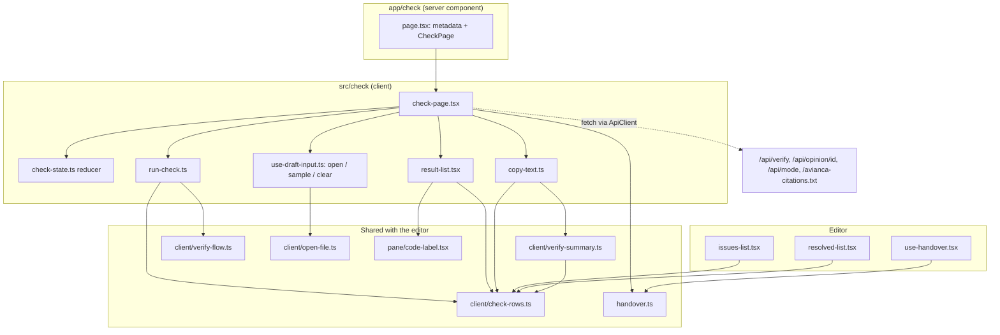

# Design Document

## Overview

This feature adds the public route `/check`. A person pastes a draft or opens a file, presses Check citations, and sees each citation and quotation with the editor's own status words. The page builds a Document with `pastedDocument`, runs the editor's `runVerifyFlow` unchanged against `/api/verify` and `/api/opinion/<clusterId>`, and renders rows built by a module the editor also imports. It stores nothing. The one exception is the Hand_Over, a `sessionStorage` write made when the author follows "Open this draft in the editor".

The design rests on five decisions.

1. **One module builds every row.** Today the status words (`SEVERITY`), `shorten`, `divergenceFor`, `wrongCaseFor` and `foundText` live inside `issues-list.tsx` and `resolved.ts`. They move to `src/client/check-rows.ts`. The Issues region, the Resolved list, the Verify result and the Check_Page all import it. Nothing about the editor's output changes (Requirement 8.4).
2. **The page reuses the editor's flow with a private Store.** `runVerifyFlow` takes a `FlowStore` (`getState`, `dispatch`). The page creates one `createStore(svc.now)` per Check_Run, dispatches `replace` with the Check_Document, runs the flow, and reads the Document back. No second verification path exists (Requirement 5.9).
3. **Staleness is a state-machine concern, not a Store concern.** The page keeps a run generation counter and a `stale` flag in a small reducer. The private Store's epoch is never used to detect edits, because the page never dispatches to it while the author types.
4. **Browser capabilities come through `AppServices`.** The services object gains `session` (a `StorageLike`) and `clipboard`. Server rendering never touches `window`, so the Copy button and the Editor_Link are absent from the server HTML and appear after mount (Requirements 10.2, 12.2).
5. **The Status_Label is a Pane component.** `CodeLabel` lives in `src/pane/`, so every Pane colour literal stays in `src/pane/` and the Check_Page stylesheet holds none (Requirement 6.13).

Research summary. Everything was read from the repository, and no external source informed the design.

- `runVerifyFlow` bumps nothing in the Store and compares `store.getState().epoch` against the epoch at the start. `replace` raises the epoch (`store-actions.ts:169`). The flow therefore detects a `replace` made while it runs. The page does not rely on that, for the reason in decision 3.
- `issues(document)` returns only failing items. Verified full citations and matching quotes are not in it. The Engine does not export `issueOrder` from `index.ts`, and the Engine is out of scope for this spec, so the rows are merged in the web package (see the ordering note under Components).
- `createApiClient(fetchFn)` in `api.ts` takes an injected `fetch`. Tests need no global stub.
- `useModeResult(api)` already reads `/api/mode` once after mount. The page reuses it.
- The Courts_Page is the model for the frame. It imports only from `src/` and its own folder, and its stylesheet has no width at-rule.

## Architecture



Data flow of one Check_Run:

```mermaid
sequenceDiagram
  participant A as Author
  participant C as CheckPage
  participant R as runCheck
  participant F as runVerifyFlow
  participant S as /api routes
  A->>C: press Check citations
  C->>C: reducer: start(generation g)
  C->>R: runCheck(text, api, now)
  R->>R: docxSafe, length, blank, pastedDocument, hasFullRecord
  R->>F: runVerifyFlow(api, privateStore, now)
  F->>S: POST /api/verify { records }
  F->>S: GET /api/opinion/id (one per cluster with quotes)
  F-->>R: VerifyOutcome
  R-->>C: CheckResult (document, info, checkedAt) or message
  C->>C: reducer: finish(g, result); dropped if g is not current
```

### Module placement

| Module | Path | Contents | May import |
| ------ | ---- | -------- | ---------- |
| Shared_Rows | `src/client/check-rows.ts` | status words, Next_Sentences, `shorten`, `foundText`, `wrongCaseFor`, `divergenceFor`, `checkRows`, `useInfo` helper `displayFor` | engine, verifier `/link`, `./mismatch`, `./divergence`. No React, no Store |
| Copy_Text | `src/check/copy-text.ts` | `copyText(rows, summary, date)` | `check-rows`, `verify-summary` |
| Check_Run | `src/check/run-check.ts` | `runCheck` | `verify-flow`, `pasted-document`, `store-runtime`, `limits`, `notices`, `@reveal-codes/export` (`docxSafe`) |
| State | `src/check/check-state.ts` | reducer and types | none beyond types |
| Input | `src/check/use-draft-input.ts` | Open, sample, Clear, confirm wiring | `open-file`, `open-messages`, `confirm-dialog` |
| Page | `src/check/check-page.tsx`, `result-list.tsx` | components | the above, `courtlistener-link`, `mark`, `pane/code-label` |
| Hand_Over | `src/handover.ts` | key, `writeHandover`, `takeHandover` | `autosave` (the `StorageLike` type only) |
| Editor side | `src/components/use-handover.tsx` | read once on mount, confirm, install | `handover`, `open-outcome`, `use-document-actions` |
| Route | `app/check/page.tsx`, `app/check/check.module.css` | metadata, stylesheet | `src/` and its own folder |

`apps/web/src/check/` mirrors `src/courts/`. The route file stays thin so the static scans can hold it to the Courts_Page's import rule.

## Components and Interfaces

### 1. Shared_Rows: `src/client/check-rows.ts`

The extraction moves pure code out of three files and leaves behind re-exports, so existing imports and the existing tests compile and pass unchanged (Requirement 8.4).

| Moved from | Symbol | Stays exported from the old module |
| ---------- | ------ | ---------------------------------- |
| `issues-list.tsx` | `SEVERITY`, `shorten`, `MAX_ISSUE_TEXT`, `divergenceFor`, `WrongCase`, `wrongCaseFor` | `shorten`, `MAX_ISSUE_TEXT`, `WrongCase`, `wrongCaseFor` re-exported; `issueWords` stays and reads `SEVERITY` |
| `resolved.ts` | `foundText` | none needed (it was private); `resolvedRows` imports it |
| `verify-summary.ts` | the literals `"found"`, `"match"`, `"not found"` and the other tally words | `summaryLines` keeps its output; its terms read from the shared word table |

Nothing is copied. `issues-list.tsx` keeps `IssueRow`, `UncheckedRow`, `uncheckedText`, `EMPTY_LINE`, `issueWords`, `issueText` and the React code, because those depend on Store callbacks (`onGo`, `onOverride`) and the editor's collapse behaviour.

```ts
export type RowCode =
  | "CIT ✓" | "CIT ✘" | "CIT ≠" | "CIT ?" | "CIT …"
  | "QUO ✓" | "QUO ✘" | "QUO …";

export type CheckRow = Readonly<{
  key: IssueKey;
  kind: "citation" | "orphan" | "quote";
  start: number;
  end: number;
  code: RowCode;
  /** Status_Words: "found", "match", or the SEVERITY words. No "blocking, " prefix. */
  words: string;
  /** The text as written, unshortened. Display calls `shorten`. */
  text: string;
  /** Case name and year on record, as `foundText` builds it; null when unknown. */
  found: string | null;
  /** `mismatchLines` output for a wrong_case citation; empty otherwise. */
  mismatch: readonly string[];
  /** `divergenceWords` output for a mismatching quotation; null otherwise. */
  divergence: string | null;
  /** CourtListener link, or null when there is no safe target. */
  href: string | null;
  /** The Next_Sentence of the row's status; null for a found citation and a matching quotation. */
  next: string | null;
}>;

export const STATUS_WORDS: Readonly<Record<RowCode, string>>;   // SEVERITY plus "found" and "match"
export const NEXT_SENTENCES: Readonly<Record<IssueCode, string>>; // the six sentences of Decision 1

export function checkRows(
  document: Document,
  info: ReadonlyMap<IssueKey, DisplayInfo> | undefined,
): readonly CheckRow[];

export function displayFor(
  clusterId: string,
  info: DisplayInfo | undefined,
): DisplayInfo | undefined;   // returns info only when info.clusterId === clusterId
```

`STATUS_WORDS` keys the six failing codes to the exact `SEVERITY` strings, so `issueWords(code, blocking)` becomes `` `${blocking ? "blocking" : "overridden"}, ${STATUS_WORDS[code]}` `` with an unchanged result. The two passing codes carry "found" and "match", the words `summaryLines` already prints.

**Row set.** `checkRows` emits one row for:

- each full citation, whatever its status;
- each short form that `issues(document)` reports with kind `orphan`;
- each quotation, whatever its status.

A linked short form gets no row. The failing rows are exactly `issues(document)`. The function calls `issues(document)` to learn which items fail and their codes, and adds the passing ones (`verified` full citations and `match` quotes) from `document.citations` and `document.quotes`.

**Ordering.** Requirement 6.3 names `issueOrder`, which the Engine does not export from `index.ts`. Exporting it would change the Engine, which is out of scope. `checkRows` sorts by `(start, kind)` with a citation before a quotation at an equal start, which is the rule `issueOrder` implements (Engine Requirement 18.1). Property 1 checks that the failing rows appear in the same sequence as `issues(document)`. If the Engine ever changes the tie-break, that check fails.

**Found names.** For a `verified` citation, `found` is `foundText(displayFor(clusterId, info.get(key)))` when Display_Info is usable and null otherwise. For a `wrong_case` citation, `mismatch` is `mismatchLines(mismatchOf(document, key))` and `href` comes from `wrongCaseFor`. A quote row has `found` null and `href` null. `resolvedRows` calls `displayFor` for its usability test, so the editor and the page decide usability the same way.

**Next_Sentences** are the six strings of Decision 1, defined once in `NEXT_SENTENCES`. A row's `next` is `NEXT_SENTENCES[code]` for a failing code and null otherwise. No sentence says a case is fake or states the law (Requirements 7.3, 7.4).

### 2. CodeLabel: `src/pane/code-label.tsx`

```tsx
export function CodeLabel({ code }: Readonly<{ code: RowCode }>): JSX.Element;
```

It renders `<span className={...}>{code}</span>` with the text unchanged, so status never relies on colour (Requirement 6.5).

- Family and failing flag come from the existing pure helpers: `codeFamily` in `layout.ts` and `isFailingOpener` in `failing.ts`.
- Text classes come from `codeClass(family, failing)` in `code-class.ts`, so the Pane's palette (`#9ADBB0` for found, `#BAC4E2` for unchecked, white on `--fail` for failing) is not copied.
- `src/pane/code-label.module.css` adds only what the Pane stylesheet does not give a stand-alone code: a ground (`background: #0f2766`, the Pane body colour) and, for failing codes, the 2px `--fail-ring` outline on `--fail`, as the Pane's failing block does. IBM Plex Mono, weight 600, and 700 for failing, match Requirement 15.4. The sheet sits in `src/pane/`, which is exempt from the Token rule, so the ground literal is allowed there. `--pane-body` is not a Token in `ui.md` and no Token is added (Requirement 15.3). The Check_Page stylesheet holds no colour literal (Requirement 6.13).
- The component adds no padding rule that needs a fixed width. It sets `display: inline-block` and `max-width: 100%`.

### 3. Check_Run: `src/check/run-check.ts`

```ts
export type CheckDone = Readonly<{
  kind: "done";
  document: Document;
  info: ReadonlyMap<IssueKey, DisplayInfo>;
  outcome: VerifyOutcome;      // completed
  checkedAt: string;           // ISO, from svc.now()
  text: string;                // the Draft_Text that was checked, as typed
}>;
export type CheckResult =
  | CheckDone
  | Readonly<{ kind: "message"; text: string }>   // refusal or failure; the sentence to show
  | Readonly<{ kind: "discarded" }>;

export async function runCheck(args: Readonly<{
  text: string;
  api: ApiClient;
  now: () => Date;
}>): Promise<CheckResult>;
```

Steps, in order. Each `message` result makes no request except where noted.

1. `safe = docxSafe(text).text` (Requirement 4.5).
2. `safe.length > MAX_TEXT_CHARS` gives `DOCUMENT_TOO_LONG` (4.2). `/^\s*$/` gives "Add some text to check." (4.3).
3. `pastedDocument(safe, iso)`. A string result is the Engine's refusal notice and becomes the `message`.
4. `hasFullRecord(document)` false gives "No citations were found in this draft." (4.4). No request has been made yet.
5. `store = createStore(now)`; `store.dispatch({ type: "replace", document })`; `outcome = await runVerifyFlow(api, store, now)`.
6. `outcome.status === "failed"` gives `{ kind: "message", text: outcome.failure }`. `outcome.failure` already is `CHECKS_BUSY` for a 429 and `FAILED_NOTICE` otherwise, so the page writes neither sentence itself (5.5, 5.6). `discarded` gives `{ kind: "discarded" }`. `completed` gives `done` with `store.getState().document` and `new Map(outcome.info ?? [])`.

`runCheck` imports `runVerifyFlow` and calls it as it is (5.9). It adds no logic about statuses, quotes or retries. The two new sentences ("Add some text to check.", "No citations were found in this draft.") are constants exported from this module, since no Editor_Sentence carries them.

The function never rejects. `runVerifyFlow` never rejects, and `docxSafe` and `pastedDocument` return values.

### 4. State machine: `src/check/check-state.ts`

```ts
export type CheckState = Readonly<{
  text: string;
  generation: number;           // bumped by every edit and by Clear
  running: null | Readonly<{ generation: number; waiting: boolean }>;
  results: null | CheckDone;    // the last completed run that was not discarded
  stale: boolean;               // an edit happened after `results` was produced
  message: string | null;       // refusal or failure sentence of the last run
  openNote: string | null;      // the Open success or refusal sentence
}>;

export type CheckAction =
  | { type: "edit"; text: string }           // typing, pasting, Open or sample installing text
  | { type: "clear" }
  | { type: "start" }
  | { type: "waiting" }
  | { type: "finish"; generation: number; result: CheckResult }
  | { type: "note"; text: string | null };

export function reduceCheck(state: CheckState, action: CheckAction): CheckState;
```

Rules:

- `edit` with text equal to `state.text` changes nothing. A different text sets `text`, increments `generation`, and sets `stale: results !== null`. `stale` stays true when the text later returns to the checked text (Requirement 9.5). Only a completed `finish` clears it.
- `start` sets `running` to the current generation and clears `message`. The page ignores `start` while `running` is set; the button is also disabled (5.2).
- `finish` with `generation !== state.generation` returns the state with `running: null` and no other change. The in-flight results are dropped (9.4, 15.5). With a matching generation: `done` sets `results`, `stale: false`, `message: null`; `message` sets `message` and keeps `results` and `stale` as they were; `discarded` changes only `running`.
- `clear` empties the text, sets `results: null`, `stale: false`, `message: null`, `openNote: null`, and increments `generation`, so an in-flight run is dropped.

The reducer is pure and has example tests only (see Testing Strategy). The page owns the effects: it calls `runCheck`, dispatches `finish`, and arms the 5000 ms timer through `svc.setTimer`.

### 5. Page and results: `src/check/check-page.tsx`, `result-list.tsx`

`CheckPage` is a client component. It takes `svc = useState(defaultServices)` like `AppShell`, and uses `useReducer(reduceCheck, initial)`.

Order on the page (Requirement 2.1): header link (Mark and wordmark), `<h1>`, what-it-does sentence, privacy sentence, not-stored sentence, `<label for>` and `<textarea>`, actions, status region, results, links to `/courts` and `/`.

- **Server HTML (1.8).** The heading, both sentences, the label, the textarea and the four actions render on the server. The textarea is controlled with an initial empty value, so it is usable before scripts run.
- **Actions (2.2, 2.3).** Check citations (the only `data-primary="true"`), Open a file, Load the Avianca citations, Clear. Open a file uses a hidden `<input type="file">` and `useOpen`'s accept list, the way the editor does.
- **Status region (15.2).** One `role="status"` element holds the running line, the waiting text, the refusal or failure `message`, the demo-mode line, the stale sentence and the results. Because it is one region, a change is announced once. A long result list inside a live region is announced as it changes. To limit that, the results container is inside the region, but its list is rendered only after a run completes, in one commit.
- **Running line.** "Verifying…" while `running` is set. After 5000 ms (`WAITING_AFTER_MS`), `WAITING_TEXT` replaces it. The timer is `svc.setTimer`, armed on `start` and cleared on `finish`, on unmount, and by `clear`. `WAITING_AFTER_MS` and `WAITING_TEXT` are imported from `use-verify.ts`.
- **Demo mode (5.7).** `useModeResult(svc.api)` gives the mode. When it is `fixtures`, the page shows `DEMO_MODE_LINE` from `issues-region.tsx`.
- **Results.** `ResultList` maps `checkRows(results.document, results.info)` to `<li>` blocks:
  `CodeLabel`, the words (`row.words`), the text (`shorten(row.text)`), then, where present, `row.found`, the `mismatch` lines (through the existing `MismatchLines` component), `Diverges at: ${row.divergence}`, the `CourtListenerLink` for `row.href`, and `row.next`. A passing row shows no `next`.
  The `Diverges at:` prefix and the `Cited as` lines come from the same functions as in the Issues row. `IssueRow` and `ResultList` both render `MismatchLines` and `CourtListenerLink`, which are existing components.
- **Summary (6.1).** `summaryLines(results.document, results.checkedAt, furtherLine(results.outcome, results.document))`. Each line is a `<p>`.
- **Stale (9.1 to 9.3).** When `stale`, the sentence "The draft has changed since this check. The results below are for the earlier text." and a "Check again" button render above the results. The results container carries a text label "Earlier results" so the mark does not rely on colour. Copy results and the Editor_Link are not rendered while `stale` is true.

### 6. Draft input: `src/check/use-draft-input.ts`

Returns the handlers and the confirm dialog node. It follows `use-open-draft.tsx`.

- **Open a file.** `openFile(file)` is called unchanged, with its refusal messages. A refusal sets `openNote` to `notice + " " + note` and leaves the text unchanged (3.3). Both strings are shown unchanged, as separate `<p>` elements. A `text` outcome and a `restored` outcome use `outcome.text` and `outcome.document.text` respectively. The provenance record is not used (3.5).
- **Success sentence (Decision 10).** A new helper `checkOpenedMessage(name, characters, removed, hasNotes, restored)` in `open-messages.ts` builds "Opened <name>: <n> characters." plus `removedSentence(removed)` plus `NOTES_SENTENCE`, or for a restored export "Opened <name>: <n> characters. Its provenance record was not used." `openedMessage` is not edited. The helper reuses `removedSentence` and `NOTES_SENTENCE`. For a `text` outcome, `hasNotes` is read the way `wordOutcome` reads it, from `NOTES_BLOCK`. That regex is private to `open-outcome.ts`, so it is exported. The `notice` field of the outcome carries the editor's sentence and is not used by the page. Because of this, the page builds its sentence from `outcome.text.length`, `outcome.removed` and a new `hasNotes` boolean added to the outcome type. Adding a field to `OpenOutcome` changes no editor behaviour. An alternative is to detect notes by `outcome.notice.endsWith(NOTES_SENTENCE)`. That is fragile, so the design adds the field and updates the existing open-outcome tests only where they use `toEqual` on whole outcomes (found by `pnpm test`).
- **Replace confirm (3.9).** When the text is non-empty, Open (after the reader accepts the file) and Load the Avianca citations open the editor's `ConfirmDialog` with the editor's wording: for Open, title "Open a draft", message `Discard the current draft and open ${name}?`, confirm "Discard and open"; for the sample, the wording `use-document-actions.tsx` uses for the Avianca sample (read at task time and imported, not retyped). A refused file never opens the dialog.
- **Load the Avianca citations (3.6, 3.7).** `svc.api.aviancaCitations()`; success installs `docxSafe(value).text`; failure sets `message` to `AVIANCA_FAILED` (imported from `use-document-actions.tsx`) and leaves the text.
- **Clear (3.8).** Dispatches `clear`, no dialog (Decision 11).
- **No requests (3.11).** Typing, pasting, Open and Clear call no `api` method. Only Load the Avianca citations does.

### 7. Copy results: `src/check/copy-text.ts` and the page

```ts
export function copyText(
  rows: readonly CheckRow[],
  citationsLine: string,
  date: string,           // YYYY-MM-DD, local time
): string;
```

Lines, joined with `\n` (Requirement 10):

1. `citationsLine`, which is the `Citations: ...` line returned by `summaryLines`. If the run found no full citation the page never reaches this point. If `summaryLines` has no Citations line (no full citations, only orphan short forms and quotes cannot occur because the run requires one full citation), the function falls back to the first line.
2. Per row: `` `${Capitalised(row.words)}: ${row.text}.` ``, then, when `row.found !== null`, ` On record: ${row.found}. ${row.href}`. A quotation row has no `found` and no `href`, so it ends after the first sentence. A wrong-case row has `found` null and `mismatch` lines. The wrong-case row's "On record" part uses the second mismatch line's case, "This citation is <found>", so the filer can see which case the citation resolved to. The function takes the text after "This citation is " from `mismatch[last]` rather than recomputing. `href` is appended when not null.
3. `` `Checked on ${date} with Reveal Codes against CourtListener.` ``

No pipe character is produced. The row text is the full text as written, not shortened, since a pasted message should carry what the author wrote. If a row's text already ends in a period, the added period is not doubled.

`date` comes from a new `localDate(iso)` beside `localTime` in `verify-summary.ts`, returning `YYYY-MM-DD` in local time, or null for an unparseable timestamp (the line then reads "Checked with Reveal Codes against CourtListener.").

The clipboard path:

- `AppServices.clipboard: Readonly<{ available: () => boolean; write: (text: string) => Promise<void> }>`. `defaultServices` reads `navigator.clipboard` lazily inside both methods.
- The page reads `canCopy` with `useSyncExternalStore(noSubscribe, () => svc.clipboard.available(), () => false)`. The server snapshot is false, so the server HTML has no button (10.2). After hydration it is true where the clipboard exists. Where `navigator.clipboard` is missing the button is never rendered.
- On press: `svc.clipboard.write(text)`; a rejection sets `message` to "The results could not be copied." (10.8). No network call happens (10.9).

### 8. Hand_Over: `src/handover.ts`, the Editor_Link and `use-handover.tsx`

```ts
export const HANDOVER_KEY = "reveal-codes:check-handover:v1";
export function writeHandover(session: StorageLike, text: string): boolean;  // false on a thrown write
export function takeHandover(session: StorageLike): string | null;          // read, remove, in one step
```

`takeHandover` calls `getItem`, then `removeItem` in a `finally`-free sequence: it reads the value, removes the key, and returns the value. If `getItem` throws it still tries `removeItem` and returns null. If `removeItem` throws, the value is still returned, since the text was read. The function swallows nothing silently in the sense of the testing rules: the caught errors are the browser's storage errors, the function returns null for them, and a test asserts that outcome. A value that is the empty string returns null.

**Writing side.** `session` is a new `AppServices` field of type `StorageLike`. `defaultServices` builds it from `window.sessionStorage` lazily, like `storage`. Only `src/handover.ts` calls `setItem` and `removeItem` on it. The Check_Page never touches `localStorage`, cookies or IndexedDB (3.10, 12.8).

**The Editor_Link (12.1 to 12.3).** It is an `<a href="/">` rendered only when all of these hold: the server snapshot is false, the viewport is at least `NARROW_WIDTH`, the Draft_Box holds text, and the results are not stale. Viewport check:

```ts
const wide = useSyncExternalStore(
  svc.viewport.subscribe,
  () => svc.viewport.width() >= NARROW_WIDTH,
  () => false,               // server snapshot: never rendered in the HTML
);
```

This is the pattern `AppShell` uses. The server HTML never contains the link (12.2). If the window is narrowed after render, `subscribe` makes the link disappear. `onClick` calls `writeHandover(svc.session, text)` with the Draft_Text after `docxSafe`, then lets the browser follow `href="/"`. The address never carries text (12.3, 12.8). The results are not passed (12.9).

If the write fails (storage disabled or full), the click is cancelled with `preventDefault` and the status region shows "The draft could not be passed to the editor. Copy it and paste it into the editor." This sentence is not in the requirements or the Decisions. It is a proposal that needs the author's agreement; without it a failed write would open an empty editor with no explanation.

**The editor side (12.3 to 12.7).** `useHandover(store, svc, gate)` runs in `Shell` after `useAutosave`. The shell's effects run in hook order within one commit, and `useAutosave`'s effect calls `loadAutosave` synchronously, so the stored draft is in the Store before `useHandover` reads it. The hook:

1. On mount, `takeHandover(svc.session)`. The key is gone after this call, whether or not the text is used (12.7).
2. When the text is null, it does nothing.
3. Otherwise it builds the outcome with `textOutcome("The draft from the checker", text, { notes: false, note: null })`. This applies `docxSafe` and the Open flow's length and blank rules without a second implementation. A `refused` outcome is dispatched as the Open flow dispatches a refusal (`notice` and `openNote`).
4. Accepted text: if `store.getState().document.text.length === 0`, install at once (12.4). If not, show `ConfirmDialog` with title "Open a draft", message "Discard the current draft and open the draft from the checker?" and confirm label "Discard and open" (12.5). Confirm installs. Cancel closes the dialog and keeps the draft (12.6). The key is already gone either way.
5. Installing is the same function the Open flow uses for a `text` outcome: one PST span through `pastedDocument` and `replace` (12.3). `installOutcome` in `use-open-draft.tsx` is exported for this. The editor shows the Open flow's notice, "Opened The draft from the checker: n characters, marked as pasted."

React Strict Mode runs effects twice in development. The second call finds no key and does nothing, so the dialog does not appear twice. The effect keeps its result in state set from the first call.

A hand-over that is written but never read (the author narrows the window before the editor mounts) stays in `sessionStorage` until the next editor mount in that tab. That is a known limit; `sessionStorage` is per tab and cleared when the tab closes.

When the Draft_Gate is blocked (an unreadable stored draft), the stored `Document` is empty and autosave is blocked. Installing then uses `replace`, as Load demo does, and the gate behaviour is unchanged from that flow.

### 9. Small_Screen_Page

`SMALL_SCREEN_SENTENCES` is replaced by two constants: `SMALL_SCREEN_INTRO` (the first sentence, unchanged) and `SMALL_SCREEN_EDITOR_NOTE` ("The drafting editor, with the codes pane and export, needs a screen at least 1150 pixels wide."). Order of the markup: intro sentence; the links block with `/check` first ("Check the citations in a draft"), then `COURT_RULES_LONG`, then video and source; the editor note; the Selection_Line when set (Decision 9). The `/check` link is a plain `<a href="/check">` with no `data-primary`. `small-screen.test.tsx` and `app-shell.test.tsx` are updated to the new order and wording.

The Courts_Page adds `<a href="/check">Check the citations in a draft</a>` beside "Open the editor". The Toolbar is not changed.

### 10. Route file and stylesheet

`app/check/page.tsx`:

```tsx
export const metadata: Metadata = {
  title: "Check the citations in a draft — Reveal Codes",
  description:
    "Paste a draft or open a file and see which citations and quotations can be found on CourtListener and which cannot. Nothing is saved.",
};
export default function Page() { return <CheckPage />; }
```

It sets no other metadata (1.7) and imports only from `src/` and `app/check/` (16.3).

`app/check/check.module.css` copies the structure of `courts.module.css`: `.desk`, `.page` (`overflow-wrap: anywhere`, `max-width: var(--page-max)`, fluid padding), `.title`, `.header`, `.brand`, and `.group` with `max-width: 100%` for each control group (the draft box, the action row, the results list). The Draft_Box is `width: 100%` with `box-sizing: border-box`. There is no width at-rule and no fixed width other than `100%`, `auto`, `min-content`, `max-content` and `0` (1.4, 1.5). Colours are `var(--token)` only. Sizes and weights come from the Courts_Page's allowed sets. The action row uses `display: flex; flex-wrap: wrap; gap`, so four buttons wrap at 320px. Controls follow the globals: 30px buttons, 34px links, the text-area focus border of `ui.md` (15.3).

### 11. Services

```ts
export type AppServices = Readonly<{
  /* existing fields */
  session: StorageLike;
  clipboard: Readonly<{ available: () => boolean; write: (text: string) => Promise<void> }>;
}>;
```

Requirement 12.7 calls for `session`. Requirement 10.2 asks for the clipboard test after mount, and a service is the only way to fake it without writing to `navigator` in tests. The scope paragraph lists "the services object", so both fields are in scope. Every test fake that builds a complete `AppServices` object needs the two fields; `pnpm typecheck` finds each. The shared test helper that builds fakes gets default in-memory implementations (`memory-storage.ts` for `session`).

## Data Models

```ts
// check-rows.ts
type CheckRow = { key; kind; start; end; code: RowCode; words; text;
                  found: string | null; mismatch: readonly string[];
                  divergence: string | null; href: string | null; next: string | null };

// run-check.ts
type CheckResult = CheckDone | { kind: "message"; text } | { kind: "discarded" };

// check-state.ts
type CheckState = { text; generation; running; results: CheckDone | null; stale;
                    message: string | null; openNote: string | null };

// handover.ts
const HANDOVER_KEY = "reveal-codes:check-handover:v1";  // value: the Draft_Text, plain string
```

Row set invariants (also stated by Property 1):

- `checkRows(d).length` equals the number of full citations, plus orphan short forms, plus quotations of `d`.
- Row keys are distinct, and the rows are strictly increasing by `(start, kind)`.
- A row's `code` is the code the Engine's display rendering gives that item. A row has `next !== null` exactly when its code is one of the six failing codes.

Copy_Text grammar, per line: `Status: text.` followed by an optional ` On record: case (year). address`. The first line is a `Citations:` summary line and the last line is `Checked on YYYY-MM-DD with Reveal Codes against CourtListener.`.

The request surface of the page, which Property 2 pins:

| Request | When | Body |
| ------- | ---- | ---- |
| `GET /api/mode` | on mount | none |
| `POST /api/verify` | Check_Run | `JSON.stringify(buildVerifyBody(document))`, the `{ records }` object |
| `GET /api/opinion/<clusterId>` | Check_Run, one per cluster that has quotes | none |
| `GET /avianca-citations.txt` | Load the Avianca citations | none |

## Static-scan extensions

| Scan | Change |
| ---- | ------ |
| `static/courts.test.ts` | The `sheetViolations` function (banned properties, sizes, weights, fixed widths, width queries) moves to `static/page-css.ts`. `courts.test.ts` imports it and keeps its assertions, including `sheets` equal to the one Courts file. |
| `static/check.test.ts` (new) | Scans `app/check/*.css` and `src/check/*.css` with `sheetViolations` and `colourViolations`. Asserts `.page { overflow-wrap: anywhere }` and `.group { max-width: 100% }`, the desk and paper column, 34px links, and the text-area focus border. Fails on a width at-rule or a `px` width (16.1, 16.2, 17.5). |
| `static/check.test.ts` | Scans `app/check/` and `src/check/` sources for `/ and packages". `src/check/` gets `noServer`. `src/client/check-rows.ts` gets `noReact` and `noServer` as other `client/` modules do. `src/handover.ts` gets `noReact`. |
| `static/check-literals.test.ts` (new) | For each Editor_Sentence (`CHECKS_BUSY`, `FAILED_NOTICE`, `DOCUMENT_TOO_LONG`, `WAITING_TEXT`, `DEMO_MODE_LINE`, `AVIANCA_FAILED`, `COURTLISTENER_LINK_TEXT`) and each `STATUS_WORDS` value: asserts that no string literal or JSX text in `app/check/` and `src/check/` equals it or contains it, and that the check sources import the owning module (R8.3, "by import and by text"). A planted-violation example proves the scan fires. |
| `static/draft-storage-writes.test.ts` | Adds a second rule: `HANDOVER_KEY` is named only in `src/handover.ts` and its tests, and `setItem` and `removeItem` calls whose first argument is `HANDOVER_KEY` or its literal appear only there. A planted-violation example proves it. |
| `static/css-colours.ts` | `src/pane/code-label.module.css` is scanned under the Pane exemption already given to `src/pane/`. If the exemption is per file, the file is added. |
| `static/small-screen-css.test.ts` and the width at-rule count | The existing assertion of exactly one width at-rule in the Shell's stylesheets stays. The Check_Page's stylesheets are not in its input list. Task 1 confirms the input list by file name, and if it is a glob over `app` or `src`, the check sheet and `code-label.module.css` still contribute zero at-rules, so the count holds (16.4). |
| `static/inventory.test.ts`, `static/docs.test.ts`, `static/kiro-usage-check.test.ts`, `static/copy-rules.test.ts` | New files and sentences are added to their inputs where they list directories. The new copy contains no exclamation mark, no icon and no banned word. The README edits keep `docs.test.ts` true (18.4). |

## Correctness Properties

*A property is a characteristic or behavior that should hold true across all valid executions of a system-essentially, a formal statement about what the system should do. Properties serve as the bridge between human-readable specifications and machine-verifiable correctness guarantees.*

Reflection on the prework: it found two universal relationships worth a property and left the rest as examples.

- Requirements 6.2, 6.3, 6.4, 6.6 to 6.10, 7.1, 7.5, 8.1 and 8.2 all describe one pure function, `checkRows`, over a Document and its Display_Info. They merge into Property 1. The "next sentence is present exactly for failing codes" rule (7.1, 7.5) is part of the same function, so it is an assertion inside Property 1 and not a separate property.
- Requirements 5.8, 11.3 and 11.4 all describe the set of requests `runCheck` makes. They merge into Property 2.
- Staleness (9.x), Copy_Text (10.x), the Hand_Over (12.x) and the Small_Screen_Page (13.x) have small, enumerable inputs or depend on the DOM. They get example tests.

Each property below is one `fc.assert(fc.property(...))`. Property 1 lives in `apps/web/test/check-rows.properties.test.ts` and Property 2 in `apps/web/test/check-request.properties.test.ts`, with `// Property N` above the assertion and `_Requirements: x.y_` in the `describe` title, as `tech.md` requires.

### Property 1: One answer

For any Document built by the existing Document arbitraries, with any verification results attached to its full citations, any quote results attached to its quotations, and any Display_Info for its verified and wrong-case citations, `checkRows(document, info)` satisfies all of the following:

1. It has exactly one row for each full citation, each orphan short form and each quotation, and none for a linked short form.
2. Its row keys are distinct, and the rows are in increasing `(start, kind)` order with a citation before a quotation at an equal start.
3. The rows whose code is one of the six failing codes are, in order, the items of `issues(document)`, with the same keys and the same codes.
4. For each row, `code` is the code the Engine's display rendering (`render(document, "display")`) gives that item, and `words` equals `STATUS_WORDS[code]`.
5. For each failing row, `words` equals `issueWords(code, true)` with its `blocking, ` prefix removed, and its `mismatch`, `divergence` and `href` equal the values the Issues row derives for the same item. For each `verified` row, `found` equals what the Resolved list shows for it. A `wrong_case` row's `mismatch` equals `mismatchLines(mismatchOf(document, key))`.
6. `next` is not null exactly when `code` is a failing code, and then equals `NEXT_SENTENCES[code]`. No `next` contains `!`, "fake", "fabricated" or "does not exist".

This is a metamorphic check against independently derived values (the Engine's `issues` and display rendering, and the editor's own row text), so a row that disagrees with the editor fails it.

**Validates: Requirements 6.2, 6.3, 6.4, 6.6, 6.7, 6.8, 6.9, 6.10, 7.1, 7.5, 8.1, 8.2**

### Property 2: Nothing more is sent

For any Draft_Text generated from the citation, quote and prose arbitraries, including text with no citation, text with characters `docxSafe` removes, and prose that contains a marker string that is not part of any citation record, running `runCheck` through an `ApiClient` built on a recording `fetch` makes requests that satisfy all of the following:

1. Every request goes to `/api/verify`, `/api/opinion/<clusterId>`, `/api/mode` or `/avianca-citations.txt`. No other URL and no other host appears.
2. If the Document built from the text has no full citation, `runCheck` makes no request and returns the "No citations were found in this draft." message. If the text is blank or too long, it likewise makes no request.
3. Otherwise exactly one request goes to `/api/verify`, and its body equals `JSON.stringify(buildVerifyBody(pastedDocument(docxSafe(text).text, iso)))`.
4. Every `/api/opinion/<clusterId>` request is a `GET` with no body, and its path after the prefix is a cluster id taken from a verify response.
5. No URL and no body of any request contains the marker string.

The recording `fetch` is the only fake. The Engine, `runVerifyFlow` and `createApiClient` run for real.

**Validates: Requirements 5.8, 11.3, 11.4**

## Error Handling

| Situation | Behaviour | Source |
| --------- | --------- | ------ |
| Blank Draft_Text on Check | `message` "Add some text to check."; no request | Requirement 4.3 |
| Text over `MAX_TEXT_CHARS` after `docxSafe` | `DOCUMENT_TOO_LONG`; no request | 4.2 |
| `pastedDocument` returns a string | That string is shown as the `message` | `runCheck` step 3 |
| No full citation | "No citations were found in this draft."; no request | 4.4 |
| `/api/verify` answers 429 | `CHECKS_BUSY`, from `outcome.failure` | 5.5 |
| Any other verify or fetch failure | `FAILED_NOTICE`, draft kept | 5.6 |
| A `finish` for an older generation | Dropped; `running` cleared only | 9.4, 15.5 |
| Open_Reader refusal | `notice` and `note` shown unchanged; text kept | 3.3 |
| `aviancaCitations()` fails | `AVIANCA_FAILED`; text kept | 3.7 |
| Clipboard write rejects | "The results could not be copied." | 10.8 |
| `navigator.clipboard` missing | No Copy results button | 10.2 |
| `sessionStorage` write throws on Editor_Link click | Click cancelled; the proposed sentence is shown (needs the author's agreement, see section 8) | 12.3 |
| `sessionStorage` read or remove throws in the editor | `takeHandover` returns null (or the value read); editor opens as usual | 12.7 |
| Hand_Over text is blank or too long | Refused by `textOutcome` as the Open flow refuses; key already removed | 12.3 |

`runCheck` never rejects, and the page code contains no `try/catch` that hides an error. The only `catch` blocks are in `handover.ts` (browser storage errors, returned as `false` or `null`) and the clipboard call (rejection shown as a sentence). Tests assert each of those results.

## Testing Strategy

Property-based testing applies to the two pure paths: row building and the request surface. It does not apply to the page markup, the stylesheet, the timer, the clipboard or the storage calls, which get example tests and static scans. The libraries are vitest and fast-check, as `tech.md` requires. Only `fetch`, `StorageLike`, the clipboard service and the timer service are faked.

**Property tests.** Each property is one `fc.assert(fc.property(...))`, `numRuns` 200 locally and 500 in CI (`pnpm test:pbt`), with the seed logged on failure and reproducible with `{ seed }`. Each is tagged `// Property N` and, in the style the repository's tests use, `Feature: citation-check-page, Property N: <title>`.

- New arbitraries go in `packages/engine/src/testing/arbitraries.ts` through a new file `arb-check-results.ts` exported from that index: verification results per citation, quote results per quotation, and Display_Info per cluster. Documents come from the existing `arb-document.ts`, `arb-text-citations.ts` and `arb-quote-groups.ts`. Draft text for Property 2 comes from `arb-text-citations.ts` with a marker sentence added.
- A property that only checks `checkRows` does not throw is not accepted. Each assertion above relates input to output.

**Example tests** (`apps/web/test/`), per Requirement 17:

- `check-page.test.tsx`: typing and pasting; Open for `.docx`, `.txt` and `.md`; each Open refusal; Load the Avianca citations; Clear; the replace confirm; the end-to-end Avianca run on recorded responses (two found, two wrong case, two not found, each with the case on record); a quotation not in the opinion; 429; failed run; demo mode; waiting text at 5000 ms through `svc.setTimer`; too-long; staleness on edit including text restored to the checked text; edit during a run; no request on typing, opening and clearing.
- `check-state.test.ts`: the reducer rules of section 4.
- `copy-text.test.ts`: first line, one line per row, no pipe, "On record" part, last line, the date from `localDate`; Copy results absent from server HTML and without a clipboard; write failure sentence; no request on copy.
- `handover.test.ts` and `use-handover.test.tsx`: write then take returns the text and a second take returns null; a throwing store; install at once on an empty draft; confirm dialog wording on a non-empty draft; cancel keeps the draft; Strict Mode double effect shows one dialog.
- `check-editor-link.test.tsx`: Editor_Link absent from server HTML, absent below 800px, present at 800px or more with text, absent while stale, hidden after the viewport narrows; the address never holds text.
- `code-label.test.tsx`: each of the eight codes renders its characters unchanged, with the failing class on the four failing codes.
- Existing editor tests (`issues-list`, `resolved`, `verify-summary`, `open-messages`) pass unchanged after the extraction (8.4). `small-screen.test.tsx`, `app-shell.test.tsx` and the Courts_Page test change as listed in sections 9 and 14.
- `static/*`: the extensions in "Static-scan extensions", each with a planted-violation example proving the scan fires.

**Verification order.** Task 1 extracts Shared_Rows with the editor's tests green before any page code. The `AppServices` change follows, then CodeLabel, `runCheck` and the reducer, then the page, the Hand_Over and the small-screen changes, then the scans and docs. The final checkpoint is the one in Requirement 18.9.
