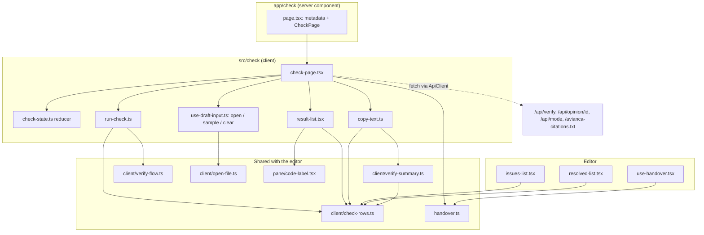

# Design Document

## Overview

This feature adds the public route `/check`. A person pastes a draft or opens a file, presses Check citations, and sees each citation and quotation with the editor's own status words. The page builds a Document with `pastedDocument`, runs the editor's `runVerifyFlow` unchanged against `/api/verify` and `/api/opinion/<clusterId>`, and renders rows built by a module the editor also imports. It stores nothing. The one exception is the Hand_Over, a `sessionStorage` write made when the author follows "Open this draft in the editor".

The design rests on five decisions.

1. **One module builds every row.** Today the status words (`SEVERITY`), `shorten`, `divergenceFor`, `wrongCaseFor` and `foundText` live inside `issues-list.tsx` and `resolved.ts`. They move to `src/client/check-rows.ts`. The Issues region, the Resolved list, the Verify result and the Check_Page all import it. Nothing about the editor's output changes (Requirement 8.4).
2. **The page reuses the editor's flow with a private Store.** `runVerifyFlow` takes a `FlowStore` (`getState`, `dispatch`). The page creates one `createStore(svc.now)` per Check_Run, dispatches `replace` with the Check_Document, runs the flow, and reads the Document back. No second verification path exists (Requirement 5.9).
3. **Staleness is a state-machine concern, not a Store concern.** The page keeps a run generation counter and a `stale` flag in a small reducer. The private Store's epoch is never used to detect edits, because the page never dispatches to it while the author types.
4. **Browser capabilities come through `AppServices`.** The services object gains `session` (a `StorageLike`) and `clipboard`. Server rendering never touches `window`, so the Copy button and the Editor_Link are absent from the server HTML and appear after mount (Requirements 10.2, 12.2).
5. **The Status_Label is a Pane component.** `CodeLabel` lives in `src/pane/`, so every Pane colour literal stays in `src/pane/` and the Check_Page stylesheet holds none (Requirement 6.13).

Research summary. Everything was read from the repository, and no external source informed the design.

- `runVerifyFlow` bumps nothing in the Store and compares `store.getState().epoch` against the epoch at the start. `replace` raises the epoch (`store-actions.ts:169`). The flow therefore detects a `replace` made while it runs. The page does not rely on that, for the reason in decision 3.
- `issues(document)` returns only failing items. Verified full citations and matching quotes are not in it. The Engine does not export `issueOrder` from `index.ts`, and the Engine is out of scope for this spec, so the rows are merged in the web package (see the ordering note under Components).
- `createApiClient(fetchFn)` in `api.ts` takes an injected `fetch`. Tests need no global stub.
- `useModeResult(api)` already reads `/api/mode` once after mount. The page reuses it.
- The Courts_Page is the model for the frame. It imports only from `src/` and its own folder, and its stylesheet has no width at-rule.

## Architecture



Data flow of one Check_Run:

```mermaid
sequenceDiagram
  participant A as Author
  participant C as CheckPage
  participant R as runCheck
  participant F as runVerifyFlow
  participant S as /api routes
  A->>C: press Check citations
  C->>C: reducer: start(generation g)
  C->>R: runCheck(text, api, now)
  R->>R: docxSafe, length, blank, pastedDocument, hasFullRecord
  R->>F: runVerifyFlow(api, privateStore, now)
  F->>S: POST /api/verify { records }
  F->>S: GET /api/opinion/id (one per cluster with quotes)
  F-->>R: VerifyOutcome
  R-->>C: CheckResult (document, info, checkedAt) or message
  C->>C: reducer: finish(g, result); dropped if g is not current
```

### Module placement

| Module | Path | Contents | May import |
| ------ | ---- | -------- | ---------- |
| Shared_Rows | `src/client/check-rows.ts` | status words, Next_Sentences, `shorten`, `foundText`, `wrongCaseFor`, `divergenceFor`, `checkRows`, `useInfo` helper `displayFor` | engine, verifier `/link`, `./mismatch`, `./divergence`. No React, no Store |
| Copy_Text | `src/check/copy-text.ts` | `copyText(rows, summary, date)` | `check-rows`, `verify-summary` |
| Check_Run | `src/check/run-check.ts` | `runCheck` | `verify-flow`, `pasted-document`, `store-runtime`, `limits`, `notices`, `@reveal-codes/export` (`docxSafe`) |
| State | `src/check/check-state.ts` | reducer and types | none beyond types |
| Input | `src/check/use-draft-input.ts` | Open, sample, Clear, confirm wiring | `open-file`, `open-messages`, `confirm-dialog` |
| Page | `src/check/check-page.tsx`, `result-list.tsx` | components | the above, `courtlistener-link`, `mark`, `pane/code-label` |
| Hand_Over | `src/handover.ts` | key, `writeHandover`, `takeHandover` | `autosave` (the `StorageLike` type only) |
| Editor side | `src/components/use-handover.tsx` | read once on mount, confirm, install | `handover`, `open-outcome`, `use-document-actions` |
| Route | `app/check/page.tsx`, `app/check/check.module.css` | metadata, stylesheet | `src/` and its own folder |

`apps/web/src/check/` mirrors `src/courts/`. The route file stays thin so the static scans can hold it to the Courts_Page's import rule.

## Components and Interfaces

### 1. Shared_Rows: `src/client/check-rows.ts`

The extraction moves pure code out of three files and leaves behind re-exports, so existing imports and the existing tests compile and pass unchanged (Requirement 8.4).

| Moved from | Symbol | Stays exported from the old module |
| ---------- | ------ | ---------------------------------- |
| `issues-list.tsx` | `SEVERITY`, `shorten`, `MAX_ISSUE_TEXT`, `divergenceFor`, `WrongCase`, `wrongCaseFor` | `shorten`, `MAX_ISSUE_TEXT`, `WrongCase`, `wrongCaseFor` re-exported; `issueWords` stays and reads `SEVERITY` |
| `resolved.ts` | `foundText` | none needed (it was private); `resolvedRows` imports it |
| `verify-summary.ts` | the literals `"found"`, `"match"`, `"not found"` and the other tally words | `summaryLines` keeps its output; its terms read from the shared word table |

Nothing is copied. `issues-list.tsx` keeps `IssueRow`, `UncheckedRow`, `uncheckedText`, `EMPTY_LINE`, `issueWords`, `issueText` and the React code, because those depend on Store callbacks (`onGo`, `onOverride`) and the editor's collapse behaviour.

```ts
export type RowCode =
  | "CIT ✓" | "CIT ✘" | "CIT ≠" | "CIT ?" | "CIT …"
  | "QUO ✓" | "QUO ✘" | "QUO …";

export type CheckRow = Readonly<{
  key: IssueKey;
  kind: "citation" | "orphan" | "quote";
  start: number;
  end: number;
  code: RowCode;
  /** Status_Words: "found", "match", or the SEVERITY words. No "blocking, " prefix. */
  words: string;
  /** The text as written, unshortened. Display calls `shorten`. */
  text: string;
  /** Case name and year on record, as `foundText` builds it; null when unknown. */
  found: string | null;
  /** `mismatchLines` output for a wrong_case citation; empty otherwise. */
  mismatch: readonly string[];
  /** `divergenceWords` output for a mismatching quotation; null otherwise. */
  divergence: string | null;
  /** CourtListener link, or null when there is no safe target. */
  href: string | null;
  /** The Next_Sentence of the row's status; null for a found citation and a matching quotation. */
  next: string | null;
}>;

export const STATUS_WORDS: Readonly<Record<RowCode, string>>;   // SEVERITY plus "found" and "match"
export const NEXT_SENTENCES: Readonly<Record<IssueCode, string>>; // the six sentences of Decision 1

export function checkRows(
  document: Document,
  info: ReadonlyMap<IssueKey, DisplayInfo> | undefined,
): readonly CheckRow[];

export function displayFor(
  clusterId: string,
  info: DisplayInfo | undefined,
): DisplayInfo | undefined;   // returns info only when info.clusterId === clusterId
```

`STATUS_WORDS` keys the six failing codes to the exact `SEVERITY` strings, so `issueWords(code, blocking)` becomes `` `${blocking ? "blocking" : "overridden"}, ${STATUS_WORDS[code]}` `` with an unchanged result. The two passing codes carry "found" and "match", the words `summaryLines` already prints.

**Row set.** `checkRows` emits one row for:

- each full citation, whatever its status;
- each short form that `issues(document)` reports with kind `orphan`;
- each quotation, whatever its status.

A linked short form gets no row. The failing rows are exactly `issues(document)`. The function calls `issues(document)` to learn which items fail and their codes, and adds the passing ones (`verified` full citations and `match` quotes) from `document.citations` and `document.quotes`.

**Ordering.** Requirement 6.3 names `issueOrder`, which the Engine does not export from `index.ts`. Exporting it would change the Engine, which is out of scope. `checkRows` sorts by `(start, kind)` with a citation before a quotation at an equal start, which is the rule `issueOrder` implements (Engine Requirement 18.1). Property 1 checks that the failing rows appear in the same sequence as `issues(document)`. If the Engine ever changes the tie-break, that check fails.

**Found names.** For a `verified` citation, `found` is `foundText(displayFor(clusterId, info.get(key)))` when Display_Info is usable and null otherwise. For a `wrong_case` citation, `mismatch` is `mismatchLines(mismatchOf(document, key))` and `href` comes from `wrongCaseFor`. A quote row has `found` null and `href` null. `resolvedRows` calls `displayFor` for its usability test, so the editor and the page decide usability the same way.

**Next_Sentences** are the six strings of Decision 1, defined once in `NEXT_SENTENCES`. A row's `next` is `NEXT_SENTENCES[code]` for a failing code and null otherwise. No sentence says a case is fake or states the law (Requirements 7.3, 7.4).

### 2. CodeLabel: `src/pane/code-label.tsx`

```tsx
export function CodeLabel({ code }: Readonly<{ code: RowCode }>): JSX.Element;
```

It renders `<span className={...}>{code}</span>` with the text unchanged, so status never relies on colour (Requirement 6.5).

- Family and failing flag come from the existing pure helpers: `codeFamily` in `layout.ts` and `isFailingOpener` in `failing.ts`.
- Text classes come from `codeClass(family, failing)` in `code-class.ts`, so the Pane's palette (`#9ADBB0` for found, `#BAC4E2` for unchecked, white on `--fail` for failing) is not copied.
- `src/pane/code-label.module.css` adds only what the Pane stylesheet does not give a stand-alone code: a ground (`background: #0f2766`, the Pane body colour) and, for failing codes, the 2px `--fail-ring` outline on `--fail`, as the Pane's failing block does. IBM Plex Mono, weight 600, and 700 for failing, match Requirement 15.4. The sheet sits in `src/pane/`, which is exempt from the Token rule, so the ground literal is allowed there. `--pane-body` is not a Token in `ui.md` and no Token is added (Requirement 15.3). The Check_Page stylesheet holds no colour literal (Requirement 6.13).
- The component adds no padding rule that needs a fixed width. It sets `display: inline-block` and `max-width: 100%`.

### 3. Check_Run: `src/check/run-check.ts`

```ts
export type CheckDone = Readonly<{
  kind: "done";
  document: Document;
  info: ReadonlyMap<IssueKey, DisplayInfo>;
  outcome: VerifyOutcome;      // completed
  checkedAt: string;           // ISO, from svc.now()
  text: string;                // the Draft_Text that was checked, as typed
}>;
export type CheckResult =
  | CheckDone
  | Readonly<{ kind: "message"; text: string }>   // refusal or failure; the sentence to show
  | Readonly<{ kind: "discarded" }>;

export async function runCheck(args: Readonly<{
  text: string;
  api: ApiClient;
  now: () => Date;
}>): Promise<CheckResult>;
```

Steps, in order. Each `message` result makes no request except where noted.

1. `safe = docxSafe(text).text` (Requirement 4.5).
2. `safe.length > MAX_TEXT_CHARS` gives `DOCUMENT_TOO_LONG` (4.2). `/^\s*$/` gives "Add some text to check." (4.3).
3. `pastedDocument(safe, iso)`. A string result is the Engine's refusal notice and becomes the `message`.
4. `hasFullRecord(document)` false gives "No citations were found in this draft." (4.4). No request has been made yet.
5. `store = createStore(now)`; `store.dispatch({ type: "replace", document })`; `outcome = await runVerifyFlow(api, store, now)`.
6. `outcome.status === "failed"` gives `{ kind: "message", text: outcome.failure }`. `outcome.failure` already is `CHECKS_BUSY` for a 429 and `FAILED_NOTICE` otherwise, so the page writes neither sentence itself (5.5, 5.6). `discarded` gives `{ kind: "discarded" }`. `completed` gives `done` with `store.getState().document` and `new Map(outcome.info ?? [])`.

`runCheck` imports `runVerifyFlow` and calls it as it is (5.9). It adds no logic about statuses, quotes or retries. The two new sentences ("Add some text to check.", "No citations were found in this draft.") are constants exported from this module, since no Editor_Sentence carries them.

The function never rejects. `runVerifyFlow` never rejects, and `docxSafe` and `pastedDocument` return values.

### 4. State machine: `src/check/check-state.ts`

```ts
export type CheckState = Readonly<{
  text: string;
  generation: number;           // bumped by every edit and by Clear
  running: null | Readonly<{ generation: number; waiting: boolean }>;
  results: null | CheckDone;    // the last completed run that was not discarded
  stale: boolean;               // an edit happened after `results` was produced
  message: string | null;       // refusal or failure sentence of the last run
  openNote: string | null;      // the Open success or refusal sentence
}>;

export type CheckAction =
  | { type: "edit"; text: string }           // typing, pasting, Open or sample installing text
  | { type: "clear" }
  | { type: "start" }
  | { type: "waiting" }
  | { type: "finish"; generation: number; result: CheckResult }
  | { type: "note"; text: string | null };

export function reduceCheck(state: CheckState, action: CheckAction): CheckState;
```

Rules:

- `edit` with text equal to `state.text` changes nothing. A different text sets `text`, increments `generation`, and sets `stale: results !== null`. `stale` stays true when the text later returns to the checked text (Requirement 9.5). Only a completed `finish` clears it.
- `start` sets `running` to the current generation and clears `message`. The page ignores `start` while `running` is set; the button is also disabled (5.2).
- `finish` with `generation !== state.generation` returns the state with `running: null` and no other change. The in-flight results are dropped (9.4, 15.5). With a matching generation: `done` sets `results`, `stale: false`, `message: null`; `message` sets `message` and keeps `results` and `stale` as they were; `discarded` changes only `running`.
- `clear` empties the text, sets `results: null`, `stale: false`, `message: null`, `openNote: null`, and increments `generation`, so an in-flight run is dropped.

The reducer is pure and has example tests only (see Testing Strategy). The page owns the effects: it calls `runCheck`, dispatches `finish`, and arms the 5000 ms timer through `svc.setTimer`.

### 5. Page and results: `src/check/check-page.tsx`, `result-list.tsx`

`CheckPage` is a client component. It takes `svc = useState(defaultServices)` like `AppShell`, and uses `useReducer(reduceCheck, initial)`.

Order on the page (Requirement 2.1): header link (Mark and wordmark), `<h1>`, what-it-does sentence, privacy sentence, not-stored sentence, `<label for>` and `<textarea>`, actions, status region, results, links to `/courts` and `/`.

- **Server HTML (1.8).** The heading, both sentences, the label, the textarea and the four actions render on the server. The textarea is controlled with an initial empty value, so it is usable before scripts run.
- **Actions (2.2, 2.3).** Check citations (the only `data-primary="true"`), Open a file, Load the Avianca citations, Clear. Open a file uses a hidden `<input type="file">` and `useOpen`'s accept list, the way the editor does.
- **Status region (15.2).** One `role="status"` element holds the running line, the waiting text, the refusal or failure `message`, the demo-mode line, the stale sentence and the results. Because it is one region, a change is announced once. A long result list inside a live region is announced as it changes. To limit that, the results container is inside the region, but its list is rendered only after a run completes, in one commit.
- **Running line.** "Verifying…" while `running` is set. After 5000 ms (`WAITING_AFTER_MS`), `WAITING_TEXT` replaces it. The timer is `svc.setTimer`, armed on `start` and cleared on `finish`, on unmount, and by `clear`. `WAITING_AFTER_MS` and `WAITING_TEXT` are imported from `use-verify.ts`.
- **Demo mode (5.7).** `useModeResult(svc.api)` gives the mode. When it is `fixtures`, the page shows `DEMO_MODE_LINE` from `issues-region.tsx`.
- **Results.** `ResultList` maps `checkRows(results.document, results.info)` to `<li>` blocks:
  `CodeLabel`, the words (`row.words`), the text (`shorten(row.text)`), then, where present, `row.found`, the `mismatch` lines (through the existing `MismatchLines` component), `Diverges at: ${row.divergence}`, the `CourtListenerLink` for `row.href`, and `row.next`. A passing row shows no `next`.
  The `Diverges at:` prefix and the `Cited as` lines come from the same functions as in the Issues row. `IssueRow` and `ResultList` both render `MismatchLines` and `CourtListenerLink`, which are existing components.
- **Summary (6.1).** `summaryLines(results.document, results.checkedAt, furtherLine(results.outcome, results.document))`. Each line is a `<p>`.
- **Stale (9.1 to 9.3).** When `stale`, the sentence "The draft has changed since this check. The results below are for the earlier text." and a "Check again" button render above the results. The results container carries a text label "Earlier results" so the mark does not rely on colour. Copy results and the Editor_Link are not rendered while `stale` is true.

### 6. Draft input: `src/check/use-draft-input.ts`

Returns the handlers and the confirm dialog node. It follows `use-open-draft.tsx`.

- **Open a file.** `openFile(file)` is called unchanged, with its refusal messages. A refusal sets `openNote` to `notice + " " + note` and leaves the text unchanged (3.3). Both strings are shown unchanged, as separate `<p>` elements. A `text` outcome and a `restored` outcome use `outcome.text` and `outcome.document.text` respectively. The provenance record is not used (3.5).
- **Success sentence (Decision 10).** A new helper `checkOpenedMessage(name, characters, removed, hasNotes, restored)` in `open-messages.ts` builds "Opened <name>: <n> characters." plus `removedSentence(removed)` plus `NOTES_SENTENCE`, or for a restored export "Opened <name>: <n> characters. Its provenance record was not used." `openedMessage` is not edited. The helper reuses `removedSentence` and `NOTES_SENTENCE`. For a `text` outcome, `hasNotes` is read the way `wordOutcome` reads it, from `NOTES_BLOCK`. That regex is private to `open-outcome.ts`, so it is exported. The `notice` field of the outcome carries the editor's sentence and is not used by the page. Because of this, the page builds its sentence from `outcome.text.length`, `outcome.removed` and a new `hasNotes` boolean added to the outcome type. Adding a field to `OpenOutcome` changes no editor behaviour. An alternative is to detect notes by `outcome.notice.endsWith(NOTES_SENTENCE)`. That is fragile, so the design adds the field and updates the existing open-outcome tests only where they use `toEqual` on whole outcomes (found by `pnpm test`).
- **Replace confirm (3.9).** When the text is non-empty, Open (after the reader accepts the file) and Load the Avianca citations open the editor's `ConfirmDialog` with the editor's wording: for Open, title "Open a draft", message `Discard the current draft and open ${name}?`, confirm "Discard and open"; for the sample, the wording `use-document-actions.tsx` uses for the Avianca sample (read at task time and imported, not retyped). A refused file never opens the dialog.
- **Load the Avianca citations (3.6, 3.7).** `svc.api.aviancaCitations()`; success installs `docxSafe(value).text`; failure sets `message` to `AVIANCA_FAILED` (imported from `use-document-actions.tsx`) and leaves the text.
- **Clear (3.8).** Dispatches `clear`, no dialog (Decision 11).
- **No requests (3.11).** Typing, pasting, Open and Clear call no `api` method. Only Load the Avianca citations does.

### 7. Copy results: `src/check/copy-text.ts` and the page

```ts
export function copyText(
  rows: readonly CheckRow[],
  citationsLine: string,
  date: string,           // YYYY-MM-DD, local time
): string;
```

Lines, joined with `\n` (Requirement 10):

1. `citationsLine`, which is the `Citations: ...` line returned by `summaryLines`. If the run found no full citation the page never reaches this point. If `summaryLines` has no Citations line (no full citations, only orphan short forms and quotes cannot occur because the run requires one full citation), the function falls back to the first line.
2. Per row: `` `${Capitalised(row.words)}: ${row.text}.` ``, then, when `row.found !== null`, ` On record: ${row.found}. ${row.href}`. A quotation row has no `found` and no `href`, so it ends after the first sentence. A wrong-case row has `found` null and `mismatch` lines. The wrong-case row's "On record" part uses the second mismatch line's case, "This citation is <found>", so the filer can see which case the citation resolved to. The function takes the text after "This citation is " from `mismatch[last]` rather than recomputing. `href` is appended when not null.
3. `` `Checked on ${date} with Reveal Codes against CourtListener.` ``

No pipe character is produced. The row text is the full text as written, not shortened, since a pasted message should carry what the author wrote. If a row's text already ends in a period, the added period is not doubled.

`date` comes from a new `localDate(iso)` beside `localTime` in `verify-summary.ts`, returning `YYYY-MM-DD` in local time, or null for an unparseable timestamp (the line then reads "Checked with Reveal Codes against CourtListener.").

The clipboard path:

- `AppServices.clipboard: Readonly<{ available: () => boolean; write: (text: string) => Promise<void> }>`. `defaultServices` reads `navigator.clipboard` lazily inside both methods.
- The page reads `canCopy` with `useSyncExternalStore(noSubscribe, () => svc.clipboard.available(), () => false)`. The server snapshot is false, so the server HTML has no button (10.2). After hydration it is true where the clipboard exists. Where `navigator.clipboard` is missing the button is never rendered.
- On press: `svc.clipboard.write(text)`; a rejection sets `message` to "The results could not be copied." (10.8). No network call happens (10.9).

### 8. Hand_Over: `src/handover.ts`, the Editor_Link and `use-handover.tsx`

```ts
export const HANDOVER_KEY = "reveal-codes:check-handover:v1";
export function writeHandover(session: StorageLike, text: string): boolean;  // false on a thrown write
export function takeHandover(session: StorageLike): string | null;          // read, remove, in one step
```

`takeHandover` calls `getItem`, then `removeItem` in a `finally`-free sequence: it reads the value, removes the key, and returns the value. If `getItem` throws it still tries `removeItem` and returns null. If `removeItem` throws, the value is still returned, since the text was read. The function swallows nothing silently in the sense of the testing rules: the caught errors are the browser's storage errors, the function returns null for them, and a test asserts that outcome. A value that is the empty string returns null.

**Writing side.** `session` is a new `AppServices` field of type `StorageLike`. `defaultServices` builds it from `window.sessionStorage` lazily, like `storage`. Only `src/handover.ts` calls `setItem` and `removeItem` on it. The Check_Page never touches `localStorage`, cookies or IndexedDB (3.10, 12.8).

**The Editor_Link (12.1 to 12.3).** It is an `<a href="/">` rendered only when all of these hold: the server snapshot is false, the viewport is at least `NARROW_WIDTH`, the Draft_Box holds text, and the results are not stale. Viewport check:

```ts
const wide = useSyncExternalStore(
  svc.viewport.subscribe,
  () => svc.viewport.width() >= NARROW_WIDTH,
  () => false,               // server snapshot: never rendered in the HTML
);
```

This is the pattern `AppShell` uses. The server HTML never contains the link (12.2). If the window is narrowed after render, `subscribe` makes the link disappear. `onClick` calls `writeHandover(svc.session, text)` with the Draft_Text after `docxSafe`, then lets the browser follow `href="/"`. The address never carries text (12.3, 12.8). The results are not passed (12.9).

If the write fails (storage disabled or full), the click is cancelled with `preventDefault` and the status region shows "The draft could not be passed to the editor. Copy it and paste it into the editor." This sentence is not in the requirements or the Decisions. It is a proposal that needs the author's agreement; without it a failed write would open an empty editor with no explanation.

**The editor side (12.3 to 12.7).** `useHandover(store, svc, gate)` runs in `Shell` after `useAutosave`. The shell's effects run in hook order within one commit, and `useAutosave`'s effect calls `loadAutosave` synchronously, so the stored draft is in the Store before `useHandover` reads it. The hook:

1. On mount, `takeHandover(svc.session)`. The key is gone after this call, whether or not the text is used (12.7).
2. When the text is null, it does nothing.
3. Otherwise it builds the outcome with `textOutcome("The draft from the checker", text, { notes: false, note: null })`. This applies `docxSafe` and the Open flow's length and blank rules without a second implementation. A `refused` outcome is dispatched as the Open flow dispatches a refusal (`notice` and `openNote`).
4. Accepted text: if `store.getState().document.text.length === 0`, install at once (12.4). If not, show `ConfirmDialog` with title "Open a draft", message "Discard the current draft and open the draft from the checker?" and confirm label "Discard and open" (12.5). Confirm installs. Cancel closes the dialog and keeps the draft (12.6). The key is already gone either way.
5. Installing is the same function the Open flow uses for a `text` outcome: one PST span through `pastedDocument` and `replace` (12.3). `installOutcome` in `use-open-draft.tsx` is exported for this. The editor shows the Open flow's notice, "Opened The draft from the checker: n characters, marked as pasted."

React Strict Mode runs effects twice in development. The second call finds no key and does nothing, so the dialog does not appear twice. The effect keeps its result in state set from the first call.

A hand-over that is written but never read (the author narrows the window before the editor mounts) stays in `sessionStorage` until the next editor mount in that tab. That is a known limit; `sessionStorage` is per tab and cleared when the tab closes.

When the Draft_Gate is blocked (an unreadable stored draft), the stored `Document` is empty and autosave is blocked. Installing then uses `replace`, as Load demo does, and the gate behaviour is unchanged from that flow.

### 9. Small_Screen_Page

`SMALL_SCREEN_SENTENCES` is replaced by two constants: `SMALL_SCREEN_INTRO` (the first sentence, unchanged) and `SMALL_SCREEN_EDITOR_NOTE` ("The drafting editor, with the codes pane and export, needs a screen at least 1150 pixels wide."). Order of the markup: intro sentence; the links block with `/check` first ("Check the citations in a draft"), then `COURT_RULES_LONG`, then video and source; the editor note; the Selection_Line when set (Decision 9). The `/check` link is a plain `<a href="/check">` with no `data-primary`. `small-screen.test.tsx` and `app-shell.test.tsx` are updated to the new order and wording.

The Courts_Page adds `<a href="/check">Check the citations in a draft</a>` beside "Open the editor". The Toolbar is not changed.

### 10. Route file and stylesheet

`app/check/page.tsx`:

```tsx
export const metadata: Metadata = {
  title: "Check the citations in a draft — Reveal Codes",
  description:
    "Paste a draft or open a file and see which citations and quotations can be found on CourtListener and which cannot. Nothing is saved.",
};
export default function Page() { return <CheckPage />; }
```

It sets no other metadata (1.7) and imports only from `src/` and `app/check/` (16.3).

`app/check/check.module.css` copies the structure of `courts.module.css`: `.desk`, `.page` (`overflow-wrap: anywhere`, `max-width: var(--page-max)`, fluid padding), `.title`, `.header`, `.brand`, and `.group` with `max-width: 100%` for each control group (the draft box, the action row, the results list). The Draft_Box is `width: 100%` with `box-sizing: border-box`. There is no width at-rule and no fixed width other than `100%`, `auto`, `min-content`, `max-content` and `0` (1.4, 1.5). Colours are `var(--token)` only. Sizes and weights come from the Courts_Page's allowed sets. The action row uses `display: flex; flex-wrap: wrap; gap`, so four buttons wrap at 320px. Controls follow the globals: 30px buttons, 34px links, the text-area focus border of `ui.md` (15.3).

### 11. Services

```ts
export type AppServices = Readonly<{
  /* existing fields */
  session: StorageLike;
  clipboard: Readonly<{ available: () => boolean; write: (text: string) => Promise<void> }>;
}>;
```

Requirement 12.7 calls for `session`. Requirement 10.2 asks for the clipboard test after mount, and a service is the only way to fake it without writing to `navigator` in tests. The scope paragraph lists "the services object", so both fields are in scope. Every test fake that builds a complete `AppServices` object needs the two fields; `pnpm typecheck` finds each. The shared test helper that builds fakes gets default in-memory implementations (`memory-storage.ts` for `session`).

## Data Models

```ts
// check-rows.ts
type CheckRow = { key; kind; start; end; code: RowCode; words; text;
                  found: string | null; mismatch: readonly string[];
                  divergence: string | null; href: string | null; next: string | null };

// run-check.ts
type CheckResult = CheckDone | { kind: "message"; text } | { kind: "discarded" };

// check-state.ts
type CheckState = { text; generation; running; results: CheckDone | null; stale;
                    message: string | null; openNote: string | null };

// handover.ts
const HANDOVER_KEY = "reveal-codes:check-handover:v1";  // value: the Draft_Text, plain string
```

Row set invariants (also stated by Property 1):

- `checkRows(d).length` equals the number of full citations, plus orphan short forms, plus quotations of `d`.
- Row keys are distinct, and the rows are strictly increasing by `(start, kind)`.
- A row's `code` is the code the Engine's display rendering gives that item. A row has `next !== null` exactly when its code is one of the six failing codes.

Copy_Text grammar, per line: `Status: text.` followed by an optional ` On record: case (year). address`. The first line is a `Citations:` summary line and the last line is `Checked on YYYY-MM-DD with Reveal Codes against CourtListener.`.

The request surface of the page, which Property 2 pins:

| Request | When | Body |
| ------- | ---- | ---- |
| `GET /api/mode` | on mount | none |
| `POST /api/verify` | Check_Run | `JSON.stringify(buildVerifyBody(document))`, the `{ records }` object |
| `GET /api/opinion/<clusterId>` | Check_Run, one per cluster that has quotes | none |
| `GET /avianca-citations.txt` | Load the Avianca citations | none |

## Static-scan extensions

| Scan | Change |
| ---- | ------ |
| `static/courts.test.ts` | The `sheetViolations` function (banned properties, sizes, weights, fixed widths, width queries) moves to `static/page-css.ts`. `courts.test.ts` imports it and keeps its assertions, including `sheets` equal to the one Courts file. |
| `static/check.test.ts` (new) | Scans `app/check/*.css` and `src/check/*.css` with `sheetViolations` and `colourViolations`. Asserts `.page { overflow-wrap: anywhere }` and `.group { max-width: 100% }`, the desk and paper column, 34px links, and the text-area focus border. Fails on a width at-rule or a `px` width (16.1, 16.2, 17.5). |
| `static/check.test.ts` | Scans `app/check/` and `src/check/` sources for `/ and packages". `src/check/` gets `noServer`. `src/client/check-rows.ts` gets `noReact` and `noServer` as other `client/` modules do. `src/handover.ts` gets `noReact`. |
| `static/check-literals.test.ts` (new) | For each Editor_Sentence (`CHECKS_BUSY`, `FAILED_NOTICE`, `DOCUMENT_TOO_LONG`, `WAITING_TEXT`, `DEMO_MODE_LINE`, `AVIANCA_FAILED`, `COURTLISTENER_LINK_TEXT`) and each `STATUS_WORDS` value: asserts that no string literal or JSX text in `app/check/` and `src/check/` equals it or contains it, and that the check sources import the owning module (R8.3, "by import and by text"). A planted-violation example proves the scan fires. |
| `static/draft-storage-writes.test.ts` | Adds a second rule: `HANDOVER_KEY` is named only in `src/handover.ts` and its tests, and `setItem` and `removeItem` calls whose first argument is `HANDOVER_KEY` or its literal appear only there. A planted-violation example proves it. |
| `static/css-colours.ts` | `src/pane/code-label.module.css` is scanned under the Pane exemption already given to `src/pane/`. If the exemption is per file, the file is added. |
| `static/small-screen-css.test.ts` and the width at-rule count | The existing assertion of exactly one width at-rule in the Shell's stylesheets stays. The Check_Page's stylesheets are not in its input list. Task 1 confirms the input list by file name, and if it is a glob over `app` or `src`, the check sheet and `code-label.module.css` still contribute zero at-rules, so the count holds (16.4). |
| `static/inventory.test.ts`, `static/docs.test.ts`, `static/kiro-usage-check.test.ts`, `static/copy-rules.test.ts` | New files and sentences are added to their inputs where they list directories. The new copy contains no exclamation mark, no icon and no banned word. The README edits keep `docs.test.ts` true (18.4). |

## Correctness Properties

*A property is a characteristic or behavior that should hold true across all valid executions of a system-essentially, a formal statement about what the system should do. Properties serve as the bridge between human-readable specifications and machine-verifiable correctness guarantees.*

Reflection on the prework: it found two universal relationships worth a property and left the rest as examples.

- Requirements 6.2, 6.3, 6.4, 6.6 to 6.10, 7.1, 7.5, 8.1 and 8.2 all describe one pure function, `checkRows`, over a Document and its Display_Info. They merge into Property 1. The "next sentence is present exactly for failing codes" rule (7.1, 7.5) is part of the same function, so it is an assertion inside Property 1 and not a separate property.
- Requirements 5.8, 11.3 and 11.4 all describe the set of requests `runCheck` makes. They merge into Property 2.
- Staleness (9.x), Copy_Text (10.x), the Hand_Over (12.x) and the Small_Screen_Page (13.x) have small, enumerable inputs or depend on the DOM. They get example tests.

Each property below is one `fc.assert(fc.property(...))`. Property 1 lives in `apps/web/test/check-rows.properties.test.ts` and Property 2 in `apps/web/test/check-request.properties.test.ts`, with `// Property N` above the assertion and `_Requirements: x.y_` in the `describe` title, as `tech.md` requires.

### Property 1: One answer

For any Document built by the existing Document arbitraries, with any verification results attached to its full citations, any quote results attached to its quotations, and any Display_Info for its verified and wrong-case citations, `checkRows(document, info)` satisfies all of the following:

1. It has exactly one row for each full citation, each orphan short form and each quotation, and none for a linked short form.
2. Its row keys are distinct, and the rows are in increasing `(start, kind)` order with a citation before a quotation at an equal start.
3. The rows whose code is one of the six failing codes are, in order, the items of `issues(document)`, with the same keys and the same codes.
4. For each row, `code` is the code the Engine's display rendering (`render(document, "display")`) gives that item, and `words` equals `STATUS_WORDS[code]`.
5. For each failing row, `words` equals `issueWords(code, true)` with its `blocking, ` prefix removed, and its `mismatch`, `divergence` and `href` equal the values the Issues row derives for the same item. For each `verified` row, `found` equals what the Resolved list shows for it. A `wrong_case` row's `mismatch` equals `mismatchLines(mismatchOf(document, key))`.
6. `next` is not null exactly when `code` is a failing code, and then equals `NEXT_SENTENCES[code]`. No `next` contains `!`, "fake", "fabricated" or "does not exist".

This is a metamorphic check against independently derived values (the Engine's `issues` and display rendering, and the editor's own row text), so a row that disagrees with the editor fails it.

**Validates: Requirements 6.2, 6.3, 6.4, 6.6, 6.7, 6.8, 6.9, 6.10, 7.1, 7.5, 8.1, 8.2**

### Property 2: Nothing more is sent

For any Draft_Text generated from the citation, quote and prose arbitraries, including text with no citation, text with characters `docxSafe` removes, and prose that contains a marker string that is not part of any citation record, running `runCheck` through an `ApiClient` built on a recording `fetch` makes requests that satisfy all of the following:

1. Every request goes to `/api/verify`, `/api/opinion/<clusterId>`, `/api/mode` or `/avianca-citations.txt`. No other URL and no other host appears.
2. If the Document built from the text has no full citation, `runCheck` makes no request and returns the "No citations were found in this draft." message. If the text is blank or too long, it likewise makes no request.
3. Otherwise exactly one request goes to `/api/verify`, and its body equals `JSON.stringify(buildVerifyBody(pastedDocument(docxSafe(text).text, iso)))`.
4. Every `/api/opinion/<clusterId>` request is a `GET` with no body, and its path after the prefix is a cluster id taken from a verify response.
5. No URL and no body of any request contains the marker string.

The recording `fetch` is the only fake. The Engine, `runVerifyFlow` and `createApiClient` run for real.

**Validates: Requirements 5.8, 11.3, 11.4**

## Error Handling

| Situation | Behaviour | Source |
| --------- | --------- | ------ |
| Blank Draft_Text on Check | `message` "Add some text to check."; no request | Requirement 4.3 |
| Text over `MAX_TEXT_CHARS` after `docxSafe` | `DOCUMENT_TOO_LONG`; no request | 4.2 |
| `pastedDocument` returns a string | That string is shown as the `message` | `runCheck` step 3 |
| No full citation | "No citations were found in this draft."; no request | 4.4 |
| `/api/verify` answers 429 | `CHECKS_BUSY`, from `outcome.failure` | 5.5 |
| Any other verify or fetch failure | `FAILED_NOTICE`, draft kept | 5.6 |
| A `finish` for an older generation | Dropped; `running` cleared only | 9.4, 15.5 |
| Open_Reader refusal | `notice` and `note` shown unchanged; text kept | 3.3 |
| `aviancaCitations()` fails | `AVIANCA_FAILED`; text kept | 3.7 |
| Clipboard write rejects | "The results could not be copied." | 10.8 |
| `navigator.clipboard` missing | No Copy results button | 10.2 |
| `sessionStorage` write throws on Editor_Link click | Click cancelled; the proposed sentence is shown (needs the author's agreement, see section 8) | 12.3 |
| `sessionStorage` read or remove throws in the editor | `takeHandover` returns null (or the value read); editor opens as usual | 12.7 |
| Hand_Over text is blank or too long | Refused by `textOutcome` as the Open flow refuses; key already removed | 12.3 |

`runCheck` never rejects, and the page code contains no `try/catch` that hides an error. The only `catch` blocks are in `handover.ts` (browser storage errors, returned as `false` or `null`) and the clipboard call (rejection shown as a sentence). Tests assert each of those results.

## Testing Strategy

Property-based testing applies to the two pure paths: row building and the request surface. It does not apply to the page markup, the stylesheet, the timer, the clipboard or the storage calls, which get example tests and static scans. The libraries are vitest and fast-check, as `tech.md` requires. Only `fetch`, `StorageLike`, the clipboard service and the timer service are faked.

**Property tests.** Each property is one `fc.assert(fc.property(...))`, `numRuns` 200 locally and 500 in CI (`pnpm test:pbt`), with the seed logged on failure and reproducible with `{ seed }`. Each is tagged `// Property N` and, in the style the repository's tests use, `Feature: citation-check-page, Property N: <title>`.

- New arbitraries go in `packages/engine/src/testing/arbitraries.ts` through a new file `arb-check-results.ts` exported from that index: verification results per citation, quote results per quotation, and Display_Info per cluster. Documents come from the existing `arb-document.ts`, `arb-text-citations.ts` and `arb-quote-groups.ts`. Draft text for Property 2 comes from `arb-text-citations.ts` with a marker sentence added.
- A property that only checks `checkRows` does not throw is not accepted. Each assertion above relates input to output.

**Example tests** (`apps/web/test/`), per Requirement 17:

- `check-page.test.tsx`: typing and pasting; Open for `.docx`, `.txt` and `.md`; each Open refusal; Load the Avianca citations; Clear; the replace confirm; the end-to-end Avianca run on recorded responses (two found, two wrong case, two not found, each with the case on record); a quotation not in the opinion; 429; failed run; demo mode; waiting text at 5000 ms through `svc.setTimer`; too-long; staleness on edit including text restored to the checked text; edit during a run; no request on typing, opening and clearing.
- `check-state.test.ts`: the reducer rules of section 4.
- `copy-text.test.ts`: first line, one line per row, no pipe, "On record" part, last line, the date from `localDate`; Copy results absent from server HTML and without a clipboard; write failure sentence; no request on copy.
- `handover.test.ts` and `use-handover.test.tsx`: write then take returns the text and a second take returns null; a throwing store; install at once on an empty draft; confirm dialog wording on a non-empty draft; cancel keeps the draft; Strict Mode double effect shows one dialog.
- `check-editor-link.test.tsx`: Editor_Link absent from server HTML, absent below 800px, present at 800px or more with text, absent while stale, hidden after the viewport narrows; the address never holds text.
- `code-label.test.tsx`: each of the eight codes renders its characters unchanged, with the failing class on the four failing codes.
- Existing editor tests (`issues-list`, `resolved`, `verify-summary`, `open-messages`) pass unchanged after the extraction (8.4). `small-screen.test.tsx`, `app-shell.test.tsx` and the Courts_Page test change as listed in sections 9 and 14.
- `static/*`: the extensions in "Static-scan extensions", each with a planted-violation example proving the scan fires.

**Verification order.** Task 1 extracts Shared_Rows with the editor's tests green before any page code. The `AppServices` change follows, then CodeLabel, `runCheck` and the reducer, then the page, the Hand_Over and the small-screen changes, then the scans and docs. The final checkpoint is the one in Requirement 18.9.

## Follow-up

This section covers Requirements 19 to 23. It changes no earlier section. Where it extends one (Property 1, the privacy and not-stored sentences, the Hand_Over name), it says so.

### F1. Case name on every citation row (Requirement 19)

`checkRows(document, info, options?)` takes `options: Readonly<{ caseNames: boolean }>`, default `{ caseNames: false }`. `CheckRow` gains one optional field, `caseName?: string`. The field is set only when the option is on and the row is a full citation whose `Full_Citation.caseName` is defined. With the option off the field is absent, so the rows are structurally equal to today's and the editor's tests (which compare rows or build the Issues and Resolved text from them) pass unchanged. There is one builder: `failingRow` and `citationRow` read the record they already hold and add the field through one helper, `withCaseName(row, record, options)`.

Display: `ResultItem` renders `citedAsLine(row.caseName)` as a `line` paragraph under the status line when `row.caseName` is set and `row.mismatch` is empty. A wrong-case row has `mismatch` lines, whose first line is already "Cited as <name>", so nothing is shown twice. `citedAsLine(name)` is a new exported function of `src/client/mismatch.ts` and `mismatchLines` calls it, so the wording exists once (`check-literals.test.ts` forbids a second literal).

Copy_Text: `rowLine` writes `<Status words>: <caseName>, <text>.` when `row.caseName` is set, for every status including wrong case (the "On record" part is unchanged). The Check_Page passes `{ caseNames: true }` in `result-list.tsx` and in `CopyButton`; the Issues region and Resolved list call `checkRows` with no third argument or do not call it at all.

Rows for quotations and orphan short forms never get the field.

### F2. Property 1, extended

Property 1 stays one `fc.assert(fc.property(...))` in `check-rows.properties.test.ts`, with `// Property 1` above it. The property gains one input: `caseNames` from `fc.boolean()`. It builds `with = checkRows(doc, info, { caseNames })` and `without = checkRows(doc, info)`, and adds two clauses to the list in "Property 1: One answer":

7. WHEN `caseNames` is false, `with` equals `without` and no row has a `caseName` field.
8. WHEN `caseNames` is true, each row for a full citation whose Full_Citation has a `caseName` carries `row.caseName` equal to it; each row for a full citation without a `caseName`, each orphan row and each quotation row has no `caseName`; and every other field of every row equals the same field of `without` at the same index.

Clause 8 is a metamorphic relation between the two calls, and the expected names are read from `document.citations`, not from the rows. Clauses 1 to 6 are asserted on `with` as well as on `without`, so the option cannot change the status, order or Next_Sentences. Requirements 19.13 is added to `**Validates:**` and to the `describe` title (`_Requirements: 8.1, 8.2, 19.13_`).

### F3. Touch rules (Requirement 20)

The check of the rules, done before this design was written:

- `ui.md` has no rule against a media query that is not a width at-rule. It says "no width at-rule" for `/courts` and `/check` and "exactly one width at-rule" in the Shell, and its button heights (30px default, 34px links) describe the desktop. It does fix the allowed font sizes (10.5 to 26px) and so does not allow 16px today.
- The scans test width at-rules by the words `min-width` or `max-width`: `WIDTH_QUERY` in `css-rules.test.ts`, the `queries` filter in `page-css.ts`, and `/width/` in `check.test.ts` and `courts.test.ts`. `@media (pointer: coarse)` contains none of those words, so it is allowed today and is not counted toward the one Shell width at-rule. `bannedViolations` rejects only `@keyframes` and `prefers-color-scheme`.
- The font-size scans in `css-rules.test.ts` (`SIZES`) and `page-css.ts` (`SIZES`) reject 16px, so the Draft_Box 16px needs a scan change, which Requirement 20.10 asks for. No scan holds a min-height list for buttons, and `check.test.ts` and `courts.test.ts` assert only the 34px link rule outside any at-rule.

Result: `(pointer: coarse)` is allowed and nothing forbids building it. The 16px size is allowed only after the scan change below.

Stylesheet changes:

- `check.module.css`: `.draft { font-size: 16px; line-height: 22px; }` at every width (this is the one size outside the list). A block `@media (pointer: coarse) { .page button { height: 44px; } .page a { display: inline-flex; align-items: center; min-height: 44px; } }`. The `.page button` selector is more specific than the global `button { height: var(--control-h) }`, so the global rule and the Toolbar are untouched. The desktop rules (`.links a` 34px, `.brand` 34px) stay outside the query.
- `small-screen-page.module.css`: `@media (pointer: coarse) { .links a { min-height: 44px; display: flex; align-items: center; } }`. The links are `display: block` with `line-height: 29px` today; the query adds the 44px floor.
- `courts.module.css`: `@media (pointer: coarse) { .links a { min-height: 44px; } }` for the two links under each rule. Other `/courts` links are not in the finding and are left as they are.

Scan changes:

- `page-css.ts` `sheetViolations` and `css-rules.test.ts` `bannedViolations` gain one rule: an `@media` whose prelude is not exactly `@media (pointer: coarse)` and is not a width at-rule fails with `media query <prelude> is not allowed`. The existing single-width-at-rule count in `shellWidthViolations` is untouched.
- The 16px size is allowed through one extra clause: `font-size: 16px` passes only when the declaration's selector is `.draft` or `textarea`. Any other 16px fails, as does 17px.
- Planted-violation examples: `@media (hover: none)`, `@media (pointer: fine)`, `@media (min-width: 600px)` in a `/check` sheet each fail; `@media (pointer: coarse)` passes and is not counted as a width at-rule; `font-size: 16px` on `.a` fails and on `.draft` passes.
- `check.test.ts` asserts the 44px rules sit inside `@media (pointer: coarse)` (by `atRules` on the declaration) and the 34px rules stay outside it, so the desktop look is pinned. `courts.test.ts` does the same for its two links.

Not covered: the confirm dialog (shared Modal sheet, 32px buttons) is not changed, because a coarse rule there would also change the editor's dialogs on touch tablets at 800px or more. It is listed under "Left out" in the BUILD_LOG entry.

A jsdom test cannot evaluate a media query, so the tests read the stylesheet text, as the existing scans do. The author checks the real effect by hand at 375px on a touch emulation.

### F4. Hand_Over name (Requirement 21)

The sentence is `Opened ${name}: ...` with `name` meant to be a file name. The page passed the sentence "The draft from the checker", whose capital T is correct at the start of a sentence and wrong after "Opened". The same `name` also starts the refusal sentences (`${name} is empty.`), where the capital is needed. The root cause is one string serving as a file name and as a sentence.

Fix in `use-handover.tsx`: `HANDOVER_NAME = "the draft from the checker"` for the success notice, and a small `sentenceStart(text)` applied only to the refusal notice and note of a refused Hand_Over, so "The draft from the checker is empty." still starts with a capital. `textOutcome`, `openedMessage` and the file-name path are not changed, so a file such as `Motion.docx` reads as before.

### F5. One Storage_Statement and the shared `useWide` (Requirements 22 and 23)

`check-text.ts` replaces `PRIVACY_SENTENCE`'s last sentence and `NOT_STORED_SENTENCE` with:

- `PRIVACY_SENTENCE`: "Only the citations and the case names written before them are sent, to this site and from there to CourtListener. The rest of your draft stays in your browser."
- `STORAGE_STATEMENT`: "Your draft is not stored. It is gone when you reload this page."
- `STORAGE_STATEMENT_WIDE`: `STORAGE_STATEMENT` followed by " Opening it in the editor stores it there."

`PageTop` renders `PRIVACY_SENTENCE` and one `<p>` that holds `STORAGE_STATEMENT_WIDE` when `wide` is true and `STORAGE_STATEMENT` otherwise. The statement therefore says "stored" once and states no storing below 800px. The wide clause depends on the viewport width only, not on whether the box has text or the results are current, so the sentence does not flicker while the author types. The Editor_Link keeps its extra conditions (text present, results current).

`wide` comes from one hook, `useWide(svc)` in `src/check/use-wide.ts`:

```ts
export function useWide(svc: Pick<AppServices, "viewport">): boolean {
  return useSyncExternalStore(
    svc.viewport.subscribe,
    () => svc.viewport.width() >= NARROW_WIDTH,
    () => false,
  );
}
```

`CheckPage` calls it once and passes `wide` to `PageTop` and `EditorLink`; `EditorLink` no longer subscribes. The server snapshot is `false`, so the server HTML holds the narrow statement and no link. The `README` line, the Requirement 11.1 clause and the criterion 2.4 sentence are replaced by Requirement 22 as the requirements follow-up says.

### F6. Root cause of the frozen Editor_Link (Requirement 23)

What reading and two probes established, before any fix:

1. `EditorLink` already subscribes with `useSyncExternalStore(svc.viewport.subscribe, () => width >= 800, () => false)`. The `subscribe` function is stable, the snapshot is a boolean, and the server snapshot is `false`. This matches the Shell's pattern in `app-shell.tsx`, which passes `svc.viewport.width` with a server snapshot of `SHELL_MIN_WIDTH`. There is no snapshot-identity or subscribe-identity misuse in the call.
2. A probe test (load at 375, type, then widen) passed with the fake viewport. A second probe passed through the production `browserViewport()`: `window.innerWidth` set to 375, the page mounted with `defaultServices().viewport`, text typed, then `innerWidth` set to 1280 and a `resize` event dispatched. In both, the link appeared. Both probes were deleted; they are not part of the suite.
3. The suite's existing test covers only narrowing ("disappears when the viewport narrows"), and only through the fake.

Task 12.9 ran the walk in two places and neither reproduced a frozen link. (1) `check-wide-hydrate.test.tsx` does `renderToString` at the narrow default, `hydrateRoot` at 375px with `defaultServices().viewport`, types, then sets `innerWidth` to 1280 and dispatches the real `resize` event: the link appears, and it goes again on narrowing. (2) In headless Chrome 1243 against `pnpm dev` (Playwright, 375px, plain and with `isMobile`/`hasTouch`), a page loaded at 375px, filled or loaded with the Avianca citations, checked, then resized to 1280px showed the link after one `resize` event. Candidates (a) and (c) are therefore ruled out: hydration and the stale guard do not freeze the link. The code read the width through `svc.viewport` and subscribed exactly as the Shell does. The only path left that the code did not cover is a width change that reaches the page without a `resize` event on `window` (candidate (b): device emulation and orientation changes report the crossing through media queries). A test that changes `innerWidth` and notifies only a `matchMedia("(min-width: 800px)")` change listener failed before the fix and passes after `browserViewport.subscribe` also listens to that query. The read moved into `useWide` (F5), which `CheckPage` calls once. The author's browser walk (load at 375px, widen to 1280px, no reload) confirmed candidate (b): the link appears and hides again when narrowed, and the matchMedia listener is what fixed it. Our jsdom and Playwright setups fire `resize`, so they could not show it.

### F7. Test plan for the follow-up

- `check-rows.properties.test.ts`: Property 1 extended as in F2.
- `check-rows.test.ts`: option off equals today's rows; option on carries the name on found, not-found, ambiguous and unchecked rows; not shown twice on a wrong-case row (one "Cited as" line); a citation with no `caseName` gets nothing; a quotation never does.
- `check-page.test.tsx`: the Varghese not-found row shows "Cited as Varghese v. China Southern Airlines Co., Ltd."; the Copy results line reads "Not found: Varghese v. China Southern Airlines Co., Ltd., 925 F.3d 1339 (11th Cir. 2019)."; the Issues region and Resolved list tests are not edited.
- `use-handover.test.tsx`: notice reads "Opened the draft from the checker: 807 characters, marked as pasted."; a refused hand-over starts with a capital; an opened file keeps its name case (`open-messages` test).
- `check-page.test.tsx` and `check-editor-link.test.tsx`: Storage_Statement at 375px and 1280px, server HTML at the narrow default, no mention of the editor below 800px, no second storage sentence; load narrow then widen shows the link and the clause; narrow again removes both; the same through the real `resize` event.
- `static/*`: the scans of F3, with their planted violations.

## Second follow-up

This section covers Requirements 24 to 29 and the fifteen decisions at the end of `requirements.md`. It rewrites no earlier section. Where it changes earlier text (Property 1, the "429 before the body is read" behaviour, the memory-only Display_Info, the primary sample), it says so. Names that the sources show are used as they are; where a file has not been read yet, the task that edits it reads it first, and this section says so.

### S1. The verify route (Requirement 24, Decisions 1 to 6)

**Order in `handleVerify`, replacing the order in the requirements' measurements.** The route is live when `config.mode === "live"`. In fixtures mode steps 2 and 6 are skipped, as the guard is today.

1. Method check: POST only (405 otherwise), as today.
2. Request_Ceiling (live only): `ceiling.check(address)` against a fixed-window limiter of 60 per `ROUTE_WINDOW_MS`. This counts every request that reaches it, answered from the cache or not, and runs before the body is read. When the address is over, answer 429 with `CHECKS_BUSY` through `tooManyRequests`, with no body read and no lookup.
3. `readBodyCapped`, the 200,000 character check, `parseVerifyBody`, the `MAX_RECORDS` and record checks, each with its present status and fixed message (24.17).
4. `missing = await missingLines(records, deps)` (live only). This is the Cache_Answered_Request test.
5. If `missing.length > 0` the request is a Service_Request: `verifyLimit.check(address)` against a second fixed-window limiter of 10 per `ROUTE_WINDOW_MS`. When over, answer 429 with `CHECKS_BUSY` and `Retry-After`, with no lookup.
6. `lookupWithInfo(records, deps)` and the response, as today (24.10).

`rate-limit.ts` gets two exports in place of the single `VERIFY_LIMIT = 6`: `VERIFY_LIMIT = 10` and `VERIFY_CEILING = 60`, each built with the existing `createFixedWindowLimiter` and `routeGuard` plumbing, one limiter per constant, so the two counts never share a window. `OPINION_LIMIT` stays 30 and `/api/opinion/[clusterId]` is not touched (Decision 5). The comments in `rate-limit.ts` and `verify-route.ts`, `docs/DEVELOPMENT.md` and the README are edited to say the new rule (24.25).

**Why two counters and a check order.** The ceiling replaces the protection "429 before the body is read" for the case that matters, a flood from one address. The Verify_Limit needs the body, so an address at the Verify_Limit costs one body read, one parse and up to 500 cache reads before it is refused. That cost is bounded by the 262,144 byte cap, by `MAX_RECORDS`, and by the ceiling of 60 requests a minute. A refused request at the Verify_Limit is counted by the ceiling and not by the Verify_Limit a second time, because `verifyLimit.check` counts only when it allows.

**Counting rules, each with its criterion.**

| Request | Ceiling | Verify_Limit | Criteria |
| ------- | ------- | ------------ | -------- |
| Fully cached lines | counted | not counted | 24.1, 24.16 |
| Any missing line, or partly cached | counted | counted once | 24.2, 24.13 |
| `{"records":[]}` or no Citation_Line | counted | not counted | 24.14 |
| Service_Request that ends all `unchecked` | counted | stays counted | 24.12 |
| Cache entry disappears between the check and `lookupWithInfo` | counted | not counted a second time, request not refused | 24.11 |
| Fixtures mode | not applied | not applied | 24.15 |
| Over the ceiling | 429 before the body | n/a | 24.16 |
| Over the Verify_Limit | counted | 429, no lookup | 24.3 |

**The Verifier export (24.7 to 24.9).** In `packages/verifier/src/cache-access.ts`, `cachePeek(deps, key, guard)` reads the store with the existing `readStore` and applies the guard, and bumps no counter. In `lookup.ts`, `missingLines(records, deps): Promise<readonly string[]>` returns the Citation_Lines of `planLookup(records).lines` for which `cachePeek(deps, line, isCachedLine)` is `undefined`. It does not call `cacheGet` (which bumps `hits` and `misses`) and does not call `cacheSet`. It is exported from `packages/verifier/src/index.ts`, and `packages/courtlistener-mcp` does not use it. `lookupWithInfo`, `readCache` and every existing export keep their arguments and results (24.9). Because both functions use `planLookup` and `isCachedLine`, they cannot disagree about which lines are cached; Property 5 pins that.

A request with no `full` record makes `planLookup(records).lines` empty and so gives an empty list, which is the Cache_Answered_Request case of 24.14. `lookupWithInfo` already returns empty maps for that case.

**Cost.** The cache is read twice for a request that goes on: once in `missingLines` and once in `readCache`. With the file store that is up to 500 small reads more, bounded as above. The gap between the two reads is a few milliseconds; the table row for 24.11 says what happens in it.

**What does not change.** The Check_Page's requests (24.19, Property 2 still holds), the 429 sentence and headers (24.4), `/api/opinion`, demo mode and `verifierStatus` counts for a Cache_Answered_Request, which still rise by `hits` through `lookupWithInfo` and not through `missingLines`.

### S2. Saved display information (Requirement 25, Decisions 7 to 10)

**Shape.** `PersistedValue` gains one optional field, written in the same `JSON.stringify` as `codes`:

```ts
type SavedInfo = Readonly<{
  key: string;          // an issue key, "k<N>"
  clusterId: string;
  foundName: string;
  foundYear?: number | string;   // exactly the type DisplayInfo gives it
  absoluteUrl?: string;
}>;
// PersistedValue: ... declaration?: Declaration; resolved?: readonly SavedInfo[];
```

`version` stays 1. `serialise(document, runLog, verifiedAt, declaration, resolved)` takes a fifth argument, `ReadonlyMap<IssueKey, DisplayInfo> | null`, and writes the field only when `storableInfo(document, resolved)` is not empty, in key order. `Restored` gains `resolved: ReadonlyMap<IssueKey, DisplayInfo>`, empty when absent. The field holds no draft text (25.2).

**One rule, written once.** `client/resolved.ts` gets `storableInfo(document, info)`, which keeps an entry only if the Document has a Full_Citation with that key whose result is `verified` or `wrong_case` and whose `clusterId` equals the entry's (25.7, Decision 8). It is the rule `usableInfo` and `displayFor` already apply when reading, moved to the write. `serialise` calls it, so no caller can write an entry for a result that is gone.

**Reading is lenient and never blocks.** `asResolved(value)` in `persist.ts` returns an empty map when the field is absent (25.8) or is not an array (25.9), and drops each entry that lacks a string `key`, a string `clusterId`, a string `foundName`, or has a `foundYear` or `absoluteUrl` of the wrong type (25.10). It never returns an error value, so `deserialise` has no new `PersistError` kind and the Draft_Gate blocks for `not_json`, `bad_shape` and `bad_codes` only (25.12). An entry that no longer matches its citation is ignored at use by the existing `clusterId` equality check (25.4).

**Memory and the epoch.** `ResolvedSession` is `{ epoch, info } | null`, read only while `session.epoch === store.epoch`. The mount-time load in `autosave.ts` now returns `resolved` with the Document, and `use-verify.ts` seeds the session with the epoch of the store after the restore. Task 1 of the implementation reads `use-autosave.ts`, `autosave.ts` and `use-verify.ts` and fixes the hand-off to one place. Replacement of the Document (New, Open, a sample, a Hand_Over) bumps the epoch as today, so the session and the entries of the earlier Document are gone; only a restore seeds a new session (25.6). An edit that clears a citation's result drops its entry from memory when the session is pruned with `storableInfo` on the store change, and from the stored value at the next write, which is the same write that records the edit (25.5).

**Writes.** `use-autosave.ts` adds the session's `info` to the values that schedule the 300 ms debounced write, so a completed Verify_Run writes with the same debounce as a Document change (25.18). While the Draft_Gate is blocked the write is skipped as it is today, and `resolved` is skipped with it (25.11).

**Compatibility.** A value from before this change has no field and loads as today, with no Resolved_List until a run (25.8). A value written now loads in an older build, because `deserialise` ignores keys it does not know; that build drops the field at its next write, which costs only the found names. A `verified` result stores only `clusterId` in the Document, which is why the found name is the new data; a `wrong_case` result already stores `foundName` and `foundYear` and only gains `absoluteUrl`.

**Size.** One entry is about 100 to 200 bytes. A Document holds at most 500 Full_Citations to verify, so the field is at most about 100 KB, far under the `localStorage` quota. A failed `setItem` is handled as today.

**Places that must not change or must ignore the field.**

- Save a copy (`saved-draft.ts`) hands over the stored string unchanged, so its code is not edited and its downloaded string now includes the field (25.13, Decision 10).
- The print view reads the value through `deserialise` and uses `Restored.document` only (25.14).
- `render(document, "full")`, the Appendix, the Statement, the DOCX and the Copy_Text take the Document and never the map (25.15). Property 3 states this.
- The `/check` page keeps its Display_Info in memory, writes nothing to storage, and its Hand_Over carries text only (25.17). The static scan that forbids `localStorage` and the other stores in `app/check/` and `src/check/` stays as it is. `storableInfo` lives in `client/resolved.ts`, which the Check_Page does not import for writing.

**Amendments recorded (Decision 9).** Each amended place gets a one-line note that Requirement 25 of this spec replaces the words: `case-match` Requirement 7 criteria 5 and 6 and its design table "What is stored where" and the diagram label "Display_Info, session only"; `editor-app` Requirement 9 criterion 2 and limitation L11; the comments in `link.ts`, `resolved.ts`, `use-verify.ts` and `verify-flow.ts` (25.21); the README line (25.22). The `case-match` and `editor-app` files are edited by the task that lands the storage change, not by this step.

### S3. Toolbar and Empty_Page (Requirement 26, Decisions 11 and 12)

**Next_Step.** `nextStep` returns `load-avianca` in place of `load-demo` while the text is empty and no run is in flight. `PRIMARY_LABEL["load-avianca"]` is "Load Mata v. Avianca". The other rules (nothing while a run is in flight, Verify, Export) are untouched (26.11, 26.12).

**Toolbar.** After Open, in this order: "Load Mata v. Avianca", then "Load demo motion". The first carries `data-primary="true"` exactly when `nextStep` is `load-avianca`; the second never carries it. Both call handlers that already exist: the Avianca button calls the handler behind the "Load the Avianca citations" link (fetch `/avianca-citations.txt`, the same confirm on a non-empty draft, install as pasted text, `AVIANCA_FAILED` on failure), passed to `Toolbar` as a prop, so there is one implementation (26.4). "Load demo motion" keeps its label, action and confirm (26.3). The Empty_Page links in `editor-surface.tsx` are reordered to "Load the Avianca citations", "Load demo motion", "Open a draft", with no icon and no `data-primary` (26.6, 26.7). The Check_Page's action order is not touched (26.17).

**Measurement plan at 1150px (26.8 to 26.10).** The label "Load Mata v. Avianca" is 20 characters, so about 150px at the estimated 7px a character, against about 105px for the earlier "Load Avianca". Together the two buttons are about 280px plus an 8px gap. The estimate is not a result. Before the label is accepted, a throwaway Playwright probe (Chromium, run against `pnpm dev` as in F6, deleted afterwards like the F6 probes, not part of the suite) measures, in a real browser:

1. Viewport 1150 by 800, empty draft (`localStorage` cleared), so the Avianca button is primary and the notice area is empty.
2. Viewport 1150 by 800 with a notice showing: the "Opened ...: n characters" message after an Open, and a long notice such as `DOCUMENT_TOO_LONG`.
3. For each of the two Sample_Buttons: `getBoundingClientRect().width` and `.height`, `scrollWidth` against `clientWidth` (clipping), and the height against the 30px button height (wrapping).
4. For the Toolbar: `scrollWidth` against `clientWidth` (no overflow), the width of the notice area, and whether the Court rules link and the last Toolbar item are inside the Toolbar's box and visible.
5. The same readings at 1280px, for the report.

The probe passes when both labels show in full, each button is 30px high with `scrollWidth <= clientWidth`, the Toolbar does not overflow, and the Court rules link is visible (26.8, 26.9). The notice area may end in an ellipsis, and its measured width is reported. If any reading fails, the report states which button, which width and by how much, and does not pick a remedy. The remedies to put to the author then are a shorter label ("Load Avianca"), a shorter Demo_Sample label, or one load button that follows the Next_Step; the third needs a rule for a non-empty draft and is not proposed. The measured values go into the `BUILD_LOG` entry (29.3). The `ui.md`, README and `docs/demo-script.md` edits of 26.13 to 26.15 use "Load Mata v. Avianca" and "Load demo motion".

### S4. The divergence sentence (Requirement 27, Decision 13)

`client/divergence.ts` keeps `divergenceWords`, `wordsOf` and `firstWordIndex` and gains one export:

```ts
export function divergenceSentence(quoteText: string, prefixLength: number): string {
  const words = wordsOf(quoteText);
  if (words.length === 0) return "";
  const first = firstWordIndex(words, prefixLength);
  const differing = divergenceWords(quoteText, prefixLength);
  if (first === 0) return `Differs from the opinion from the first word: "${differing}"`;
  const tail = words.slice(Math.max(0, first - 3), first).map((w) => w.text).join(" ");
  const lead = first > 3 ? "… " : "";
  return `Matches the opinion up to "${lead}${tail}", then differs: "${differing}"`;
}
```

Reading it against the requirements:

- The Match_Tail is the last three whole words before the first differing word, or all of them when fewer than three precede it (27.5, 27.10). The leading "… " (U+2026 and a space) appears only when `first > 3`, which means words were dropped before the tail (27.6). A divergence inside a word makes `firstWordIndex` return that word, so the whole word is in the differing part and the tail ends before it (27.9).
- A divergence at the first word, including inside the first word or at offset 0, gives the "Differs from the opinion from the first word" form (27.8). An offset past the last word makes `firstWordIndex` return the last word, so the sentence still names it.
- An empty or whitespace-only quotation gives the empty string, and the callers show no divergence line (27.11). Words are taken as written, with no change to apostrophes or marks (27.13). Only the ASCII `"` and U+2026 are used, there is no icon and no exclamation mark (27.12).
- For the demo motion's quotation the result is `Matches the opinion up to "a pro", then differs: "se plaintiff who alleges retaliation is…"`, with no leading ellipsis because "a pro" begin the quotation.

**Where it is used (27.2, 27.3).**

| Place | Before | After |
| ----- | ------ | ----- |
| `check-rows.ts`, `divergenceFor`, feeding `row.divergence` | `divergenceWords(...)` or null | `divergenceSentence(...)`, null when empty (27.16) |
| Issues row, `issues-list.tsx` | "Diverges at: " plus the words | the sentence alone |
| Check_Page result list, `result-list.tsx` | same | the sentence alone |
| Pane status, `composeStatus` in `use-pane.ts` | `statusText` plus the words, calling `divergenceWords` directly | `statusText`, two spaces, then `divergenceSentence(...)` |

No caller builds any part of the sentence. The Export dialog and the Copy_Text show no divergence, the Statement carries `prefixLength` as data and does not print it, and nothing the Sentinel reads holds the words, so the DOCX, the Statement, the Appendix, the full serialisation and the Copy_Text do not change by a byte (27.15). The Pane status can now be about 100 characters. The task that edits `use-pane.ts` reads the Status_Bar stylesheet in `src/pane/`; the status line must stay on one line and end in an ellipsis, and if it does not, the three declarations (`white-space: nowrap`, `overflow: hidden`, `text-overflow: ellipsis`) are added there, where Pane styling is exempt from the Tokens. A test asserts that the status element has them.

### S5. One link to the editor on `/check` (Requirement 28, Decision 14)

`check-page.tsx` computes one value, `showEditorLink = wide && !stale && text !== ""`, the condition that renders the Editor_Link today. It renders `EditorLink` when the value is true, and passes `showEditor={!showEditorLink}` to `PageLinks`, which renders "Open the editor" only when `showEditor` is true and always renders "See all court rules" (28.1 to 28.3, 28.6). Exactly one of the two is present at any moment, because both read the same value. The server snapshot of `wide` is `false`, so the server HTML holds the footer link and no Editor_Link (28.4). A change of viewport width, an emptied or filled Draft_Box, or results going out of date change the value and swap the links without a reload (28.5). The one-column page rule in `ui.md` gets the sentence that the checking page shows one link to the editor (28.9). The earlier criteria 2.5 and 14.3 are amended as 28.8 says.

### S6. Process and documents (Requirement 29, Decision 15)

The `BUILD_LOG.md` entry is written by the agent that lands the last task. It records, as plain statements of fact: all five findings were found by a reviewer who used the live site cold, and none was found by a test; the limit counted requests that were answered from the cache; the display information for found cases did not survive a reload; the empty page led with the demo motion while every instruction starts with the Avianca sample; "Diverges at" read as clipped text to two readers; and `/check` showed two links to the editor. It then names each finding with its requirement, the measured values the design used (10 and 60 per minute, 6 and 5 distinct Citation_Lines in the two samples, the Toolbar widths from S3), and the four earlier decisions it reverses (6 a minute counting every request, 429 before the body is read, memory-only Display_Info, the demo motion as the primary sample). `docs/KIRO_USAGE.md` gains the row for the `ui.md` edit and keeps the row for this spec listing `.config.kiro`, `requirements.md`, `design.md`, `tasks.md` and `tasks.meta.json` (29.6). The README edits keep `static/docs.test.ts` true, including that the README holds no exclamation mark (29.7).

### S7. Correctness properties added or updated

Reflection on the prework for Requirements 24 to 28:

- 27.14 and 27.16 describe one pure function and its use in the rows. They update Property 1 and add Property 4. Property 1's divergence clause becomes a comparison with `divergenceSentence`; Property 4 states the function's own invariants.
- 25.16 and 25.19 describe one round trip and one independence. They merge into Property 3. The clearing rules (25.5, 25.6, 25.18), the Draft_Gate (25.9 to 25.12), the print view and Save a copy depend on the DOM, the store or the clock, and get example tests.
- 24.7 to 24.9 describe a pure relation between two Verifier functions over a seeded cache. They become Property 5. The counting rules of 24.1 to 24.3, 24.11 to 24.16 and 24.20 to 24.23 involve the route, a clock and an address, so they are example tests with a live guard, a memory cache and a recording `fetch`, as `route-limits.test.ts` builds its live case today. They are enumerable, and one example per row of the S1 table covers each.
- Requirement 26 (labels, order, widths) and Requirement 28 (links) are markup and layout. They get example tests and the S3 probe. Requirement 29 is documents.

Each property is one `fc.assert(fc.property(...))` in a file named `<module>.properties.test.ts`, with `// Property N` above it and `_Requirements: x.y_` in the `describe` title, `numRuns` 200 locally and 500 in CI. Arbitraries are added to `packages/engine/src/testing/arbitraries.ts` through `arb-check-results.ts`: saved-entry lists (valid, stale `clusterId`, unknown key, wrong types), quotation texts with Unicode words and runs of white space, and citation records with seeded cache contents.

#### Property 1: One answer (updated)

Clause 5 of Property 1 changes. Its text "its `mismatch`, `divergence` and `href` equal the values the Issues row derives for the same item" now reads: for each failing quotation row with a mismatch result, `divergence` equals `divergenceSentence(quote text, prefixLength)` of that quotation, and is `null` when that sentence is empty or the row is not a mismatch; `mismatch` and `href` equal the values the Issues row derives as before. The Issues row, the result list and the Pane status are checked to show that same string through their own derivations in the example tests. Everything else in Property 1 and its extension F2 is unchanged. **Validates: Requirements 6.9 as replaced by 27.2 and 27.16, 8.1, 19.13**

#### Property 3: Saved display information round trip

For any Document built by the existing arbitraries with any verification results, any list of Display_Info entries whose keys are drawn from the Document's keys and from keys it does not have, with matching, stale and absent `clusterId` values, any run log, any `verifiedAt` and any declaration:

1. `deserialise(serialise(document, runLog, verifiedAt, declaration, info))` returns a Document equal to `document`, and a `resolved` map equal to exactly the entries that `storableInfo` keeps, which is those whose key names a Full_Citation of the Document with a `verified` or `wrong_case` result and the same `clusterId`. Entries that fail that test are absent.
2. The restored Document, its `render(…, "full")` text and the DOCX built from it with a fixed clock are equal to those of the Document restored from `serialise(...)` with `info` null. The bytes of the two DOCX files are identical (25.15, 25.16).
3. The serialised string with `info` null has no `resolved` key, and the serialised string never contains any text of the Document that is not already in `codes`, other than through the entries' own fields.

**Validates: Requirements 25.1, 25.2, 25.7, 25.15, 25.16, 25.19**

#### Property 4: Divergence sentence

For any quotation text made of words (including non-ASCII letters, apostrophes and curly marks) separated by runs of white space, and any `prefixLength` from 0 to the text length, let `words` be the text split on white space, let `first` be the index of the word that holds the offset `prefixLength` (or the next word, or the last word when none follows), computed by scanning code units independently of `wordsOf`, and let `s = divergenceSentence(text, prefixLength)`:

1. If `words` is empty, `s` is the empty string. Otherwise `s` has no `!`, and the characters outside the words it carries are only ASCII `"`, spaces, commas, colons, periods and U+2026.
2. If `first` is 0, `s` equals `Differs from the opinion from the first word: "` plus `divergenceWords(text, prefixLength)` plus `"`.
3. Otherwise `s` equals `Matches the opinion up to "` plus a leading `… ` only when `first > 3` plus the words `max(0, first - 3)` to `first - 1` joined by single spaces plus `", then differs: "` plus `divergenceWords(text, prefixLength)` plus `"`.
4. The differing words inside `s` begin with `words[first]` and contain at most six words (the trailing U+2026 is not a word), and the Match_Tail has at most three words, each equal to a word of the text in the same order and ending just before `words[first]`.
5. Adding more words after the divergence, or changing white space between words, does not change the Match_Tail or the part of `s` before `then differs` (metamorphic).

**Validates: Requirements 27.1, 27.4, 27.5, 27.6, 27.7, 27.8, 27.9, 27.10, 27.11, 27.12, 27.14**

#### Property 5: Missing lines agree with the lookup

For any list of citation records (full records of several reporters, short forms, and records that give no Citation_Line), and any memory cache seeded with some of the lines of those records as valid cached entries, some as entries that fail `isCachedLine` (a `verified` entry with no cluster record, a wrong shape), and the rest absent, with a recording `fetch` and a fixed clock:

1. `missingLines(records, deps)` returns a list equal, as a set, to the Citation_Lines that `lookupWithInfo(records, deps)` then sends to the recording `fetch`, and the list is empty exactly when `lookupWithInfo` makes no request.
2. `missingLines` writes nothing: the store's contents are equal before and after, and the `hits`, `misses` and `writes` counters of `verifierStatus` are equal before and after.
3. The result of `lookupWithInfo(records, deps)` is equal whether or not `missingLines` ran first (24.9).

**Validates: Requirements 24.7, 24.8, 24.9, 24.14**

### S8. Error handling and testing changes

| Situation | Behaviour | Source |
| --------- | --------- | ------ |
| 60 requests of any kind in a window from one address | 429 `CHECKS_BUSY` with `Retry-After`, before the body is read | 24.16 |
| Over the Verify_Limit with a Service_Request | 429 `CHECKS_BUSY` with `Retry-After`, no lookup | 24.3 |
| Over the Verify_Limit with a malformed or oversize body | 400 or 413 as for any such body; the limit is not reached | 24.6 |
| `deps.cache.get` rejects inside `missingLines` | The line counts as missing, as `readStore` already returns `undefined` for a rejection | 24.7 |
| `resolved` absent, not an array, or an entry malformed | Field or entry ignored; Document loads; Draft_Gate stays open | 25.8 to 25.10, 25.12 |
| `divergenceSentence` on a quotation with no word | `""`; no divergence line | 27.11 |

No new `try/catch` is added. `cachePeek` reuses `readStore`, which already turns a store rejection into `undefined`.

**Tests that change or are added.**

- `route-limits.test.ts`: the test "refuses before the body is read or any lookup is made" is replaced by tests of 24.3, 24.16 and 24.17, and the tests that call `handleVerify` six or seven times with `fixturesDeps()` are rewritten to count Service_Requests (24.24). New examples, one per row of the S1 table, with a live guard, a memory cache that holds every line of a draft, and a recording `fetch`; any number of repeat checks up to the ceiling answer 200 and call the service once; Service_Requests answer 200 up to 10, 429 after, 200 in the next window, and each address counts alone; the 429 sentence and headers equal those of the earlier tests; fixtures mode never limits (24.20 to 24.23).
- `packages/verifier/test/missing-lines.properties.test.ts` (Property 5) and a small example test with the file store.
- `apps/web/test/persist-resolved.properties.test.ts` (Property 3), and examples: verify, reload, same rows and the same addresses; edit a citation and its entry and row go; New, Open, a sample and a Hand_Over clear the entries; a value with no field loads; a malformed field is ignored and leaves the Draft_Gate open; Save a copy equals the stored string; the print view ignores the field; the `/check` page writes nothing (25.20).
- `apps/web/test/divergence.properties.test.ts` (Property 4) and `divergence.test.ts` examples for the first-word, short-quote, mid-word, no-word and long-quote cases (27.17); `check-rows.properties.test.ts` for the updated Property 1.
- `toolbar` and `app-shell` tests: Avianca button first and primary on empty text, the demo button plain, order after Open, labels; `next-step.test.ts` and its two property files for `load-avianca`; the nine tests listed in 26.16 updated to the new order.
- `check-page.test.tsx` and `check-editor-link.test.tsx`: one link to the editor at 375px with text, at 1280px with text, at 1280px with an empty box, at 1280px with out-of-date results, and the server HTML (28.7).
- Static scans: `draft-storage-writes` and the `check` storage scan stay as they are. A new assertion in `docs.test.ts` or its neighbour is not added; the README edits keep the existing ones true.
- The S3 browser probe is run once by the task that sets the label, and its numbers go in the `BUILD_LOG`; it is not committed.

## Third follow-up

The follow-up covers Requirements 30 to 32 and Decisions 1 to 3 (third follow-up). The earlier text of this design stays. Section S3 (Toolbar) is amended by T1 for the Toolbar buttons only. No property is added or changed, and no engine, verifier, route or token changes.

### T1. Sample buttons only while empty (Requirement 30)

The Shell computes one boolean, `empty = text.length === 0`, and passes it to both `Toolbar` and `EditorSurface`. The Empty_Page links already use that condition; the task replaces any second copy of it with the one value. In `toolbar.tsx` the two Sample_Buttons render only when `empty` is true, after Open and in the S3 order. With text they are absent from the DOM, not hidden. `data-primary` stays tied to `nextStep === "load-avianca"`, which `nextStep` returns only for empty text with no run in flight, so no rule changes. The Toolbar frees about 290px (149.0px and 133.4px, measured in task 18.4, plus the 8px gap) for the Notice_Area while a draft is loaded.

New already confirms when the draft is non-empty and then empties the Document, so the Empty_Page links and both buttons come back with no new code (30.5).

### T2. The guarded path and its tests (Requirement 31)

`useDocumentActions` is not edited. `loadOrAsk` still asks the confirm before it replaces a non-empty draft. After T1 no control calls it with text, so a test can no longer click a Toolbar button to reach it. The rationale to keep the guard: a sample load that silently replaced a draft would be the worst failure, and the guard costs no room.

The five tests call the actions through a small harness, `apps/web/test/support/document-actions-harness.tsx`. It mounts the real AppShell with `vi.mock('../src/components/shell-toolbar')` replaced by a wrapper (`capturingToolbar`) that records the live `actions` object, and exposes `loadDemo()` and `loadSample(key)`, which call `actions.onLoadDemo()` or `actions.onLoadSample("avianca")` inside `act`. Each test calls `loadDemo()` or `loadSample("avianca")`, then asserts exactly what it asserted through the button: the dialog text, cancel keeping the draft, confirm replacing it, the "Could not load the demo motion." notice with the draft kept, the Verify result cleared, the stored Declaration cleared and the dialog asking. One assertion is removed: in the avianca confirm test, `expect(toolbarButton('Load Mata v. Avianca').hasAttribute('data-primary')).toBe(false)`, because the button is no longer in the DOM with text; the Toolbar absence test covers it. No other assertion is changed. The harness is the one place that knows how to build the hook's inputs, so each test file imports it instead of copying it.

| Test file | Test | Reaches the confirm by |
| --------- | ---- | ---------------------- |
| `avianca.test.tsx` | confirms on a non-empty draft; cancel keeps it, confirm replaces it | `onLoadSample("avianca")` |
| `document-actions.test.tsx` | replace via the dialog | `onLoadDemo()` |
| `document-actions.test.tsx` | failed load keeps the draft and shows "Could not load the demo motion." | `onLoadDemo()` |
| `document-actions.test.tsx` | replacing clears the Verify result | `onLoadDemo()` |
| `samples-declaration.test.tsx` | Load demo motion clears a stored Declaration and the dialog asks | `onLoadDemo()` |

Two Toolbar tests are added (`toolbar.test.tsx`, with the Shell for the New case in `app-shell.test.tsx`): with text, neither button is in the Toolbar; after New and its confirm, both are back. `toolbar.test.tsx` and the order and primary tests of `app-shell.test.tsx` assert the buttons only for an empty draft and assert their absence for a draft.

### T3. The notice rule (Requirement 32)

In `toolbar.module.css` the `.notice` rule keeps `flex: 1` and `min-width: 0` and gains a two-line clamp, written with the standard property and its prefixed form, because the prefixed box form is what Chromium, Safari and Firefox all support today:

```css
.notice {
  display: -webkit-box;
  -webkit-box-orient: vertical;
  -webkit-line-clamp: 2;
  line-clamp: 2;
  overflow: hidden;
  font: 500 13px / 16px var(--font-ui);
  overflow-wrap: anywhere;
}
```

The task reads the current rule first and keeps its existing declarations; the block above lists only what is added or confirmed. Two lines at 16px are 32px, which fits the 52px Toolbar with no change of height. `overflow-wrap: anywhere` lets a long file name break inside a line, so the clamp cuts at the second line and the name is not cut at the first. There is no width at-rule, no animation and no colour literal.

In `toolbar.tsx` the element becomes `<div role="status" aria-live="polite" className={styles["notice"]} title={props.notice ?? undefined}>`. The text child is unchanged, so the DOM text is the whole notice and a screen reader reads all of it. CSS removes nothing from the accessibility tree. The `title` is the hover text only; it is not relied on for any other reader.

### T4. Measurement (Requirement 32.5 to 32.7)

The measurement task runs after T1 lands, because the Notice_Area width depends on it. It starts `pnpm dev` as a background process, runs Playwright scripts kept in `/tmp` (not committed), and stops the server afterwards.

1. **Enumerate.** Search `notices.ts`, `open-messages.ts` and every other module that calls the store action that sets the Toolbar notice, and list every string and template. Mark each as fixed text or as text with a file name or number. The longest fixed text is expected to be `EXPORT_UNSAFE_CHARACTER` (128 characters); the file-name notices (`notWordMessage`, `passwordMessage`, `tooLongMessage`) are expected near 110 to 125 characters plus the file name. These are estimates and the list decides.
2. **Produce.** For each notice that a real action produces, produce it by that action in Chromium: open a file for "Opened ..." and "Could not open ...", export a draft with an unsafe character for `EXPORT_UNSAFE_CHARACTER` if feasible. Where an action is not feasible, render the notice through the store and say so in the report.
3. **Read.** At 1150, 1280 and 1440px wide (800px high), once with an Empty_Draft and once with a loaded draft: the Notice_Area `clientWidth`; for the longest notice its width on one line (measured by a probe `span` with `white-space: nowrap` in the same font) and the number of lines it takes, `scrollHeight` against `clientHeight`, and how much of the text is visible, counted by the last character whose range rectangle is inside the clamped box.
4. **Report.** Give a table of those numbers, the text of the longest notice, and its visible part at each of the three widths with a loaded draft.
5. **Stop rule.** If the longest fixed notice does not fit in two lines at 1280px with a loaded draft, the task reports and stops. It does not pick a remedy, edit the stylesheet or write the BUILD_LOG numbers. A long file name may still be cut and is not a reason to stop (32.8).

T3 is implemented only after T4 passes. The T4 numbers go into the BUILD_LOG second follow-up entry in place of the "Open observation" paragraph.

### T5. Documents

- `ui.md`: Layout Toolbar sentence and the Primary rule (30.7); a notice rule in the Toolbar text and in Copy (32.9). No Token is added.
- README "Demo path" and `docs/demo-script.md`: both start from an empty draft. The task checks that neither tells a reader to press a sample button with a draft loaded, and adds the one sentence "To switch samples, press New first." where a reader could be in a loaded draft (30.8). `docs.test.ts` stays true (30.9).
- `docs/KIRO_USAGE.md`: a row for the `ui.md` edit if the inventory asks; the row for this spec still lists its five files. `pnpm kiro:check` stays green.
- `BUILD_LOG.md`: the second follow-up entry's "Open observation" is replaced in place; a short third follow-up entry is added (32.10).

### T6. Correctness properties and tests

Property-based testing does not apply here. The changes are Toolbar markup, one stylesheet rule and documents, and the measurement reads a real browser. The `next-step` properties are unchanged, and the inventory scan's count does not change. The tests are examples and static scans:

- `toolbar-notice.test.tsx`: the notice element has the whole text and `title`; a notice of at least 200 characters keeps its whole text in the DOM and its `title`; no notice gives no `title`.
- `static/toolbar-notice-css.test.ts` (or an added case in the existing css-rules scan, which the task reads first): the `.notice` rule in `toolbar.module.css` has the two-line clamp, `overflow: hidden`, and the stylesheet has no width at-rule (`@media` with `width`), no `animation`, no `transition` and no colour literal.
- The five rewritten tests and two new Toolbar tests of T2.

| Situation | Behaviour | Source |
| --------- | --------- | ------ |
| Draft has text | No Sample_Button in the Toolbar | 30.2 |
| New confirmed | Empty_Page links and both buttons shown | 30.5 |
| Load with a non-empty draft by the action | Same confirm as today | 31.2 |
| Notice longer than two lines | Ellipsis; `title` and DOM text whole | 32.1, 32.3, 32.4 |
| Longest fixed notice over two lines at 1280px | Stop and report | 32.7 |
