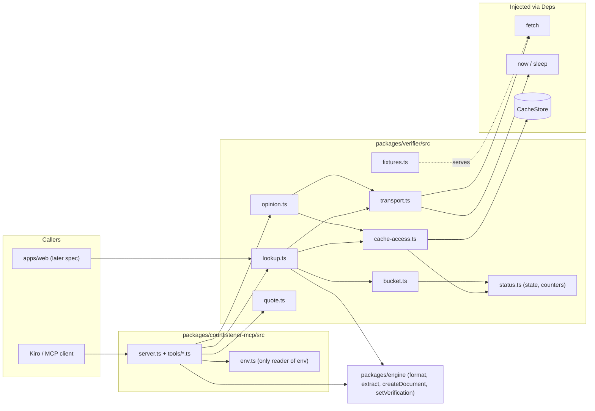
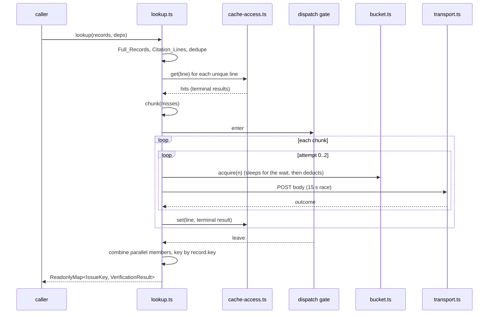

# Design Document: citation-verifier

## Overview

`@reveal-codes/verifier` turns the engine's `CitationRecord` values into `VerificationResult` values by asking CourtListener whether each cited case exists, and turns a quotation plus an opinion text into a `QuoteCheckResult`. `@reveal-codes/courtlistener-mcp` wraps the same functions as four MCP tools over stdio. The engine is a dependency and is not changed: this package calls `format` (to build Citation_Lines), `extract`, `createDocument`, `setVerification`, and `verificationOf` only, and returns the values the engine's `setVerification` and `setQuoteCheck` accept.

Design goals, in priority order:

1. **Honest statuses.** Only a per-citation Line_Status 200 can produce `verified`. Every failure path (network, timeout, 5xx, bad JSON, wrong shape, wrong line count, throttle) ends in `unchecked`, never in a terminal status. A terminal status is cached for 24 hours. `unchecked` is never cached.
2. **Privacy.** Only formatted Citation_Lines leave the machine. The request builder takes `readonly string[]` lines, not records, so a draft cannot reach it by construction.
3. **Everything external is injected.** `fetch`, the clock, `sleep`, the cache, the token, and the Base_URL arrive in `Deps`. No file under `packages/verifier/src/` reads `process.env`, calls `Date.now()`, calls `new Date()` with no argument, calls `setTimeout`, or references the global `fetch`. A static test enforces it (Req 11.3).
4. **Small modules.** Functions stay under 40 lines and modules under 300 (tech.md). The package is about 22 modules behind one entry point.
5. **Tests never touch the network.** Tests use a scripted fetch, a manual clock that advances itself when the event loop is idle, a memory cache, and the recorded Fixture_Set.

### Decisions this design fixes (deferred or open in requirements.md)

| Item | Decision |
|---|---|
| Where mutable state lives | There is no module-level mutable state. `createDeps(init)` returns a `Deps` that carries one `VerifierState` (token bucket, sliding-window log, counters, dispatch gate). `lookup`, `fetchOpinionText`, and `verifierStatus` read and write that state through `deps.state`. The MCP server creates one `Deps` at startup, so `verifier_status` reads the same state `lookup_citations` wrote. See N3. |
| `Deps` shape | `DepsInit` has exactly the six glossary fields. `Deps` is `DepsInit` plus `state`. `sleep` takes an optional second argument, an `AbortSignal`, so a finished request can cancel its 15 s timeout timer. A `sleep` that ignores the signal is still correct. |
| `CacheStore` is asynchronous | `get`, `set`, and `delete` return promises so `FileCacheStore` can use `node:fs/promises`. Values are `unknown`; the verifier validates a cached value's shape before using it, so a stale or hand-edited file is a miss. |
| Sliding-window guard | A token bucket with capacity 60 and a refill of 1 per second does not satisfy Req 7.5: after a 60-line burst, 30 s later it allows 30 more, so 90 lines pass in one 60 s window. The design keeps the bucket exactly as Req 7.1 to 7.4 state it and adds a sliding-window log, so the sleep before a dispatch is `max(bucket wait, window wait)`. The two agree whenever no more than 60 lines were sent in the last 60 s, which includes every fresh-state case. See N2. |
| 200 with two or more clusters | CourtListener documents that a citation can share a printed page with other decisions, so a Line_Status 200 can carry several clusters. Req 3.1 says `verified` needs exactly one. This design maps 200 with two or more distinct cluster ids to `ambiguous`. It does not conflict with Req 3.8 (`verified` only on 200). See N4. |
| Pipeline step order | Req 8.2 lists ellipsis (step 4) before brackets (step 5). That order breaks Req 8.10: `.[.].` becomes `.[.].` after step 4, then `...` after step 5, and a second pass folds it to `…`. The design runs the steps in the order 1, 2, 3, 5, 4, 6, 7, and the ellipsis pattern accepts any White_Space between dots (`. \u00a0.\u00a0.` would otherwise fail the same way). See N1. |
| Case-insensitive comparison | Both sides are folded with a per-UTF-16-unit lower-casing that keeps a unit unchanged when `toLowerCase()` would not return exactly one unit. This keeps lengths and the quote's offset map valid. |
| Opinion requests and the bucket | The Token_Bucket counts citations, so opinion and cluster requests do not draw from it. They share the transport (timeout, retries, token rule) and the cache. |
| Request encoding | `POST {baseUrl}/citation-lookup/` with `Content-Type: application/x-www-form-urlencoded` and body `text=<percent-encoded Request_Body>`. The 64 000 limit applies to the decoded `text`, which is what a Lookup_Chunk caps. |
| Redirects | Requests set `redirect: "error"`. A redirect is a transport failure (`unchecked`), so the token can never follow a redirect to another origin. |
| Fixture throttle | The throttled Demo_Corpus citation is a per-line `status: 429` entry carrying `wait_until`, inside an HTTP 200 response. That is the only shape that lets one `lookup` call return `verified`, `not_found`, `ambiguous`, and a throttled `unchecked` together (Req 12.12). The recorded HTTP-level 429 body is kept as a separate fixture that scripted-fetch tests replay. See N9. |

### Research findings that inform the design

Checked during this design phase against the current CourtListener help pages ([Citation Lookup and Verification API](https://wiki.free.law/c/courtlistener/help/api/rest/v4/citation-lookup) and [Case Law API](https://wiki.free.law/c/courtlistener/help/api/rest/v4/case-law)). The pages are rendered from templates, so the numeric limits (`[[ citation_lookup.max_per_request ]]` and similar) were not visible; those numbers come from `.kiro/steering/citations.md`, which records them as verified on 2026-11-02.

What the pages state, and the design relies on:

- **Endpoint.** `POST /api/rest/v4/citation-lookup/`. It accepts `text` (a block of text) or `volume`, `reporter`, and `page`. The curl examples use `--data`, so the default form encoding is what is documented.
- **Response shape.** A bare JSON array, one object per citation found, in text order. Fields: `citation`, `normalized_citations` (several for an ambiguous citation), `start_index`, `end_index`, `status`, `error_message`, `clusters` (full cluster objects). Text with no citations returns `[]`.
- **Line_Status.** 200 found and looked up; 404 valid but not in the database; 400 reporter not in the system; 300 matched more than one item; 429 identified but not looked up because the request exceeded the per-request maximum.
- **Several clusters on one page.** The `clusters` list can hold several entries "when a citation is ambiguous or when multiple decisions are on a single page in a printed book". This is why N4 exists.
- **Throttle.** A request that exceeds the valid-citation throttle gets HTTP 429 and a JSON object with a wait key holding an ISO-8601 datetime. **The prose spells the key `wait_util`**; steering and the DRF convention say `wait_until`. The parser accepts both spellings.
- **Limits.** 64 000 characters of text per request. The endpoint does not look up statutes, journals, `Id.`, or `supra`.
- **Cluster endpoint.** `GET /api/rest/v4/clusters/{id}/`. The cluster has `id` and `sub_opinions`, a list of opinion URLs of the form `.../api/rest/v4/opinions/{opinion_id}/`.
- **Opinion endpoint.** `GET /api/rest/v4/opinions/{id}/`. Text fields: `html_with_citations`, `html_columbia`, `html_lawbox`, `xml_harvard`, `html_anon_2020`, `html`, `plain_text`. The page recommends `html_with_citations` as the best field and `plain_text` only for PDF or Word sources. See N7: Req 9.3 fixes a different preference order.
- **Field selection.** The help pages say to use field selection to cut load. The design appends `?fields=...` to cluster and opinion requests. If the server ignores it the response is merely larger; the parser reads only the fields it needs.

Not verified against the live API in this phase (a recording task must confirm each, and fixtures that use them are marked `hand_authored` until then):

- That the cluster objects embedded in a citation-lookup response carry `id` as a number. The design accepts a positive integer or a digit string, and treats anything else as a malformed entry (`unchecked`).
- That a per-line 429 entry carries `wait_until`. The docs show none. The parser reads it when present and falls back to the response's `Retry-After` header.
- That JSON bodies are not required. The form encoding follows the documented curl examples.

Other facts:

- `@modelcontextprotocol/sdk` is the v1 package (tech.md names it). `McpServer.registerTool(name, { description, inputSchema }, handler)` with a Zod shape, and `StdioServerTransport`, are the v1 server API. A v2 line (`@modelcontextprotocol/server`) exists; this design stays on v1 as tech.md requires. See R3.
- `tsconfig.base.json` has `types: []` and `lib: ["ES2022"]`, so `AbortSignal` and Node modules need `types: ["node"]` in the verifier and MCP tsconfigs. The verifier defines its own structural `FetchLike`, so it needs no DOM lib.
- Node 22 (`.nvmrc` 22, engines `>=22.12.0 <23`). `String.prototype.normalize`, `\p{M}` regexes, and static JSON import attributes are available.

## Architecture



### Lookup pipeline



The dispatch gate is a promise chain held in `deps.state`. It serialises the network phase of concurrent `lookup` calls on one `Deps`, so the bucket arithmetic and the "sleep, then deduct immediately before fetch" rule cannot interleave. Cache reads happen before the gate, so an all-hit call never waits on it.

## Components and Interfaces

### Module map

All paths are under `packages/verifier/src/` unless stated. Line counts are budgets (limit 300).

| Module | Contents | Budget |
|---|---|---|
| `index.ts` | Named re-exports only | 40 |
| `deps.ts` | Types: `FetchLike`, `FetchInit`, `HttpResponse`, `CacheStore`, `DepsInit`, `Deps`, `VerifierState`, `Counters`, `Cell` | 80 |
| `create-deps.ts` | `createDeps(init)`: strips a trailing `/` from `baseUrl`, creates the state | 40 |
| `json.ts` | `parseJson(text): Result<unknown, JsonError>` (the only `try/catch` in `src/`, returns the error as a value), small `isRecord`, `asArray` guards | 60 |
| `time.ts` | `nowMs(deps)`, `toIso(ms)` (rejects years outside 0000 to 9999), `parseWaitUntil`, `parseRetryAfter` | 120 |
| `normalise.ts` | The Normalisation_Pipeline stages and `normalise`, `normaliseQuote`, `foldCase` | 200 |
| `track.ts` | Origin-tracked quote normalisation: `trackQuote(q)` returns the folded normal form, the origin of each unit, and the dirty cuts | 220 |
| `kmp.ts` | `longestPrefixOccurring(pattern, text)` | 50 |
| `quote.ts` | `checkQuote`, `prefixLength` (Algorithm A4) | 180 |
| `lines.ts` | `memberLines(record)`, `buildLines(records)`: Citation_Lines, dedupe, record-to-line index | 120 |
| `chunk.ts` | `chunkLines(lines)` | 70 |
| `bucket.ts` | `BucketState`, `refill`, `waitFor`, `take`, `availableTokens` (pure); `acquire(deps, n)` | 180 |
| `transport.ts` | `requestOnce` (timeout race, auth rule), `withRetries`, `retryDelayMs`, `HttpOutcome` | 260 |
| `map-status.ts` | `parseLookupBody`, `mapEntry`, `mapChunk` (position mapping, count check) | 200 |
| `combine.ts` | `combineParallel(members)` | 90 |
| `unresolvable.ts` | `UNRESOLVABLE_FORMS` | 30 |
| `cache-access.ts` | `cacheGet`, `cacheSet`: counters, TTL, shape validation, rejection-safe | 90 |
| `cache-memory.ts` | `createMemoryCacheStore({ now })` | 60 |
| `cache-file.ts` | `createFileCacheStore({ dir, now, fs? })`, `encodeKey` | 160 |
| `status.ts` | `createState(startMs)`, counters, `verifierStatus(deps)` | 90 |
| `gate.ts` | `withGate(state, fn)` | 40 |
| `lookup.ts` | `lookup`, `dispatchChunk`, `resultsForRecords` | 240 |
| `html.ts` | `htmlToText` (strip tags, decode entities) | 150 |
| `opinion.ts` | `fetchOpinionText` | 180 |
| `fixtures.ts` | `createFixtureFetch()` | 200 |

Tests-only modules are in `packages/verifier/test/support/`: `scripted-fetch.ts`, `manual-clock.ts`, `arb-verifier.ts`, `fc.ts` (`runs()`), `scan-source.ts`.

`index.ts` exports: `lookup`, `fetchOpinionText`, `checkQuote`, `verifierStatus`, `createDeps`, `createMemoryCacheStore`, `createFileCacheStore`, `createFixtureFetch`, `UNRESOLVABLE_FORMS`, and the types `Deps`, `DepsInit`, `CacheStore`, `FetchLike`, `FetchInit`, `HttpResponse`, `VerifierStatus`. Nothing else is public. Tests import internal modules by relative path.

### Public API

```ts
export function lookup(
  records: readonly CitationRecord[],
  deps: Deps,
): Promise<ReadonlyMap<IssueKey, VerificationResult>>;

export function fetchOpinionText(clusterId: string, deps: Deps): Promise<string | null>;

export function checkQuote(opinionText: string, quote: string): QuoteCheckResult; // never "unchecked"

export function verifierStatus(deps: Deps): VerifierStatus;

export type VerifierStatus = Readonly<{
  bucket: Readonly<{ available: number; capacity: number }>;
  counters: Readonly<{ hits: number; misses: number; writes: number }>;
}>;

export function createDeps(init: DepsInit): Deps;
export function createMemoryCacheStore(opts: Readonly<{ now: () => Date }>): CacheStore;
export function createFileCacheStore(opts: Readonly<{ dir: string; now: () => Date }>): CacheStore;
export function createFixtureFetch(): FetchLike;
export const UNRESOLVABLE_FORMS: readonly Readonly<{ form: "WL" | "LEXIS"; description: string }>[];
```

`lookup` never throws and never rejects. `fetchOpinionText` never throws and returns `null` on any failure. `checkQuote` is total.

### Internal interfaces (selected)

```ts
// deps.ts
export type FetchInit = Readonly<{
  method: "GET" | "POST";
  headers: Readonly<Record<string, string>>;
  body?: string;
  signal: AbortSignal;
  redirect: "error";
}>;
export type HttpResponse = Readonly<{
  status: number;
  headers: Readonly<{ get(name: string): string | null }>;
  text(): Promise<string>;
}>;
export type FetchLike = (url: string, init: FetchInit) => Promise<HttpResponse>;

export type CacheStore = Readonly<{
  /** `undefined` is a miss. Never rejects. */
  get(key: string): Promise<unknown>;
  /** `expiresAt` is an ISO-8601 UTC string. Never rejects (a failed write is swallowed by the store, Req 10.10). */
  set(key: string, value: unknown, expiresAt: string): Promise<void>;
  delete(key: string): Promise<void>;
}>;

export type DepsInit = Readonly<{
  fetch: FetchLike;
  now: () => Date;
  sleep: (ms: number, signal?: AbortSignal) => Promise<void>;
  cache: CacheStore;
  token?: string;
  baseUrl: string;
}>;
export type Deps = DepsInit & Readonly<{ state: VerifierState }>;

export type Cell<T> = { value: T }; // the only mutable shape in the package; written only by bucket.ts, status.ts, gate.ts
export type VerifierState = Readonly<{
  bucket: Cell<BucketState>;
  counters: Cell<Counters>;
  gateTail: Cell<Promise<void>>;
}>;
export type Counters = Readonly<{ hits: number; misses: number; writes: number }>;
```

```ts
// lines.ts
export type LineIndex = Readonly<{
  /** Unique Citation_Lines in first-occurrence order (Req 2.3, 2.4). */
  lines: readonly string[];
  /** Per Full_Record key: its member lines in member order, or "database" / "invalid". */
  members: ReadonlyMap<IssueKey, readonly string[] | "database" | "invalid">;
}>;
export function buildLines(records: readonly CitationRecord[]): LineIndex;

// chunk.ts
export type Chunk = Readonly<{ lines: readonly string[]; oversize: boolean }>;
export function chunkLines(lines: readonly string[]): readonly Chunk[];

// bucket.ts
export const CAPACITY = 60;
export const REFILL_MS = 1000;
export const WINDOW_MS = 60_000;
export type BucketState = Readonly<{
  tokens: number; // integer, 0..60
  partialMs: number; // integer, 0..999; elapsed ms toward the next token
  lastMs: number; // clock reading at the last refill
  sent: readonly Readonly<{ atMs: number; lines: number }>[]; // ascending atMs, pruned to the window
}>;
export function refill(b: BucketState, nowMs: number): BucketState;
export function waitFor(b: BucketState, n: number, nowMs: number): number; // 0 when n lines may go now
export function take(b: BucketState, n: number, nowMs: number): BucketState;
export function availableTokens(b: BucketState, nowMs: number): number;
export function acquire(deps: Deps, n: number): Promise<boolean>; // false only if the clock never advances (see A3)

// transport.ts
export type HttpOutcome =
  | Readonly<{ kind: "json"; status: number; headers: Headers2; body: unknown }>
  | Readonly<{ kind: "http_error"; status: number; retryAfter: string | null; waitUntil: string | null; retryable: boolean }>
  | Readonly<{ kind: "network" }>
  | Readonly<{ kind: "timeout" }>
  | Readonly<{ kind: "bad_body"; status: number }>;
type Headers2 = HttpResponse["headers"];
export function requestOnce(deps: Deps, url: string, init: RequestSpec): Promise<HttpOutcome>;
export function withRetries(
  deps: Deps,
  beforeAttempt: () => Promise<boolean>,
  send: () => Promise<HttpOutcome>,
): Promise<Readonly<{ outcome: HttpOutcome; attempts: number }>>;
export function retryDelayMs(i: Readonly<{ retryAfterMs: number | null; waitUntilMs: number | null }>, nowMs: number): number;

// map-status.ts
export type LineEntry = Readonly<{
  status: number | null; // null: malformed entry
  clusterIds: readonly string[]; // distinct, in response order
  waitUntil?: string; // ISO, from the entry's wait_until / wait_util
}>;
export function parseLookupBody(body: unknown): Result<readonly LineEntry[], ShapeError>;
export function mapChunk(
  lines: readonly string[],
  parsed: Result<readonly LineEntry[], ShapeError>,
  responseRetryAfter: string | null,
  nowMs: number,
): ReadonlyMap<string, VerificationResult>;

// combine.ts
export function combineParallel(members: readonly VerificationResult[]): VerificationResult;
```

`Result` and `err` / `ok` come from `@reveal-codes/engine`. Verifier modules use `Result<T, E>` for parse failures and plain outcome unions for transport. The only `throw` is none; the only `try/catch` is in `json.ts` and returns the error as a `Result` (Req 15.6).

## Data Models

### Citation_Line

`<volume> <reporter> <page>`, produced by `format({ kind: "reporter", volume, reporter, page })` from the engine, so it is the engine's canonical text for a pincite-free citation. If `format` returns an error for a member (it cannot for engine-produced records), the record is marked `invalid` and maps to `unchecked` without a request. A database record has no line. A parallel record yields one line per member, in member order. The same string is the de-duplication key and the cache key.

### Request

| Part | Value |
|---|---|
| URL | `{baseUrl}/citation-lookup/` |
| Method and type | `POST`, `application/x-www-form-urlencoded`, `Accept: application/json` |
| Body | `text=` + `encodeURIComponent(requestBody)`, where `requestBody` is the chunk's lines joined by `\n` |
| Auth | `Authorization: Token <token>` only when a token is set and the URL starts with `{baseUrl}/` |
| Other headers | none |

### Cache entries

| Key | Value | Written when |
|---|---|---|
| Citation_Line | `VerificationResult` with status `verified`, `ambiguous`, or `not_found` | a Terminal_Result is produced for the line (Req 10.1) |
| `opinion:<clusterId>` | the opinion text (`string`) | `fetchOpinionText` returns non-null (Req 9.9) |

Expiry is `toIso(nowMs + 86_400_000)`. Reading is hit only when `Date.parse(expiresAt) > nowMs` (strict, Req 10.3). A cached citation value must pass `isTerminalResult` (right `status`, string `clusterId`, string array `candidates` of length two or more, optional string `reason`); a cached opinion must be a non-empty string. Anything else counts as a miss.

### Fixture layout

```
packages/verifier/fixtures/
  README.md                one line: see manifest.json
  manifest.json            schema below
  lookup/<slug>.json       { "line": "410 U.S. 113", "entry": { ...CourtListener per-citation object... } }
  http/throttle-429.json   { "status": 429, "headers": { "Retry-After": "30" }, "body": { "wait_until": "..." } }
  clusters/<id>.json       { "id": 108713, "sub_opinions": ["https://www.courtlistener.com/api/rest/v4/opinions/<oid>/"] }
  opinions/<oid>.json      { "id": <oid>, "plain_text": "...excerpt..." }  (or html_with_citations)
  quotes.json              { "genuine": [{ "opinion": "<oid>", "text": "..." }], "fabricated": { "text": "..." } }
```

```ts
type ManifestEntry = Readonly<{
  file: string; // relative to fixtures/
  kind: "lookup" | "http" | "cluster" | "opinion" | "quotes";
  line?: string; // lookup only: exact Citation_Line
  path?: string; // cluster and opinion only: exact URL path, e.g. "/api/rest/v4/clusters/108713/"
  source: string; // "courtlistener-live" | "supremecourt.gov" | "hand-authored" ...
  recorded?: string; // ISO date when recorded from the live API
  hand_authored?: true; // exactly one of recorded / hand_authored
  note: string; // one line: where it came from (tech.md)
}>;
```

The Demo_Corpus lines are `556 U.S. 662`, `550 U.S. 544`, `410 U.S. 113` (status 200), `123 F.4th 456` (404), `1 H. 150` (the documentation's ambiguous example, 300 with two clusters), and `576 U.S. 644` (per-line 429 with `wait_until`). Cluster ids and opinion excerpts are whatever the recording task obtains from the live API or the public-domain opinion. The design does not invent ids: a hand-authored cluster id is marked `hand_authored` in the manifest and the opinion excerpts are copied verbatim from the opinions, never composed (Req 12.10).

The JSON files are imported statically in `fixtures.ts` (`import x from "../fixtures/lookup/x.json" with { type: "json" }`), so the module needs no `fs`, works in the browser bundle for the web demo, and `packages/verifier/tsconfig.json` adds `"fixtures/**/*.json"` to `include`.

## Algorithms

### A1. lookup (Req 1, 2, 5, 10)

1. `full` = records whose `kind` is `"full"`. If none, return an empty map with no `Deps` call (Req 1.7).
2. `buildLines(full)`: for each Full_Record, a `database` value maps to `"database"`; a reporter value to its one line; a parallel value to one line per member (zero members maps to `"invalid"`, Req 6.7); a `format` error maps to `"invalid"`. Collect unique lines in first-occurrence order.
3. For each unique line, `cacheGet(deps, line)`. A valid terminal result is a hit and the line leaves the batch.
4. `chunkLines(missing)` (A2). Then, inside the gate, dispatch chunks in order (A3). An `oversize` chunk is not sent: its line is `unchecked` (Req 7.2).
5. For each terminal result obtained, `cacheSet(deps, line, result)`. `unchecked` is never written (Req 10.2).
6. Per Full_Record: `"database"` or `"invalid"` gives `{ status: "unchecked" }` (no `waitUntil`, Req 5.1); one member gives that line's result; several members give `combineParallel(memberResults)`.
7. Return a `Map` with one entry per Full_Record key. Short and other records are never read past the `kind` test (Req 1.3, 1.4).

A line that has no result for any reason (for example its chunk was skipped) is `unchecked`. Step 6 therefore never lacks an input.

### A2. Chunking (Req 7.2, 7.7)

Greedy, in order. `size` is the length of `lines.join("\n")`.

```
chunks = []; cur = []; size = 0
for line of lines:
  if line.length > 64000:                       // alone it exceeds the cap
     flush(cur); chunks.push({ lines: [line], oversize: true }); continue
  added = cur.length === 0 ? line.length : size + 1 + line.length
  if cur.length === 60 or added > 64000: flush(cur)   // start a new chunk
  cur.push(line); size = (cur.length === 1) ? line.length : size + 1 + line.length
flush(cur)
```

Every non-oversize chunk has at most 60 lines and a Request_Body of at most 64 000 characters. The concatenation of the chunks' lines equals the input lines in order, oversize chunks included. This is Property 4.

### A3. Token bucket, window guard, and dispatch (Req 7.1 to 7.11)

State is `BucketState` (integer milliseconds throughout, no floating point).

**Refill.** `refill(b, now)`:

```
elapsed = max(0, now - b.lastMs)                    // a clock step backwards credits nothing
total   = b.partialMs + elapsed
gained  = floor(total / 1000)
tokens  = min(60, b.tokens + gained)
partial = tokens === 60 ? 0 : total % 1000          // partial time is retained below the cap
return { ...b, tokens, partialMs: partial, lastMs: now }
```

If the clock steps backwards, `lastMs` is set to `now`, so a later forward step credits only the time after the step. Clocks in the properties are non-decreasing.

**Bucket wait (Req 7.3).** After `refill`, with `n` lines to send and `t` tokens: if `t >= n` the bucket wait is 0. Otherwise the Shortfall is `s = n - t` and the wait is `s * 1000 - partialMs`. That value is at least 1 because `s >= 1` and `partialMs <= 999`. After sleeping exactly that long, `partialMs + wait = s * 1000`, so `gained = s` exactly and `tokens = n`.

**Window wait.** `sent` lists `{ atMs, lines }` for each dispatch in the last 60 000 ms, where an entry is live while `atMs > now - 60000`. Let `used` be the sum of live `lines`. If `used + n <= 60`, the window wait is 0. Otherwise walk the live entries in ascending order, subtracting each entry's `lines` from `used` until `used + n <= 60`; the window wait is `entry.atMs + 60000 - now` for the entry at which that happens (at least 1). A window is closed at the start and open at the end, so an entry sent exactly 60 000 ms ago is outside it.

**Wait and deduct.** `waitFor(b, n, now) = max(bucketWait, windowWait)`.

```
acquire(deps, n):                                  // runs inside the dispatch gate
  for i in 0..2:
    now = nowMs(deps); b = refill(cell.value, now)
    w = waitFor(b, n, now)
    if w === 0:
       cell.value = take(b, n, now)                // tokens -= n; sent.push({ atMs: now, lines: n }); prune
       return true
    cell.value = b
    await deps.sleep(w)
  return false                                      // the clock never advanced; nothing was deducted
```

`take` runs in the same synchronous step as the `w === 0` check, and the caller calls `Deps.fetch` in the same microtask chain with no await between, so tokens are deducted immediately before the fetch (Req 7.3). With a clock that advances by the slept amount the loop body runs once and `Deps.sleep` is called exactly once. A second iteration happens only if the clock advanced by less than requested (a real timer firing a millisecond early); it then sleeps the smaller recomputed wait. After three iterations without success, `acquire` returns `false` and the chunk's lines are `unchecked` with no request made. See N2.

**Dispatch and retries.** `dispatchChunk(chunk)` runs `withRetries(deps, () => acquire(deps, n), send)`:

```
withRetries(deps, before, send):
  for attempt in 0..2:
    if !(await before()) return { outcome: { kind: "network" }, attempts: attempt }   // no request made
    out = await send()
    if out.kind === "http_error" && out.retryable && attempt < 2:
       await deps.sleep(retryDelayMs(out, nowMs(deps)))
       continue
    return { outcome: out, attempts: attempt + 1 }
  // unreachable: attempt 2 always returns
```

`retryable` is true for HTTP 429 and any status from 500 to 599, and nothing else (Req 7.11). A network failure, a timeout, a bad body, and every other non-2xx status return immediately (Req 4.1, 4.2, 4.4). Each retry calls `before()` again, so tokens are deducted again (Req 7.4). `Deps.fetch` runs at most three times per chunk (Req 7.10), and the outcome of an exhausted chunk is the last response.

**Retry delay (Req 7.8).** With `retryAfterMs` from `Retry-After` (integer seconds times 1000, or an HTTP date minus now, minimum 0) and `waitUntilMs` from `wait_until` minus now (minimum 0), each `null` when absent or unparseable:

```
delay = both null      ? 1000
      : one is null    ? the other
      : max(a, b)
delay = min(delay, 30000)
```

**Result of an exhausted or failed chunk.** `unchecked`, with `waitUntil` taken from the last response: `wait_until` if present and valid, otherwise `Retry-After` converted with `Deps.now` (Req 4.5), otherwise absent (Req 4.6). A `network`, `timeout`, or `bad_body` outcome gives `unchecked` with no `waitUntil` (Req 4.1, 4.2, 4.4).

**Why the guard matters.** Property 3 draws sequences of `lookup` calls and non-decreasing clocks and asserts that the lines passed to `fetch` (retries included) within any 60 000 ms window total at most 60. With the bucket alone a counterexample exists (60 lines at t = 0, 30 lines at t = 30 000). With the guard the second dispatch sleeps until t = 60 000.

### A4. Timeout race and the transport (Req 4.1 to 4.7, 2.9, 2.10)

```
requestOnce(deps, url, spec):
  fetchAbort = new AbortController(); sleepCancel = new AbortController()
  headers = authHeaders(deps, url, spec.headers)       // adds Authorization only if url.startsWith(baseUrl + "/")
  work    = deps.fetch(url, { ...spec, headers, signal: fetchAbort.signal, redirect: "error" })
              .then(res => readResponse(res), () => NETWORK)
  timeout = deps.sleep(15000, sleepCancel.signal).then(() => TIMEOUT)
  winner  = await Promise.race([work, timeout])
  sleepCancel.abort()                                   // the 15 s timer is cancelled when the request settled first
  if winner === TIMEOUT: fetchAbort.abort(); return { kind: "timeout" }
  return winner
```

`readResponse` reads `res.text()` (a rejection is `network`), parses it with `parseJson`, and returns:

- status 2xx and parsed: `json`;
- status 2xx and not parseable: `bad_body`;
- status 429 or 500 to 599: `http_error` with `retryable: true`, `retryAfter` from the header, and `waitUntil` from the body's `wait_until` (or `wait_util`) when the body parses to an object;
- any other status: `http_error` with `retryable: false`.

`authHeaders` is the only place a token is read. It never writes the token anywhere else, and `HttpOutcome` contains no request header, so no error value or log can carry it (Req 11.4). The real `sleep` in the MCP server clears its timer when the signal aborts and resolves, so no 15 s timer outlives a finished request.

### A5. Status mapping (Req 3, 2.6, 2.7)

`parseLookupBody(body)` requires an array. Each element must be an object. `status` must be a safe integer, otherwise the entry's `status` is `null` (malformed). `clusterIds` is built from `clusters[i].id` for each cluster object: a positive safe integer or a string of digits without leading zero becomes its string form, anything else is skipped, duplicates are dropped, order is kept. `waitUntil` is `parseWaitUntil(entry.wait_until ?? entry.wait_util)`. A non-array body is a `ShapeError`.

`mapChunk(lines, parsed, retryAfter, now)`:

1. If `parsed` is an error or the array length differs from `lines.length`, every line is `unchecked` with no `waitUntil` (Req 2.7).
2. Otherwise line `i` takes entry `i` (zero-based position, Req 2.6) through `mapEntry`:

| Entry | Result |
|---|---|
| `status` 200, exactly one cluster id | `verified { clusterId }` |
| `status` 200, two or more cluster ids | `ambiguous { candidates }` (N4) |
| `status` 200, no cluster id | `unchecked` (Req 3.7) |
| `status` 300, two or more cluster ids | `ambiguous { candidates }` in response order |
| `status` 300, fewer than two | `unchecked` (Req 3.7) |
| `status` 404 | `not_found` with no `reason` |
| `status` 400 | `not_found { reason: "unknown_reporter" }` |
| `status` 429 | `unchecked`, `waitUntil` = entry `wait_until` if valid, else `Retry-After` converted with `now`, else absent |
| anything else, or `status` `null` | `unchecked` |

Only the 200 rows can produce `verified`, which is Property 1. The mapping function takes no other input that could produce it.

### A6. Parallel combination (Req 6)

`combineParallel(members)` applies the first matching row:

| # | Condition on the member results | Result |
|---|---|---|
| 0 | no members | `unchecked` |
| 1 | at least one `verified`; let `V` be the distinct `clusterId` values in member order; `V` has one value | `verified { clusterId: V[0] }` |
| 2 | at least one `verified`; `V` has two or more values | `ambiguous { candidates: V }` |
| 3 | no `verified`, at least one `ambiguous` | `ambiguous { candidates }` = the members' candidate lists concatenated in member order, first occurrence kept |
| 4 | no `verified`, no `ambiguous`, at least one `unchecked` | `unchecked`, with the latest `waitUntil` among the `unchecked` members when any has one |
| 5 | every member `not_found` | `not_found`, keeping `reason` only when every member carries the same `reason` |

Rows 1 and 2 ignore every non-verified member (Req 6.6). Rows 2 and 3 always have two or more distinct ids, as the engine's `setVerification` requires.

### A7. Normalisation_Pipeline (Req 8.2, 8.3, 8.10, 8.11)

`WS` is the Unicode White_Space set: `[\t-\r \u0085\u00a0\u1680\u2000-\u200a\u2028\u2029\u202f\u205f\u3000]`. It is written out because JavaScript's `\s` omits U+0085 and includes U+FEFF, which is not White_Space.

| Step | Operation | Length effect |
|---|---|---|
| 1 | NFC | may grow |
| 2 | `“` `”` to `"`; `‘` `’` `‚` to `'` | none |
| 3 | `–` `—` to `-` | none |
| 4 | brackets: stack-match `[` and `]`, delete the matched pairs' bracket characters (equals "innermost first, repeated"); unmatched brackets stay | shrinks |
| 5 | ellipsis: `/\.(?:WS*\.){2,}|…/g` to `…` | shrinks or equal |
| 6 | `WS+` to one space; trim both ends | shrinks or equal |
| 7 | NFC | may grow |
| Q | quote only: trim tail (below) | shrinks |

Step numbers 4 and 5 here are the spec's steps 5 and 4 respectively (N1). The ellipsis class `WS*` also matches a single `\u00a0` between dots, so step 6's whitespace collapse can never create a new match for a second pass.

Trailing-punctuation removal (`trimTail`): repeatedly delete a final character that is in `WS` or is one of `.`, `,`, `;`, `:`. This is the spec's "remove a trailing punctuation mark together with any whitespace left before it, until the quote ends in none of them", combined with step 6's trailing trim.

Why the pipeline is idempotent (Property 7): after step 4 no matched pair remains and stack matching never creates one by deleting a pair (the unmatched characters are some `]` followed by some `[`); after step 5 the dot runs are consumed greedily and `…` plus dots cannot recombine; step 6 leaves single spaces only; steps 2 and 3 only remove their own inputs. A second pass therefore finds nothing to change. Steps 2 to 6 never grow a string (each replacement is no longer than the text it replaces), so the full pipeline output is at most `NFC(s)` long.

`foldCase(s)` maps each UTF-16 unit `u` to `u.toLowerCase()` when that is exactly one unit and to `u` otherwise. `normalise(s) = foldCase(pipeline(s))` for the opinion; `normaliseQuote(s) = foldCase(trimTail(pipeline(s)))`.

### A8. checkQuote (Req 8.1, 8.4 to 8.9)

```
checkQuote(opinion, quote):
  T = normaliseQuote(quote)
  if T === "":                       return mismatch(0)
  O = normalise(opinion)
  if O.includes(T):                  return match            // exact substring, also the rule for |T| < 12
  if T.length < 12:                  return mismatch(0)      // Req 8.7: no prefix search
  return mismatch(prefixLength(quote, O, T))
```

`unchecked` is never returned (Req 8.9). A mismatch's `prefixLength` is below the quote's length because the full quote is not a substring, which the engine requires (`prefixLength < quote length`).

### A9. prefixLength (Req 8.6)

Definition: the largest `n` in `[0, L]` (`L` = quote length in UTF-16 units) such that `S(n) = normaliseQuote(quote.slice(0, n))` is non-empty and a substring of `O`; 0 when none exists.

**The predicate is not monotone in `n`, so binary search is wrong.** Examples, with `O` containing `a b c` only: for `a [b] c`, `n = 5` gives `a b` (a substring) but `n = 4` gives `a [b` (not). For `x. . . y` with `O` containing `x …`, `n = 7` gives `x …` and `n = 5` gives `x . .`. A prefix cut can also split a combining sequence or a surrogate pair. Normalisation is not prefix-closed because of four things: brackets (a cut inside a pair keeps the `[`), ellipsis forms (a cut inside the pattern keeps part of it), NFC (a cut before a combining mark), and tail trimming. Whitespace collapse is not a problem: any cut inside a run, or at its end, trims to the run's start.

**Algorithm.** Split the cuts into clean cuts, where `S(n)` is provably a prefix of `T`, and dirty cuts, where it may not be.

1. **`m*`.** `m* = longestPrefixOccurring(T, O)`: the length of the longest prefix of `T` that occurs in `O`. Computed by running the KMP automaton for pattern `T` over `O` and taking the maximum state reached. Time O(|O| + |T|), space O(|T|). "A prefix of `T` occurs in `O`" is monotone in the prefix length (a prefix of an occurring string occurs), so `m*` is well defined.
2. **Tracking.** `trackQuote(quote)` runs the same stages as the string pipeline over the quote while recording, for each unit of the pre-trim normal form `V`, the original index that produced it (`origin[j]`, non-decreasing). It gives `kOf(n) = #{j : origin[j] < n}` and `e(k) = |trimTail(V.slice(0, k))|` (a running "last keepable unit" scan). For a clean cut, `S(n) = V.slice(0, e(kOf(n)))`, which is a prefix of `T`. If NFC changes the quote at step 1 or 7, tracking is abandoned (`tracked: false`).
3. **Dirty cuts**, found by scanning the original quote:
   - `n` strictly inside a matched bracket pair, that is `open < n <= close` for a stack-matched `[ ... ]`;
   - `n` strictly inside an ellipsis match, `start < n < end`;
   - `n` where the unit at `quote[n]` matches `[\p{M}\u1160-\u11FF]` or is a low surrogate (a cut before a combining mark, a Hangul jamo vowel or trailer, or inside a surrogate pair).
   Each dirty cut records a region start `rs` (the pair's `[`, the ellipsis start, or `n - 1`).
4. **Search, descending.** For `n` from `L - 1` down to 1, with a probe budget `MAX_PROBES = 64`:
   - clean cut: skip unless `0 < e(kOf(n)) <= m*`; if it qualifies, probe `n`;
   - dirty cut: skip unless `e(kOf(rs)) <= m*` (the part before the region must occur in `O`); if eligible, probe `n`;
   - a probe computes `S(n)` with the string pipeline (the definition itself) and tests `O.includes(S(n))` for non-empty `S(n)`. The first success is returned. Each probe spends one unit of the budget, so a wrong clean/dirty classification costs probes and can never return a wrong answer.
   - if tracking was abandoned, the candidates are the cuts immediately before a `WS` unit, descending (word ends), under the same budget.
5. Return 0 when the loop ends without success.

**Complexity.** Time O(|O| + L + P * (L + |O|)) with P at most 64 probes; the clean path normally needs one probe, so a typical quote costs two passes over `O`. Memory O(|T| + L). There is no O(L^2) path: the quadratic definition is used only as the verification step for at most 64 cuts.

**Guarantees.** The result is always sound: if non-zero, `S(n)` is a non-empty substring of `O`, so `n` satisfies the definition. It is maximal whenever every cut that satisfies the predicate is either classified correctly or probed within the budget. L1 and L2 record the exceptions. Property 9 compares the result with a brute-force model (all `n`, no shortcut) on small adversarial inputs (brackets, ellipsis forms, combining marks) where the budget is never reached, and checks the altered-word bounds on opinion-derived quotes.

### A10. fetchOpinionText (Req 9)

```
fetchOpinionText(clusterId, deps):
  if !/^[1-9][0-9]*$/.test(clusterId): return null
  hit = cacheGet(deps, "opinion:" + clusterId); if hit is a non-empty string: return hit
  cluster = withRetries(... GET {base}/clusters/{id}/?fields=id,sub_opinions)          // no bucket
  if not json object: return null
  ids = sub_opinions.map(urlTail)        // /opinions/(\d+)/ at the end of the URL; others dropped
  for oid of ids (in cluster order):
     res = withRetries(... GET {base}/opinions/{oid}/?fields=id,plain_text,html_with_citations,html,html_lawbox,html_columbia,xml_harvard)
     if request failed: return null                                                     // Req 9.8
     text = firstNonEmptyField(res.body)
     if text !== null: cacheSet(deps, key, text); return text
  return null                                                                            // zero opinions or none with text
```

Opinion URLs are rebuilt from `{baseUrl}` and the numeric tail, never followed as given, so the token cannot be sent to a host chosen by a response body (Req 2.9, 2.10, 11.7).

`firstNonEmptyField` walks `OPINION_FIELDS = ["plain_text", "html_with_citations", "html", "html_lawbox", "html_columbia", "xml_harvard"]` (Req 9.3: the opinion loop is outer, the field loop inner). A field is empty when absent, `null`, not a string, or whitespace only. For a non-`plain_text` field the value passes through `htmlToText`. If the result is whitespace only the field counts as empty and the walk continues (a clarification of Req 9.3: a field holding only markup yields no text). `html_anon_2020` is not in the requirement's list and is not read.

`htmlToText(s)`: delete `<script>` and `<style>` elements and elements whose class contains `star-pagination` (page markers like `*665` would split quotations; see L4); turn block-level tags (`p`, `div`, `br`, `li`, `h1` to `h6`, `blockquote`, `tr`, `footnote`) into `\n`; delete every other tag; decode `&amp; &lt; &gt; &quot; &apos; &nbsp; &ndash; &mdash; &lsquo; &rsquo; &ldquo; &rdquo; &hellip; &sect; &para;` and numeric `&#N;` / `&#xH;` references (invalid code points become U+FFFD). No dependency is added.

### A11. Cache wiring and counters (Req 10)

`cacheGet(deps, key)` calls `deps.cache.get(key)` (a rejection is treated as a miss), increments `hits` when the value passes the shape guard and `misses` otherwise, and returns the value or `undefined`. A value that is present but fails the guard is counted as a miss. `cacheSet(deps, key, value)` computes `expiresAt = toIso(nowMs(deps) + 86_400_000)`, increments `writes`, and awaits `deps.cache.set` (a rejection is ignored; the caller still returns its result, Req 10.10). Counters live in `deps.state.counters`, one set for citation and opinion entries (Req 10.13). `verifierStatus(deps)` returns `refill(state.bucket.value, now).tokens` as `available` (computed with `Deps.now`, without storing the refill) and the counters (Req 10.14). It never asks the store to list keys.

### A12. FileCacheStore (Req 10.8 to 10.10)

`encodeKey(key)` is `encodeURIComponent(key)` with `.` replaced by `%2E` and `*` by `%2A`, plus the suffix `.json`. Percent-encoding is injective because `%` is itself encoded, so two keys never share a file. The encoded stem contains no separator and no dot, so a key such as `../x`, `a/b`, or `opinion:7` cannot leave the directory or name a hidden file. A key whose encoded name exceeds 200 bytes is not written (the write is a swallowed failure).

Layout: one file per key containing `{ "value": ..., "expiresAt": "..." }`. `set` writes `<name>.<pid>.<n>.tmp` in the same directory (`mkdir` recursive first), then `rename`s it over the target. On any failure it deletes the temp file and leaves the old entry in place. `get` reads the file, parses it with `parseJson`, and returns the value when `Date.parse(expiresAt) > now().getTime()`; a missing, unreadable, or unparseable file, or a bad shape, is a miss. Every `fs` call goes through a helper that turns the promise into a `Result` (`p.then(ok, fail)`), so there is no `try/catch` and no swallowed error. The store takes an optional `fs` argument (a subset of `node:fs/promises`) so tests can inject write failures.

`MemoryCacheStore` is a `Map<string, { value, expiresAt }>` with the same expiry rule, so Property 5 runs against both stores.

### A13. createFixtureFetch (Req 12)

`createFixtureFetch()` returns a `FetchLike` built from the statically imported Fixture_Set and `manifest.json`. At construction it builds three maps from the manifest: `lookupByLine` (`line` to entry), `clusterByPath`, `opinionByPath` (`path` to body). It never calls the network and never throws.

Routing on `(method, new URL(url).pathname)`; the query string is ignored (Req 12.6):

| Request | Response |
|---|---|
| `POST` to a path ending `/citation-lookup/` | Decode `text` from the form body. Split on `\n`, trim each line, drop empty lines. For each line in input order emit its recorded entry (with its recorded `status`), or `{ citation: line, status: 404, error_message: "...", clusters: [] }` when unknown. Respond HTTP 200 with the array (Req 12.4, 12.5). |
| `GET` of a path equal to a recorded cluster or opinion `path` | HTTP 200 with the recorded body |
| anything else | HTTP 404 with body `{"detail":"Not found."}` |

The response object is `{ status, headers: { get }, text }`. `http/throttle-429.json` is not routed; scripted-fetch tests import it as the template for an HTTP-level throttle.

### A14. Dependency creation in the MCP server and tests

- **Production (MCP):** `fetch` is the global `fetch` (the MCP package may reference it; only `packages/verifier/src/` may not), `now` is `() => new Date()`, `sleep` is a `setTimeout` promise that clears its timer and resolves when the signal aborts and whose timer is `unref`'d, `cache` is `createFileCacheStore({ dir, now })`, `baseUrl` is `https://www.courtlistener.com/api/rest/v4`.
- **Fixtures only (`REVEAL_CODES_FIXTURES_ONLY=1`):** `fetch` is `createFixtureFetch()`, the cache is a `MemoryCacheStore` (so the demo writes nothing to disk), the rest as above.
- **Tests:** `createDeps({ fetch: scripted, now: clock.now, sleep: clock.sleep, cache: createMemoryCacheStore({ now: clock.now }), baseUrl: "https://cl.test/api/rest/v4" })`.

## MCP server (`packages/courtlistener-mcp/src`)

| Module | Contents |
|---|---|
| `index.ts` | Named re-exports of `createServer`, `readEnv`, `buildContext` (package `exports` points here) |
| `main.ts` | Entry. The only module that touches the `process` global: calls `readEnv(process.env, homedir())`, `buildContext`, `createServer`, and `server.connect(new StdioServerTransport())`. Fatal start-up errors go to stderr and exit non-zero |
| `env.ts` | `readEnv(env, home): Env` with `COURTLISTENER_TOKEN` (empty string is absent), `REVEAL_CODES_CACHE_DIR` (default `<home>/.reveal-codes/cache`), `REVEAL_CODES_FIXTURES_ONLY` (`"1"` is true, anything else false). Pure |
| `context.ts` | `buildContext(env): ToolContext` where `ToolContext = { deps: Deps; now: () => Date }`, as in A14 |
| `log.ts` | `log(line)` writes to `process.stderr`. It replaces every occurrence of the token by `[redacted]`. Nothing in the package writes to stdout except the SDK transport (Req 13.13) |
| `results.ts` | `okResult(payload)` gives `{ content: [{ type: "text", text: JSON.stringify(payload) }] }`; `errorResult(message)` adds `isError: true` |
| `schemas.ts` | Zod shapes for the three tools with arguments, and the parse helper `parseArgs(shape, args)` returning `Result<T, string>` whose error names the first invalid argument path (for example `citations[3]: expected a string of 1 to 2000 characters`) |
| `tools/lookup-citations.ts` | `handleLookupCitations(args, ctx)` |
| `tools/get-opinion-text.ts` | `handleGetOpinionText(args, ctx)` |
| `tools/check-quote.ts` | `handleCheckQuote(args, ctx)` |
| `tools/verifier-status.ts` | `handleVerifierStatus(ctx)` |
| `server.ts` | `createServer(ctx): McpServer`: `registerTool` for each name with the Zod shape and `(args) => handle*(args, ctx)` |

Argument bounds (Req 13.2, 13.4, 13.6):

| Tool | Arguments |
|---|---|
| `lookup_citations` | `citations`: array of 1 to 50 strings, each 1 to 2000 characters |
| `get_opinion_text` | `clusterId`: positive safe integer |
| `check_quote` | `clusterId`: positive safe integer; `quote`: string of 1 to 10 000 characters |
| `verifier_status` | none |

Validation is defined once in `schemas.ts` and used twice: registered with the SDK so clients see the JSON Schema, and re-run inside each handler with `parseArgs` so a handler called directly (in tests, or if the SDK's own message differs) still returns an `isError` result that names the bad argument before any Verifier function runs (Req 13.12). The handler is the single place that decides the error text.

Handler behaviour (each is under 40 lines and holds no verification logic, Req 13.9):

- `lookup_citations`: for each string `i`, `createDocument(text, ctx.now().toISOString())` (an error, such as a lone surrogate, is a tool error naming `citations[i]`). Collect every `kind: "full"` record from `doc.citations`, rewriting its `key` to `"<i>:<key>"` so keys stay unique, and call `lookup` once. For each document, apply `setVerification(doc, key, result)` for every full record, then read `verificationOf(doc, key)` for every keyed record, so short forms report their target's result. Return `{ results: [{ index, citations: [{ index, text, start, end, kind, result }] }] }` where `result` is the `VerificationResult`, or `null` for an Other_Reference. A string with no citations gets an entry with an empty `citations` list and is not an error (Req 13.3).
- `get_opinion_text`: `fetchOpinionText(String(clusterId), deps)`. A text is returned as `{ clusterId, text }`. `null` returns `{ clusterId, text: null, message: "Opinion text is unavailable for clusterId N." }`, not an error (Req 13.5).
- `check_quote`: fetch the text; when `null` return `{ status: "unchecked", reason: "Opinion text is unavailable for clusterId N." }`; otherwise return `checkQuote(text, quote)` (Req 13.7).
- `verifier_status`: `verifierStatus(deps)`.

Register in Kiro (`.kiro/settings/mcp.json`, Req 14.1 to 14.3). The edit reads the file, stops without writing if it is missing or not valid JSON, adds `courtlistener` beside any existing server, and leaves every existing entry byte-identical in meaning:

```json
{
  "mcpServers": {
    "courtlistener": {
      "command": "pnpm",
      "args": ["mcp"],
      "env": { "REVEAL_CODES_FIXTURES_ONLY": "1" },
      "autoApprove": ["lookup_citations", "verifier_status"]
    }
  }
}
```

Start-up: the root `mcp` script stays `pnpm --filter @reveal-codes/courtlistener-mcp start`. The package `start` script becomes `node --import jiti/register src/main.ts` (`jiti` is already a pinned root dev dependency, and it resolves the engine's `.js`-suffixed relative imports to `.ts`). `package.json` adds `@reveal-codes/engine` and `@reveal-codes/verifier` as `workspace:*`, and pinned exact versions of `@modelcontextprotocol/sdk` (1.x) and the `zod` version its peer range requires. The tsconfig adds `types: ["node"]`. See R2 and R3.

## Hooks, vitest, and static checks

- **Hook** `.kiro/hooks/verifier-tests-on-save.json`, shaped like the engine hook:

```json
{
  "version": "v1",
  "hooks": [
    {
      "name": "Verifier tests on save",
      "trigger": "PostFileSave",
      "matcher": "packages/verifier/(src|test)/.*\\.ts$",
      "timeout_ms": 120000,
      "action": {
        "type": "command",
        "command": "perl -e 'alarm shift; exec @ARGV' 120 pnpm vitest run --project verifier --passWithNoTests"
      }
    }
  ]
}
```

  It runs only the `verifier` project, once, in single-run mode (Req 15.1, 15.2). `docs/KIRO_USAGE.md` gains a row for this hook and a row for the `courtlistener` server (`.kiro/settings/mcp.json`), plus a row for this spec (Req 14.4).
- **Vitest projects.** The root `vitest.config.ts` already declares `verifier` and `courtlistener-mcp` (checked in this phase), so Req 15.3 needs no config change; a test asserts the two names stay declared. `setupFiles` already applies the 60 s timeout to `*.properties.test.ts`.
- **Static source test** `test/static.test.ts` (Req 11.3). `test/support/scan-source.ts` strips comments, string and template literal text, and regex literals (the same idea as the engine's `purity.test.ts`) and reports `file:line` for each hit in `src/**/*.ts` of: `process.env`, `Date.now(`, `new Date()` (no argument), `setTimeout(`, `globalThis.fetch`, and a call `fetch(` not preceded by `.`, `$`, or a word character. `deps.fetch(` passes.
- **Limits test** `test/limits.test.ts` (Req 15.4 to 15.6) parses `src` and `test` (and the MCP package's `src`) with the `typescript` compiler API already in the root `devDependencies`: file length at most 300 lines, each function body at most 40 lines, no `AnyKeyword`, no `export default`, and every `catch` clause either rethrows, returns `err(...)`, or contains an `expect` call.
- **Inventory test** `test/inventory.test.ts` (Req 16.1, 16.2) parses this file's `### Property N` headings and the test sources: exactly 12 properties, numbers 1 to 12 once each, each `// Property N` followed by one `fc.assert(fc.property(...))` in a file named `*.properties.test.ts`, each `describe` title ending in `_Requirements: x.y_`.
- **Docs test** `test/docs.test.ts` (Req 2.11, 17): README has a "What leaves your machine" section; `citations.md` no longer contains the whole-document sentence and contains "joined by newline" and "one request per chunk"; `.env.example` lists the two new variables each after a comment line.

## Correctness Properties

*A property is a characteristic or behavior that should hold true across all valid executions of a system-essentially, a formal statement about what the system should do. Properties serve as the bridge between human-readable specifications and machine-verifiable correctness guarantees.*

Exactly twelve properties (Req 16.1). Each is implemented once as one `fc.assert(fc.property(...))` in the file named in brackets, preceded by `// Property N`. Generic arbitraries come from `packages/engine/src/testing/arbitraries.ts`; verifier-specific arbitraries live in `packages/verifier/test/support/arb-verifier.ts` (Req 16.7). Reflection merged redundant criteria: 1.3, 1.4, and 1.5 sit in P12; 2.1 to 2.5 and 2.8 sit in P2; 3.1 to 3.8 and 1.8 sit in P1; 5.1, 5.4, and 5.5 sit in P11; 7.2 and 7.7 sit in P4; 7.6 and 7.10 sit in P10; 8.10 and 8.11 sit in P7; 10.3, 10.6, and 10.11 sit in P5.

Verifier-specific arbitraries named below:

- `arbLookupEntry` and `arbLookupBody(lines)`: documented-shape entries (`status` from 200, 300, 400, 404, 429 plus out-of-set integers and non-numbers, `clusters` of 0 to 3 objects with valid, duplicate, and malformed `id`s, optional `wait_until` in several forms), with variants whose length differs from `lines` and non-array bodies.
- `arbRecords`: `CitationRecord[]` taken from engine `arbDocument` (all kinds: reporter, parallel, database, short, other), with keys preserved.
- `arbClock`: a non-decreasing sequence of millisecond readings with gaps from 0 to 120 000.
- `arbResponseScript`: a sequence of scripted HTTP responses drawn from 429 (with and without `Retry-After`, `wait_until`, `wait_util`, malformed values), 500 to 599, other 4xx, and a valid 200.
- `arbQuoteSource`: an opinion from engine `arbOpinionWithQuotes`, extended with ellipsis forms (`...`, `. . .`, `…`) at word boundaries.
- `arbNormalisable`: strings mixing ASCII, curly quotes, dashes, `[`/`]`, dots, spaces, tabs, U+0085, U+00A0, U+FEFF, combining marks, surrogates (engine `arbAnyString`), and Hangul jamo.

### Property 1: Status mapping yields verified only for Line_Status 200 and one result per line
For any non-empty list of distinct Citation_Lines and any response from `arbLookupBody(lines)`, `mapChunk` returns exactly one result per line. A line is `verified` only when its entry has `status` 200 and exactly one cluster id, and its `clusterId` is that id as a string. A line is `ambiguous` only when its entry has two or more distinct cluster ids (statuses 200 or 300), with `candidates` in response order. A line is `not_found` only for status 404 (no `reason`) or 400 (`reason` `unknown_reporter`). A response that is not an array, or whose length differs from the line count, makes every line `unchecked` with no `waitUntil`. Calling `mapChunk` twice with equal inputs returns deeply equal maps. [`map-status.properties.test.ts`]
Arbitraries: `arbLookupBody`.
**Validates: Requirements 1.8, 2.6, 2.7, 3.1, 3.2, 3.3, 3.4, 3.5, 3.6, 3.7, 3.8**

### Property 2: Request bodies carry only Citation_Lines drawn from the records
For any `arbRecords` and any draft text, every request passed to `Deps.fetch` during `lookup` has a decoded `text` field equal to a prefix-ordered slice of the de-duplicated Citation_Lines of the Full_Records, joined by `\n` with no leading or trailing `\n`; parallel records contribute one line per member in member order; the URL is the citation-lookup URL; no header other than `Authorization`, `Content-Type`, and `Accept` is present; and no request contains the draft text, a case name, a pincite, a court, or a year. [`lookup.properties.test.ts`]
Arbitraries: `arbRecords`, engine `arbDocumentText` (the draft), scripted fetch that returns 404 entries.
**Validates: Requirements 2.1, 2.2, 2.3, 2.4, 2.5, 2.8**

### Property 3: Lines sent in any 60 000 ms window never exceed 60
For any sequence of `lookup` calls over `arbRecords` with fresh lines each time, any `arbClock` of gaps between calls, and a manual `sleep` that advances the clock by the requested amount, the Citation_Lines passed to `Deps.fetch` (retries included) in any window `[t, t + 60000)` total at most 60. Refill never leaves more than 60 tokens, `tokens` and `partialMs` stay integers with `0 <= partialMs <= 999`, and every call to `Deps.sleep` has a positive integer argument. [`bucket.properties.test.ts`]
Arbitraries: `arbRecords`, `arbClock`, `arbResponseScript` (to include 429 retries).
**Validates: Requirements 7.1, 7.3, 7.4, 7.5**

### Property 4: Chunking caps hold and chunks concatenate to the input
For any list of distinct lines (including lines longer than 64 000 characters), every chunk not marked `oversize` has at most 60 lines and a Request_Body of at most 64 000 characters, an `oversize` chunk holds exactly one line, and the concatenation of all chunks' lines equals the input in order. [`chunk.properties.test.ts`]
Arbitraries: lists of Citation_Lines built from engine `arbReporterValue` plus occasional very long lines.
**Validates: Requirements 7.2, 7.7**

### Property 5: Cache round trip and expiry hold for both stores
For any key (including separators, spaces, colons, `.`, `..`, and Unicode), any Terminal_Result, any start time, and any expiry delay, in each of `MemoryCacheStore` and `FileCacheStore` (temporary directory): `get` strictly before the expiry returns a value deeply equal to the stored result; `get` at or after the expiry is a miss; and storing two distinct keys never lets one overwrite or read the other. The file store never writes outside its directory. [`cache.properties.test.ts`]
Arbitraries: key strings from engine `arbAnyString`, terminal results derived from engine `arbVerificationResult` (non-`unchecked`), a mutable manual clock.
**Validates: Requirements 10.3, 10.6, 10.8, 10.11**

### Property 6: A fully cached lookup makes no network or sleep calls
For any `arbRecords`, after a first `lookup` against a scripted fetch returns terminal results, repeating the call with the same records makes zero calls to `Deps.fetch` and `Deps.sleep`, returns a map deeply equal to the first for every record whose lines were all terminal, and includes in any request only lines that were not terminal the first time. [`lookup.properties.test.ts`]
Arbitraries: `arbRecords`, `arbLookupBody`-driven scripted fetch with a mix of terminal and `unchecked` outcomes.
**Validates: Requirements 10.2, 10.4, 10.5**

### Property 7: The Normalisation_Pipeline is idempotent and never lengthens beyond NFC
For any string from `arbNormalisable`, `normalise(normalise(s)) === normalise(s)` and `normaliseQuote(normaliseQuote(s)) === normaliseQuote(s)`; each of steps 2 to 6 returns a string no longer than its input; `normalise(s).length <= s.normalize("NFC").length`; and when `trackQuote(s)` reports `tracked: true`, trimming the tail of its text equals `normaliseQuote(s)` (the tracked and untracked paths agree). [`normalise.properties.test.ts`]
Arbitraries: `arbNormalisable`.
**Validates: Requirements 8.2, 8.3, 8.10, 8.11**

### Property 8: A quotation lifted from an opinion matches however it is typeset
For any opinion from `arbQuoteSource`, any substring of at least 12 characters cut at word boundaries, and any combination of straight quotes rewritten as curly quotes, each whitespace run replaced by a run of Unicode White_Space of the same or greater length, and each ellipsis form rewritten as another ellipsis form, `checkQuote(opinion, transformed)` is `match`. [`quote.properties.test.ts`]
Arbitraries: `arbQuoteSource`, indices over word boundaries, a transform record.
**Validates: Requirements 8.4, 8.5, 8.12**

### Property 9: An altered quotation mismatches, and prefixLength locates the divergence
For any opinion from `arbQuoteSource`, any lifted quote of at least 12 characters, and one interior word replaced by a word absent from the opinion, `checkQuote` returns `mismatch` with `prefixLength` at least the offset of the altered word and less than the altered quote's length. For small adversarial quotes (brackets, ellipsis forms, combining marks) over small opinions, `prefixLength` equals the brute-force largest `n` over all cuts, where the model normalises every prefix with the string pipeline. The generator is `fc.oneof` of the two cases and the property body branches on the case tag. [`quote.properties.test.ts`]
Arbitraries: `arbQuoteSource`, a replacement-word arbitrary filtered against the opinion, an adversarial quote/opinion pair arbitrary.
**Validates: Requirements 8.6, 8.8, 8.13**

### Property 10: Retries are bounded and exhaustion keeps the last wait
For any `arbResponseScript` for one chunk, `Deps.fetch` is called at most three times for that chunk, one request per attempt; calls stop at the first response that is not 429 or 5xx; every retry sleeps `min(30000, max(retryAfterMs, waitUntilMs))`, or 1000 when neither is present or parseable, and the request is not retried after a non-retryable status; and when all three responses are 429 or 5xx the chunk's lines are `unchecked` with `waitUntil` equal to the last response's valid `wait_until` (or its converted `Retry-After`), or absent when neither parses. [`transport.properties.test.ts`]
Arbitraries: `arbResponseScript`, `arbClock`.
**Validates: Requirements 4.3, 4.5, 4.6, 4.7, 7.6, 7.8, 7.9, 7.10, 7.11**

### Property 11: Database citations are never sent and always map to unchecked
For any `arbRecords` mixing database, reporter, and parallel records, no request body contains a Westlaw or Lexis citation; every database Full_Record maps to `{ status: "unchecked" }` with no `waitUntil`; the non-database lines sent are exactly those sent when the database records are removed; and a list of only database records makes zero `Deps.fetch` calls. [`lookup.properties.test.ts`]
Arbitraries: `arbRecords` restricted and mixed through engine `arbDatabaseValue`.
**Validates: Requirements 5.1, 5.3, 5.4, 5.5**

### Property 12: Short and other records are never sent and never in the result map
For any `arbRecords` including `short` and `other` kinds, the result map's keys equal exactly the set of Full_Record keys; no request contains a line derived from a `short` or `other` record; and two records with equal Citation_Lines receive equal results. [`lookup.properties.test.ts`]
Arbitraries: `arbRecords`.
**Validates: Requirements 1.2, 1.3, 1.4, 1.5, 1.6**

## Error Handling

No source module throws to callers. The only `try/catch` is `parseJson` in `json.ts`, which returns the error as a `Result`. `lookup` resolves, `fetchOpinionText` resolves to `null`, `checkQuote` is total, and the MCP handlers return results (never reject).

| Condition | Value produced | Requirements |
|---|---|---|
| `Deps.fetch` rejects | `unchecked`, no `waitUntil`; other chunks unchanged | 1.9, 1.10, 4.1 |
| No response in 15 000 ms | request aborted, `unchecked`, no `waitUntil` | 4.2 |
| HTTP 429 or 5xx | retry up to twice, then `unchecked` with the last `waitUntil` | 4.3, 4.5, 7.8 to 7.10 |
| Other non-2xx, or 2xx with unparseable body | `unchecked`, no `waitUntil`, no retry | 4.4, 7.11 |
| Body not an array, entry malformed, line count differs | `unchecked` for the affected lines | 2.7, 3.6 |
| Line_Status 200 without a cluster id, 300 with fewer than two | `unchecked` | 3.7 |
| Line_Status 429 inside a 200 response | `unchecked` with entry `wait_until` or `Retry-After` | 3.5 |
| Westlaw or Lexis record | `unchecked`, not sent | 5.1 |
| Citation_Line over 64 000 characters | `unchecked`, not sent | 7.2 |
| `acquire` gives up (clock did not advance) | `unchecked`, no request, nothing deducted | 7.3 (A3) |
| Cache `get` rejects, bad shape, expired, unreadable file | miss | 10.3, 10.9 |
| Cache `set` rejects or fails to write | ignored; result still returned; old entry kept; temp file removed | 10.10 |
| Opinion request fails after retries | `fetchOpinionText` returns `null`, nothing cached | 9.8 |
| Cluster has no usable opinion text | `null`, nothing cached | 9.7, 9.9 |
| MCP argument missing, wrong type, or out of bounds | `isError` result naming the argument; no Verifier call | 13.12 |
| MCP string with a lone surrogate | `isError` result naming `citations[i]` | 13.2 |
| Token present | never in any `HttpOutcome`, log line, cache key, cache file, fixture, or tool result | 10.12, 11.4, 11.7, 13.14 |

## Testing Strategy

### Layout and tooling

- `packages/verifier/test/<module>.test.ts` holds examples and `<module>.properties.test.ts` holds property tests. `test/support/fc.ts` exports `runs()`: 200 locally, exactly 500 when `process.env.CI` is set (Req 16.4), also honouring `FC_NUM_RUNS` from `pnpm test:pbt`. fast-check prints `seed` and `path` on failure; replay with `fc.assert(prop, { ...runs(), seed, path })` (Req 16.6).
- Each property file entry has the shape:

```ts
// Property 4
// Feature: citation-verifier, Property 4: Chunking caps hold and chunks concatenate to the input
describe("Property 4: chunking _Requirements: 7.2, 7.6, 7.7_", () => {
  it("every chunk obeys the caps and the chunks rebuild the input", () => {
    fc.assert(fc.property(arbLines, (lines) => { /* relate chunks to lines */ }), runs());
  });
});
```

- No `vi.mock`, no snapshots, no network, no `try/catch` that swallows (tech.md). `tsconfig` in `test/` adds `types: ["node"]`.

### Fakes (all in `test/support/`)

- **Scripted fetch** `createScriptedFetch(steps)`: each call consumes the next step (`{ status, headers?, body }`, `{ reject }`, or `{ hang }`) and records `{ url, method, headers, decodedText }`. A step list shorter than the calls is a test failure, not a default response.
- **Manual clock** `createManualClock(startMs)`: `now()` returns a `Date` at the current reading; `sleep(ms, signal)` registers a timer. When the macrotask queue is idle (a `setImmediate` pass with no resolved fetch pending), it advances the clock to the earliest live timer and resolves it. A scripted response resolves in microtasks, so it beats the 15 000 ms timeout timer; a `hang` step never resolves, so the clock jumps to the timeout and the race fires. A timer whose signal is aborted is removed, so cancelled timeout timers never move time. `advance(ms)` is also available for tests that drive time explicitly. Every `sleep` call is logged with its argument for assertions on exact waits.
- **Memory cache** `createMemoryCacheStore({ now })`, and a failing `fs` stub for `FileCacheStore` write-failure examples.
- **Fixture fetch** for the Demo_Corpus examples.

### Example tests

- **`lookup.test.ts`:** zero Full_Records makes no calls (1.7); fault isolation, where chunk 2 of 3 fails and chunks 1 and 3 keep their results (1.10); token only on Base_URL requests, including a hostile `sub_opinions` URL in `opinion.test.ts` (2.9, 2.10); Fixture_Fetch end to end on the Demo_Corpus (12.12).
- **`transport.test.ts`:** reject, hang (15 s race, request aborted), 500, bad JSON, 404; `Retry-After` as integer seconds, as an HTTP date, and garbage; `wait_until` and `wait_util`; exact sleep for a shortfall of 5 lines with 12 tokens needed and 7 available and 400 ms retained (`5 * 1000 - 400 = 4600`).
- **`bucket.test.ts`:** refill with partial retention (999 ms then 1 ms), cap at 60, a backwards clock step, the window guard counterexample (60 at t = 0 then 30 at t = 30 000 sleeps to t = 60 000).
- **`combine.test.ts`:** one example per row of the A6 table, including row 0 and the `reason` rule.
- **`map-status.test.ts`:** one example per row of the A5 table, and the 200-with-two-clusters case.
- **`normalise.test.ts`:** each step in isolation; `[t]he`, `[...]`, `. . .`, NBSP and NEL runs, curly quotes, trailing `.,;:` with spaces before them, empty and whitespace-only quotes; quotes under 12 characters.
- **`quote.test.ts`:** prefix examples for each non-monotone case in A9, probe budget exhaustion (L1), tracking abandoned for non-NFC input.
- **`opinion.test.ts`:** outer opinion loop and inner field loop with the three examples from Req 9.4 and 9.5; HTML strip and entity decode; empty-after-strip; request failure returns `null` and caches nothing; cache hit makes no call; the cluster with zero opinions.
- **`cache-file.test.ts`:** key encoding of `../x`, `a/b`, `opinion:7`, `.`, `..`; atomic write (a failing rename leaves the old entry and no temp file); unparseable file is a miss; no token in any file.
- **`status.test.ts`:** counters after a scripted sequence of gets and sets; `verifierStatus` after idle refill.
- **`fixtures.test.ts`:** routing table of A13; every manifest entry exists and has exactly one of `recorded` or `hand_authored`; each genuine quote is 8 to 60 words and `match`es its excerpt; the fabricated quote is 8 to 60 words and `mismatch`es all excerpts (12.1 to 12.13).
- **MCP tests** (`packages/courtlistener-mcp/test/`): `env.test.ts`; each handler with valid and invalid arguments; `server.test.ts` registers exactly four tools; `stdio.test.ts` spawns the server with `REVEAL_CODES_FIXTURES_ONLY=1`, completes the MCP handshake over a pipe, calls `lookup_citations` on the Demo_Corpus, and asserts stdout carries only protocol messages and stderr never contains the token (13.1, 13.13, 13.14, 13.15).

### Coverage of non-property criteria

Every acceptance criterion not named in a property's **Validates** line is covered by at least one example above or by a static test: 2.9, 2.10, 2.11, 4.1, 4.2, 4.4, 5.2, 6.1 to 6.7, 7.1 (examples), 8.1, 8.7, 8.9, 9.1 to 9.10, 10.1, 10.7, 10.9, 10.10, 10.12 to 10.14, 11.1 to 11.7, 12.1 to 12.14, 13.1 to 13.15, 14.1 to 14.7, 15.1 to 15.7, 16.1 to 16.7, 17.1 to 17.5.

### Documentation and proof tasks (Req 14.4 to 14.7, 17)

- README gains "What leaves your machine": only citation strings are sent to CourtListener; draft text goes to an LLM provider only when the author uses the assistant.
- `.kiro/steering/citations.md` is edited (Req 17.2, 17.3): the lookup bullet says the request body is the formatted citation strings joined by newline characters; the design-consequences paragraph says the verifier sends one request per chunk of at most 60 lines and 64 000 characters; the `lookup(documentText)` bullet becomes `lookup(records, deps)`; the whole-document sentence is removed.
- `.env.example` adds `REVEAL_CODES_CACHE_DIR` and `REVEAL_CODES_FIXTURES_ONLY`, each after a comment line, and extends the `COURTLISTENER_TOKEN` comment: read only by the MCP server and the web app.
- `BUILD_LOG.md` gets a dated entry `YYYY-MM-DD citation-verifier` listing each Kiro error and its fix, or "No Kiro errors".
- Final task: call `lookup_citations` through the registered `courtlistener` tool (not by importing the package) with every citation string extracted from the demo motion in `apps/web/demo/`, paste the full result into the completion notes, and stop if the call fails (Req 14.5 to 14.7). See N13: that folder does not exist yet.

## Known limitations

Standing rule (carried over from provenance-engine, user decision): anything that affects only malformed input or a rare citation style is recorded here as one line, with no spec change and no stop.

- **L1. Probe budget.** `prefixLength` spends at most 64 probes (A9). A quote with more than 64 eligible dirty cuts above the true answer (for example a very long bracketed passage) can return a smaller value than the largest `n`. The value is still sound: `S(n)` is a substring of the opinion. `prefixLength` is a display hint and never changes `match` or `mismatch`.
- **L2. Shortcut misses.** A quote whose ellipsis is formed only by deleting a bracket pair (`.[.].`), or whose NFC form differs from its text (tracking abandoned), loses the clean-cut shortcut for the affected cuts; the result is found by word-end probes and may be smaller than the largest `n`.
- **L3. Case folding.** Case-insensitivity uses a per-unit lower-case map. A character whose lower-case form is longer than one unit (U+0130) is left unfolded, so a quote that differs from the opinion only in such a character mismatches. Astral cased letters (for example Deseret) are not folded.
- **L4. Page markers.** CourtListener's `html_with_citations` can mark page breaks with `star-pagination` elements. `htmlToText` deletes them, but if the live markup differs (not verified here) a quotation that spans a page break can mismatch because of a page number inside it. The fixture recording task checks one real opinion.
- **L5. Unparseable line.** One Citation_Line that CourtListener cannot parse makes the response shorter than the request, so the whole chunk (up to 60 lines) is `unchecked` (Req 2.7). It is safe and recoverable; see N8.
- **L6. Clock steps.** The token bucket assumes a clock that does not run backwards. A backwards step credits nothing, but a forward step after it is measured from the new reading, so the window guarantee holds for non-decreasing clocks only.
- **L7. Opinion requests unmetered.** Cluster and opinion GETs do not draw from the citation Token_Bucket, so a burst of `check_quote` calls can hit CourtListener's general account limits (5 requests per minute on a free account per steering). The 429 retry path then returns `null`. This is a rate-limit consequence, not a wrong result.

## Notes for the user

Decisions needing your input or recorded for review. None blocks writing the tasks; each states what the design does until you decide.

- **N1. Requirement 8.2 order conflicts with 8.10.** With ellipsis before brackets, `.[.].` normalises to `...` on the first pass and `…` on the second, and `.\u00a0.\u00a0.` has the same problem with step 6. The design runs brackets before ellipsis and lets the ellipsis pattern span any White_Space. Outputs differ from the written order only when bracket removal exposes dots. Please confirm, or relax 8.10.
- **N2. Requirement 7.5 does not follow from 7.1.** A capacity-60 bucket that refills 1 per second allows 90 lines in a 60 s window (60 at t = 0, 30 at t = 30 s). The design adds a sliding-window log to make 7.5 true, so the sleep is the larger of the bucket wait and the window wait. If you prefer to keep the bucket alone, 7.5 should be restated as "at most 60 plus one per elapsed second"; the guard is then dropped. Also: 7.3 says `Deps.sleep` is called exactly once. That holds when the clock advances by the slept time; a real timer that fires a millisecond early produces one extra short sleep, and after three rounds without progress the chunk is `unchecked`.
- **N3. `Deps` carries one extra field, `state`, and `sleep` takes an optional `AbortSignal`.** The glossary lists six fields. The extra field is what lets `verifier_status` read the counters and the bucket without module-level state. `createDeps` builds it, so callers still pass the six. Alternative: a module-level `WeakMap` keyed by `deps.cache`, which hides the state but is global.
- **N4. A 200 with two or more clusters is mapped to `ambiguous`.** Req 3.1 only covers exactly one cluster. CourtListener says several decisions can share one printed page, so `verified` on an arbitrary first cluster would assert a case the author may not have meant.
- **N5. Quotes from separate opinions are checked against one opinion only.** Req 9.2 stops at the first opinion that yields text. A cluster such as Roe v. Wade holds the majority, concurrences, and dissents as separate opinions, so a quotation from a dissent returns `QUO ✘`, a false red code on a real quote. Recommended change: have a new `fetchOpinionTexts` return all of a cluster's texts and check the quote against each. The design implements the requirement as written.
- **N6. Ellipsis for omitted words never matches.** Req 8.2 folds ellipsis forms into one character but does not split a quote at an ellipsis, so `the court … held` (words omitted) is a `mismatch`. Lawyers quote this way often. Recommended follow-up: split at `…`, require each fragment of at least 12 characters in order. Not done here because it changes 8.5.
- **N7. Field preference differs from CourtListener's guidance.** The docs recommend `html_with_citations` and say `plain_text` is for PDF or Word sources. Req 9.3 puts `plain_text` first. The design follows the requirement. The two agree for an opinion that has only one populated field.
- **N8. Position mapping versus `start_index`.** The response carries `start_index` per citation, which would map each result to its line even when CourtListener drops a line. Req 2.6 and 2.7 choose position plus an all-or-nothing count check, so one bad line unchecks the chunk (L5). Using `start_index` would be safer for users and is a small change to 2.7.
- **N9. Throttle fixture shapes.** Two shapes are recorded: a per-line `status: 429` entry with `wait_until` inside an HTTP 200 (served by Fixture_Fetch, so one call returns all four statuses), and an HTTP-level 429 body (replayed by scripted tests). The first is not known to match what the live API sends (R1).
- **N10. Fixture content is not written in this phase.** Cluster ids, opinion excerpts, and genuine quotations come from a recording task (live API when a token is available) or are copied verbatim from the public-domain opinions; nothing is composed. Until recorded, an entry is `hand_authored` in the manifest.
- **N11. Quotes shorter than 12 normalised characters** (Req 8.7) are tested after normalisation, so `[t]he` counts as 3 characters.
- **N12. Repeated `check_quote` calls on a throttled opinion refetch each time.** Only a non-null opinion text is cached (Req 9.9), and opinion requests do not draw from the citation bucket (L7).
- **N13. The demo motion does not exist yet.** `apps/web/demo/` is not in the repository, and Req 14.5 needs its citations. The final task must stop and report per 14.7 unless the folder exists. Recommended: the final task seeds `apps/web/demo/motion.txt` with the Demo_Corpus citations as a placeholder the web spec replaces.

## Open Risks

- **R1. Live API shapes.** `clusters[].id`, a per-line `wait_until`, form encoding, and `fields=` selection are taken from the docs and not exercised against the live API in this phase. The recording task checks each and corrects the parser and fixtures if they differ. Each wrong guess fails safe (`unchecked`).
- **R2. `pnpm mcp` and stdout.** `pnpm run` prints a script banner that may reach stdout and corrupt the MCP stream. `args: ["mcp"]` is fixed by Req 14.1, and the `jiti` start command is untested here. The stdio test starts the server through `pnpm mcp` and requires the first stdout bytes to be protocol JSON. If it fails, the fallback is `reporter=silent` in the repository `.npmrc`.
- **R3. SDK line.** A v2 SDK (`@modelcontextprotocol/server`) exists. tech.md names `@modelcontextprotocol/sdk`, so the design uses the v1 API (`McpServer.registerTool`, Zod shapes, `StdioServerTransport`). The task pins exact versions and checks that SDK-side argument rejection and the handler's own message both name the bad argument.
- **R4. Verify step cost.** Each `prefixLength` probe scans the opinion once. For an opinion near 1 MB and 64 probes the worst case is about 64 MB of scanning per mismatch, which stays well under a second. Real opinions with a quote that fails early stop at the first probe.
