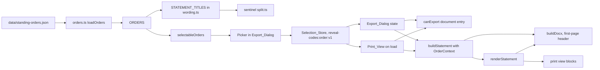
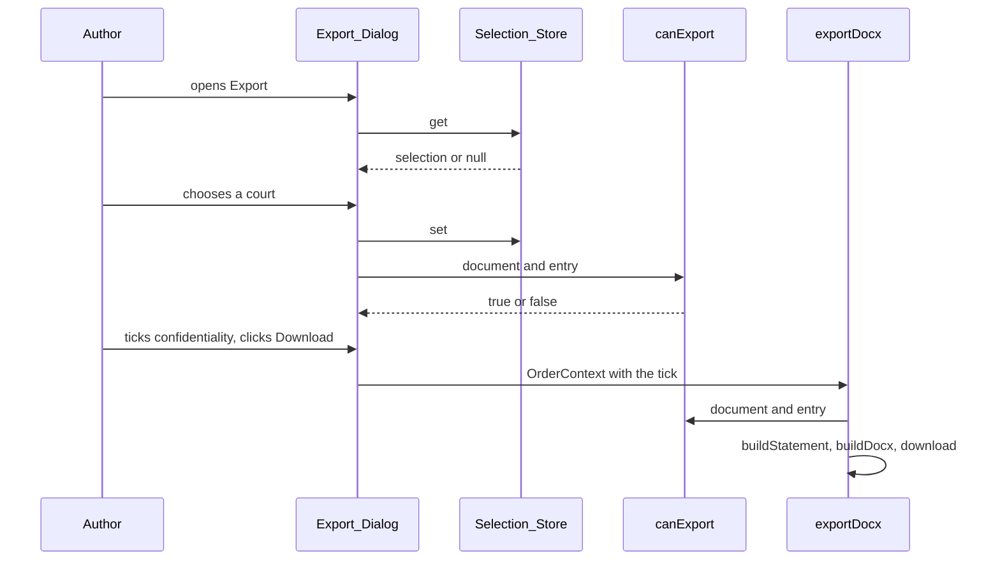

# Design Document: court-orders

## Overview

This design lets the author name the court, or the judge, a filing is going to. The Statement then cites that instrument, carries its required elements, and the export refuses to proceed under an instrument that prohibits AI drafting while AI-origin text remains. With no selection, every output is byte for byte what it is today.

The work is four things:

1. A validated, typed view of the public dataset `data/standing-orders.json` in `packages/export` (`orders.ts` and two helper modules), with a selector `selectableOrders`.
2. An order parameter on `buildStatement` (optional, default `null`) and on `canExport` (required), plus the Statement data and wording that follow from it.
3. Web changes: a Selection_Store, a Picker with an Order_Summary and a confidentiality checkbox in the Export_Dialog, the same summary and a separate checkbox in the Print_View, a prohibition block, and a first-page heading in the DOCX and the print view.
4. Sentinel title matching through `STATEMENT_TITLES`, a demo motion court change, three sentinel proof tests, and documentation edits.

The Engine and the Verifier do not change. `crew/sentinel` changes in one source file, `src/split.ts`, and its tests.

Product principles that bind this design: principle 1 (the gate counts spans, it never detects AI), principle 2 (same Document and same entry give the same Statement), principle 3 (the selection stays in `localStorage`, nothing is sent anywhere), principle 4 (the prohibition has no override because it is not a red code), principle 7 (the picker is plain UI).

### Decisions this design fixes

This design refers to two criteria of Requirement 9 by content: "the paragraphs-not-lines test" is criterion 12, about the word "paragraphs", and "the STATEMENT_TITLES test" is criterion 13, about the constant.

| # | Decision | Reason |
|---|---|---|
| D1 | **Validation runs check by check.** Check 2 runs, then check 3, and so on to check 10. Each check scans all entries in file order and returns at the first failure. | Requirement 1, criterion 11 says the checks run in the order of criteria 2 to 10 and entries in file order. Check-major order makes "first failing check" the lowest criterion number, which a test can assert with a two-failure fixture (a bad `date` in entry 1 and a bad `kind` in entry 2 reports `kind`). |
| D2 | **The loader is a pipeline of narrowing steps, with no cast.** `unknown` becomes a raw record (checks 2 to 4), then a typed `OrderEntry` (check 5 turns vocabulary strings into unions), then checks 6 to 10 read typed entries. | `tech.md` forbids `any` and prefers `unknown` plus narrowing. Check 5 is the one place a string becomes `OrderKind` and the others, so no assertion is needed. |
| D3 | **Check 5 also tests membership in the code's own lists.** A value must be a key of the file's Vocabulary object and a member of `ORDER_KINDS`, `APPLIES_TO`, `ORDER_ELEMENTS`, `CAPTION_PLACEMENTS` or `ORDER_STATUSES`. The error text is the same. A malformed or missing `vocabulary` object returns `err` naming `vocabulary` at the position of check 5. | The unions drive wording and gating. A new vocabulary word added to the file without code must fail loudly, not fall through a `switch`. |
| D4 | **`ORDERS` throws at module load if the shipped file fails its own validation.** `loadOrders` itself never throws. | `ORDERS: OrderSet` is not a `Result` (Requirement 1, criterion 1). A silent empty set would hide a bad edit. The shipped-file example test fails first in CI. This is the "throw only at the boundary" exception for a build-time constant. |
| D5 | **The URL check is hand-written.** `hostOf(url)` takes the text between `https://` and the first `/`, `?` or `#`, rejects `@`, `:`, `\` and whitespace in it, and lower-cases it. | The Export_Package compiles with `lib: ["ES2022"]` and `types: []`, so the `URL` global has no type there. Requirement 11, criterion 5 also forbids DOM use. A host passes if it ends in `.uscourts.gov` or equals `edrm.net`; the bare `uscourts.gov` fails because it does not end in `.uscourts.gov`. All 39 shipped entries pass this rule (checked by script during this design). |
| D6 | **A calendar date is checked with a days-in-month table.** `^\d{4}-\d{2}-\d{2}$`, month 1 to 12, day 1 to the month length, leap years by the Gregorian rule. No `Date` object. | The boundaries scan forbids `new Date()` with no arguments, and `Date.UTC` maps years 0 to 99 to 1900 to 1999. |
| D7 | **`StatementOrder` carries one more field than the glossary lists: `elements`.** | Requirement 4, criterion 21 makes `renderStatement` a pure function of the Statement, and criteria 9 to 17 branch on the entry's `elements`. Without the field the renderer cannot know which sentences to add. The field is plain data and serialises with the rest. This is a deliberate widening of the nine-field shape in the Glossary. |
| D8 | **One figure serves two sentences: `runCount = runLog.length`.** The "run count" of criterion 12 and the "prompt count" of criterion 15 are both "the number of runs in the run log". | The requirement defines both as the same number. The Statement keeps one field. The run log can hold runs whose text was later deleted; the requirement says "run log", so the count is the log's length, not `document.runs.length`. |
| D9 | **Criteria 16 and 18 of Requirement 4 produce the same text.** The no-AI sentence of criterion 16 equals `PARAGRAPH_NO_AI`, which is what is rendered today. | There is one code path for the no-AI paragraph; tests assert the text under each of the three conditions and under none. |
| D10 | **The separate-declaration clause replaces the full stop of the citing sentence.** The sentence reads `...(<instrument>, <date>), filed as a declaration captioned "<caption.text>". Source: <url>.` | Requirement 4, criterion 8 says the sentence ends with the clause and the stop is not duplicated. Inserting the clause "before `Source:`" into the base sentence would leave `). , filed`. |
| D11 | **`buildStatement` takes `orderContext` as an optional fourth parameter, default `null`.** `canExport` takes `order` as a required second parameter. | Requirement 5, criterion 1 says "required" and "pass `null` explicitly" for the gate only. A default on `buildStatement` keeps `crew/sentinel/test/docx-read.properties.test.ts` and the existing export tests unchanged, which Requirement 4, criterion 4 and Requirement 12, criterion 14 need. The two Web_App callers pass the argument explicitly anyway. |
| D12 | **No `wording-orders.ts` for now.** The new wording goes into `wording.ts`, which grows from 85 to about 195 lines. | Requirement 11, criterion 3 splits only if `wording.ts` would exceed the limits scan (300 lines, 40 per function). A split would also change the wording scan in `boundaries.test.ts`, which exempts only the file named `wording.ts`. If the file passes 300 lines during implementation, move the court-orders block to `wording-orders.ts`, change the scan to exempt both basenames, and build `FRAGMENTS` from both modules. |
| D13 | **`STATEMENT_TITLES` is defined in `wording.ts`** as `[STATEMENT_TITLE, ...distinct caption texts]`, computed by the pure function `statementTitles(orders)` in `orders.ts`. | The edited sentinel-sweep requirements say the titles are "re-exported from `wording.ts`". The function is separate so a test can feed it a synthetic Order_Set. |
| D14 | **Only two Correctness Properties.** Property 1 and Property 2 are exactly those of Requirement 10. | Requirement 10, criterion 1 asks for one assertion for each of the two. The other criteria that look like properties (selection round trip, null identity, determinism) have small domains and are covered by exhaustive example tests over all 39 entries, or by the existing property P2 of export-certification, extended by one argument. |
| D15 | **Order arbitraries live in `packages/export/test/support/arbitraries.ts`.** | The Engine has no knowledge of `OrderEntry` and may not import the Export_Package. Requirement 10, criterion 4 asks for reuse of the shared arbitraries; `arbDocument` and `arbGateClearDocument` are reused as they are. |
| D16 | **The Selection_Store keeps `localStorage` authoritative and uses memory only after a failed write.** | Requirement 2, criterion 6. This lets another tab's change show when the dialog opens and keeps the in-memory fallback to one flag. |
| D17 | **The `blocked` print model keeps its shape; a new `prohibited` kind carries the notice.** | `print-model.test.ts` asserts `toEqual({ kind: "blocked", blocking })`. Adding a field to `blocked` would break it. |
| D18 | **A span of line breaks only has no paragraph.** If every AI-origin span lies on `\n` characters, the AI ranges are empty. The portions sentence is then omitted, and the prohibition line says `between paragraphs` instead of `at paragraphs <ranges>`. | The requirements do not cover this case. A paragraph is "contained" only when an AI span overlaps characters of the paragraph, not its terminating `\n`. This is a small gap in the requirements; see the summary at the end of the conversation. |
| D19 | **The dataset file is formatted with Prettier before it is used.** `prettier --check data` reports `data/standing-orders.json` today. The task runs `prettier --write` on it and compares `JSON.parse` of the file before and after for deep equality. | `pnpm lint` ends with `prettier --check .` and would fail. Only whitespace changes; no fact changes (Requirement 1, criterion 12). |
| D20 | **Changing line 2 of the demo motion shifts every later Offset by +8.** `FOR THE DISTRICT OF OREGON` is 26 characters and `FOR THE NORTHERN DISTRICT OF TEXAS` is 34. | `packages/engine/test/demo.test.ts` holds literal Offsets (337 through 2342) and `packages/engine/fixtures/README.md` quotes four of them. Requirement 12, criterion 9 names only the sentinel test; these are further tests that "quote" the old text by position. They are updated mechanically in the same task. |

### Research findings that inform the design

- **Callers found by search.** `canExport` is called from `apps/web/src/client/export-docx.ts`, `apps/web/src/print-model.ts`, `apps/web/src/components/export-dialog.tsx`, `packages/export/test/gate.test.ts` (four calls) and `packages/export/test/gate.properties.test.ts` (two calls). `buildStatement` is called from `export-docx.ts`, `print-model.ts` and six test files. The full list with the edit for each is in "Callers of the changed signatures".
- **`docx` 9.15.3.** The section options accept `headers: { first: Header }` and `properties: { titlePage: true }`; the type definitions describe `first` as requiring `titlePage`. With no `default` header, pages after the first have none.
- **Sentinel reader.** `readDocx` reads only `word/document.xml`. A header lives in `word/header1.xml`, so the first-page heading cannot reach the Paragraph_List. This is why the heading is the proof of Requirement 7, criterion 4.
- **Wording scan.** `boundaries.test.ts` fails if any `src` file other than `wording.ts` holds a literal of 20 or more characters that overlaps a `wording.ts` export. New Statement sentences therefore go through `wording.ts`, and the prohibition line (shared by the dialog and the print view) is built in the Export_Package.
- **Property-file scan.** `boundaries.test.ts` knows four property files, each with one `// Property N` and one `fc.assert`, and requires the comments to be exactly 1 to 4. Two new files with Property 1 and Property 2 need the table changed (see "Static scans").
- **Project references.** `packages/export/tsconfig.json` is `composite` with `include: ["src"]`. A JSON import from `../../../data` is outside `rootDir` and not in the file list, which TypeScript reports as TS6059 and TS6307. The design widens `rootDir` and `include` (see "Dataset import and project settings").
- **Offsets in the demo motion.** All Offsets in `packages/engine/test/demo.test.ts` are after line 2, so all shift by +8 (D20).

## Architecture



Responsibilities follow `structure.md`. Everything pure is in `packages/export`; everything with `localStorage`, React or CSS is in `apps/web`. The Export_Package gains no dependency and imports nothing from `node:` or the DOM.

The Document is never changed by this feature. The selection and the tick are outside the Store, the undo and redo stacks, and the autosave Persisted_Value (Requirement 2, criterion 1). The Print_View does not receive the tick; it receives only what the browser already holds in `localStorage`.



## Components and Interfaces

### Package layout: `packages/export`

| File | Status | Lines (est.) | Contents |
|---|---|---|---|
| `src/orders-types.ts` | new | 90 | `OrderEntry`, `OrderSet`, `OrderContext`, the five vocabulary lists and their unions |
| `src/orders-parse.ts` | new | 130 | Checks 2 to 4: root shape, `version`, entry fields and types |
| `src/orders-check.ts` | new | 140 | Checks 5 to 10: vocabulary, ids, references, dates, URLs, key language |
| `src/orders.ts` | new | 90 | `loadOrders`, `ORDERS`, `selectableOrders`, `orderById`, `judgeSurname`, `statementTitles` |
| `src/ai-paragraphs.ts` | new | 70 | `aiParagraphRanges`, `formatRanges`, `ParagraphRange` |
| `src/order-rules.ts` | new | 60 | `aiSpanCount`, `needsConfidentiality`, `prohibitionNotice` |
| `src/statement-order.ts` | new | 70 | `orderOf`, `statementTitle`, `firstPageHeading` |
| `src/render-order.ts` | new | 70 | `orderSentences`, `signatureLine`, `citingParagraph` |
| `src/wording.ts` | changed | 195 | the court-orders block, `STATEMENT_TITLES`; header comment updated |
| `src/types.ts` | changed | 110 | new Statement fields, `StatementOrder`, re-export of order types |
| `src/statement.ts` | changed | 70 | fourth parameter and the new fields |
| `src/statement-parts.ts` | changed | 100 | exports `isAiSpan`; `usedAi` uses it |
| `src/render-statement.ts` | changed | 125 | title, paragraph 1, numbering shift, AI paragraph sentences, signature |
| `src/gate.ts` | changed | 14 | second parameter and the prohibition rule |
| `src/docx.ts`, `src/docx-blocks.ts` | changed | 60, 115 | first-page header |
| `src/index.ts` | changed | 40 | new exports |
| `tsconfig.json` | changed | | `rootDir` and `include` for the JSON file |

All new modules use named exports, plain `type` aliases, and `unknown` plus narrowing. All stay under 300 lines and each function under 40.

### Dataset import and project settings

`orders.ts` starts with `import data from "../../../data/standing-orders.json";` (a JSON import has no named export; this is the one default import, on a data file, not on our code). The path is relative to `packages/export/src`, which resolves to `<repo>/data`.

`packages/export/tsconfig.json` changes to:

```json
{
  "extends": "../../tsconfig.base.json",
  "compilerOptions": { "outDir": "dist", "rootDir": "../..", "types": [] },
  "include": ["src", "../../data/standing-orders.json"],
  "references": [{ "path": "../engine" }]
}
```

`resolveJsonModule` is already on in `tsconfig.base.json`. `rootDir` widens to the repo root so TypeScript accepts the file; the package is consumed through `exports: "./src/index.ts"`, so `dist` only holds declarations and `.tsbuildinfo`. The first task checks `pnpm typecheck` with this change. If widening `rootDir` breaks the declaration layout for `apps/web` or `crew/sentinel`, the fallback is `declarationDir: "dist"` with the same `rootDir`; the dataset file stays where it is.

The import has no `with { type: "json" }` attribute. Every runtime that loads the Export_Package uses a transformer that handles JSON: Vitest (Vite), Next with `transpilePackages` (webpack), and the Sentinel's `node --import jiti/register`. `ORDERS` is declared `export const ORDERS: OrderSet`, so the declaration file does not carry the inferred type of the 39-entry literal. The JSON adds about 40 KB to the web bundle.

### `orders-types.ts`

```ts
export const ORDER_KINDS = ["certification_every_filing", "disclosure_when_used", "prohibition",
  "verification_only", "guidance"] as const;
export const APPLIES_TO = ["all", "attorneys", "pro_se"] as const;
export const ORDER_ELEMENTS = ["tool_name", "portions", "how_used", "accuracy_certification",
  "citations_verified", "human_review", "confidentiality", "prompt_records",
  "negative_certification_when_unused", "signed_by_all_drafters"] as const;
export const CAPTION_PLACEMENTS = ["first_page_heading", "statement_title",
  "separate_declaration"] as const;
export const ORDER_STATUSES = ["current", "superseded", "rescinded", "inactive",
  "not_adopted", "proposed"] as const;

export type OrderKind = (typeof ORDER_KINDS)[number];
export type AppliesTo = (typeof APPLIES_TO)[number];
export type OrderElement = (typeof ORDER_ELEMENTS)[number];
export type CaptionPlacement = (typeof CAPTION_PLACEMENTS)[number];
export type OrderStatus = (typeof ORDER_STATUSES)[number];
```

`OrderEntry`, `OrderSet` and `OrderContext` are in "Data Models". Property names keep the dataset's snake_case (`applies_to`, `key_language`, `source_url`), because the loader returns the data as written and renames nothing (Requirement 1, criterion 12). `exactOptionalPropertyTypes` is on, so the four optional fields are written `date_note?: string` and are omitted, never set to `undefined`.

### `orders-parse.ts` and `orders-check.ts`: validation order

`loadOrders(value: unknown): Result<OrderSet, string>` runs this pipeline. Each row is a function that returns `string | null` (an error message) or a narrowed value, and the pipeline returns the first error. Messages name the entry id and the field as shown.

| Step | Requirement 1 criterion | Check | Message form |
|---|---|---|---|
| 1 | 2 | The value is an object with `version` present and `entries` an array | `orders: "entries" must be an array` or `orders: "version" is missing` |
| 2 | 3 | `version === 1` | `orders: "version" must be 1` |
| 3 | 4 | Every entry has every field of the definition except `date_note`, `supersedes`, `superseded_by`, `notes`, with the right JSON type; `judge` is `null` or `{name, role}`; `caption` is `null` or `{placement, text}`; `court` has `name`, `abbreviation`, `level`; `elements` is an array of strings; a present optional field is a string | `entry <id>: "<field>" is missing or malformed` (nested fields as `court.name`; an entry whose `id` is missing is named `entry <index>`) |
| 4 | 5 | `kind`, `applies_to`, each member of `elements`, `caption.placement` when `caption` is not `null`, and `status` are keys of the matching Vocabulary object and members of the code's lists (D3) | `entry <id>: "<field>" has unknown value "<value>"` |
| 5 | 6 | `id` is kebab-case (`^[a-z0-9]+(-[a-z0-9]+)*$`) and no earlier entry has the same `id` | `entry <id>: "id" is not kebab-case` or `is duplicated` |
| 6 | 7 | `supersedes` and `superseded_by`, when present, equal the `id` of an entry in the same file | `entry <id>: "supersedes" names no entry` |
| 7 | 8 | `date` is a calendar date `YYYY-MM-DD` (D6) | `entry <id>: "date" is not a calendar date` |
| 8 | 9 | `source_url` is `https:` and `hostOf` ends in `.uscourts.gov` or equals `edrm.net` (D5) | `entry <id>: "source_url" is not an allowed https URL` |
| 9 | 10 | `key_language` has 1 to 400 characters | `entry <id>: "key_language" must be 1 to 400 characters` |

Steps 1 to 3 live in `orders-parse.ts` and produce raw records (strings for the vocabulary fields). Step 4 produces typed `OrderEntry` values. Steps 5 to 9 live in `orders-check.ts` and read typed entries. Within step 5, an entry is tested for kebab-case first and then for a duplicate. The pipeline returns `ok({ version: 1, entries })` with the entries in file order and every field copied as read. The top-level `compiled`, `title`, `description`, `licence` and `vocabulary` keys are validated or ignored but not carried; `OrderSet` holds `version` and `entries`.

### `orders.ts`

```ts
export function loadOrders(value: unknown): Result<OrderSet, string>;
export const ORDERS: OrderSet;               // throws at module load if the shipped file is invalid (D4)
export type OrderGroup = Readonly<{ court: string; entries: readonly OrderEntry[] }>;
export function selectableOrders(orders: OrderSet): readonly OrderGroup[];
export function orderById(orders: OrderSet, id: string): OrderEntry | null;  // current entries only
export function judgeSurname(judge: OrderJudge): string;
export function statementTitles(orders: OrderSet, standardTitle: string): readonly string[];
```

`selectableOrders` keeps the entries whose `status` is `"current"` and groups them by `court.abbreviation` in the order in which each abbreviation first appears among them (a `Map` keeps insertion order). Inside a group it sorts with a stable comparator: a Court_Wide_Entry (`judge === null`) has rank 0 and a Judge_Entry rank 1; ties on rank are broken by `judgeSurname(a).localeCompare(judgeSurname(b), "en")`; any remaining tie keeps file order, which `Array.prototype.sort` guarantees. `judgeSurname` is the last token of `judge.name.trim().split(/\s+/)`. No shipped judge name ends in a suffix such as `Jr.`.

`orderById` returns the entry only when its `status` is `"current"`; this is the rule the Selection_Store uses for Requirement 2, criterion 4.

`statementTitles` returns `[STATEMENT_TITLE]` followed by each distinct `caption.text` over **all** entries, of any `status`, whose `caption.placement` is `statement_title` or `separate_declaration`, in first-appearance order. `orders.ts` cannot import `STATEMENT_TITLE` from `wording.ts` without a cycle in the other direction, so `statementTitles(orders, standardTitle)` takes the standard title as an argument and `wording.ts` calls it: `export const STATEMENT_TITLES = statementTitles(ORDERS, STATEMENT_TITLE);`. With the shipped file the result has seven members (the standard title and six distinct captions).

### `ai-paragraphs.ts`

```ts
export type ParagraphRange = Readonly<{ from: number; to: number }>;   // 1-based, inclusive
export function aiParagraphRanges(document: Document): readonly ParagraphRange[];
export function formatRanges(ranges: readonly ParagraphRange[]): string;
```

A Filing_Paragraph is a substring of `document.text` between `\n` characters, and its 1-based index is the "line" number the Sentinel reports. The computation reads only `document.spans` and `document.text`:

1. `starts` is `[0]` plus `i + 1` for every `\n` at index `i`. Paragraph `k` (0-based) covers `[starts[k], end(k))` where `end(k)` is `starts[k + 1] - 1`, or `text.length` for the last one. The terminating `\n` is not part of the paragraph.
2. For every span with `isAiSpan(span)` (origin `AI` or `AI>HUM`) and `start < end`, binary-search the greatest `k` with `starts[k] <= span.start`, then walk `k` upward while `starts[k] < span.end`. Mark `k + 1` when `max(span.start, starts[k]) < min(span.end, end(k))`.
3. Sort the marks, merge consecutive indexes into `{from, to}` ranges.

The overlap test is why a span consisting only of `\n` marks nothing (D18) and why an empty paragraph is never marked. `formatRanges` writes `27` for a single index, `12–14` (en dash U+2013) for a run, and joins items with `, `; two consecutive indexes are written `12–13`. It returns `""` for no ranges. No origin is re-derived: `isAiSpan` is the same predicate `usedAi` uses.

### `order-rules.ts`

```ts
export function aiSpanCount(document: Document): number;      // spans with isAiSpan
export function needsConfidentiality(document: Document, entry: OrderEntry | null): boolean;
export type ProhibitionNotice = Readonly<{ line: string; keyLanguage: string }>;
export function prohibitionNotice(document: Document, entry: OrderEntry | null): ProhibitionNotice | null;
```

`needsConfidentiality` is `entry !== null && entry.elements.includes("confidentiality") && usedAi(document)`. `prohibitionNotice` returns `null` unless `entry.kind === "prohibition"` and `usedAi(document)`. Otherwise it builds `line` with `prohibitionLine` from `wording.ts` (below), `aiSpanCount(document)` and `formatRanges(aiParagraphRanges(document))`, and returns the entry's `key_language` unchanged. The dialog and the print view both render this one value, so the "paragraphs, never lines" rule is tested in one place. The notice is shown if and only if the Gate returns `false` for the prohibition reason.

### `gate.ts`

```ts
export function canExport(document: Document, order: OrderEntry | null): boolean {
  if (order !== null && order.kind === "prohibition" && usedAi(document)) return false;
  return blockingIssues(document).length === 0;
}
```

`usedAi` already reads `document.spans` for origins `AI` and `AI>HUM`; it is exported from `statement-parts.ts` and imported here. `gate.ts` stays the only module that names `blockingIssues` and, with `index.ts`, the only one that names `canExport`; both scans in `boundaries.test.ts` keep passing. The gate does not look at the confidentiality tick (Property 2 forbids it); the tick is a separate condition of the dialog and of `exportDocx`.

### Callers of the changed signatures

Every caller found by searching `apps`, `packages`, `crew` and `docs` for `canExport(` and `buildStatement(`:

| Caller | Change |
|---|---|
| `apps/web/src/client/export-docx.ts:65` `canExport(document)` | `canExport(document, deps.orderContext?.entry ?? null)` |
| `apps/web/src/client/export-docx.ts:67` `buildStatement(...)` | passes `deps.orderContext` as the fourth argument |
| `apps/web/src/print-model.ts:41` `canExport(document)` | `canExport(document, order)` with the new `order` parameter |
| `apps/web/src/print-model.ts:42` `buildStatement(...)` | passes an `OrderContext` built from `order` (called twice when the tick is required) |
| `apps/web/src/components/export-dialog.tsx:114` `canExport(document)` | moves into `useOrderGate`, `canExport(document, entry)` |
| `packages/export/test/gate.test.ts` lines 19, 24, 28, 34 | add `, null` |
| `packages/export/test/gate.properties.test.ts` lines 13, 16 | add `, null` |
| `packages/export/test/static/boundaries.test.ts:190` | not a call; the text `canExport(d);` is a planted source string for the scan. No change |
| `packages/export/src/index.ts` | re-export only |
| `buildStatement` in `docx.properties.test.ts`, `statement.test.ts` (four calls), `statement.properties.test.ts` (two), `support/demo-statement.ts`, `docx.test.ts`, and `crew/sentinel/test/docx-read.properties.test.ts` | no change: the parameter defaults to `null` (D11). `demo-statement.ts` gains an optional `orderContext` parameter for the sentinel proof tests |

`packages/export/test/render-statement.test.ts` builds a `Statement` literal in `base()`. It gains the four new fields (`order: null`, `aiRanges: []`, `runCount: 0`, `confidentialityCertified: false`) so it still typechecks; its expectations do not change.

### Statement data and rendering

**`types.ts`** adds to `Statement`:

```ts
order: StatementOrder | null;
/** Filing_Paragraph ranges that hold AI-origin text, ascending; [] when none. */
aiRanges: readonly ParagraphRange[];
/** runLog.length; the run count and the prompt count of the order sentences. */
runCount: number;
confidentialityCertified: boolean;
```

`buildStatement(document, runLog, meta, orderContext = null)` sets `order` with `orderOf(orderContext)` (`null` for `null`), `aiRanges` with `aiParagraphRanges(document)`, `runCount` with `runLog.length` and `confidentialityCertified` with `orderContext?.confidentialityCertified ?? false`. The meta check and the segmentation error path are unchanged. The function stays under 40 lines because the new fields come from helpers.

**`orderOf(ctx)`** copies `id`, `instrument`, `title`, `date`, `kind`, `caption`, `elements` from the entry, `court` from `court.name`, `judge` from `judge?.name ?? null`, and `sourceUrl` from `source_url`. It copies arrays and objects so the Statement shares nothing mutable with the dataset.

**`renderStatement`** keeps its shape and numbers the blocks with a shift (`1` when `order !== null`, else `0`):

| Block | Text |
|---|---|
| title | `statementTitle(s)`: `caption.text` when `order.caption` is not `null` and its `placement` is `statement_title` or `separate_declaration`, else `STATEMENT_TITLE` |
| paragraph 1, only with an order | `citingParagraph(s.order)` (below) |
| `PARAGRAPH_1` | number `1 + shift` |
| AI paragraph | number `2 + shift`: `aiParagraph(...)` or `PARAGRAPH_NO_AI`, then the order sentences, separated by one space |
| citation, quote, overrides, responsibility | numbers as today plus `shift` |
| signature | `signatureLine(s)`: `SIGNATURE_LINE`, or `SIGNATURE_LINE` + ` (all contributors to the drafting)` when the order has `signed_by_all_drafters` |

With `order === null` the shift is 0, no sentence is added and the signature line is unchanged, so the blocks equal today's blocks character for character. The code lives in `render-order.ts` (`orderSentences`, `signatureLine`, `citingParagraph`) so `render-statement.ts` stays near 125 lines.

**Citing sentence (paragraph 1).** With `judgeClause = judge === null ? "" : ", Judge " + judge` and `declaration = placement === "separate_declaration" ? ', filed as a declaration captioned "' + caption.text + '"' : ""`:

```text
This statement is made to comply with the following instrument of the <court>: <title> (<instrument><judgeClause>, <date>)<declaration>. Source: <sourceUrl>.
```

For `edtex-love-2025` this reads `...of the United States District Court for the Eastern District of Texas: <title> (<instrument>, Judge John D. Love, 2025-04-09). Source: https://...` (court, title and date as in the entry). For `dhaw-go-23-1` the sentence ends `...<date>), filed as a declaration captioned "Reliance on Unverified Source". Source: ...` (D10).

**Order sentences.** They are appended to the AI paragraph (when `aiUsed`) or to the no-AI paragraph (when not), in this order. Each sentence is a constant or small function in `wording.ts`.

| Condition on `order.elements` and the Statement | Sentence |
|---|---|
| `tool_name`, `aiUsed` | `The generative artificial intelligence program used was <provider> <model>.` per tool, tools joined by `; `, `<provider>` alone when `model` is `null`; with no tool recorded, `The generative artificial intelligence program used is not recorded.` |
| `tool_name`, not `aiUsed` | `No program was used.` |
| `portions`, `aiUsed`, `aiRanges` not empty | `The text drafted with the program appears at paragraphs <ranges> of the filing.` |
| `how_used`, `aiUsed` | `The program was used to draft text inserted at the author's request in <n> run(s); each prompt is recorded in the run log.` with `run` for 1 and `runs` otherwise |
| `confidentiality`, `aiUsed`, `confidentialityCertified` | `The author certifies that no confidential or business proprietary information was entered into the program.` |
| `prompt_records`, `aiUsed` | `Prompt records are retained in the document's run log (<n> prompts).` with `<n>` = `runCount` |
| `accuracy_certification`, `citations_verified`, `human_review` | nothing; `citationParagraph`, `quoteParagraph` and `RESPONSIBILITY` are always rendered |

The wording is one place: `wording.ts` holds the constants (`NO_PROGRAM_SENTENCE`, `CONFIDENTIALITY_SENTENCE`, `ALL_DRAFTERS_SUFFIX`) and the functions `citingSentence`, `toolsSentence`, `portionsSentence`, `howUsedSentence`, `promptRecordsSentence`, `headerPointer` and `prohibitionLine`. None contains an exclamation mark.

### First-page heading in the DOCX

`firstPageHeading(statement): FirstPageHeading | null` in `statement-order.ts` returns `{ heading: caption.text, pointer: headerPointer(statementTitle(statement)) }` when `order?.caption?.placement === "first_page_heading"` and `aiUsed`, and `null` otherwise. `headerPointer(title)` is `This filing was prepared using generative artificial intelligence. See the <title> following the filing.` The Export_Package exports the function so the print view uses the same two strings.

`docx-blocks.ts` gains `headerElements(h)`: a centred bold 12 pt paragraph for `heading` (the existing `bodyRun(text, true)`) and `singleParagraph(h.pointer)` for the pointer. `docx.ts` builds the section as before, and when the heading is not `null` adds `titlePage: true` to `properties` and `headers: { first: new Header({ children: headerElements(h) }) }`:

```ts
function headerOptions(heading: FirstPageHeading | null) {
  if (heading === null) return { properties: { page: PAGE } };
  return {
    properties: { page: PAGE, titlePage: true },
    headers: { first: new Header({ children: headerElements(heading) }) },
  };
}
```

With a heading `null` the options are the ones used today, so the file is unchanged. The body children are the same in both cases; nothing is added to the filing paragraphs, the Statement_Text or the Appendix (Requirement 7, criterion 4). The title paragraph still opens with the page break; the first page of the section is the first page of the filing, which is the page the rule names.

### `index.ts`

New exports: types `OrderEntry`, `OrderSet`, `OrderContext`, `OrderGroup`, `OrderKind`, `OrderElement`, `StatementOrder`, `ParagraphRange`, `ProhibitionNotice`, `FirstPageHeading`; values `ORDERS`, `loadOrders`, `selectableOrders`, `orderById`, `judgeSurname`, `STATEMENT_TITLES`, `prohibitionNotice`, `needsConfidentiality`, `firstPageHeading`. `canExport` and `buildStatement` keep their export.

### Web app: Selection_Store (`apps/web/src/order-selection.ts`)

```ts
export const ORDER_KEY = "reveal-codes:order:v1";
export type OrderSelection = Readonly<{ entryId: string }> | null;
export function readOrderSelection(storage: StorageLike, orders: OrderSet): OrderSelection;
export function writeOrderSelection(storage: StorageLike, selection: OrderSelection): boolean;
export type OrderSelectionStore = Readonly<{ get: () => OrderSelection; set: (s: OrderSelection) => void }>;
export function createOrderSelectionStore(storage: StorageLike, orders: OrderSet): OrderSelectionStore;
```

- `writeOrderSelection` stores `JSON.stringify({ version: 1, entryId })` or removes the key for `null`. A throw from `localStorage` becomes `false`; nothing throws out.
- `readOrderSelection` returns `{ entryId }` only for valid JSON of the form `{ "version": 1, "entryId": <string> }` whose `entryId` is the id of a Selectable_Entry (`orderById`). Missing value, bad JSON, another version, a non-string id, an unknown id, a non-current id, and a throwing `getItem` all give `null`.
- `createOrderSelectionStore` holds one variable, `memory: OrderSelection | undefined`. `set` writes through; if the write fails it keeps the value in `memory`, and if it succeeds it clears `memory`. `get` returns `memory` when it is defined, else `readOrderSelection(...)` (D16). Round trip: for any selection that is `null` or names a Selectable_Entry, `set` then `get` returns it, with working or failing storage.

The module imports only types from React-free modules and uses the injected `StorageLike` (the type already exported by `autosave.ts`). It reads no global, so the DOM-globals scan passes without being added to the state-module list. It is separate from `store.ts`, `history.ts` and `persist.ts`, and `serialise` is not changed.

### Web app: copy (`apps/web/src/order-copy.ts`)

Pure functions, tested without React:

| Function | Result |
|---|---|
| `NO_ORDER_LABEL` | `No specific order — general statement` |
| `optionText(entry)` | `Court-wide — <instrument> (<year>)` or `Judge <surname> — <title> (<year>)`; year is `date.slice(0, 4)` |
| `kindWords(kind)` | `Statement in every filing`, `Disclosure when AI is used`, `AI drafting prohibited`, `Verification required`, `Guidance`; typed as `Record<OrderKind, string>` so a new kind fails to compile |
| `appliesWords(a)` | `attorneys and self-represented parties`, `attorneys`, `self-represented parties` |
| `summaryLine(entry)` | `<kindWords> · <appliesWords> · <date>` |
| `CONFIDENTIALITY_LABEL` | `I entered no confidential or business proprietary information into the AI tool.` |
| `CONFIDENTIALITY_REQUIRED` | `The statement is not shown until you tick the confidentiality statement above.` |
| `quoted(text)` | the text between straight double quotation marks |

### Web app: components

All new files are in `apps/web/src/components/`. No new top-level directory is added under `apps/web/src`, so the inventory test for `structure.md` is unaffected.

**`order-picker.tsx`** exports `OrderPicker` and `OrderSummary`.

- `OrderPicker({ selection, onSelect })` renders `<label htmlFor=id>Court or judge</label>` and a native `<select id=id>`. The first `<option value="">` is `NO_ORDER_LABEL`. Then one `<optgroup label={group.court}>` per group of `selectableOrders(ORDERS)`, each with `<option value={entry.id}>{optionText(entry)}</option>`. The value of the select is `selection?.entryId ?? ""`. `onSelect` receives `string | null`.
- `OrderSummary({ entry })` renders nothing for `null`. For an entry it renders the line `summaryLine(entry)`, the `key_language` in straight quotation marks, and `<a href={entry.source_url} target="_blank" rel="noreferrer">Source</a>`. The `href` can only be a value that passed the `https` and host check of the loader, so no `javascript:` URL can reach it. `key_language` is rendered as text by React, never as HTML.
- Styles are in `order-picker.module.css`: the select uses `font-family: var(--font-ui)`, `font-size: var(--size-ui)`, `border: 1px solid var(--rule)`, `background: var(--paper)`, `color: var(--ink)`, no radius, no shadow; its focus outline is `2px solid var(--accent)`; the summary has a 1px `var(--rule)` top border. Every value is already allowed by `css-rules.test.ts`, so no scan changes.

**`confidentiality-checkbox.tsx`** exports `ConfidentialityCheckbox({ checked, onChange })`, a native checkbox inside its label with `CONFIDENTIALITY_LABEL`. The dialog and the print view each render it with their own state.

**`use-order-gate.ts`** is the dialog's one place for order logic:

```ts
export type OrderGate = Readonly<{
  selection: OrderSelection;
  entry: OrderEntry | null;
  select: (id: string | null) => void;
  needsTick: boolean;
  ticked: boolean;
  setTicked: (v: boolean) => void;
  notice: ProhibitionNotice | null;
  clear: boolean;
  context: OrderContext;
}>;
export function useOrderGate(document: Document, orderStore: OrderSelectionStore): OrderGate;
```

`selection` starts as `orderStore.get()` when the hook mounts. The dialog mounts only while open, so each opening reads the store (Requirement 3, criterion 7) and starts with `ticked === false` (Requirement 6, criterion 4). `select(id)` calls `orderStore.set`, updates the state and sets `ticked` to `false` (criterion 5). `entry` is `orderById(ORDERS, selection.entryId)`. `needsTick` is `needsConfidentiality(document, entry)`; an effect sets `ticked` to `false` whenever `needsTick` becomes `false`. `notice` is `prohibitionNotice(document, entry)`. `clear` is `canExport(document, entry) && (!needsTick || ticked)`. `context` is `null` for no entry, else `{ entry, confidentialityCertified: needsTick && ticked }`.

**`export-dialog.tsx`** changes:

- `ExportDialogProps` gains `orderStore: OrderSelectionStore`, and `onDownload` becomes `(context: OrderContext) => void`. `onPrint` keeps its signature: the print view reads the persisted selection itself and receives no tick (Requirement 6, criterion 8).
- The body renders, in this order: `OrderPicker`, `OrderSummary` (only with an entry), the `ConfidentialityCheckbox` (only when `needsTick`), the existing lead and `ExportIssues` (only when there are blocking issues), and the prohibition notice. The Picker is above the Issues list (Requirement 3, criterion 1).
- The notice is two paragraphs, `notice.line` and `quoted(notice.keyLanguage)`, in the place above the action buttons. There is no override control for it, and `ExportIssues` receives only `blockingIssues(document)`, so the Issues list and its count are unchanged (Requirement 5, criterion 7).
- The buttons use `disabled={!gate.clear || busy}` and `disabled={!gate.clear}`. Their labels still come from `downloadLabel(blocking.length)` and `printLabel(blocking.length)`, which count Blocking_Issues only. `use-export.tsx` still computes the toolbar count from `blockingIssues(doc).length`, so the "Export (n blocking)" label does not count the Prohibition_Block (Requirement 5, criterion 8).
- `ExportDialog` is 35 lines today. To stay under 40 with the new hook and JSX, the three buttons move into a new component `ExportActions({ clear, busy, blocking, onDownload, onPrint, onClose })` in the same file, and the picker, tick and notice live in `ExportOrder({ gate })`. The file stays near 190 lines.
- The first focusable control is now the Picker, not the first button. The tests that check initial focus are checked in the implementation task.

**`use-export.tsx`** creates the store once: `useMemo(() => createOrderSelectionStore(svc.storage, ORDERS), [svc.storage])`, passes it to `ExportDialog`, and calls `startDownload(svc, store, setBusy, close, context)` with the context the dialog passes up. `printFlow` is unchanged.

**`client/export-docx.ts`** changes:

```ts
export type ExportDeps = Readonly<{
  now: () => Date;
  download: (bytes: Uint8Array, fileName: string) => void;
  /** The chosen entry and the tick, or null for no selection. */
  orderContext: OrderContext;
}>;
```

`exportDocx` returns `{ status: "blocked" }` when `!canExport(document, entry)`, and also when `needsConfidentiality(document, entry)` and the context says the tick is missing. The dialog already disables the buttons for both cases; the second check keeps the function safe when called without the dialog. The context is passed to `buildStatement` as the fourth argument. `exportFileName(built.value.caption, now)` is untouched (Requirement 8, criterion 2).

**`print-model.ts`** changes:

```ts
export function printModel(raw: string | null | Thrown, now: Date, order: OrderEntry | null): PrintModel;
```

After `deserialise`, the function calls `canExport(document, order)` once. If it returns `false`: when `prohibitionNotice(document, order)` is not `null` the model is `{ kind: "prohibited", blocking, notice }` (with `blocking` possibly empty); otherwise it is the existing `{ kind: "blocked", blocking }`, unchanged in shape (D17). If it returns `true`, the model is `ready` with two new fields:

```ts
heading: FirstPageHeading | null;               // firstPageHeading(statement)
certifiedBlocks: readonly StatementBlock[] | null;   // non-null only when needsConfidentiality
```

`blocks` is the Statement_Text built with `confidentialityCertified: false`; `certifiedBlocks` is built with `true` and only when the entry has `confidentiality` and `aiUsed`. Both are plain data, so the model stays pure and the view only picks one. `order === null` produces the model of today plus `heading: null` and `certifiedBlocks: null`.

**`print-view.tsx` and `print-order.tsx`.** `PrintView` reads the selection on mount, in the same effect that reads the document, with `createOrderSelectionStore(svc.storage, ORDERS).get()` and `orderById`. It keeps `{ model, order }` in state and a separate `ticked` state that starts `false` on every load and is never stored. New components in `print-order.tsx`:

- `PrintHeader({ order, printable, children })`: the existing `controls` block (hidden in `@media print`) holding the Print button when `printable`, the `OrderSummary` when `order !== null` (read-only, Requirement 3, criterion 12), and the `ConfidentialityCheckbox` when the model has `certifiedBlocks`.
- `FirstPageBlock({ heading })`: a block with two paragraphs, `heading.heading` (bold, centred) and `heading.pointer`, at the top of the first page, outside the controls block so it prints. Its class has `break-after: avoid`. Nothing renders for `null`.
- `ProhibitedView({ model })`: `notice.line` and `quoted(notice.keyLanguage)`, and the blocked list when `blocking` is not empty. No Statement_Text.

In `ready`, the Statement_Text shown is `blocks` when `certifiedBlocks === null`; `CONFIDENTIALITY_REQUIRED` as one line when `certifiedBlocks !== null` and the box is not ticked; and `certifiedBlocks` when ticked. `ReadyView` is split into `PrintHeader`, `FirstPageBlock`, the filing section, the statement section and `AppendixSection` so each function stays under 40 lines. `print-view.module.css` gains `.firstPage { break-after: avoid; }` and `.firstPageHeading { font-weight: 700; text-align: center; }`.

### Sentinel

`crew/sentinel/src/split.ts` changes in three lines:

```ts
import { APPENDIX_TITLE, STATEMENT_TITLES, buildAppendix } from "@reveal-codes/export";
// ...
const s = paragraphs.findIndex((p) => STATEMENT_TITLES.includes(p));
```

Nothing else in `crew/sentinel/src` changes. `crew/sentinel/test/split.test.ts` and `static/package.test.ts` keep passing: `STATEMENT_TITLE` is still exported with its value and the default Statement still opens with it.

A filing paragraph equal to any member of `STATEMENT_TITLES` (for example `AI Certification`) cuts the body early; this is the case already described by row L1 of the sentinel-sweep error table, now widened to the seven members.

`buildDemoDocumentStatement(orderContext: OrderContext = null)` in `packages/export/test/support/demo-statement.ts` passes the context to `buildStatement`. Three example tests in a new file `crew/sentinel/test/court-orders.test.ts` each build the demo Document (which has one AI span) and a Statement under one entry, pack it with `buildDocx`, write it to a temp file and run `run(["check", file], io)` with an `io` of the same shape as in `sweep.test.ts` (no token, so the recorded fixtures are used, and a `fetch` that rejects). Each asserts exit code 0 and `No drift.` in the report:

| Test | Entry | What it proves |
|---|---|---|
| first-page header | `ndtex-lr-7-2-f` | `word/header1.xml` is outside the Paragraph_List; also asserts the zip holds `word/header1.xml`, so the test cannot pass because no header was written (Requirement 7, criterion 4) |
| renamed title | `edtex-love-2025` | `STATEMENT_TITLES` finds the renamed title; the body is cut at the right paragraph |
| separate declaration | `dhaw-go-23-1` | the same for a declaration caption |

### Demo motion and tests that quote it

- `packages/engine/fixtures/demo-motion.txt` line 2 becomes `FOR THE NORTHERN DISTRICT OF TEXAS`. The case number `3:26-cv-00000` stays. The three fabricated citations and the quote keep their text.
- `apps/web/scripts/copy-demo.ts` is unchanged: it already copies the file byte for byte, and `predev` and `prebuild` run it. The final checkpoint's `next build --webpack` refreshes the gitignored `apps/web/public/demo-motion.txt`.
- `crew/sentinel/test/analyse.test.ts` lines 62 and 70: `>FOR THE NORTHERN DISTRICT OF TEXAS</w:t>` is replaced by `>FOR THE SOUTHERN DISTRICT OF TEXAS</w:t>`, and `before` and `after` become `FOR THE NORTHERN DISTRICT OF TEXAS` and `FOR THE SOUTHERN DISTRICT OF TEXAS`. Line 2 stays line 2.
- `packages/engine/test/demo.test.ts`: every literal Offset gains 8 (D20): the starts `1466`, `1696`, `2004`, `2117`; the `at(...)` pairs from `(337, 361)` to `(2342, 2366)`; `targetStart` `1466` and `954`; `citationStart` `1062` and `2229`; and the three `slice` calls. `packages/engine/fixtures/README.md` line 3 quotes `1466`, `1696`, `2004` and `2117`, which become `1474`, `1704`, `2012` and `2125`.
- A search for the other Offsets in `apps`, `packages`, `crew` and `docs` found only those two files. The implementation task repeats the search before and after the edit and runs the engine, verifier, web and sentinel test projects.
- The motion cites Ninth Circuit and D. Or. authority, which now sits oddly under a Texas caption. Requirement 12 changes line 2 only, so the design leaves the citations alone: they are the fabricated citations the verifier fixtures and the demo script depend on.

### Documentation and steering

| File | Edit |
|---|---|
| `README.md` | new section "Court-specific certification": the Picker in the Export dialog; three example courts (N.D. Tex. first-page heading, E.D. Tex. Judge Love's certificate title, S.D. Ohio Judge Newman's prohibition); a link to `data/README.md`; one sentence that the dataset is released under CC0 |
| `docs/KIRO_USAGE.md` | a `Spec` row for court-orders (`.config.kiro`, `requirements.md`, `design.md`, `tasks.md`, and `tasks.meta.json` if the tasks phase creates it), and a `Steering` row for `structure.md` and `product.md` |
| `BUILD_LOG.md` | dated entry for this feature: what was built, what Kiro got wrong, and that the requirements pass found the Sentinel matched only the Standard_Title; also the Offsets shift of D20 and the Prettier pass of D19 |
| `.kiro/steering/structure.md` | `data/` added to the repository layout: `standing-orders.json` (public, CC0, validated by `packages/export/src/orders.ts`) and `README.md` |
| `.kiro/steering/product.md` | one unnumbered line under the principles: `The statement follows the selected court's instrument. The dataset behind it, data/standing-orders.json, is public and CC0.` |
| `.kiro/specs/sentinel-sweep/requirements.md` and `design.md` | see below |

The spec commit is titled `spec(court-orders): ...` and includes `data/README.md` and `data/standing-orders.json` with the spec files. The formatting pass of D19 is part of the implementation, not the spec commit.

**Edits to the sentinel-sweep spec.** The working tree already holds uncommitted edits that name `STATEMENT_TITLES` in the Statement_Title definition, Requirement 1 criterion 15, Requirement 3 criteria 1 and 3, and in the design's overview, runtime-import note, shared imports, `splitExport` description and two error-table rows. Locate the rest by content:

- `requirements.md`, Requirement 3 criteria 4 and 5: "the Statement_Title" becomes "any Statement_Title".
- `design.md`, decision D1: `...equal to STATEMENT_TITLE` (two places) becomes "equal to a member of `STATEMENT_TITLES`", and the emitted title is described as `STATEMENT_TITLE` for a Statement with no order and a member of `STATEMENT_TITLES` otherwise.
- `design.md`, Property 1: `buildStatement(d, [], meta)` becomes `buildStatement(d, [], meta, null)`, and "followed ... by `STATEMENT_TITLE`" becomes "followed ... by `STATEMENT_TITLE` (a member of `STATEMENT_TITLES`)".
- `design.md`, the `package.test.ts` line: the exported names asserted include `STATEMENT_TITLES`.
- `tasks.md` of sentinel-sweep is a record of finished work and is not edited.

## Data Models

### Order types

```ts
export type OrderCourt = Readonly<{ name: string; abbreviation: string; level: string }>;
export type OrderJudge = Readonly<{ name: string; role: string }>;
export type OrderCaption = Readonly<{ placement: CaptionPlacement; text: string }>;

export type OrderEntry = Readonly<{
  id: string;
  court: OrderCourt;
  judge: OrderJudge | null;
  instrument: string;
  title: string;
  date: string;
  date_note?: string;
  kind: OrderKind;
  applies_to: AppliesTo;
  elements: readonly OrderElement[];
  caption: OrderCaption | null;
  key_language: string;
  source_url: string;
  source_kind: string;
  retrieved: string;
  status: OrderStatus;
  supersedes?: string;
  superseded_by?: string;
  notes?: string;
}>;

export type OrderSet = Readonly<{ version: 1; entries: readonly OrderEntry[] }>;
export type OrderContext = Readonly<{ entry: OrderEntry; confidentialityCertified: boolean }> | null;
```

### Statement additions

```ts
export type StatementOrder = Readonly<{
  id: string;
  instrument: string;
  title: string;
  court: string;                    // court.name
  judge: string | null;             // judge.name
  date: string;
  sourceUrl: string;                // source_url
  kind: OrderKind;
  caption: OrderCaption | null;
  elements: readonly OrderElement[];   // D7
}>;
```

`Statement` gains `order`, `aiRanges`, `runCount` and `confidentialityCertified` (see "Statement data and rendering"). Every value is a string, number, boolean, `null`, array or plain object, so `JSON.parse(JSON.stringify(statement))` equals the Statement (Requirement 8, criterion 1).

### Persisted selection

Key `reveal-codes:order:v1`, value `{"version":1,"entryId":"sdohio-newman"}`. The key is absent when there is no selection. The tick is never written anywhere. The autosave key `reveal-codes:document:v1` and its Persisted_Value are unchanged.

### Print model

```ts
export type PrintModel =
  | Readonly<{ kind: "absent" }>
  | Readonly<{ kind: "unreadable" }>
  | Readonly<{ kind: "blocked"; blocking: readonly BlockedItem[] }>                 // unchanged
  | Readonly<{ kind: "prohibited"; blocking: readonly BlockedItem[]; notice: ProhibitionNotice }>
  | Readonly<{
      kind: "ready";
      paragraphs: readonly string[];
      blocks: readonly StatementBlock[];
      certifiedBlocks: readonly StatementBlock[] | null;
      heading: FirstPageHeading | null;
      appendix: Appendix;
    }>;
```

### Test arbitraries (`packages/export/test/support/arbitraries.ts`)

- `arbSelectableEntry`: `fc.constantFrom(...selectable entries of ORDERS)`.
- `arbAnyEntry`: `fc.constantFrom(...ORDERS.entries)`, all statuses.
- `arbOrderContext`: `fc.record({ entry: arbSelectableEntry, confidentialityCertified: fc.boolean() })`.
- `arbGateClearAiDocument`: `arbGateClearDocument` with, in half of the cases, an AI-origin sentence appended through the Engine's `apply`, kept only if no Blocking_Issue results. Without it, a clear `arbDocument` may rarely hold AI text, and Property 2 would pass without exercising its prohibition branch.

The entries are built from fast-check combinators over the loaded dataset, not from a parsed blob, so shrinking works.

## Correctness Properties

*A property is a characteristic or behavior that should hold true across all valid executions of a system-essentially, a formal statement about what the system should do. Properties serve as the bridge between human-readable specifications and machine-verifiable correctness guarantees.*

Requirement 10 names two properties, and this design keeps exactly those. The property reflection merged the title rule and the citation containment into Property 1, and the gate rule, its span-based source and the no-AI case into Property 2. The other criteria that look like properties (the selection round trip, the determinism of `buildStatement`, the JSON round trip of the Statement, the file name) range over `null` and the 39 shipped entries, so the tests iterate over all of them instead of drawing random values (decision D14).

### Property 1: Order citation is total

*For any* Selectable_Entry, any Document and run log from the export test arbitraries, and any value of `confidentialityCertified`, the Statement_Text rendered from `buildStatement(document, runLog, meta, { entry, confidentialityCertified })` contains the entry's `instrument`, its `court.name` and its `source_url`, and its title block text equals `caption.text` when `caption.placement` is `statement_title` or `separate_declaration`, and equals the Standard_Title otherwise.

**Validates: Requirements 4.5, 4.6, 4.7, 10.2**

### Property 2: Gate

*For any* Order_Entry of any `status` and any Document with no Blocking_Issue, `canExport(document, entry)` equals `!(entry.kind === "prohibition" && hasAiOrigin(document))`, where `hasAiOrigin` is computed in the test from the span list of the Document (origin `AI` or `AI>HUM`) and not from the Gate.

**Validates: Requirements 5.2, 5.3, 5.4, 5.12, 10.3**

## Error Handling

| Condition | Behaviour | Requirement |
|---|---|---|
| `loadOrders` receives a malformed value or a bad entry | `err(message)` naming the entry id and the field; never throws | 1.2 to 1.11 |
| The shipped `data/standing-orders.json` fails its own validation | `ORDERS` throws when the module loads (D4); the shipped-file example test fails first | 1.1 |
| `localStorage` throws on read | `readOrderSelection` returns `null` | 2.5, 2.6 |
| `localStorage` throws on write | `writeOrderSelection` returns `false`; the store keeps the selection in memory for the session. A print tab opened afterwards reads the old stored value | 2.6 |
| The stored selection is not the expected JSON, has another `version`, or names an unknown or non-current id | read as `null`; the dialog shows "No specific order — general statement". The bad value is left in place and overwritten by the next choice | 2.4, 2.5 |
| A dataset update turns a stored id non-current | same as above | 2.4 |
| `buildStatement` receives an invalid `meta` | `Err` as today; `exportDocx` shows the existing failure notice | 4.4 |
| The Prohibition_Block holds when `exportDocx` is called | `{ status: "blocked" }`, no notice; the dialog already disables the buttons | 5.2, 5.6 |
| The confidentiality tick is missing when `exportDocx` is called | `{ status: "blocked" }`, no notice | 6.2 |
| Prohibition and Blocking_Issues hold together | the dialog shows both: the Issues list as today and the notice; the print view shows the `prohibited` model with the blocking list and the notice, and no Statement_Text | 5.7, 5.11 |
| Every AI-origin span lies on line breaks only | AI ranges are empty; the portions sentence is omitted; the notice reads `between paragraphs` (D18) | 4.11, 5.5 |
| An AI-origin run has no entry in the run log | the tool sentence reads `The generative artificial intelligence program used is not recorded.` | 4.9 |
| The run log is empty and `how_used` applies | `...in 0 runs; each prompt is recorded in the run log.` | 4.12 |
| `docx` fails to pack the header | the existing `pack` failure path: `Error` value, failure notice, Document unchanged | 7.1 |
| The Print_View storage read throws | the existing `unreadable` model; the selection read is separate and gives `null` | 3.12 |
| A filing paragraph equals a member of `STATEMENT_TITLES` | the Sentinel cuts the body there and reports it as it reports a paragraph equal to the standard title today | 12.11 |

The Export_Package keeps its rule that errors are values: `loadOrders` returns a `Result`, `buildStatement` returns a `Result`, the Gate returns a boolean. Only `ORDERS` throws, at module load, and only if the shipped file is wrong.

## Testing Strategy

Property-based testing applies: the Statement builder, the renderer, the paragraph-range computation and the Gate are pure functions over plain data with large input spaces (Documents). The tests use fast-check with Vitest, as `tech.md` requires. The UI (Picker, dialog, print view), the DOCX header and the documentation are tested with example tests, because their behaviour does not vary with generated input in a way 500 draws would find.

### Property tests

| File | Property | Input | Asserted |
|---|---|---|---|
| `packages/export/test/order-citation.properties.test.ts` | 1 | `arbExportCase`, `arbOrderContext` | the joined text of `renderStatement` contains `instrument`, `court.name` and `source_url`; paragraph 1 contains them; `blocks[0]` is a title block equal to `caption.text` or the Standard_Title as the rule says |
| `packages/export/test/order-gate.properties.test.ts` | 2 | `arbGateClearAiDocument`, `arbAnyEntry` | `canExport(document, entry)` equals the formula, with `hasAiOrigin` written in the test as `document.spans.some(s => s.provenance.origin === "AI" \|\| s.provenance.origin === "AI>HUM")` |

Each file has one `// Property N` comment above one `fc.assert(fc.property(...))`, a second comment `// Feature: court-orders, Property N: <title>`, `_Requirements: x.y_` in the describe title, and `{ numRuns: runs() }` (200 locally, 500 in CI, seed logged on failure). A failing property is recorded as a named example test next to it and the code is fixed; the property is not weakened. Property 1 is a relationship between input and output (the output holds the input's fields); Property 2 is a relationship between two independent computations of the same fact.

### Example and integration tests

Export package (`packages/export/test`):

- `orders.test.ts`: the shipped file loads `ok` and `ORDERS` equals its entries in order; the mutation table (version, a missing field for every required field, one unknown vocabulary word per vocabulary field including a word that the file lists but the code does not, duplicate and non-kebab ids, dangling `supersedes` and `superseded_by`, the date table, the URL table, the `key_language` boundaries 0, 1, 400, 401); the two-failure fixtures of D1; malformed roots; `selectableOrders` on the shipped file and on synthetic sets (ties, accents, two court-wide entries, a later entry of an earlier court); `statementTitles` and `STATEMENT_TITLES` (the seven strings in order, including the superseded entry's caption and without the first-page heading caption).
- `ai-paragraphs.test.ts`: a table of Documents with expected ranges (one paragraph, a span over three paragraphs, adjacent spans, a span on `\n` only, an empty paragraph inside a span, a span ending at the last character) and a table for `formatRanges` (`27`, `12–14`, `12–13`, `3, 7–8, 20`, empty).
- `statement-orders.test.ts`: `order` for every entry against an expected object built in the test; paragraph numbering shift; the exact citing sentence for `edtex-love-2025`, `ndtex-lr-7-2-f` and `dhaw-go-23-1` (no doubled stop); `ndtex-lr-7-2-f` with AI used (Standard_Title and heading); `edtex-love-2025` (renamed title and tool sentence, tool lists of none, one, two, and a `null` model); `dcolo-wang-2025` with no AI (no-AI sentence and signature line); the sentence for each element in the table above, with run counts 0, 1 and 3; `cit-choe-groves-2025` with the tick on and off; for every entry whose elements are only `accuracy_certification`, `citations_verified` or `human_review`, the verification sentences and no added sentence; the paragraph count of every entry equals the count with `order === null` plus one; the sentence `The text drafted with the program appears at paragraphs 12–14 of the filing.`; no range text contains the word "lines"; JSON round trip of the Statement for every entry; `renderStatement` of a structured clone equals the original; `exportFileName` equal for every entry.
- `null-order.test.ts`: `renderStatement` of the Demo_Document Statement built with the default argument and with `null` equal the existing expected blocks in `render-statement.test.ts`.
- `order-rules.test.ts` and `gate-orders.test.ts`: `prohibitionNotice` for a Judge_Entry and a synthetic Court_Wide_Entry, with 1 and 2 spans; `sdohio-newman` on the Demo_Document (one AI span, so `canExport` is `false`); the same Document after an edit beyond the relabel threshold turns the span into `AI>HUM` (still `false`); after the AI text is deleted (`true`); `needsConfidentiality` truth table.
- `docx-orders.test.ts`: with `ndtex-lr-7-2-f` and AI used, the unzipped file has `word/header1.xml`, `w:titlePg` in `word/document.xml`, a first paragraph with bold, centred and size 24, and the pointer sentence; the body paragraph list from the existing docx text reader equals the one without the heading; with AI not used, with another placement, and with `order === null`, there is no `header1.xml` and no `w:titlePg`.

Web app (`apps/web/test`):

- `order-selection.test.ts`: write and read for `null` and every selectable entry with working storage and with write-failing storage; the table of stored values of Requirement 2, criteria 4 and 5, including `ndtex-starr-2023` (superseded) and a throwing `getItem`; the autosave key is unchanged by a selection.
- `order-copy.test.ts`: `optionText` for every selectable entry against a template written in the test; `kindWords` over `ORDER_KINDS`; `appliesWords` over `APPLIES_TO`.
- `order-picker.test.tsx`: label and native select; first option; optgroups equal `selectableOrders(ORDERS)` and no non-current option; choosing an option updates the store; opening with a stored id, with an unknown id; the Order_Summary lines and the Source link with `target="_blank"` and `rel="noreferrer"`; no summary without a selection.
- `export-dialog-orders.test.tsx`: `sdohio-newman` with one AI span shows the line of Requirement 5, criterion 5 and the quoted `key_language`, both buttons disabled, no Override button for it, the Issues list unchanged, and the toolbar label unchanged (blocking count only); a synthetic Court_Wide_Entry shows the `<instrument> prohibits` form; "paragraphs" and never "lines"; `cit-choe-groves-2025` checkbox shown only with AI used, gates both buttons, reset on reopen and on a change of selection, not persisted; download passes the tick (the downloaded Statement has the confidentiality sentence only when ticked).
- `export-docx-orders.test.ts`: `exportDocx` returns `blocked` for a prohibition with AI text and for a missing tick, and passes the context to `buildStatement`.
- `print-model-orders.test.ts` and `print-view-orders.test.tsx`: `ready` carries `heading` and `certifiedBlocks` as described; `prohibited` for `sdohio-newman`; the summary in the controls block; the first-page block present with the class that carries `break-after: avoid` (the test also reads `print-view.module.css`) and absent otherwise; the print checkbox unticked on every load, the one-line stand-in until ticked, then the same blocks as `buildStatement` with the tick; after ticking in the dialog and opening print, the only storage keys are the autosave key and the order key.

Sentinel (`crew/sentinel/test`):

- `court-orders.test.ts`: the three proof tests of Requirement 12, criterion 10 through `run(["check", file], io)`.
- `analyse.test.ts`: lines 62 and 70 updated (see "Demo motion and tests that quote it").

Engine (`packages/engine/test/demo.test.ts`): Offsets shifted by 8 and one new assertion that line 2 is `FOR THE NORTHERN DISTRICT OF TEXAS` and that the `Case No. 3:26-cv-00000` line is present.

### Static scans that change

- `packages/export/test/static/boundaries.test.ts`: `PROPERTY_FILES` becomes rows of `{ spec, file, number }`: the four export-certification files and the two new files (`order-citation.properties.test.ts`, number 1; `order-gate.properties.test.ts`, number 2). The message "not one of the four known files" becomes "not one of the known files". The last test, which requires the comments to be exactly 1 to 4, asserts the numbers per spec: `[1, 2, 3, 4]` for export-certification and `[1, 2]` for court-orders. The one-comment-one-assert rule stays. The wording scan, the size scan, the `node:` scan, the clock scan and the gate scans need no change (D12).
- `apps/web/test/static/css-rules.test.ts`, `copy-rules.test.ts`, `limits.test.ts`, `boundaries.test.ts`: no change. The new CSS uses allowed values only; the copy has no exclamation mark; new web files stay under 300 lines and each function under 40; `order-selection.ts` reads no DOM global.
- `apps/web/test/static/inventory.test.ts`: the new spec files and steering edits are listed in `docs/KIRO_USAGE.md`.

### Build order (task groups)

The later task list follows the requirement groups named in `requirements.md`.

1. **Group 1, Requirements 1 and 2.** Format the dataset (D19), widen the export `tsconfig.json`, add `orders-types.ts`, `orders-parse.ts`, `orders-check.ts`, `orders.ts`, the Selection_Store and `order-copy.ts`, and their tests. Run `pnpm typecheck` first, to settle the JSON import.
2. **Group 2, Requirements 4 and 5 with Properties 1 and 2.** Types, `statement.ts`, `ai-paragraphs.ts`, `order-rules.ts`, `statement-order.ts`, `render-order.ts`, `wording.ts` (including `STATEMENT_TITLES`), `render-statement.ts`, `gate.ts`, `index.ts`; update the callers in the export tests and the three web callers so the repository typechecks; add the order arbitraries, the two property files, the example tests and the `boundaries.test.ts` table change.
3. **Group 3, Requirements 3, 6 and 7.** `order-picker`, `confidentiality-checkbox`, `use-order-gate`, the dialog and `use-export` changes, `export-docx.ts` deps, `print-model.ts`, `print-view.tsx`, `print-order.tsx`, the CSS modules, `docx.ts` and `docx-blocks.ts`, and the web and DOCX tests.
4. **Group 4, Requirement 12 and one final checkpoint.** `split.ts`, the demo motion and the Offsets, `analyse.test.ts`, the three proof tests, README, `KIRO_USAGE.md`, `BUILD_LOG.md`, `structure.md`, `product.md`, and the sentinel-sweep spec edits. The checkpoint runs `pnpm lint`, `pnpm typecheck`, `pnpm test` and `next build --webpack`, and states that the browser check is left to the user.
