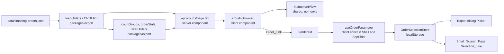

# Design Document

## Overview

This design implements `requirements.md` for `court-rules-page`: a public, server-rendered page at `/courts` that lists every instrument in `data/standing-orders.json`, a client-side filter, a link from each in-force instrument into the editor (`/?order=<id>`), three links back to the page, and four small repairs (print table headers, Open clears the old message, `.d.ts` files ignored, one vocabulary sentence).

Decisions taken from the requirements and the code read for this design. They bind the tasks.

- The list is rendered from the Loader (`ORDERS` from `@reveal-codes/export`), the same source as the Picker. No fetch, no API route, no new dependency, no new environment variable.
- The filter is one pure function, `filterOrders`, in `packages/export`. The page and its tests both call it. It is the only property-tested unit (Property 1). Everything else is covered by example tests and static scans, as the requirements state.
- Hydration safety: the server and the first client render both show every instrument and no control. The filter controls and the filtered view appear after mount. With scripts off the reader therefore sees every instrument (including those not in force) and no control (R1.4).
- `OrderSet` and every existing export keep their shape. The Loader adds `compiled` and `vocabulary` through a new subtype `OrderDataset` (R1.6). `loadOrders` and `ORDERS` return that subtype, which is assignable to `OrderSet`, so no existing caller or test changes.
- The editor reads `?order=` in one client effect after mount. `/` stays static (R8.6).
- Court order, instrument order and the numeric collation live in a pure function, `courtGroups`, in `packages/export`, so the page and its test use the same `localeCompare` call (R16.4).
- Arbitraries for Property 1 live in `packages/export/test/support/`, next to the existing `arbOrderChoice`. `tech.md` puts shared arbitraries in `packages/engine/src/testing/`, but the engine must not import `OrderEntry` from the export package, and `arb-declaration.ts` already records the same exception. R16.12 says "a shared `testing` module"; this design reads that as the export package's shared test support. Flagged for the user.
- The mark and wordmark are not placed on `/courts` (`ui.md` allows the mark in three places only).

Research: no outside source was needed. Findings that shaped the design came from the repository: `orders.ts` already validates the vocabulary (`checkVocabulary`) but discards it; `OrderSelectionStore` writes `localStorage` and the Export dialog reads it through `createOrderSelectionStore`; `app-shell.tsx` switches on `svc.viewport.width()` against `NARROW_WIDTH` (800); `runOpen` in `use-open-draft.tsx` clears `openNote` but not `notice`, which is the R13 defect; `BlockTable` in `print-view.tsx` styles every table through one `.table th, .table td { overflow-wrap: anywhere }` rule, which is the R12 defect; `tsconfig.base.json` sets `composite` and `emitDeclarationOnly`, so any `tsc` run that is not `tsc -b` with a correct `outDir` writes `.d.ts` beside sources (R14).

## Architecture



Server and client split of `/courts`:

1. `app/courts/page.tsx` (server) calls `getPublicLinks()` for Repo_Base, builds a plain-data view model from `ORDERS` (stats, groups, per-instrument display data, superseded link targets) and renders the heading, introduction, snapshot sentence, "Open the editor" link, and `<CourtsBrowser model={...} />`.
2. `CourtsBrowser` (client) holds the Filter_State. Before mount it renders every group and instrument and no control and no Count_Line. After mount an effect sets `mounted`, applies the hash rule (R5.4), and re-scrolls to the hash target because the controls change layout.
3. `InstrumentView` has no hooks and no browser API. The server and the client use the same component, which keeps the first client render equal to the server HTML.

Boundaries: `app/courts/` imports only from `src/` (the same rule as the `api/` routes in `structure.md`). `packages/export` stays pure: `filterOrders`, `courtGroups` and `orderStats` import nothing from `node:` or the DOM.

### Why the first render shows everything

The alternatives were (a) render the filtered default view on the server and (b) render everything and filter after mount. (a) hides superseded and rescinded instruments from readers with scripts off, which contradicts R1.3 and R1.4, and a hash link to a superseded instrument would land on nothing. (b) costs one frame in which not-in-force instruments are visible before the effect runs. (b) is chosen. No transition or animation is involved (R6.10).

## Components and Interfaces

### packages/export (pure)

New file `src/order-filter.ts`:

```ts
export type KindChoice = OrderKind | "all";
export type FilterState = Readonly<{ query: string; kind: KindChoice; showInactive: boolean }>;
export const CLEARED_FILTER: FilterState = { query: "", kind: "all", showInactive: false };

/** Lower-case, then drop every character that is not a letter or a digit (Unicode). */
export function normaliseText(text: string): string;

/** R6.4. Input order is preserved. */
export function filterOrders(entries: readonly OrderEntry[], state: FilterState): readonly OrderEntry[];
```

`normaliseText` uses `text.toLowerCase().replace(/[^\p{L}\p{N}]/gu, "")`. `filterOrders` keeps an entry when all three hold: `entry.status === "current" || state.showInactive`; `state.kind === "all" || state.kind === entry.kind`; and the normalised query is empty or is a substring of the normalised `court.name`, `court.abbreviation` or `judge.name` (the last only when `judge !== null`). A query that normalises to empty (for example `"..."`) matches everything, per R6.4.

New file `src/order-groups.ts`:

```ts
export type CourtGroupView = Readonly<{
  court: OrderCourt;                     // name and abbreviation of the group
  entries: readonly OrderEntry[];        // court-wide first, then judge-level; each run newest first, id ascending
}>;

export function compareAbbreviations(a: string, b: string): number; // a.localeCompare(b, "en", { numeric: true })
export function courtGroups(entries: readonly OrderEntry[]): readonly CourtGroupView[];

export type OrderStats = Readonly<{ total: number; courts: number; inForce: number; compiled: string }>;
export function orderStats(dataset: OrderDataset): OrderStats;
```

Ordering inside a group: `rank(entry)` (0 for `judge === null`, 1 otherwise), then `date` descending (ISO strings compare as text), then `id` ascending with plain code-unit comparison. The group's `court` object is that of its first entry in dataset order. `courtGroups` is applied to the already filtered list on the client, so empty groups are omitted by construction (R6.6).

Changes to `orders-types.ts`, `orders-parse.ts`, `orders.ts` (R1.6):

```ts
export type OrderVocabulary = Readonly<{
  kind: Readonly<Record<OrderKind, string>>;
  applies_to: Readonly<Record<AppliesTo, string>>;
  elements: Readonly<Record<OrderElement, string>>;
  "caption.placement": Readonly<Record<CaptionPlacement, string>>;
  status: Readonly<Record<OrderStatus, string>>;
}>;
export type OrderDataset = OrderSet & Readonly<{ compiled: string; vocabulary: OrderVocabulary }>;
```

- `parseRoot` also reads `compiled` (a string, else `err('orders: "compiled" is missing or malformed')`).
- `checkVocabulary` already verifies that every value used by an entry is a key of its vocabulary group. A new `readVocabulary(raw)` step returns the typed `OrderVocabulary` and fails the load when any member of an enumerated list is absent from its group or is not a string. The shipped dataset has all 5 groups complete, so loading still succeeds. Errors use the existing message style (`orders: vocabulary "status" lacks "proposed"`).
- `loadOrders` returns `Result<OrderDataset, string>` and `ORDERS` is an `OrderDataset`. `index.ts` additionally exports `OrderDataset`, `OrderVocabulary`, `filterOrders`, `normaliseText`, `CLEARED_FILTER`, `FilterState`, `KindChoice`, `courtGroups`, `compareAbbreviations`, `orderStats` and `CourtGroupView`. No existing export changes.

### apps/web: the page

`src/order-copy.ts` gains `placementWords: Record<CaptionPlacement, string>` (typed over every value, so a new placement fails to compile), with these words: `first_page_heading` "Heading on the first page", `statement_title` "Title of the statement", `separate_declaration` "Separate declaration". `kindWords` and `appliesWords` are reused as they are.

New files:

| File | Role |
| ---- | ---- |
| `app/courts/page.tsx` | Server component. Exports `metadata` (title and description only, R11) and the default `Page`. |
| `app/courts/courts.module.css` | One CSS module for the page. Heights and layout only; control rules live in `globals.css` (R10.8). |
| `src/courts/view-model.ts` | Pure `buildCourtsModel(dataset, repoBase)` returning plain data: `stats`, `repoLinks`, and `instruments` keyed by id (display fields, Element_Words, Placement_Words, status sentence, superseded target id and title, Order_Link href). |
| `src/courts/intro.ts` | Pure `introText(stats, repoLinks)` returning the paragraph parts. Figures come from `orderStats`; none is a literal (R2.2). |
| `src/courts/courts-browser.tsx` | Client component with the Filter_State, the controls, the Count_Line and the group list. |
| `src/courts/instrument-view.tsx` | Hook-free component for one instrument. |
| `src/courts/hash.ts` | Pure `showInactiveForHash(hash, instruments)` returning true when the hash names a not-in-force instrument. |

The Filter_State type is the one from `packages/export`. `CourtsBrowser` props: `Readonly<{ entries: readonly OrderEntry[]; model: CourtsModel }>`. `entries` is the full list in dataset order; the view model holds everything else. This serialises the dataset once into the RSC payload (41 entries, a few tens of kilobytes).

Page structure (single column, no width at-rule):

```
<main>
  <h1>Federal court rules on AI in filings</h1>
  <p>{introduction}</p>
  <p>{snapshot sentence}</p>
  <p><a href="/">Open the editor</a></p>
  <CourtsBrowser>
    [after mount] <form role="search"> labelled text box, labelled kind select, labelled checkbox </form>
    [after mount] <p role="status">Showing n of m</p>
    <section aria-labelledby=...> <h2>Court name (abbr.)</h2>
      <article id="<entry.id>"> <h3>title</h3> ... </article>
    </section>
</main>
```

`InstrumentView` shows, in order: title (`h3`, `instrument` when the title is empty); the `instrument` name; judge name and role when present; kind and applies-to words; `date` and `date_note`; the "Not in force." line with the status sentence, plus a link `#<superseded_by>` titled with that instrument's title when `superseded_by` is set; the elements list (omitted when empty); the caption text and Placement_Words (when present); `<blockquote>` with the key language in curly quotation marks (`curlyQuoted`); "Read the court's text" (`target="_blank" rel="noreferrer"`); and, for In_Force instruments only, "Draft under this rule" to `/?order=${encodeURIComponent(id)}`. `retrieved`, `source_kind` and `notes` are never read.

"Not in force." is a text line, so status never depends on colour (R10.10). If a `superseded_by` id names no entry, the view model drops the link and keeps the sentence; the dataset check `checkReferences` already rejects that case at load, so this is a guard and not an expected path.

`CourtsBrowser` effect on mount:

```ts
useEffect(() => {
  const id = decodeHash(window.location.hash);               // "" when no hash
  const inactive = showInactiveForHash(id, model.inactiveIds);
  setState((s) => (inactive ? { ...s, showInactive: true } : s));
  setMounted(true);
}, []);
useEffect(() => { if (mounted) scrollToHash(); }, [mounted]); // second effect: after the controls have laid out
```

`scrollToHash` calls `document.getElementById(id)?.scrollIntoView()`. The browser's own scroll at load covers the case of no controls; the effect repeats it once the controls have shifted the layout (R5.3). `decodeHash` wraps `decodeURIComponent` and returns the raw text if decoding throws a `URIError`; this is the boundary-handling exception, narrowed to that one error type and returned as a value rather than swallowed.

Count_Line: `<p role="status">Showing {n} of {m}</p>` with `n = filtered.length`, `m = entries.length`. When `n === 0` the sentence "No rule matches. Clear the filter to see every rule in force." follows it (R6.9).

Controls: `<input type="text">`, `<select>` with "All kinds" then one `<option>` per `ORDER_KINDS` member with `kindWords[kind]`, and `<input type="checkbox">`, each with a `<label>`. Initial state is `CLEARED_FILTER`.

### apps/web: Court_Rules_Link in three places

`src/courts/links.ts` exports `COURT_RULES_PATH = "/courts"`, `COURT_RULES_SHORT = "Court rules"` and `COURT_RULES_LONG = "See all court rules"`.

- `Toolbar` (`components/toolbar.tsx`): one `<a href="/courts" target="_blank" rel="noreferrer">Court rules</a>` placed after the notice `div`, as the last child. `toolbar.module.css` gives it `margin-left: auto` only if the notice does not already take the free space; the notice currently sits last and flexes, so the link is added after it with a fixed width and no height change. No `data-primary`; the 52px height and the three button groups are untouched (R9.5).
- `OrderPicker` (`components/order-picker.tsx`) is rendered by `ExportDialog`; the link goes in `ExportDialog` directly beside the Picker's field wrapper, with `target="_blank" rel="noreferrer"` and text "See all court rules". The Picker component is not changed.
- `SmallScreenPage`: a `links` row that always renders. The Court_Rules_Link is first, in the same tab (no `target`), and is present with both public addresses unset. The existing `links.video === null && links.repo === null ? null` guard is removed and each of the three links is conditional on its own value.

### apps/web: the Order_Parameter

New hook `src/components/use-order-parameter.ts`:

```ts
export type OrderParameterResult = Readonly<
  { kind: "none" } | { kind: "ignored" } | { kind: "applied"; entry: OrderEntry }
>;

/** Pure: classify the raw parameter value against the dataset. */
export function classifyOrderParameter(orders: OrderSet, raw: string | null): OrderParameterResult;
```

- `raw === null` gives `none`. A value for which `orderById(orders, raw)` returns an entry gives `applied`. Any other value, including the id of a superseded instrument, gives `ignored` (R8.3, R8.4). `orderById` already returns only `status === "current"` entries, which is exactly the Selectable_Instrument rule.
- The effect `useOrderParameter(svc, orderStore, onApplied)` runs once after mount in `AppShell`, not in `Shell`, because `AppShell` is mounted at every width and the Shell is mounted only at 800px and wider (R8.7). It reads `new URLSearchParams(window.location.search).get("order")`, classifies it, and, for `applied`, calls `orderStore.set({ entryId })`. In every case other than `none` it then removes the parameter with `window.history.replaceState(window.history.state, "", pathWithoutOrder)`: no new history entry, no reload (R8.5). Other query parameters and the hash are kept.
- `AppShell` already creates the Shell lazily. To share one `OrderSelectionStore` between the effect, the Export dialog and the Small_Screen_Page, `AppShell` creates it with `useMemo(() => createOrderSelectionStore(svc.storage, ORDERS), [svc.storage])` and passes it to `Shell` (which passes it to `useExport`, replacing the store `use-export.tsx` creates itself at line 101) and to `SmallScreenPage`. `print-view.tsx` keeps creating its own store; it only reads.
- Toolbar_Notice (R8.2): when the Shell is mounted and an `applied` result is pending, `Shell` dispatches `{ type: "notice", text: \`Court rule selected: ${entry.court.abbreviation}, ${optionText(entry)}.\` }`. At 800px and wider this happens in the same effect as the store write. Below 800px the effect writes the store and dispatches nothing; when the viewport later widens the Shell mounts and, because the notice is only dispatched by the effect that read the parameter, no late notice appears (R8.7 says "silently"). The Shell shows the selection through the Export dialog Picker, which reads the store.
- Selection_Line (R8.9 to R8.12): `SmallScreenPage` takes `selection: OrderEntry | null`. `AppShell` computes it from `orderStore.get()` only when this page load applied a parameter (kept in a `useRef` set by the effect), so a selection stored by an earlier Export-dialog choice does not produce the line. The line is `Selected: ${entry.court.abbreviation}, ${optionText(entry)}. Open this page on a wider screen to draft under it.`, plain text, rendered after the introductory sentences and before the links row. Because the ref changes after mount, `AppShell` holds the applied entry in `useState` so the small-screen page re-renders.

### apps/web: Open clears the old message (R13)

In `runOpen` (`use-open-draft.tsx`), the first line becomes two dispatches: `store.dispatch({ type: "notice", text: null })` and `store.dispatch({ type: "openNote", text: null })`, both before `await openFile(file)` and therefore before any confirm dialog opens. `refuseSeveral` already sets `openNote` to null first; it gets the same `notice` reset. The test opens a refused file, then opens a valid second file while the draft is non-empty, and asserts that neither the Toolbar_Notice nor the Open_Note holds "Could not open <name>." while the confirm dialog is open.

### apps/web: print override table (R12)

`BlockTable` gets a `className` of `styles["table"]` plus `styles["overrides"]` when `props.columns` equals `OVERRIDE_COLUMNS` (imported from `@reveal-codes/export`; it is exported from `wording.ts`, which `index.ts` is checked for in the tasks). `print-view.module.css`:

```css
.overrides th { overflow-wrap: normal; word-break: keep-all; }
.overrides th:nth-child(1),
.overrides td:nth-child(1) { min-width: <code-width>ch; }
.overrides th:nth-child(4),
.overrides td:nth-child(4) { min-width: 26ch; }
```

The timestamp column holds a 20-character UTC value, so 20 plus padding. `<code-width>` is the length of the longest code text in the print model plus padding; the task computes it from the codes that can fail (`CIT ✘`, `CIT ≠`, `CIT ?`, `CIT …`, `QUO ✘`, `QUO …` with brackets, the longest being 7 characters), so 7 plus padding gives 10ch with `padding: 2px 6px`. The body-cell rule `overflow-wrap: anywhere` is untouched (R12.3). The stylesheet test reads the CSS file, finds the `.overrides th` rule, and asserts both declarations and the two `min-width` values; it fails on the current file because the rule does not exist.

### Repository hygiene

- `.gitignore` gets `*.d.ts` and `!apps/web/src/css-modules.d.ts`. `next-env.d.ts` and `/vitest.config.d.ts` are already listed and stay.
- The emitting process (R14.2): the only declaration setting in the repository is `tsconfig.base.json` (`composite`, `declaration`, `emitDeclarationOnly`). `packages/export/test/tsconfig.json` and `crew/sentinel/tsconfig.json` both set `outDir`, so `tsc -b` writes to `dist/`. A `.d.ts` beside the sources therefore comes from a `tsc` run that ignores those project files, for example `tsc <file>` or an editor or hook running `tsc` with default options. The task searches `package.json` scripts, `.kiro/hooks/*.json`, `.github/workflows/ci.yml`, `scripts/` and `vitest.config.ts`, fixes the one it finds, and otherwise writes the search list into `BUILD_LOG.md` as R14.3 requires. The `.gitignore` entry is the fix that is certain.
- `data/standing-orders.json`: one string replaced, `vocabulary.elements.negative_certification_when_unused`, with the exact text of R15.1. A test compares the entries array of the new file with `git show HEAD:data/standing-orders.json`'s entries through `JSON.stringify`, which stays valid as long as the formatting is not changed. `pnpm power:build` regenerates the Power_Copy; a test asserts the two files are byte-equal.
- Docs: README line, `docs/KIRO_USAGE.md` spec entry, `BUILD_LOG.md` entry, `.env.example` comment, `ui.md` paragraphs (the 1150px minimum applies to the Shell only; `/courts` is one column from 320px; text input, checkbox and quotation rules). The README figures ("41 ... 27 ... 36") stay literal because the README tests already pin them; this page computes its own.

## Data Models

```ts
type OrderDataset = OrderSet & { compiled: string; vocabulary: OrderVocabulary };   // packages/export

type CourtsModel = Readonly<{
  stats: OrderStats;                              // total, courts, inForce, compiled
  repoLinks: Readonly<{ dataset: string; readme: string }> | null;
  inactiveIds: readonly string[];                 // ids with status !== "current"
  words: Readonly<{                               // everything InstrumentView needs from the vocabulary
    status: Readonly<Record<OrderStatus, string>>;
    elements: Readonly<Record<OrderElement, string>>;
  }>;
  titles: Readonly<Record<string, string>>;       // id -> display title, for superseded_by links
}>;
```

`repoLinks` is derived from `getPublicLinks().repo`: trailing slashes are removed with `repo.replace(/\/+$/, "")`, then `/blob/main/data/standing-orders.json` and `/blob/main/data/README.md` are appended. A null `repo` gives null and the page contains no repository link (R2.5, R2.6). `getPublicLinks()` runs on the server in `app/courts/page.tsx`, the only place that reads it for this page, so `process.env` is still read only in `server/deps.ts`.

The only new persisted or transported values are the query parameter `order` and the existing `reveal-codes:order:v1` key, which keeps its format.

## Correctness Properties

*A property is a characteristic or behavior that should hold true across all valid executions of a system-essentially, a formal statement about what the system should do. Properties serve as the bridge between human-readable specifications and machine-verifiable correctness guarantees.*

Only the filter has a property-based test, as the requirements ask. The prework classified the rest of the acceptance criteria as example, static-scan or non-testable. Grouping and ordering (R3) is a pure function that could take a property; it is deliberately left to example tests against the shipped dataset, as R16.4 specifies, to keep the scope the requirements set.

Reflection on redundancy: R6.4 (the three-way rule) and R6.8 (cleared controls select exactly the In_Force entries) were both marked PROPERTY. R6.8 is R6.4 with the state fixed, so one property covers both, with the state arbitrary biased toward the cleared state. R6.5 (filter is one pure function) is a structure statement, covered by the boundary scan.

### Property 1: The filter selects exactly the entries the rule names

*For any* list of instruments, any query text, any kind choice (one kind or "all kinds") and any checkbox state, `filterOrders` returns exactly the entries for which all of these hold, in the input order and with no entry repeated: the entry is In_Force or the checkbox is ticked; the kind choice is "all kinds" or equals the entry's `kind`; and the Normalised_Text of the query is empty or is a substring of the Normalised_Text of the entry's `court.name`, of its `court.abbreviation`, or of its `judge.name`. *For any* list of instruments, when the query is empty, the kind choice is "all kinds" and the checkbox is not ticked, the result is exactly the entries whose status is `current`.

**Validates: Requirements 6.4, 6.8, 16.11**

## Error Handling

- The dataset fails its own validation: `ORDERS` throws at module load (existing behaviour, D4). Build and tests fail; no page is served. `readVocabulary` adds its failures to the same path.
- `?order=` that is absent, unknown, or names an instrument that is not In_Force: no selection change, no notice, no Open_Note, no error. The parameter is still removed, except when absent.
- `localStorage` throws on write: `createOrderSelectionStore` already keeps the value in memory after a failed write (D16); `set` does not throw. The Selection_Line and the Picker read through `get()`, so they still see it.
- `window.history.replaceState` throws (some sandboxed frames): the effect catches the `DOMException` at this boundary only, leaves the address as it is, and keeps the selection already stored. It does not rethrow, because the selection is applied and the address cleanup is cosmetic; the catch narrows to `DOMException` and is covered by one example test so that it does not swallow other errors.
- A hash that is not valid percent-encoding: `decodeHash` returns the raw text, which names no instrument, so the filter stays at its initial state.
- `NEXT_PUBLIC_REPO_URL` unset, blank or not http(s): `repoLinks` is null; the page has no repository link.
- A `source_url` that is not http(s) cannot occur: `checkUrls` rejects it at load.

## Testing Strategy

Property-based testing applies to one unit, the filter. The page, the editor wiring, the print stylesheet, the repository checks and the documentation are rendering, side-effect, CSS and configuration work, so they get example tests and static scans (`vitest`, no network, no snapshots).

### Property test

- File: `packages/export/test/order-filter.properties.test.ts`. Library: fast-check with vitest, no from-scratch implementation.
- One `fc.assert(fc.property(...))` for Property 1, with the comment `// Property 1` above it, a describe title containing `_Requirements: 6.4, 6.8_`, and `numRuns: runs()` from `packages/export/test/support/arbitraries.ts` (`FC_NUM_RUNS`, else 500 in CI, else 200; satisfies R16.12).
- Tag: **Feature: court-rules-page, Property 1: The filter selects exactly the entries the rule names**.
- Oracle: the test states R6.4 directly as `entries.filter(...)` over normalised strings, written independently of `filterOrders` (it must not call `normaliseText`; it spells the lower-casing and character removal once, in the test). It asserts equality of the id lists, so the order, duplicates and omissions are all checked. For the cleared state it also asserts equality with `entries.filter((e) => e.status === "current")`.
- Arbitraries, in `packages/export/test/support/arb-order-filter.ts`, built from combinators so values shrink:
  - `arbOrderEntries`: `fc.array` of entries with a short-text pool for `court.name`, `court.abbreviation` and `judge` (null or name), the five kinds and the six statuses; duplicates of names are likely so that matches happen.
  - `arbFilterState(entries)`: `fc.oneof` with weight on `CLEARED_FILTER`, a state whose query is a substring of one entry's court name, abbreviation or judge name, a state whose query differs from such a substring only in case, punctuation and spacing, and a state with a query that matches nothing (a string over a disjoint alphabet); the kind choice is "all" or one of the five kinds; the checkbox is a boolean (R16.13).
  - Whitespace-only, punctuation-only and empty queries are in the pool, to cover the empty-after-normalisation case.
- No `try/catch` and no snapshot. Failure records the shrunk counterexample as a named example test next to the property (`testing.md`).

### Example tests (all with fakes for services, storage and viewport)

| Area | Tests |
| ---- | ----- |
| Loader (R1.6, R15) | `loadOrders` returns `compiled` and a complete `vocabulary`; a vocabulary missing one status word makes the load fail with the new message; the new `negative_certification_when_unused` sentence; entries unchanged; Power_Copy byte-equals the Dataset. |
| Page content (R1 to R5, R7, R16.1 to R16.3) | Render the server component to a string: every id appears exactly once as an `id` attribute; intro figures equal `orderStats`; each superseded link target exists on the page; a superseded id has no Order_Link and an In_Force id has the encoded one; no `retrieved`, `source_kind` or `notes` text; Repo_Base unset, set with a trailing slash and set without one (R16.9); metadata has exactly `title` and `description`. |
| Order (R3, R16.4) | Group order equals the order computed with the same `compareAbbreviations`; a synthetic list with "5th Cir." and "10th Cir. BAP" puts 5th first; court-wide before judge-level; newest first; id tie-break. |
| Filter UI (R6) | Controls absent before mount and present after; initial state; the checkbox is ticked from a hash that names a superseded id; Count_Line text and `role="status"`; empty-result sentence; empty groups omitted. |
| Order_Parameter (R8, R16.5, R16.6) | Valid, unknown and superseded ids at 1280px: store contents, notice text, parameter removed through `replaceState` with the history length unchanged. At 600px: store set, no notice, parameter removed, Selection_Line text with court abbreviation and `optionText`; unknown, superseded and absent each leave no Selection_Line; a selection stored earlier from the dialog gives no line. Status_Line text unchanged. |
| Links (R9, R16.8) | Export dialog link beside the Picker with `target="_blank"` and `rel="noreferrer"`; small-screen link is the first link, has no `target`, and renders with both public addresses unset; Toolbar link is last, an `a`, has no `data-primary`. |
| Print (R12) | CSS test on `print-view.module.css` that fails against the current file. |
| Open (R13) | Refuse a file, then open a second file with a non-empty draft; no "Could not open" text while the confirm dialog is open. |
| Repository (R14) | `git ls-files` lists no `.d.ts` other than `apps/web/src/css-modules.d.ts`. |
| Static scans (R10, R16.10) | `css-rules.test.ts`, `css-colours`, `copy-rules`, `forbidden`, `boundaries` and `inventory` are extended to cover `app/courts/` and `src/courts/`: tokens only, allowed sizes and weights, no `@media (min-width|max-width)` other than the Shell's 799px rule, no icon, no emoji, no shadow, gradient, radius, animation or transition, and `app/courts/` imports only from `src/`. |

Width at 320px (R10.2) cannot be measured in jsdom. The tests assert its causes: the stylesheet has no fixed width above 100%, `overflow-wrap: anywhere` on text, and `max-width: 100%` on the list. The user's walk checks the rest, as the requirements say.

### Task order (for `tasks.md`)

1. Loader and vocabulary, the one dataset sentence, Power copy (R1.6, R15).
2. `filterOrders`, `courtGroups`, `orderStats` and Property 1 (R3, R6.4, R16.11 to R16.13).
3. The page and its client browser (R1 to R7, R10, R11).
4. Order_Parameter, three links (R8, R9).
5. The three repairs (R12 to R14).
6. Scans, docs, `docs/KIRO_USAGE.md` and `BUILD_LOG.md` (R16.10, R17).

Each step lands its tests before the next begins. Nothing is committed or pushed by this spec.

## Follow-up design (Requirements 18 to 25)

- **R18 wording.** `NotInForce` in `instrument-view.tsx` prints `Not in force.` then, when the replacing title is known, `Replaced by <a>title</a>.`. It no longer reads `vocabulary.status`. The `words.status` field may stay in the model only if another reader uses it; otherwise it is removed from `view-model.ts`. The field-name test (R18.3) renders the page to shown text (tags stripped, attribute values and link targets excluded) and checks it against the schema-shaped keys collected from the shipped file: every key in an entry, in `vocabulary` and at the top of the file that contains an underscore or an interior capital. It fails on any of those as a whole word and on any word that contains an underscore. Keys that are ordinary English words (`court`, `text`, `instrument`, `compiled`) are page words and are not checked.
- **R19 roles.** `orders-types.ts` gains `ORDER_ROLES = ["district","magistrate","senior","chief"] as const` and `OrderRole`; `OrderJudge.role` is `OrderRole`; `orders-parse.ts` rejects any other value as `orders: entry <id>: "role" has unknown value "<value>"`. `order-copy.ts` gains `roleWords: Record<OrderRole, string>` (`Judge`, `Magistrate Judge`, `Senior Judge`, `Chief Judge`) and `judgeLine(judge)`. Both are exported from the package index and the web copy.
- **R20.** `InstrumentView` prints the instrument line only when `entry.title !== "" && entry.title !== entry.instrument`.
- **R21 layout.** `courts/page.tsx` renders `<div className={styles.desk}><main className={styles.page}>…`. `.desk` is `min-height: 100vh; background: var(--desk)` and `.page` is `max-width: var(--page-max); min-height: 100vh; margin: 0 auto; background: var(--paper)` with fluid padding from `clamp` or `max` (no at-rule). The header reuses `Mark` and the wordmark style of `small-screen-page.module.css`, as one `<a href="/">`. Each article has the title (`h3`), a `.meta` block (`--font-ui`, `--muted`), then a `.asks` block.
- **R21 type assignments (all from the allowed lists):**

| Level | Family | Size / line | Weight | Colour |
| ----- | ------ | ----------- | ------ | ------ |
| Page title (`h1`) | Libre Caslon Text | 26 / 32 | 400 | `--ink` |
| Court heading (`h2`) | Libre Caslon Text | 20 / 26 | 400 | `--ink` |
| Instrument title (`h3`) | Libre Caslon Text | 18 / 26 | 400 | `--ink` |
| Not in force line | Public Sans | 13 / 18 | 700 | `--ink` |
| Judge, kind, date (`.meta`) | Public Sans | 13 / 18 | 500 | `--muted` |
| `Requires` label | Public Sans | 10.5 / 16, uppercase, 0.1em | 700 | `--muted` |
| Requirements, required heading, key language | Libre Caslon Text | 14 / 22 | 400 | `--ink` |
| Links | as today | as today | as today | `--oxblood`; `min-height: 34px`, `display: inline-flex`, `align-items: center` |

- **R22.** `compareAbbreviations` strips `/[\s.]/g` from both sides, then calls `localeCompare(…, "en", { numeric: true })`. The page test and the ordering test use the same function.
- **R23.** `compiled` is a value in the file; the test reads the file and compares with the maximum `retrieved`. The curator agent and skill gain the step. `data/README.md` and `README.md` dates are updated if they state the compile date.
- **R24.** `.overrides` Code and Timestamp columns get `white-space: nowrap; width: 1%`; the Reason column is left at `width: auto` and wraps by word (`overflow-wrap: break-word`, not `anywhere`, for that column).
