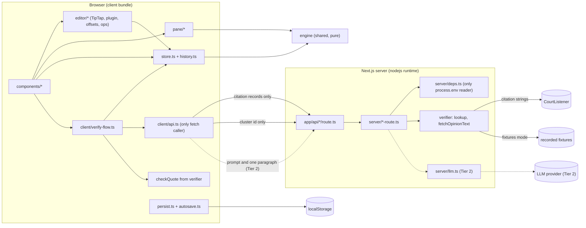
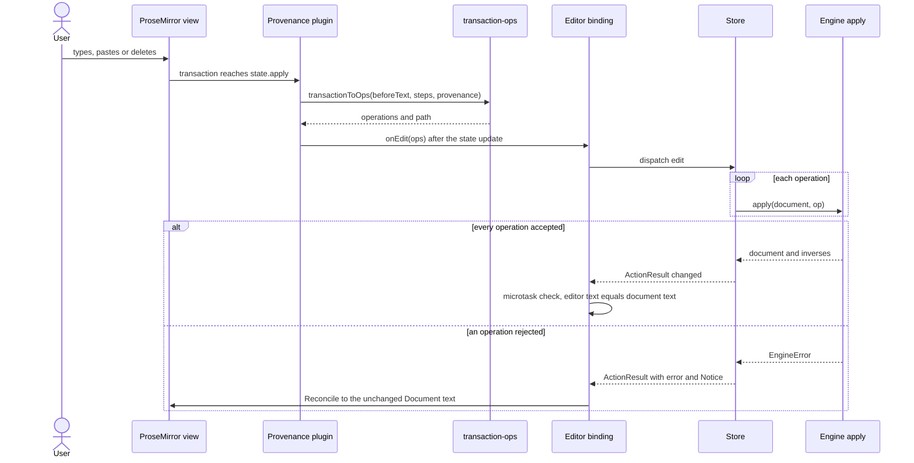
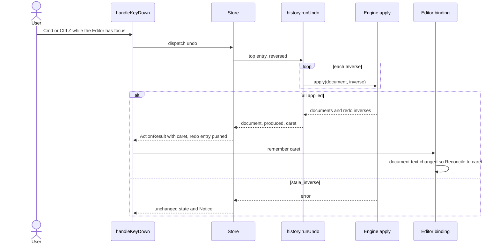
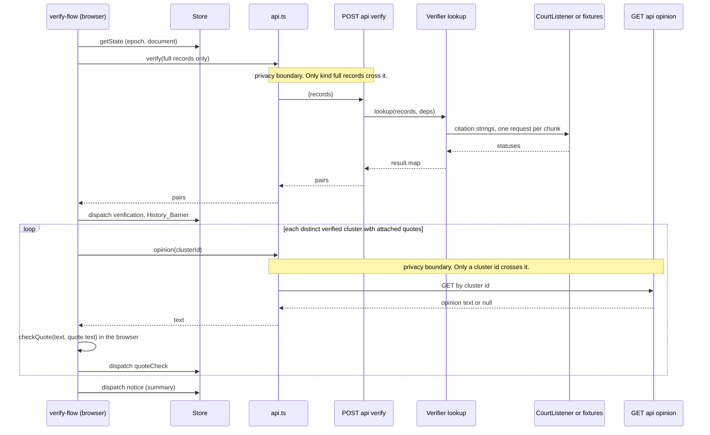
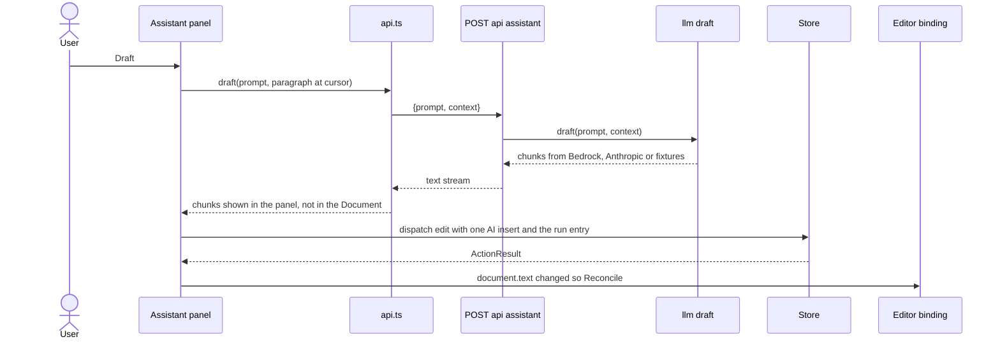

# Design Document: editor-app

## Overview

`apps/web` is the Reveal Codes editor: one Next.js page at `/` where a self-represented litigant pastes a draft, presses Alt-F3 to see the provenance codes, presses Verify to check every citation and quotation, and sees which problems block export. The app is a thin shell over three existing pieces and changes none of them: the Engine (`@reveal-codes/engine`) owns the document, the Verifier (`@reveal-codes/verifier`) checks citations and quotations, and TipTap on ProseMirror is the editing surface. This design was checked against the real engine and verifier source, and the demo path of Requirement 21 was run once through the real engine, the real verifier and the recorded fixtures (see "Demo path walkthrough").

Design goals, in priority order:

1. **One source of truth.** The app holds one Engine `Document` in a Store. The ProseMirror document is a derived view. Every user edit becomes Engine `CallerOperation` values passed through `apply`; when the Engine text and the editor text differ for any reason, the editor yields (Reconcile).
2. **Captured provenance.** Origin comes from the kind of transaction that inserted the text. The Provenance_Plugin is the only module that assigns an origin to a user edit. Nothing infers origin from content, and nothing in the app constructs `AI>HUM`.
3. **Privacy by construction.** The only request body that carries document-derived data is the Verify request, and the function that builds it can return nothing but `kind: "full"` citation records. Quotation text is checked in the browser. The server never receives draft text except in the Tier 2 assistant route.
4. **Everything works with no credentials.** No token selects Fixtures_Mode; no LLM credentials select the recorded-response provider. The whole demo path runs offline.
5. **Small, pure, testable modules.** Functions stay under 40 lines and modules under 300 (tech.md). Everything that can be a pure function is one: offsets, step mapping, history, layout, request building, config reading. Components are thin.

### Decisions this design fixes

| Item | Decision |
|---|---|
| Store shape | `store.ts` holds a pure `reduce(state, action, now)` that returns an `ActionResult` (new state, `changed`, `error`, `skipped`, `caret`). React's `useReducer` cannot return a side value, so a 40-line `createStore` in `store-runtime.ts` wraps `reduce` and exposes `getState`, `dispatch` (returns the `ActionResult` synchronously), and `subscribe`; components read it with `useSyncExternalStore`. No state library. |
| Undo group order | A group is stored in chronological (application) order. Undo applies it reversed; the redo group is the reverse of the Inverses that undo produced, so it is chronological too; redo applies it forward and the Undo group is exactly what redo produced. This is Requirement 8.5 and 8.6 with the order made explicit. |
| Where origin is assigned | A plugin-state field computes the operations for each transaction (a pure function of the transaction); the plugin view flushes them to `onEdit` once per state update. The plugin also owns paste, drop and key handling, so every edit entry point lives in one module. |
| Self-checking step mapper | `transactionToOps` string-splices its own output and compares it with the document it built from the steps after each step. A mismatch switches to the Requirement 5.5 fallback. The Mirror_Invariant therefore holds by construction, and Property 2 tests the relationship from outside. `mapSteps` also reports which path it took, so example tests can assert that ordinary edits take the mapped path. |
| Editor drift safety net | After every flush to the Store the Editor compares its text with `document.text` in a microtask and Reconciles on any difference. A rejected edit (Requirement 6.4) and any bug in the mapper end the same way: the editor yields to the Engine. |
| Placeholder | `@tiptap/extension-placeholder` is not in the Requirement 1 list and Requirement 1.1 loads three extensions only, so the placeholder is an `aria-hidden` overlay element shown while `document.text === ""`, plus `aria-placeholder` on the content element. |
| Bundler | Webpack, not Turbopack: `next dev --webpack`, `next build --webpack`. The Engine imports its siblings with `.js` specifiers that name `.ts` files; webpack maps them with `resolve.extensionAlias`, and Turbopack has no equivalent (vercel/next.js issue 82945, status in 16.4.5 not confirmed). See "Next.js specifics" and risk R1. |
| Verifier in the browser | `checkQuote` is imported from the `@reveal-codes/verifier` entry point. That entry point also re-exports the file cache, which imports `node:fs/promises` and `node:path`; the client webpack config maps those to empty modules. The Verifier package is not changed. |
| Route method guards | Each route file exports its real handler plus explicit `405` handlers for the other methods, so the `405` carries `Cache-Control: no-store` (Requirement 16.6). Next.js would otherwise answer `405` itself without the header. |
| Body size | The Verify route reads the body as a stream and stops at 262 144 bytes, so an oversize body is rejected without buffering it. |
| Record guard | The Verify route validates each record deeply enough that the Verifier's `buildLines` cannot throw (it reads `citation.value` fields). A structurally broken record is `400`. |
| `jsdom` version | `jsdom` is pinned to 28.1.0, the newest line whose engines range includes the repository floor `>=22.12.0` (31.0.0 needs `>=22.22.2`). See Notes. |
| `zod` | `ai` and both provider packages declare `zod` as a required peer; `zod` is added as an exact-pinned dependency of the Tier 2 group (Requirement 1 notes already anticipated it). |

### Research findings that inform the design

Registry versions were read from npm during this design phase. TipTap, ProseMirror and the AI SDK are **not installed in this workspace** (`apps/web/node_modules` holds only `next`, `react`, `react-dom`, `@types`), so TipTap and ProseMirror API behaviour in this document comes from the packages' published metadata and documented APIs, not from running them. Task group 1 therefore opens with a smoke test of every API assumption in "API notes" (risk R3).

| Package | Version to pin | Why this one |
|---|---|---|
| `@tiptap/core`, `@tiptap/react`, `@tiptap/pm`, `@tiptap/extension-document`, `@tiptap/extension-paragraph`, `@tiptap/extension-text` | `3.33.0` (all six) | `@tiptap/react` and `@tiptap/core` declare `@tiptap/pm` and each other at exactly 3.33.0; `@tiptap/pm` bundles `prosemirror-model` 1.25.x, `prosemirror-state` 1.4.x, `prosemirror-transform` 1.12.x, `prosemirror-view` 1.42.x. The editor imports ProseMirror only through `@tiptap/pm/*` subpaths, so there is one copy. |
| `@testing-library/react` | `16.3.3` | Peers: `react`/`react-dom` 18 or 19, `@testing-library/dom` ^10, `@types/react`. |
| `@testing-library/dom` | `10.4.2` | Required peer of the line above (Requirement 1 notes). |
| `jsdom` | `28.1.0` | Engines `^20.19 \|\| ^22.12 \|\| >=24`; matches the repository's `>=22.12.0 <23`. |
| `fast-check` | `4.10.2` | Same pin as the engine and verifier; added to `apps/web` devDependencies because pnpm does not hoist it. |
| `ai` | `7.0.165` (Tier 2) | Peer `zod` ^3.25.76 or ^4.1.8. |
| `@ai-sdk/amazon-bedrock` | `5.0.135` (Tier 2) | Peer `zod`, same range. |
| `@ai-sdk/anthropic` | `4.0.99` (Tier 2) | Peer `zod`, same range. |
| `zod` | `4.6.7` (Tier 2) | Satisfies the peer range. |

Already pinned in `apps/web/package.json` and kept: `next` 16.4.5, `react` and `react-dom` 19.3.1, `@types/*`. Root: `vitest` 5.1.0, `typescript` 5.9.3, `jiti` 2.7.0. Node 22.23.4 is installed locally.

Facts read from the code that shape the design:

- **Engine.** `apply(doc, op)` returns `Result<Applied, EngineError>` with `Applied = { document, inverse }`. An Inverse holds `expect: Document` and applies only to a structurally equal Document (`stale_inverse` otherwise). A no-op operation returns the same Document object. `Replace` with empty text delegates to `Delete`; with `from === to` it delegates to `Insert`. `setVerification`, `setQuoteCheck` and `recordOverride` return a new Document and no Inverse. `issues(doc)` lists a citation only when its result is not `verified`; a short form is an Issue only when it is an orphan. `render(doc, "display")` returns `{ text, positions }` where text characters `\`, `[`, `]` are escaped with a backslash and every other character, including `\n`, is raw.
- **Display code tokens.** `[` + name + optional `:` retained payload + `]`, for example `[PST]`, `[AI:r1]`, `[CIT ?:2]`, `[OVR:reason]`, `[/CIT]`. Names are fixed by the Engine (`CODE_NAMES`). The retained payload escapes `\ [ ] {`.
- **Verifier.** The package entry is `./src/index.ts` (one export path). It imports siblings without extensions, and `fixtures.ts` imports JSON with `with { type: "json" }`. `createDeps(init)` trims a trailing `/` from `baseUrl` and builds fresh state. `lookup` never rejects; `fetchOpinionText` returns `null` on any failure; `checkQuote` is total. Its 15 s request timeout is a race against `Deps.sleep(15000)`: **a `sleep` that resolves immediately makes every request time out** (observed while checking the demo path), so the server's `sleep` must be a real, abortable timer in Fixtures_Mode too.
- **Fixtures.** The recorded corpus serves Ashcroft v. Iqbal (cluster 145875, opinion 9435339) and Haines v. Kerner (cluster 108432, opinion 108432); the three fabricated citations are explicit 404 entries.
- **Repository.** `apps/web/tsconfig.json` is composite with DOM libs and `jsx: react-jsx`; the root `vitest.config.ts` already declares a `web` project (`include: test/**/*.test.ts`, node). `.npmrc` sets `reporter=silent`. CI runs `lint`, `typecheck`, `test`, `test:pbt`.

## Architecture



### Trust boundary rules

| Rule | Where it is enforced |
|---|---|
| Draft text never reaches the server except in the Tier 2 assistant route. | `buildVerifyBody` returns `{ records }` of `kind: "full"` records only (Property 5); the route rejects anything else with `400`. |
| Quotation text is checked in the browser. | `verify-flow.ts` calls `checkQuote(opinionText, quote.text)` locally; `GET /api/opinion/<id>` carries only a cluster id. |
| The token exists only inside `Deps`. | `readServerConfig` returns it only in `live` mode; `buildServerDeps` is its only consumer; no route handler reads it; responses are scanned for a sentinel token in tests. |
| `process.env` is read in one file. | `server/deps.ts`; static test (Requirement 2.3). |
| `fetch` is called in two places. | `client/api.ts` (browser) and `server/deps.ts` plus Tier 2 provider files (server); static test (Requirement 2.6). |
| Server code never reaches the client bundle. | Import-boundary static test below. |

### Import boundaries (enforced by `test/static/boundaries.test.ts`)

| Module group | May import | Must not import |
|---|---|---|
| `store.ts`, `history.ts`, `store-runtime.ts`, `persist.ts`, `autosave.ts`, `notices.ts` | `@reveal-codes/engine` | React, `@tiptap/*`, DOM globals, `server/`, `client/` |
| `pane/layout.ts` | `@reveal-codes/engine` | React, TipTap, `server/` |
| `editor/offsets.ts`, `editor/slice-text.ts`, `editor/transaction-ops.ts`, `editor/schema.ts` | `@tiptap/core`, `@tiptap/pm/*`, `@reveal-codes/engine` | DOM globals, React, `server/` |
| `client/*` | `@reveal-codes/engine`, `checkQuote` and types from `@reveal-codes/verifier` | `server/`, `node:*` |
| `server/*` | `@reveal-codes/engine`, `@reveal-codes/verifier`, `node:*`, AI SDK (Tier 2) | React, `@tiptap/*`, `client/`, `components/`, `editor/`, `pane/` |
| `components/*`, `editor/*` (rest) | everything client-side | `server/` |
| `app/api/**/route.ts` | `server/*` only | everything else |

### File layout of `apps/web` (the `src/` layout that `structure.md` adopts in group 9)

Line figures are budgets against the 300-line limit. **T2** marks Tier 2 files.

```
apps/web/
  next.config.ts                      transpilePackages, webpack aliases, tracing root      (90)
  package.json                        pins, predev/prebuild, --webpack scripts
  tsconfig.json                       (existing)
  scripts/copy-demo.ts                copyDemo(src, dest): Result, main guard               (50)
  public/demo-motion.txt              generated by copy-demo, git-ignored
  fixtures/assistant/default.txt      T2  recorded reply
  fixtures/assistant/<hash>.txt       T2  recorded replies keyed by prompt hash
  app/
    layout.tsx                        html shell, imports globals.css                       (30)
    page.tsx                          renders <AppShell/>                                   (15)
    globals.css                       CSS variables, element resets                         (110)
    api/verify/route.ts               POST + 405 guards                                     (30)
    api/opinion/[clusterId]/route.ts  GET + 405 guards                                      (30)
    api/mode/route.ts                 GET + 405 guards                                      (25)
    api/assistant/route.ts            T2  POST + 405 guards                                 (30)
  src/
    index.ts                          (existing PACKAGE_NAME stub)
    css-modules.d.ts                  declare module "*.module.css" (export =)              (6)
    store.ts                          StoreState, StoreAction, ActionResult, reduce         (280)
    history.ts                        UndoEntry, pushEdit, runUndo, runRedo                 (170)
    store-runtime.ts                  createStore                                           (60)
    notices.ts                        noticeForError(EngineError)                           (50)
    persist.ts                        Persisted_Value serialise / deserialise               (100)
    autosave.ts                       createAutosave (debounce, flush)                      (90)
    services.ts                       AppServices, defaultServices()                        (70)
    editor/
      schema.ts                       EDITOR_EXTENSIONS, editorSchema                       (30)
      offsets.ts                      docText, posToOffset, offsetToPos, docFromText        (140)
      slice-text.ts                   sliceToText, textToSlice                              (90)
      transaction-ops.ts              transactionToOps, mapSteps                            (250)
      provenance-plugin.ts            createProvenancePlugin, provenanceFor                 (210)
      clipboard.ts                    plainTextOf, normaliseNewlines                        (50)
      reconcile.ts                    reconcile(view, text, caretOffset)                    (70)
      shortcuts.ts                    classifyKey                                           (70)
      use-editor-binding.ts           useEditorBinding hook                                 (230)
    pane/
      layout.ts                       layoutPane, itemIndexAtOffset, offsetOfItem,
                                      statusText, codeFamily, codeMeaning                   (230)
      pane.tsx                        <Pane/>                                               (150)
      pane.module.css                 CGA palette, exempt from the UI palette rule          (110)
    client/
      api.ts                          createApiClient, browserApi                           (170)
      verify-flow.ts                  buildVerifyBody, quotesByCluster, runVerifyFlow       (240)
      verify-summary.ts               summaryNotice                                         (60)
      assistant-client.ts             T2  streamDraft                                       (90)
    server/
      deps.ts                         readServerConfig, buildServerDeps, getServerContext   (220)
      http.ts                         jsonResponse, notAllowed, NO_STORE                    (50)
      body.ts                         readBodyCapped                                        (50)
      verify-route.ts                 parseVerifyBody, handleVerify                         (150)
      opinion-route.ts                handleOpinion                                         (50)
      mode-route.ts                   handleMode                                            (40)
      llm.ts                          T2  draft, selectProvider, DraftOptions               (140)
      llm-bedrock.ts                  T2  bedrockStream(streamText, model)                  (50)
      llm-anthropic.ts                T2  anthropicStream(streamText, model)                (50)
      llm-fixture.ts                  T2  fixtureStream, promptHash, chunkText              (90)
      assistant-route.ts              T2  parseAssistantBody, handleAssistant               (140)
    components/
      app-shell.tsx                   composition root, "use client"                        (250)
      toolbar.tsx / toolbar.module.css                                                      (120 / 50)
      editor-surface.tsx / .module.css  EditorContent, placeholder overlay                  (110 / 40)
      issues-list.tsx / .module.css                                                         (150 / 50)
      modal.tsx / modal.module.css      role=dialog, focus trap                             (120 / 40)
      override-dialog.tsx                                                                   (110)
      confirm-dialog.tsx                                                                    (60)
      export-dialog.tsx                                                                     (50)
      mode-badge.tsx                                                                        (40)
      assistant-panel.tsx / .module.css T2                                                  (180 / 40)
  test/                               see "Testing Strategy"
```

## Components and Interfaces

### Store: `store.ts`, `history.ts`, `store-runtime.ts`

```ts
import type {
  CallerOperation, Document, EngineError, Inverse, IssueKey,
  QuoteCheckResult, VerificationResult,
} from "@reveal-codes/engine";

/** One assistant run; kept beside the Document because the Engine RunEntry has no such fields (L2). Tier 2 fills it. */
export type RunLogEntry = Readonly<{
  runId: string; provider: string; modelId: string | null; prompt: string; timestamp: string;
}>;
export type TypingMark = Readonly<{ endOffset: number; atMs: number }>;
/** `group` is chronological. `typing` is non-null only for a group started by one HUM code-point insert. */
export type UndoEntry = Readonly<{ group: readonly Inverse[]; typing: TypingMark | null }>;

export type StoreState = Readonly<{
  document: Document;
  undo: readonly UndoEntry[];   // last element is the top
  redo: readonly UndoEntry[];
  runLog: readonly RunLogEntry[];
  notice: string | null;
  epoch: number;
}>;

export type StoreAction =
  | Readonly<{ type: "edit"; ops: readonly CallerOperation[]; run?: RunLogEntry }>   // run: Tier 2
  | Readonly<{ type: "undo" }>
  | Readonly<{ type: "redo" }>
  | Readonly<{ type: "verification"; pairs: readonly (readonly [IssueKey, VerificationResult])[] }>
  | Readonly<{ type: "quoteCheck"; pairs: readonly (readonly [IssueKey, QuoteCheckResult])[] }>
  | Readonly<{ type: "override"; key: IssueKey; reason: string; timestamp: string }>
  | Readonly<{ type: "replace"; document: Document; runLog?: readonly RunLogEntry[] }>
  | Readonly<{ type: "notice"; text: string | null }>;

export type ActionResult = Readonly<{
  state: StoreState;
  /** The Document changed. */
  changed: boolean;
  /** First Engine error that rejected the action, else null. */
  error: EngineError | null;
  /** Pairs skipped by verification / quoteCheck (Requirements 3.6, 3.7). */
  skipped: number;
  /** Offset for the caret after undo or redo (Requirement 8.9), else null. */
  caret: number | null;
}>;

export function initialState(now: () => Date): StoreState;             // createDocument("", iso); throws only if the Engine rejects its own valid timestamp
export function reduce(state: StoreState, action: StoreAction, now: () => Date): ActionResult;
```

```ts
// store-runtime.ts
export type Store = Readonly<{
  getState(): StoreState;
  dispatch(action: StoreAction): ActionResult;   // synchronous; callers read error, skipped, caret
  subscribe(listener: () => void): () => void;
}>;
export function createStore(now: () => Date): Store;

// history.ts
export type Stepped = Readonly<{ document: Document; produced: readonly Inverse[]; caret: number }>;
export function pushEdit(
  undo: readonly UndoEntry[], inverses: readonly Inverse[],
  ops: readonly CallerOperation[], nowMs: number,
): readonly UndoEntry[];
export function runUndo(doc: Document, entry: UndoEntry): Result<Stepped, EngineError>;   // applies group reversed
export function runRedo(doc: Document, entry: UndoEntry): Result<Stepped, EngineError>;   // applies group forward
```

Reducer rules, by action:

- **edit** (3.3, 3.4, 8.2 to 8.4). Apply each operation in order with `apply(doc, op)`; stop at the first error and return the previous state with `notice = noticeForError(error)`, `error` set and `changed: false`. An operation whose result Document is the same object (an Engine no-op) contributes no Inverse. With no Inverses the state is unchanged. Otherwise push one Undo_Group (`pushEdit`), empty the Redo_Stack, clear the Notice, and, when `run` is present (Tier 2), set `runLog = [...runLog.filter(e => e.runId !== run.runId), run]`. Coalescing (`pushEdit`): the edit holds exactly one `insert`, its Origin is `HUM`, its text is one code point, the top entry has a `typing` mark, `op.at === top.typing.endOffset`, and `nowMs - top.typing.atMs <= 1000`. Then the Inverse is appended to the top group and the mark becomes `{ endOffset: at + text.length, atMs: nowMs }`. Otherwise a new entry is pushed, with a mark only when the edit is itself one HUM one-code-point insert.
- **undo / redo** (8.1, 8.5 to 8.9). Empty stack: unchanged. Otherwise pop the top entry and run `runUndo` or `runRedo`. Undo applies `reverse(group)`; the redo entry is `{ group: reverse(produced), typing: null }`. Redo applies `group` forward; the undo entry is `{ group: produced, typing: null }`. Any error (in practice `stale_inverse`) leaves Document and both stacks unchanged and sets a Notice. `caret` is `restore.at + restore.insertText.length` of the last Inverse applied.
- **verification / quoteCheck** (3.6, 3.7). Fold the pairs with `setVerification` / `setQuoteCheck`; an error pair is skipped and counted. If at least one pair applied, empty both stacks (History_Barrier, L3).
- **override** (3.8, 3.9). `recordOverride(doc, key, reason, timestamp)`; on error keep the Document and set a Notice; on success apply the History_Barrier.
- **replace** (3.10). Install the Document, empty both stacks, set `runLog` to `action.runLog ?? []`, increase `epoch`, clear the Notice.
- **notice**. Sets `notice` only.

Every branch returns new objects; nothing mutates the previous state (3.11). Timestamps come only from the injected `now` (3.12); the only clock reads are `initialState` and coalescing.

### Offsets: `editor/offsets.ts`

```ts
import type { Node as PMNode, Schema } from "@tiptap/pm/model";
export function docText(doc: PMNode): string;                       // paragraph texts joined by "\n"
export function posToOffset(doc: PMNode, pos: number): number | null;
export function offsetToPos(doc: PMNode, offset: number): number | null;
export function docFromText(schema: Schema, text: string): PMNode;  // split on "\n"; "" is one empty paragraph
```

Arithmetic. Let paragraph `i` have content length `len_i`. Its content starts at Pos `s_i = 1 + Σ_{j<i}(len_j + 2)` and at Offset `o_i = Σ_{j<i}(len_j + 1)`. `posToOffset` finds the `i` with `s_i <= pos <= s_i + len_i` and returns `o_i + (pos - s_i)`; any other Pos (the document level, or a paragraph's open or close token) returns `null`. `offsetToPos` finds the `i` with `o_i <= offset <= o_i + len_i` and returns `s_i + (offset - o_i)`; these ranges are disjoint because `o_{i+1} = o_i + len_i + 1`, so the Offset of the `\n` that ends paragraph `i` is `o_i + len_i` (end of paragraph `i`) and the next Offset is the start of paragraph `i + 1` (Requirement 4.3). A non-integer or out-of-range argument returns `null` (4.5). ProseMirror counts text in UTF-16 code units, so no code point conversion exists. The module touches no DOM; it imports ProseMirror types only.

### Slice text and step mapping: `editor/slice-text.ts`, `editor/transaction-ops.ts`

```ts
// slice-text.ts
import type { Slice, Schema } from "@tiptap/pm/model";
/** Text of a slice: text nodes concatenated, or paragraphs joined by "\n". null when a node is outside the Editor_Schema or a text node holds "\n". */
export function sliceToText(slice: Slice): string | null;
/** One line: Slice of a text node (open 0, 0). Several lines: Slice of paragraphs (open 1, 1). "" gives Slice.empty. */
export function textToSlice(schema: Schema, text: string): Slice;

// transaction-ops.ts
import type { Step } from "@tiptap/pm/transform";
import type { CallerOperation, Provenance } from "@reveal-codes/engine";
export type StepMapping = Readonly<{ ops: readonly CallerOperation[]; path: "mapped" | "fallback" }>;
export function mapSteps(beforeText: string, steps: readonly Step[], provenance: Provenance): StepMapping;
export function transactionToOps(
  beforeText: string, steps: readonly Step[], provenance: Provenance,
): readonly CallerOperation[];                                   // mapSteps(...).ops
```

Algorithm (A-ops):

1. Build `doc = docFromText(editorSchema, beforeText)` and `text = beforeText` (Requirement 5's note: step documents are recovered from the text).
2. For each step: if it is not a `ReplaceStep`, go to the fallback. Else `from = posToOffset(doc, step.from)`, `to = posToOffset(doc, step.to)`, `ins = sliceToText(step.slice)`; any `null` goes to the fallback. Apply the step to `doc` (`step.apply(doc)`; a failure goes to the fallback). Classify (5.2): `from < to` and `ins === ""` is a `delete` with `actor: provenance.origin`; `from === to` and `ins !== ""` is an `insert`; both non-empty is a `replace`; neither is no operation. Splice `text` the same way, then **self-check**: `docText(newDoc) === text`; a mismatch goes to the fallback.
3. The provenance object is copied unchanged into every `insert` and `replace` (5.4). Paragraph boundaries inside an inserted slice are written as one `\n` (5.3).
4. **Fallback** (5.5, 5.6). Apply all steps to a fresh document built from `beforeText`; if any step fails to apply, return no operations (the editor then Reconciles to the Engine text). Otherwise compute the longest common prefix and suffix of `beforeText` and the resulting text, move each cut point left by one when it falls between the two code units of a surrogate pair, and return one `replace { from, to, text, provenance }`. If the two texts are equal the result is no operation (an empty replace would only create an empty Undo_Group).

The module never calls the Engine's `apply`, a clock or the DOM (5.7).

### Provenance plugin: `editor/provenance-plugin.ts`

```ts
import { Plugin, PluginKey, type Transaction } from "@tiptap/pm/state";
export const PROVENANCE_META = "revealCodes.provenance";   // value: { origin: "PST" }
export const RECONCILE_META = "revealCodes.reconcile";     // value: true
export type ProvenancePluginOptions = Readonly<{
  now: () => Date;
  onEdit: (ops: readonly CallerOperation[]) => void;       // called once per state update that carries ops
}>;
export function createProvenancePlugin(options: ProvenancePluginOptions): Plugin;
/** null for Reconcile transactions and transactions that do not change the document. */
export function provenanceFor(tr: Transaction, now: () => Date): Provenance | null;
```

- **Classification** (`provenanceFor`): a Reconcile transaction or one with `docChanged === false` gives `null`. A transaction carrying `PROVENANCE_META` uses it (`PST` with a timestamp from `now`). A transaction whose `uiEvent` meta is `"paste"` or `"drop"` but carries no provenance meta is `PST` (cannot know, product principle 1). Everything else, which covers typing, IME composition, Enter, Backspace, Delete and cut, is `HUM` (Requirement 7.2). `AI` never comes from a ProseMirror transaction: assistant text enters through the Store (Tier 2, Requirement 7.8).
- **Plugin state**: `{ ops: readonly CallerOperation[] } | null`, recomputed in `state.apply` as `transactionToOps(docText(oldState.doc), tr.steps, provenance)`. The state is a pure function of the transaction, so it works in tests with no view.
- **Plugin view**: `update(view)` reads the plugin state and calls `onEdit(state.ops)` when the state object is new (identity check against the last one seen), so a reconfigure that keeps the old state object does not flush twice. A transaction applied together with an appended one is lost if the editor ever registers an `appendTransaction` plugin; none is registered, and the drift safety net covers it.
- **Props**: `handlePaste(view, event)` reads `text/plain` only, normalises `\r\n` and `\r` to `\n`, and dispatches `state.tr.replaceSelection(textToSlice(...))` (or `insertText` for one line) with `PROVENANCE_META` and `uiEvent: "paste"`; no `text/plain` returns `true` without changing the document (7.5). `handleDrop(view, event, _slice, moved)` reads `text/plain`, finds the position with `view.posAtCoords`, and inserts there with the same meta; when `moved` is true it first deletes the dragged selection (L6). `handleKeyDown` runs `classifyKey` for undo and redo (Requirement 8.1), and `handleDOMEvents.beforeinput` calls `preventDefault` for `historyUndo` and `historyRedo` so a browser menu cannot mutate the DOM behind the Store.

### Reconcile and the editor binding: `editor/reconcile.ts`, `editor/use-editor-binding.ts`

```ts
import type { EditorView } from "@tiptap/pm/view";
/** Replace the whole content with the Paragraph_List of `text`; the transaction carries RECONCILE_META so the plugin emits nothing. Restores the selection head at `caretOffset` clamped to the text length. */
export function reconcile(view: EditorView, text: string, caretOffset: number): void;

export type EditorBinding = Readonly<{
  editor: Editor | null;
  focusAt(offset: number): void;           // pane click, Go control
  focusEnd(): void;
}>;
export function useEditorBinding(args: Readonly<{
  store: Store; now: () => Date;
  onCaret: (offset: number) => void;       // Requirement 6.7
}>): EditorBinding;
```

`useEditorBinding` creates the Editor with `useEditor({ extensions: EDITOR_EXTENSIONS, immediatelyRender: false, editorProps: { attributes: { role: "textbox", "aria-multiline": "true", "aria-label": "Document", "aria-placeholder": ... } } })`, registers the plugin once with `editor.registerPlugin(createProvenancePlugin(...))`, and adds three effects:

1. **Reconcile effect** on `state.document.text`: if `docText(editor.state.doc) !== text`, call `reconcile` with the pending caret (set by undo/redo from `ActionResult.caret`) or else the current head Offset (6.2, 6.3).
2. **Edit flush** (`onEdit`): dispatch `{ type: "edit", ops }`. If the result has `error !== null`, schedule a Reconcile to the unchanged Document text (6.4). In every case, a microtask afterwards compares `docText(editor.state.doc)` with `store.getState().document.text` and Reconciles on any difference (drift safety net). Dispatching from inside the plugin view is deferred with `queueMicrotask` so no ProseMirror transaction is dispatched during a state update.
3. **Selection report** on every transaction: `onCaret(posToOffset(state.doc, state.selection.head) ?? 0)`.

### Keyboard: `editor/shortcuts.ts`

```ts
export type ShortcutAction = "togglePane" | "saveStub" | "undo" | "redo";
export type KeyContext = Readonly<{ paneOpen: boolean; modalOpen: boolean; editorFocused: boolean }>;
export type KeyLike = Pick<KeyboardEvent, "key" | "altKey" | "ctrlKey" | "metaKey" | "shiftKey">;
export function classifyKey(e: KeyLike, ctx: KeyContext): ShortcutAction | null;
```

`F3` with `altKey` and neither `ctrlKey` nor `metaKey` is `togglePane` unless a modal is open (14.1). `F7` is `saveStub` only while the Pane is open (14.3, 14.5). `z`/`Z` with `ctrlKey` or `metaKey` and no `altKey` is `undo` without `shiftKey` and `redo` with it, only when the Editor has focus (8.1). Everything else is `null` (10.5). `app-shell.tsx` registers one capturing `keydown` listener on `window` for `togglePane` and `saveStub`, so Alt-F3 works wherever focus is; `handleKeyDown` in the plugin handles undo and redo.

### Pane layout: `pane/layout.ts`

```ts
export type CodeFamily =
  | "HUM" | "PST" | "AI" | "AI>HUM"
  | "verified" | "failed" | "pending" | "ovr" | "ref" | "close";
export type PaneItem =
  | Readonly<{ kind: "text"; offset: number; text: string }>
  | Readonly<{ kind: "code"; offset: number; text: string; family: CodeFamily; meaning: string }>;
export type PaneLayout = Readonly<{ items: readonly PaneItem[]; textLength: number }>;

export function layoutPane(document: Document): PaneLayout;
export function codeFamily(token: string): CodeFamily;           // by the name at the start of the token
export function codeMeaning(token: string): string;              // accessible name, e.g. "Citation not found"
export function itemIndexAtOffset(layout: PaneLayout, offset: number): number;
export function offsetOfItem(layout: PaneLayout, index: number): number;
export function statusText(text: string, offset: number): string; // "Doc 1 Pg 1 Ln <line> Pos <col>"
```

Algorithm (11.1 to 11.4): take `rendering = render(document, "display")`. Walk `document.text` by Offset `o` from 0 to `text.length`; at each `o`, first emit every Code_Item whose `positions` entry has `offset === o` (array order), then, if `o < text.length`, emit the Text_Item for the code point at `o`. A Text_Item's `text` is read from `rendering.text`, not recomputed: between code strings the rendering holds the text characters, and a backslash always begins a two-unit escape, so the item is the backslash plus the next unit when the next character is a backslash, and one code point otherwise. Offsets advance by the unescaped code point length. Code_Items at `o === text.length` follow the last Text_Item. The layout reads every code offset from `positions` only and never parses a token for position. `codeFamily` reads the name between `[` and the first `:` or `]` and maps it per 11.5; `codeMeaning` maps names to words (`CIT ✘` to "Citation not found", `AI:r1` to "Inserted by the assistant, run r1", `OVR:<reason>` to "Override: <reason>" with the retained escapes removed). `itemIndexAtOffset` returns the index of the Text_Item with the largest `offset <= argument`, or the index just after the last Text_Item (the "end position") when the argument is `textLength`. `statusText` counts `\n` before the Offset for the line and code units since the last `\n` for the column (11.7).

### Pane component: `pane/pane.tsx`

```tsx
export type PaneProps = Readonly<{
  document: Document;
  cursorOffset: number;
  statusOverride: string | null;          // F7 message, Requirement 14.3
  onItemClick: (offset: number) => void;  // Requirement 13.3
  onBackgroundClick: () => void;          // Requirement 13.5
}>;
export function Pane(props: PaneProps): JSX.Element;
```

The Pane renders only while open (nothing in the accessibility tree while hidden, 12.1). It memoises `layoutPane(document)` on the Document. Each line (items between `\n` text items) is a `div` with `content-visibility: auto` so off-screen lines skip paint. Each item carries `data-offset`; one delegated click handler on the container reads the nearest `[data-offset]` (13.3) and otherwise calls `onBackgroundClick` (13.5). The Text_Item at the cursor gets the highlight class, and an empty highlighted block follows the last item when the cursor is at the end (13.1, 13.4); an effect calls `scrollIntoView({ block: "nearest" })` on it (13.2). Text_Items are `aria-hidden`; each Code_Item has `role="img"` and `aria-label` from `codeMeaning` (12.8). The Status_Line shows `statusOverride ?? statusText(document.text, cursorOffset)`. The region has `role="region"` and `aria-label="Reveal Codes"`; it shows no logo and no product name (12.7).

### Persistence: `persist.ts`, `autosave.ts`

```ts
export const AUTOSAVE_KEY = "reveal-codes:document:v1";
export type PersistedValue = Readonly<{ version: 1; codes: string; runLog: readonly RunLogEntry[] }>;
export type PersistError = Readonly<{ kind: "absent" | "not_json" | "bad_shape" | "bad_codes" }>;
export function serialise(document: Document, runLog: readonly RunLogEntry[]): string;
export function deserialise(
  raw: string | null,
): Result<Readonly<{ document: Document; runLog: readonly RunLogEntry[] }>, PersistError>;

export type StorageLike = Pick<Storage, "getItem" | "setItem" | "removeItem">;
export type AutosaveDeps = Readonly<{
  storage: StorageLike;
  setTimer: (fn: () => void, ms: number) => unknown;
  clearTimer: (handle: unknown) => void;
  onError: (message: string) => void;
}>;
export type Autosave = Readonly<{
  schedule(document: Document, runLog: readonly RunLogEntry[]): void;   // 300 ms debounce
  flush(): void;                                                         // pending write now
  clear(): void;                                                         // cancel pending, remove the key
}>;
export function createAutosave(deps: AutosaveDeps): Autosave;
```

`serialise` stores `render(document, "full").text` as `codes`; `deserialise` validates the JSON shape (`version === 1`, string `codes`, `runLog` an array of well-formed entries) and then calls the Engine's `parse`. Any failure is an `Err`, and the app starts with an empty Document (9.4). The page loads after mount, installs the value through a `replace` action, and starts scheduling saves only after that first load attempt, so the empty initial Document never overwrites a stored one. `flush` runs on `visibilitychange` to hidden and on `pagehide` (the reliable unload signal). A throwing `setItem` calls `onError("Autosave failed. Your draft is kept in this tab only.")` and the Document stays in memory (9.6). Undo stacks, redo stacks and Notices are never written (9.7).

### Services: `services.ts`

```ts
export type AppServices = Readonly<{
  now: () => Date;
  setTimer: AutosaveDeps["setTimer"];
  clearTimer: AutosaveDeps["clearTimer"];
  storage: StorageLike;
  api: ApiClient;
}>;
export function defaultServices(): AppServices;   // window.setTimeout, window.localStorage, browserApi()
```

`AppShell` takes an optional `services` prop (tests supply fakes) and otherwise builds `defaultServices()` once on the client. Page-level injection through a prop is why the page is a server component that renders `<AppShell />` with no props.

### API client: `client/api.ts`

```ts
export type ApiError =
  | Readonly<{ kind: "network" }>
  | Readonly<{ kind: "status"; status: number }>
  | Readonly<{ kind: "shape" }>;
export type FullRecord = Extract<CitationRecord, { kind: "full" }>;
export type VerifyPairs = readonly (readonly [IssueKey, VerificationResult])[];
export type ModeInfo = Readonly<{
  mode: "fixtures" | "live";
  assistant?: Readonly<{ provider: "bedrock" | "anthropic" | "fixture"; modelId: string | null }>;   // Tier 2
}>;
export type FetchFn = (input: string, init?: Readonly<{
  method?: string; headers?: Readonly<Record<string, string>>; body?: string; signal?: AbortSignal;
}>) => Promise<Response>;

export type ApiClient = Readonly<{
  verify(records: readonly FullRecord[], signal?: AbortSignal): Promise<Result<VerifyPairs, ApiError>>;
  opinion(clusterId: string, signal?: AbortSignal): Promise<Result<string | null, ApiError>>;
  mode(): Promise<Result<ModeInfo, ApiError>>;
  demoMotion(): Promise<Result<string, ApiError>>;
  draft(prompt: string, context: string, signal?: AbortSignal):                       // Tier 2
    Promise<Result<AsyncIterable<string>, ApiError>>;
}>;
export function createApiClient(fetchFn: FetchFn): ApiClient;   // fetch injected (Requirement 25.7 mocks only this)
export function browserApi(): ApiClient;                         // wraps the global fetch; the only fetch( call in the browser bundle
```

Responses are narrowed from `unknown`; a result that is not a well-formed `[key, VerificationResult]` pair is dropped, and a response that is not an array is `shape`. `verify` posts `{ "records": [...] }` with `Content-Type: application/json`. `opinion` is a body-less `GET /api/opinion/<clusterId>`.

### Verify flow: `client/verify-flow.ts`, `client/verify-summary.ts`

```ts
export type FlowStore = Pick<Store, "getState" | "dispatch">;
export type VerifyOutcome = Readonly<{
  status: "completed" | "failed" | "discarded";
  citations: Readonly<Record<VerificationResult["status"], number>>;
  quotes: Readonly<{ match: number; mismatch: number; unchecked: number }>;
  skipped: number;
  unavailable: number;
}>;
/** Requirement 17.2: the only request body the flow builds for /api/verify. */
export function buildVerifyBody(document: Document): Readonly<{ records: readonly FullRecord[] }>;
/** Requirement 17.5: quote keys of `verified` attached citations, grouped by cluster id, first-encounter order. */
export function quotesByCluster(document: Document): ReadonlyMap<string, readonly IssueKey[]>;
export function hasFullRecord(document: Document): boolean;              // Requirement 17.1
export function summaryNotice(outcome: VerifyOutcome): string;
export function runVerifyFlow(api: ApiClient, store: FlowStore): Promise<VerifyOutcome>;   // never rejects
```

`runVerifyFlow`: capture `epoch`; `api.verify(buildVerifyBody(doc).records)`; on failure set the Notice "Verification could not be completed. Your citations are unchanged." and return `failed`; dispatch one `verification` action; `quotesByCluster(store.getState().document)`; for each cluster id in order, `api.opinion(id)`; on `text: null` or error count it unavailable and continue; otherwise re-read the quotes from the **current** Document by key, run `checkQuote(text, quote.text)` in the browser for each quote still present, and dispatch one `quoteCheck` action. After every `await`, if `store.getState().epoch !== epoch` return `discarded` and apply nothing more (17.11). The final Notice comes from `summaryNotice`, for example `Citations: 2 verified, 3 not found, 0 ambiguous, 0 unchecked. Quotes: 1 match, 1 mismatch, 0 unchecked. Skipped: 0. Opinions unavailable: 0.` A quote whose attached citation is not `verified` triggers no request (17.9).

### Server: `server/*`

```ts
// deps.ts (the only reader of process.env)
export type ServerEnv = Readonly<Record<string, string | undefined>>;
export type AssistantConfig = Readonly<{                       // Tier 2
  bedrock: Readonly<{ region: string; modelId: string }> | null;
  anthropic: Readonly<{ apiKey: string; modelId: string }> | null;
}>;
export type ServerConfig = Readonly<{
  mode: "fixtures" | "live";
  token: string | null;            // non-null only in live mode
  baseUrl: string;                 // COURTLISTENER_BASE_URL, default https://www.courtlistener.com/api/rest/v4
  cacheDir: string | null;         // REVEAL_CODES_CACHE_DIR; null means <home>/.reveal-codes/cache
  assistant: AssistantConfig;      // Tier 2
}>;
export function readServerConfig(env: ServerEnv): ServerConfig;   // pure
export type ServerIo = Readonly<{ fetch: FetchLike; now: () => Date; sleep: Deps["sleep"]; homeDir: string }>;
export function buildServerDeps(config: ServerConfig, io: ServerIo): Deps;
export function getServerContext(): Readonly<{ config: ServerConfig; deps: Deps }>;   // once per process, kept on globalThis

// verify-route.ts
export const MAX_BODY_BYTES = 262_144;
export const MAX_RECORDS = 500;
export type RouteError = Readonly<{ status: 400 | 413; message: string }>;     // fixed messages, never echo input
export function parseVerifyBody(text: string): Result<readonly FullRecord[], RouteError>;
export function handleVerify(request: Request, deps: Deps): Promise<Response>;

// opinion-route.ts
export function handleOpinion(clusterId: string, deps: Deps): Promise<Response>;   // /^[1-9][0-9]{0,11}$/

// mode-route.ts
export function handleMode(config: ServerConfig): Response;   // receives the whole config but reads only mode and the Tier 2 fields

// http.ts
export const NO_STORE: Readonly<Record<string, string>>;      // Cache-Control: no-store
export function jsonResponse(status: number, body: unknown): Response;
export function notAllowed(allow: string): () => Response;    // 405 with Allow and no-store
```

- `readServerConfig`: `mode` is `fixtures` when `REVEAL_CODES_FIXTURES_ONLY === "1"` or `COURTLISTENER_TOKEN` is absent or empty, else `live` (15.2); `token` is non-null only in `live`. In `live`, `buildServerDeps` uses the real `fetch`, `createFileCacheStore({ dir, now })` and the token; in `fixtures` it uses `createFixtureFetch()` and `createMemoryCacheStore({ now })` and no token (15.3, 15.4). `io.sleep` is an abortable `setTimeout` promise whose timer is cleared on abort and `unref`'d. `getServerContext` keeps one `Deps` per process on `globalThis` so dev hot reload does not rebuild the bucket and cache.
- `parseVerifyBody` order: invalid JSON, a top-level property other than `records`, or a `records` that is not an array is `400`; more than 500 records is `413`; then each record must be `kind: "full"` with a string `key` and a `citation.value` whose kind is `reporter`, `parallel` or `database` with the fields `buildLines` reads, otherwise `400`. `handleVerify` reads the body through `readBodyCapped(request, 262_144)` (`413` on overrun), calls `lookup(records, deps)` and responds `200` with `[...map]`.
- The route files are wrappers (16.7):

```ts
// app/api/verify/route.ts
export const runtime = "nodejs";
export const dynamic = "force-dynamic";
export const POST = (request: Request) => handleVerify(request, getServerContext().deps);
export const GET = notAllowed("POST");
export const PUT = notAllowed("POST");
export const PATCH = notAllowed("POST");
export const DELETE = notAllowed("POST");
export const HEAD = notAllowed("POST");
export const OPTIONS = notAllowed("POST");

// app/api/opinion/[clusterId]/route.ts
export async function GET(_request: Request, ctx: { params: Promise<{ clusterId: string }> }) {
  return handleOpinion((await ctx.params).clusterId, getServerContext().deps);
}
```

### UI components (summary)

| Component | Props and behaviour |
|---|---|
| `AppShell` | Composition root. Creates the Store, services, Autosave, editor binding; owns `paneOpen`, `cursorOffset`, `mode`, `verifying`, `statusOverride`, dialog state. Registers the `window` keydown listener (capture), the `visibilitychange` and `pagehide` listeners, and runs the mount-time autosave load and mode fetch. |
| `Toolbar` | `role="toolbar"`: buttons New, Load demo motion, Verify (label "Verifying…" and disabled while running; disabled when `!hasFullRecord`), "Reveal Codes (Alt-F3)" with `aria-pressed`, Export (label `Export` or `Export (n blocking)`, disabled while `n > 0`), `ModeBadge`, then the `role="status"` `aria-live="polite"` Notice area. |
| `EditorSurface` | `EditorContent` inside the page-sized white surface (Georgia, 12pt, line-height 1.5, max width 8.5in); placeholder overlay "Paste your draft here, or start typing." while the text is empty. |
| `IssuesList` | `aside`/complementary region. Row: code, text shortened to 80 characters with an ellipsis, severity words, "Go". Blocking rows show "Override…"; overridden rows show "Overridden" and the reason. "No issues." when empty. Fixtures_Mode adds the line "Demo mode checks only the recorded demo citations. Any other citation shows as not found." |
| `Modal` | `role="dialog"`, `aria-modal="true"`, `aria-labelledby`; moves focus in on open, cycles Tab inside, closes on Escape, returns focus to the opener. Hand-built: `jsdom` has no `HTMLDialogElement.showModal`. |
| `OverrideDialog` | Labelled reason field, the statement that the reason will be printed in the certification, "Save override" (disabled while `reason.trim().length < 10`) and "Cancel"; shows the error kind if the Store rejects. |
| `ConfirmDialog` | Used by New and Load demo motion when the text is non-empty (20.3). |
| `ExportDialog` | States that export and the certification are provided by the export-certification spec; one "Close" button. |
| `ModeBadge` | "Demo mode: recorded CourtListener responses" in Fixtures_Mode, "Live CourtListener lookups" in live, "Server unreachable" when the Mode request fails. |
| `AssistantPanel` (T2) | Prompt box, Draft/Stop, streaming text area, the disclosure line of Requirement 23.1. |

### Assistant (Tier 2): `server/llm*.ts`, `server/assistant-route.ts`, `client/assistant-client.ts`

```ts
export type ProviderName = "bedrock" | "anthropic" | "fixture";
export type Provider = Readonly<{ name: ProviderName; modelId: string | null }>;
export function selectProvider(config: AssistantConfig): Provider;           // Bedrock, else Anthropic, else fixture
export type StreamTextFn = (options: Readonly<{
  model: unknown; system: string; prompt: string; abortSignal?: AbortSignal;
}>) => Readonly<{ textStream: AsyncIterable<string> }>;
export type DraftOptions = Readonly<{
  config?: AssistantConfig; streamText?: StreamTextFn; signal?: AbortSignal;
}>;
export function draft(prompt: string, context: string, options?: DraftOptions): AsyncIterable<string>;
export function promptHash(prompt: string): string;     // first 16 hex digits of SHA-256 of the whitespace-collapsed trimmed prompt
export function chunkText(text: string, max: number): readonly string[];   // never splits a surrogate pair
```

`draft` builds the system prompt (a drafting aid for a self-represented person that must not invent citations), sends only `prompt` and `context` (the paragraph at the cursor, last 4 000 code units cut at a code point boundary), and delegates to the selected adapter. The adapters take `streamText` as an argument (24.4), build the model with `createAmazonBedrock({ region })(modelId)` or `createAnthropic({ apiKey })(modelId)`, and are the only modules that import an SDK (24.3). `handleAssistant` validates the body, pulls the first chunk before answering (so a failure becomes `502` with a generic message, 22.10), then streams `text/plain; charset=utf-8` with `no-store`, holding back a trailing high surrogate between chunks so encoding never emits U+FFFD. The panel inserts the whole reply on stream end as one `edit` action with an `AI` insert at the selection head (23.4), `runId = r<max(runs.length, runLog.length)+1>`, and the Run_Log entry in the same action.

## Data Models

### Wire formats (JSON)

| Route | Request | Response |
|---|---|---|
| `POST /api/verify` | `{ "records": [ FullRecord, ... ] }`, at most 262 144 bytes and 500 records | `200` `[["k0", {"status":"verified","clusterId":"145875"}], ...]` (the Verifier's result map as pairs); `400`/`413` `{ "error": "<fixed text>" }` |
| `GET /api/opinion/<clusterId>` | none | `200` `{ "clusterId": "145875", "text": "..." }` or `"text": null`; `400` for an id outside `^[1-9][0-9]{0,11}$` |
| `GET /api/mode` | none | `{ "mode": "fixtures" }` or `{ "mode": "live" }`; Tier 2 adds `"assistant": { "provider": "...", "modelId": "..." \| null }` |
| `POST /api/assistant` (T2) | `{ "prompt": "<1..2000 chars after trim>", "context": "<0..4000 chars>" }` | `200` streamed `text/plain`; `400` invalid; `502` provider failure before the first chunk |

Every route response carries `Cache-Control: no-store`; every other method is `405` with an `Allow` header.

### Store and persistence

`StoreState`, `StoreAction`, `ActionResult`, `UndoEntry`, `RunLogEntry` are defined above. The Persisted_Value is `{"version":1,"codes":"<render(doc,'full').text>","runLog":[...]}` under `reveal-codes:document:v1`.

### Pane items

`PaneItem` and `PaneLayout` are defined above. A Document with `n` code points of text and `m` code positions produces exactly `n + m` items.

### Server configuration

| Variable | Read by | Effect |
|---|---|---|
| `COURTLISTENER_TOKEN` | `readServerConfig` | Absent or empty selects Fixtures_Mode. |
| `REVEAL_CODES_FIXTURES_ONLY` | `readServerConfig` | `1` selects Fixtures_Mode even with a token. |
| `COURTLISTENER_BASE_URL` | `readServerConfig` | Default `https://www.courtlistener.com/api/rest/v4`. |
| `REVEAL_CODES_CACHE_DIR` | `readServerConfig` | Default `<home>/.reveal-codes/cache`; live mode only. |
| `AWS_REGION`, `BEDROCK_MODEL_ID` (T2) | `readServerConfig` | Both non-empty selects Bedrock. |
| `ANTHROPIC_API_KEY`, `ANTHROPIC_MODEL` (T2) | `readServerConfig` | Both non-empty selects Anthropic when Bedrock is not selected. |

`LLM_PROVIDER` is removed from `.env.example` (26.3).

### Recorded fixtures used by the demo path

| Citation_Line | Fixture result | Cluster |
|---|---|---|
| `556 U.S. 662` | 200, one cluster | 145875 (opinion 9435339) |
| `404 U.S. 519` | 200, one cluster | 108432 (opinion 108432) |
| `1047 F.3d 212`, `1012 F. Supp. 2d 88`, `912 F.4th 33` | 404 | none |

The motion writes the third fabricated citation as `912 F. 4th 33`; the Engine normalises it, so the Citation_Line the server receives is `912 F.4th 33`.

## Visual rules

`.kiro/steering/ui.md` binds this spec. Requirement 10, criteria 9 to 18, restate it as testable criteria, and `test/static/css-rules.test.ts` and `copy-rules.test.ts` enforce them. The Pane keeps its own palette and is exempt from the UI palette rule (Requirement 12).

### ui.md rules and where they land

| ui.md rule | Statement | Requirement | Enforcement |
|---|---|---|---|
| Build | No component library, icon library, Tailwind or CSS-in-JS. One global stylesheet defining CSS variables, plus one CSS module per component. Text labels only; no icons, emoji or illustrations. | 10.9, 10.10 | `package.json` dependency scan; one `app/globals.css`; every component CSS file ends in `.module.css`; literal scan for emoji and icon characters (below). |
| Palette | Paper `#FFFFFF`, ink `#111111`, rule grey `#B0B0B0`, UI background `#ECECEC`; one accent `#1F3A8A` used only for the focused control and for links; no gradients, shadows, rounded cards, purple or glass. | 10.4, 10.11 | CSS scan: every colour literal is in the UI_Palette (`transparent`, `inherit`, `currentColor` allowed; `rgb()`, `hsl()` and named colours rejected); `var(--accent)` or `#1F3A8A` appears only in `outline` and `outline-color` declarations and in rules whose selector is `a` or `a:*`; no `box-shadow`, `text-shadow`, gradient function, `border-radius`, `transition`, `animation`, `@keyframes`. `:root { color-scheme: light }` and no `prefers-color-scheme` rule. |
| Type | UI system sans 13px; Editor Georgia 12pt; Pane monospace; three families; weights regular and bold. | 10.3, 10.12 | CSS scan: `font-family` values resolve to the three variables; `font-weight` is 400, 700, `normal` or `bold`; `font-size` is `var(--size-ui)`, `13px`, or in `editor-surface.module.css` `var(--size-editor)`. |
| Controls | Flat buttons: 1px `#111111` border, `4px 10px` padding, no radius; disabled grey text and border; hover changes background only; focus is a 2px `#1F3A8A` outline. | 10.7, 10.13, 10.14 | Button rule lives once in `globals.css`; CSS scan checks the declarations; rendering tests check keyboard operability and `disabled` on Export. |
| Layout | Fixed grid: 32px toolbar, 260px left panel, 300px right panel, Pane 40% of viewport height when open; regions separated by 1px `#B0B0B0` rules. | 10.1, 10.15 | Variables `--toolbar-h`, `--left-w`, `--right-w`, `--pane-h`; the left column exists only when the assistant (Tier 2) is present. |
| Copy | Short and plain; no exclamation marks, "Oops", "Let's", sparkle characters or marketing text; no empty-state illustrations; no toasts. | 10.6, 10.16 | AST scan of string literals, template literals and JSX text under `src` and `app` for `!`, `Oops`, `Let's`; Notices render only in the toolbar `role="status"` area. |
| Severity | Words in the Issues list ("blocking", "not found"), not coloured badges. | 10.17 | Issues_List rendering test; no background colour on row elements. |

Literal scan for 10.10: strings and JSX text must not match `\p{Extended_Pictographic}` or the ranges U+2190 to U+21FF, U+2600 to U+27BF, U+2B00 to U+2BFF and U+1F000 to U+1FFFF, with `✓` (U+2713) and `✘` (U+2718) exempt for code names such as `CIT ✘`. The ellipsis U+2026 in "Verifying…" and "Override…" is not in those ranges.

### CSS variables (`app/globals.css`)

| Variable | Value | Used for |
|---|---|---|
| `--paper` | `#FFFFFF` | Editor page, dialogs, buttons |
| `--ink` | `#111111` | Text, button borders |
| `--rule` | `#B0B0B0` | 1px region rules, disabled text and border |
| `--ui-bg` | `#ECECEC` | App background, button hover background |
| `--accent` | `#1F3A8A` | Focus outline, links only |
| `--font-ui` | `-apple-system, "Segoe UI", Helvetica, Arial, sans-serif` | Toolbar, panels, dialogs |
| `--font-editor` | `Georgia, "Times New Roman", serif` | Editor surface |
| `--font-pane` | `ui-monospace, Menlo, Consolas, monospace` | Pane |
| `--size-ui` | `13px` | All UI text |
| `--size-editor` | `12pt` | Editor surface |
| `--size-pane` | `14px` | Pane (the Pane stylesheet reads it) |
| `--line-editor` | `1.5` | Editor surface |
| `--page-max` | `8.5in` | Editor surface maximum width |
| `--toolbar-h` | `32px` | Toolbar row |
| `--left-w` | `260px` | Assistant column (Tier 2) |
| `--right-w` | `300px` | Issues column |
| `--pane-h` | `40vh` | Pane row while open |
| `--button-pad` | `4px 10px` | Buttons |

`globals.css` also holds the single `button` rule (1px `var(--ink)` border, `var(--button-pad)`, no radius, `button:hover:not(:disabled)` background `var(--ui-bg)`, `button:disabled` colour and border `var(--rule)`) and the single `:focus-visible { outline: 2px solid var(--accent) }` rule. The page grid is `.app { display: grid; grid-template-rows: var(--toolbar-h) minmax(0, 1fr) auto; grid-template-columns: [assistant] var(--left-w) [main] minmax(0, 1fr) [issues] var(--right-w) }` with the first column dropped when the assistant is absent, regions separated by `border` rules of `1px solid var(--rule)`, and the Pane row sized `var(--pane-h)` while open.

### Pane palette (exempt from the UI palette; Requirement 12)

The Pane stylesheet may use only the sixteen CGA colours. Used colours are marked; the rest are listed because the palette is the complete allowed set.

| Name | Hex | Used for |
|---|---|---|
| black | `#000000` | not used |
| blue | `#0000AA` | Pane field, Status_Line background, cursor-block text |
| green | `#00AA00` | not used |
| cyan | `#00AAAA` | not used |
| red | `#AA0000` | not used |
| magenta | `#AA00AA` | not used |
| brown | `#AA5500` | `pending` text |
| light grey | `#AAAAAA` | Pane text, Code_Item outline, `ref`, `ovr` background, cursor block, Status_Line text |
| dark grey | `#555555` | `ovr` text |
| light blue | `#5555FF` | not used |
| light green | `#55FF55` | `verified` |
| light cyan | `#55FFFF` | `AI>HUM` |
| light red | `#FF5555` | `failed` |
| light magenta | `#FF55FF` | `AI` |
| yellow | `#FFFF55` | `PST`, `pending` background |
| white | `#FFFFFF` | `HUM`, `close` |

| Code_Family | Tokens | Foreground on background | Contrast (approx.) |
|---|---|---|---|
| `HUM` | `[HUM]` | `#FFFFFF` on `#0000AA` | 13.3 : 1 |
| `PST` | `[PST]` | `#FFFF55` on `#0000AA` | 12.5 : 1 |
| `AI` | `[AI:<run>]` | `#FF55FF` on `#0000AA` | 5.1 : 1 |
| `AI>HUM` | `[AI>HUM:<run>]` | `#55FFFF` on `#0000AA` | 10.8 : 1 |
| `verified` | `[CIT ✓]`, `[QUO ✓]` | `#55FF55` on `#0000AA` | 10.0 : 1 |
| `failed` | `[CIT ✘]`, `[QUO ✘]` | `#FF5555` on `#0000AA` | 4.2 : 1 |
| `pending` | `[CIT ?:n]`, `[CIT …]`, `[QUO …]` | `#AA5500` on `#FFFF55` | 4.9 : 1 |
| `ovr` | `[OVR:<reason>]` | `#555555` on `#AAAAAA` | 3.2 : 1 |
| `ref` | `[REF]` | `#AAAAAA` on `#0000AA` | 5.7 : 1 |
| `close` | `[/CIT]`, `[/QUO]`, `[/REF]` | `#FFFFFF` on `#0000AA` | 13.3 : 1 |
| cursor block | the Text_Item at the head | `#0000AA` on `#AAAAAA` | 5.7 : 1 |
| Status_Line | `Doc 1 Pg 1 Ln n Pos n` | `#AAAAAA` on `#0000AA` | 5.7 : 1 |

Ratios are the WCAG relative-luminance ratio, computed by hand and rounded; the test suite does not assert them.

**OVR decision.** The brief gives OVR as grey `#555555` with no background. On the Pane field `#0000AA` that is a 1.8 : 1 ratio and barely legible. `#555555` on `#AAAAAA` is 3.2 : 1, readable and still unmistakably grey, so OVR tokens carry a `#AAAAAA` background. `ref` uses `#AAAAAA` on the field so reference codes read as grey and quiet; closing codes use white. All colours are in the Palette. Two pairs (`failed` 4.2 : 1 and `ovr` 3.2 : 1) fall below 4.5 : 1 for body text; each token also carries an accessible name and the Issues list states the same facts in words, but full WCAG validation requires manual testing with assistive technologies and expert review, which this spec does not claim.

## Next.js specifics

**Bundling workspace packages.** `@reveal-codes/engine` and `@reveal-codes/verifier` publish TypeScript source (`exports: "./src/index.ts"`), so `next.config.ts` sets `transpilePackages: ["@reveal-codes/engine", "@reveal-codes/verifier"]`. The Engine imports siblings as `./document.js`; the files are `.ts`. Webpack resolves this with `resolve.extensionAlias = { ".js": [".ts", ".tsx", ".js"] }`. Turbopack, the default bundler in Next 16, has no extensionAlias equivalent (vercel/next.js issue 82945), and Next 16 refuses to build with a custom `webpack` function under Turbopack, so the scripts are `next dev --webpack` and `next build --webpack` (risk R1).

```ts
// next.config.ts (shape; no `any` annotation is written)
const nextConfig: NextConfig = {
  reactStrictMode: true,
  transpilePackages: ["@reveal-codes/engine", "@reveal-codes/verifier"],
  outputFileTracingRoot: path.join(import.meta.dirname, "../.."),
  outputFileTracingIncludes: { "/api/assistant": ["./fixtures/assistant/**"] },   // Tier 2
  webpack(config, { isServer, webpack }) {
    config.resolve.extensionAlias = { ".js": [".ts", ".tsx", ".js"] };
    if (!isServer) {
      // verifier's entry point re-exports the file cache, which imports node:fs/promises and node:path
      config.plugins.push(new webpack.NormalModuleReplacementPlugin(/^node:/, (r) => {
        r.request = r.request.replace(/^node:/, "");
      }));
      config.resolve.fallback = { ...config.resolve.fallback, fs: false, "fs/promises": false, path: false };
    }
    return config;
  },
};
```

The Verifier's fixture JSON is imported with `with { type: "json" }` and ends up in the client bundle through the same entry point; it is a few kilobytes and a smoke test confirms webpack accepts import attributes (risk R2).

**Routes.** Every route file exports `runtime = "nodejs"` (the file cache and `node:crypto` need Node) and `dynamic = "force-dynamic"`. In Next 16 the dynamic segment's `params` is a `Promise`, so the opinion route awaits it. Route handlers do no work beyond calling `server/*`.

**Client components.** `app/page.tsx` is a server component that renders `<AppShell />`; `AppShell` starts with `"use client"`. TipTap's `useEditor` is created with `immediatelyRender: false` so server rendering emits no editor markup and hydration cannot mismatch. The Store, services and Autosave are created in `useState` initialisers, so server rendering never touches `localStorage`.

**copy-demo.** `scripts/copy-demo.ts` exports `copyDemo(src: string, dest: string): Result<undefined, string>` (read, write, create the directory) and runs it from a main guard that exits non-zero when the source is missing. It runs from `package.json` as `"predev": "node --import jiti/register scripts/copy-demo.ts"` and the same for `"prebuild"` (Node 22.12 cannot run `.ts` directly; `jiti` is a pinned root devDependency, as the MCP package already uses). pnpm runs `pre*` scripts by default, and a test asserts both scripts exist (risk R4). `public/demo-motion.txt` is generated and added to `.gitignore`. Tests never depend on the public copy: example tests give the Api_Client a `fetch` that reads `packages/engine/fixtures/demo-motion.txt`.

**Vitest `web` project.** The root `vitest.config.ts` helper `project(name, root)` gains an optional options argument; the `web` entry becomes:

```ts
project("web", "apps/web", {
  include: ["test/**/*.test.ts", "test/**/*.test.tsx"],   // Requirement 1.5
  oxc: { jsx: { runtime: "automatic" } },                 // Vite 8.3.5 is installed; use `esbuild` on Vite 7
})
```

The default environment stays `node`; a rendering test selects jsdom with `// @vitest-environment jsdom` on its first line. CSS modules need no config (Vitest returns a class-name proxy). The existing `vitest.setup.ts` already gives `*.properties.test.ts` a 60 s timeout. Because `globals` is off, Testing Library's automatic cleanup does not run; `test/support/render.tsx` registers `afterEach(cleanup)`.

**TypeScript.** `apps/web/tsconfig.json` already has DOM libs and `jsx: react-jsx`. `src/css-modules.d.ts` declares `*.module.css` with `export =`, so `tsc -b` passes in CI where `next-env.d.ts` (git-ignored) has not been generated, and the static check for `export default` does not trip on it.

## API notes

Where a ProseMirror or TipTap API differs from an assumption in the requirements, the design keeps the requirement's behaviour and records the difference. Items 1 to 12 are unverified against installed code (risk R3) and are the first task of group 1.

1. **No Placeholder extension.** Requirement 6.5 shows placeholder text but Requirement 1.1 allows only three extensions. The placeholder is an `aria-hidden` overlay while the text is empty, plus `aria-placeholder` on the content element.
2. **No history.** Without a history extension the browser's native contenteditable undo would mutate the DOM behind the Store. The plugin's `beforeinput` handler cancels `historyUndo` and `historyRedo`; Cmd/Ctrl-Z and Cmd/Ctrl-Shift-Z are handled in `handleKeyDown`.
3. **Typing has no marker.** ProseMirror sets `uiEvent` meta only for `paste`, `drop` and `cut`; ordinary typing, IME, Enter, Backspace and Delete arrive as unmarked transactions. The rule is therefore: provenance meta wins; `uiEvent` of `paste` or `drop` without it is `PST`; everything else that changes the document is `HUM`. Spellcheck, autocorrect and dictation replacements look like typing at the DOM level and are `HUM` (L17).
4. **Paste is intercepted, not transformed.** `handlePaste(view, event)` replaces the default flow so HTML is never parsed. It builds a `Slice` from the text (`textToSlice`); `tr.insertText` is not used for multi-line text because it would put a literal `\n` inside a text node.
5. **Drop uses `handleDrop(view, event, slice, moved)`** and `view.posAtCoords`. For a drag-move (`moved === true`) the handler deletes the dragged selection and inserts the text at the drop position, so moved text becomes `PST` (L6).
6. **Step classes.** `instanceof ReplaceStep` is only reliable with one copy of `prosemirror-transform`. The editor imports only `@tiptap/pm/*`, which pins one copy; a duplicate would send every transaction to the fallback, which is still correct, and an example test asserts `path === "mapped"` for typing, deletion, Enter and Backspace so such a regression is visible.
7. **Step documents are derived from `beforeText`** (the signature in Requirement 5 carries no document); `docFromText` rebuilds them. A slice holding both text nodes and paragraphs, a non-paragraph node, or a text node with `\n` is treated as outside the Editor_Schema.
8. **Slices.** `tr.insertText` creates a slice of one text node with open depths 0 and 0; a split creates paragraphs with open depths 1 and 1. `sliceToText` handles both.
9. **`registerPlugin`.** The three extensions are the whole `extensions` list; the plugin is added with `editor.registerPlugin(...)`, not through a custom extension. TipTap still loads its built-in core extensions (keymap, commands, paste, drop and similar); none registers `appendTransaction` that changes the document.
10. **Reconcile** uses a raw `view.dispatch` of `tr.replaceWith(0, doc.content.size, fragment)` with the Reconcile meta, not `setContent`, which parses HTML and emits extra events.
11. **`useEditor`** needs `immediatelyRender: false` under server rendering. `@tiptap/react` 3.x accepts React 19.
12. **Keys.** On macOS, Option-F3 reports `event.key === "F3"` with `altKey`; the global listener uses the capture phase so ProseMirror's own key handling cannot swallow it.
13. **jsdom.** ProseMirror needs `Range.getClientRects`, `Range.getBoundingClientRect`, `document.elementFromPoint` and `Element.scrollIntoView`; `test/support/dom-shims.ts` stubs them for the Editor and Pane rendering tests. Properties 1 and 2 use `EditorState` and `Transaction` only and need no DOM (Requirement 25.5).
14. **Next 16.** Route `params` is a Promise, and a `webpack` config requires `--webpack` (see above).

## Sequence diagrams

### Edit, apply, Reconcile



### Undo



### Verify flow and the privacy boundary



Between awaits the flow compares `store.getState().epoch` with the epoch it captured and returns without dispatching if they differ.

### Assistant insertion (Tier 2)



## Demo path walkthrough

The path below was run once in this design phase through the real Engine, the real Verifier, `createFixtureFetch()` and `packages/engine/fixtures/demo-motion.txt`, with real timers. The counts are measured, not derived.

| Step | Action | Result |
|---|---|---|
| 0 | Open `/` with no token | Empty Document; Verify disabled (no Full_Record); Export reads `Export`; Issues list reads "No issues."; badge reads "Demo mode: recorded CourtListener responses". |
| 1 | Load demo motion | One `PST` span over the whole text. Alt-F3 shows `[PST]` at the start, three `[REF]` pairs (`Fed. R. Civ. P. 12(b)(6)`, `42 U.S.C. § 3617`, `Fed. R. Civ. P. 15(a)(2)`), seven `[CIT …]` (five full citations plus the short forms `Id. at 221` and `Iqbal, 556 U.S. at 679`) and two `[QUO …]`. The Issues list shows seven rows: five `CIT …` and two `QUO …` (short forms with a target are not Issues). Export reads `Export (7 blocking)`. |
| 2 | Verify (five Full_Records sent) | `556 U.S. 662` and `404 U.S. 519` become `verified`; `1047 F.3d 212`, `1012 F. Supp. 2d 88` and `912 F. 4th 33` become `not_found`. The short forms inherit: `Iqbal, 556 U.S. at 679` shows `[CIT ✓]`, `Id. at 221` shows `[CIT ✘]`. Two quotes are attached to verified citations: the Haines quote (`k2`, following rule, cluster 108432) and the Iqbal quote (`k7`, preceding rule, attached to the short form, cluster 145875). Two opinion requests follow, in that order. Results: Haines `QUO ✓` (`match`); Iqbal `QUO ✘` (`mismatch`, `prefixLength` 4). Notice: `Citations: 2 verified, 3 not found, 0 ambiguous, 0 unchecked. Quotes: 1 match, 1 mismatch, 0 unchecked. Skipped: 0. Opinions unavailable: 0.` |
| 3 | Read the Issues list | Four rows: `CIT ✘` for each fabricated citation and `QUO ✘` for the Iqbal quote. Export reads **`Export (4 blocking)`** and is disabled. Undo is empty (History_Barrier). |
| 4 | Override one row with a reason of at least 10 characters | The pane shows `[OVR:<reason>]` after that `[CIT ✘]`; the row reads "Overridden" and the reason; Export reads **`Export (3 blocking)`**. |
| 5 | Fix the other problems by editing the text and verifying again | Editing a citation re-anchors it (the Engine issues a fresh key and an `unchecked` result), so Verify is needed again; at zero blocking, Export reads `Export` and opens the placeholder dialog. |

The figures 4 and 3 are Requirement 21.2 and 21.3. The initial 7 is not stated in the requirements; it is recorded here so the example test can assert it. The Haines excerpt contains the motion's quoted passage and the Iqbal excerpt does not contain the motion's fabricated sentence, which is what the recorded `quotes.json` plants. With fixtures, the whole flow completes in well under a second, inside the 10 s of Requirement 21.4.

## Correctness Properties

*A property is a characteristic or behavior that should hold true across all valid executions of a system-essentially, a formal statement about what the system should do. Properties serve as the bridge between human-readable specifications and machine-verifiable correctness guarantees.*

Testing by property applies to the pure core of this feature: the offset mapping, the step mapper, the history, the pane layout and the request builder. It does not apply to UI rendering, routes, configuration, static rules or documentation, which are covered by example and static tests (see Testing Strategy). Requirement 25.1 fixes the suite at **exactly five** properties, one `fc.assert(fc.property(...))` each, each in a file named `<module>.properties.test.ts` and preceded by a `// Property N` comment. Several criteria that are property-shaped but not one of the five (the paste newline normalisation of 7.3, the fixture chunking of 22.5, the persistence round trip of 9.8) are example tests; the reflection below shows where each criterion lives.

**Property reflection.** The prework found these criteria testable as properties: 4.3, 4.4, 4.6 (offset mapping), 5.1, 5.3, 5.4, 5.8 (step mapping), 8.5, 8.6, 8.11 (history), 11.1 to 11.4, 11.6, 11.8 (pane layout), and 17.2, 17.3, 17.5, 17.6, 17.9, 17.14 (privacy). Merges: 4.3 and 4.4 are the two halves of the round trip 4.6; 5.1, 5.3 and 5.4 are conditions that must hold while checking the Mirror_Invariant 5.8, so they are assertions inside Property 2; 8.5 and 8.6 are the halves of the undo and redo statement 8.11; 11.1 to 11.4 and 11.6 are facets of the layout statement 11.8; 17.2, 17.3, 17.5, 17.6 and 17.9 are facets of the privacy statement 17.14, because the same recorded request log answers all of them. That leaves exactly five.

The numbers and primary criteria are those of Requirement 25.1: (1) offset round trip, 4.6; (2) mirror invariant, 5.8; (3) undo restores exactly, 8.11; (4) pane layout is faithful, 11.8; (5) only citations leave, 17.14.

### Property 1: Offset round trip

For any non-empty Paragraph_List (one to six paragraphs, each with no `\n`, drawn from text that includes surrogate pairs, brackets and backslashes), let `doc` be the document built from it and `text` its `docText`. Then `text` equals the paragraphs joined by `\n`; for every integer Offset `o` from 0 to `text.length`, `offsetToPos(doc, o)` is non-null and `posToOffset(doc, offsetToPos(doc, o)) === o`; for every paragraph `i` and every `k` from 0 to its length, the Pos `s_i + k` (with `s_i` summed from the node sizes of the tree, independently of the module under test) satisfies `offsetToPos(doc, posToOffset(doc, s_i + k)) === s_i + k`; and the Offset of the `\n` that ends paragraph `i` maps to the end of paragraph `i` while the next Offset maps to the start of paragraph `i + 1`.

**Validates: Requirements 4.2, 4.3, 4.4, 4.6**

*Generator.* `arbParagraphList` in `apps/web/test/arbitraries.ts`: `fc.array(arbLine, { minLength: 1, maxLength: 6 })` where `arbLine` is the shared Engine `arbText` (printable ASCII, whitespace, special characters, astral pairs) with `\n` removed, mixed with a bracket-and-backslash alphabet. The ProseMirror document comes from `docFromText(editorSchema, lines.join("\n"))`; no `EditorView` and no DOM. Null returns for out-of-range arguments (4.5) are example tests. File: `test/offsets.properties.test.ts`.

### Property 2: Mirror invariant

For any starting Paragraph_List, any sequence of one to six generated edit transactions applied to an `EditorState` (each transaction built from one to three steps drawn from insert text, delete range, replace range, split paragraph, join paragraphs and paste text containing newlines), and any provenance `{ origin, timestamp }` with origin `HUM` or `PST`: after each transaction, applying `transactionToOps(textBefore, tr.steps, provenance)` in order through the Engine's `apply` to a Document whose text was the editor text before the transaction leaves `document.text` equal to `docText(newState.doc)`; every emitted `insert` and `replace` carries a provenance deeply equal to the one supplied; every emitted `delete` has `actor` equal to the supplied origin; and a `\n` appears in an operation's text exactly where the inserted slice has a paragraph boundary.

**Validates: Requirements 5.1, 5.3, 5.4, 5.8**

*Generator.* `arbEditPlan` in `test/arbitraries.ts` yields a start list and a list of transaction plans. Each step descriptor carries a paragraph index and an in-paragraph index as unbounded integers that `test/support/pm.ts` reduces modulo the current paragraph count and length of the evolving `tr.doc`, so every descriptor is valid whatever earlier steps did. Positions are computed from paragraph node sizes (`posIn(doc, paragraph, index)`), not through `offsets.ts`, so Property 2 does not depend on Property 1's module. In-paragraph indices are snapped left off a surrogate pair interior (as the Engine's own `snapBoundary` does), because the Engine rightly rejects splitting a pair. A paste descriptor uses the same pure `buildPasteTransaction(state, text)` the plugin's `handlePaste` calls, so the real paste construction (a `Slice` with open depths 1 and 1) is exercised. Transactions are driven with `EditorState.create({ schema: editorSchema, doc })` and `state.tr...` then `state.apply(tr)`, with no `EditorView`. Deletions across paragraph boundaries reach the Requirement 5.5 fallback; hand-built `ReplaceAroundStep` cases are examples. File: `test/transaction-ops.properties.test.ts`.

### Property 3: Undo restores exactly

For any freshly created Document, any sequence of Caller_Operations valid against it (including runs of single-character `HUM` inserts at consecutive Offsets), any partition of the sequence into `edit` actions of one to three operations, and any non-decreasing injected clock with gaps from 0 to 2 500 ms: after reducing the actions in order, reducing `undo` until the Undo_Stack is empty yields a Document equal (deep equality, including spans and runs) to the starting Document; and then reducing `redo` until the Redo_Stack is empty yields a Document equal to the Document before the first undo. The number of Undo_Groups never exceeds the number of `edit` actions.

**Validates: Requirements 8.5, 8.6, 8.11**

*Generator.* `arbEditPlan`-style `arbHistoryPlan` in `test/arbitraries.ts`: start Document from the Engine's `arbCreatedDocument`; operations from the Engine's `arbOpSequence(doc)`; then a typing run generated against the Document those operations produce (a start Offset, one to six code points, each emitted as its own one-code-point `HUM` insert at the previous end), so the coalescing rule fires; the partition sizes and clock gaps are `fc.array(fc.integer(...))`. The clock is a closure over a counter that advances by the next gap per action. File: `test/store.properties.test.ts`.

### Property 4: Pane layout is faithful

For any Document (reached by edits and state writes, so it holds citations, quotes, verification states, overrides and `AI` and `AI>HUM` spans, with text that includes brackets, backslashes, newlines and surrogate pairs): with `r = render(doc, "display")` and `L = layoutPane(doc)`, the `text` of the items concatenated in order equals `r.text`; the Code_Items, in order, equal the entries of `r.positions` (same `offset`, `text` equal to `code`); there is exactly one Text_Item per code point of `doc.text`, each with `offset` equal to the Offset of its first code unit and a `text` that is the code point or a backslash plus the escaped character; every Code_Item with `offset` `o` precedes the Text_Item with `offset` `o`, and every Code_Item with `offset` equal to `doc.text.length` follows the last Text_Item; for every Text_Item at index `k`, `itemIndexAtOffset(L, item.offset) === k` and `offsetOfItem(L, k) === item.offset`; and `itemIndexAtOffset(L, doc.text.length)` is the index just after the last Text_Item.

**Validates: Requirements 11.1, 11.2, 11.3, 11.4, 11.6, 11.8**

*Generator.* The Engine's `arbDocument` (weight 3) and a second branch that calls `createDocument` on a string drawn from `fc.array(fc.constantFrom("[", "]", "\\", "a", " ", "\n", "😀"))` joined (weight 1), so escaping is exercised on every run. File: `test/layout.properties.test.ts`.

### Property 5: Only citations leave

For any Document that contains at least one Full_Record, run the real `runVerifyFlow` against the real Store and the real `createApiClient` whose injected `fetch` records every request and answers `POST /api/verify` with a generated result for each posted key and `GET /api/opinion/<id>` with generated text or `null`. Then: exactly one `POST` is sent and it is the first request; its body parses to an object whose only property is `records`, and `records` is deeply equal to the `kind: "full"` entries of the starting `document.citations`, in order; no run of 20 or more consecutive characters of `document.text` taken from outside the `[start, end)` ranges of the Full_Records occurs in the body (windows that also occur inside a Full_Record's own text are exempt); every other request is a body-less `GET` whose path is `/api/opinion/` followed by a cluster id; and the ids requested are exactly the keys of `quotesByCluster` computed independently from the final Document (verified attached citation, at least one quote), each requested once, in first-encounter order.

**Validates: Requirements 17.2, 17.3, 17.5, 17.6, 17.9, 17.14**

*Generator.* `arbCitingDocument` in `test/arbitraries.ts`: the Engine's `arbTextWithCitations` and `arbCitingString` texts through `createDocument`, then discarded unless the Document has a Full_Record. The fake `fetch` takes its answers from `arbVerifyScript`: per record key, a result from the Engine's `arbVerificationResult` (verified results use a small pool of cluster ids so several quotes share a cluster), and per cluster id either `null` or an opinion text from the Engine's `arbOpinionWithQuotes`. The Verifier's `checkQuote` and the Engine are real. File: `test/verify-flow.properties.test.ts`.

**One `fc.assert` per property.** Each file holds one `describe` titled with its `_Requirements: x.y_` list and one `it` containing one `fc.assert(fc.property(...), { numRuns: runs() })`. A property body may loop over the generated value (Property 1 loops over every Offset; Property 3 over every undo) but never contains a second `fc.assert`. `runs()` in `test/support/fc.ts` returns `FC_NUM_RUNS` if set, else 500 under `CI`, else 200 (Requirement 25.3). fast-check prints the seed and shrunk counterexample on failure; replay with `fc.assert(prop, { seed, path })` (Requirement 25.8).

## Error Handling

Nothing in `src` swallows an error. The only `try/catch` blocks are at the boundaries and each returns the failure as a value: JSON parsing in `server/verify-route.ts`, `server/assistant-route.ts` and `persist.ts`, the first-chunk read in `assistant-route.ts`, and `localStorage` access in `autosave.ts`. The Engine and Verifier already return values.

| Condition | Value produced | Requirements |
|---|---|---|
| Engine rejects an edit (`out_of_range`, `split_surrogate` and others) | Document and stacks unchanged; Notice `Edit not applied: <kind>.`; the Editor Reconciles to the unchanged Document text | 3.4, 6.4, L12 |
| `stale_inverse` on undo or redo | Document and stacks unchanged; Notice `Undo not applied: the document changed since this edit.` (or `Redo not applied: ...`) | 8.8 |
| Undo or redo with an empty stack | State unchanged, no Notice | 8.7 |
| A transaction the step mapper cannot map | One fallback `replace` by common prefix and suffix; no operation when the texts are equal | 5.5, 5.6 |
| Steps that do not apply to the rebuilt document | No operations; the drift check Reconciles to the Engine text | 5.5 |
| Editor text differs from `document.text` after a flush | Reconcile (drift safety net) | 6.2 |
| Paste or drop without `text/plain` | Document unchanged | 7.5 |
| Pair in `verification` or `quoteCheck` rejected by the Engine | Skipped, counted, reported in the final Notice | 3.6, 3.7 |
| Override rejected by the Engine | Dialog stays open and shows the error kind; Document unchanged | 3.8, 18.8 |
| Verify request fails or returns non-200 | Document unchanged; Notice "Verification could not be completed. Your citations are unchanged." | 17.10 |
| Opinion response `text: null` or an error | Quotes of that cluster left unchanged; counted as unavailable; flow continues | 17.8 |
| Epoch changes during the flow | Later results discarded, nothing applied | 17.11, 20.6 |
| Mode request fails | Badge "Server unreachable"; Verify stays enabled | 15.8 |
| Demo motion fetch fails | Document kept; Notice "Could not load the demo motion." | 20.4 |
| Stored value absent, not JSON, wrong shape, or `parse` fails | Ignored; empty Document | 9.4 |
| `localStorage` unreadable or `setItem` throws | Read treated as absent; write failure sets Notice "Autosave failed. Your draft is kept in this tab only."; Document kept in memory | 9.4, 9.6 |
| Verify route: invalid JSON, extra property, non-array, bad record | `400` with a fixed message; `lookup` not called | 16.2 |
| Verify route: body over 262 144 bytes or over 500 records | `413`; `lookup` not called | 16.3 |
| Opinion route: id outside `^[1-9][0-9]{0,11}$` | `400`; `fetchOpinionText` not called | 16.5 |
| Other HTTP method on a route | `405` with `Allow` and `Cache-Control: no-store` | 16.6 |
| `lookup` returns `unchecked` results | Returned unchanged with `200` | 16.8 |
| Token | Never in a response, error, log line or the client bundle | 15.5 |
| Assistant (Tier 2): body invalid or over limits | `400`; provider not called | 22.9 |
| Assistant (Tier 2): provider fails before the first chunk | `502` with a generic message | 22.10 |
| Assistant (Tier 2): stream fails or ends empty | Nothing inserted; Notice "Draft failed. Nothing was inserted." or "Draft was empty. Nothing was inserted." | 23.7 |

Route handlers write nothing to any log (16.6). Response bodies for errors are fixed strings and never echo input.

## Testing Strategy

### Layout and tooling

```
apps/web/test/
  arbitraries.ts                    arbParagraphList, arbEditPlan, arbHistoryPlan, arbCitingDocument, arbVerifyScript
  support/fc.ts                     runs()
  support/pm.ts                     posIn, buildTransaction (descriptor to Transaction), state builders
  support/clock.ts                  manual clock, manual timers
  support/memory-storage.ts         StorageLike over a Map, optional throwing setItem
  support/route-fetch.ts            FetchFn that calls handleVerify / handleOpinion / handleMode directly
  support/services.ts               AppServices with fakes and fixture-backed ApiClient
  support/dom-shims.ts              Range.getClientRects etc. for ProseMirror under jsdom
  support/render.tsx                Testing Library helpers, afterEach(cleanup)
  support/scan.ts                   source walker, comment and string stripper, TS AST helpers
  offsets.properties.test.ts        Property 1
  transaction-ops.properties.test.ts  Property 2
  store.properties.test.ts          Property 3
  layout.properties.test.ts         Property 4
  verify-flow.properties.test.ts    Property 5
  *.test.ts, *.test.tsx             examples, listed below
  static/*.test.ts                  static checks
```

Tooling: Vitest 5.1.0 with the `web` project, fast-check 4.10.2, `@testing-library/react` 16.3.3 under jsdom 28.1.0. Rendering tests start with `// @vitest-environment jsdom`; everything else runs in `node`. Tests mock only the injected `fetch` and, in Tier 2, the stream function; they never mock the Engine or the Verifier (25.7, enforced by a static scan for `vi.mock` of those packages). No test uses the network: the fixture-backed `ApiClient` calls the route handlers in-process with `createFixtureFetch()`, and the clock and timers are manual. The server `sleep` in those tests is a real abortable timer, because a sleep that resolves immediately makes the Verifier's 15 s timeout win every race.

Property test shape (tag format: Feature, Property N):

```ts
// Property 4
// Feature: editor-app, Property 4: Pane layout is faithful
describe("Property 4: pane layout _Requirements: 11.1, 11.2, 11.3, 11.4, 11.6, 11.8_", () => {
  it("the items rebuild the display rendering and carry its offsets", () => {
    fc.assert(fc.property(arbLayoutDocument, (doc) => { /* relate layout to render(doc, "display") */ }), { numRuns: runs() });
  });
});
```

### Example tests by module

| File | Covers |
|---|---|
| `store.test.ts`, `history.test.ts` | 3.1 to 3.4, 3.6 to 3.12, 8.2 to 8.4, 8.7 to 8.10: each action; a frozen state passed to `reduce` for every action; rejected edit; stale inverse built by hand; coalescing table (gap 1000 versus 1001, wrong Offset, non-`HUM`, two code points). |
| `offsets.test.ts`, `slice-text.test.ts` | 4.2, 4.5: null cases; doc-level positions; text node with `\n`. |
| `transaction-ops.test.ts` | 5.2, 5.5, 5.6: four classification cases; `path === "mapped"` for typing, delete, Enter, Backspace, paste; hand-built `ReplaceAroundStep`; surrogate pair at a fallback cut. |
| `provenance-plugin.test.ts`, `clipboard.test.ts` | 7.1 to 7.7: `provenanceFor` for each transaction kind; paste newline normalisation (`\r\n`, `\r`, `\n`); fake `ClipboardEvent` and `DragEvent` with and without `text/plain`; injected clock. |
| `shortcuts.test.ts` | 8.1, 10.5, 14.1, 14.3, 14.5: `classifyKey` table including the keys that must be `null`. |
| `layout.test.ts` | 11.5, 11.7: every code name to its family; run ids and reasons containing colons; `statusText` with newlines. |
| `persist.test.ts`, `autosave.test.ts` | 9.1 to 9.8: debounce, flush, throwing `setItem`, malformed stored values, and the persistence round trip over four fixed Documents (fresh, edited, verified with an override, demo after Verify). |
| `api.test.ts`, `verify-flow.test.ts`, `verify-summary.test.ts` | 17.1, 17.4, 17.5, 17.7, 17.8, 17.10 to 17.13: verified-attachment selection including a short-form attachment; sequential opinion requests; epoch discard by dispatching `replace` mid-flow; exact Notice texts. |
| `deps.test.ts` | 15.1 to 15.5: `readServerConfig` table; live versus fixtures deps with a fake `io`; a sentinel token never appears in any route response or error. |
| `verify-route.test.ts`, `opinion-route.test.ts`, `mode-route.test.ts` | 16.1 to 16.8: bad-body table, 413 cases, id table, 405 with headers, `unchecked` passthrough, no logging (console spy). |
| `copy-demo.test.ts` | 20.1: byte equality with temporary directories; missing source exits non-zero (one spawned process). |
| `demo-path.test.tsx` | 21.1 to 21.5, 20.2, 20.7: Load demo motion, Verify through the route-backed `ApiClient`, the Issues list, and the Export label: 7 blocking, then 4, then 3 after one override; all five verification results and both quote results; elapsed time under 10 000 ms. |
| `toolbar.test.tsx`, `editor-surface.test.tsx`, `pane.test.tsx`, `issues-list.test.tsx`, `export-dialog.test.tsx`, `app-shell.test.tsx` | 6.2 to 6.7, 10.1, 10.2, 10.6, 10.7, 10.17, 12.1, 12.6 to 12.9, 13.1 to 13.5, 14.2, 15.7, 15.8, 17.13, 18.1 to 18.10, 19.1 to 19.3, 19.5, 20.3 to 20.6, 9.3: one rendering test per component, plus integration through `AppShell` for Alt-F3, F7 with a manual timer, autosave load, New and Load confirmations. |
| `assistant-panel.test.tsx`, `llm.test.ts`, `assistant-route.test.ts` (Tier 2) | 10.8, 22.1 to 22.10, 23.1 to 23.9, 24.1, 24.2, 24.4: provider selection, hash lookup, chunking at a surrogate pair, context truncation, 400 and 502, run id after an undone insertion, Stop. |

### Static tests (`test/static/`)

| File | Checks |
|---|---|
| `env-and-size.test.ts` | `process.env` outside `server/deps.ts` (2.3); modules over 300 lines (2.4). Reports path and line. |
| `forbidden.test.ts` | `any` annotations, `export default` outside Next `page`, `layout`, `route` files, `@tiptap/starter-kit` imports (2.5); `fetch(` outside `client/api.ts`, `server/deps.ts` and Tier 2 provider files (2.6); the literal `AI>HUM` and `Date.now`/`new Date()` rules (3.12, 7.7, 23.9); provider SDK imports outside the adapters (24.3); `docx` and download code (19.4). |
| `limits.test.ts` | TypeScript-AST: functions at most 40 lines in source and tests (2.7); every `catch` rethrows, returns the error as a value or asserts (2.8). |
| `package-json.test.ts` | Exact pins and workspace protocol (1.1 to 1.4), no UI libraries (10.9), `predev` and `prebuild` (1.6), `--webpack` scripts. |
| `css-rules.test.ts` | UI_Stylesheets: palette, accent placement, banned properties, three families, weights, 13px, button and focus rules (10.3, 10.4, 10.9, 10.11 to 10.15); Pane stylesheet: Palette-only colours, the code-family table, no font-smoothing properties (12.2 to 12.5). |
| `copy-rules.test.ts` | String, template and JSX text scan for `!`, "Oops", "Let's" (10.16) and the emoji and icon ranges (10.10). |
| `boundaries.test.ts` | The import-boundary table; route files import only `server/` (16.7). |
| `inventory.test.ts` | Exactly five properties, one `fc.assert` each, `// Property N`, `_Requirements: x.y_`, the two ProseMirror property files without `EditorView` (25.1 to 25.5). |
| `docs.test.ts` | README section, `.env.example` entries and the removed `LLM_PROVIDER`, `KIRO_USAGE.md` rows, `BUILD_LOG.md` entry, `structure.md` layout (26.1 to 26.6); the hook file (2.1, 2.2); the root `vitest.config.ts` `web` entry (1.5). |

### Coverage of non-property criteria

Criteria 1.1 to 1.6, 2.x, 3.x, 9.x, 10.x, 12.x to 16.x, 17.1, 17.4, 17.7 to 17.13, 18.x to 21.x, 22.x to 24.x (Tier 2) and 26.x are covered by the example and static tests above. Criteria with no automated test, as the prework classified them: 1.7, 3.5, 10.18, 21.5 and 21.6 (process and manual evidence), 24.5, 25.6, 25.8, 26.7 (review).

### Documentation and proof tasks

- `README.md` gains "What leaves your machine" (26.1); `.env.example` is edited (26.2, 26.3); `docs/KIRO_USAGE.md` gains rows for the `web-tests-on-save` hook and this spec (26.4); `BUILD_LOG.md` gets an `editor-app` entry (26.5); `.kiro/steering/structure.md` is rewritten to the `src/` layout above (26.6, group 9).
- `.kiro/hooks/web-tests-on-save.json` copies `verifier-tests-on-save.json` with the matcher `apps/web/(src|test)/.*\.tsx?$` and the `web` project (2.1).
- Checkpoint 7 records that `pnpm dev` served the page and that the hand walk (load demo motion, Alt-F3, Verify, red codes, override, label change) was done once (21.6).
- Repository files outside `apps/web` that this spec edits, beyond the list in the requirements' scope: root `vitest.config.ts` (the `web` entry and the `project` helper), `.gitignore` (`apps/web/public/demo-motion.txt`), and `apps/web/tsconfig.json` gains `references` to `../../packages/engine` and `../../packages/verifier`, as the Verifier's tsconfig does, so `tsc -b` accepts the test files' imports of Engine arbitraries by relative path.

## Traceability

| Requirement | Design sections |
|---|---|
| 1 Package setup and test project | Overview (research table), Next.js specifics (scripts, vitest, tsconfig), Testing Strategy (tooling) |
| 2 Save hook and static guards | Testing Strategy (static tests, documentation tasks), Architecture (boundaries) |
| 3 The Store | Components (Store), Data Models, Error Handling |
| 4 Offset mapping | Components (Offsets), Property 1 |
| 5 Transaction to operations | Components (Slice text and step mapping), API notes 6 to 8, Property 2 |
| 6 Editor schema, reconcile, selection | Components (Reconcile and binding), Overview (decisions: placeholder, drift check), API notes 1, 9, 10 |
| 7 Provenance capture | Components (Provenance plugin), API notes 3 to 5, Tier 2 (assistant) |
| 8 Undo and redo | Components (Store), Sequence (Undo), Property 3 |
| 9 Autosave and persistence | Components (Persistence), Error Handling |
| 10 Page layout, toolbar, keyboard | Visual rules, Components (UI components, Keyboard), Next.js specifics |
| 11 Pane layout | Components (Pane layout), Property 4 |
| 12 Pane presentation | Visual rules (Pane palette), Components (Pane component) |
| 13 Cursor sync | Components (Pane component, Reconcile and binding) |
| 14 Pane toggle and F7 | Components (Keyboard, UI components), Sequence diagrams |
| 15 Server configuration, mode, badge | Components (Server), Data Models (configuration), Architecture (trust boundary) |
| 16 Verify and opinion routes | Components (Server), Data Models (wire formats), Error Handling |
| 17 Verify flow | Components (Verify flow), Sequence (Verify), Property 5, Demo path |
| 18 Issues list and overrides | Components (UI components), Error Handling |
| 19 Export gate | Components (UI components), Demo path |
| 20 New document and demo load | Next.js specifics (copy-demo), Components (UI components), Demo path |
| 21 Demo path | Demo path walkthrough, Testing Strategy (`demo-path.test.tsx`) |
| 22 Assistant provider module and route (Tier 2) | Components (Assistant), Data Models, Tier 2 cut list |
| 23 Assistant panel and AI insertion (Tier 2) | Components (Assistant, UI components), Sequence (Assistant) |
| 24 Provider adapters (Tier 2) | Components (Assistant), Testing Strategy |
| 25 Property tests and example coverage | Correctness Properties, Testing Strategy |
| 26 Documentation and steering alignment | Testing Strategy (documentation tasks), Notes for the user |

## Tier 2 cut list

Tier 2 is separable (Requirement notes). To cut it, delete the following; no Tier 1 criterion changes, and none of the five properties is Tier 2.

- **Requirements:** 22, 23, 24, and the Tier 2 criteria 1.3, 7.8, 10.8, 10.15 (the left-panel clause), 15.6 (the `assistant` field), 25.6 (the Assistant_Panel rendering test) and 26.1, 26.2 (their Tier 2 clauses).
- **Files:** `server/llm.ts`, `server/llm-bedrock.ts`, `server/llm-anthropic.ts`, `server/llm-fixture.ts`, `server/assistant-route.ts`, `app/api/assistant/route.ts`, `client/assistant-client.ts`, `components/assistant-panel.tsx` and its CSS module, `fixtures/assistant/`, and the Tier 2 tests (`assistant-panel.test.tsx`, `llm.test.ts`, `assistant-route.test.ts`).
- **Edits inside Tier 1 files:** the `assistant` field of `readServerConfig`/`ServerConfig` and of the Mode response, `ApiClient.draft`, the `run` field of the `edit` action and its Run_Log line in `reduce`, the left grid column and the Assistant disclosure button, the `outputFileTracingIncludes` entry.
- **Packages:** `ai`, `@ai-sdk/amazon-bedrock`, `@ai-sdk/anthropic`, `zod`.
- **Kept empty, not removed:** `StoreState.runLog` and the Persisted_Value `runLog` array, so the stored format does not change.

## Known limitations

Standing rule (carried over from the provenance-engine and citation-verifier specs, user decision): anything that affects only malformed input or a rare citation or editing style is recorded here as one line, with no spec change and no stop.

- L1. The v1 editor is plain paragraphs: no bold, italics, headings, lists, centring, or tabs. The caption block of the Demo_Motion shows left-aligned plain text, not a centred filing caption.
- L2. Engine gap, worked around in the app: the Engine `RunEntry` is `{ runId, originalLength, editedCount, relabelled }` and the Engine creates it itself on the first `AI` insert for a Run_Id (`addOriginalLength`). It has no provider, model, prompt, or timestamp. The app keeps those in the Run_Log beside the Document and persists them in the Persisted_Value. An undo of an assistant insertion removes the Engine run entry, so the Run_Id formula of Requirement 23, criterion 5 uses the Run_Log length to avoid reusing an Id. A Run_Log entry can outlive its Engine run entry.
- L3. Engine gap, worked around in the app: `setVerification`, `setQuoteCheck`, and `recordOverride` change the Document without going through `apply` and return no `Inverse`, and `apply` of an earlier `Inverse` returns `stale_inverse` unless the Document is structurally equal to the one that Inverse expects. The app therefore empties both history stacks after any of these writes (the History_Barrier), so Cmd-Z cannot undo a verification or an override, and cannot undo edits made before them.
- L4. Fixtures_Mode answers 404 for every citation it has no recording for, which the Verifier maps to `not_found`; the app cannot tell an unrecorded real case from a fabricated one. The Issues_List line of Requirement 15, criterion 7 is the mitigation. A user who pastes real citations into a deployment without a token sees red codes for them.
- L5. The app has no unauthenticated live mode because CourtListener's citation-lookup endpoint answers an anonymous POST with 401 (checked 2026-11-07); a missing token selects Fixtures_Mode. `tech.md` has been corrected (it previously claimed unauthenticated lookups at a lower rate).
- L6. A drag-move of text inside the Editor is a delete plus a drop, so the moved text is re-inserted as `PST` even though the author wrote it.
- L7. On laptops where the function keys default to media controls, Alt-F3 and F7 need the Fn key, and some operating systems capture Option-F3 or F3 first. The toolbar button is the fallback for the Pane; F7 has none.
- L8. Undo history is unbounded within a session (each Inverse retains the Document it expects), so a very long editing session on a long filing can use significant memory. New, Load demo motion, Verify, and Override empty the history.
- L9. A quotation from a dissent or concurrence is checked only against the first opinion with text (citation-verifier L1), so a real quotation can show `QUO ✘`. The failure direction is safe.
- L10. CourtListener throttles opinion fetches at 5 per minute (citation-verifier L3). A document whose verified citations span more than a few distinct clusters with quotes leaves later quotes `QUO …`; the Notice counts the unavailable opinions, and pressing Verify again later uses the cache.
- L11. The Persisted_Value is stored unencrypted in `localStorage`; on a shared computer the author should use New to remove it. Two tabs on the same origin overwrite each other's autosave (last write wins).
- L12. A paste, drop, or assistant text that contains an unpaired surrogate is rejected by the Engine (`split_surrogate`) and leaves the Document unchanged with a Notice.
- L13. The Verify route has no per-client throttle; the shared Token_Bucket in the server's Verifier deps limits aggregate use. A public deployment should run in Fixtures_Mode.
- L14. The Assistant_Panel sends only the current paragraph, so the model cannot see the rest of the filing, and markdown in a reply is inserted as plain text. (Tier 2)
- L15. Design record: the Engine stores `prefixLength` for a `QUO ✘`, but no editor-app criterion shows it, and the display form of the Pane omits payloads. Product principle 6 promises that a `QUO ✘` is "shown with where the quote diverges"; that display is left to a later spec (certification or a follow-up).
- L16. Design record: the Pane renders one element per code point of the text. Lines use `content-visibility: auto` to skip off-screen paint, but a filing of well over 50 000 characters makes the open Pane slow to build; the Editor is unaffected while the Pane is closed.
- L17. Design record: spellcheck, autocorrect and dictation replacements reach ProseMirror as ordinary DOM edits and are indistinguishable from typing, so they are recorded as `HUM`. Text a browser extension writes into the editor is also `HUM`.
- L18. Design record: an edit made while a Verify is running can re-key a citation; the result for the old key is skipped and counted (Requirement 3.6) and the author presses Verify again.
- L19. Design record: the page runs on webpack, not Turbopack, so cold starts and rebuilds are slower than the Next 16 default (risk R1).
- L20. Design record: the toolbar has `role="toolbar"` as Requirement 10.1 requires, but moves between buttons with Tab, not arrow keys.
- L21. Design record: the `Id.` and party short forms show the result of their target citation in the Pane (`[CIT ✘]` for `Id. at 221`) but are not Issues of their own, so they are never overridden separately.

## Notes for the user

Assumptions made while writing this design. None changes the Engine or the Verifier.

- **Bundler.** Webpack through `--webpack`, because the Engine's `.js` import specifiers need `extensionAlias` and Turbopack has none that I could confirm in 16.4.5 (risk R1).
- **Browser bundle and `node:` builtins.** The Verifier's single entry point re-exports the file cache, so the client webpack config maps `node:fs/promises` and `node:path` to empty modules. The alternative is an `exports` map in the Verifier's `package.json` with a browser-safe subpath for `checkQuote`; that edits the Verifier, which this spec does not, so I did not choose it.
- **Versions.** TipTap packages at 3.33.0, `@testing-library/react` 16.3.3, `@testing-library/dom` 10.4.2, `jsdom` 28.1.0 (31.0.0 is newer but needs Node 22.22.2 or later, above the repository floor of 22.12.0), and for Tier 2 `ai` 7.0.165, `@ai-sdk/amazon-bedrock` 5.0.135, `@ai-sdk/anthropic` 4.0.99, `zod` 4.6.7 (a required peer). `fast-check` 4.10.2 is added to the web devDependencies.
- **Initial Export count.** After loading the demo motion and before Verify, Export reads "Export (7 blocking)" (five unchecked citations and two unchecked quotes), measured on the real fixtures. Requirement 21 states only the 4 and 3.
- **Origin of unflagged edits.** An edit that is not a paste, drop or Reconcile is `HUM`, even though product principle 1 says unknowable text is `PST`; Requirement 7.2 lists typing, IME, Enter, Backspace, Delete and cut as `HUM`, and ProseMirror cannot tell typing from autocorrect (L17). An unflagged paste or drop transaction is `PST`.
- **Fallback with equal text.** Requirement 5.5 says the fallback returns one `replace`. When the texts before and after are equal, I return no operation instead, because an empty replace would add an empty Undo_Group.
- **Verify route ordering.** Structural faults (invalid JSON, extra property, non-array) are `400`; more than 500 records is `413`; then each record is checked and a bad one is `400`. The route also checks the fields of `citation.value` that the Verifier reads, which is stricter than Requirement 16.2, so a malformed record cannot make `lookup` throw.
- **Interface shapes.** `layoutPane` returns `{ items, textLength }` rather than a bare list, because `itemIndexAtOffset(layout, offset)` needs the text length for the end position. `reduce` returns an `ActionResult` and a small `createStore` wraps it, because the Verify flow and the Editor need the skipped count, the error and the caret from a dispatch.
- **Notices.** A successful edit, undo, redo or replace clears the Notice; the Verify flow and the other actions set it. The live-mode badge reads "Live CourtListener lookups" (Requirement 15 specifies only the Fixtures and unreachable texts).
- **Assistant disclosure button (Tier 2).** It sits at the top of the left column; when collapsed the column is only wide enough for the button.
- **Setup edits outside `apps/web`.** Root `vitest.config.ts` (the `web` entry), `.gitignore` (the generated demo copy), and `apps/web/tsconfig.json` (`references`).

## Open Risks

- **R1. Turbopack and `.js` specifiers.** If a smoke build shows Turbopack in 16.4.5 resolves `.js` to `.ts`, the `webpack` function and the `--webpack` flags can go. Until then webpack is the contract. Task group 1 builds a page that imports the Engine and the Verifier before anything else is written.
- **R2. Client bundle.** The `node:` replacement plugin, the `fs` fallbacks and webpack's handling of `with { type: "json" }` are unverified. A failure shows at the first `next build`, not at runtime; the fallback is the Verifier `exports` map in the Notes.
- **R3. TipTap, ProseMirror and AI SDK behaviour is unverified here.** None is installed. The first task installs the pins and runs a smoke test of API notes 1 to 12: `getSchema` in Node, `registerPlugin`, `handlePaste` and `handleDrop` ordering against TipTap's built-ins, the transaction metadata of paste, drop and cut, `Slice` open depths for `insertText` and `split`, and `useEditor` with `immediatelyRender: false`. The Tier 2 shapes (`streamText(...).textStream`, `createAmazonBedrock`, `createAnthropic`) are likewise checked before group 8.
- **R4. `pre*` scripts.** `predev` and `prebuild` depend on pnpm running `pre` scripts, which pnpm 10 does by default; a test asserts the scripts exist and the checkpoint walk confirms `public/demo-motion.txt` appears. If it does not, the scripts become explicit `&&` chains.
- **R5. ProseMirror under jsdom.** Rendering tests need the stubs in `test/support/dom-shims.ts`; a missing stub shows as a thrown error in a rendering test, not in the properties, which use no view.
- **R6. Plugin flush.** The plugin keeps one pending operation list per state update. If an `appendTransaction` plugin is ever added, operations from earlier transactions in the same update could be lost; the drift check Reconciles, so the effect is a reverted keystroke, never a silent divergence.
- **R7. Vitest 5 with Vite 8.** JSX is transformed by Oxc; the `web` project sets the automatic runtime explicitly. If a different Vite is installed the key is `esbuild`.
