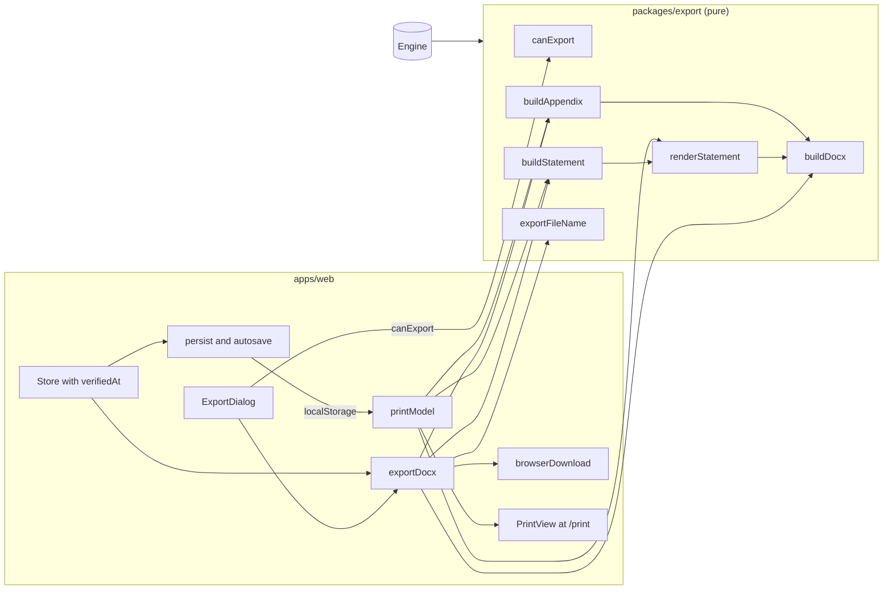

# Design Document: export-certification

## Overview

This design adds `packages/export` (`@reveal-codes/export`), a pure TypeScript package that turns a checked Engine `Document` into the three parts of a filing: the filing paragraphs, an AI-Use and Verification Statement, and a Provenance Appendix. It also replaces the placeholder Export dialog of `apps/web` with a working Export flow, adds a print view at `/print`, and adds one Store field, `verifiedAt`, so the Statement can say when citations were checked.

The shape of the work follows `structure.md`: anything pure goes in a package, anything that needs the DOM stays in `apps/web`. The Export_Package has no React, no DOM, no `node:` import and no network call. The Engine and the Verifier are not changed. The gate is the Engine's `blockingIssues`, wrapped once as `canExport` in the Export_Package and applied only by the Web_App.

### Decisions this design fixes

| # | Decision | Reason |
|---|---|---|
| D1 | The `docx` package is bundled for the browser. `POST /api/export` is not built. | Checked by a real build; see "Webpack decision". |
| D2 | `buildStatement` returns data. `renderStatement` returns blocks. The docx builder and the print view both consume the same blocks. | One holder of the wording (Requirement 4, criterion 12). |
| D3 | `Statement.quotes[].status` and `Statement.citations[].status` hold the Engine's status words. The tables show the product codes (`CIT ✓`, `CIT ✘`, `CIT ?`, `CIT …`, `QUO ✓`, `QUO ✘`, `QUO …`) in the status column. | The codes are binding vocabulary in `product.md`. Requirement 4, criterion 7 allows the Engine's names. |
| D4 | Statement_Text has no title. The "bold headings" of Requirement 6, criterion 5 are the table header rows and the paragraph numbers. | Requirement 4, criterion 2 and Requirement 6, criterion 9 allow no sentence or body element beyond the listed ones. If a title is wanted, the requirements change first. |
| D5 | The signature block is two lines: `/s/ ________________` and the ISO date, with no "Date:" label. | Requirement 4, criterion 11 allows no wording that criteria 3 to 9 do not define. |
| D6 | Page breaks are a `PageBreak` run at the start of the first paragraph of the Statement_Text and of the Appendix. They are not separate paragraphs. | A break-only paragraph puts one blank line at the top of the next page in Word. The paragraph count of the filing part is unchanged. |
| D7 | Page size is US Letter (12240 by 15840 twips). | `docx` defaults to A4, and the target courts are US courts. Requirement 6, criterion 2 fixes margins only. |
| D8 | Dates are UTC. The signature date is the UTC date of `meta.now`. | `toISOString` is the only clock format the package uses. The author can change the date in Word. |
| D9 | `buildStatement` returns `Err` with `invalid_timestamp` when `meta.now` is an invalid Date or `meta.verifiedAt` is not an ISO 8601 UTC instant. | `toISOString` throws on an invalid Date, and a garbled `verifiedAt` would print garbage in paragraph 3. |
| D10 | `runVerifyFlow` gets a required third parameter `now`. | The clock is injected (Requirement 12, criterion 2). A default would hide a missing clock. |
| D11 | `serialise` and `Autosave.schedule` get a required `verifiedAt` parameter. `Autosave.flush` returns `boolean`. | A forgotten caller must fail to compile instead of dropping the field. `flush` must report failure for Requirement 2, criterion 11. |

### Research findings that inform the design

- **`docx` 9.15.3** is the latest release on npm (checked today). Its `exports` map has an `import` entry `./dist/index.mjs`, its runtime dependencies are `fflate` and `nanoid`, and it has no `browser` field. The only `from "fs"` text in `dist/index.mjs` is inside a JSDoc comment (line 24104).
- **Probe results** (a scratch project in `/tmp`, since deleted): an empty paragraph is written as `<w:p/>`. Text runs carry `xml:space="preserve"`. `\t` is kept as a literal tab. XML-illegal control characters (`\u0000`, `\u000c`) are dropped silently by `docx`. A leading `PageBreak` run is written as `<w:r><w:br w:type="page"/></w:r>` before the text run in the same paragraph. An empty `title` option omits `<dc:title>` from `docProps/core.xml` and the file is still valid. The default page size is A4 (11906 by 16838). `Packer.toBuffer` returns a Node `Buffer` (a `Uint8Array`). `docProps/core.xml` holds the real creation time, read by `docx` itself, so the bytes of the file are not deterministic. The text content is.
- **Engine facts used:** `blockingIssues(doc)` is `issues(doc)` minus overridden keys. `issues(doc)` carries `{ key, kind, start, end, code }` but not the text, so the text is `doc.text.slice(start, end)`. `Override` is `{ key, reason, timestamp }`, stored in issue order, and may belong to a key that is no longer an issue. `segment(text, spans)` returns `Result<Sentence[], EngineError>`. `render(doc, "full")` is total and `parse` returns `Result<Document, EngineError>`.
- **Web facts used:** `runVerifyFlow(api, store)` is the single place a Verify completes, `reduceReplace` is the single place `replace` is handled, `serialise(document, runLog)` and `deserialise(raw)` are the only persistence functions, and `static/forbidden.test.ts` currently forbids `createObjectURL` and the `download` JSX attribute anywhere in `apps/web`.

### Webpack decision

**Path taken: the client path. `docx` is bundled for the browser and `buildDocx` runs in the browser. `POST /api/export` is not built.**

Evidence, from a scratch Next project with the same pins as `apps/web` (`next` 16.4.5, `react` 19.3.1, `docx` 9.15.3):

- `next build --webpack` compiled a `"use client"` page that imports `Document`, `Packer`, `Paragraph`, `TextRun` and `PageBreak` from `docx` and calls `Packer.toBuffer` in a click handler. The build finished without errors or warnings ("Compiled successfully", static pages generated).
- The client chunk that holds `Packer` is 215 KB, and it contains no `node:` reference (`grep -c "node:"` gave 0).
- In Node, `Packer.toBuffer` returned a `Buffer`, which is a `Uint8Array`, so `buildDocx` can return `Promise<Uint8Array>`.

What I could not verify: a build of the real `apps/web` (with `transpilePackages`, the `.js` to `.ts` `extensionAlias` and the new workspace package), and a run of `Packer.toBuffer` inside a real browser (the probe ran the compile and a Node run, not a browser). Task 1 of the plan repeats the probe inside `apps/web` before anything depends on it. If that build fails, the fallback of Requirement 7, criterion 5 is built instead: `app/api/export/route.ts` over a new `src/server/export-route.ts`, with the same `exportDocx` flow posting `{ codes, runLog }`. The design of everything else is the same on both paths, because `buildStatement` and `buildDocx` take a `Document`, and the server would obtain it with `parse`.

## Architecture



Trust boundary: nothing in this feature adds a network call. `exportDocx` and the print view read the Store or `localStorage` and write a Blob or the screen. The Autosave flush before the print tab opens is the only write, and it goes to `localStorage`.

## Components and Interfaces

### Package layout: `packages/export`

```
packages/export/
  package.json            name @reveal-codes/export, "exports": "./src/index.ts"
  tsconfig.json           extends tsconfig.base.json; "types": []; references ../engine
  src/
    index.ts              named re-exports only (about 30 lines)
    types.ts              Meta, RunInfo, Statement and its parts, StatementBlock, Appendix (about 90)
    gate.ts               canExport (about 10); the only module that names blockingIssues
    text.ts               clip, ellipsize, captionOf (about 45)
    time.ts               isInstant, datePart (about 25)
    statement.ts          buildStatement (about 70)
    statement-parts.ts    countCharacters, countSentences, toolsOf, citationsOf, quotesOf, overridesOf (about 120)
    wording.ts            every fixed sentence and label; the only holder of the wording (about 130)
    render-statement.ts   renderStatement (about 110)
    appendix.ts           buildAppendix (about 30)
    file-name.ts          exportFileName (about 30)
    docx-style.ts         fonts, sizes, spacing, borders, page constants (about 60)
    docx-blocks.ts        blocks and lines to docx elements (about 140)
    docx.ts               buildDocx (about 60)
  test/
    tsconfig.json         "types": ["node"]; references ..
    gate.properties.test.ts         Property 1
    statement.properties.test.ts    Property 2
    appendix.properties.test.ts     Property 3
    docx.properties.test.ts         Property 4
    statement.test.ts, render-statement.test.ts, appendix.test.ts, file-name.test.ts,
    text.test.ts, docx.test.ts, package.test.ts
    static/boundaries.test.ts       no network, no node:, no react, one gate module, wording in one module
    support/demo-document.ts        the Demo_Document builder
    support/arbitraries.ts          export-specific arbitraries
    support/docx-text.ts            unzip and read word/document.xml
```

Every module stays at or under 300 lines and every function at or under 40. The `src` tsconfig has `"types": []`, as the Engine's does, so a stray `node:` import fails the typecheck as well as the scan. Imports use `.js` specifiers like the Engine; `apps/web` already aliases them in `next.config.ts`.

`package.json` dependencies, all exact: `@reveal-codes/engine` `workspace:*` and `docx` `9.15.3`; devDependencies `fflate` `0.8.3`, `fast-check` `4.10.2`, `@reveal-codes/verifier` `workspace:*`. `vitest` stays at the root as in the other packages.

### Types: `types.ts`

```ts
import type {
  IssueCode, Origin, QuoteCheckResult, VerificationResult,
} from "@reveal-codes/engine";

/** The only clock the package sees. `now` must be a valid Date. */
export type Meta = Readonly<{ now: Date; verifiedAt: string | null }>;

/** Structural subset of the app's RunLogEntry; a RunLogEntry is assignable to it. */
export type RunInfo = Readonly<{ runId: string; provider: string; modelId: string | null }>;

export type OriginCounts = Readonly<Record<Origin, number>>;
export type StatementTool = Readonly<{ provider: string; model: string | null }>;
export type StatementCitation = Readonly<{
  text: string;
  status: VerificationResult["status"];
  clusterId?: string;                       // present only when status is "verified"
}>;
export type StatementQuote = Readonly<{
  text: string;
  status: QuoteCheckResult["status"];
  prefixLength?: number;                    // present only when status is "mismatch"; not printed
}>;
export type StatementOverride = Readonly<{
  code: IssueCode; text: string; reason: string; timestamp: string;
}>;

export type Statement = Readonly<{
  aiUsed: boolean;
  tools: readonly StatementTool[];
  characters: OriginCounts;
  sentences: Readonly<{ total: number; byDominantOrigin: OriginCounts }>;
  citations: readonly StatementCitation[];
  quotes: readonly StatementQuote[];
  overrides: readonly StatementOverride[];
  generatedAt: string;                      // meta.now.toISOString()
  verifiedAt: string | null;
  caption: string;
}>;

/** What renderStatement returns: numbered paragraph, table, or signature (Requirement 4, criterion 1). */
export type StatementBlock =
  | Readonly<{ kind: "paragraph"; number: number; text: string }>
  | Readonly<{ kind: "table"; columns: readonly string[]; rows: readonly (readonly string[])[] }>
  | Readonly<{ kind: "signature"; line: string; date: string }>;

export type Appendix = Readonly<{
  /** The two introductory sentences, in order. */
  intro: readonly [string, string];
  /** The lines of render(document, "full").text split on "\n", unmodified. */
  lines: readonly string[];
}>;
```

`StatementBlock` has no explicit "override entry" kind: the entries of paragraph 5 are a `table` with the columns Code, Text, Reason and Timestamp. Table column labels (`Citation`, `Status`, `Cluster id`, `Quotation`, `Status`, `Code`, `Text`, `Reason`, `Timestamp`) are the only labels that are not sentences; they live in `wording.ts`.

### Functions

```ts
// gate.ts
export function canExport(document: Document): boolean;                 // blockingIssues(document).length === 0

// statement.ts
export function buildStatement(
  document: Document, runLog: readonly RunInfo[], meta: Meta,
): Result<Statement, EngineError>;

// render-statement.ts
export function renderStatement(statement: Statement): readonly StatementBlock[];

// appendix.ts
export function buildAppendix(document: Document): Appendix;

// docx.ts
export function buildDocx(document: Document, statement: Statement): Promise<Uint8Array>;

// file-name.ts
export function exportFileName(caption: string, now: Date): string;     // "<slug>-<YYYY-MM-DD>.docx"

// text.ts (ellipsize is exported for the dialog; clip and captionOf are internal)
export function clip(text: string, max: number): string;
export function ellipsize(text: string, max: number): string;
```

How each behaves, beyond the requirements:

- **`buildStatement`** validates `meta` first (D9), then calls `segment(document.text, document.spans)` and returns its error unchanged (Requirement 3, criterion 12). It then assembles the parts from `statement-parts.ts`. It never calls `canExport` or `blockingIssues`; it calls `issues(document)` for the override list, which Requirement 1, criterion 4 allows because the rule forbids only the gate functions.
- **`toolsOf`** filters `runLog` to entries whose `runId` is in `document.runs`, keeps run-log order, maps `modelId` to `model`, and removes a later pair with equal `provider` and `model`. Run-log entries that share a `runId` are all kept (they may differ in provider), then deduplicated by pair.
- **`overridesOf`** builds a `Map` from override key to override, walks `issues(document)` in order, and emits `{ code: issue.code, text: document.text.slice(issue.start, issue.end), reason, timestamp }` for each issue that has an override. An override whose key is no longer an issue is never visited, so it is omitted.
- **`captionOf`** takes the first line of `document.text.split("\n")` whose `trim()` is non-empty, trims it, and applies `clip(…, 120)`. An all-blank text gives `""`.
- **`clip(text, max)`** returns the first `max` UTF-16 code units, one fewer when the cut would split a surrogate pair, so a lone surrogate never reaches the DOM or the XML. **`ellipsize(text, max)`** returns `text` when `text.length <= max`, else `clip(text, max - 1) + "…"`. This is the 80-character rule of the dialog (79 characters and "…") and, through `clip(…, 80)`, of the quotation table.
- **Percentage** (paragraph 2) is integer arithmetic: `tenths = Math.floor((2000 * a + t) / (2 * t))`, which is `a / t * 100` rounded half up to one decimal, and it is printed as `${Math.floor(tenths / 10)}.${tenths % 10}`; `t = 0` prints `0.0`. No floating point is involved, so 1 of 8 prints `12.5` and 1 of 16 prints `6.3`.
- **`renderStatement`** returns blocks in this order: paragraph 1; paragraph 2; paragraph 3 and its table; paragraph 4 and its table; when `overrides` is non-empty, paragraph 5 and its table; the final paragraph (numbered 5 or 6); then the `signature` block. The signature date is `datePart(statement.generatedAt)`; the check date in paragraph 3 is `datePart(statement.verifiedAt)` or the "date that was not recorded" wording.
- **`buildAppendix`** returns `{ intro: [S1, S2], lines: render(document, "full").text.split("\n") }`.
- **`buildDocx`** composes the file in this order: the Filing_Paragraphs, the Statement_Text (first paragraph begins with a `PageBreak` run), then the Appendix (first intro paragraph begins with a `PageBreak` run), then one paragraph per appendix line. It calls `Packer.toBuffer`, stores the result as `unknown`, and returns it only if it is a `Uint8Array`; otherwise it throws, which rejects the promise. This avoids `any` if the `docx` type declarations need Node's `Buffer` type. It sets `creator: "Reveal Codes"`, `lastModifiedBy: "Reveal Codes"`, and `title: statement.caption`. The page is US Letter with 1440-twip margins on every side (D7). Filing paragraphs use `spacing: { line: 480, lineRule: AUTO }` and `AlignmentType.LEFT`; the Statement uses `line: 240`; table borders are `BorderStyle.SINGLE` on the six edge kinds (top, bottom, left, right, inside horizontal, inside vertical); the Appendix uses Courier New at size 18 (half-points) and the rest Times New Roman at size 24.
- **`exportFileName`** applies the steps of Requirement 7, criterion 1 in order and takes the date from `now.toISOString().slice(0, 10)`. `now` must be a valid Date; the Web_App only calls it after `buildStatement` has accepted `now`.

### Web app changes

**New files**

| File | Purpose |
|---|---|
| `src/client/export-docx.ts` | `exportDocx(store, deps)`: the whole Download flow |
| `src/client/download.ts` | `browserDownload(bytes, fileName)`: Blob, object URL, anchor click, revoke |
| `src/print-model.ts` | `printModel(raw, now)`: pure; stored string to one of four outcomes |
| `src/components/export-issues.tsx` | the list of blocking issues, one row each, with `Go` and `Override…` |
| `src/components/export-dialog.module.css` | the dialog's one CSS module |
| `src/components/use-export.tsx` | the dialog's open state, the download and print handlers; moves the export code out of `app-shell.tsx` |
| `src/components/print-view.tsx`, `print-view.module.css` | the client component for `/print` |
| `app/print/page.tsx` | server component: `export default function Page() { return <PrintView />; }` |

**Replaced:** `src/components/export-dialog.tsx` (the placeholder and `EXPORT_PLACEHOLDER` are removed).

**Changed:** `src/store.ts`, `src/store-actions.ts`, `src/persist.ts`, `src/autosave.ts`, `src/services.ts`, `src/notices.ts`, `src/client/verify-flow.ts`, `src/components/app-shell.tsx`, `src/components/toolbar.tsx`, `next.config.ts`, `package.json`, `tsconfig.json`, root `vitest.config.ts`, root `tsconfig.json`.

#### Store and actions (`store.ts`, `store-actions.ts`)

```ts
export type StoreState = Readonly<{
  document: Document;
  undo: readonly UndoEntry[];
  redo: readonly UndoEntry[];
  runLog: readonly RunLogEntry[];
  verifiedAt: string | null;               // new; initial null
  notice: string | null;
  epoch: number;
}>;

export type StoreAction =
  | /* existing actions unchanged, except: */
  | Readonly<{
      type: "replace"; document: Document;
      runLog?: readonly RunLogEntry[]; verifiedAt?: string | null;   // new optional field
    }>
  | Readonly<{ type: "verified"; at: string }>;                       // new
```

- `initialState` adds `verifiedAt: null`.
- `reduceReplace(state, document, runLog, verifiedAt)` sets `verifiedAt: verifiedAt ?? null`. New and Load demo dispatch `replace` with neither field, so both clear it.
- `reduceVerified(state, at)` returns `result({ ...state, verifiedAt: at })` with `changed: false`: the Document is untouched, so no history barrier and no Autosave of the Document, but the new state object notifies subscribers.
- `edit`, `undo`, `redo`, `verification`, `quoteCheck` and `override` copy `verifiedAt` through unchanged (they spread `state`), which is Requirement 12, criterion 7. No code is needed beyond not touching the field.

#### Verify flow (`client/verify-flow.ts`)

`runVerifyFlow(api, store, now)` dispatches `{ type: "verified", at: now().toISOString() }` once, after the quote phase has finished and before the summary Notice, and only on the `completed` path. The `failed` and `discarded` paths dispatch nothing. `app-shell.tsx` passes `svc.now`.

#### Persistence (`persist.ts`, `autosave.ts`)

```ts
export type PersistedValue = Readonly<{
  version: 1;                               // unchanged; the change is additive
  codes: string;
  runLog: readonly RunLogEntry[];
  verifiedAt: string | null;                // new
}>;
export type Restored = Readonly<{
  document: Document; runLog: readonly RunLogEntry[]; verifiedAt: string | null;
}>;
export function serialise(document: Document, runLog: readonly RunLogEntry[], verifiedAt: string | null): string;
export function deserialise(raw: string | null): Result<Restored, PersistError>;

// autosave.ts
schedule(document: Document, runLog: readonly RunLogEntry[], verifiedAt: string | null): void;
flush(): boolean;      // true when nothing was pending or the write succeeded; false when setItem threw
```

`deserialise` reads `value["verifiedAt"]`: absent (`undefined`) gives `null` (old values load, Requirement 12, criterion 5); `null` or a string is accepted; any other type returns `bad_shape` (criterion 6). The key `reveal-codes:document:v1` and `version: 1` stay, because old readers of the new shape would ignore the extra field and new readers accept the old shape. `app-shell.tsx`'s `loadAutosave` passes `restored.value.verifiedAt` in the `replace` action, and `useAutosave` schedules a save when `verifiedAt` changes too (a Verify that changes only `verifiedAt` must reach storage before the print tab reads it).

#### Services and notices

`AppServices` gains two members, both lazy like the rest of `defaultServices`:

```ts
download: (bytes: Uint8Array, fileName: string) => void;   // browserDownload
openPrint: () => boolean;                                   // true when a tab opened
```

`openPrint` is `const w = window.open("/print", "_blank"); if (w === null) return false; w.opener = null; return true;`. It must not pass the `noopener` feature, because `window.open` then returns `null` even on success and the failure notice would always show. `browserDownload` builds `new Blob([new Uint8Array(bytes)], { type: DOCX_MIME })` (the copy gives an `ArrayBuffer`-backed array, which the DOM typings accept), calls `URL.createObjectURL`, clicks an anchor whose `download` is the file name, and revokes the URL in a `finally`.

`notices.ts` adds `EXPORT_FAILED = "Export failed. Your document is unchanged."`, `PRINT_FAILED = "The print view did not open."`, and `exportedNotice(fileName) = \`Exported ${fileName}.\``.

#### `exportDocx` (`client/export-docx.ts`)

```ts
export type ExportDeps = Readonly<{
  now: () => Date;
  download: (bytes: Uint8Array, fileName: string) => void;
}>;
export type ExportOutcome =
  | Readonly<{ status: "exported"; fileName: string }>
  | Readonly<{ status: "blocked" }>
  | Readonly<{ status: "failed" }>;
export function exportDocx(
  store: Pick<Store, "getState" | "dispatch">, deps: ExportDeps,
): Promise<ExportOutcome>;
```

The flow, in order; the first failing step returns `failed` after dispatching `{ type: "notice", text: EXPORT_FAILED }`:

1. Read `store.getState()`. If `!canExport(document)`, return `blocked` and touch nothing (Requirement 1, criterion 5). The dialog already disables the button, so this is the second line of defence.
2. `buildStatement(document, runLog, { now: deps.now(), verifiedAt })`. An `Err` fails.
3. `parse(buildAppendix(document).lines.join("\n"))`. An `Err` fails (Requirement 5, criterion 5).
4. `await buildDocx(document, statement)`. A rejection fails.
5. `deps.download(bytes, exportFileName(statement.caption, meta.now))`. A throw fails; `browserDownload` has already revoked any URL it created.
6. Dispatch `{ type: "notice", text: exportedNotice(fileName) }` and return `exported`.

The `try/catch` blocks sit at the boundary (steps 4 and 5) and return the failure as a value, in line with the editor-app rule that nothing swallows an error. The function reads no environment variable and sends no request.

#### Export dialog (`export-dialog.tsx`, `export-issues.tsx`, `use-export.tsx`)

```ts
export type ExportDialogProps = Readonly<{
  document: Document;                       // the live Document from the store slice
  store: Store;
  now: () => Date;
  notice: string | null;
  busy: boolean;                            // a download is in progress
  restoreFocus?: HTMLElement | null | undefined;
  onGo: (offset: number) => void;           // binding.focusAt
  onDownload: () => void;
  onPrint: () => void;
  onClose: () => void;
}>;
```

- The dialog is a `Modal` titled "Export". It computes `blockingIssues(document)` and `canExport(document)` on every render. The list updates in the same React render as the Store change, so the 100 ms bound of Requirement 2, criterion 10 holds without a timer. The old `open && blocking === 0` condition in `app-shell.tsx` is removed, so the dialog opens in both states.
- Each row (`export-issues.tsx`) shows the code, `ellipsize(document.text.slice(start, end), 80)`, a `Go` button and an `Override…` button. `Go` calls `onGo(issue.start)` then `onClose()`.
- `Override…` sets local state `{ issue, opener }`. The `OverrideDialog` is rendered as a sibling of the export `Modal`, not a child, so React's portal event bubbling does not reach the export dialog's Tab trap. `OverrideDialog` gets `restoreFocus={opener}`. When it closes and the opener row has gone (the override cleared that issue), the `Modal` focus restore skips the detached element, and an effect in the export dialog moves focus to its first control if focus is outside the dialog (Requirement 2, criterion 5).
- The two buttons read "Download .docx" and "Open print view" when `canExport`, and "Download .docx (<n> blocking)" and "Open print view (<n> blocking)", disabled, otherwise. While `busy`, Download is also disabled.
- A status line (`role="status"`) in the dialog shows `notice`, because the toolbar notice sits behind the modal overlay.

`use-export.tsx` owns `open`, `opener`, and `busy`, and exposes `{ toolbar: { blockingCount, onExport }, dialog }` like the current `useExportGate`.

- `onDownload`: sets `busy`, awaits `exportDocx(store, { now: svc.now, download: svc.download })`, clears `busy`, and closes the dialog when the status is `exported`. On `failed` the dialog stays open and shows the notice.
- `onPrint`: calls `autosave.schedule(doc, runLog, verifiedAt)` then `autosave.flush()`; scheduling first guarantees that storage matches the live state even when nothing was pending (for example right after New, which removed the key). If `flush()` is `false` or `svc.openPrint()` is `false`, it dispatches `{ type: "notice", text: PRINT_FAILED }` and keeps the dialog open and the Document unchanged (Requirement 2, criterion 11).

`Toolbar` loses the `exportDisabled` prop; the button is always enabled and keeps `exportLabel(blockingCount)`.

#### Print view (`print-model.ts`, `print-view.tsx`, `app/print/page.tsx`)

`printModel` is pure and total. `print-view.tsx` reads storage after mount (never during server rendering), calls `printModel`, and renders the result.

```ts
export type BlockedItem = Readonly<{ code: string; text: string }>;
export type PrintModel =
  | Readonly<{ kind: "absent" }>                          // no stored value
  | Readonly<{ kind: "unreadable" }>                      // throw, bad JSON, bad shape, bad codes, buildStatement Err
  | Readonly<{ kind: "blocked"; blocking: readonly BlockedItem[] }>
  | Readonly<{
      kind: "ready";
      paragraphs: readonly string[];                      // Filing_Paragraphs
      blocks: readonly StatementBlock[];                  // renderStatement(...)
      appendix: Appendix;
    }>;
export function printModel(raw: string | null | Thrown, now: Date): PrintModel;
```

Here `Thrown` is `Readonly<{ thrown: unknown }>`: the component wraps `storage.getItem` in a boundary `try/catch` (as `readStored` does in `app-shell.tsx`) and passes the failure as a value. The mapping is: `deserialise` error `absent` gives `absent`; the other `deserialise` errors and a thrown read give `unreadable`; a parsed Document with `canExport === false` gives `blocked` (with `ellipsize`-free, full text of each issue); otherwise `buildStatement(document, runLog, { now, verifiedAt })`, where an `Err` gives `unreadable` and an `Ok` gives `ready`.

The component states are therefore: nothing rendered before mount, then one of the three non-ready outcomes of Requirement 8 (criteria 6, 7 and 8) or the ready filing.

| State | Text and elements |
|---|---|
| absent | "Nothing to print. Open the editor and resolve the blocking items first." |
| blocked | "This filing cannot be exported: <n> unresolved items remain." then a list of code and text, document order; no filing, no Statement_Text, no Appendix, no Print button |
| unreadable | "The saved document could not be read." |
| ready | Print button, Filing_Paragraphs, Statement_Text, Appendix, in that order |

The ready state renders three `<section>` elements. `print-view.module.css` gives the second and third `break-before: page` inside `@media print`, hides the `.controls` wrapper that holds the Print button in print, and sets `@page { size: letter; margin: 1in; }`. The filing and statement use `var(--font-editor)`, the appendix `var(--font-pane)`, and all colours come from the existing palette variables (`ui.md`). Statement blocks render through one `StatementBlocks` component that maps `paragraph` to `<p>` with the number and text, `table` to a bordered `<table>` with a header row, and `signature` to two lines. The Print button calls `window.print()` once per click. The component takes an optional `services` prop (`AppServices`) so tests inject storage and the clock.

#### Wiring in the build

- `package.json`: add `"@reveal-codes/export": "workspace:*"`.
- `next.config.ts`: add `"@reveal-codes/export"` to `transpilePackages`. `docx` is a normal dependency and needs no transpiling.
- `apps/web/tsconfig.json`: add `{ "path": "../../packages/export" }` to `references`. Root `tsconfig.json`: add `{ "path": "packages/export" }`.
- `pnpm install` rewrites `pnpm-lock.yaml`; the new lockfile is committed because CI runs `--frozen-lockfile`.

### Vitest project and hook

`vitest.config.ts` gains one entry beside the others:

```ts
project("export", "packages/export"),
```

The default include `test/**/*.test.ts` and the shared setup file (60 s timeout for `*.properties.test.ts`) apply unchanged.

`.kiro/hooks/export-tests-on-save.json`, with the same timeout as the other hooks (`120000`):

```json
{
  "version": "v1",
  "hooks": [
    {
      "name": "Export tests on save",
      "trigger": "PostFileSave",
      "matcher": "packages/export/(src|test)/.*\\.ts$",
      "timeout_ms": 120000,
      "action": {
        "type": "command",
        "command": "perl -e 'alarm shift; exec @ARGV' 120 pnpm vitest run --project export --passWithNoTests"
      }
    }
  ]
}
```

## Data Models

### Persisted_Value (after this spec)

```json
{ "version": 1, "codes": "<render(document, \"full\").text>", "runLog": [], "verifiedAt": "2026-11-07T14:03:11.000Z" }
```

`verifiedAt` is `null` when no Verify has completed since the Document was loaded or created. Old values without the field load with `verifiedAt` `null`. The key order written is `version`, `codes`, `runLog`, `verifiedAt`.

### Demo_Document fixture builder (`test/support/demo-document.ts`)

```ts
export const DEMO_NOW: Date;                         // fixed instant
export const DEMO_VERIFIED_AT: string;               // fixed ISO string
export const DEMO_OVERRIDE_REASONS: readonly [string, string, string, string];   // four distinct reasons
export const DEMO_RUN_LOG: readonly RunInfo[];       // run-1 (used), run-9 (unused)
export function buildDemoDocument(): Promise<Document>;
```

Steps, none of which touches the network:

1. Read `packages/engine/fixtures/demo-motion.txt` and `createDocument(text, ISO)` (one `PST` span).
2. Append one `AI` span with `run-1` using `apply` with an `insert` at the end of the text. The inserted sentence contains no citation or quote, so the citation and quote counts do not change.
3. Build `Deps` from `createFixtureFetch()`, `createMemoryCacheStore`, a real abortable `sleep`, and a fixed `now`; call `lookup(doc.citations, deps)` and apply every result with `setVerification`.
4. For each quote, find the owning verified cluster (through the `Id.` link when the quote is attached to a short form), fetch its text with `fetchOpinionText`, and apply `checkQuote` with `setQuoteCheck`.
5. Call `recordOverride` for each issue of `blockingIssues(doc)` with `DEMO_OVERRIDE_REASONS[i]`.
6. Assert before returning, throwing a plain `Error` if any fails: 2 verified, 3 not found, 1 mismatch, 4 overrides, one entry in `doc.runs`, and `canExport(doc)` is `true`. A fixture change therefore fails the builder, not the tests that use it.

Steps 3 and 4 repeat the helpers in `apps/web/test/support/persist-fixtures.ts` (`fixtureDeps`, `applyQuoteChecks`, `quotesByCluster`), because test support is not a package. The copy is about 50 lines; moving both to a shared place is a later refactor and is not part of this spec.

### Arbitraries (`test/support/arbitraries.ts`)

The Engine's `arbDocument` already generates documents with `AI` spans, verification results, quote results and overrides, so it is reused through the relative import that `apps/web/test/arbitraries.ts` already uses. The new arbitraries are export-specific and so live in the Export_Package, not in the Engine's `testing/` folder, which keeps the Engine untouched:

| Arbitrary | Produces |
|---|---|
| `arbGateClearDocument` | `arbDocument` with `recordOverride` applied to every blocking issue, so the gate is open |
| `arbGateDocument` | `fc.oneof(arbDocument, arbGateClearDocument)` so both gate branches are exercised |
| `arbRunLog(doc)` | `RunInfo[]`: a random subset of `doc.runs` ids (some left out), extra unreferenced ids, repeated `(provider, modelId)` pairs from small pools, `modelId` null or a string |
| `arbMeta` | `{ now, verifiedAt }`: `now` from `fc.date({ noInvalidDate: true })`, `verifiedAt` null or an ISO string |
| `arbExportCase` | `arbDocument.chain(doc => tuple(constant(doc), arbRunLog(doc), arbMeta))` |

The Engine's `arbText` produces printable ASCII, `\n`, `\t`, quotation marks, brackets and astral characters, so generated filings include empty paragraphs, leading and trailing spaces, `&` and `<`, and surrogate pairs, which is what Property 4 needs.

### Docx text reader (`test/support/docx-text.ts`)

`readDocxParagraphs(bytes: Uint8Array): string[]` uses `unzipSync` and `strFromU8` from `fflate`, takes `word/document.xml`, and matches each paragraph with `/<w:p(?:\s[^>]*)?\/>|<w:p(?:\s[^>]*)?>[\s\S]*?<\/w:p>/g` (a self-closing `<w:p/>` is an empty paragraph). For each paragraph it joins the contents of its `<w:t …>` elements, turns `<w:tab/>` into `\t`, unescapes the five XML entities, and, when the paragraph contains `<w:br w:type="page"/>`, emits the marker `"\f"` as a separate entry before the paragraph's text.

## Correctness Properties

*A property is a characteristic or behavior that should hold true across all valid executions of a system-essentially, a formal statement about what the system should do. Properties serve as the bridge between human-readable specifications and machine-verifiable correctness guarantees.*

Reflection on redundancy: the testable criteria of Requirements 1, 3, 5 and 6 reduce to four properties, matching Requirement 10, criterion 5. Criteria 1.1, 1.2 and 1.6 collapse into Property 1. Criteria 3.2 and 3.5 to 3.11 collapse into Property 2 (3.3 and 3.4 are covered by its subset assertion and by example tests). Criteria 5.2 and 5.3 are steps inside Property 3. Criteria 6.3, 6.4 and 6.9 are assertions inside Property 4. Wording, file names, dialog and print states are example tests because they are exact strings or UI states with little input variation.

### Property 1: Gate

For any Document, `canExport(document)` is `true` if and only if `blockingIssues(document)` has length 0. Calling it twice returns the same value, and the input Document is deep-equal to a clone taken before the call.

**Validates: Requirements 1.1, 1.2, 1.6**

### Property 2: Statement data

For any Document, any Run_Log and any Meta with a valid `now` and a valid `verifiedAt`, `buildStatement` returns `Ok` and the Statement satisfies all of the following: `characters` has non-negative integer counts that sum to `document.text.length` and equal the span lengths per origin; `aiUsed` is `true` exactly when some span has origin `AI` or `AI>HUM`; `sentences.total` equals the length of `segment(document.text, document.spans)` and `byDominantOrigin` sums to `total` and matches the per-origin tally of those sentences; `citations` has one entry for each `kind: "full"` record in document order with the Document's status, and `clusterId` only for `verified`; `quotes` has one entry for each quote record in document order with the Document's status, and `prefixLength` only for `mismatch`; `overrides` equals the Document's overrides that belong to `issues(document)`, in issue order, with the code and text of their issue; every tool pair comes from a Run_Log entry whose `runId` is in `document.runs`, with no duplicate pair; `generatedAt` equals `meta.now.toISOString()`; and a second call with the same arguments returns a deep-equal result.

**Validates: Requirements 3.2, 3.5, 3.6, 3.7, 3.8, 3.9, 3.11, 3.13**

### Property 3: Appendix round trip

For any Document, joining the lines of `buildAppendix(document)` with `\n` equals `render(document, "full").text`, `parse` of that text returns `Ok`, and the parsed Document's `text`, `spans`, `citations`, `quotes`, `overrides` and `runs` are deep-equal to the original's. A second call to `buildAppendix` returns a deep-equal Appendix.

**Validates: Requirements 5.2, 5.3, 5.4**

### Property 4: DOCX content

For any Document, the paragraph list read from `word/document.xml` of `buildDocx(document, statement)` (with page breaks as `"\f"` markers, in order) holds exactly two page-break markers; the entries before the first marker are the Filing_Paragraphs, with empty paragraphs kept; the first entry after the first marker begins with `1. This filing was prepared with the drafting tool Reveal Codes`; and the first entry after the second marker is "The following is the complete provenance record of this filing in Reveal Codes form."

**Validates: Requirements 6.3, 6.4, 6.9, 6.10**

## Error Handling

The standing rule applies: a fault that only affects malformed input is a value or one line here, with no spec change. Nothing in the package swallows an error. The package returns `Result` for `buildStatement` and rejects from `buildDocx`; the only `try/catch` blocks in the Web_App are at the boundaries named below and each returns the failure as a value.

| Condition | Value produced | Requirements |
|---|---|---|
| `canExport` is `false` when Download is requested | `exportDocx` returns `blocked`; `buildDocx` not called; Document and overrides unchanged | 1.5 |
| `segment` returns an error (spans break coverage) | `buildStatement` returns that `Err`; nothing thrown; inputs unchanged | 3.12 |
| `meta.now` is an invalid Date | `buildStatement` returns `Err { kind: "invalid_timestamp", value }`; nothing thrown | 3.1 (D9) |
| `meta.verifiedAt` is a non-null string that is not an ISO 8601 UTC instant | Same `Err` | 3.1 (D9) |
| A `runId` in `document.runs` has no Run_Log entry | Run omitted from `tools`; `Ok`; paragraph 2 may read "Tools: not recorded." | 3.4, L2 |
| Run_Log holds entries for runs not in `document.runs` | Ignored | 3.3 |
| Override whose key is no longer an issue | Omitted from the Statement and from paragraph 5 | 3.9 |
| Empty Document | Caption `""`, one empty Filing_Paragraph, zero sentences, four zero counts, valid file with the title omitted | 3.6, 6.3, 6.8 |
| Appendix lines do not parse back | `exportDocx` fails: no download, notice "Export failed. Your document is unchanged." | 5.5 |
| `buildDocx` rejects, or `Packer.toBuffer` result is not a `Uint8Array` | `exportDocx` fails with the same notice | 7.4 |
| `download` throws or object URL creation fails | URL revoked in `finally`; `exportDocx` fails with the same notice | 7.4 |
| Text holds XML-illegal control characters (for example a form feed pasted from a PDF) | `docx` drops them from the file silently (probed); the Document and the Appendix in the app are unchanged | 6.2 |
| Autosave flush fails or `window.open` returns `null` | Dialog stays open; notice "The print view did not open."; Document unchanged | 2.11 |
| Print view: no stored value | Text "Nothing to print. Open the editor and resolve the blocking items first." | 8.6 |
| Print view: `getItem` throws, not JSON, wrong shape, `parse` error, or `buildStatement` `Err` | Text "The saved document could not be read." | 8.8, L1 |
| Print view: stored Document has blocking issues | The blocked sentence and the list; no filing text | 8.7 |
| Persisted_Value `verifiedAt` is a number, object or boolean | `deserialise` returns `bad_shape` | 12.6 |
| Persisted_Value has no `verifiedAt` | Loaded with `null` | 12.5 |
| `exportFileName` called with an invalid Date | Precondition violation; unreachable from the app because `buildStatement` rejects the Date first | 7.1 |
| A cut at 80 characters falls inside a surrogate pair | `clip` backs off one code unit; the cut text is 79 units | 2.3, 4.7 |

Known limitations to carry into the README and `BUILD_LOG.md` if they matter to a reader: the bytes of the `.docx` are not deterministic because `docx` writes the real clock into `docProps/core.xml`; the Statement text is deterministic. Tool names come from the app's run log, not from the Appendix, so a Document re-read from the Appendix alone lists no tools (L3).

## Testing Strategy

Property-based testing applies to the pure package: the gate, the statement data, the appendix round trip, and the docx content. It does not apply to the dialog, the print view, the download, or the persistence changes, which are UI or I/O wiring and get example tests. Fixed wording is checked by exact string equality, not by a property that would restate it.

**Library and configuration.** fast-check with vitest, in files named `<module>.properties.test.ts`. Each property is one `fc.assert(fc.property(...))`, preceded by the comment `// Property N`, inside a `describe` whose title ends in `_Requirements: x.y_`. Properties 1 to 3 use `numRuns` from the `runs()` helper pattern already in `apps/web/test/support/fc.ts` (200 locally, 500 when `CI` or `FC_NUM_RUNS` says so). Property 4 uses `numRuns: 50` with a comment that packing a docx file is slow. The package tests contain exactly four properties; a static test counts the `// Property N` comments. Each tag reads: Feature: export-certification, Property N: title.

**Property tests**

| File | Property | Input | Output asserted |
|---|---|---|---|
| `gate.properties.test.ts` | 1 | `arbGateDocument` | `canExport` equals `blockingIssues(d).length === 0`; stable on a second call; input unchanged |
| `statement.properties.test.ts` | 2 | `arbExportCase` | the relationships of Property 2, computed independently from spans, `segment`, `issues` and the records |
| `appendix.properties.test.ts` | 3 | `arbDocument` | lines join to `render` text; `parse` is `Ok` and the six fields are deep-equal |
| `docx.properties.test.ts` | 4 | `arbExportCase` | the paragraph structure read with `readDocxParagraphs` |

In Properties 2 and 4 the Statement comes from `buildStatement`; if it returns `Err` for a generated case the property fails, because `arbMeta` only generates valid metadata and `arbDocument` only generates canonical Documents.

**Example tests (string equality unless noted)**

- `render-statement.test.ts`: Statement_Text for the Demo_Document (2 verified, 3 not found, 1 mismatch, 4 overrides, paragraph 5 with four rows), for a Document with no AI text and no overrides, for AI spans with an empty Run_Log ("Tools: not recorded."), and paragraph 3 with a `verifiedAt` date and with `verifiedAt` null. Percentage cases: 0 of 0, 1 of 3, 1 of 8, 1 of 16, 2 of 3. Final paragraph numbered 5 without overrides and 6 with them.
- `statement.test.ts`: tool de-duplication, `model` null, unknown `runId`; caption cases (leading blank lines, all blank, 121 characters, astral character at the cut); the hand-built Document whose spans break coverage returns `Err`; invalid `now` and garbled `verifiedAt` return `Err`.
- `text.test.ts`, `file-name.test.ts`: `clip`, `ellipsize` at 79, 80 and 81 characters and at a surrogate pair; `exportFileName` for spaces, punctuation, a 60-character cut ending in a dash, an empty caption, non-ASCII, and a UTC date near midnight.
- `appendix.test.ts`: empty Document gives the `[DOC]` header line only; a Document with leading and trailing spaces keeps every line unmodified.
- `docx.test.ts`: document.xml has `w:spacing w:line="480"` for filing paragraphs and `240` for the Statement, Times New Roman at `w:sz` 24, Courier New at 18, US Letter and 1440 margins, `single` borders on all six table edges, bold header cells; `docProps/core.xml` has creator "Reveal Codes" and the caption as title, and an empty Document's file has no title and unzips; every Appendix paragraph equals the matching line (Demo_Document and a leading-space case); no `fetch` call.
- `package.test.ts`: exact version strings, no range operators, `docx` is the only third-party runtime dependency, the hook file exists with the 120000 timeout and the pattern from this design.
- `static/boundaries.test.ts`: no `fetch`, `XMLHttpRequest`, `WebSocket`, `sendBeacon`, `node:`, `react` or DOM import under `packages/export/src`; `blockingIssues` and `canExport` appear only in `gate.ts`; statement sentences appear only in `wording.ts`; no `Date.now`, `new Date()` without arguments, `Math.random` or `process` in `src`; every module at most 300 lines and every function at most 40.
- Web: `export-docx.test.ts` (success with a fake `download` and a fixed clock; blocked Document leaves `download` uncalled and the Store unchanged; `buildStatement` `Err`; `buildDocx` rejection; `download` throwing; a corrupted appendix; zero `fetch` calls). `export-dialog.test.tsx` and `export-shell.test.tsx` (both states, count labels, 79/80/81-character text, `Go`, `Override…` and focus return, live update after an override without advancing timers, print flush order, print failure by throwing `setItem` and by `openPrint` returning `false`). `print-model.test.ts` and `print-view.test.tsx` (absent, unreadable by throw, JSON, shape, codes and bad `verifiedAt`, blocked with the exact sentence and no filing, Statement or Print button, ready order and `window.print` called once). `store.test.ts`, `persist.test.ts`, `autosave.test.ts` and `verify-flow.test.ts` for `verifiedAt` (initial, `verified`, `replace` with and without it, edit, undo and override leave it, shape accept and reject, one `verified` dispatch per completed Verify and none on failure or discard).

**Fixtures.** The Demo_Document is built at test time from committed fixtures with `createFixtureFetch`; no new recorded file is added. If a fixture is ever added under `packages/export/`, its folder gets a `README` line saying where it came from and when.

**Where the editor-app tests change.** See the revision note in `.kiro/specs/editor-app/design.md`.

**Task order that the plan should follow.**

1. Verify the webpack path inside `apps/web` (add the package skeleton and a throwaway client import of `docx`; run `next build --webpack`; remove the import). If it fails, switch to the `/api/export` fallback before step 4.
2. Package skeleton, `types.ts`, `gate.ts`, `text.ts`, `time.ts`, then Property 1.
3. `statement-parts.ts`, `statement.ts`, `wording.ts`, `render-statement.ts`, `appendix.ts`, then Properties 2 and 3 and the example tests.
4. `docx-style.ts`, `docx-blocks.ts`, `docx.ts`, `file-name.ts`, the docx reader and Property 4.
5. Store, persist, autosave, services, notices and verify-flow changes, with the editor-app tests that depend on them.
6. Export dialog, `use-export.tsx`, toolbar, `exportDocx`, `browserDownload`.
7. Print model, print view, `/print`.
8. Hook file, `vitest.config.ts`, tsconfig references, steering updates (`structure.md` and `tech.md` name `packages/export`), README, `docs/KIRO_USAGE.md`, `BUILD_LOG.md`.
9. Manual check in a real browser: `pnpm dev`, load the demo motion, Verify, override the red items, download, and open the file in Word or LibreOffice (cannot be automated here; record the result in `BUILD_LOG.md`).
