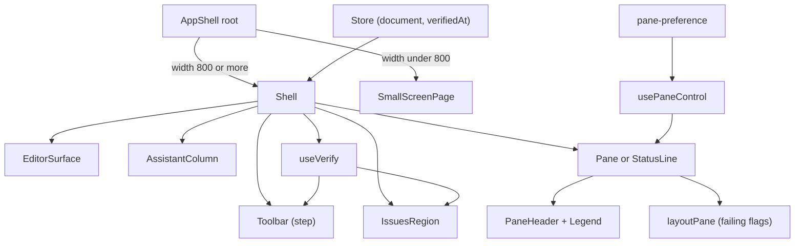

# Design Document

## Overview

This design implements `requirements.md` of the first-run-and-flow feature. It changes layout, labels, text placement and the look of failing codes in `apps/web`. It adds one stored preference, the Pane open or closed state, at `reveal-codes:pane:v1`. It does not touch the Engine, the Verifier, the Export_Package, the MCP server or the Sentinel, adds no dependency and adds no colour outside the Pane.

The work falls into eleven decisions, which are Requirements 1 to 11:

1. The Pane opens on a first visit (unless a Saved_Draft exists) and remembers its state.
2. A Pane_Header names the pane and carries a seven-entry Legend.
3. Failing codes (`CIT ✘`, `CIT ?`, `QUO ✘` and their closers) are white on `#AA0000` blocks.
4. One Toolbar button, the Primary_Button, names the next step. A pure function `nextStep` decides it.
5. The result of Verify moves from a Toolbar Notice to a Verify_Summary in the Issues region.
6. Before the first Verify, unchecked items collapse into one Unchecked_Row.
7. The assistant panel says where the reply will go and where it went.
8. The Override dialog shows the text being overridden.
9. The Export dialog is wider, its buttons carry no count, and one line states the blocking count.
10. Below 800px a plain page replaces the Shell; the Shell has a 1150px minimum width.
11. Optional page marks (a verdict is in "Page marks: feasibility verdict").

### Design decisions taken while reading the code

These are choices the requirements leave open. Each is binding on the tasks that follow.

- **D1. The viewport is read through `AppServices.viewport`.** It has `width()` and `subscribe(onChange)`. `AppShell` becomes a thin root that picks the Shell or the Small_Screen_Page; the present body moves to `Shell`. The server snapshot of the width is the wide constant, so server markup is the Shell, and the media rule of Requirement 10.12 hides it on a narrow screen before any script runs.
- **D2. Mount-time storage access is guarded by the viewport, not by render order.** On a narrow hydration the Shell renders once with the server snapshot before the root switches to the small page. The two mount effects that touch `reveal-codes:document:v1` and `reveal-codes:pane:v1` return early when `svc.viewport.width() < 800`. This keeps Requirement 10.7 true without making server and client markup differ.
- **D3. On Shell unmount the pending autosave is flushed once.** Without it, a debounced timer would fire after the small page is shown, which breaks Requirement 10.7 in a worse way (a silent late write). The flush happens in the cleanup of the commit that removes the Shell, so it precedes the small page. A test covers it.
- **D4. `useVerify` moves up to `Shell`.** The Toolbar and the Issues region (Unchecked_Row, Verify_Summary) share one running flag, one start handler and one further-line note.
- **D5. The Toolbar receives `step: NextStep`; it does not compute it.** `ShellToolbar` calls `nextStep`. Property 1 renders the real Toolbar from the output of the real `nextStep`.
- **D6. The Failing_Code flag is computed in `pane/layout.ts`**, not in the component, so Requirement 3.4 (read only `positions`) is testable without React.
- **D7. The Reply_Box shows what is in the Document.** The box text is the text of the run that was inserted, whole or partial (Requirements 7.5, 7.10 to 7.14). A completed run that inserted keeps its text; a stopped run that inserted partial text keeps that partial text; a run that inserted nothing (failed, empty, discarded, or stopped before any text) leaves the box empty. This replaces the earlier decision that the box kept text only for a run that inserted. The first run of the page session that inserts nothing leaves `started` false, so no box is rendered; a later run that inserts nothing leaves the box rendered and empty, and never shows an earlier run's text.
- **D8. "Inserted at Ln" and "Stopped. Partial reply inserted at Ln" are true only if the Store accepted the edit.** `runDraft` reads the result of `dispatch` and reports an insertion only when `error` is null. A rejected edit sets its own Notice and shows no line.
- **D9. `verifiedAt` that does not parse as a date leaves out the "Checked" line** and changes nothing else. `deserialise` accepts any string there, so this input exists.
- **D10. Property 1 lives in `apps/web/test/next-step.properties.test.ts`**, not under `src/components/`. Requirement 12.13 allows "the matching `test/` path", and every other property file of the app is under `test/`.

### Observations for the owner (no spec change made)

- **O1.** Resolved by the Insertion_Line definition (Requirements 7.6, 7.11). `<l>` names the line where the reply text begins, not the line of the caret (see "Assistant panel").
- **O3.** The old failing style, `#FF5555` on `#0000AA`, measures 4.23:1, below the 4.5:1 of WCAG AA for normal text. The new style fixes that (see "Measured contrast").

## Architecture

### Component map



### Data flow of a first visit

1. `AppShell` root reads `svc.viewport.width()`. At 800 or more it renders `Shell`.
2. `Shell` mounts. `useAutosave` loads the Saved_Draft. `usePaneControl` reads the Pane_Key. With no Valid_Preference it decides `open = !savedDraftExists(storage)`, sets the state and writes the Pane_Preference.
3. The user pastes. The Toolbar reads `nextStep`: the text is not empty and one full citation is `CIT …`, so `verify`. The Verify button is the Primary_Button. The Issues region shows one Unchecked_Row.
4. The user presses Verify. `useVerify` runs `runVerifyFlow`, sets `verifiedAt`, and stores the further-line note. The Issues region shows the Verify_Summary and the individual rows. Failing codes are red blocks in the open Pane.
5. `nextStep` now returns `export`, whatever the blocking count. The Export button is primary.

### Measured contrast

Computed with the WCAG 2.x relative-luminance formula. Channel `c / 255` goes through `c <= 0.04045 ? c / 12.92 : ((c + 0.055) / 1.055) ^ 2.4`; `L = 0.2126 R + 0.7152 G + 0.0722 B`; ratio `(L1 + 0.05) / (L2 + 0.05)` with the lighter colour first. Run once with Node during the design; no repository file was changed.

| Pair | L (text) | L (field) | Ratio | Needed | Result |
| ---- | -------- | --------- | ----- | ------ | ------ |
| `#FFFFFF` on `#AA0000` (Failing_Code) | 1.00000 | 0.08546 | **7.751 : 1** | at least 7:1 (Req 3.7) | passes |
| `#0000AA` on `#AAAAAA` (Pane_Header) | 0.02902 | 0.40198 | **5.720 : 1** | none in the requirements; 4.5:1 for AA | passes AA, below 7:1 |
| `#FF5555` on `#0000AA` (old failing style, for reference) | 0.28413 | 0.02902 | 4.228 : 1 | none | below AA |

The header pair is not required to reach 7:1, and it does not. It clears 4.5:1, which is the usual bar for 12px text. The tests assert the exact figures to two decimals (7.75 and 5.72) and the 7:1 floor for the failing pair, computed from the colours read out of `pane.module.css`, so a colour edit that drops the ratio fails a test.

### Page marks: feasibility verdict

**Verdict: build, as optional group 5, with decorations only.** The Engine does not change.

Reasons, from the code as it stands:

- **Ranges are already in Document offsets.** `issues(document)` returns `start` and `end` as UTF-16 offsets into `document.text`. `editor/offsets.ts` states that Pos and Offset are both UTF-16 code units, with `offsetToPos` mapping one to the other. Nothing from the Engine's span structure is needed; marks follow the text the Engine already reports on.
- **The Editor schema stays as it is.** The marks are ProseMirror inline decorations from one plugin registered with `editor.registerPlugin`, the way `createProvenancePlugin` is registered. `EDITOR_EXTENSIONS` (doc, paragraph, text) does not change.
- **The Provenance_Plugin ignores them.** `provenanceFor` returns null when `!tr.docChanged`, and a decoration update is a meta-only transaction. No operation reaches the Store.
- **"In step" holds by construction.** The plugin keeps a `DecorationSet`. A transaction that changes the document maps the set through `tr.mapping`, so a mark follows the text while the Store catches up. The set is replaced only when `docText(editor.state.doc) === store.document.text`, the point at which Document offsets and Editor Pos agree. A change that reaches the Store re-derives every mark from `issues(document)` (Requirement 11.4). An edit inside a marked citation turns it `CIT …` in the Engine, and the mark goes away on the next replace, which is the honest result.
- **It costs one extra pass.** The sync reads `docText` of the Editor and compares it with the Store text on each transaction; it recomputes marks only when both are equal and the derived range list changed (compared by a string signature). `issues(document)` is memoised by Document identity.

Risks recorded, each with its guard:

- *Composition.* Replacing the set while an IME composition is in a marked range could end the composition. Marks exist only on failing items, and an edit inside one removes its mark, so the window is narrow. The sync skips the replace while `view.composing` is true and retries on the next transaction.
- *Accessibility.* `title` on a decoration is a hover aid only. The Pane and the Issues list remain the accessible route. The marks add no information that only they carry.
- *Untested API assumptions.* I did not run a decoration experiment, because this task is design only. Group 5 therefore starts with a smoke test in `test/smoke/` for three assumptions: a meta-only transaction leaves `docText` unchanged, it produces no Provenance_Plugin operation, and `Decoration.inline` spanning a paragraph boundary renders.

**Stop condition.** If that smoke test shows that any of the three fails, group 5 stops, the reason goes to `BUILD_LOG.md`, and Requirement 11.7 applies: no marks are built. Every task in the group is optional, so the checkpoint does not depend on it.

### File-level changes

All paths are under `apps/web` unless they start with `.kiro`, `docs`, or are a root file.

**Pane (group 1)**

| File | Change |
| ---- | ------ |
| `src/pane-preference.ts` (new) | `PANE_KEY`, `encodePreference(open)`, `decodePreference(raw)` (open flag or null for First_Visit), `readPreference(storage)`, `writePreference(storage, open)`, `initialPaneOpen(storage)`. No React, no DOM global; added to the state-module regex of `boundaries.test.ts`. |
| `src/persist.ts` | Adds `readRaw(storage, key)` (moved from `app-shell.tsx`, same value-not-throw shape) and `savedDraftExists(storage)`. |
| `src/components/use-pane.ts` | `usePaneControl` starts closed, runs a mount effect (skipped when narrow) that sets the state from `initialPaneOpen`, and writes the Pane_Preference from one effect keyed on `[ready, open]`. The F7 and Alt-F3 listener is unchanged. |
| `src/pane/layout.ts` | Code items gain `failing: boolean`. Adds `lnPos(text, offset)`; `statusText` calls it, with identical output. |
| `src/pane/failing.ts` (new) | `failingFlags(positions): readonly boolean[]`, parallel to `positions`; two stacks, one per kind (CIT, QUO). |
| `src/pane/code-class.ts` (new) | `cls(...names)` and `codeClass(family, failing)`; the one place a code's class list is built. |
| `src/pane/pane-header.tsx` (new) | `PaneHeader` and the `LEGEND` constant. |
| `src/pane/pane.tsx` | Renders `PaneHeader` above the body; `ItemView` uses `codeClass`. |
| `src/pane/pane.module.css` | Removes `.failed`; adds `.failing`, `.header`, `.legend`. |

**Toolbar, Verify, Issues (group 2)**

| File | Change |
| ---- | ------ |
| `src/components/next-step.ts` (new) | `NextStep`, `NextStepInput`, `nextStep`, `PRIMARY_LABEL`. Pure. |
| `src/components/toolbar.tsx` | New prop `step`; sets `data-primary="true"` on the named button only; drops nothing else. |
| `app/globals.css` | Two primary rules (rest and hover); the media rule and `--shell-min` come in group 4. |
| `src/components/shell-toolbar.tsx` (new) | `ShellToolbar`, moved out of `app-shell.tsx`; calls `nextStep`. |
| `src/components/use-verify.ts` (new) | `useVerify(svc, store)` returns `{ running, start, disabled, note }`. |
| `src/client/verify-flow.ts` | Stops dispatching the counts Notice; clears a stale `FAILED_NOTICE` on completion; adds `countVerifiableUnchecked(document)`; uses `tallyDocument`. |
| `src/client/verify-summary.ts` | Removes `summaryNotice`. Adds `tallyDocument`, `summaryLines`, `furtherLine`, `localTime`. Keeps `FAILED_NOTICE`. |
| `src/components/verify-result.tsx`, `verify-result.module.css` (new) | The Verify_Summary container. |
| `src/components/issues-region.tsx` | Takes `verifiedAt`, `verify`, `note`; renders `VerifyResult` between heading and list. |
| `src/components/issues-list.tsx` | Takes `collapseUnchecked`, `verify`; renders the Unchecked_Row first; exports `issueText`. |

**Assistant, Override, Export (group 3)**

| File | Change |
| ---- | ------ |
| `src/components/assistant-panel.tsx`, `.module.css` | The "Inserts at the cursor" line; the Reply_Box with label "Last reply" and the "Inserted at" line; no box before the first run. |
| `src/components/assistant-column.tsx` | Passes `position` through `useAssistantSlot`. |
| `src/components/use-assistant.ts` | `runDraft` returns `{ message, inserted }`; `useAssistantRun` keeps `started`, the reply text and `inserted`. |
| `src/components/override-dialog.tsx`, `.module.css` | Prop `issueText`; the text under the title; `aria-describedby`. |
| `src/components/modal.tsx`, `modal.module.css` | Props `wide` and `describedBy`; class `dialogWide`. |
| `src/components/issues-region.tsx`, `export-dialog.tsx` | Both pass `issueText(document, issue)` to the Override dialog. |
| `src/components/export-dialog.tsx` | Constants `DOWNLOAD_LABEL`, `PRINT_LABEL` replace `downloadLabel` and `printLabel`; `blockingLine(n)`; `wide`. |
| `src/order-copy.ts` | `OPTION_TEXT_MAX = 80`. |

**Small screens (group 4)**

| File | Change |
| ---- | ------ |
| `src/services.ts` | `AppServices.viewport` (`Viewport` type); `defaultServices` reads `window.innerWidth` and listens to `resize`, lazily like the other globals. |
| `src/components/app-shell.tsx` | Root `AppShell` and `Shell`. The parts that moved out: `use-autosave.ts`, `shell-toolbar.tsx`, `use-verify.ts`. |
| `src/components/use-autosave.ts` (new) | `useAutosave` and `loadAutosave`, moved; adds the narrow guard and the unmount flush. |
| `src/components/small-screen-page.tsx`, `.module.css` (new) | The page of Requirement 10.5 and 10.6, and `<title>Reveal Codes</title>`. |
| `app/globals.css` | `--shell-min: 1150px`; `.app { min-width: var(--shell-min); }`; the one `@media (max-width: 799px)` rule. |

**Page marks (group 5, optional)**

| File | Change |
| ---- | ------ |
| `src/editor/marks.ts` (new) | `markRanges(document)`: pure; the ranges and titles for `CIT ✘`, `CIT ?`, `QUO ✘`. |
| `src/editor/marks-plugin.ts` (new) | The decoration plugin and `MARKS_META`. |
| `src/editor/use-editor-binding.ts` | Registers the plugin and syncs it from the Store and from Editor transactions. |
| `src/components/editor-surface.module.css` | One rule for `[data-issue]`: 1px dotted underline in `var(--ink)`. |

**Tests that change with the behaviour (Requirement 12.14).** `app-shell.test.tsx` (Pane closed on first load, the counts Notice, Verify button queries), `toolbar.test.tsx` (new `step` prop), `pane.test.tsx`, `pane-css.test.ts` (`failed` row becomes `failing`; header rows), `layout.test.ts` (`failing` flag), `assistant-panel.test.tsx` (always-present log region), `override-dialog.test.tsx`, `issues-list.test.tsx`, `issues-shell.test.tsx`, `export-dialog.test.tsx`, `export-dialog-orders.test.tsx`, `export-flow.test.tsx`, `export-shell.test.tsx` and `demo-path.test.tsx` (labels with counts, the counts Notice), `order-copy.test.ts` and `order-picker.test.tsx` (60 becomes 80), `verify-flow.test.ts` and `verify-summary.test.ts` (no counts Notice), `document-actions.test.tsx` (Pane state), and `static/inventory.test.ts`, `static/boundaries.test.ts`, `static/css-rules.test.ts`. The eight test files that build an `AppServices` literal gain `viewport` from one shared helper.

## Components and Interfaces

### Pane preference (`src/pane-preference.ts`)

```ts
export const PANE_KEY = "reveal-codes:pane:v1";

export type PanePreference = Readonly<{ version: 1; open: boolean }>;

export function encodePreference(open: boolean): string;            // JSON.stringify of PanePreference
export function decodePreference(raw: string | null): boolean | null; // null is First_Visit
export function readPreference(storage: Pick<Storage, "getItem">): boolean | null;
export function writePreference(storage: Pick<Storage, "setItem">, open: boolean): Result<true, unknown>;
export function initialPaneOpen(storage: StorageLike): boolean;
```

- `decodePreference` returns null for `null`, for text that is not JSON, and for JSON that is not an object with `version === 1` and boolean `open`. Extra fields are allowed. The JSON parse follows `persist.ts`: it catches `SyntaxError` and rethrows anything else.
- `readPreference` goes through `readRaw`; a throwing `getItem` gives null (Requirement 1.7).
- `writePreference` catches the throw and returns `{ ok: false, error }`. The caller ignores it and sets no Notice (Requirement 1.8). The catch returns the error, so `limits.test.ts` accepts it.
- `initialPaneOpen`: a Valid_Preference gives its `open`; otherwise `!savedDraftExists(storage)` (Requirements 1.3 to 1.5).
- `savedDraftExists` is `deserialise(raw)` succeeding with a Document whose text is not empty. A draft that restores to empty text is not a Saved_Draft.

`usePaneControl`:

```ts
const [open, setOpen] = useState(false);
const [ready, setReady] = useState(false);
useEffect(() => {
  if (svc.viewport.width() < NARROW_WIDTH) return;
  setOpen(initialPaneOpen(svc.storage));
  setReady(true);
}, [svc]);
useEffect(() => {
  if (ready) writePreference(svc.storage, open); // result ignored on purpose
}, [ready, open, svc]);
```

The second effect writes the first-visit choice (Requirement 1.6) and every toggle (Requirement 1.2) with one code path. "New" never touches the key (Requirement 1.9). One frame of the closed state can show before the first effect sets the open state; the editor itself also mounts late (`immediatelyRender: false`), so this is accepted.

### Failing codes (`src/pane/failing.ts`, `layout.ts`)

```ts
export function failingFlags(positions: readonly CodePosition[]): readonly boolean[];
```

For each position in order, take `nameOf(code)`:

- an opening `CIT ✘`, `CIT ?` or `QUO ✘` pushes `true` on its kind's stack and is itself failing;
- any other opening `CIT …`, `CIT ✓`, `QUO …`, `QUO ✓` pushes `false` and is not failing;
- `/CIT` or `/QUO` pops its own stack; the closer is failing when the popped value is true; an empty stack gives false;
- every other code (`HUM`, `PST`, `AI`, `AI>HUM`, `OVR`, `REF`, `/REF`) is not failing.

Two stacks keep a quote inside a failing citation from consuming the citation's closer. The function reads only `positions` (Requirement 3.4). `layoutPane` calls it once and passes `flags[next]` to `codeItem`. The Pane_Item type becomes:

```ts
| Readonly<{ kind: "code"; offset: number; text: string; family: CodeFamily; meaning: string; failing: boolean }>
```

`family` stays, so the Code_Family names of editor-app Requirement 11.5 survive. `meaning` and `text` do not change (Requirement 3.6). The text and offset properties of editor-app Property 4 are untouched because only a flag is added.

Style: `ItemView` and the Legend both call `codeClass(family, failing)`. It returns `cls("code", failing ? "failing" : familyClass(family))`. The CSS module:

```css
.failing { color: #ffffff; background: #aa0000; outline: none; }
```

placed after `.code` so it wins at equal specificity. The `.failed` rule is removed: it was reachable only for `CIT ✘` and `QUO ✘`, which are now always `failing`. `.pending` stays for `CIT …` and `QUO …`. `outline: none` is inside Pane_Files, and `checkPaneSheet` does not run the "outline removed" check, which applies to UI sheets only.

### Pane header (`src/pane/pane-header.tsx`)

```ts
type LegendEntry = Readonly<{ code: string; words: string; family: CodeFamily; failing: boolean }>;
export const LEGEND: readonly LegendEntry[] = [
  { code: "[HUM]", words: "typed", family: "HUM", failing: false },
  { code: "[PST]", words: "pasted", family: "PST", failing: false },
  { code: "[AI]", words: "assistant", family: "AI", failing: false },
  { code: "[AI>HUM]", words: "assistant, edited", family: "AI>HUM", failing: false },
  { code: "[CIT ✓]", words: "found", family: "verified", failing: false },
  { code: "[CIT ✘]", words: "not found", family: "failed", failing: true },
  { code: "[QUO ✘]", words: "not in the opinion", family: "failed", failing: true },
];
```

Markup: `<div className="header" onMouseDown={prevent}>` holding `<span>Reveal Codes</span>` and `<span className="legend">`. Each entry renders `<span className={codeClass(...)}>{code}</span>` followed by the text ` {words}`; entries are separated by the text ` · `. The text content of the Legend is therefore exactly the string of Requirement 2.4. There is no `aria-hidden`, no `role`, no `aria-label` in the header (Requirement 2.6). `onMouseDown` calls `preventDefault`, so a click on the header does not move focus out of the Editor and the selection stays (Requirement 2.9).

CSS:

```css
.header { flex: none; display: flex; flex-wrap: wrap; justify-content: space-between;
  gap: 0 16px; padding: 2px 8px; color: #0000aa; background: #aaaaaa;
  font-family: var(--font-pane); font-size: 12px; }
.legend { white-space: pre-wrap; }
```

The Pane is a flex column; the header is a sibling above the scrolling body, so it never scrolls (Requirement 2.8). The Legend is about 130 characters at 12px monospace, so it wraps onto a second line in a column narrower than about 940px; `flex-wrap` keeps every entry visible (Requirement 2.7). The header uses only colours of the sixteen-colour Palette, and only in Pane_Files (Requirement 2.11).

### Next step and the Primary_Button

```ts
export type NextStep = "load-demo" | "verify" | "export" | "none";

export type NextStepInput = Readonly<{
  empty: boolean;            // Document text has zero characters
  verifying: boolean;        // Verify_In_Flight
  verifiableUnchecked: number; // unchecked citations plus unchecked quotations Verify can act on
  blocking: number;          // length of blockingIssues(document)
}>;

export function nextStep(i: NextStepInput): NextStep {
  if (i.verifying) return "none";
  if (i.empty) return "load-demo";
  if (i.verifiableUnchecked > 0) return "verify";
  return "export";
}

export const PRIMARY_LABEL = { "load-demo": "Load demo motion", verify: "Verify", export: "Export" } as const;
```

`blocking` is an input because Requirement 4.1 lists it, and the function ignores it by rule (d). Property 1 holds that it is ignored.

`countVerifiableUnchecked(document)` in `client/verify-flow.ts` is the sum of two counts (Requirements 4.2, 4.4, 4.5):

- citations: `document.citations` entries with `kind === "full"` and `result.status === "unchecked"` (code `CIT …`);
- quotations: `document.quotes` entries with `result.status === "unchecked"` (code `QUO …`) whose owner is checkable. The owner is found by `quote.quote.citationStart`, as `ownerCluster` does: the attached citation is a full citation (whatever its status, since a verified one is re-checked and an unchecked or failed one is re-verified), or a short form whose `targetStart` points at a full citation. A quote with no attached citation, or a short form with `targetStart === null` or a target that is not a full citation, is not counted.

It is 0 when `hasFullRecord(document)` is false, which is also when the Verify button is disabled, so the two stay in step. Every counted quotation has a full citation, so `hasFullRecord` holds whenever the count is above zero: `verifiableUnchecked > 0` implies Verify is enabled and not running, and the primary Verify button is never disabled in the shell (see Requirement 4.9 below). A document whose citations are all verified but whose quote is `QUO …` gives `verify`, so pressing it retries the quote. A Short_Form with no preceding citation (`CIT …`, no target) and its quote are not counted, and give `export`.

Toolbar:

```ts
export type ToolbarProps = Readonly<{
  /* existing props */
  step: NextStep;
}>;
```

Each of the three candidate buttons gets `data-primary={props.step === "<its step>" ? "true" : undefined}`. While `verifyRunning` the step is `none`, so no button has it, and the Verify button reads "Verifying…" in the ordinary disabled style. `exportLabel` is unchanged.

Style, in `globals.css` and nowhere else:

```css
button[data-primary="true"]:not(:disabled) { background: var(--ink); color: var(--paper); }
button[data-primary="true"]:hover:not(:disabled) { background: var(--paper); color: var(--ink); }
```

The 1px ink border, the `4px 10px` padding, the height and the font are inherited from the `button` rule, so they match every other button (Requirement 4.6). There is no `transition`. `:not(:disabled)` keeps the disabled look of `button:disabled` when a primary is disabled for any reason (Requirement 4.9) while `data-primary` stays on the element. Specificity: the hover rule is (0,3,1), above the base hover rule (0,2,1), so a hovered primary swaps colours.

### Verify result (`client/verify-summary.ts`, `components/verify-result.tsx`)

```ts
export function tallyDocument(d: Document): Readonly<{ citations: CitationTally; quotes: QuoteTally }>;
export function summaryLines(d: Document, checkedAt: string, further: string | null): readonly string[];
export function furtherLine(o: VerifyOutcome, d: Document): string | null;
export function localTime(iso: string): string | null;  // "HH:MM" local, null if unparseable
```

- `tallyDocument` is the private `tally` of `verify-flow.ts`, moved. `verify-flow.ts` imports it, and `verify-summary.ts` no longer imports `VerifyOutcome` for its counts, which removes the type cycle between the two files. It counts full citations by `result.status` and quotes by `result.status`.
- `summaryLines`:
  1. `Citations: ` + terms `<n> found`, `<n> not found`, `<n> ambiguous`, `<n> not checked` (statuses `verified`, `not_found`, `ambiguous`, `unchecked`), zero terms dropped, joined by ` · `. Dropped whole when no term is left.
  2. `Quotations: ` + `<n> match`, `<n> not in the opinion`, `<n> not checked` (`match`, `mismatch`, `unchecked`). Same rules.
  3. `Checked ` + `localTime(checkedAt)`; left out when `localTime` is null (D9).
  4. The further line, when not null.
- `localTime` builds `HH:MM` from `getHours()` and `getMinutes()` of `new Date(iso)`, each padded to two digits. It runs in the browser's zone (Known limitation L2). It takes an argument, so the clock rule in `forbidden.test.ts` (no `new Date()` without arguments) is not touched.
- `furtherLine(outcome, document)` returns null unless the outcome is `completed`. Let `retry` be the latest `waitUntil` over full citations whose status is `unchecked`, by `Date.parse`. With a parseable `retry` it returns `Some items were not checked; try Verify again after <localTime(retry)>.`. Otherwise, when `outcome.skipped + outcome.unavailable > 0` it returns `Some items were skipped; try Verify again.`. Otherwise null.

`useVerify` sets the note from `furtherLine(outcome, store.getState().document)` after a `completed` outcome, including null, so a clean run clears the old line. A `failed` or `discarded` outcome leaves it alone. The note is `useState` in the Shell, so it lives for the page session only (Requirement 5.14, L1).

`VerifyResult` props: `{ document, verifiedAt, further }`. It always renders the container `<div role="status" aria-label="Verify result">`, so the live region exists before it has text and the result is announced when it appears (Requirement 5.15). With `verifiedAt === null` the container is empty. With a value it renders one `<p>` per line.

`runVerifyFlow` no longer dispatches the counts. On a `completed` outcome it dispatches `{ type: "notice", text: null }` only when the current Notice equals `FAILED_NOTICE`, so a failure message from an earlier run does not outlive a good run. A failed run still dispatches `FAILED_NOTICE` (Requirement 5.3).

### Issues list

`IssuesList` gets:

```ts
collapseUnchecked: boolean;                     // verifiedAt === null
verify: Readonly<{ start: () => void; disabled: boolean }>;
```

`all = issues(document)`. `unchecked = all.filter(i => i.code === "CIT …" || i.code === "QUO …")`. When `collapseUnchecked && unchecked.length > 0` the list renders, in this order, the Unchecked_Row `<li>` and then a row for each issue not in `unchecked`. Otherwise it renders as it does today. The row text is `${n} citations and quotations have not been checked.`, or `1 citation or quotation has not been checked.` for one. Its button is a plain `Verify` button with `onClick={verify.start}` and `disabled={verify.disabled}`; `verify.disabled` is the same value the Toolbar uses (`running || !hasFullRecord(doc)`). The row carries no `data-primary`. The empty line "No issues." still shows only when `all` is empty.

Counts elsewhere do not change: `issuesHeading`, `blockingIssues` and `exportLabel` read the Engine directly (Requirement 6.8), and `ExportIssues` lists `blockingIssues(document)` without the collapse (Requirement 6.10).

Both the Toolbar and the Unchecked_Row have an accessible name "Verify". Tests that look up a button by name scope the query to `role="toolbar"` or to the Issues region.

### Assistant panel

Props: `AssistantPanel({ info, run, position })`, with `position` from `lnPos(doc.text, cursor)` in the Shell, passed through `useAssistantSlot`. `lnPos` is the `Ln <l> Pos <p>` part of `statusText`, so the panel and the Status_Line show the same numbers (Requirement 7.2).

Order in the panel body: disclosure, Prompt label and box, then `<p>Inserts at the cursor: {position}</p>`, then the Draft or Stop button, then the Reply_Box, then the message.

```ts
export type AssistantRun = Readonly<{
  text: string; streaming: boolean; message: string | null;
  started: boolean;                          // a run has started in this page session
  inserted: Readonly<{ line: number; runId: string; stopped: boolean }> | null;
  start: (prompt: string) => void; stop: () => void;
}>;
```

`runDraft` returns `{ message: string | null; inserted: { line; runId; stopped } | null; insertedText: string }`. After `buildInsertion` it dispatches the edit and reads the result. `inserted` is set only when `error === null` and text was inserted, for a completed run and for a stopped run with partial text alike; `stopped` is true for the latter. A failed, discarded, empty or rejected run, and a stopped run with no text, returns `inserted: null` and `insertedText: ""`. `runId` is `insertion.run.runId`; `insertedText` is the reply text actually inserted (the body, without the separating newlines `asParagraph` adds).

**Insertion_Line.** It is the line of the first inserted character of the reply, not the caret line after the insertion. It is computed from the Document text before the edit, with the same line numbering as `lnPos`, and the offset `ops[0].at`:

```ts
const op = insertion.ops[0];                              // kind "insert"
const lead = op.text.startsWith("\n") ? 1 : 0;            // asParagraph's separator, not reply text
const line = lineAt(docTextBefore, op.at) + lead;         // lines before `at` do not change by the insertion
```

`asParagraph` adds one leading `\n` when the caret is not at a paragraph start, so the reply then begins on the next line; the `lead` term accounts for that, and `asParagraph` strips the reply's own leading newlines, so `lead` is 0 or 1. When the caret starts a paragraph the reply begins at `at` and `lead` is 0. The value does not depend on where the caret ends up (Requirements 7.6, 7.11). `lineAt(text, offset)` is the line number inside `lnPos` (1 plus the newlines before the clamped offset), exported from `pane/layout.ts` so `statusText`, `lnPos` and the insertion line share one numbering. The pure helper `insertionLine(docText, op)` sits beside `buildInsertion` in `assistant-run.ts` and is tested without React.

`useAssistantRun`:

- `start` sets `started`, clears `inserted`, `message` and `text`, and sets `streaming`. This removes the "Inserted at" and "Stopped. Partial reply inserted" lines of the previous run (Requirements 7.8, 7.15).
- On the end of a run it sets `message` and `inserted`, and sets `text` to `insertedText` (D7): the whole reply, the partial reply of a stopped run, or empty. It never keeps an earlier run's text.
- `start` sets `started` to true, so the box appears with the first run (Requirement 7.4). When the first run of the page session ends stopped with nothing inserted, the hook sets `started` back to false, so no Reply_Box is rendered (Requirement 7.13). A ref `shownBefore`, set once any run has inserted text or has ended without being the first, tells the hook this is not the first run; for a later run `started` stays true and the box stays rendered and empty (Requirement 7.14).

The Reply_Box renders only when `run.started`. While streaming the box shows the streamed text; when the run ends it is replaced by the inserted text, so a stop never leaves text that is not in the Document (Requirement 7.10):

```tsx
<p id={labelId} className={styles.label}>Last reply</p>
<div role="log" aria-live="off" aria-labelledby={labelId} className={styles.stream}>
  {run.text}
  {run.inserted === null ? null : (
    <p className={styles.inserted}>
      {run.inserted.stopped
        ? `Stopped. Partial reply inserted at Ln ${run.inserted.line} as run ${run.inserted.runId}`
        : `Inserted at Ln ${run.inserted.line} as run ${run.inserted.runId}`}
    </p>
  )}
</div>
```

A stopped run shows only the "Stopped. Partial reply inserted" line, never "Inserted at". A stopped run with nothing inserted shows neither line (Requirement 7.12).

The accessible name comes from the visible label (Requirement 7.4). The old `aria-label="Streamed reply"` goes away. Insertion itself (origin `AI`, Run_Id, one Undo_Group, offset at the caret when the stream ends) is not changed.

### Override dialog

`OverrideDialog` gets `issueText: string`. Directly under the title it renders:

```tsx
<div id={descId}>
  <p className={styles.issue}>{issueText}</p>
  <p className={styles.statement}>{PRINTED_STATEMENT}</p>
</div>
```

`Modal` gets `describedBy?: string` and sets `aria-describedby` on the dialog element, so the accessible description contains the Issue_Text (Requirement 8.4). `issueText(document, issue)` is exported from `issues-list.tsx` as `shorten(document.text.slice(issue.start, issue.end))`. Both callers, `IssuesRegion` and the Export dialog's `OverrideTarget`, use it, so the text is the same from both openers (Requirement 8.3). `shorten` cuts at 80 code points with the last one an ellipsis, which is 79 code points plus the ellipsis (Requirement 8.2). The reason field, buttons, focus rules and error display are untouched.

### Export dialog

- `Modal` gets `wide?: boolean`; with it, the dialog element takes `styles.dialogWide`:
  ```css
  .dialogWide { width: min(560px, 100vw - 32px); max-width: none; }
  ```
  placed after `.dialog` (width 420px, max-width 90vw), so the later rule wins. `min()` accepts the unparenthesised subtraction. The Override and confirm dialogs do not pass `wide` and keep 420px (Requirement 9.2). The width is set only in `modal.module.css` (Requirement 9.8).
- `downloadLabel` and `printLabel` become the constants `DOWNLOAD_LABEL = "Download .docx"` and `PRINT_LABEL = "Open print view"`.
- `blockingLine(n)`: null for 0, `1 blocking item remains` for 1, `${n} blocking items remain` otherwise. It renders as a `<p>` directly above `ExportActions`, after the status paragraph.
- The disabled rules are unchanged: `!gate.clear || busy` for download, `!gate.clear` for print.
- `OPTION_TEXT_MAX` becomes 80 in `order-copy.ts`, so the Picker cuts at 80 code points (Requirement 9.7).

### Small screens

```ts
export type Viewport = Readonly<{ width: () => number; subscribe: (onChange: () => void) => () => void }>;
export const NARROW_WIDTH = 800;
export const SHELL_MIN_WIDTH = 1150;
```

Root:

```tsx
export function AppShell({ services }: AppShellProps) {
  const [svc] = useState(() => services ?? defaultServices());
  const width = useSyncExternalStore(svc.viewport.subscribe, svc.viewport.width, () => SHELL_MIN_WIDTH);
  return width < NARROW_WIDTH ? <SmallScreenPage /> : <Shell svc={svc} />;
}
```

`defaultServices().viewport` reads `window.innerWidth` inside its method and registers a `resize` listener inside `subscribe`, so server rendering touches no `window`. `innerWidth` includes the scrollbar, as the `(max-width: 799px)` media query does, so the two agree at the threshold.

The Shell is mounted fresh when the width reaches 800, and `useAutosave` loads the Saved_Draft on that mount (Requirement 10.8). It is unmounted when the width falls below 800 (Requirement 10.9).

`SmallScreenPage` renders `<title>Reveal Codes</title>` and a `<main>` with the wordmark in the editor family at 15px bold and three `<p>` elements with the exact sentences of Requirement 10.5. It has no image, icon, button or link. Its module sets `background: var(--paper)`, `color: var(--ink)`, `min-height: 100vh` and padding. The UI sheet rules hold: font sizes 15px and 13px, the editor and UI families, weights 400 and 700.

`globals.css`:

```css
:root { --shell-min: 1150px; }
.app { min-width: var(--shell-min); /* existing rules */ }
@media (max-width: 799px) { .app { display: none; } }
```

Between 800px and 1150px the grid is 1150px wide, so the page scrolls sideways as one piece with the toolbar spanning `1 / -1` (Requirement 10.2). The 1150px figure is 32px strip + 818px main + 300px Issues; the 816px sheet (8.5in at 96dpi) plus its 1px borders fit in 818px. The Status_Line already sits in `grid-column: main` and the Issues region spans rows 2 to 4, so the Status_Line never runs under the Issues region (Requirement 10.3); a static check pins both declarations. The hide rule matches `.app` only, so the small page, which is not `.app`, stays visible (Requirement 10.13). It is the only `min-width` or `max-width` media query in any app stylesheet; `print-view.module.css` has an `@media print` rule, which is not a width query.

`useAutosave` (moved to its own file) gets two changes:

- Its mount effect returns before `loadAutosave` and before subscribing when `svc.viewport.width() < NARROW_WIDTH` (D2).
- Its cleanup calls `autosave.flush()` once before it unsubscribes (D3).

### Page marks (optional)

```ts
export type MarkRange = Readonly<{ start: number; end: number; code: "CIT ✘" | "CIT ?" | "QUO ✘"; title: string }>;
export function markRanges(document: Document): readonly MarkRange[];
```

`markRanges` filters `issues(document)` to the three codes and maps each to its title: `Citation not found`, `Citation ambiguous`, `Quotation not in the opinion`. It is pure.

`marks-plugin.ts` keeps a `DecorationSet` as plugin state. `apply(tr, set)`: when `tr.getMeta(MARKS_META)` holds a range list, it builds a new set with `Decoration.inline(offsetToPos(start), offsetToPos(end), { "data-issue": code, title })` for each range whose two Pos values are not null; otherwise it returns `set.map(tr.mapping, tr.doc)`. `props.decorations` returns the set.

`use-editor-binding.ts` gets a `useMarks(editor, store)` hook with one function `sync`, called from a Store subscription and from the Editor `transaction` event, each through `queueMicrotask` like the existing `onEdit` path:

1. `ranges = verifiedAt === null ? [] : markRanges(document)`.
2. Return when `docText(editor.state.doc) !== document.text` or `view.composing`.
3. Return when the signature `JSON.stringify(ranges)` equals the last applied one.
4. Dispatch a meta-only transaction carrying `ranges`, and remember the signature.

The dispatch triggers one more `transaction` event; its signature matches, so the loop ends. CSS, in `editor-surface.module.css`:

```css
.content :global(.ProseMirror) [data-issue] {
  text-decoration: underline dotted var(--ink);
  text-decoration-thickness: 1px;
}
```

It uses `var(--ink)` only, so Requirement 11.5 holds, and no transition. Requirements 11.1 to 11.6 are met without a change to the Document, Store, Undo_Stack, Engine, Provenance_Plugin output or Editor_Schema.

## Data Models

```ts
// Stored at "reveal-codes:pane:v1".
type PanePreference = Readonly<{ version: 1; open: boolean }>;

// Read from the Store and the Document, not stored.
type NextStepInput = Readonly<{ empty: boolean; verifying: boolean; verifiableUnchecked: number; blocking: number }>;
type CitationTally = Readonly<{ verified: number; not_found: number; ambiguous: number; unchecked: number }>;
type QuoteTally = Readonly<{ match: number; mismatch: number; unchecked: number }>;

// Page-session state in the Shell, never stored.
type VerifyNote = string | null;                          // the further line
type RunResult = Readonly<{ message: string | null; inserted: Readonly<{ line: number; runId: string; stopped: boolean }> | null; insertedText: string }>;

// Injected through AppServices.
type Viewport = Readonly<{ width: () => number; subscribe: (onChange: () => void) => () => void }>;

// Pane layout.
type PaneCodeItem = Readonly<{ kind: "code"; offset: number; text: string; family: CodeFamily; meaning: string; failing: boolean }>;
```

The Persisted_Value at `reveal-codes:document:v1` does not change. `verifiedAt` already travels in it, so the Verify_Summary counts and Check_Time survive a reload (Requirement 5.14).

## Correctness Properties

*A property is a characteristic or behavior that should hold true across all valid executions of a system-essentially, a formal statement about what the system should do. Properties serve as the bridge between human-readable specifications and machine-verifiable correctness guarantees.*

The prework found one criterion group that is a property of this spec's own logic: Requirement 4. Other criteria are examples, edge cases or static scans. Some of them are property-shaped (the Pane_Preference round trip of 1.11, the closing-code pairing of 3.3, the summary line formatting of 5.6 to 5.8), but Requirement 12.13 and `tech.md` allow exactly one new property for this spec, so they are covered by examples (see the Testing Strategy). Property reflection: 4.1, 4.2, 4.3, 4.4, 4.5, 4.7 and 4.10 are all instances of 4.12, which states the whole rule over the whole input domain, so they merge into one property. Requirement 3.8 is already held by editor-app Property 4, because this change adds a flag and no text.

### Property 1: One next step

*For any* combination of "Document text is empty" (true or false), Verify_In_Flight (true or false), unchecked citations Verify can act on (zero or more), unchecked quotations Verify can act on (zero or more) and Blocking_Count (zero or more), with Verifiable_Unchecked_Count the sum of the two unchecked counts, the Toolbar rendered with `step = nextStep(input)` shall carry `data-primary="true"` on at most one button; on none while Verify_In_Flight is true; and otherwise on exactly the button the ordered rule names: "Load demo motion" when the text is empty, else "Verify" when the Verifiable_Unchecked_Count is above zero (including when only quotations are unchecked), else the Export button, whatever the Blocking_Count is. Changing only the Blocking_Count never changes `nextStep`.

**Validates: Requirements 4.1, 4.2, 4.3, 4.4, 4.5, 4.7, 4.10, 4.12**

The test renders the real `Toolbar` with `renderToStaticMarkup` and counts `data-primary="true"` in the markup, then reads the label of the button that carries it. The expected button comes from a table keyed by the rule outcome, not from a second call to `nextStep`. The Blocking_Count is generated in the same record and a second `nextStep` call with a different Blocking_Count checks the metamorphic clause.

## Error Handling

| Situation | Behaviour |
| --------- | --------- |
| `getItem` of the Pane_Key throws, returns non-JSON or a wrong shape | First_Visit (Requirements 1.7, 1.11). |
| `setItem` of the Pane_Key throws | The Pane state stays in memory; no Notice (Requirement 1.8). |
| A Saved_Draft that does not restore or restores to empty text | Not a Saved_Draft; a first visit opens the Pane. |
| `getItem` of the Autosave_Key throws during the first-visit check | Treated as no Saved_Draft; `useAutosave` handles its own read as it does today. |
| A Verify run fails | `FAILED_NOTICE` in the Toolbar Notice; the Verify_Summary and the further-line note are left as they were (Requirement 5.3). |
| A Verify run is discarded (New or Load while running) | Nothing is shown, as today; the note is not touched. |
| `verifiedAt` does not parse as a date | The "Checked" line is left out; the counts still show (D9). |
| `waitUntil` does not parse | It is ignored for the retry time; the skipped sentence applies if anything was skipped. |
| The Store rejects the assistant's edit | The Store's own Notice shows; no "Inserted at" line (D8). |
| The viewport source throws or is missing | Not handled: `AppServices` requires it, and the default reads `window.innerWidth`. |
| Width falls below 800 with a save pending | The pending save is flushed during Shell unmount (D3); nothing is written after. |
| Marks and Editor disagree on the text, or a composition is active | The mark update waits for the next transaction (page marks only). |

## Testing Strategy

PBT applies to one part of this feature: the Next_Step rule, a pure function with a closed input domain, tested through the real Toolbar. The rest is layout, copy, storage shape and stylesheet rules, which take example tests and static scans. The library is `fast-check` under Vitest, as `tech.md` requires; nothing is written from scratch and no Python is involved.

### Property test

- File: `apps/web/test/next-step.properties.test.ts`, one `fc.assert(fc.property(...))`, a `// Property 1` comment above it.
- `describe` title: `"Property 1: one next step _Requirements: 4.1, 4.2, 4.3, 4.4, 4.5, 4.7, 4.10, 4.12_"`.
- `{ numRuns: runs() }`, which gives 200 locally and 500 when `CI` is set, as `test/support/fc.ts` and the inventory test require.
- Arbitrary `arbNextStepInput` in `apps/web/test/arbitraries.ts`: `fc.record` of two `fc.boolean()` and three counts (unchecked citations, unchecked quotations, blocking) each drawn from `fc.oneof(fc.constant(0), fc.nat({ max: 50 }))`, so the zero case is hit often. `verifiableUnchecked` is the sum of the citation and quotation counts, so the generator reaches the case of zero unchecked citations with unchecked quotations (which must give `verify`) and the case of both zero (which must give `export`). Tag comment: **Feature: first-run-and-flow, Property 1: one next step**.
- Every assertion relates input to output; none checks only that the render does not throw.

### Example tests

| Requirement | File | What it checks |
| ----------- | ---- | -------------- |
| 1 (12.1) | `test/pane-preference.test.ts`, `test/app-shell.test.tsx` | First visit with no draft opens; stored `open: false` stays closed; stored `open: true` opens; malformed values (`"x"`, `"{}"`, `{"version":2,"open":true}`, `{"version":1,"open":"yes"}`, `null`, `[]`) read as First_Visit; first visit with a draft starts closed; a draft that restores to empty text counts as no draft; a toggle writes; the first-visit choice is written; encode and decode for `true` and `false`; throwing `getItem` and `setItem`; New leaves the key. |
| 2 (12.2) | `test/pane.test.tsx`, `test/pane-css.test.ts` | The seven Legend entries and the joined string; no `aria-hidden`, `role` or `aria-label` in the header; header colours and 12px; the header is a sibling of the scrolling body; `mousedown` on the header is default-prevented. |
| 3 (12.3) | `test/failing.test.ts`, `test/layout.test.ts`, `test/pane.test.tsx`, `test/pane-css.test.ts` | Failing flags for failing and verified citation and quotation; a quote inside a failing citation; an unbalanced closer; `CIT ?` is failing, `CIT …` is not; the `failing` class on opening and closing codes; the contrast figures 7.75 and 5.72 and the 7:1 floor. |
| 4 (12.4) | `test/next-step.test.ts`, `test/verify-flow.test.ts`, `test/toolbar.test.tsx`, `test/app-shell.test.tsx` | One example for each of the four results; `countVerifiableUnchecked` on a Document with all citations verified and one `QUO …` attributed to a full citation (1, so `verify`), a `QUO …` attributed to a Short_Form with no target (0), and a Short_Form only (0, so `export`); no `data-primary` while a run is in flight; the attribute on exactly the named button otherwise; a disabled primary keeps `data-primary` and `disabled`. |
| 5 (12.5) | `test/verify-summary.test.ts`, `test/verify-result.test.tsx`, `test/verify-flow.test.ts` | Lines with all terms, with a zero term dropped, with a whole line dropped, the Checked line (expected value built from local getters, so it holds in any zone), the further line with the latest of two retry times, the skipped sentence, a clean run clearing the line, no Toolbar result text, no counts Notice, the failure Notice kept, a stale failure Notice cleared by a good run, the summary gone after a replace. |
| 6 (12.6) | `test/issues-list.test.tsx`, `test/issues-shell.test.tsx` | The Unchecked_Row first, plural and singular text, individual rows after a run, the row's Verify making one request, the row's button disabled with the Toolbar's, no row at zero, the Export dialog listing every item. |
| 7 (12.7) | `test/assistant-panel.test.tsx`, `test/use-assistant.test.tsx` | The "Inserts at the cursor" line above the button and its update with the caret; no Reply_Box before a run; the label "Last reply" as the accessible name; text kept after an inserting run; "Inserted at Ln `l` as run r1" with `l` the line of the first inserted character, for a caret at a paragraph start, mid-paragraph (the leading newline moves it down one line) and at the end of the text, and not the caret line after the insertion; "Stopped. Partial reply inserted at Ln `l` as run `id`" with the partial text kept and no "Inserted at" line; a stopped run with nothing inserted shows neither line and empty text, with no box for the first run and an empty box (no earlier text) for a later run; no line after a failed or empty run; both lines removed when a new run starts; a rejected edit shows no line. `insertionLine` is also tested directly in `test/assistant-run.test.ts`. |
| 8 (12.8) | `test/override-dialog.test.tsx` | Short text under the title; 120 characters cut to 79 plus an ellipsis; an emoji at the cut is not split; the same text from the list and from the Export dialog; `aria-describedby` resolves to the text. |
| 9 (12.8) | `test/export-dialog.test.tsx`, `test/order-copy.test.ts`, `test/order-picker.test.tsx` | Labels "Download .docx" and "Open print view" with zero and with four blocking items; the line for 4, 1 and 0 items; the width string in `modal.module.css`; options of 80 and 81 code points. |
| 10 (12.9) | `test/app-shell.test.tsx`, `test/small-screen.test.tsx` | Width 799 gives the small page with its three sentences and no `button`, `a` or `img`; width 800 gives the Shell; the storage fake records no `getItem` or `setItem` of either key at 799; the Shell mounts and loads the draft when the width reaches 800; the Shell is replaced when it falls below, with one flush and no later write; the title at 799. |
| 11 (12.10, optional) | `test/marks.test.ts`, `test/marks-plugin.test.tsx`, `test/smoke/api-assumptions.dom.test.ts` | The ranges and titles for the three codes; no marks while Check_Time is null; the Document text, undo stack and operations unchanged by a marks transaction; a mark follows an edit before it; the three smoke assumptions. |

The tests use no new `vi.mock`, never mock the Engine, and contain no `try/catch` that swallows an error.

### Deliberately example-only

The Pane_Preference round trip (1.11), the closing-code pairing (3.3) and the summary formatting (5.6 to 5.8) are property-shaped. Requirement 12.13 and `tech.md` allow one new property, so they are examples: the preference domain has two values, the pairing has a small set of structural cases, and the formatting has a short list of count combinations. If the owner later lifts the one-property limit, these three are the next candidates.

### Static scans

- **`css-rules.test.ts`.**
  - `FAMILY_COLOURS`: remove `failed`; add `failing: ["#FFFFFF", "#AA0000"]` and `header: ["#0000AA", "#AAAAAA"]`.
  - A new source scan over `app/**` and `src/**` (`.css`, `.ts`, `.tsx`) outside `src/pane/`: any `#AAAAAA` or `#AA0000`, in any letter case, is a violation. Pane_Files are exempt. A planted-violation self-test covers it.
  - A primary-rule check in `globals.css`: exactly one rest rule and one hover rule whose selector contains `data-primary`; their values are only `var(--ink)` and `var(--paper)`; neither sets `border`, `padding`, `transition`, `font-size` or `height`; the hover rule sets only `background` and `color`; the `button` rule keeps `border: 1px solid var(--ink)` and `padding: var(--button-pad)`; no other stylesheet mentions `data-primary`.
  - **The hover rule needs an exception.** `controlViolations` today allows only `background` in a `:hover` selector, while Requirement 4.8 changes the text colour too. The check will allow `color` in a hover selector only when the selector contains `[data-primary="true"]`. The planted self-test shows `a:hover { color: ... }` is still reported.
  - A media-rule check: `globals.css` has exactly one `@media (max-width: 799px)` at-rule with a declaration `display: none` on a selector `.app`; across all stylesheets under `app` and `src` there is exactly one at-rule whose prelude has `min-width` or `max-width`.
  - `--shell-min` added to `VARIABLE_VALUES` as `1150px`.
  - A check that `status-line.module.css` has `grid-column: main` and `issues-region.module.css` has `grid-row: 2 / 4`, which pin Requirement 10.3.
  - A check that `width: min(560px, 100vw - 32px)` appears in `modal.module.css` and in no other sheet.
- **`boundaries.test.ts`.** `pane-preference.ts` joins the state-module regex (no React, no TipTap, no server, no DOM global). `pane/failing.ts` joins the layout regex.
- **`inventory.test.ts`.** The property inventory expects six properties: `["1","1","2","3","4","5"]` by comment, with the new file named, because property numbers are per spec. The "exactly one `fc.assert` per file with `{ numRuns: runs() }`" and "describe title ends with `_Requirements: ..._`" tests need no change and cover the new file. The spec-file inventory requires every file of `first-run-and-flow` to appear in `docs/KIRO_USAGE.md`.
- **`limits.test.ts`, `copy-rules.test.ts`, `forbidden.test.ts`.** No change; they run over the new files. The new copy has no exclamation mark, "Oops" or "Let's". `localTime` calls `new Date(iso)` with an argument.

### Checkpoint

The last task runs `pnpm lint`, `pnpm typecheck`, `pnpm test`, `pnpm test:pbt`, `next build --webpack` for `apps/web` and `pnpm kiro:check`, each to exit 0. Then the owner walks the app in a browser. The walk covers what jsdom cannot: layout at 799, 800 and 1150px, the sideways scroll, the Legend wrap, and the dotted marks if built.

## Documentation Changes

- **`.kiro/steering/ui.md`** (Requirement 13.1 to 13.4):
  - Intro: add a sentence that the Pane_Header and its Legend are part of the Pane and use the Pane palette.
  - Controls: add "One primary button on the Toolbar at most: ink background, paper text, the same border and size as other buttons. It names the next step, by the first rule that matches: nothing while a Verify run is in flight; Load demo motion when the text is empty; Verify when a full citation is unchecked; otherwise Export."
  - Layout: add "The Shell is at least 1150px wide. Between 800px and 1150px the page scrolls sideways. Below 800px a plain page replaces it."
  - Copy: add "The result of Verify is shown as text in the Issues region, in addition to the toolbar, the status line and the pane status line."
- **`.kiro/steering/product.md`** (Requirement 13.5): a new section "Pane palette" after the Codes list, with this table (text, background, outline):

  | Family | Text | Background | Outline |
  | ------ | ---- | ---------- | ------- |
  | `HUM` | `#FFFFFF` | `#0000AA` | 1px `#AAAAAA` |
  | `PST` | `#FFFF55` | `#0000AA` | 1px `#AAAAAA` |
  | `AI` | `#FF55FF` | `#0000AA` | 1px `#AAAAAA` |
  | `AI>HUM` | `#55FFFF` | `#0000AA` | 1px `#AAAAAA` |
  | `CIT ✓`, `QUO ✓` | `#55FF55` | `#0000AA` | 1px `#AAAAAA` |
  | `CIT …`, `QUO …` | `#AA5500` | `#FFFF55` | 1px `#AAAAAA` |
  | Failing: `CIT ✘`, `CIT ?`, `QUO ✘` and the closer of each | `#FFFFFF` | `#AA0000` | none |
  | `OVR` | `#555555` | `#AAAAAA` | 1px `#AAAAAA` |
  | `REF` | `#AAAAAA` | `#0000AA` | 1px `#AAAAAA` |
  | Closers of non-failing codes (`/CIT`, `/QUO`, `/REF`) | `#FFFFFF` | `#0000AA` | 1px `#AAAAAA` |
  | Pane field and status line | `#AAAAAA` | `#0000AA` | none |
  | Cursor | `#0000AA` | `#AAAAAA` | none |
  | Pane_Header | `#0000AA` | `#AAAAAA` | none |

  Measured ratios go beside the failing and header rows: 7.75:1 and 5.72:1. No code is added, renamed or restyled in the Codes list.
- **`README.md`** (Requirement 13.6). Demo path steps 3 to 6 become: 3. "The Reveal Codes pane is already open on a first visit; Alt-F3 hides and shows it." 4. "The Verify button is the dark one. Select it. Read the result in the Issues region; the planted errors are red blocks in the pane and blocking rows in the list." 5. "Select Export. The button reads "Export (n blocking)" while any blocking issue remains. The dialog says how many items remain, and its two buttons stay disabled." 6. "Write an override reason for one issue, and correct the others in the text. Verify again. Download .docx produces the filing with its certification." The `docs.test.ts` sections the README must keep (What leaves your machine, and so on) are not touched.
- **`docs/KIRO_USAGE.md`** (Requirement 13.7): three rows. One `Spec | first-run-and-flow` row listing `.kiro/specs/first-run-and-flow/.config.kiro`, `requirements.md`, `design.md`, `tasks.md` and `tasks.meta.json`, so the inventory test and `pnpm kiro:check` pass. One `Steering | ui.md` row and one `Steering | product.md` row, each saying what this spec edited.
- **`BUILD_LOG.md`** (Requirement 13.8): one new dated heading `## <date> first-run-and-flow`, appended after the last entry. It states the first run before (Pane hidden; Verify result in a Toolbar Notice; every unchecked item a row; buttons "Download .docx (n blocking)"; the Editor at any width) and after (Pane open with a Legend; failing codes as red blocks; one dark button; result in the Issues region; one Unchecked_Row; "Inserts at the cursor"; a plain page below 800px). It then lists where Kiro's output was wrong and how it was fixed, or says "No Kiro errors". Existing entries stay unmodified.
