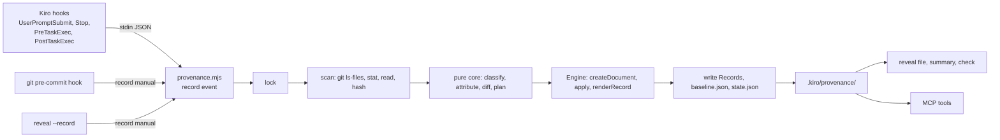
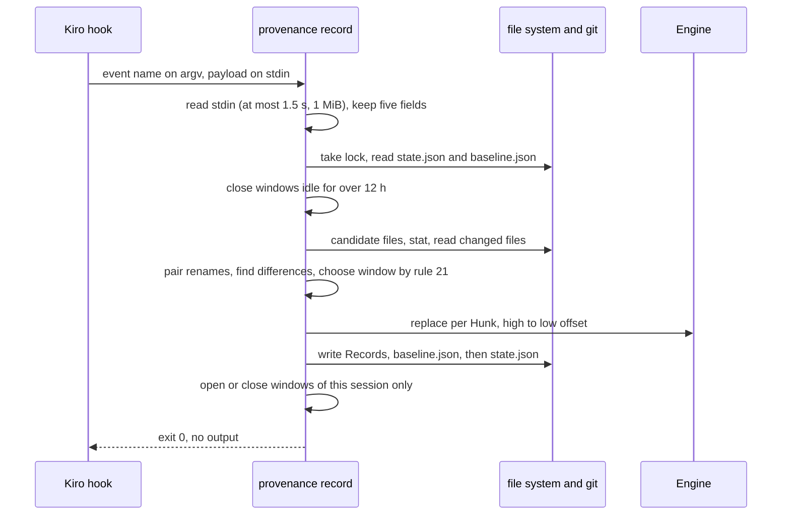

# Design Document

## Overview

This design adds one package, `packages/provenance` (`@reveal-codes/provenance`), one Power, `powers/provenance`, and one hook file, `.kiro/hooks/0-provenance.json`. Together they record, for any workspace, which text in each source file changed while Kiro's agent was working, and show that record as Reveal Codes. The Engine is used as it is. The Recorder compares each changed file with the last state it recorded and applies the difference through `createDocument`, `apply`, `renderRecord` and `parseRecord`. It adds no provenance logic of its own.

The package ships four things.

1. **The Recorder**, run by `provenance record <event>` from four Kiro hooks, from the Reveal_Command (`reveal --record`) and from a git pre-commit hook. It reads the hook payload, finds the files that changed since its last run, attributes each change to an open Agent_Window or to no window, and writes one Record per changed file.
2. **The Reveal_Command**, with the forms `reveal <file>`, `reveal --summary [path]`, `reveal --check [--strict]` and `reveal --record`.
3. **The MCP server**, with five tools that return structured spans from the Records.
4. **The Power** that installs all of it in a workspace, with a Setup_Skill that writes the hook file, because a Power cannot carry hooks (Decision 5).

All four share one Bundle, `provenance.mjs`, built by esbuild. The pure parts (diff, attribution, state transitions, codecs, summary, check, view) live in modules that import no `node:` module. File system, git, process and clock access sit in a small set of modules that receive them as injected values.

### What the Engine can and cannot do (verified)

Requirement 4 and Decision 8 depend on how the Engine counts Runs. I read `packages/engine/src/ops/{replace,insert,delete,validate}.ts`, `relabel.ts`, `spans.ts`, `codes/render.ts` and `codes/syntax.ts`, and ran a scratch script (not committed) against the Engine source. Results:

| Question | Result | Evidence |
| -------- | ------ | -------- |
| Does one `replace` or `insert` per Hunk, each with its own Run_Id, give one Run per Hunk? | **Yes.** `addOriginalLength` adds one `RunEntry` per distinct `runId` at insert time, in sorted position. Two Hunks with the Run_Ids `turn …Z.1` and `turn …Z.2` gave two `RunEntry` values with `originalLength` 30 and 29 and two separate `AI` spans that `normaliseSpans` does not merge (different Run_Ids are not Mergeable). | `relabel.ts` `addOriginalLength`, `spans.ts` `isMergeable`; scratch run |
| Is relabelling to `AI>HUM` per Run? | **Yes.** `relabelRuns` flips a Run whose `editedCount / originalLength` is strictly above the threshold, and rewrites only the `AI` spans of that Run. In the scratch run a `HUM` replace of 20 of the 30 characters of Run `.1` set its `relabelled` flag and left Run `.2` as `AI`. | `relabel.ts` `crosses`, `relabelSpans`; scratch run |
| What counts as an edit? | Only an Actor `HUM` counts. A `HUM` delete adds the deleted `AI` code units of each Run to that Run's `editedCount`. A `HUM` insert strictly inside a Run's extent (`runStart < at < runEnd`) adds its length. An insert at either end of an extent adds nothing. An Actor `AI` or `PST` never counts. | `relabel.ts` `countDeleted`, `countInserted` |
| Does `replace` give the same result as delete then insert? | **Yes.** `applyReplace` is `deleteDraft` with Actor `provenance.origin`, relabel, `insertDraft`, relabel. With empty `text` it is a `delete`; with `from == to` it is an `insert`. The Recorder can therefore use one `replace` call for every Hunk. | `ops/replace.ts` |
| Are Run table entries ever removed? | **No.** Deleting all text of a Run leaves its `RunEntry`. Hunk numbers are therefore stable and a count of existing Runs of a Window_Run equals the highest Hunk number if numbers are gapless. | `ops/delete.ts`, `ops/pipeline.ts` |
| What does an `AI` insert into an already relabelled Run do? | It becomes `AI>HUM` (`effectiveProvenance`). With one Run per window and file (option (a)) this would mark the agent's later text as human-edited. With one Run per Hunk (option (b)) a new Hunk never reuses a relabelled Run. This is a second reason for (b). | `ops/insert.ts` |
| Are all Run_Ids legal? | Any non-empty string. `renderRecord` escapes `\ [ ] { } ; = ,` in the payload and `\ [ ] {` in the retained part. A Run_Id such as `1. Probe task one 2026-11-19T10:00:00Z.1` round-trips through `renderRecord` and `parseRecord`. | `codes/syntax.ts`; scratch run |
| Does a source file's citation layer interfere? | `createDocument` and every `apply` run the citation extractor over the file text. The Record then holds `[CIT …]`, `[QUO …]` and `[REF]` codes for citation-like text. The Recorder never sets a result or override. The viewer draws spans from `Document.spans` and `Document.text`, so these codes never reach the view (Decision 10). | `document.ts`, `citation-layer.ts` |
| Does a Record grow with the text or with the number of Hunks? | With the number of Hunks ever applied. 300 one-line `AI` Hunks into a 2.6 KB text gave a 39 KB full Record, about 125 bytes per Run (one `r=` entry in `[DOC]` and one `[AI:…{t=…}]` code). Run entries are never pruned. See Open points. | scratch run |

**Cost of (b) over (a).** The Engine already supports (b) with no change. The extra work is the Hunk numbering rule, the Run_Id parser and the grouping in the summary, about two to three hours over (a). It is well under half a day. It is not an open point. The open point is the Record growth in the last row.

**BOM.** `new TextDecoder("utf-8", { fatal: true })` drops a leading byte order mark. The Recorder must pass `ignoreBOM: true` or Requirement 4, criterion 1 fails. I confirmed the difference (one code unit without the option, two with it).

### Decisions made in this design

| Id | Decision | Reason |
| -- | -------- | ------ |
| M1 | The line difference is hand-written Myers O(ND) over line hashes. It trims the common prefix and suffix first, caps the edit distance at 1,500 lines, and past the cap treats the whole middle as one Hunk. | Requirement 1, criterion 3 allows a library only if a hand-written difference cannot meet Requirement 4. Requirement 4 asks for line-aligned replacement Hunks that reproduce the new text, not for a minimal diff. A cap bounds memory at about 9 MB and cannot make a result wrong. |
| M2 | One `replace` per Hunk, applied from the highest offset to the lowest. Hunks that insert text get Run numbers in ascending offset order. A delete-only Hunk takes no number. | Requirement 4, criteria 3 and 8; Requirement 3, criterion 12. Numbers stay gapless, so count and highest number agree. |
| M3 | The Window_Run is `<Run_Label> <UTC time to the second>`, with `~<k>` appended only when that string is already used by an open window or by the last opened window. A Run_Id is the Window_Run, `.`, and the Hunk number. The viewer parses it from the right. | Requirement 3, criteria 11 and 12. Run_Ids stay self-describing, so no side index is needed. |
| M4 | Pure core takes digests and times as inputs. SHA-256 and the clock are injected. | Requirement 1, criterion 5. |
| M5 | The viewer builds its output from `Document.text` and `Document.spans`. For plain mode it calls `render(view, "display")` on a copy of the Document with `citations`, `quotes` and `overrides` emptied. | Requirement 9, criterion 4. No Engine change. |
| M6 | The viewer replaces control characters in file text with visible Unicode control pictures, in colour and plain mode alike. Characters keep their length, so columns are unaffected. | A file can hold terminal escape sequences, and colour mode prints text unescaped. Without this a file could inject escape codes into the user's terminal. Open point 9. |
| M7 | `.kiroignore` supports negation (`!pattern`, last match wins) in addition to Requirement 2, criterion 9. | Kiro already reads `.kiroignore` with gitignore syntax and shows `!.env.example` in its own documentation. Open point 6. |
| M8 | The Recorder trusts its per-file cache only as a hint, and only when the file's modification time is at least 2 seconds older than the time the cache entry was made. The Record or Baseline_Entry is always the authority. | A killed run can leave a Record newer than `state.json`; the comparison with the Record repairs it, and a file saved in the same clock tick as the last hash is not skipped. |
| M9 | A stale lock file (older than 30 seconds) is removed before the 5 second wait. | A crashed Recorder must not make every later event time out. |
| M10 | `over_limit` is logged once per path and size and modification time, not at every event. | Requirement 2, criterion 10 says "one line" per skipped file; logging at every event would fill the Fault_Log on this repository, which has over-limit tracked files. |

## Architecture

### Data flow



### Event sequence



### Module layout of `packages/provenance`

Each module is at most 300 lines and each function at most 40. `core/` imports nothing from `node:`. `io/` holds every `node:` import except in `mcp/` and `cli/`. Only `io/env.ts` references `process.env`. Only `cli/main.ts` may throw or call `process.exit`.

| Module | Pure | Role |
| ------ | ---- | ---- |
| `src/index.ts` | yes | Named exports of the pure API and the types. |
| `src/core/types.ts` | yes | Plain data types in Data Models. |
| `src/core/limits.ts` | yes | `SIZE_LIMIT` 200,000; `HOOK_DEADLINE_MS` 20,000; `STALE_WINDOW_MS` 43,200,000; `LABEL_MAX` 80; `STDIN_MAX` 1 MiB; `STDIN_WAIT_MS` 1,500; `LOCK_WAIT_MS` 5,000; `RACY_MS` 2,000; `DIFF_CAP` 1,500. |
| `src/core/payload.ts` | yes | `parsePayload(text)`: keep `session_id`, `cwd`, `task_name`, `spec_name`, `task_success`; drop every other field including `prompt`. |
| `src/core/label.ts` | yes | `makeLabel`, `windowRunName`, `runId`, `parseRunId`. |
| `src/core/windows.ts` | yes | Stale sweep, `select` (rule 21), `transition` per event, ordering counter. |
| `src/core/state-codec.ts` | yes | `encodeState`, `decodeState` for `state.json`. |
| `src/core/baseline-codec.ts` | yes | `encodeBaseline`, `decodeBaseline`. |
| `src/core/lines.ts` | yes | Line starts, `LineIndex`, offset to line and column, column in UTF-16 units. |
| `src/core/diff.ts` | yes | `diffLines(old, new)` giving `Hunk[]`. |
| `src/core/plan.ts` | yes | `planHunks(hunks, origin, runBase, clock)` giving Engine operations. |
| `src/core/update.ts` | yes | `updateRecord`, `firstRecord`, `appearedRecord` over the Engine. Returns `Result`. |
| `src/core/exclude.ts` | yes | Built-in exclusion rules of Requirement 2, criteria 4 to 7. |
| `src/core/ignore.ts` | yes | `.kiroignore` parser and matcher. |
| `src/core/renames.ts` | yes | `pairRenames(gone, appeared)`. |
| `src/core/legend.ts` | yes | The Source_Legend text and the not-know notice. |
| `src/core/structured.ts` | yes | `Structured_Span` builder over a Document. |
| `src/core/summary.ts` | yes | Counts, stretches and window table. |
| `src/core/check.ts` | yes | `checkWorkspace(facts)` giving failures and reports. |
| `src/core/palette.ts` | yes | Pane colours, 24-bit and 256-colour mapping. |
| `src/core/neutralize.ts` | yes | Control-character neutralizing. |
| `src/core/view.ts` | yes | `viewRecord(doc, mode)` for `reveal <file>`. |
| `src/io/deps.ts` | no | `Deps` type and `nodeDeps()`: `fs`, `git`, `clock`, `sha256`, `stdin`, `log`. |
| `src/io/env.ts` | no | The one `process.env` reader: `NO_COLOR`, `COLORTERM`, `TERM`. |
| `src/io/store.ts` | no | Record_Directory layout, atomic write, read of Records, baseline and state. |
| `src/io/lock.ts` | no | Exclusive lock with 5 s wait and stale break. |
| `src/io/faults.ts` | no | Fault_Log append and trim. |
| `src/io/git.ts` | no | `ls-files`, `cat-file`, `log`; every call through `execFile` with an argument array. |
| `src/io/scan.ts` | no | Candidates from git or a walk, exclusion, stat, read, decode, hash. |
| `src/io/baseline-text.ts` | no | Baseline_Text resolver: HEAD blob, then 20 commits. |
| `src/io/stdin.ts` | no | Bounded stdin read. |
| `src/io/recorder.ts` | no | One event from start to exit; calls the pure core in order. |
| `src/io/recorder-files.ts` | no | Per-file phases of an event. |
| `src/io/baseline-cmd.ts` | no | `provenance baseline`. |
| `src/io/load.ts` | no | Read Records, Baseline_File and files into one `WorkspaceFacts` for the viewer, summary, check and MCP. |
| `src/io/setup.ts` | no | `provenance setup` and the `setup_provenance` tool body. |
| `src/io/reveal-cmd.ts` | no | The four Reveal_Command forms, exit statuses, colour choice. |
| `src/mcp/server.ts`, `tools.ts`, `schemas.ts`, `workspace.ts` | no | MCP server over stdio, five tools, `outputSchema` values, workspace discovery. The only modules that import `@modelcontextprotocol/sdk` or `zod`. |
| `src/cli/main.ts` | no | Entry. Dispatch on `record`, `baseline`, `reveal`, `mcp`, `setup`. Catches everything for `record`. |
| `src/testing/arbitraries.ts` | yes | Re-exports from `arb-text.ts`, `arb-edits.ts`, `arb-windows.ts`, `arb-dirs.ts`. |

Package files: `package.json` (dependencies `@reveal-codes/engine` `workspace:*`, plus the two that Requirement 12 forces, see Open points 1), `tsconfig.json` (extends `tsconfig.base.json`, `types: ["node"]`, references `../engine`). Root changes: `tsconfig.json` gains `{ "path": "packages/provenance" }`; `vitest.config.ts` gains `project("provenance", "packages/provenance")`; `package.json` gains `"reveal": "node --import jiti/register packages/provenance/src/cli/main.ts reveal"`. `pnpm-workspace.yaml` already includes `packages/*` and is not changed.

### Layout of the Record_Directory

```
.kiro/provenance/
  baseline.json          committed
  records/<path>.reveal  committed, one per changed file
  provenance.mjs         committed, the Bundle
  reveal                 committed, shell wrapper
  .gitignore             lists state.json, errors.log, lock
  state.json             not committed
  errors.log             not committed
  lock                   not committed
.kiroignore              committed, at the Workspace_Root
.kiro/hooks/0-provenance.json
```

## Components and Interfaces

### Line difference (M1)

`diffLines(oldText, newText): Hunk[]` where `Hunk = { from, to, text }` is a replacement of `oldText[from, to)` by `text`. Every `from` and `to` is a line boundary of `oldText`. A line ends after `\n`; a `\r` stays with its line, so CRLF files diff correctly and a Surrogate_Pair is never split.

Steps:

1. Split both texts into lines. If the texts are equal, return `[]`.
2. Trim the common prefix and suffix of lines. If either side is then empty, return one Hunk.
3. Hash each remaining line to an integer (FNV-1a over code units); compare hashes first and the strings on a hash match.
4. Run Myers O(ND) forward, keeping one `Int32Array` per `d`. If `d` passes `DIFF_CAP` (1,500), stop and return one Hunk over the whole middle.
5. Walk back to get the edit script. Merge each run of deletes and inserts into one Hunk. Convert line indices to offsets.

Why hand-written: the only property Requirement 4 needs is that the Hunks reproduce `newText`, which Property 7 tests. A library would be a runtime dependency of a package that has one dependency. Memory is the sum of `2d+1` ints for `d` up to the cap, about 9 MB, and runs only for a file that changed by more than 1,500 lines. The cost is that a very large rewrite is one Hunk, so the Record says the whole rewritten middle belongs to one Run. That is correct about the text and coarser about the Runs. The common case (a few lines changed in a large file) takes the prefix and suffix trim and costs a pass over the lines.

### Hunk to Engine operation (M2)

For one file at one event, with `origin` either `AI` (Agent_Change) or `HUM` (Outside_Change):

1. `base` is the number of existing Runs in the Record whose Run_Id starts with `<Window_Run>.` and ends in digits. For a Record the Recorder wrote, this equals the highest Hunk number. The design uses the highest number found, plus one, which is the same value and cannot collide.
2. Hunks are ordered by offset. For an Agent_Change, each Hunk with non-empty `text` gets number `base + 1`, `base + 2`, and so on in ascending offset order. A delete-only Hunk takes none.
3. Operations are applied from the highest offset to the lowest, so every `from` and `to` is still valid in the original text. Each is `{ kind: "replace", from, to, text, provenance }` where `provenance` is `{ origin: "AI", runId, timestamp }` for an Agent_Change and `{ origin: "HUM", timestamp }` for an Outside_Change. The Engine turns it into an insert or a delete when `from == to` or `text` is empty. For a delete-only Agent_Change Hunk the Run_Id is unused and the Engine ignores it for the Actor; the Recorder passes the Window_Run with number 0 only to satisfy `checkProvenance` (`AI` needs a non-empty `runId`), and no Run entry is created because no text is inserted.
4. No `relabelThreshold` is passed. The default 0.4 applies (`DEFAULT_RELABEL_THRESHOLD`).
5. After the last operation the Recorder checks `doc.text === fileText`. If not, it keeps the previous Record and logs `apply_mismatch`.

For an Agent_Change that replaces `AI` text the delete step has Actor `AI`, which the Engine never counts as an edit. For an Outside_Change that replaces `AI` text the delete step has Actor `HUM`, which adds the deleted `AI` code units to the `editedCount` of each Run, and the Engine flips every Run that now exceeds 0.4. Because each Hunk is its own Run, one reworked function flips its own Run only.

### Run names (M3)

- **Label.** For `preTask` the `task_name` string with `\s` and C0 controls collapsed to single spaces, trimmed, cut to 80 code points (never inside a Surrogate_Pair). For `promptSubmit` the word `turn`. Empty after cleaning, or no `task_name`, gives `task` (Open point 4).
- **Window_Run.** `<label> <YYYY-MM-DDTHH:MM:SSZ>`. If an open window or the last opened window already has that name, append `~2`, `~3`, and so on.
- **Run_Id.** `<Window_Run>.<n>`.
- **Parse.** `^(.*) (\d{4}-\d\d-\d\dT\d\d:\d\d:\d\dZ)(~\d+)?\.(\d+)$`, label greedy from the left, the rest anchored at the right. Hunk number is the digits after the last `.`. The viewer, summary and MCP tools read the label, the opening time and the Hunk number from the Run_Id and need no other index. A Run_Id that does not match is shown with label `?` and sorts last.
- No part of any prompt or Session_Key enters a name (Requirement 3, criteria 11 and 25).

### Windows, sessions and attribution

All of this is one pure module, `core/windows.ts`, over `WindowState` (Data Models).

**Order of work at one event for session `S`** (`S` is `null` for `manual`):

1. **Sweep (criterion 23).** Close every window of every session whose `lastEventAt` is more than 43,200 s before this event's clock. Log `window_left_open` once per window closed. The current event does not count as that session's last event.
2. **Leftover (criterion 8).** For `promptSubmit` in a session that still has open windows, close all of `S`'s windows and log `window_left_open`.
3. **Attribute.** For every difference this event finds, apply rule 21 to the windows that are open now:
   - (a) the innermost (last) window of `S`, if `S` has one;
   - (b) otherwise the window with the highest `order` among the innermost windows of the other sessions;
   - (c) otherwise none: the difference is an Outside_Change.
   For `manual`, `S` has no windows, so rule (b) applies over all sessions.
4. **Record** the differences.
5. **Transition**, for `S` only: `promptSubmit` opens `turn`; `preTask` opens a task window above any existing one; `postTask` closes the innermost window of `S`; `agentStop` closes all of `S`. A `postTask` or `agentStop` with nothing to close logs `no_open_window`. `manual` changes nothing.
6. Set `sessions[S].lastEventAt` to this event's clock. A session with no windows is removed from `sessions`.

`order` is a counter in `state.json` that increases by one for each window opened. It breaks ties between windows opened in the same second, so rule (b) is a total order and deterministic (Property 5).

**`_none` sessions (criterion 22).** A missing, non-string or empty `session_id` gives the key `_none`. Events with such a payload share one session, so their windows open and close as a pair. `no_session_id` is logged at most once per process, which is once per event, because each event is one process. Open point 3 proposes once per state lifetime.

**What rule (b) can and cannot say.** A hook event reports no file path, and a write is seen only at the next event of any session. When two sessions have windows open together, a change goes to the window that opened most recently, which may be the other session's. The README and the legend say that attribution while sessions overlap is a rule, not a fact.

### Candidate files and exclusion

1. **Git tree.** `git ls-files -z --cached --others --exclude-standard`, minus `git ls-files -z --cached --ignored --exclude-standard` (tracked files that an ignore rule matches). Both through `execFile`, no shell. On this repository the first takes about 30 ms and the second about 30 ms.
2. **No git.** A walk that skips `.git node_modules dist build out .next coverage target` and applies no ignore file. `lstat` first; a symbolic link is absent.
3. **Built-in exclusions**, in `core/exclude.ts`: everything under the Record_Directory; lockfiles and `*.lock`; `*.min.js`, `*.min.css`, `*.map`; anything under a directory named `dist build out .next coverage target`; `.env`, `.env.*`, `*.pem`, `*.key`, `*.p12`, `*.pfx`, `id_rsa*`, `id_ed25519*`. These cannot be re-included by `.kiroignore`.
4. **`.kiroignore`** at the Workspace_Root only (`core/ignore.ts`). Blank lines and `#` lines skipped. `*` is any run except `/`; `**` is any run; `?` is one character except `/`; a trailing `/` marks a directory and matches every file below it. A pattern with no `/` matches the name at any depth. A pattern with a `/` elsewhere, or a leading `/`, is anchored at the root. A line starting with `!` re-includes a path that an earlier line excluded (M7); the last match wins.

**Kiro already reads `.kiroignore`** (checked against the Kiro documentation, `kiro.dev/docs/kiroignore`). In Kiro it stops the agent reading files, with gitignore syntax, including `!` negation, `[]` classes, nested `.kiroignore` files and a global file. The Recorder shares the root file so that secrets listed there are not recorded. It implements the subset above, so three things differ from Kiro: `[]` classes are not matched, nested and global ignore files are not read, and a pattern the Recorder cannot parse is skipped. A line that Kiro treats as a class would not exclude here. The README says so.

**Size and binary.** If `stat.size > 600,000` bytes the file is over the limit without reading, because a text of 200,000 code units takes at most 600,000 bytes of UTF-8. If `stat.size <= 200,000` it cannot be over. Between the two the text is decoded and its `length` is compared. A file with a NUL byte or invalid UTF-8 is binary and silently skipped. Decoding uses `fatal: true, ignoreBOM: true`.

### Baseline file and the first change

`baseline.json` is written by `encodeBaseline` with one entry per line, sorted by path in UTF-16 code unit order:

```
{
  "version": 1,
  "at": "2026-11-19T09:00:00Z",
  "files": {
    "README.md": "<64 hex>",
    "apps/web/app/page.tsx": "<64 hex>"
  }
}
```

The digest is SHA-256 of the file's bytes, which equals the digest of its text because decoding is lossless (BOM and CR kept). A path appears only while the file has no Record (Requirement 5, criterion 1). `at` is set once and never changed.

**First change.** When a file with a Baseline_Entry and no Record differs from the entry's digest:

1. `io/baseline-text.ts` looks for the Baseline_Text: `git cat-file blob HEAD:<path>`, and if its SHA-256 equals the entry's digest, use it. Otherwise `git log -n 20 --format=%H -- <path>`, then `git cat-file blob <commit>:<path>` for each commit, newest first, with the same digest test. Otherwise none.
2. Found: `createDocument(baselineText, baseline.at)` makes every character `PST`. The Hunks from `baselineText` to the file text are applied as above, the Record is written, the entry is removed.
3. Not found: `createDocument("", clock)` then one `replace` of the whole text, with the origin of the event (`AI` and Run `<Window_Run>.1`, or `HUM`), and `baseline_text_unavailable` in the Fault_Log (Requirement 5, criterion 7). The Record then says the whole file is `[AI]` or `[HUM]`, including lines nobody changed. This over-attributes. It happens when git is absent, when the file was changed and committed after the baseline and more than 20 commits ago, when it had uncommitted changes at the baseline, or when line-ending conversion alters the blob bytes. The pre-commit hook of this repository (below) reduces the second case, because it records the first change before the commit that would bury the baseline blob. Open point 2 asks whether to add an ignored cache of baseline text.

**A file that appears.** A candidate with neither a Record nor a Baseline_Entry gets `createDocument("", clock)` and one whole-text insert, `AI` with Run `<Window_Run>.1` if rule 21 selects a window, `HUM` otherwise.

**Renames and deletions** (`core/renames.ts`, Requirement 5, criteria 10 to 13). At one event, a path is *gone* when it has a Record or entry and is no longer a candidate; a path is *appeared* when it is a candidate with neither. A gone path and an appeared path are paired when exactly one of each carries the same non-empty digest (digest of the Recorded_Text for a Record, the entry's digest for an entry, the file's digest for an appeared path). A paired Record file is moved to the new path and an entry gets the new path; no span changes. Anything else is a deletion (Record or entry removed, empty directories under `records/` removed) plus a creation. A rename that also edits the text is a deletion plus a creation.

### One event, in order

`io/recorder.ts` runs these steps. Every step that fails logs a reason and goes on.

1. Parse argv: event name. Unknown name: log `unknown_event`, exit 0.
2. Read stdin for `promptSubmit`, `agentStop`, `preTask`, `postTask`: at most 1.5 s and 1 MiB. Skip stdin for `manual`, because a git hook's stdin is not a payload. `parsePayload` keeps five fields.
3. Find the Workspace_Root: walk up from `process.cwd()` to the first directory that holds `.kiro/provenance`; if none, use the payload `cwd` if it is absolute and holds one; else exit 0 with no log.
4. Take the lock (below). Read `state.json`, `baseline.json`, `.kiroignore`.
5. Sweep, leftover, as in Windows.
6. Scan candidates. For each: if the cache entry matches size and modification time and is not racy, skip. Else read, decode, hash. Compare with the Record (parsed once) or entry.
7. Pair renames. Choose the window by rule 21 once for the event.
8. For each changed file: update as above, write the Record by temporary file and rename, update the cache entry. If the file's modification time changed during the update, keep the old Record and leave the file for the next event (Requirement 4, criterion 12).
9. Delete Records and entries of gone files. Write `baseline.json` if it changed.
10. Transition windows. Write `state.json` last, by temporary file and rename.
11. Release the lock. Exit 0.

The deadline is checked before each file. After 20 s the loop stops, the remaining files keep their Records, and `deadline` is logged. Differences in those files are then seen at the next event and attributed by the windows open then, which may be none; the README says a deadline can misattribute. A watchdog `setTimeout` of 22 s calls `process.exit(0)`.

**Lock.** `open(lock, "wx")` holding the process id and the time. Retry every 25 ms for 5 s. A lock file older than 30 s is renamed away and retried (M9). On timeout: log `lock_timeout`, exit 0, change nothing.

**Cache hint.** `state.files[path] = { size, mtimeMs, digest, seenMs }`. It is trusted when `mtimeMs + 2000 <= seenMs` and size and mtime match. If the cache is absent or unreadable (`bad_state`), every file is compared with its Record or entry. Without a cache the work is about 1,055 reads and hashes (0.2 s measured) plus the parse of each existing Record.

### The Hook_File and why it runs first

`.kiro/hooks/0-provenance.json` holds four hooks in one file:

| name | trigger | command |
| ---- | ------- | ------- |
| Provenance: prompt | `UserPromptSubmit` | `node .kiro/provenance/provenance.mjs record promptSubmit >/dev/null 2>&1 \|\| true` |
| Provenance: stop | `Stop` | `... record agentStop ...` |
| Provenance: task start | `PreTaskExec` | `... record preTask ...` |
| Provenance: task end | `PostTaskExec` | `... record postTask ...` |

Each hook is `{ "name", "trigger", "timeout": 30, "action": { "type": "command", "command": … } }`. `timeout` sits beside `trigger`, as `timeout_ms` does in the existing test hooks, and is in seconds (measured: the IDE honours `timeout`). There is no `matcher` and no `timeout_ms`. Standard input is not redirected, because the payload arrives on it.

Requirement 8, criterion 3 allows no other trigger. `PreToolUse` and `PostToolUse` carry the path of `fs_write` and `fs_append` writes but not of shell writes (probe captures), so they stay out (Decision 6).

**Order with commit-on-task.** The IDE ran two `PostTaskExec` hooks of different files sequentially in file-name order (measured). `0-provenance.json` sorts before `commit-on-task.json` because `0` (0x30) is before `c` (0x63). The Recorder finishes before `scripts/commit-task.sh` runs `git add -A`, so the Records are in the task's commit. `scripts/commit-task.sh` is unchanged. Its `scope_of` skips paths under `.kiro/`, so Record files do not change the scope of a commit; a commit whose only changed paths are under `.kiro/` already gets scope `repo`, as before. **The CLI order is unmeasured.** If the CLI runs the hooks in another order, the Records of a task are committed with the next task or by the pre-commit hook. Nothing is lost. Task 1 measures it.

### The Reveal_Command

`provenance reveal …` is what `.kiro/provenance/reveal` runs; `pnpm reveal` runs the same code from source. The wrapper is `#!/bin/sh` followed by `exec node "$(dirname "$0")/provenance.mjs" reveal "$@"`.

**`reveal <file>`** (`io/reveal-cmd.ts`, `core/view.ts`). The path is resolved against the current directory and must lie inside the Workspace_Root.

| State of the file | Output | Exit |
| ----------------- | ------ | ---- |
| Record whose text equals the file | Header line with the file name; the four-item legend; the Record's spans with codes inline | 0 |
| Unchanged_File (entry, digest equal) | Same header and legend; one `[PST]` and the file text, read from the file | 0 |
| Stale (Record or entry, text or digest differs) | First line: `stale: <path> changed after the last recorded event; <n> characters not yet recorded; run: reveal --record`. Then the Record as recorded, or no codes when only an entry | 0 |
| No Record, no entry | One line with `not_tracked`, `over_limit`, `binary`, `ignored` or `no_record` | 1 |
| Record that does not parse | One line with `tampered_record` | 1 |

`<n>` is the sum of the lengths of the Hunk texts and deleted texts between the recorded text and the file. For a stale file with only an entry, the Baseline_Text is looked up in git as above; if not found, `<n>` is the whole file length.

**Colour choice** (`io/env.ts` and `process.stdout.isTTY`): 24-bit when stdout is a terminal, `COLORTERM` is `truecolor` or `24bit`, `NO_COLOR` is unset and `TERM` is not `dumb`; 256 colours when `TERM` contains `256color` and not 24-bit; plain otherwise.

**Coloured body.** Each span prints its code (`[HUM]`, `[PST]`, `[AI:run]`, `[AI>HUM:run]`, with the Engine's escaping of the Run_Id) and its text, unescaped except for the neutralizing of M6, in the colour of its origin from `product.md`: `HUM #E8ECF6`, `PST #F5D98B`, `AI #A6D4F7`, `AI>HUM #D7C6F5`, on the pane body `#0F2766`. The header title is `#FFFFFF` and the legend `#BAC4E2`. Each line ends with a reset so the background does not run on. The 256-colour mode maps each hex value to the nearest of the 6×6×6 cube and 24 greys by squared distance in RGB.

**Plain body.** `render(view, "display").text`, where `view` is the Document with `citations`, `quotes` and `overrides` set to empty, so only the four provenance codes appear, with `\`, `[` and `]` escaped. Control characters are neutralized as in colour mode.

**Equality (Property 6).** Let `P` be the plain rendering and `positions` the Engine's code positions in it. Unescaping the text segments of `P` between code positions, and leaving codes, header and legend as they are, gives a string equal to the colour output with every ANSI sequence removed.

**The legend** has the four items of Requirement 9, criterion 3, in order, one line each, under the header.

**`reveal --summary [path] [--top n]`** (`core/summary.ts`). Per file and in total: characters and share of each Origin to one decimal. An Unchanged_File counts all its characters as `PST`. Then up to `top` (default 10) largest `AI` Spans, ordered by length descending, path ascending, offset ascending, each with path, first and last line, length, label and Window_Run. One line gives the `AI>HUM` characters left out of the list. A table groups `AI` and `AI>HUM` characters by Window_Run: label, opening time, files, Runs, characters of each. Files whose text differs from their Record are marked `stale`. The notice that `[HUM]` does not tell typing from pasting is printed once. No clock is read, so the output is a function of the Records, the baseline, the files and the arguments. With nothing recorded: one line naming `setup_provenance`, exit 1.

**`reveal --check [--strict]`** (`core/check.ts`). For every Tracked_File, the Record or the entry is compared with the file. Lines are printed in path order, each labelled `fail` or `report`:

| Reason | Condition | Class |
| ------ | --------- | ----- |
| `tampered_record` | `parseRecord` fails | fail |
| `orphan_record` | Record for a path that is not a Tracked_File | fail |
| `orphan_baseline` | entry for a path that is not a Tracked_File, or a path with both a Record and an entry | fail |
| `stale` | Record text or entry digest differs from the file | report; fail with `--strict` |
| `no_record` | Tracked_File with neither | report; fail with `--strict` |

Exit 1 when any `fail` line is printed (or any `report` line with `--strict`), else 0. A clean run prints one line with the number of files checked. A run that printed `stale` or `no_record` ends with the line `run: reveal --record`. The check reads files and writes nothing.

**`reveal --record`** runs the Recorder with the event `manual`.

### The MCP tools

`provenance mcp` starts a stdio server with `@modelcontextprotocol/sdk`. The tool code in `mcp/tools.ts` calls the same functions as the command line (`io/load.ts`, `core/structured.ts`, `core/summary.ts`, `core/check.ts`), so a tool and its command cannot disagree. All results hold `structuredContent` that matches the tool's `outputSchema`, and a text summary of one to five lines. No tool returns file text, escaped text or ANSI sequences, and no tool calls a model.

**Workspace.** The argument `workspace` (absolute path) or else the process's current directory, then up to the first directory that holds `.kiro/provenance`. If none: an error result that says provenance is not set up and names `setup_provenance`. Every `path` argument is resolved inside the Workspace_Root and rejected otherwise. `setup_provenance` without `workspace` works only when the current directory holds `.git` or `.kiro`; otherwise it returns an error asking for `workspace`, because it has not been verified where Kiro starts a Power's server (Open point 8).

**Types** (`StructuredSpan` has 1-based lines and columns in UTF-16 code units, end exclusive):

| Tool | Input | Output |
| ---- | ----- | ------ |
| `reveal_file` | `path`, `workspace?` | `{ file, status, reason, unrecordedCharacters, spans: StructuredSpan[], legend: string[4] }`. `status` is `current`, `unchanged_baseline`, `stale` or `unrecorded`. `reason` is `null` or one of the Requirement 9 reasons. `reason` is an addition to Requirement 12, criterion 4. |
| `untouched_agent_text` | `path`, `top?`, `workspace?` | `{ path, stretches: StructuredSpan[], countsByOrigin: { AI, "AI>HUM", HUM, PST }, omittedAiHumCharacters, stale, notice }` |
| `provenance_summary` | `path?`, `top?`, `workspace?` | `{ files: FileCounts[], total: FileCounts, windows: WindowRow[], stretches: (StructuredSpan & { file })[], omittedAiHumCharacters, notice }` |
| `check_records` | `strict?`, `workspace?` | `{ ok, filesChecked, failures: {path, reason}[], reports: {path, reason}[] }`; `isError` is true when the command would exit non-zero |
| `setup_provenance` | `workspace?` | `{ written: string[], kept: string[] }` |

`FileCounts = { path, stale, characters: { AI, "AI>HUM", HUM, PST }, shares: same keys as percentages }`. `WindowRow = { windowRun, taskTitle, openedAt, files, runs, aiCharacters, aiHumCharacters }`. `StructuredSpan = { startLine, startColumn, endLine, endColumn, length, origin, run, taskTitle }` with `run` and `taskTitle` null for `HUM` and `PST`. `run` is the Run_Id; `taskTitle` is the Run_Label parsed from it.

The four read tools carry `annotations: { readOnlyHint: true }`; `setup_provenance` does not. They read only the Record_Directory, the `.kiroignore` and the files they describe.

**Startup cost.** The hook path loads the same Bundle. The MCP modules are loaded with a dynamic `import()` only for `provenance mcp`, so the hook path does not evaluate the SDK. esbuild still parses the bundled text, which adds a few milliseconds (a 917 KB bundle for citation-check). Task 7 measures it; if it costs more than 20 ms of a `promptSubmit` event, Open point 1 gives the fallback.

### Setup and the pre-commit hook

`provenance setup` (also the body of `setup_provenance`) does, in order, and reports each file as written or kept: create `.kiro/provenance/`; copy the running Bundle to `provenance.mjs` and write `reveal` and `.gitignore`; write `.kiroignore` (comment lines only) if absent; write `.kiro/hooks/0-provenance.json` if absent; run the baseline, which writes `baseline.json` and no Record. An existing `.kiroignore`, Hook_File, `baseline.json` or Record_Directory is kept and named. The Bundle copy and wrapper are program files: they are replaced when their bytes differ and then reported as written. Without this a rebuilt Bundle would never reach a workspace (Open point 7).

**In this repository** the install task builds the Bundle (`node scripts/build-power.mjs --power provenance`), runs `node powers/provenance/server/provenance.mjs setup`, adds the line `powers/*/server/` to `.kiroignore`, and writes `.git/hooks/pre-commit` with this block, appended if a hook exists:

```sh
# reveal-codes provenance: catch up the record, stage it. Never blocks a commit.
if [ -f .kiro/provenance/provenance.mjs ]; then
  node .kiro/provenance/provenance.mjs record manual >/dev/null 2>&1 || true
  git add -- .kiro/provenance/baseline.json .kiro/provenance/records >/dev/null 2>&1 || true
fi
```

If an existing pre-commit hook has an unconditional `exit` before the end, the block never runs; the install task reports this and does not edit the hook. Git does not version `.git/hooks`; `docs/KIRO_USAGE.md` and the README give the recreating command: `node powers/provenance/server/provenance.mjs setup --git-hook`, an extra flag of the setup command that writes only this block.

**How it coexists with Kiro's commits in the middle of a window.** In chat mode the agent runs `git commit` through the shell while its `turn` window is open. The pre-commit hook then runs the Recorder with `manual`. Rule 21 (b) selects the most recently opened innermost window, so what the agent changed so far is recorded as `AI` of that window, and the window stays open. Without criterion 10 the text would become `[HUM]`. When no window is open (a person commits between turns) the same run records an Outside_Change. The cost: a change a person saves while the agent is working is attributed to the agent. With a lock held by a hook Recorder, the pre-commit run waits up to 5 s. With `git commit <paths>` or `--only`, git uses a temporary index and the `git add` may not reach the final index; the Records are then staged by the next commit. Records describe the working tree, so a partial commit can hold a Record that is ahead of the committed file, and `reveal --check` on that commit reports `stale`.

### The Power and its build

```
powers/provenance/
  plugin.json                 name reveal-codes-provenance, keywords of Requirement 13, criterion 2
  mcp.json                    node ${PLUGIN_ROOT}/server/provenance.mjs mcp, no env
  server/provenance.mjs       generated by pnpm power:build
  skills/setup-provenance/SKILL.md
  skills/reveal-codes-for-source/SKILL.md
  README.md
```

`scripts/build-power.mjs` gains a table of Powers. With no argument it builds `citation-check` and `provenance`. With an output directory only (the form `power.test.ts` uses) it builds `citation-check` into it, unchanged. With `--power provenance [out]` it builds `provenance`. The esbuild options are those of `citation-check` (`bundle`, `platform: "node"`, `format: "esm"`, `target: "node20"`, `legalComments: "none"`, the `createRequire` banner), entry `packages/provenance/src/cli/main.ts`. The build is deterministic, so `pnpm power:build` leaves the tree clean. A test builds into a temporary directory and compares bytes with `powers/provenance/server/provenance.mjs`, as `power.test.ts` does for `citation-check`. A second test compares `.kiro/provenance/provenance.mjs` of this repository with that file. `.prettierignore` gains the new generated path; `eslint.config.ts` already ignores `powers/*/server/*.mjs`.

### Requirement 19 as a small change

In each of the five files `engine-tests-on-save.json`, `verifier-tests-on-save.json`, `web-tests-on-save.json`, `export-tests-on-save.json` and `sentinel-tests-on-save.json`, the line `"timeout_ms": 120000,` becomes `"timeout": 120,` and nothing else changes. The `perl alarm 120` wrapper stays. In `crew/sentinel/test/static/package.test.ts` the type declaration (line 28), `expect(hook.timeout_ms).toBe(120000)` (line 82) and the equality check (lines 89 to 95) change to `timeout` and `120`. In `packages/export/test/package.test.ts` the type declaration (line 72), the equality loop (lines 89 to 97) and `toBe(120000)` (line 100) change the same way. `BUILD_LOG.md` gains the entry that Requirement 19, criterion 3 describes. The rows in `docs/KIRO_USAGE.md` and the older specs are not edited.

### Time budgets and how they are measured

| Budget | Limit | Estimate | How measured |
| ------ | ----- | -------- | ------------ |
| `promptSubmit`, no file changed, this repository | 0.5 s | About 80 to 120 ms on the M4 (the user's measured floor is 33 to 50 ms for node, stdin and three git calls). In the shell of this session, an empty `node` start took about 105 ms, one `git ls-files` about 30 ms, and a node process that ran `git ls-files` and `stat` on 1,060 files took about 140 ms, so the same event takes about 200 ms there. | `test/timing.test.ts`, run only when `PROVENANCE_TIMING=1`: spawn the built Bundle 25 times in a copy of this repository's working tree state, report the median and the maximum. Value recorded in `BUILD_LOG.md` next to the floor. |
| Other events, no change | 1.5 s | Same as above plus the parse of `state.json` (about 100 KB). | Same test. |
| Any event, no `state.json` | 5 s | 1,055 reads and hashes (0.2 s), parse of every Record (under 1 s for a few hundred), Engine `createDocument` only for changed files. | Same test, with `state.json` removed. |
| Baseline of this repository | 10 s | About 0.3 s. | Same test, `provenance baseline`. |
| One file, one Hunk, 194,104 characters | n/a | 2 ms for `apply` (measured), plus the diff pass over the lines. | Unit timing in the same test file. |
| Hook end | Deadline 20 s plus 2 s | Watchdog at 22 s. | Example test with an injected slow clock. |

The tests do not assert wall-clock limits in CI, because a shared runner is slower than the M4. They report the numbers, and the example test for the deadline uses an injected clock.

## Data Models

**`WindowState`** and `state.json` (`version: 1`):

```
{
  "version": 1,
  "order": 17,                          // windows opened so far
  "lastWindowRun": "turn 2026-11-19T10:00:00Z",
  "lastEventAt": "2026-11-19T10:05:00Z",
  "recordedAtMs": 1794981816799,
  "sessions": {
    "<Session_Key>": {
      "lastEventAt": "2026-11-19T10:05:00Z",
      "windows": [                      // stack, innermost last
        { "windowRun": "turn 2026-11-19T10:00:00Z", "label": "turn",
          "kind": "turn", "openedAt": "2026-11-19T10:00:00Z", "order": 16 },
        { "windowRun": "1. Probe task one 2026-11-19T10:01:00Z", "label": "1. Probe task one",
          "kind": "task", "openedAt": "2026-11-19T10:01:00Z", "order": 17, "spec": "probe-scratch" }
      ]
    }
  },
  "files": {
    "src/a.ts": { "size": 1200, "mtimeMs": 1794981000000.5, "digest": "<64 hex>", "seenMs": 1794981010000 }
  },
  "skipped": {
    "data/standing-orders.json": { "size": 412000, "mtimeMs": 1794981000000, "reason": "over_limit" }
  }
}
```

The Session_Key is stored here and nowhere else (Requirement 3, criterion 25). `spec` is the directory name that holds the payload's `tasks.md`, never a path. `decodeState` returns an error for any other shape, and the Recorder then treats the state as absent, logs `bad_state` and closes every window it held.

**`Baseline_File`**: as above. `decodeBaseline` accepts `version` 1, an `at` that passes the Engine's timestamp check, and a `files` object whose values are 64 lowercase hex characters.

**Record**: `renderRecord(document, null, "full").text`, at `records/<path>.reveal`, `/` as separator on every platform. `parseRecord` of the file returns the Document it was made from. The file holds no path, so moving it is a rename.

**`Payload`** `= { sessionId: string | null, cwd: string | null, taskName: string | null, specName: string | null, taskSuccess: boolean | null }`. Nothing else is read or kept. `specName` is reduced to the name of the directory that holds the `tasks.md` and is stored only as `spec` in a window entry.

**`Hunk`** `= { from, to, text }`. **`FileFact`** `= { path, digest, text | null, kind: "text" | "binary" | "over_limit" }`. **`WorkspaceFacts`** is the Records parsed, the entries, the files read and the candidate list, gathered once by `io/load.ts` for the viewer, the summary, the check and the tools.

**`Fault_Log` line**: `<ISO time> <event> <path or -> <reason>`, one line, no file text, no payload field. Reasons: `over_limit`, `no_open_window`, `window_left_open`, `lock_timeout`, `no_session_id`, `baseline_text_unavailable`, `tampered_record`, `bad_state`, `bad_baseline`, `deadline`, `apply_failed:<kind>`, `apply_mismatch`, `read_failed`, `write_failed`, `unknown_event`, `exception`. A log over 256 KiB is cut to its last 128 KiB, at a line boundary, before the next append.

**The Source_Legend** (also the `legend` of `reveal_file`), exactly: `[AI:<run>] changed while the agent was working, with the run it belongs to`; `[AI>HUM:<run>] agent text in a run that the Engine counts as edited outside the agent`; `[HUM] changed outside the agent; typing, pasting and other tools are not told apart`; `[PST] already in the file when recording started; origin not recorded`.

## Correctness Properties

*A property is a characteristic or behavior that should hold true across all valid executions of a system-essentially, a formal statement about what the system should do. Properties serve as the bridge between human-readable specifications and machine-verifiable correctness guarantees.*

The properties below follow Requirement 16 (Properties 1 to 5 and the colour equality of criterion 12) and add round trips for each parser and codec. Each is one `fc.assert(fc.property(...))` in a file named `<module>.properties.test.ts`, with `// Property N` above it and `_Requirements: x.y_` in the `describe` title. Run counts come from a `runs()` helper in `packages/provenance/test/support/fc.ts`, copied from the engine's (200 locally, 500 with `FC_NUM_RUNS=500`). Reflection: the cache rule (Requirement 5, criterion 16) and the Record round trip (criterion 2) are folded into Property 1; the bytes of the Fault_Log and state are excluded from Property 4 by Requirement 16, criterion 5.

### Property 1: The record or the baseline is the file

*For any* starting file text (including empty, with a leading byte order mark, with carriage returns, with surrogate pairs and with `[`, `]` and `\`), *for any* sequence of events and *for any* replacement of the file text before each event (including deletion of all text and changes at the start and the end), and with `state.json` removed before a generated subset of the events, after every event the file has a Record whose `parseRecord` Document has `text` equal to the file text, or has no Record and a Baseline_Entry whose digest equals the digest of the file text; it never has both.

**Validates: Requirements 4.1, 4.2, 5.1, 5.2, 5.6, 5.15, 5.16, 16.2**

### Property 2: Attribution follows the windows and nothing else

*For any* sequence of events over one or more sessions and *for any* file edits between them, let `W` be the window that rule 21 selects at an event from the windows open when the event starts (after the sweep and the leftover closing). Then every character the event inserts has origin `AI` and a Run_Id `W.windowRun + "." + n` with `n` distinct per inserting Hunk and ascending with the Hunk's offset, one more than the highest number already used in that Record by that Window_Run; when no window is open, every inserted character has origin `HUM` and none has origin `AI`; and every character outside the event's Hunks keeps its Run_Id and timestamp, and keeps its origin except that `AI` may become `AI>HUM` for a Run the Engine's table marks relabelled.

**Validates: Requirements 3.12, 3.21, 4.3, 4.4, 4.5, 4.10, 5.7, 5.8, 5.9, 16.3**

### Property 3: Changed agent text goes through the Engine and only the Engine

*For any* Record that holds `AI` text and *for any* sequence of Outside_Changes to it, the Document the Recorder writes is equal (`renderRecord(…, "full")` text) to the Document obtained by applying the same Hunks as Engine `replace` operations from the highest offset to the lowest to the same starting Document; every `AI>HUM` span has a Run with `relabelled` true in the Run table; and the Recorder passes no relabelling threshold.

**Validates: Requirements 4.6, 4.7, 4.8, 4.9, 16.4**

### Property 4: Nothing happens twice

*For any* Record_Directory and *for any* event, running the same event a second time with no file change leaves every file under the Record_Directory except `state.json` and `errors.log` byte for byte the same, including `baseline.json` and every Record.

**Validates: Requirements 5.15, 6.2, 6.3, 16.5**

### Property 5: Sessions are independent

*For any* interleaving of valid event sequences of two sessions with different Session_Keys, with a file change possible before every event and every gap between events under 12 hours: after every event of one session, the set of open windows of the other session equals the set before that event; and every difference found at an event while some window is open is inserted with origin `AI` and a Run whose Window_Run is that of the window rule 21 selects, and is never an Outside_Change.

**Validates: Requirements 3.2, 3.3, 3.4, 3.5, 3.6, 3.21, 3.24, 16.18**

### Property 6: Colour output is the plain output with the colour removed

*For any* Document (text with `[`, `]`, `\`, control characters and citation-like strings, and any spans) and *for any* of the 24-bit and 256-colour modes, removing every ANSI escape sequence from the coloured view gives the plain view with the Engine's escaping removed from the text characters only; the plain view contains no escape character and none of the codes `CIT`, `QUO`, `REF`, `OVR` or `DOC`; and the coloured and plain views show the same text characters after neutralizing.

**Validates: Requirements 9.4, 9.5, 9.6, 9.7, 9.8, 16.12**

### Property 7: Hunks reproduce the new text

*For any* two texts `a` and `b`, `diffLines(a, b)` returns Hunks that are sorted by offset, do not overlap, start and end on line boundaries of `a`, and when applied to `a` give `b`; it returns no Hunk when `a` equals `b`; and the total of the Hunk text lengths and deleted lengths does not exceed `a.length + b.length`.

**Validates: Requirements 4.2, 4.3**

### Property 8: The baseline file round-trips

*For any* set of paths and digests and *for any* valid `at`, `decodeBaseline(encodeBaseline(x))` equals `x`, the encoded text has one entry per line, the entries are in UTF-16 code unit order of path, and encoding the same set in any insertion order gives the same bytes.

**Validates: Requirements 5.4, 6.3**

### Property 9: The window state round-trips

*For any* valid `WindowState` (sessions with stacks of windows, cache entries, skipped entries and counters), `decodeState(encodeState(s))` equals `s`, and `decodeState` of any text that is not a valid encoding returns an error value and never throws.

**Validates: Requirements 3.17, 5.16, 5.17**

### Property 10: Run names round-trip

*For any* label string (including spaces, dots, digits, brackets, surrogate pairs and control characters), *for any* time and *for any* collision suffix and Hunk number, `parseRunId(runId(windowRunName(makeLabel(label), time, k), n))` gives back the cleaned label, the time, the suffix and `n`; the cleaned label has at most 80 code points, no control character and no run of spaces; and the Run_Id contains no part of the original label beyond the cleaned label.

**Validates: Requirements 3.11, 3.12, 3.13, 10.6**

### Property 11: Structured spans cover the file exactly

*For any* Document, the `StructuredSpan` list of its spans is contiguous in order, starts at line 1 column 1, ends at the position of `text.length`, has lengths that sum to `text.length`, and each span's start and end positions convert back to the offsets of the Document span it came from; `run` and `taskTitle` are null exactly for `HUM` and `PST`.

**Validates: Requirements 12.4, 12.5, 12.8**

### Property 12: Summary counts add up

*For any* set of Records and Unchanged_Files, for each file the four Origin counts sum to the length of the Recorded_Text (or of the file for an Unchanged_File, all `PST`); the four shares sum to 100.0 within rounding; the total equals the sum over files; the Untouched_Stretches are `AI` spans only, ordered by length descending, then path ascending, then offset ascending; and the number of `AI>HUM` characters left out of the list equals the total `AI>HUM` count.

**Validates: Requirements 10.2, 10.3, 10.5, 10.8**

### Property 13: The payload keeps five fields and no prompt

*For any* JSON payload with any extra fields (including `prompt`, `tool_input` and `tool_response` with arbitrary strings), `parsePayload` returns only `sessionId`, `cwd`, `taskName`, `specName` and `taskSuccess`; no returned string contains a `prompt` value; and a non-object, a non-JSON text or a text over 1 MiB gives the empty payload.

**Validates: Requirements 3.15, 3.16, 3.19**

## Error Handling

Every failure of the Recorder ends in exit status 0 with nothing on standard output or standard error. The reason goes to the Fault_Log (Data Models). The table gives the action.

| Failure | Action |
| ------- | ------ |
| Unknown event name | Log `unknown_event`, exit 0. |
| stdin not closed, empty, invalid JSON or over 1 MiB | Continue with the empty payload. |
| No `session_id` | Use `_none`; log `no_session_id`. |
| No Record_Directory found | Exit 0, log nothing (nowhere to write). |
| Lock not obtained in 5 s | Log `lock_timeout`, change nothing. |
| `state.json` unreadable | Treat as absent, log `bad_state`, close held windows. |
| `baseline.json` unreadable | Leave it, log `bad_baseline`, create no Record that needs an entry. |
| Record does not parse | Leave the file, log `tampered_record`, write no new Record for that path. |
| `apply` returns an error, or text differs from file after apply | Keep the old Record and entry, log `apply_failed:<kind>` or `apply_mismatch`, continue. |
| File changed while being updated | Keep the old Record and entry; the next event handles it. |
| File over the limit | Skip; log `over_limit` once per path, size and modification time; delete its Record or entry. |
| Binary file | Skip silently; delete its Record or entry. |
| Baseline_Text not found | Insert the whole text with the origin of the event; log `baseline_text_unavailable`. |
| Deadline (20 s) | Stop starting files, log `deadline`. |
| Uncaught exception, unhandled rejection | Caught in `cli/main.ts`, log `exception`, exit 0. |
| Fault_Log not writable | Discard the line. |

The Reveal_Command and the MCP tools return error values (never throw) and exit non-zero only where Requirements 9, 10 and 11 say so.

## Testing Strategy

**Property tests** use `fast-check` with vitest, as `tech.md` requires: Properties 1 to 13 above, each with the `// Property N` comment, the `_Requirements: x.y_` title and `runs()`. Arbitraries live in `packages/provenance/src/testing/arbitraries.ts` (re-exporting `arb-text.ts`, `arb-edits.ts`, `arb-windows.ts`, `arb-dirs.ts`) and cover text with surrogate pairs, carriage returns, a byte order mark, empty text and text with `[`, `]` and `\`; line-based edit sequences; interleaved events of two or more sessions, with and without `session_id`; and Record_Directories with few Records and a Baseline_File. The IO modules take an in-memory `Deps` (a map for the file system, a fake git, a fixed clock), so the properties run without disk and without the network. No test mocks the Engine. The exception to `tech.md` (arbitraries in the package, not in `packages/engine`) goes in `BUILD_LOG.md` (Decision 17). The design changed no property from Requirement 16; any change during the build is listed in `BUILD_LOG.md`.

**Example tests**, in `packages/provenance/test/`:

- Payloads. Scrubbed fixtures captured by task 1, one per event and surface for which a payload exists (field names, types, `task_name`, `spec_name`, `task_success`, a fixed placeholder for `prompt` and for every `session_id`), each labelled by how it was captured (Requirement 16, criterion 6). The IDE and CLI `Stop` and `UserPromptSubmit` shapes are already known from the probe; the CLI task events are not.
- Files. Rename of an Unchanged_File; rename of a recorded file; deletion of each; a binary file; a file at 199,999, 200,000 and 200,001 code units; a rename plus an edit; a git-ignored file; a `.kiroignore` file, with negation; a file that appears inside a window; a symbolic link.
- Baseline text. Three temporary git repositories: Baseline_Text found at `HEAD`, found 5 commits back, not found (whole text inserted with the origin of the event, `baseline_text_unavailable` logged).
- Corrupt directory. A truncated Record, an unparseable `state.json`, an unparseable `baseline.json` and an unwritable directory: the Fault_Log gains a line, standard output and standard error are empty, the status is 0.
- Check. `--check` fails on a tampered Record, an orphan Record and an orphan baseline entry; reports a stale file and a `no_record` file without failing; fails on both with `--strict`; one run per case with the exit status and the reason line.
- Tools. The Bundle copied from `powers/provenance` to a directory outside the repository with no `node_modules`, run over stdin and stdout with the SDK client; each tool is called and its result is checked against its `outputSchema` and against Requirement 12.
- View. `reveal <file>` in 24-bit, 256-colour and plain mode on a file that contains `[`, `]` and `\`; the legend text; the stale first line; the `[PST]`-only view of an Unchanged_File; exit statuses 0 and 1.
- Events. `manual` with and without an open window; overlapping IDE and CLI sessions as in Requirement 16, criterion 19 (the IDE opens, the CLI opens, a change and the IDE stops, a second change and the CLI stops, a third change after both); an event with no `session_id` and one with an empty one (`_none`, one `no_session_id` line); rule (b) with two other sessions that opened in the same second; a window left open for 13 hours.
- Engine. One `replace` of a Hunk yields one Run, and an edit to one Hunk does not count against the extent of a neighbour (Requirement 16, criterion 17; the scratch run of the Overview, made permanent).
- Hook file and order. `0-provenance.json` has four hooks with `timeout` 30, no `timeout_ms`, and output redirected; its name sorts before `commit-on-task.json` byte-wise; `commit-task.sh` is unchanged (`git diff` empty); `scripts/commit-task.sh --print-scope` gives the same scope with and without a path under `.kiro/provenance/`.
- Static. No `node:` import under `src/core/`; `process.env` in one module; no module over 300 lines; no function over 40 lines; no `any`; no network call; the `provenance` Vitest project exists and `pnpm-workspace.yaml` is unchanged.
- Power. Manifests; the Bundle equals a fresh build in a temporary directory; `.kiro/provenance/provenance.mjs` equals the Bundle; `pnpm power:build` leaves `git status` clean; `setup` in a temporary directory writes the listed files and a second run keeps them.
- Timing. `test/timing.test.ts`, run when `PROVENANCE_TIMING=1`: median and maximum of 25 runs of `promptSubmit` with no change, of another event, of an event with no `state.json`, and of `baseline`, against the limits of Requirement 7 and Requirement 6; the deadline with an injected clock.
- Requirement 19. The two updated `package.test.ts` files, and a check that the five hook files hold `"timeout": 120` and no `timeout_ms`.

**Not property-tested**, and why: the Hook_File, the manifests, the Power build and the documentation are fixed text (smoke and snapshot of file content); git and the real file system are integration (a few temporary repositories); wall-clock limits depend on the machine (reported, not asserted); Kiro's scheduling of hooks cannot be tested from this repository (measured by hand in task 1).

## Open points

Each item is a decision the design had to make, or a place where a requirement could not be met as written. Please confirm or change before tasks run.

1. **Requirement 1, criterion 3 conflicts with Requirement 12, criterion 1.** The package may depend only on the Engine, but the MCP server needs `@modelcontextprotocol/sdk` (and `zod` for `outputSchema`). Design: both are `dependencies` of `packages/provenance`, pinned to the versions `courtlistener-mcp` uses (1.32.2 and 3.25.76), imported only by `src/mcp/`, and loaded by dynamic `import()` only for `provenance mcp`. The pure core, the Recorder and the viewer import neither. Fallback if the Bundle's parse cost passes 20 ms on a `promptSubmit` event: a second file `provenance-mcp.mjs`, which breaks Requirement 13, criterion 10 (one file).
2. **Baseline text for a first change can be missing.** For a non-git workspace, or a file changed and committed more than 20 commits after the baseline, or a file with uncommitted changes at the baseline, or a line-ending conversion, the Record says the whole file is `[AI]` or `[HUM]`. That over-attributes. The alternative is an ignored cache of baseline text under the Record_Directory, a second copy of every tracked file (about 7 MB here). The design does not include it. Decision for you.
3. **`no_session_id` is logged once per process,** which is once per event, so a client that never sends `session_id` writes a line at every event. The design follows the requirement. A line once per state lifetime would be quieter.
4. **Requirement 3, criterion 14 conflicts with criterion 16.** Criterion 14 reads the field `task` as a label fallback; criterion 16 allows reading only five fields. The design follows 16 and uses the word `task` when `task_name` is missing.
5. **The 12-hour stale rule** (criterion 23) is the proposal from Decision 18, kept as written. A single session that is idle more than 12 hours with a window open loses it at the next event of any session, and its late `Stop` logs `no_open_window`.
6. **`.kiroignore` is already a Kiro file.** Kiro reads it with gitignore syntax to keep files from the agent. The design shares the root file and supports negation (`!`), which Requirement 2, criterion 9 does not list. `[]` classes, nested `.kiroignore` files and the global ignore file are not supported, so a file Kiro hides may still be recorded and a file the Recorder excludes may be readable by Kiro. A pattern added for recording also hides the file from the agent.
7. **Refreshing the installed Bundle.** Requirement 13, criterion 4 says an existing Record_Directory is left unchanged. The design replaces `provenance.mjs` and `reveal` when their bytes differ, and keeps everything else. Without it a rebuilt Bundle never reaches a workspace. A test compares the repository's installed copy with the built one, so every change to the package needs a rebuild and `setup` before commit.
8. **Where Kiro starts a Power's MCP server is unverified.** `setup_provenance` without a `workspace` argument works only if the current directory holds `.git` or `.kiro`. The Setup_Skill passes `workspace`. This tightens Requirement 12, criterion 12 for that one tool.
9. **Control characters in file text** are replaced by visible control pictures in the view, in both modes, so a file cannot send escape sequences to the terminal. This departs from "print the file's text as it is" (Requirement 9, criterion 5) for files that contain control characters. The MCP tools return no text.
10. **Record growth.** A Record grows by about 125 bytes for every Hunk ever applied, because the Engine never prunes Runs. A file the agent edits 1,000 times reaches about 125 KB of Record. The design does not compact. Compaction would need an Engine change, which Requirement 1, criterion 4 forbids.
11. **`reveal_file` has an added `reason` field** (Requirement 12, criterion 4 lists five fields). It carries the Requirement 9 reasons for an unrecorded file.
12. **Baseline "files skipped"** is read as the candidate files that were not baselined because they are over the limit, binary or unreadable. Files that already have a Record or entry are not counted.
13. **A deadline can misattribute.** Files not processed before the 20 s deadline are seen at a later event, when the window may already be closed; their changes become an Outside_Change.
14. **A stale lock is broken** after 30 s (M9). This is not in the requirements.
15. **Unmeasured, and carried to task 1:** the order of two `PostTaskExec` hooks on the CLI; whether the CLI fires `PreTaskExec` and `PostTaskExec` at all; whether `session_id` differs between the IDE, the CLI and two IDE chat tabs (the probe stored only its type); and whether `fs_write` and `fs_append` paths are absolute or workspace-relative (the probe stored no path value, and the Recorder does not use them). Also unmeasured: whether a sub-agent started by `invoke_sub_agent` fires its own `Stop` in the same `session_id`, which would close the parent's windows early.
16. **`pre-commit` with partial commits.** With `git commit <paths>` or `--only`, git uses a temporary index and the `git add` of Records may not reach the final index; they are staged by the next commit.
17. **Documentation in two places.** This design asks for `--git-hook` as an extra flag of `provenance setup` so the hook can be recreated by one command. It is not in the requirements.
