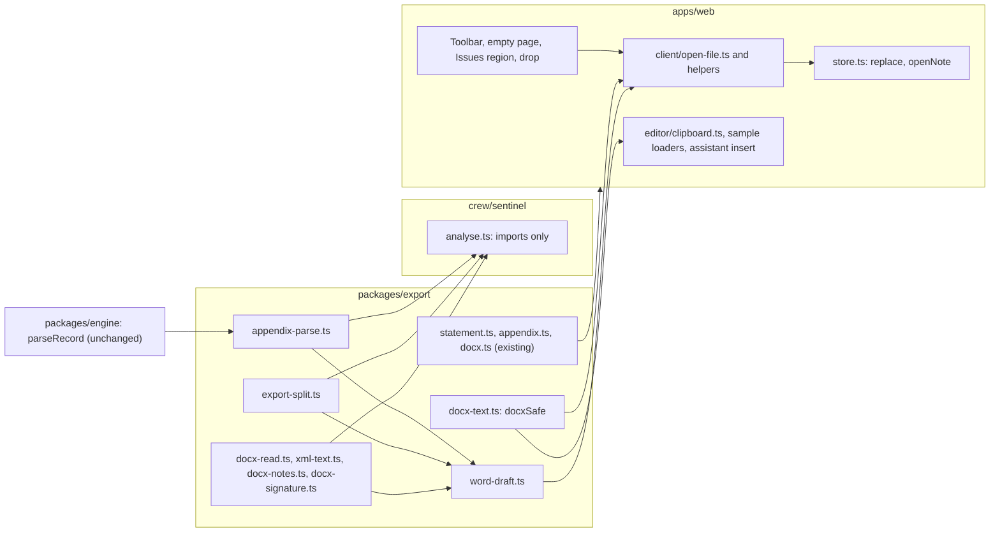
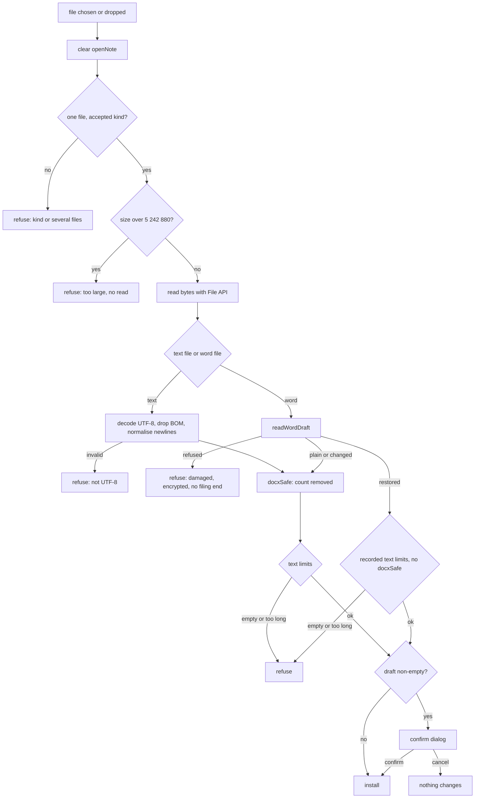

# Design Document: open-draft

## Overview

A person can open a `.docx`, `.txt` or `.md` file. A text file, or a Word file with no Provenance Appendix, becomes one `PST` span with no Declaration. A Reveal Codes export whose body still equals the document text recorded in its Appendix is restored from the record, with an empty run log and no check date. An export whose body differs is imported as body text only, as one `PST` span, with a reason in the Issues region. Text from every source is made safe for Word files at the moment it enters the Document. All of it runs in the browser. There is no server route. `packages/engine` is not changed.

This design answers the questions the requirements left to it. The answers are collected here so the author can find them before reading the detail.

| Question | Answer | Section |
| -------- | ------ | ------- |
| Where does the shared reader live, and why (Req 1.2) | `packages/export`. Nine modules move or are added there. `fflate` becomes a runtime dependency of the Export_Package. The Sentinel changes import paths only. | "Shared reader" |
| What does a restore put in the Run_Log and the verification time (Req 13.1, 13.9) | Nothing. `runLog: []` and `verifiedAt: null`. A table covers every item the record does not carry. | "Restoring the run log" |
| Which fix for characters DOCX cannot carry (Req 22) | **Decided.** `docxSafe` at every Entry_Point, an export refusal as backstop. Never narrow the arbitrary. | "Q12: characters DOCX cannot carry" |
| Where is the export date (Req 9.6) | Confirmed. It is the paragraph immediately before the Appendix title. | "Where the export date is" |
| Where does `MAX_TEXT_CHARS` live (Req 21.8) | `apps/web/src/limits.ts`. The boundary test accepts it for both importers (run, result below). | "`MAX_TEXT_CHARS`" |
| What was cut from this spec | The record additions (tool names, check date) and the rule that a reopened export gives the same statement. | "Deferred" |

### Flags for the author

1. **Q12 is decided.** The fix is `docxSafe` at every Entry_Point with the export refusal as backstop. Requirement 5 criterion 4 already names the Docx_Safe_Text step for text files, so no requirement is left to amend.

### Interpretations the design makes

- "Q12" is read as the question numbered 12 in the author's question message, which the requirements record as Requirement 22 (characters DOCX cannot carry). The repository holds no other trace of the number.
- A note whose text is empty is left out and takes no number, so the numbers in the Notes_Block run 1..N with no gap (Requirement 7 criteria 3 and 5).
- The Open_Flow reads the Appendix title and the end of the filing from the paragraph list with the Sentinel's rules. A footnote added to an export after it was made changes Body_Text (the Notes_Block is appended) and so counts as a change. The Sentinel does not read notes and would report no body drift for the same file. The design accepts the difference: adding a note is an edit to the filing.
- "Has a verification result" means a full citation record whose `result.status` is not `unchecked`, or a quote record whose `result.status` is not `unchecked`. Short forms derive their result from a target and do not count on their own.
- "Has an AI run" means `document.runs` is not empty.
- `removed` counts each removed Docx_Unsafe_Character once, and an unpaired surrogate counts as one. A U+000B or U+000C turned into `\n` and a `\r\n` or lone `\r` turned into `\n` are not removals (Requirement 22 criterion 5).

## Architecture

### Where the code goes



### Shared reader: home, modules and why

**Home: `packages/export`.** Reasons, each checked in the repository:

- The Sentinel's `split.ts` already imports `APPENDIX_TITLE`, `STATEMENT_TITLES` and `buildAppendix` from `@reveal-codes/export`, and computes `INTRO_LENGTH` from `buildAppendix`. The end-of-filing rule is a rule about what the export builder writes. It belongs beside the builder, where a change to the builder and a change to the rule land in one commit and one test run.
- Both consumers already depend on the Export_Package (`crew/sentinel/package.json`, `apps/web/package.json`). No new workspace edge appears.
- `packages/engine` must keep zero runtime dependencies (tech.md) and the reader needs `fflate`. `packages/verifier` is for the network. A new package for a few small modules would need its own manifest, tsconfig, CI entry and a dependency on the Export_Package for the same constants.
- `apps/web` must not import from `crew/sentinel`: that reverses the direction (the Sentinel is a consumer of the product).
- `packages/export` is pure functions over plain data. The reader is one.

Cost, stated: the Export_Package gains a runtime dependency (`fflate` 0.8.3, already a devDependency of this package and a dependency of the Sentinel) and gets larger. `apps/web` already bundles `docx`, which is much larger than `fflate`.

New and moved modules in `packages/export/src` (flat, as the package is today; each under 300 lines, each function under 40):

| Module | Content | Comes from |
| ------ | ------- | ---------- |
| `docx-read.ts` | `readDocx(bytes)`, `readDocxWithNotes(bytes, limits)` | `crew/sentinel/src/docx-read.ts` |
| `xml-text.ts` | `paragraphsOf`, `decodeEntities` | `crew/sentinel/src/xml-text.ts` |
| `docx-notes.ts` | `notesOf(xml, kind)`, `notesBlock(notes)` | new (Req 7) |
| `docx-signature.ts` | `isCompoundFile(bytes)`, `holdsEncryptedPackage(bytes)` | new (Req 14.2) |
| `export-split.ts` | `splitExport(paragraphs)`, `exportDate(paragraphs)` | `crew/sentinel/src/split.ts` |
| `appendix-parse.ts` | `recordedRecord`, `recordedDocument` | `crew/sentinel/src/recorded.ts` |
| `word-draft.ts` | `readWordDraft(bytes, limits)`: classifies a Word file | new (Req 6 to 11) |
| `read-types.ts` | `DocxText`, `ExportParts`, `DocxReadError`, `WordDraft` | `crew/sentinel/src/types.ts` (two types) |
| `docx-text.ts` | `docxSafe(text)`, `holdsDocxUnsafe(text)` | new (Req 22) |

`word-draft.ts` is pure over bytes, so the classification (plain, restored, changed, refused) is tested without a browser, and it is the same code path the Sentinel's split uses. The web module only turns a classification into a Store action and a message. `readWordDraft` keeps its home in `word-draft.ts`; its result carries the record the Appendix parse returned and nothing else from the file.

**Sentinel change set: import paths only.**

- Delete `crew/sentinel/src/docx-read.ts`, `xml-text.ts`, `split.ts`, `recorded.ts` (requirement 1.3: no copy).
- `analyse.ts` and `index.ts` import `readDocx`, `splitExport`, `recordedDocument` from `@reveal-codes/export`. `index.ts` keeps re-exporting them, so the Sentinel's public surface is unchanged.
- `types.ts` re-exports `DocxText` and `ExportParts` from `@reveal-codes/export`. `SentinelError` stays. `DocxReadError` (`not_docx` and `part_too_large`) is assignable to it for the default reader, which only returns `not_docx`.
- `crew/sentinel/package.json` is unchanged. `fflate` stays listed because the Sentinel's tests and test support import it, and `crew/sentinel/test/static/package.test.ts` pins that list.
- The five Sentinel test files that exercise the moved modules (`docx-read.test.ts`, `xml-text.test.ts`, `split.test.ts`, `recorded.test.ts`, `docx-read.properties.test.ts`) stay where they are. Only their import lines change, to `@reveal-codes/export`. Other Sentinel tests that import the moved modules change the same way.
- **`packages/export/test/package.test.ts` changes** because `fflate` moves from `devDependencies` to `dependencies`: the line that pins `devDependencies.fflate` (line 30 today) now pins `dependencies.fflate` at `0.8.3`, and the line that pins "docx as the only third-party runtime dependency" now allows `docx` and `fflate`. These are Export_Package tests, not Sentinel tests.

**Default reader behaviour is the Sentinel's, byte for byte.** `readDocx(bytes)` reads `word/document.xml` only, applies no size limit, and turns any failure into `{ kind: "not_docx" }`. `readDocxWithNotes(bytes, { maxPartBytes })` is the Open_Flow's reader: it also reads `word/footnotes.xml` and `word/endnotes.xml`, and it can return `part_too_large`. One internal `unpack` serves both. The wrapped `try`/`catch` in the reader turns an `fflate` throw into a value; it discards nothing (Requirement 14 criterion 13 applies to the Open_Flow, and the reader is where the failure becomes one of its messages).

**Part size without unpacking.** `fflate`'s `unzipSync` accepts a `filter` that receives each entry's `originalSize` from the central directory. The reader first runs `unzipSync(bytes, { filter })` with a filter that records sizes and returns `false`, so nothing is inflated. If a wanted part declares more than `maxPartBytes`, it returns `part_too_large`. Whether `fflate` bounds the real output to the declared size when a header lies is an assumption to pin by test with a crafted zip, not a fact this design asserts.

**Encrypted files.** `isCompoundFile` tests the eight-byte signature `D0 CF 11 E0 A1 B1 1A E1`. `holdsEncryptedPackage` also looks for the UTF-16LE bytes of `EncryptedPackage` (directory entries store names in UTF-16LE). A compound file without that name is damaged (a renamed `.doc`).

### The Open_Flow in the web app

Modules in `apps/web/src/client/` (browser-side flows, per structure.md), each with one job:

| Module | Job |
| ------ | --- |
| `open-file.ts` | `openFile(file, deps)`: kind, size, read, classify, confirm, install. The Picker and the drop both call it (Req 3.7). |
| `open-text.ts` | Text_File decoding: UTF-8 with `fatal: true`, one BOM removed, `\r\n` and `\r` to `\n`. |
| `open-outcome.ts` | `OpenOutcome` and the pure step from a `WordDraft` or text to an outcome: `docxSafe`, then the text limits. |
| `open-messages.ts` | Every message of Requirement 14 and the Open_Message wordings, including the removed-character sentence. |
| `open-note.ts` | `restoreNote(document)`: the three-case Issues note of Requirement 13 criterion 4. |
| `pasted-document.ts` | `pastedDocument(text, iso)`, moved out of `components/use-document-actions.tsx` so Open and Load demo motion use one construction (Req 8.1). |

Components: `components/use-open.ts` (Picker through a hidden file input whose value is cleared after each use, so the same file opens twice, Req 2.5), `components/use-file-drop.ts` (a capture-phase `drop` and `dragover` listener on `document` that acts only when `dataTransfer.types` includes `"Files"`, calls `preventDefault` and `stopPropagation`, and so never reaches ProseMirror; a drag with no file is untouched, Req 3.5), edits to `toolbar.tsx` and `shell-toolbar.tsx` (button after New, before Load demo motion, no `data-primary`), `editor-surface.tsx` (placeholder and three links), `issues-region.tsx` (Open_Note above the list, below the Draft_Gate notice, in a `role="status"` element) and `use-verify.ts` (clears the note when a run starts).

**`MAX_TEXT_CHARS`.** Today it is defined in `src/server/verify-route.ts` (line 20), and `test/static/boundaries.test.ts` forbids client modules from importing `server/`. The design moves the definition to `apps/web/src/limits.ts`. `verify-route.ts` imports it from there and re-exports the name, so `test/verify-route.test.ts` (which imports it from `verify-route`) is unchanged and there is one definition (Req 21.8). The Open_Flow imports it from `../limits`.

*Boundary test, run.* The rule table in `boundaries.test.ts` (`checksFor`) gives `src/limits.ts` only the `browserBundle` check (no `node:` and no Verifier root), and the file has no imports. A `server/` file may import any module outside `client/`, `components/`, `editor/` and `pane/`; a `client/` file may import any module outside `server/`. `src/limits.ts` is in neither group. To prove it without touching the repository, the test was run in a throwaway copy of `apps/web` under `/tmp`, with `src/limits.ts` added, `server/verify-route.ts` importing and re-exporting it, `client/open-outcome.ts` importing it, and `editor/` importing `docxSafe` from `@reveal-codes/export`: **7 of 7 tests passed.** A negative control in the same copy, a `client/` file importing `../server/verify-route`, failed with `not allowed (server/)`, so the test does bite. The unmodified repository also passes (7 of 7). The copy was deleted; the repository is unchanged. The criterion for the task is that `pnpm --filter @reveal-codes/web test -- test/static/boundaries.test.ts` passes with the real files in place.

*Other static tests checked for `docxSafe`.* `boundaries.test.ts` bans only `node:` and the Verifier root for browser modules, so `@reveal-codes/export` may be imported from `editor/`, `client/` and `components/` (it already is, from `components/` and `print-model.ts`). `forbidden.test.ts` bans direct `docx`, PDF and download-library imports in `apps/web`, not `@reveal-codes/export`; `CLOCK_FREE` covers `src/editor/`, and `docxSafe` reads no clock. `package-json.test.ts` pins the web dependencies, and `@reveal-codes/export` is already listed.

**Store changes.** `StoreState` gains `openNote: string | null` (initial `null`). A new action `{ type: "openNote"; text: string | null }` sets it. `reduceReplace` sets it to `null`, which covers New, Load demo motion and Load the Avianca citations (Req 15.2). `replace` also sets `notice` to `null`, so the Open_Flow dispatches `replace` first and `notice` and `openNote` after, the same order Load demo motion uses. `persist.ts` is untouched, so the note is never stored (Req 15.6). The Open_Flow dispatches `openNote: null` on entry (Req 15.3) and `use-verify.ts` dispatches it on run start.

**`nextRunId` after a restore.** `nextRunId` (`apps/web/src/assistant-run.ts`) returns `r` plus `max(document.runs.length, runLog.length) + 1`. With a full run log that avoided a clash when undo had left `runLog` longer than `document.runs`. With an empty run log it can clash: a Document whose runs are `r1` and `r3` (run `r2` was undone) has `document.runs.length` 2, so the next run would be `r3`, a second run with an existing id. The design changes `nextRunId` to also take the highest number in any `r<digits>` id held by `document.runs` or `runLog`. For contiguous ids the result is unchanged, so existing tests keep passing, and an example test pins the `r1`, `r3` case. This is a change outside the list of modules the requirements name, made because the empty restore needs it.

### Open_Flow algorithm



Refusal order is Requirement 14 criterion 12: kind, size, unreadable or encrypted, part size, then the text limits. The "no filing end" refusal (criterion 9) sits after part size and before the text limits. The text limits apply to the text after `docxSafe` (Requirement 22 criterion 3), so a file that holds only control characters is refused as empty.

## Components and Interfaces

### Export package: `word-draft.ts`

```ts
export type WordLimits = Readonly<{ maxPartBytes: number }>;

export type WordDraft =
  | Readonly<{ kind: "plain"; text: string }>
  | Readonly<{
      kind: "restored";
      record: DocumentRecord; // { document, declaration } as parseRecord returns it
      exportedOn: string | null; // YYYY-MM-DD, or null when the line does not have that shape
    }>
  | Readonly<{ kind: "changed"; text: string }>
  | Readonly<{ kind: "refused"; reason: "damaged" | "encrypted" | "no_filing_end" }>;

export function readWordDraft(bytes: Uint8Array, limits: WordLimits): WordDraft;
```

Steps, in order:

1. `holdsEncryptedPackage(bytes)` gives `refused / encrypted`. `isCompoundFile(bytes)` without it gives `damaged`.
2. `readDocxWithNotes(bytes, limits)`. `not_docx` and `part_too_large` give `refused / damaged` (Requirement 14 criterion 10: an oversize part is "damaged").
3. If no paragraph equals `APPENDIX_TITLE`: `plain`, with `text = paragraphs.join("\n") + notesBlock(notes)`.
4. Otherwise `splitExport(paragraphs)`. `not_reveal_codes_export` gives `refused / no_filing_end`.
5. `bodyText = body.join("\n") + notesBlock(notes)`. `recordedRecord(appendix)`. If it parses and `record.document.text === bodyText`, `restored`, with `exportedOn = exportDate(paragraphs)`. Otherwise `changed` with `text = bodyText` (an unparseable Appendix is a changed export, Requirement 10 criterion 6).

`readWordDraft` does not call `docxSafe`: the Open_Flow applies it to `plain` and `changed` text and to nothing in `restored`.

Because `splitExport` is the Sentinel's function, the Open_Flow and the Sentinel cut the body at the same place and agree on whether a file was edited, with the one difference noted under "Interpretations".

### Export package: `docx-text.ts`

```ts
export type DocxSafe = Readonly<{ text: string; removed: number }>;

/** Docx_Safe_Text: U+000B and U+000C become "\n"; "\r\n" and a lone "\r" become "\n";
 *  every other Docx_Unsafe_Character is removed and counted. */
export function docxSafe(text: string): DocxSafe;

/** True when the text holds any Docx_Unsafe_Character, U+000B and U+000C included. */
export function holdsDocxUnsafe(text: string): boolean;
```

XML 1.0 allows U+0009, U+000A, U+000D, U+0020 to U+D7FF, U+E000 to U+FFFD and U+10000 to U+10FFFF. Everything else is unsafe, an unpaired surrogate included. One table of allowed ranges serves both functions. `docxSafe` is idempotent (`docxSafe(docxSafe(s).text).text` equals `docxSafe(s).text`, and the second `removed` is 0) and returns its input unchanged when the input holds no unsafe character and no `\r`. `holdsDocxUnsafe` exists because the export guard must also see U+000B and U+000C, which `docxSafe` converts and does not count. The module imports nothing and runs in the browser and under Node.

### Where the export date is

Confirmed by reading the builder. `renderStatement` (`packages/export/src/render-statement.ts`) ends with `{ kind: "signature", line: signatureLine(statement), date: statement.generatedDate }`. `blockElement` in `docx-blocks.ts` turns that block into two `singleParagraph`s, the signature line and then the date. `buildDocx` (`docx.ts`) places `titleParagraph(appendix.title)` straight after `statementElements(...)`. `generatedDate` is `localDate(meta.now)` (`YYYY-MM-DD`, host time zone). So the date line is the paragraph immediately before the last paragraph equal to `APPENDIX_TITLE`.

One detail was checked: `titleParagraph` starts its paragraph with a `PageBreak` run (`<w:br w:type="page"/>`). The reader's `breaksLine` returns `false` for a break whose type is not `textWrapping`, so the paragraph text is exactly the title and `lastIndexOf(APPENDIX_TITLE)` finds it (the Sentinel relies on the same behaviour today).

`exportDate(paragraphs)` returns the paragraph at `lastIndexOf(APPENDIX_TITLE) - 1` when it matches `/^\d{4}-\d{2}-\d{2}$/`, else `null`. The shape test is the only validation, which also keeps arbitrary file text out of the message. The date is not compared with anything: the statement pages are never imported and never compared.

### Restoring the run log

A restore installs an empty Run_Log and no Verification_Time, because the file carries neither the tool names of assistant runs nor the check date (Requirement 13 criterion 1).

```ts
// client/open-file.ts, after the confirm
store.dispatch({
  type: "replace",
  document: record.document,
  runLog: [],
  verifiedAt: null,
  declaration: record.declaration,
});
store.dispatch({ type: "notice", text: reopenedMessage(file.name, exportedOn) });
store.dispatch({ type: "openNote", text: restoreNote(record.document) });
```

`reduceReplace` runs `declarationAfter(declaration, document, false)`, which drops a `pasted_text` Declaration when the restored Document holds no substantive pasted text, as Requirement 12 criterion 3 says. The span timestamps and override timestamps come back inside `record.document` unchanged (Requirement 13 criterion 8). The Document is not passed through `docxSafe` (Requirement 22 criterion 4).

**The Issues note.** `restoreNote(document)` is driven by two booleans, `hasAiRun` (`document.runs.length > 0`) and `hasResult` (a full citation or a quote with a status other than `unchecked`):

| `hasAiRun` | `hasResult` | Open_Note |
| ---------- | ----------- | --------- |
| yes | yes | "The tool names of the assistant runs and the check date were not in this file, so the next statement cannot give them." |
| yes | no | "The tool names of the assistant runs were not in this file, so the next statement cannot name them." |
| no | yes | "The check date was not in this file, so the next statement cannot give it." |
| no | no | no note (`null`) |

**Verified against the code.** A Document with AI spans and an empty Run_Log is accepted by both consumers:

- **Store.** `reduceReplace(state, document, runLog, verifiedAt, declaration)` stores the arrays as given (`runLog ?? []`, `verifiedAt ?? null`). `reduceEdit` replaces a run-log entry with the same Run_Id and appends otherwise, so later runs append to an empty log. `nextRunId` is changed as described above so an empty log cannot reuse an id. `persist.ts` stores `[]` and `null` as it does for New.
- **`buildStatement`.** It reads `runLog.length` for `runCount` and `toolsOf(document, runLog)` for the tools, and `meta.verifiedAt` for the date. `toolsOf` iterates the run log, so an empty log gives `[]`. Nothing requires every run in `document.runs` to have an entry. An AI Document with `runLog = []` builds with `runCount` 0 and no tools.
- **The statement.** `render-order.ts` prints the how-used sentence only when `s.runCount > 0` (line 54) and the prompt-records sentence only when `s.assistantText && s.runCount > 0` (line 73). With `runCount` 0 neither prints. `toolList` returns "not recorded" for no tools (`wording.ts` line 59), `toolsSentence` returns "The generative artificial intelligence program used is not recorded." (line 157), and `citationParagraph` prints "a date that was not recorded" for a `null` date (line 90).

What the Store holds after a restore, and what the next statement prints, for each item:

| Item | Store holds | Next statement prints |
| ---- | ----------- | --------------------- |
| Tool of each AI run | `runLog = []` | "Tools: not recorded" in the AI-use paragraph, and "The generative artificial intelligence program used is not recorded." where the order names the program. Nothing is printed for a filing with no AI text. |
| Run count and prompts | `runLog.length` 0, no prompt, no timestamp | no sentence about how the program was used and none about prompt records |
| Verification_Time | `verifiedAt = null` | "a date that was not recorded" in the citation paragraph |
| Court and judge | none selected | the author picks again; no order sentences until then |
| Confidentiality tick | unticked | the sentence is not printed until the author ticks |
| Declaration | the recorded Declaration, kept or dropped by `declarationAfter` | the Declaration sentence, as recorded |
| Spans, results, overrides | as recorded, inside the Document | counts and tables of the Document, with the recorded timestamps |

### Q12: characters DOCX cannot carry

**Decided: `docxSafe` at every Entry_Point, with an export refusal as backstop. The arbitrary is not narrowed.**

Evidence for the choice:

1. **What the export does today.** A probe of `docx` 9.15.3 (the version in `packages/export/package.json`), run in this repository by writing `"x" + char + "y"` into a `TextRun` and reading `word/document.xml` back, shows:
   - U+0000 to U+0008, U+000B, U+000C and U+000E to U+001F are removed from the output. Nothing reports it.
   - U+FFFE and U+FFFF are written through. XML 1.0 does not allow them, so Word or a strict parser may reject the file.
   - `\t`, U+0085, U+2028, U+FEFF and astral code points survive. `\r` is written as a raw `\r`, which an XML parser reads as `\n`.
   - An unpaired surrogate becomes U+FFFD.
2. **What the editor lets in.** `apps/web/src/editor/clipboard.ts` normalises `\r\n` and `\r` and nothing else. The Engine rejects unpaired surrogates in a Document and the Tool_Name rule rejects Cc characters, but ordinary text may hold U+000B or U+000C. Word puts U+000B in the clipboard text of a soft line break.
3. **What the existing arbitraries generate.** `arbText` (under `arbDocument`) draws printable ASCII, `\n`, `\t`, the code syntax characters, quotes, and astral code points, with surrogates only in pairs. It never draws a C0 control other than `\t` and `\n`, never `\r`, never U+FFFE or U+FFFF. The failure would appear in use, not in the existing tests. That is why a new arbitrary is added (below) and the existing one is left as it is.
4. **What the failure looks like without the fix.** A pasted U+000B reaches the Document. The export drops it from the body and from the Appendix text alike, so the two still match, the file is restored, and the restored Document is a different filing from the one the author exported, with no message.

**Where `docxSafe` is applied** (one call each, the result's `text` is used; `removed` is used only by Open):

| Entry_Point | Module | Note |
| ----------- | ------ | ---- |
| Paste and drop | `editor/clipboard.ts`, in `plainTextOf` | replaces the `normaliseNewlines` call; `normaliseNewlines` stays exported for its current tests |
| Demo motion and Avianca citations | `components/use-document-actions.tsx`, before `pastedDocument` | the loaders get text from `svc.api`; no message, the fixtures are clean |
| Assistant insertion | `components/use-assistant.ts`, in `insertReply`, on the whole reply | applied once to the accumulated reply, not per chunk, so a surrogate pair split across two chunks is never cut |
| Open (Text_File, Plain_Reading, body-only import) | `client/open-outcome.ts` | before the text limits; `removed` goes to the Open_Message |

A restore is not sanitised (Requirement 22 criterion 4). `readWordDraft` does not call `docxSafe`. Typed text is not covered: a keyboard does not produce these characters, and the export guard catches any that arrive another way.

**Open_Message.** After the sentence of Requirement 8 criterion 3, when `removed` is at least 1, the message carries " <k> characters that Word files cannot store were removed." and, when `removed` is 1, " 1 character that Word files cannot store was removed." When `removed` is 0 it carries nothing. After that comes the sentence of Requirement 7 criterion 7 when the text holds a Notes_Block. `open-messages.ts` builds the three parts in that order.

**Export refusal.** `client/export-docx.ts` checks `holdsDocxUnsafe` on `document.text` and on every override reason, after the existing order and gate checks and before `buildStatement`. A hit dispatches a `notice` with the text "This draft holds a character that Word files cannot store, so it was not exported. Paste the text again or remove the character." (a constant in `notices.ts`, beside `EXPORT_FAILED`), returns `{ status: "failed" }`, downloads nothing and leaves the Document unchanged (Requirement 22 criterion 8). The check covers the two places the requirement names. A Declaration Tool_Name is already barred from control characters by the pasted-text-declaration rule.

**Tests.** The existing arbitraries are not changed. A new `arbDocxHostileText` (below) feeds Property 4. A failing run is recorded in BUILD_LOG.md with its shrunk counterexample (Requirement 18 criterion 8).

## Data Models

| Type | Where | Shape |
| ---- | ----- | ----- |
| `DocxReadError` | `packages/export/src/read-types.ts` | `{ kind: "not_docx" } \| { kind: "part_too_large" }` |
| `WordDraft`, `WordLimits` | `packages/export/src/word-draft.ts` | above |
| `DocxSafe` | `packages/export/src/docx-text.ts` | `{ text: string; removed: number }` |
| `StoreState.openNote` | `apps/web/src/store.ts` | `string \| null`, not persisted |
| `OpenOutcome` | `apps/web/src/client/open-outcome.ts` | below |

```ts
export type OpenOutcome =
  | Readonly<{ kind: "refused"; note: string; notice: string }>
  | Readonly<{
      kind: "text";
      text: string; // after docxSafe
      removed: number; // characters docxSafe removed, for the Open_Message
      notice: string;
      note: string | null;
    }>
  | Readonly<{
      kind: "restored";
      record: DocumentRecord; // installed unchanged, not sanitised
      notice: string;
      note: string | null;
    }>;
```

- `kind: "text"` covers a Text_File, a Plain_Reading and a changed export. Its `note` is the changed-export Open_Note (Requirement 10 criterion 4) or `null`. It installs as one `PST` span through `pastedDocument`, then `Declaration` Pending (`null`), `runLog` `[]`, `verifiedAt` `null`, no override and no result (Requirement 8 criterion 2).
- `kind: "restored"` carries no `removed`: a restore is not sanitised.
- The `notice` is the Toolbar text. For a refusal it is "Could not open <file name>." (Requirement 14 criterion 11); for several dropped files it is "Open one file at a time." with no name (criterion 8).
- Messages are string builders in `open-messages.ts`. They hold the exact wording of Requirement 14 and Requirement 8 criterion 3, Requirement 9 criterion 5 and 6, Requirement 7 criterion 7, Requirement 10 criterion 4 and Requirement 22 criterion 5, so a test can pin each one.
- The text limits use the White_Space test `!/\P{White_Space}/u.test(text)` for "empty" (the predicate `holdsSubstantivePasted` already uses), and `text.length > MAX_TEXT_CHARS` for "too long", both on the text after `docxSafe`.

## Correctness Properties

*A property is a characteristic or behavior that should hold true across all valid executions of a system-essentially, a formal statement about what the system should do. Properties serve as the bridge between human-readable specifications and machine-verifiable correctness guarantees.*

Reflection. The prework found these overlaps and the design resolves them. The restore criteria (9.2, 9.3, 9.7, 9.10, 12.1, 13.8) are one property (Property 2), and the changed-export criteria (9.9, 10.1 to 10.7) are another (Property 3). The criterion that red codes still block export after a reopen (9.7) follows from structural equality of the Document and is checked inside Property 2 by comparing `canExport` before and after. The criterion that the Open_Flow and the Sentinel agree on whether a file was edited (9.9) follows from sharing `splitExport` and is checked inside Property 3 by comparing the Sentinel's `body_edited` Finding. The default-reader behaviour for the Sentinel (1.9) is an example test, not a property. The empty Run_Log and null check date after a restore (13.1) are a fixed install, so they are example tests. The README, ordering of refusals, the Toolbar and the empty page are examples.

Each property is one `fc.assert(fc.property(...))` (or `fc.asyncProperty` where the body awaits `buildDocx`) in a file named `<module>.properties.test.ts`, with `// Property N` above it and `_Requirements: x.y_` in the `describe` title, at `numRuns` 200 locally and 500 in CI. The numbers match Requirement 18 and Requirement 22: Properties 1 to 4 are the four the requirements name.

### Property 1: Word text round trip

For any list of paragraphs that hold no `\n` and no character XML 1.0 cannot carry, a Word_File built from them with the Export_Package's `filingParagraph` and read with `readDocx` returns the paragraphs. The paragraphs include leading and trailing spaces, tabs, quotation marks, `&`, `<`, `>`, non-ASCII characters and empty paragraphs.

**Validates: Requirements 6.2, 6.3, 6.8, 6.9, 18.2, 18.3**

### Property 2: A reopened export is the exported Document

For any Document (existing `arbDocument`, with overrides and every verification status), any Applicable_Declaration for either subject (including Tool_Names with brackets, parentheses and quotation marks), any Run_Log and any Verification_Time or none, exporting with `buildStatement` and `buildDocx` and reading the file with `readWordDraft` gives `restored`, a Document equal by `structuralEqual` to the original, and the same Declaration. `canExport` over the restored Document equals `canExport` over the original, for every court. The Run_Log and the Verification_Time are generated to show that they do not affect what is restored.

**Validates: Requirements 9.2, 9.3, 9.7, 9.10, 12.1, 12.5, 13.8, 18.4**

### Property 3: A changed export imports as pasted body text

For any Document that exports, and any single-character change to any body paragraph of the exported file, `readWordDraft` gives `changed` with text equal to the changed body, and the installed Document is one `PST` span over that text with no Declaration and the Open_Note of Requirement 10 criterion 4. The Sentinel's `analyseFile` over the same file reports a `body_edited` Finding exactly when `readWordDraft` reports `changed`.

**Validates: Requirements 9.9, 10.1, 10.2, 10.5, 10.6, 10.7, 18.5**

### Property 4: DOCX-safe text

For any string, including any sequence of UTF-16 code units, `docxSafe` returns text with no Docx_Unsafe_Character, `docxSafe` of that text returns the same text with `removed` 0, and `docxSafe(s).text` equals `s` when `s` holds no Docx_Unsafe_Character and no `\r`. For any Document whose text came from `docxSafe` of a string drawn from `arbDocxHostileText`, exporting and reopening returns a Document equal to the original by `structuralEqual`. The string drawn includes U+0000 to U+001F, U+FFFE, U+FFFF and unpaired surrogates, and the existing arbitraries are not narrowed.

**Validates: Requirements 22.1, 22.2, 22.6, 22.7, 18.6**

### Property 5: The statement and the Appendix are never body text

For any Document, including one whose text holds a line equal to a member of `STATEMENT_TITLES`, and for both a restore and a body-only import, no paragraph at or after the Filing_End appears in the text the Open_Flow installs. The text is the paragraphs before the last statement title that precedes the Appendix title, joined with `\n`.

**Validates: Requirements 11.1, 11.2, 11.3**

### Property 6: The reader is total

For any bytes, including truncated zips, zips with random part content and random data, `readDocx` and `readDocxWithNotes` return a value and throw nothing.

**Validates: Requirements 1.6**

### Property 7: UTF-8 text round trip

For any string with no `\r` and no Docx_Unsafe_Character, encoded as UTF-8 with or without a leading byte-order mark, `decodeTextFile` returns the string. For any string with `\r\n` or lone `\r` and no Docx_Unsafe_Character, it returns the string with each replaced by `\n`.

**Validates: Requirements 5.1, 5.2, 5.3, 5.4, 5.6**

### Property 8: Opened text installs as one PST span

For any accepted text, including text that holds Docx_Unsafe_Characters, installing it through the Open_Flow gives a Document with exactly one span, of origin `PST`, covering the whole text after `docxSafe`, with the current time, and a Store with Declaration `null`, an empty run log, no verification time, no override and no verification result. The Open_Message carries the removed-character sentence exactly when `removed` is at least 1, with `removed` as its count.

**Validates: Requirements 8.1, 8.2, 8.6, 22.3, 22.5**

### Property 9: Notes are numbered 1..N without separators

For any list of footnote and endnote entries, including Separator_Notes and notes with empty text, `notesBlock` lists only the notes with text, numbered from 1 with no gap, footnotes before endnotes in part order, one line each with paragraphs joined by a single space and line breaks and tabs as spaces; and it is the empty string when no note has text.

**Validates: Requirements 7.1, 7.2, 7.3, 7.4, 7.5, 7.6**

### Property 10: The restore note follows AI runs and verification results

For any Document, `restoreNote` returns the note of Requirement 13 criterion 4 for the case given by "has an AI run" and "has a verification result" (AI runs and results; AI runs only; results only), and returns `null` when the Document has neither.

**Validates: Requirements 13.2, 13.3, 13.4, 13.5**

### Property 11: A refusal changes nothing but the note and the message

For any file the Open_Flow refuses, and any prior Store state, the Store after the open equals the Store before except for `openNote` and `notice`, and no confirm dialog opened.

**Validates: Requirements 4.6, 4.7, 14.11, 19.1**

## Error Handling

| Condition | Result | Where it is decided |
| --------- | ------ | ------------------- |
| Not an Accepted_Kind | Open_Note "<file name> is not a .docx, .txt or .md file. Choose one of those." | `open-file.ts`, first |
| Several files dropped | Open_Note "Open one file at a time. Drop a single file." and Toolbar "Open one file at a time." | `use-file-drop.ts` |
| Over 5 242 880 bytes | refused before the bytes are read | `open-file.ts`, from `File.size` |
| Not a zip, no `word/document.xml`, cannot unpack | damaged message | `readWordDraft` returns `refused / damaged` |
| Compound file with `EncryptedPackage` | password-protected message | `refused / encrypted` |
| A part over 32 MiB when unpacked | damaged message, part not unpacked | `part_too_large` mapped to `damaged` |
| Appendix title but no statement title before it | filing-could-not-be-separated message | `refused / no_filing_end` |
| Text empty after `docxSafe` and the White_Space test, or over 200 000 | empty and too-long messages | `open-outcome.ts`, last; the length test also applies to restored text |
| Not valid UTF-8 (including UTF-16) | not-UTF-8 message | `open-text.ts` with `TextDecoder("utf-8", { fatal: true })` |
| Anything unexpected in a Word_File | the damaged message | `open-file.ts` |
| Anything unexpected in another file | Toolbar "Could not open <file name>." | `open-file.ts` |
| Appendix does not parse, or body differs | `changed`: one `PST` span, no Declaration, changed-export note | `readWordDraft` |
| Stored draft holds a Docx_Unsafe_Character in the text or an override reason | export refuses with "This draft holds a character that Word files cannot store, so it was not exported. Paste the text again or remove the character."; nothing downloads; the Document is unchanged | `exportDocx` guard |

No `try`/`catch` in the Open_Flow discards an error. The only `try` is the one in the reader around `unzipSync`, which turns the throw into a `DocxReadError` value. `File.arrayBuffer()` and `TextDecoder` failures become the messages above through the unexpected-failure rule. Every refusal leaves the Document, the history, the Declaration, the verification time and the stored draft unchanged, because no `replace` is dispatched on a refusal and the confirm dialog opens only after every refusal check has passed.

## Testing Strategy

**Property-based tests** use `fast-check` with `vitest`, one `fc.assert` per property, files named `<module>.properties.test.ts`. They sit with their module:

| File | Properties |
| ---- | ---------- |
| `packages/export/test/docx-read.properties.test.ts` | 1, 6, 9 |
| `packages/export/test/word-draft.properties.test.ts` | 2, 3, 5 |
| `packages/export/test/docx-text.properties.test.ts` | 4 |
| `apps/web/test/open-file.properties.test.ts` | 7, 8, 10, 11 |

New shared arbitraries live in `packages/export/test/support/arbitraries.ts`, the Export_Package equivalent that Requirement 18 criterion 7 allows, because `packages/engine` is not changed by this spec and the arbitraries are used by three export test files: `arbParagraphs` (paragraph lists with leading and trailing spaces, tabs, quotation marks, `&`, `<`, `>`, non-ASCII characters and empty paragraphs), `arbBodyEdit` (one single-character change to a body paragraph) and `arbDocxHostileText` (text that includes U+0000 to U+001F, U+FFFE, U+FFFF and unpaired surrogates). `arbDocument`, `arbText` and `arbRunLog` are not changed, and Properties 1 to 3 keep using the existing arbitraries.

**Example tests** pin the following; each asserts message text where it names one.

- Each refusal of Requirement 14, with the Document, stored draft and history unchanged and no confirm dialog opened, plus the refusal order of criterion 12 with files that fail two checks.
- A text file with a BOM and Windows endings, and a lone `\r`.
- The `.docx` fixture of Requirement 19 criterion 3: a table, a tracked deletion, a tracked insertion, two footnotes, one endnote and Word's separator notes, with the exact text and the Notes_Block and the sentence of Requirement 7 criterion 7.
- The Picker and a drop reaching `openFile` with the same bytes and producing the same Document.
- Confirm-before-replace: dialog for a non-empty draft, none for an empty one, Cancel changes nothing, Confirm replaces.
- The three Toolbar messages, the Open_Note in the Issues region and its clearing by New, the empty-page text and its three links in order, the Open button after New, and zero `fetch`, `XMLHttpRequest`, `sendBeacon` and form-post calls during an open.
- The restore install: `replace` with `runLog: []` and `verifiedAt: null` for a Document with AI spans, accepted by `reduceReplace`, and `buildStatement` on that state builds. The Open_Note for each case of Requirement 13 criterion 4 and no note for criterion 5. The statement built after a restore prints no sentence about prompt records (Requirement 19 criterion 16).
- `nextRunId` for a Document whose runs are `r1` and `r3` with an empty run log gives `r4`, and for contiguous ids gives what it gave before.
- Requirement 22: `docxSafe` at paste, drop, the two samples and assistant insertion (a reply that splits a surrogate pair across chunks is not cut); the Open_Message for `removed` 0, 1 and more than 1, with the sentences in the order of Requirement 7 criterion 7; a restore of a record that holds an unsafe character is not changed; and the export refusal for a stored draft with a Docx_Unsafe_Character in the text and in an override reason, with the exact message, nothing downloaded and the Document unchanged.
- The Sentinel: every existing Sentinel test passes with import paths changed only.
- A zip whose central directory declares a small part but whose stream is larger, to settle the `fflate` size-header question.
- Static tests: no copy of the moved modules, no `node:` or DOM import in the shared modules, no `try`/`catch` that discards in the Open_Flow, no route under `apps/web/app/api` for opening, the docs tests of Requirement 17 criterion 4, and `boundaries.test.ts` with `src/limits.ts` in place.

**Fixtures** are built by a deterministic helper in the Export_Package tests: `docx` for paragraphs, tables, tracked changes and footnotes, then a post-processing step with `fflate` that adds `word/endnotes.xml` with its content-type and relationship entries (the `docx` library writes none), with every date and zip timestamp fixed. A password-protected stand-in is a compound-file header with an `EncryptedPackage` stream name. Also built: a truncated zip, a zip without `word/document.xml`, and an export edited by one character. A file saved by Word is out of scope (Requirement 19 criterion 14).

**Why property tests apply.** The reader, the split, the classification and `docxSafe` are pure functions of bytes or plain data with round-trip and invariant statements. The Toolbar, the drop handling, the empty page and the messages are UI wiring and wording, so they are example tests.

### Order of landing

The author asked for the shared reader first. Each step keeps `pnpm lint`, `pnpm typecheck` and `pnpm test` green.

1. **Spec.** Commit the spec (`spec(open-draft): ...`) before any implementation task (Requirement 21 criterion 1).
2. **The shared reader move.** Move the four modules into `packages/export/src`, add `read-types.ts`, move `fflate` to `dependencies`, update `packages/export/test/package.test.ts`, change Sentinel import paths. No behaviour changes. This step ships on its own.
3. **Reader additions and `word-draft.ts`.** Notes, part-size limit, signature check, `readWordDraft`, the fixtures helper, Properties 1, 2, 3, 5, 6 and 9.
4. **`docxSafe` with the editor-input changes.** `docx-text.ts`, the calls in `clipboard.ts`, the sample loaders and the assistant insertion, the export guard and its notice, `arbDocxHostileText`, Property 4.
5. **The app.** `limits.ts` with the `verify-route.ts` change and the boundary test run, the Store `openNote`, the `nextRunId` change, the Open_Flow modules, Toolbar, drop, empty page, Issues region, restore install, Properties 7, 8, 10 and 11.
6. **Documentation and the final checkpoint.** README, KIRO_USAGE, BUILD_LOG, `ui.md`, `structure.md`, `tech.md`, then the checks of Requirement 21 criterion 3.

## Deferred

The record additions were cut from this spec. This section keeps the design summary so that a later spec can pick it up. Nothing here is built by `open-draft`, and none of it changes `packages/engine`, `product.md` or the `[DOC]` form in this spec.

**What was designed.**

- **Fields.** One optional `va` field in `[DOC]` (the Verification_Time, valid by the Engine's `isTimestamp`), after `d` and before the `r` fields. Two optional trailing values on each `r` field: provider as a fifth value, model as a sixth. A model of `""` stays `""` and is not `null`. Version stays 1.
- **Escaping and allowed text.** Provider and model use the existing payload escaping. They must hold no Cc character, no U+2028 or U+2029, no unpaired surrogate, and at most 200 UTF-16 code units (the Tool_Name rule). A name outside the rule is written as a four-value `r`.
- **Engine.** `codes/doc-extras.ts` (`RunTool`, `RecordExtras`, `NO_EXTRAS`, `encodeRunFields`, `decodeRunFields`, `decodeVerifiedAt`), a fourth optional parameter `extras` on `renderRecord`, an `extras?` field on `DocumentRecord` that is absent when the record carries none, one lexer token for `va`, and edits to `decode-fields.ts`, `decode-header.ts` and `decode-types.ts`. Bad extras (a repeated or non-timestamp `va`, an `r` with fewer than four or more than six values, a tool value outside the allowed text, an unknown key) are `malformed_codes` at index 0 with rule `bad_field`.
- **Export.** `Statement.recordExtras`, filled by `buildStatement` through `recordExtrasOf(document, runLog, verifiedAt)`, and a third argument of `buildAppendix`. A write switch in `buildStatement` turned on last.
- **Properties.** A record round trip with extras, "without extras the record is byte for byte unchanged", and "bad extras are `bad_field`".

**Why it was deferred.**

- **It changes the file format, and `va` appears in nearly every export.** `d` appeared only in filings with a declaration; `va` appears in every export made after a Verify, and the tool values in every export with assistant text.
- **Old-Sentinel rollout.** The Sentinel is deployed from another repository. A Sentinel built before the change rejects an unknown `[DOC]` key and an `r` field without exactly four values as `malformed_codes` at index 0, which it reports as one `unreadable` Finding (`appendix_unparseable`) for the file, not as a crash. A version bump would not help because the old reader also rejects `v=2`. The order that follows: release the Sentinel that reads the extras first (in this repository it reads them as soon as the Engine change lands, because the shared parse calls `parseRecord`), then turn the app's write switch on. The `product.md` `[DOC]` line is edited first, as the pasted-text-declaration spec did for `d`.
- **Prompt-sentence flag.** A restored Run_Log would hold run entries with no prompts. The statement prints "each prompt is recorded in the run log" and "Prompt records are retained in the document's run log (N prompts)" whenever the run count is above 0, so a reopened filing would claim prompts it does not hold. The choice is to leave the sentences (the statement is identical) or to print them only for entries that hold a prompt (the statement differs from the original). With the empty restore of this spec the run count is 0 and neither sentence prints, so the problem does not arise here.
- **Orphan run-log entries.** The Store keeps a run-log entry after an undo removes the run from the Document (`reduceHistory` does not touch `runLog`). The record would carry only the runs the Document holds, so a reopened statement could count fewer runs than the original.
- **`arbRunLog` duplicate ids.** `arbRunLog` (`packages/export/test/support/arbitraries.ts`) generates up to three entries per run and entries for runs the Document does not hold. The Store never holds two entries with one Run_Id (`withRun` replaces). A property about the statement of a reopened export needs a new arbitrary that generates at most one entry per Run_Id of the Document's runs and may omit the entry for a run.
- **The rule that a reopened export produces the same statement.** It needs the record to carry the tool names and the check date, so it depends on the fields above. It was stated as "export, reopen, export gives an identical statement and an identical Appendix", which the orphan entries and the prompt sentences both qualify. Requirement 13 criterion 10 puts it out of this spec.

**What a later spec picks up.** The Engine and Export pieces above, `product.md` first, the Sentinel release before the write switch, a decision on the prompt sentences and on orphan entries, and the new run-log arbitrary. The empty restore of this spec stays valid as the Old_Export path for every file written before the change.
