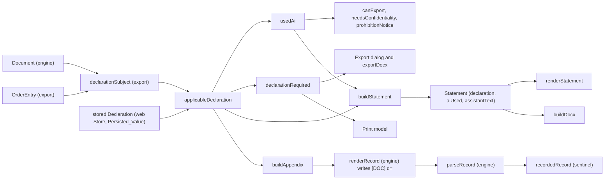

# Design Document: pasted-text-declaration

## Overview

The AI-Use and Verification Statement stops asserting what the record cannot show. Today `usedAi(document)` counts only `AI` and `AI>HUM` spans, so a filing that is one `PST` span prints "No generative artificial intelligence was used in preparing this filing." That sentence has no basis: `PST` means the tool does not know where the text came from. This design splits the Statement into Record_Sentences (what the tool recorded) and Author_Sentences (what the author says, always beginning "The author states that"), removes the unsupported sentence, and adds one two-way Declaration that the author must make in the Export dialog in two cases (pasted text with a non-whitespace character; a typed-only filing under a court order that demands a statement either way).

The design changes four places:

1. `packages/engine`: the `Declaration` type, Tool_Name validation, two pure predicates over the Document and operations, and an optional `d` field of `[DOC]` with `renderRecord` and `parseRecord`. `Document`, `render` and `parse` keep their types.
2. `packages/export`: the subject, applicable-declaration and Used_AI functions in one module, new wording builders, paragraph 2 by case, order sentences, the prohibition notice, and the `Statement` and `Appendix` data.
3. `apps/web`: the Declaration in the Store and in the Persisted_Value, the clearing rule, the Export dialog controls, the Print view notice, the Legend text, and the samples.
4. `crew/sentinel`: a record reader that returns the Declaration with the Document. Findings are unchanged.

### Compatibility flag: do old exports still parse?

This is the answer the owner asked to see before any build starts.

**Yes. Every export made before this feature still parses, and the `[DOC]` version stays 1.** The reasons, each verified in the current code:

- The new field is optional. The lexer schema for `[DOC]` today is `required: ["v","n"], optional: [], repeat: "r"` (`packages/engine/src/codes/lex.ts`). The change adds `"d"` to `optional`. A file with no `d` still satisfies the schema, so `parseRecord` returns the Document and a `null` Declaration (Requirement 8 criterion 9).
- A rendering with no Declaration is byte for byte what `render(document, "full")` produces today. The `d` field is written only for an Applicable_Declaration. Every existing fixture, every old DOCX Appendix and every stored `codes` string is therefore unchanged by this feature.
- The reverse direction does not hold, and the design says so rather than hide it. **A reader built before this feature cannot read a file that carries `d`.** `fieldsMatch` in the lexer rejects a key that is neither required, optional nor the repeat key, so the old `parse` returns `malformed_codes` at index 0 with rule `bad_field`. For an old Sentinel that becomes one `unreadable` Finding (`appendix_unparseable`) for that file, not a crash and not "No drift.". Files with no Declaration are unaffected. A version bump would not help, because the old reader also rejects `v=2`. Consequence for rollout: ship the Sentinel that reads `d` before, or in the same release as, the app that writes it (see D11 and the Sentinel section).

### Decisions this design fixes

| Id | Decision | Why |
| -- | -------- | --- |
| D1 | `Document` does not gain a field. The Declaration travels beside it. `parseRecord` and `renderRecord` are new; `parse` and `render` keep their signatures and call them. | The Declaration depends on the selected order (its subject), so it is not engine document state. Leaving `Document` alone leaves `apply`, `equal`, `normalise`, every arbitrary and every `Document` literal (for example `EMPTY_DOCUMENT` in `crew/sentinel/src/split.ts`) unchanged. |
| D2 | The Declaration type, Tool_Name validation, `holdsSubstantivePasted` and `insertsPasted` live in `packages/engine`. | structure.md: anything that can be a pure function goes in the engine, and the `[DOC]` codec needs the type. The Declaration_Subject needs the order, so it lives in `packages/export`. |
| D3 | One module, `packages/export/src/declaration.ts`, defines `holdsAssistantText`, `declarationSubject`, `applicableDeclaration`, `declarationRequired` and `usedAi`. No other module reads `isAiSpan` to decide AI use. A static test enforces this. | Requirement 6 criterion 1. |
| D4 | `canExport` stays the function that refuses without an override (blocking issues, prohibition). It does not look at a pending Declaration. `declarationRequired` is a sibling predicate that every export-time check calls next to it, and `buildStatement` returns an error value when it holds. | Property 2 says `canExport` refuses exactly when the order prohibits and Used_AI is true. Folding a pending declaration into it would make that statement false. Requirement 4 criterion 7 (the Gate refuses at the moment of export) is met by the moment-of-export checks in `exportDocx` and `printFlow`, which call both. |
| D5 | The Declaration is stored in the Persisted_Value as a JSON field `declaration`, written only when present, and not inside the `codes` string. | Requirement 5 criterion 1. An app from before this feature ignores the extra key and reads the draft; the draft's `codes` string is unchanged. |
| D6 | `[DOC]` carries the Declaration as `d=<subject>,<choice>[,<toolName>]`, only for an Applicable_Declaration. | Payload escaping already covers every character a Tool_Name may contain (see the codec section). |
| D7 | The clearing rule is decided from the operations (and from the Inverses of undo and redo) that the reducer applied, not from a before/after comparison of Documents. | A Document has no character identity. "Replace pasted text with different pasted text" leaves the PST count unchanged. |
| D8 | Typed-only filings under an order that requires a statement are asked with the subject `this_filing`. Substantive pasted text always wins as the subject. | Requirement 5 decision and the Declaration_Subject glossary entry. |
| D9 | When the Print view finds Declaration_Required, it shows only the one-line notice and the link, not the filing and not the Appendix. | See "Interpretations the design makes". |
| D10 | A Tool_Name is validated and stored trimmed. `Declaration` values always hold a trimmed, valid name. | "Printed as entered after trimming" (Requirement 2 criterion 8) and round-trip equality. |
| D11 | The Sentinel must be released no later than the app that writes `d`. | Compatibility flag above. |

### Interpretations the design makes

These are the places where the approved requirements are silent or two criteria pull apart. Each is resolved here so tasks can be written; any of them can be changed by editing this table and the section it names.

1. **Requirement 2 criterion 14** says to print `<T>` as the count of typed characters when `<P>` and `<A>` are 0. The exact wording of criterion 3 for that case contains no number, and the interpretation note says wording in quotation marks is exact. The design keeps the criterion 3 sentence as is, adds no count to it, and treats criterion 14 as satisfied by "no pasted count is printed". For the Assistant_Text case with no Pasted_Text, `<T>` is already printed by the existing AI sentence and no pasted sentence is added.
2. **Requirement 4 criterion 4** says the notice is "in place of the Statement_Text". Showing the filing and the Appendix without the Statement would let a user print a filing with no statement. The Print view therefore shows only the notice and the link (the same shape as the `blocked` view), and because the block is hidden in `@media print`, printing in that state prints a blank page. If the owner wants the filing shown, that is a change to `print-model.ts` and one view component only.
3. **Requirement 7 criteria 7, 8 and 16.** The sentence "The author states that no program was used to prepare <subject>." is not rendered at all. When the author chose None, the only author no-AI sentence is the Declaration sentence of Requirement 2 criterion 5 ("The author states that no generative AI was used to prepare <subject>."), in paragraph 2. The `tool_name` element, when Used_AI is false, adds no sentence, whether the Declaration is None or Pending, because paragraph 2 already says the editor's assistant was not used and there is no tool to name. The `negative_certification_when_unused` element adds no sentence. An order can carry both elements together; the Declaration sentence still appears exactly once.
4. **Requirement 7 criterion 5** reads "<recorded tools>". When the run log yields no tool, the existing tools sentence says "is not recorded". The combined sentence then reads "The generative artificial intelligence program used is not recorded; the author names <tools> for the pasted text."
5. **Requirement 7 criterion 11** (and 13) render the existing sentence only when the run count is greater than 0. Today `how_used` prints "in 0 runs" for assistant text with no run. That is a deliberate behaviour change.
6. **Tool_Name length** is counted in UTF-16 code units after trimming, the same unit the Engine uses for every other count. "Control character" means Unicode category Cc plus U+2028 and U+2029, and an unpaired surrogate is also rejected so the JSON draft and the DOCX stay well formed.
7. **Requirement 6 criterion 8** puts the prohibition line before any declaration control. The existing dialog renders the prohibition block after the Confidentiality_Checkbox; the block moves above the declaration controls.
8. **Typing after a `this_filing` answer** keeps the answer (Requirement 5 criterion 6 covers only pasted text, and typed text is `HUM`). The author's earlier answer for "this filing" is not re-asked after more typing. This is the accepted limit of a record that cannot tell hand-copied text from typed text.

### Build order

The first step is a spec-side steering edit, because `.kiro/steering/structure.md` and Requirement 14 criterion 5 require the spec to change before the Engine does.

1. **`.kiro/steering/product.md`, one line, before any file under `packages/engine` changes.** Replace line 88:

   Current: ``- `[DOC]`: document header carrying engine state. Present only in the full serialisation, never in the pane.``

   New: ``- `[DOC]`: document header carrying engine state and, optionally, the author's Declaration about pasted text (see the pasted-text-declaration spec). Present only in the full serialisation, never in the pane.``

   No code is added, renamed or restyled. The Codes list stays the same length. This edit is task 1 of the task list and is not performed by writing this design.
2. Engine: types, validation, predicates, codec, arbitraries.
3. Export: declaration module, wording, statement, gate, notice, appendix.
4. Sentinel: record reader.
5. Web: store, persistence, dialog, print view, Legend, samples.
6. Documentation, README demo path, BUILD_LOG, KIRO_USAGE, principle 1 text of product.md (Requirement 13 criterion 4).

### Research findings that inform the design

No external research was needed; the feature rests on the repository. The findings below come from reading the code and each one changes the design.

- **Lexer behaviour for `[DOC]`.** `parseCode` in `codes/lex.ts` rejects a field whose key is not in `required`, `optional` or `repeat`, and rejects a repeated key that is not the repeat key. So `d` must be added to `optional` (one allowed occurrence), and an old reader fails on it (see the compatibility flag).
- **Payload escaping.** `escapePayload` escapes `\ [ ] { } ; = ,` and `splitTop` skips escaped pairs. A Tool_Name with brackets, parentheses, quotes, commas, semicolons, equals signs and non-ASCII characters therefore round-trips with no new escaping rule. A line break would not survive the Appendix, which is split on `"\n"`, so line breaks must be rejected by validation. This is why Requirement 3 rejects them.
- **Inverse snapshots.** An `Inverse.restore` carries `at`, `insertText` and the full pre-operation `spans`. The characters that undo or redo puts back are exactly `[at, at + insertText.length)`, and their origins are the spans of `restore.spans` over that range. This makes an exact "restores PST characters" test possible without diffing Documents.
- **Where PST is assigned.** The provenance plugin assigns `PST` to paste and drop (a drop is a delete plus a PST insert, "moved text is PST"). Typing and replacement inside a pasted region produce `HUM` operations. The clearing rule therefore needs only the operation origin.
- **Existing call shapes.** `buildStatement`, `canExport`, `needsConfidentiality`, `prohibitionNotice`, `buildAppendix`, `serialise`, `autosave.schedule` and `printModel` all gain the Declaration. Making it a required parameter on the web-facing functions turns every missed caller into a type error; `buildStatement` keeps it optional because `null` there means "none supplied" and the result is then the correct error value.

## Architecture

### Data flow



### Module placement (structure.md placement rules)

| Module | Package | Reason |
| ------ | ------- | ------ |
| `declaration.ts` (types, `checkToolName`, `isDeclaration`, `holdsSubstantivePasted`, `insertsPasted`) | `packages/engine/src` | Pure, no dependencies, no `node:` and no DOM. |
| `codes/doc-declaration.ts` (encode and decode of `d`), changes to `codes/lex.ts`, `codes/decode.ts`, `codes/decode-types.ts`, `codes/render.ts`, `codes.ts`, `index.ts` | `packages/engine/src` | `[DOC]` is an Engine form. |
| `testing/arb-declaration.ts` | `packages/engine/src/testing` | Shared arbitraries (Requirement 11 criterion 6). |
| `declaration.ts` (`declarationSubject`, `applicableDeclaration`, `declarationRequired`, `usedAi`, `orderRequiresStatement`, `holdsAssistantText`) | `packages/export/src` | Needs `OrderEntry`. Pure. |
| `declaration-wording.ts` | `packages/export/src` | `wording.ts` is 229 lines of the 300 allowed. All new fixed wording goes in a new module. |
| `paragraph-two.ts` | `packages/export/src` | Assembles paragraph 2 by case. `render-statement.ts` is 104 lines and keeps its job. |
| `statement-error.ts` | `packages/export/src` | The error values of `buildStatement`. |
| `declaration-clearing.ts`, `declaration-state.ts` | `apps/web/src` | Store reducers. They need the Store types. |
| `components/declaration-controls.tsx`, `components/declaration-controls.module.css`, `components/use-declaration.ts` | `apps/web/src/components` | DOM. One CSS module per component. |
| `recorded.ts` (adds `recordedRecord`) | `crew/sentinel/src` | The sweep CLI reads exports. |

No module outside `packages/export` and the Engine decides AI use, subject or wording. `apps/web` calls `declarationSubject`, `applicableDeclaration`, `declarationRequired` and `usedAi`, and imports the label builders. `packages/verifier` and `packages/courtlistener-mcp` do not change.

### Dependency rule

The Engine gains no dependency and no `node:` or DOM import. The label and sentence builders have no dependency beyond string templates.

## Components and Interfaces

### Engine: `declaration.ts`

```ts
export type DeclarationSubject = "pasted_text" | "this_filing";

export type Declaration = Readonly<
  | { subject: DeclarationSubject; choice: "none" }
  | { subject: DeclarationSubject; choice: "declared_ai"; toolName: string }
>;

export type ToolNameFault =
  | "too_short"
  | "too_long"
  | "control_character"
  | "unpaired_surrogate";

export const TOOL_NAME_MIN = 2;
export const TOOL_NAME_MAX = 100;

/** Trims, then checks. Returns the trimmed name. */
export function checkToolName(raw: string): Result<string, ToolNameFault>;

/** Builds a Declaration; the only constructor the app and the tests use. */
export function declareNone(subject: DeclarationSubject): Declaration;
export function declareAi(
  subject: DeclarationSubject,
  rawToolName: string,
): Result<Declaration, ToolNameFault>;

/** Narrowing for stored or parsed data: shape, known subject, known choice, trimmed and valid name. */
export function isDeclaration(value: unknown): value is Declaration;

/** True when some span of origin PST covers at least one character that is not Unicode White_Space. */
export function holdsSubstantivePasted(document: Document): boolean;

/** True when applying `operation` puts at least one character of origin PST into the Document. */
export function insertsPasted(operation: Operation): boolean;
```

`checkToolName`: trim with `String.prototype.trim`; length under 2 is `too_short`, over 100 is `too_long`; `/[\p{Cc}\u2028\u2029]/u` is `control_character`; `firstUnpairedSurrogate` (already in `validate.ts`) is `unpaired_surrogate`. Faults are checked in the order listed, so a name with a line break reports `control_character` even when it is also short. Every fault renders as the same line in the UI (Requirement 3 criteria 3 and 4).

`holdsSubstantivePasted` slices `document.text` by each PST span and tests `/\P{White_Space}/u`. It uses the Unicode White_Space property named by the requirements, not `\s`: `\s` differs on U+0085 and U+FEFF.

`insertsPasted` (the clearing predicate's engine half; the full predicate is in "Clearing rule"):

```ts
export function insertsPasted(op: Operation): boolean {
  if (op.kind === "insert" || op.kind === "replace") {
    return op.text !== "" && op.provenance.origin === "PST";
  }
  if (op.kind === "delete") return false;
  const { at, insertText, spans } = op.restore;
  if (insertText === "") return false;
  const end = at + insertText.length;
  return spans.some((s) => s.provenance.origin === "PST" && s.start < end && s.end > at);
}
```

### Engine: the `[DOC]` field

Position and syntax. The field sits after `v` and `n` and before the repeated `r` fields:

```
[DOC{v=1;n=3;d=pasted_text,declared_ai,ChatGPT (GPT-4o);r=run-1,120,14,1}]
[DOC{v=1;n=0;d=this_filing,none}]
```

- `d` has two or three values: subject (`pasted_text` or `this_filing`), choice (`none` or `declared_ai`), and, only for `declared_ai`, the Tool_Name. Values are escaped by the existing `escapePayload`, so brackets, parentheses, quotation marks, commas, semicolons, equals signs, backslashes and non-ASCII characters in a Tool_Name round-trip without a new rule.
- Order of fields is not significant to the lexer (`fieldsMatch` is order-insensitive); the renderer always writes `v`, `n`, `d`, then the `r` fields, so output is deterministic.
- `d` is absent for Pending, for the subject `none`, and for a Declaration that is not the Applicable_Declaration. In the display form no payload is written at all, so the Pane shows no new code and no new payload (Requirement 8 criterion 8).

How the lexer treats an unknown `[DOC]` key (Requirement 8 criterion 10): `fieldsMatch` returns false for a key outside `required`, `optional` and `repeat`, so `parseCode` records `bad_field` at the code's input index (0 for `[DOC]`). After this change `d` is known. A key that is still unknown, a second `d`, a `d` with an unknown subject or choice, a `declared_ai` with no Tool_Name, a `none` with a Tool_Name, and an invalid Tool_Name are all `bad_field` at index 0 (decode reads `d` in `decodeHeader`, which already reports `bad(code)`).

Interfaces:

```ts
export type Record = Readonly<{ document: Document; declaration: Declaration | null }>;
// named DocumentRecord in code; `Record` is shown only for brevity here

export function renderRecord(
  document: Document,
  declaration: Declaration | null,
  mode: RenderMode,
): Rendering;

export function parseRecord(text: string): Result<DocumentRecord, EngineError>;

export function render(document: Document, mode: RenderMode): Rendering; // = renderRecord(document, null, mode)
export function parse(text: string): Result<Document, EngineError>;       // = parseRecord(text).document
```

`renderRecord` receives only a validated Declaration; its precondition is `isDeclaration(declaration)`. The export flow protects the precondition twice: `buildStatement` validates before `Statement.declaration` exists, and `exportDocx` re-parses the Appendix and compares the parsed Declaration with `Statement.declaration` before anything is downloaded (see "Web: export flow"). `parse` of a file that carries `d` succeeds and discards the Declaration, so callers that need only the Document (`persist.ts`, the Sentinel's findings) keep working.

`DraftDocument` gains `declaration?: Declaration`, set by `decodeHeader` through a new `readDeclaration(code)` in `codes/decode-fields.ts`; `check` and `build` ignore it, and `parseRecord` reads it from `CheckedDraft.draft`.

### Export: `declaration.ts`

```ts
export type SubjectOrNone = DeclarationSubject | "none";

export function holdsAssistantText(document: Document): boolean;       // spans.some(isAiSpan)
export function orderRequiresStatement(entry: OrderEntry | null): boolean;
export function declarationSubject(document: Document, entry: OrderEntry | null): SubjectOrNone;
export function applicableDeclaration(
  document: Document,
  entry: OrderEntry | null,
  stored: Declaration | null,
): Declaration | null;
export function declarationRequired(
  document: Document,
  entry: OrderEntry | null,
  stored: Declaration | null,
): boolean;
export function usedAi(
  document: Document,
  entry: OrderEntry | null,
  stored: Declaration | null,
): boolean;
```

Definitions, in the order the glossary gives them:

```ts
export function orderRequiresStatement(entry: OrderEntry | null): boolean {
  if (entry === null) return false;
  return (
    entry.kind === "certification_every_filing" ||
    entry.elements.includes("negative_certification_when_unused")
  );
}

export function declarationSubject(document, entry): SubjectOrNone {
  if (holdsSubstantivePasted(document)) return "pasted_text";
  if (!holdsAssistantText(document) && orderRequiresStatement(entry)) return "this_filing";
  return "none";
}

export function applicableDeclaration(document, entry, stored) {
  const subject = declarationSubject(document, entry);
  return stored !== null && subject !== "none" && stored.subject === subject ? stored : null;
}

export const declarationRequired = (document, entry, stored): boolean =>
  declarationSubject(document, entry) !== "none" &&
  applicableDeclaration(document, entry, stored) === null;

export function usedAi(document, entry, stored): boolean {
  return (
    holdsAssistantText(document) ||
    applicableDeclaration(document, entry, stored)?.choice === "declared_ai"
  );
}
```

`usedAi` is the only definition of AI use. `isAiSpan` stays in `statement-parts.ts` for `aiPassages`, which classifies spans, not the filing. The old `usedAi(document)` in `statement-parts.ts` is deleted.

### Export: the callers of the changed signatures

| Function | New signature | Behaviour change |
| -------- | ------------- | ---------------- |
| `canExport` | `(document, order, declaration)` | Refuses when `order.kind === "prohibition"` and `usedAi(document, order, declaration)`; otherwise `blockingIssues(document).length === 0`. Ignores a pending Declaration (D4). |
| `needsConfidentiality` | `(document, entry, declaration)` | `entry` includes `confidentiality` and `usedAi(...)`. |
| `prohibitionNotice` | `(document, entry, declaration)` | Non-null when the entry prohibits and `usedAi(...)`. Line wording below. |
| `buildStatement` | `(document, runLog, meta, orderContext = null, declaration = null)` | Returns `StatementError` (below) when `declarationRequired`; validates the applicable Declaration's Tool_Name. |
| `buildAppendix` | `(document, declaration = null)` | The `lines` come from `renderRecord(document, declaration, "full")`. |
| `buildDocx` | `(document, statement)` | Unchanged signature. It calls `buildAppendix(document, statement.declaration)`. |
| `firstPageHeading` | `(statement)` | Unchanged signature. It reads `statement.aiUsed`, which is now Used_AI. |

`gate.ts` keeps its one-line contract:

```ts
export function canExport(document: Document, order: OrderEntry | null, declaration: Declaration | null): boolean {
  if (order !== null && order.kind === "prohibition" && usedAi(document, order, declaration)) return false;
  return blockingIssues(document).length === 0;
}
```

### Export: statement errors

`buildStatement` returns `Result<Statement, StatementError>`.

```ts
export type StatementError =
  | EngineError
  | Readonly<{ kind: "declaration_required"; subject: DeclarationSubject }>
  | Readonly<{ kind: "invalid_tool_name"; fault: ToolNameFault }>;
```

Order of checks in `buildStatement`: `meta`, segmentation (as today), then `declarationRequired`, then `checkToolName` on the Applicable_Declaration. A Declaration stored with an untrimmed name is accepted and printed trimmed. Both new errors are values; callers that only test `.ok` (`exportDocx`, `printModel`) keep working and the web decides which message to show.

### Export: Statement data

`Statement` gains three fields. Nothing else is renamed.

```ts
aiUsed: boolean;                    // Used_AI, replaces usedAi(document)
assistantText: boolean;             // holdsAssistantText(document)
declaration: Declaration | null;    // the Applicable_Declaration, trimmed and valid
```

`StatementOrder` already carries `kind` and `elements`. The subject for every sentence comes from `statement.declaration.subject`.

### Export: wording builders (`declaration-wording.ts`)

Every builder is a pure function of its arguments and returns the exact string below. `<subject>` is `subjectPhrase(subject)`.

```ts
export const subjectPhrase = (s: DeclarationSubject): string =>
  s === "pasted_text" ? "the pasted text" : "this filing";

export const choiceNoneLabel = (s) => `No generative AI was used to prepare ${subjectPhrase(s)}.`;
export const choiceAiLabel = (s) =>
  `Generative AI was used to prepare some or all of ${subjectPhrase(s)}.`;
export const TOOL_NAME_LINE = "Enter the name of the tool or tools, 2 to 100 characters.";
export const requiredLine = (s) =>
  `State whether generative AI was used to prepare ${subjectPhrase(s)} before you download or print.`;
```

Record sentences:

| Builder | Output |
| ------- | ------ |
| `typedOnlySentence` | "The record shows that every character was typed in the editor and that the editor's assistant was not used." |
| `typedAndPastedSentence({ total, typed, typedPct, pasted, pastedPct })` | "The record shows that the editor's assistant was not used. Of the `<T>` characters of this filing, `<H>` (`<pct>`%) were typed in the editor and `<P>` (`<pct>`%) were pasted or imported; the tool did not record the origin of the pasted or imported text." |
| `pastedAfterAssistantSentence({ total, pasted, pastedPct })` | "`<P>` of `<T>` characters (`<pct>`%) were pasted or imported; the tool did not record their origin." |

Author sentences:

| Builder | Output |
| ------- | ------ |
| `declarationNone(s)` | "The author states that no generative AI was used to prepare `<subject>`." |
| `declarationAi(s, tool)`, subject `pasted_text` | "The author states that generative AI was used to prepare some or all of the pasted text, and names the tool as `<tool>`. The tool did not record which pasted passages." |
| `declarationAi(s, tool)`, subject `this_filing` | "The author states that generative AI was used to prepare some or all of this filing, and names the tool as `<tool>`. The tool did not record which passages." |
| `portionsDeclared(s)` | "The author states that generative AI was used to prepare some or all of `<subject>`; the tool did not record which passages." |
| `programWithAuthor(tools, tool)` | "The generative artificial intelligence program used was `<recorded tools>`; the author names `<tool>` for the pasted text." (with no recorded tool: "The generative artificial intelligence program used is not recorded; the author names `<tool>` for the pasted text.") |
| `programAsNamed(tool)` | "The generative artificial intelligence program used was `<tool>`, as named by the author." |

Record sentences about the author's declaration (`The tool did not record how...`, `The tool holds no prompt records...`) are Record_Sentences about the tool's own record:

| Builder | Output |
| ------- | ------ |
| `howUsedDeclared(s)` | "The tool did not record how generative AI was used to prepare `<subject>`." |
| `promptRecordsDeclared(s)` | "The tool holds no prompt records for `<subject>`." |

`<tool>` is inserted as given by `checkToolName` (trimmed), with nothing added around it. The only sentence in this feature that does not start "The author states that" and is an Author_Sentence is `programAsNamed`, which ends "as named by the author" (Requirement 1 criterion 2). `programWithAuthor` mixes a record clause and an author clause by the wording the requirements fix; it begins "The generative artificial intelligence program used" and ends "the author names ... for the pasted text", and the design treats it the same way as `programAsNamed`, an attributed Author_Sentence. The two constants `PARAGRAPH_NO_AI` and `NO_PROGRAM_SENTENCE` are deleted from `wording.ts`, and no builder renders "The author states that no program was used to prepare <subject>.".

### Export: paragraph 2 (`paragraph-two.ts`)

```ts
export function paragraphTwo(s: Statement): string {
  return [...recordSentences(s), ...declarationSentences(s), ...orderSentences(s)].join(" ");
}
```

`recordSentences` selects by `(s.assistantText, P > 0)` where `P = s.characters.PST`:

| `assistantText` | `P > 0` | Output |
| --------------- | ------- | ------ |
| true | false | `aiParagraph(figures)` (existing wording, Requirement 2 criterion 1) |
| true | true | `aiParagraph(figures)` then `pastedAfterAssistantSentence` (criterion 2) |
| false | false | `typedOnlySentence` (criterion 3) |
| false | true | `typedAndPastedSentence` (criterion 4) |

`declarationSentences` is `[]` when `s.declaration === null` (subject `none`; criteria 10 and 12), `[declarationNone(subject)]` for `none`, and `[declarationAi(subject, toolName)]` for `declared_ai`. It follows every record sentence and precedes the order sentences (criterion 9). Whitespace-only Pasted_Text with the subject `pasted_text` is impossible by definition; with the subject `this_filing` the pasted counts are printed and the declaration sentence names "this filing" (criterion 11).

`percent` stays in `render-statement.ts` and is passed in, or moves to `text.ts` if `paragraph-two.ts` would otherwise import from `render-statement.ts` (that import would be circular).

### Export: order sentences (`render-order.ts`)

`orderSentences(s)` keeps its reading order: tool sentences, then portions, how used, confidentiality, prompt records. Let `A = s.assistantText`, `D = s.declaration?.choice === "declared_ai"`, `N = s.declaration?.choice === "none"`.

| Element | Condition | Sentence |
| ------- | --------- | -------- |
| `tool_name` | `A` and not `D` | existing `toolsSentence(s.tools)` (criterion 4) |
| `tool_name` | `A` and `D` | `programWithAuthor` (criterion 5) |
| `tool_name` | not `A` and `D` | `programAsNamed` (criterion 6) |
| `tool_name` | not `aiUsed` | no sentence, whether `N` or Pending (criteria 7, 8; interpretation 3) |
| `negative_certification_when_unused` | any | no sentence (criterion 16; interpretation 3). The Declaration sentence in paragraph 2 is the only author no-AI sentence. |
| `portions` | `A` and passages exist | existing `portionsSentence` |
| `portions` | `D` | `portionsDeclared` (criterion 10) |
| `how_used` | `A` and `runCount > 0` | existing `howUsedSentence` |
| `how_used` | `D` | `howUsedDeclared` (criterion 12) |
| `confidentiality` | `aiUsed` and `confidentialityCertified` | existing `CONFIDENTIALITY_SENTENCE` |
| `prompt_records` | `A` and `runCount > 0` | existing `promptRecordsSentence` |
| `prompt_records` | `D` | `promptRecordsDeclared` (criterion 14) |

`accuracy_certification`, `citations_verified`, `human_review` and `signed_by_all_drafters` are untouched (criterion 17). The table has no row that depends on the order kind, so the sentences are identical across `certification_every_filing`, `disclosure_when_used`, `prohibition`, `verification_only` and `guidance` for the same Used_AI value, subject and element list (criterion 19). The first-page heading (`firstPageHeading`) and the title placements are unchanged in code; their input `aiUsed` now means Used_AI (criteria 1 to 3).

### Export: prohibition notice (`order-rules.ts`)

`prohibitionNotice(document, entry, declaration)` is non-null when `entry.kind === "prohibition"` and `usedAi(...)`.

- Assistant_Text present: the existing line from `prohibitionLine`, followed by " The author also declared that generative AI was used to prepare `<subject>`." when the Applicable_Declaration is `declared_ai` (criterion 6).
- No Assistant_Text, Applicable_Declaration `declared_ai`: "`<court>` prohibits AI-drafted text. The author declared that generative AI was used to prepare `<subject>`." where `<court>` is the existing subject of `prohibitionLine` (`Judge <surname>'s order`, or the instrument). The builder is `prohibitionDeclaredLine` in `declaration-wording.ts`; it reuses the subject expression, which is factored out of `prohibitionLine` as `prohibitionSubject`.

The branch is on `holdsAssistantText`, not on whether `aiPassages` is empty, so assistant text made of line breaks only keeps its existing line.

### Web: Store

`StoreState` gains `declaration: Declaration | null` (the stored value, not the applicable one). `StoreAction` gains `{ type: "declaration"; declaration: Declaration | null }`, and `replace` gains an optional `declaration` that defaults to `null`. `reduceReplace` sets `declaration: declaration ?? null`, so sample loads and "New" (which dispatch `replace` without it) clear the Declaration (Requirement 5 criteria 4 and 5), and the mount-time load passes the stored value (criterion 1).

The reducers that change the Document call `declarationAfter` (next section). `reducePairs`, `reduceOverride` and `reduceVerified` leave the Declaration alone: verification statuses and overrides do not change which text is pasted. They still run the drop check, because `reducePairs` and `reduceOverride` return a possibly new Document through `barrier`; that Document has the same text, so the check is a no-op by construction and is kept only in `reduceEdit`, `reduceHistory` and `reduceReplace`.

### Web: clearing rule (`declaration-clearing.ts`)

```ts
/** True when any operation put a PST character into the Document. */
export function insertedPasted(operations: readonly Operation[]): boolean {
  return operations.some(insertsPasted);
}

export function declarationAfter(
  stored: Declaration | null,
  after: Document,
  pastedInserted: boolean,
): Declaration | null {
  if (stored === null || pastedInserted) return null;
  if (stored.subject === "pasted_text" && !holdsSubstantivePasted(after)) return null;
  return stored;
}
```

Call sites: `reduceEdit` passes `insertedPasted(ops)` over the applied `CallerOperation` list; `reduceHistory` passes `insertedPasted(entry.group)` for both undo and redo, because `applyAll` applies exactly that group (reversed for undo) and every member is an `Inverse`.

#### The precise predicate and why

An operation clears the stored Declaration when, and only when, it inserts at least one character of origin `PST`. Formally, for a `CallerOperation`: `insert` or `replace` whose `text` is non-empty and whose provenance origin is `PST`. For an `Inverse` (undo and redo): `restore.insertText` is non-empty and a span with origin `PST` of `restore.spans` overlaps `[restore.at, restore.at + restore.insertText.length)`. `delete` never clears. The Declaration is also dropped when it has subject `pasted_text` and `holdsSubstantivePasted(after)` is false. Everything else keeps it.

Why each part is right:

- **Why "inserts a PST character" and not "the PST count grew".** A replacement of pasted text by other pasted text can leave the count equal or smaller while the author never answered for the new text. A Document has no character identity, so a before/after comparison cannot tell new PST text from old (D7). The operation carries its origin, so the operation is the exact evidence.
- **Why undo and redo are checked on their Inverses.** Undoing a delete of pasted text puts PST characters back, which the author's earlier answer may not have covered if the declaration was made while they were gone. The Inverse's `restore` says exactly which characters return and what their origins are. Undoing a paste removes PST text and inserts none, so it keeps the Declaration unless the drop rule applies.
- **Why whitespace-only pasted insertions also clear.** Requirement 5 criterion 3 says "at least one character". A paste of text that is only whitespace cannot be told apart from a paste whose substantive characters are removed in the same operation, and the cost of asking once more is one click. The conservative direction is also the safe one for the statement.
- **Why deletes and in-place edits keep it (criterion 6).** Neither can add text that came from outside the editor. A delete only reduces what the answer covers. A typed or assistant edit inside a pasted region has origin `HUM` or `AI`, and an assistant insertion changes the subject through Assistant_Text, not through this rule.
- **Why the drop rule uses substantive text (criterion 7, decision 4).** The subject `pasted_text` exists only while substantive pasted text exists. Once it is gone the stored answer is about nothing, and keeping it would let it answer a later, different paste that never triggered the clearing rule (for example a paste, an undo, then a redo is covered by the insertion rule, but a paste that is later made whitespace-only by deletes and then re-entered by typing is not).
- **Why a `this_filing` answer is not dropped when pasted text appears.** A paste inserts PST characters, so the insertion rule clears it. A `this_filing` answer is also kept, not applied, when an order change or Assistant_Text makes the subject something else (criterion 9).

Mapping to Requirement 5 criteria: criterion 3 is the insertion rule; 4 and 5 are `replace`; 6 is the keep rule; 7 is the drop rule; 8 and 9 are `applicableDeclaration`; 10 and 11 are in `deserialise`; 12 is Property 4.

### Web: persistence (`persist.ts`)

```ts
export type PersistedValue = Readonly<{
  version: 1;
  codes: string;
  runLog: readonly RunLogEntry[];
  verifiedAt: string | null;
  declaration?: Declaration;
}>;

export type Restored = Readonly<{
  document: Document;
  runLog: readonly RunLogEntry[];
  verifiedAt: string | null;
  declaration: Declaration | null;
}>;
```

- `serialise(document, runLog, verifiedAt, declaration)` writes the key only when `declaration !== null`. A draft with no Declaration serialises exactly as today, and `version` stays 1.
- `deserialise` reads `value["declaration"]`. Absent gives `null`. Present and failing `isDeclaration` gives `null` too, and the draft still loads unchanged (criterion 10). A draft from before this feature has no key and loads with `null` (criterion 11). The Declaration never makes `deserialise` return an error.
- `createAutosave.schedule(document, runLog, verifiedAt, declaration)` has the new parameter required. `startAutosave` also schedules when `next.declaration !== last.declaration`, so choosing in the dialog is saved without a Document change.
- The stored value is the raw stored Declaration, not the applicable one. A `this_filing` answer kept under criterion 9 therefore survives a reload.
- An app from before this feature reads a draft that has a `declaration` key, ignores the key, and loads the Document. This is the downgrade path.

### Web: export flow

`exportDocx` reads `declaration` from `store.getState()` and resolves the order from `deps.orderContext`:

```ts
function orderBlocks(document: Document, context: OrderContext | null, declaration: Declaration | null): boolean {
  const entry = context === null ? null : context.entry;
  if (!canExport(document, entry, declaration)) return true;
  if (declarationRequired(document, entry, declaration)) return true;
  return needsConfidentiality(document, entry, declaration) && context?.confidentialityCertified !== true;
}
```

It passes `declaration` to `buildStatement`, builds the Appendix from `built.value.declaration`, and `appendixParses` becomes:

```ts
function appendixParses(document: Document, declaration: Declaration | null): boolean {
  const parsed = parseRecord(buildAppendix(document, declaration).lines.join("\n"));
  return parsed.ok && sameDeclaration(parsed.value.declaration, declaration);
}
```

`sameDeclaration` compares subject, choice and Tool_Name. A mismatch is the existing `EXPORT_FAILED` path, so a Declaration cannot reach a DOCX in a form that fails to read back. `printFlow` receives the same `declaration` and refuses with `PRINT_BLOCKED` when `declarationRequired` holds at the moment of printing, then schedules and flushes the autosave with the Declaration.

### Web: Export dialog

New files: `components/declaration-controls.tsx` (presentation), `components/use-declaration.ts` (state), `components/declaration-controls.module.css`. `export-dialog.tsx` is 233 lines; the declaration wiring pushes it toward 300, so `ExportOrder` moves with its block into `components/export-order.tsx`.

Order of elements in the order block (Requirement 4 criterion 1, Requirement 6 criterion 8): Picker, Order_Summary, prohibition block (when present), declaration controls (when Declaration_Required or an Applicable_Declaration exists), Confidentiality_Checkbox (when `needsTick`).

`use-declaration.ts`:

```ts
export type DeclarationView = Readonly<{
  subject: SubjectOrNone;           // from declarationSubject(document, entry)
  required: boolean;                // declarationRequired(...)
  choice: "none" | "declared_ai" | null;   // the radio selection (local state)
  toolText: string;                 // the text field (local state)
  toolFault: ToolNameFault | null;  // from checkToolName(toolText) when choice is declared_ai and toolText is not empty
  setChoice: (c: "none" | "declared_ai") => void;
  setToolText: (t: string) => void;
}>;
```

Behaviour:

- Initial state comes from the Applicable_Declaration (criterion 2): `choice` and `toolText` are read from `applicableDeclaration(...)`; with none, `choice` is `null`, so the radios render with nothing selected (Requirement 3 criteria 1 and 8).
- The controls component is mounted with `key={subject}` so a change of subject (an order change) resets the local state and applies Requirement 3 criterion 8 (a Declaration for one subject never answers the other; the stored value is untouched, it is only not applicable).
- `setChoice("none")` dispatches `{ type: "declaration", declaration: declareNone(subject) }` and sets `toolText` to `""` (criterion 6).
- `setChoice("declared_ai")` or a change of `toolText` runs `declareAi(subject, toolText)`. A valid result is dispatched; a fault dispatches `{ type: "declaration", declaration: null }`, so the stored value is Pending while the name is invalid (criterion 3) and the text stays in the field.
- The Tool_Name field and its line (`TOOL_NAME_LINE`) are shown when `choice === "declared_ai"`. The line is shown when the trimmed length is 0 as well as when `toolFault !== null`, so an empty field right after choosing the second option shows the instruction. It is tied to the field by `aria-describedby`.
- The dialog status area shows `requiredLine(subject)` while `required` holds (criterion 2) and the export result notice otherwise.

Markup: a `<fieldset>` with a `<legend>` ("Generative AI"), two native `<input type="radio" name="declaration">` inside `<label>`s with `choiceNoneLabel(subject)` and `choiceAiLabel(subject)`, and a `<label>` plus `<input type="text">` for the Tool_Name. No library, no icon, no animation (ui.md). The Tool_Name input has `maxLength` unset so the 101-character case is reachable and reports its error instead of being silently cut.

`useOrderGate` gains the stored Declaration and returns `required`:

```ts
clear: canExport(document, entry, declaration) && !required && (!needsTick || ticked),
```

and clears the tick and the export notice whenever the Declaration value changes (Requirement 4 criterion 11), with a ref that skips the first run. `select` already clears both when the order changes; the dialog recomputes subject and applicable on every render (criterion 12). "Download .docx" and "Open print view" stay disabled while `required` holds (criterion 1), and become enabled when `clear` is true (criterion 6).

### Web: Print view

`PrintModel` gains `{ kind: "declaration_pending"; subject: DeclarationSubject }`. `printModel` checks, in order: storage error, parse error, `canExport` (blocked or prohibited, with the prohibition line first: Requirement 6 criterion 8), `declarationRequired` (new), then builds. `build` passes the stored Declaration to `buildStatement` and the Applicable_Declaration to `buildAppendix`.

The view for `declaration_pending` renders one block: a line ("The statement is not shown until you state whether generative AI was used to prepare `<subject>`. Make that statement in the Export dialog.") and a link to `/` with the text "Back to the editor". The block has the class `pending`, whose rule is `display: none` inside `@media print` (criterion 5). The Print view has no declaration control (criterion 3). It reads the Declaration from the same Persisted_Value as the dialog (criterion 13); the dialog's `printFlow` flushes the autosave before it opens the print view, so the print view sees the choice the dialog made.

### Web: Legend, samples

`LEGEND` in `pane/pane-header.tsx`: the second entry's `words` changes from "pasted" to "pasted, origin not recorded". Nothing else in the file changes. The Legend's existing width rules (`legend` CSS) are checked at the supported widths by the existing layout tests; the longer text is the only new input (Requirement 9 criterion 3).

Samples: `installDocument` dispatches `replace` with no Declaration, so both samples (and "New") land with Pending. Both samples are one `PST` insert, so the subject is `pasted_text` and the Export dialog asks (Requirement 10 criteria 1 and 2). The README demo path and `docs/demo-script.md` gain the declaration step (Requirement 10 criteria 3 and 4); the demo walkthrough tests make the declaration before asserting the export buttons are enabled (criterion 5).

### Sentinel

`recorded.ts` gains `recordedRecord(appendix): Result<{ document: Document; declaration: Declaration | null }, SentinelError>` that calls `parseRecord`. `recordedDocument` is kept and returns `recordedRecord(...).document`, so `analyse.ts` and `deriveFindings` are unchanged: the Declaration is not an input to any Finding. `splitExport` is unchanged: the statement text never contains a paragraph equal to a `STATEMENT_TITLES` member other than its own title, because every sentence that holds a Tool_Name also holds fixed words before it and after it, and the paragraph begins with its number in the DOCX and in the Print view (Requirement 8 criterion 7, asserted by a test over arbitrary Tool_Names).

Behaviour by case (Requirement 8 criteria 6 and 9, Requirement 12 criterion 9):

| File | Sentinel built after this feature | Sentinel built before this feature |
| ---- | --------------------------------- | ---------------------------------- |
| Export before this feature (no `d`) | reads it, Declaration `null`, "No drift." when unchanged | reads it, "No drift." |
| Export with `d` (None or Declared_AI) | reads it, "No drift." when unchanged | one `unreadable` Finding, `after: "appendix_unparseable"` |

The second row is the compatibility limit stated in the flag above. The `crew/sentinel` package is run on a schedule by a separate repository, so D11 applies: release the Sentinel first.

### Documentation and steering

Requirement 13 is documentation only and is tasked later: `docs/CERTIFICATION.md` (paragraph by paragraph, Record or Author per sentence, the cases of paragraph 2 with exact wording, the declaration and its two subjects, the clearing rule, the single definition of AI use, the prohibition reasons), `README.md` ("What it does" and "Demo path"), `.kiro/steering/product.md` principle 1, `BUILD_LOG.md`, and `docs/KIRO_USAGE.md` rows. No hook, agent, steering file other than product.md, or MCP tool is added.

## Data Models

### Declaration and subject

```ts
type DeclarationSubject = "pasted_text" | "this_filing";
type Declaration =
  | { subject: DeclarationSubject; choice: "none" }
  | { subject: DeclarationSubject; choice: "declared_ai"; toolName: string };   // trimmed, 2..100 code units
```

Pending is `null` in the Store, in `Restored` and in function parameters. "Subject none" is the string `"none"` of `SubjectOrNone` and never stored.

### Store and persisted data

```ts
// StoreState adds
declaration: Declaration | null;

// StoreAction adds
| { type: "declaration"; declaration: Declaration | null }
// and replace gains: declaration?: Declaration | null   (absent means null)
```

Persisted_Value, version 1, with a Declaration:

```json
{
  "version": 1,
  "codes": "[DOC{v=1;n=0}][PST{t=2026-11-07T10:00:00.000Z}]...",
  "runLog": [],
  "verifiedAt": null,
  "declaration": { "subject": "pasted_text", "choice": "declared_ai", "toolName": "ChatGPT (GPT-4o)" }
}
```

Without a Declaration the key is absent. `localStorage` keys are unchanged (`reveal-codes:document:v1`, `reveal-codes:order:v1`).

### Statement additions and errors

As listed under "Export: Statement data" and "Export: statement errors". No existing `Statement` field changes type; `aiUsed` changes meaning to Used_AI.

### Print model addition

```ts
| Readonly<{ kind: "declaration_pending"; subject: DeclarationSubject }>
```

### Appendix

`Appendix.lines` is `renderRecord(document, declaration, "full").text.split("\n")`. The type does not change. The Appendix carries a Declaration only when `Statement.declaration` is non-null, which is the Applicable_Declaration (Requirement 8 criteria 1 and 2).

### Test arbitraries (`packages/engine/src/testing/arb-declaration.ts`, exported from `arbitraries.ts`)

| Arbitrary | Produces |
| --------- | -------- |
| `arbToolName` | Valid trimmed names of 2 to 100 code units drawn from letters, digits, space, `()[]{}"';=,\` and non-ASCII (accents, CJK, an emoji pair). |
| `arbBadToolName` | Names that fail each `ToolNameFault`: empty, one character, 101 characters, whitespace only, with `\n`, `\r`, `\t`, U+0000, U+2028, and with a lone surrogate. |
| `arbDeclaration(subject?)` | `declareNone` or `declareAi` over `arbToolName`, for the given subject or either. |
| `arbMixedOriginDocument` | A Document built by `apply` from inserts over all four origins, including whitespace-only `PST` spans. |
| `arbOrderChoice` | `null` or an `OrderEntry` of each kind and each `negative_certification_when_unused` and `certification_every_filing` shape, built from `packages/export/test/support/arbitraries.ts`. |
| `arbEditSequence` | A list of steps: `edit` (insert, delete, replace over `HUM`, `PST`, `AI`), `undo`, `redo`. |

## Correctness Properties

*A property is a characteristic or behavior that should hold true across all valid executions of a system-essentially, a formal statement about what the system should do. Properties serve as the bridge between human-readable specifications and machine-verifiable correctness guarantees.*

### Property 1: The Statement asserts no AI-free claim the author did not make

For any Document over all four origins (including whitespace-only `PST` text), any Order_Entry of any kind or no order, and any stored Declaration (Pending, or None or Declared_AI with a valid Tool_Name, for either subject) for which `buildStatement` returns a Statement, the Statement_Text never contains "No generative artificial intelligence was used in preparing this filing."; every sentence that says no generative AI or no program was used either begins "The author states that" or is a Record_Sentence of paragraph 2 that says the editor's assistant was not used; the sentence "The record shows that no generative artificial intelligence program was used in the editor." never appears; the sentence "The author states that no program was used to prepare <subject>." never appears; the Author_Sentence "The author states that no generative AI was used to prepare <subject>." appears exactly once when the Applicable_Declaration is None and not otherwise; no Declaration sentence appears when the Declaration_Subject is `none`; a Declared_AI Tool_Name appears verbatim, trimmed, and unwrapped; and building twice from the same inputs gives the same Statement_Text.

**Validates: Requirements 1.3, 1.4, 1.5, 1.6, 2.5, 2.6, 2.7, 2.8, 2.10, 2.11, 7.18**

### Property 2: Export is refused without an override exactly when the order prohibits and AI was used

For any Document with no blocking issues, any Order_Entry of any kind or no order, and any stored Declaration (Pending, None or Declared_AI, with either subject, including a subject that is not the current one), `canExport(document, entry, declaration)` is `false` exactly when `entry.kind === "prohibition"` and either the Document holds Assistant_Text or the Applicable_Declaration is Declared_AI. The expected value is computed in the test from the spans and the text, not by calling `usedAi`. Changing a Declared_AI Declaration to None under a prohibition entry on a Document with no Assistant_Text makes `canExport` true.

**Validates: Requirements 6.2, 6.3, 6.4, 6.9, 6.10**

### Property 3: The Declaration survives the record

For any Document, any Declaration of either subject with a valid Tool_Name (brackets, parentheses, quotation marks, commas, semicolons, equals signs, backslashes and non-ASCII characters included) and any Order_Entry for which the Declaration is the Applicable_Declaration: `parseRecord(renderRecord(document, declaration, "full").text)` returns an equal Document and an equal Declaration; `renderRecord(document, declaration, "display")` contains no declaration text; a rendering of a Document with no Declaration is equal to `render(document, "full")`; no paragraph of the Statement_Text equals a member of `STATEMENT_TITLES` other than its own title; and the Declaration also survives the path DOCX export, `readDocx`, `splitExport`, `recordedRecord` unchanged, with the verifier `fetch` stubbed.

**Validates: Requirements 8.1, 8.2, 8.3, 8.4, 8.5, 8.7, 8.8, 8.12**

### Property 4: A stored Declaration is cleared exactly when pasted text is added or none remains

For any starting Document with a stored Declaration and any sequence of Store actions (`edit` operations of `HUM`, `PST` and `AI` inserts, deletes and replaces, `undo` and `redo`), after each action the stored Declaration is `null` when the action put at least one character that was not present before into the Document with origin `PST`; is `null` when its subject is `pasted_text` and no non-whitespace `PST` character remains; and is otherwise the same value as before. "Put a character that was not present before" is decided by a reference model that gives every character a unique identity and follows it through edits, undo and redo, not by calling `insertsPasted`.

**Validates: Requirements 5.3, 5.6, 5.7, 5.12**

## Error Handling

| Condition | Where | Value or behaviour |
| --------- | ----- | ------------------ |
| Declaration required and none applicable | `buildStatement` | `Err({ kind: "declaration_required", subject })`. No Statement exists, so no Statement_Text can be produced. |
| Applicable Declaration has an invalid Tool_Name | `buildStatement` | `Err({ kind: "invalid_tool_name", fault })`. |
| Bad `meta` or unsegmentable text | `buildStatement` | Unchanged Engine error. |
| Invalid Tool_Name typed in the dialog | `use-declaration.ts` | The stored Declaration becomes `null` (Pending), the export buttons stay disabled, the line `TOOL_NAME_LINE` shows. Nothing is thrown. |
| `d` field malformed in a `[DOC]` | `parseRecord` | `malformed_codes` at index 0, rule `bad_field`. |
| Stored `declaration` key cannot be read | `deserialise` | `declaration: null`; the Document loads unchanged; no error and no draft-gate block. |
| Draft from before this feature, with substantive pasted text | `deserialise` and the dialog | `declaration: null`, so the dialog asks. |
| Appendix does not read back to the same Declaration | `exportDocx` | Existing `EXPORT_FAILED` notice; nothing downloaded; Document unchanged. |
| Declaration required at the moment of download or print | `exportDocx`, `printFlow` | `{ status: "blocked" }` and `PRINT_BLOCKED`. The buttons are already disabled; this is the second line of defence. |
| Print view finds Declaration required | `printModel` | `{ kind: "declaration_pending" }`. |
| Storage read or write throws | unchanged | Existing values (`Thrown`, `AUTOSAVE_FAILED`). The Declaration adds no new throwing call. |
| Sentinel meets an old-format reader and a file with `d` | old Sentinel | One `unreadable` Finding. Documented limit (D11). |

Errors stay values in the Engine and the Export package. Nothing in this feature throws, and no test or source uses a `try/catch` that hides an error.

## Testing Strategy

The feature is mostly pure functions (subject, applicability, wording, the `[DOC]` codec, the clearing predicate), so property-based testing applies to the four invariants above. The dialog, Print view, Legend, persistence shapes and Sentinel cases are specific UI and I/O behaviour, so they are example tests.

### Property tests (fast-check, vitest)

Redundancy check: the criteria for "no unsupported sentence" (1.3, 1.4, 1.5, 2.5 to 2.10, 7.18) all assert one relationship between the applicable Declaration and the rendered text, so they are one property. The gate criteria (6.2, 6.3, 6.4, 6.9, 6.10) are one property. The round-trip criteria (8.1 to 8.5, 8.7, 8.8) are one property. The clearing criteria (5.3, 5.6, 5.7, 5.12) are one property. Exact wording, UI behaviour, persistence and Sentinel cases are example tests (Testing Strategy).

- Library: `fast-check`. No hand-rolled generator loop. `numRuns` is 200 locally and 500 in CI through the existing `runs()` helpers (`packages/export/test/support/arbitraries.ts`, `apps/web/test/support/fc.ts`). Seeds are logged on failure and reproduce with `fc.assert(..., { seed })`.
- One `fc.assert(fc.property(...))` per property, in `<module>.properties.test.ts`, with a `// Property N` comment above it and `_Requirements: x.y_` in the `describe` title.

| Property | File | Package |
| -------- | ---- | ------- |
| 1 | `packages/export/test/statement-declaration.properties.test.ts` | export |
| 2 | `packages/export/test/declaration-gate.properties.test.ts` | export |
| 3 | `crew/sentinel/test/recorded-declaration.properties.test.ts` | sentinel (needs engine, export, `docx-read`) |
| 4 | `apps/web/test/declaration-clearing.properties.test.ts` | web |

- Property 1 oracle: sentence splitting uses the fixed builder strings, not a language heuristic. A "no AI" sentence is any sentence matching `/\bno (generative (artificial intelligence( program)?|AI)|program) was used\b/i`. Each must start "The author states that" and be the None Declaration sentence, or be a paragraph 2 Record_Sentence that says the editor's assistant was not used (the old `NO_PROGRAM_RECORD` string is asserted absent); the "no program" author sentence matches the pattern and so fails the oracle. The expected count of the None sentence is 1 when the test's own applicability calculation says None applies, else 0.
- Property 2 oracle: spans and text are inspected directly in the test. The Declaration generator includes the wrong-subject case.
- Property 3 is one assertion over the whole chain and its generators cover both subjects. The Sentinel read uses `analyseFile` with a stubbed `fetch` for the "No drift." check of Requirement 12 criterion 9 in the example tests and `recordedRecord` for the equality check here.
- Property 4 reference model: an array of `{ id, origin }` per character. `edit` applies the operation to the array (new ids for inserted characters, removed ids for deleted ones); a stack of snapshots follows undo and redo. "Inserted PST" is "the after-array has a PST id the before-array lacks". The model is independent of `insertsPasted` and of Inverse snapshots.
- Arbitraries live in `packages/engine/src/testing/arb-declaration.ts` and are re-exported from `arbitraries.ts` (Requirement 11 criterion 6). Shrinking works because each is built from fast-check combinators.
- A property never merely checks that a function does not throw.

### Example tests (exact cases, Requirement 12)

- `packages/export/test`: paragraph 2 cases (assistant with and without pasted text; typed only with no order; typed only under an order that requires a statement with None and with Declared_AI; substantive pasted text with None and with Declared_AI; whitespace-only paste with no order, no Author_Sentence); each order kind with Declared_AI pasted text and no Assistant_Text; the N.D. Tex. first-page heading in the DOCX; "ChatGPT (GPT-4o)" printed unchanged; `buildStatement` error values; prohibition lines of Requirement 6 criteria 6 and 7; `checkToolName` boundaries 1, 2, 100, 101, whitespace only, line break, parentheses.
- `apps/web/test`: dialog shows no statement and disabled buttons until a choice; Print view notice and link, no control, hidden in print CSS; limits as typed; paste clears, sample clears, New discards, partial delete keeps, deleting all substantive pasted text drops; persistence of a Declaration and the absent and unreadable cases; the two samples ask; the Legend text and the other seven entries unchanged; the dialog, Print view and `exportDocx` make no network request carrying the Declaration.
- `crew/sentinel/test`: "No drift." for a Declared_AI export and a None export; the result for a file exported before this feature (built with `d` removed from the Appendix) is "No drift." and `declaration: null`.
- Engine: `[DOC]` lexing cases for a duplicate `d`, an unknown subject, `declared_ai` without a name, `none` with a name, and an old file with no `d`.

### Static scans

- New scan in `packages/export/test/static/`: `usedAi` is defined once; `isAiSpan`-based use is not read outside `declaration.ts` and `ai-paragraphs.ts`; the strings "No generative artificial intelligence was used", "No program was used." and "states that no program was used" appear nowhere under `packages/*/src`, `apps/web/src` or `docs/`.
- Existing scans in `apps/web/test/static` (css-rules, copy-rules, limits, forbidden) apply to the new component, CSS module and copy: no icon, no emoji, no exclamation mark, colours only as `var(--token)`, functions under 40 lines, modules under 300.

### Existing tests that change

- Tests that build a Statement from a pasted Document without a Declaration now get an error value. The fixtures (`packages/export/test/support/demo-statement.ts`, `apps/web/test/support/order-fixtures.ts`, the print-view order tests, `crew/sentinel/test/*` that use the demo Document) pass a Declaration or use a typed-only Document.
- Tests that assert "No generative artificial intelligence was used..." or "No program was used." are rewritten to the Requirement 2 and 7 wording.
- `canExport`, `needsConfidentiality` and `prohibitionNotice` callers gain the argument.
- The prohibition block moves above the declaration controls in the dialog (interpretation 7); tests that pin the order of the order block are updated.

### Checks

The final checkpoint runs `pnpm lint`, `pnpm typecheck`, `pnpm test`, `pnpm test:pbt`, `pnpm --filter @reveal-codes/web build` and `pnpm kiro:check` (Requirement 14 criterion 2). Nothing is committed or pushed by this design.
