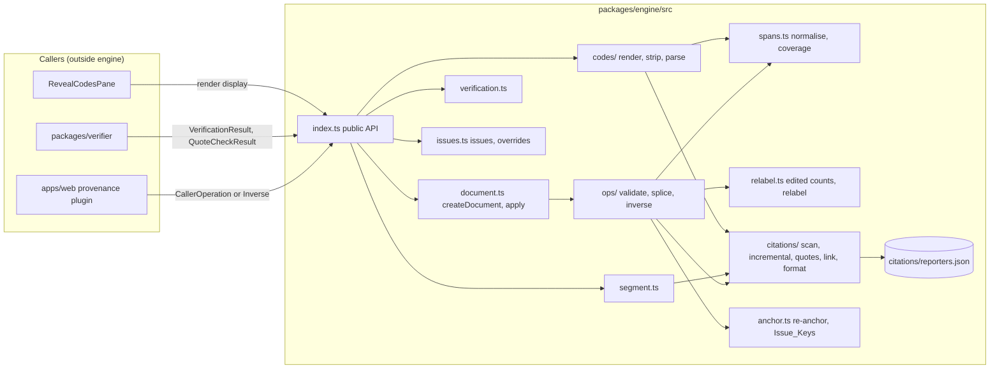
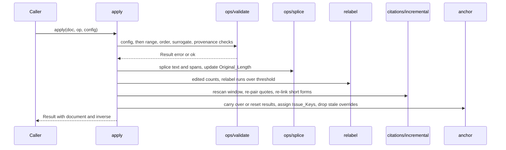

# Design Document: provenance-engine

## Overview

`@reveal-codes/engine` is a library of pure functions over immutable plain data. A `Document` holds Text, canonical Spans, a Run table, extracted Citations and Quote_Candidates with their verification state, Overrides, and an Issue_Key_Counter. Callers create a Document from pasted text, apply Caller_Operations (each returns a new Document and an exact Inverse), write verification and quote-check results, record Overrides, ask for `blockingIssues`, segment sentences, and render Reveal Codes in `full` or `display` mode. `parse` reads a Full_Rendering back into the Document.

Design goals, in priority order:

1. **Exactness.** Every requirement that says "equal" means Structural_Equality, including Timestamps and Issue_Key_Counter. Inverses are snapshot-based, so undo is exact by construction rather than by recomputation.
2. **Determinism.** No clock, randomness, network, file system, `Date`, or `Map`-order dependence. Issue_Keys come from a counter. The reporter index is computed once at module load from a static JSON import.
3. **Budget.** A single-code-unit edit on a 50,000-code-unit Document finishes in under 5 ms median (Req 21). Every per-edit step is O(edit window + spans + citations), except two tight O(n) scans (text splice and quote-mark scan), which take well under 1 ms at n = 50,000.
4. **Small modules.** Functions stay under 40 lines and modules under 300 lines (tech.md), so the engine is split into about 30 modules behind one entry point.

### Decisions this design fixes (deferred by requirements.md)

| Deferred item | Decision |
|---|---|
| Escape_Character | `\` (U+005C). In Text it escapes `[`, `]`, `\`. Inside a Code it also escapes `{` (and, inside a Payload_Section, `}`, `;`, `=`, `,`). |
| Payload_Section syntax | `{key=value;key=value}`, written as the last part of a Code, right before `]`. Strip deletes from an unescaped `{` to its matching unescaped `}`. |
| Retained_Payload syntax | `:` after the Code name: `[AI:r7]`, `[AI>HUM:r7]`, `[CIT ?:3]`, `[OVR:reason]`. |
| `[DOC]` header | `[DOC{v=1;n=<counter>;r=<runId>,<orig>,<edited>,<0\|1>;r=…}]`, Runs sorted by Run_Id in UTF-16 order. |
| Issue_Key format | `k<n>`, where `<n>` is the decimal Issue_Key_Counter value with no leading zeros (`k0`, `k17`). |
| Inverse | `{ kind: "inverse", expect, restore }`: a reference to the post-operation Document plus a text patch and the pre-operation arrays (shared, not copied). Staleness is a structural comparison with a reference-equality fast path. No hash is used, so detection is exact. |
| Replace | Text, Spans, and Run table are built as Delete then Insert, relabelled after the delete step and again after the insert step (Req 6.9). The citation layer is re-anchored once against the original Document with the combined Edit `[from, to) → [from, from + text.length)`. One combined Inverse. See "Replace composition" below. |
| Re-extraction | A windowed incremental rescan of the citation layer with a resynchronisation proof, followed by global but cheap passes for quote pairing, attachment, and Short_Form linking. Property 25 asserts that the result equals full extraction. |
| Reporter list | `src/citations/reporters.json` (a JSON array of strings in reporters-db order) is a static import. Exact and near-miss indexes are built from it once at module load. The generation script lives at `packages/engine/scripts/generate-reporters.ts` and runs offline against a local reporters-db checkout. |
| Benchmark | `packages/engine/bench/` holds a vitest file under its own config. It is run only by `pnpm --filter @reveal-codes/engine bench` and is excluded from `pnpm test`, `pnpm test:pbt`, and CI. |
| Quote Sentence relation | Sentence membership for Req 13 is decided by counting Sentence boundaries with the Segmenter's own predicate (`boundary.ts`, A8), without segmenting the Text. Preceding rule: at most one boundary at an Offset in `(c, s]`, where `c` is the closing mark and `s` the Citation's start. Following rule: no boundary in `(s, o]`, where `o` is the opening mark. A9 shows that this equals the Segmenter's "same or adjacent Sentence" and "same Sentence", and Property 44 checks it. |
| Case_Name bound | A Party_Name is at most 80 code units, including any Entity_Suffix, so a Case_Name is at most 80 + 4 + 80 + 1 = 165 code units (`MAX_CASE_NAME`) and at least 7 (`a v. b,`). The gap matcher tests only candidate ends within that bound. |
| Gap_Signal in a preceding gap | The gap is matched as `P1 + S + P2 + C + P3` (Req 13.1). `S` must start where `P1` ends, so the matcher tries `S` empty and each Gap_Signal that starts there; at most three Gap_Signals can start at one position (`See`, `See also`, `See, e.g.,` or their lowercase forms). The longest Gap_Signal, `See, e.g.,`, is 10 code units (`MAX_GAP_SIGNAL`). |
| Short_Form_Party matching | Tail-anchored. `matchPartyShortAt(text, p)` takes the first `,` in `(p, p + MAX_PARTY]` at which the `, <volume> <reporter> at <page>` tail matches, skipping commas that start an Entity_Suffix or that are prose, then computes the one canonical party start for that comma by a bounded right-to-left scan (`partyStartFor`, A9 step 4). It matches only when that start equals `p`. The scan reads at most `PARTY_SCAN` = 161 code units before the comma, so `LOOKBEHIND` is `PARTY_SCAN + 1` = 162 code units (it was 82, which was too small to classify the word that straddles the 80-code-unit bound; see the constants table), and the rescan's right resync point moves accordingly (A5). |
| Quote attachment rule in the data | `ExtractedQuote.rule` is `"preceding"` or `"following"`. It is not rendered: the Parser re-derives it from the Text through the Extractor, as it does for Other_References and Short_Form link targets, so the Full_Rendering gains no Payload. |

### Research findings that inform the design

- reporters-db publishes `reporters_db/data/reporters.json`. Its top-level keys are reporter names, and each entry has `editions` (canonical abbreviations) and `variations`. The repository is BSD-licensed ([freelawproject/reporters-db](https://github.com/freelawproject/reporters-db)). Some abbreviations repeat across reporters (the README notes that Puerto Rico and a Pennsylvania reporter both use `P.R.`), so the generator de-duplicates by first occurrence to satisfy Req 14.4. The vendored list holds edition abbreviations only. Variations are not vendored, because the near-miss rule (Req 11.1) already covers period and space variants.
- CourtListener facts (citations.md) affect only the payload shapes the engine stores: one cluster id for `verified`, a list for `ambiguous`, `wait_until` for throttled `unchecked`. The engine never calls CourtListener.
- fast-check 4.10 (the pinned devDependency) offers `fc.chain`, `fc.letrec`, `fc.configureGlobal`, `seed`/`path` replay, and `unit` options for strings. Replaying with `seed` (and `path` when given) reproduces the shrunk counterexample.
- tsconfig uses `moduleResolution: "Bundler"`, `resolveJsonModule`, `exactOptionalPropertyTypes`, and `noUncheckedIndexedAccess`. Optional fields are therefore written as absent, never `undefined`. The JSON import is `import reporters from "./reporters.json" with { type: "json" };`. This is a default *import* of a JSON module, which tech.md's ban on default *exports* does not cover.

## Architecture



### Apply pipeline



Data flows one way. No module holds state except the module-level reporter and LEXIS court indexes, which are constants derived from constants. `codes/parse` calls the Extractor (Req 20.5) and the span validator (Req 20.4). `segment` calls the Extractor (Req 8.5).

## Components and Interfaces

### Module map

Each module stays under 300 lines. Line estimates are given in parentheses. `testing/` is excluded from the public entry point (Req 1.2).

```
src/
  index.ts                 public named re-exports only (40)
  result.ts                Result, ok(), err() (20)
  errors.ts                EngineError union, MalformedRule (80)
  types.ts                 Origin, Provenance, Span, RunEntry, Document, Operation, Inverse (160)
  equal.ts                 structuralEqual(a, b): boolean (60)
  validate.ts              isTimestamp, firstUnpairedSurrogate, isValidBoundary, checkProvenance (140)
  document.ts              createDocument, apply (dispatcher) (120)
  spans.ts                 checkCoverage, normaliseSpans, normalise, originAt, runExtents (200)
  ops/validate.ts          validateConfig, validateCallerOp (fixed precedence, Req 7.6) (160)
  ops/splice.ts            spliceText, spliceSpans, effectiveProvenance (220)
  ops/insert.ts            applyInsert (pipeline for one insert) (120)
  ops/delete.ts            applyDelete (120)
  ops/replace.ts           applyReplace = delete ∘ insert drafts, one re-anchor, merged inverse (70)
  ops/inverse.ts           makeInverse, applyInverse, redo (120)
  relabel.ts               countDeleted, countInserted, relabelRuns, addOriginalLength (200)
  anchor.ts                reanchor (Req 15); re-exports assignKeys and issueOrder from anchor-keys.ts; no longer holds reanchorStage (250)
  anchor-keys.ts           issueOrder, assignKeys (Issue_Key assignment), keptOverrides (A6 steps 6 and 7) (180)
  citation-layer.ts        reanchorStage (A1 step 4, A3 step 7), matchesOf (A5 layer 1) (80)
  verification.ts          setVerification, setQuoteCheck, verificationOf (200)
  issues.ts                issues, blockingIssues, overrides, recordOverride (220)
  abbreviations.ts         LEGAL_ABBREVIATIONS (non-reporter list), ENTITY_SUFFIX_WORDS, isAbbreviationEndingAt, abbreviationsStartingAt (130)
  boundary.ts              isBoundaryAt, countBoundaries: the one Sentence-boundary predicate (120)
  segment.ts               segment, dominant origin; uses boundary.ts (180)
  citations/reporters.json vendored list (data)
  citations/REPORTERS_LICENSE.md licence note (Req 14.2)
  citations/reporters.ts   REPORTERS, exactIndex, collapsedIndex, lookupReporter (90)
  citations/lexis-courts.json vendored Lexis_Court_List (data, Req 14.8, 14.9)
  citations/lexis-courts.ts LEXIS_COURTS, exact and collapsed court indexes, lookupLexisCourt, isUnlistedLexisCourt (90)
  citations/lex.ts         readInt, readSpaces, isWordChar, bounded readers (150)
  citations/grammar.ts     matchReporterAt, matchParallelTail, matchParenthetical (280)
  citations/grammar-db.ts  matchDatabaseAt (WL, LEXIS) (150)
  citations/grammar-short.ts matchIdAt, matchPartyShortAt (tail-anchored, uses party.ts) (160)
  citations/party.ts       PARTY_STOP_LIST, CONNECTORS, isCapitalisedWord, partyStartFor (right-to-left Party_Run automaton + stripping) (240)
  citations/grammar-other.ts matchOtherAt (U.S.C., C.F.R., Fed. R.) (150)
  citations/scan.ts        matchAt(text, p) (leftmost-longest, precedence), scanRange (200)
  citations/incremental.ts rescan(prevText, prevMatches, edit, newText) (180)
  citations/quotes.ts      pairQuoteMarks, attachQuotes (preceding and following rules) (220)
  citations/case-name.ts   isPartyName, isCaseName, isGapCaseName, matchPrecedingGap (220)
  citations/signals.ts     SIGNALS, GAP_SIGNALS, startsWithSignal, gapSignalsAt (70); party.ts builds PARTY_STOP_LIST from SIGNALS
  citations/link.ts        linkShortForms (120)
  citations/extract.ts     extract(text), extractFromMatches (80)
  citations/format.ts      format, validateFullValue (240)
  codes/syntax.ts          CODE_NAMES, escapeText, escapeRetained, escapePayload, unescape (180)
  codes/render.ts          render(doc, mode) (250)
  codes/strip.ts           strip(text), stripPositions(positions) (90)
  codes/lex.ts             lexCodes(input) -> tokens + faults (min index) (260)
  codes/decode.ts          tokens -> draft document, field decoders (280)
  codes/check.ts           semantic checks of Req 20.4 and 20.5 (260)
  codes.ts                 facade: render, parse, strip, stripPositions (40)
  testing/arbitraries.ts   re-exports of testing/arb-*.ts (30)
  testing/arb-text.ts, arb-citation.ts, arb-case-name.ts, arb-document.ts, arb-ops.ts, arb-opinion.ts
  testing/arb-edit.ts      arbEdit, applyTextEdit, editTargets (Property 25) (250)
  testing/arb-boundary-text.ts arbBoundaryText, arbReporterAbbreviationProse (Properties 15, 44) (130)
  testing/arb-lexis-near-miss.ts arbNearMissLexisCourt, arbNearMissLexisCitation (Properties 22, 23) (70)
scripts/generate-reporters.ts  offline generator (outside src; may use node:fs)
bench/apply.bench.test.ts, bench/fixture.ts, bench/vitest.config.ts
test/*.test.ts, test/*.properties.test.ts, test/support/fc.ts
```

`structure.md` lists `document.ts`, `ops.ts`, `segment.ts`, `citations/`, `codes.ts`, and `testing/arbitraries.ts`. Those paths exist as facades or entry modules (`ops.ts` re-exports `ops/*`), and the subfolders hold the splits that the 300-line rule forces.

### Public API (`index.ts`)

All functions are named exports. Fallible functions return `Result<T, EngineError>`. `extract`, `render`, `strip`, `stripPositions`, `issues`, `blockingIssues`, `overrides`, and `verificationOf` are total.

```ts
// creation and editing
export function createDocument(text: string, timestamp: string): Result<Document, EngineError>;
export function apply(doc: Document, op: Operation, config?: EngineConfig): Result<Applied, EngineError>;
export function normalise(doc: Document): Result<Document, EngineError>;
export function normaliseSpans(textLength: number, spans: readonly Span[]): Result<readonly Span[], EngineError>;

// segmentation and citations
export function segment(text: string, spans: readonly Span[]): Result<readonly Sentence[], EngineError>;
export function extract(text: string): Extraction;
export function format(value: CitationValue): Result<string, EngineError>;

// verification state
export function setVerification(doc: Document, key: string, result: VerificationResult): Result<Document, EngineError>;
export function setQuoteCheck(doc: Document, key: string, result: QuoteCheckResult): Result<Document, EngineError>;
export function verificationOf(doc: Document, key: string): VerificationResult | null; // derived for Short_Forms

// issues and overrides
export function issues(doc: Document): readonly Issue[];
export function blockingIssues(doc: Document): readonly Issue[];
export function overrides(doc: Document): readonly Override[];
export function recordOverride(doc: Document, key: string, reason: string, timestamp: string): Result<Document, EngineError>;

// Reveal Codes
export function render(doc: Document, mode: RenderMode): Rendering;
export function parse(fullText: string): Result<Document, EngineError>;
export function strip(revealCodesText: string): string;
export function stripPositions(positions: readonly CodePosition[]): readonly CodePosition[];

export const DEFAULT_RELABEL_THRESHOLD = 0.4;
```

Key arguments are typed `string`, not `IssueKey`, so that callers can pass keys taken from rendered text. An unknown key is a value-level error (Req 16.4, 17.5, 18.6).

### Internal interfaces (selected)

```ts
// spans.ts
checkCoverage(textLength: number, spans: readonly Span[]): Result<void, EngineError>; // invalid_spans with first violation offset
mergeSeams(spans: readonly Span[], seams: readonly number[]): readonly Span[];       // merge only at listed indices
runExtents(spans: readonly Span[]): ReadonlyMap<RunId, readonly [number, number]>;

// ops/splice.ts
spliceSpans(spans: readonly Span[], from: number, to: number, piece: Span | null): SpliceResult;
type SpliceResult = { spans: readonly Span[]; deletedPieces: readonly Span[] };

// citations/scan.ts
type Match = Readonly<{ start: number; end: number; value: CitationValue; normalised?: string }>; // Short_Form targetStart unset
matchAt(text: string, p: number): Match | null;
scanRange(text: string, from: number, until: (p: number) => boolean): readonly Match[];

// citations/incremental.ts
rescan(prev: readonly Match[], edit: Edit, newText: string): readonly Match[];
type Edit = Readonly<{ from: number; oldTo: number; newTo: number }>; // [from, oldTo) became [from, newTo)

// anchor.ts
reanchor(prev: Document, next: DraftDocument, edit: Edit): Document;

// boundary.ts (shared by segment.ts and citations/quotes.ts)
isBoundaryAt(text: string, b: number, citations: readonly ExtractedCitation[]): boolean;     // Req 8.3, 8.5, 8.6, 8.10
countBoundaries(text: string, from: number, to: number, citations: readonly ExtractedCitation[], cap: number): number; // boundaries b in (from, to], stops at cap

// citations/case-name.ts
isPartyName(text: string, start: number, end: number): boolean;
isCaseName(text: string, start: number, end: number): boolean;
isGapCaseName(text: string, start: number, end: number): boolean; // isCaseName plus the gap's leading-word rule (D19)
matchPrecedingGap(text: string, gapStart: number, gapEnd: number): boolean; // gap = P1 + S? + P2 + C? + P3

// citations/signals.ts
export const SIGNALS: readonly string[];      // 14 capitalised Signals (Glossary Signal), case-sensitive
export const GAP_SIGNALS: readonly string[];  // 10 capitalised Gap_Signals + their 10 first-letter-lowercase forms
gapSignalsAt(text: string, at: number, limit: number): readonly number[]; // ends of every GAP_SIGNALS entry starting at `at` and ending ≤ limit

// abbreviations.ts
export const ENTITY_SUFFIX_WORDS: readonly string[]; // Inc., LLC, L.L.C., Ltd., Co., Corp., L.P., N.A.
abbreviationsStartingAt(text: string, at: number, limit: number): readonly number[]; // ends of Legal_Abbreviation occurrences at `at`

// citations/party.ts
export const CONNECTORS: readonly (readonly string[])[];       // [["&"], ["of"], ["the"], ["and"], ["ex", "rel."]]
export const PARTY_STOP_LIST: readonly (readonly string[])[];  // each entry as its words: SIGNALS + In, As, Under, ... , ["The","Court","in"]
isCapitalisedWord(text: string, start: number, end: number): boolean;            // Glossary Capitalised_Word; false for `v.`
partyStartFor(text: string, comma: number): number | null; // start of the stripped Short_Form_Party ending at `comma`, or null

// codes/lex.ts
type Token = TextToken | CodeToken;
lexCodes(input: string): { tokens: readonly Token[]; firstFault: number | null };
```

### Constants

| Name | Value | Rationale |
|---|---|---|
| `MAX_MATCH` | 512 code units | Upper bound on any Citation match length the grammar can produce. The longest forms are a parallel citation (up to 4 members of ≤ 60 each, plus a parenthetical of ≤ 44, so ≤ 284) and a party Short_Form (party ≤ `MAX_PARTY` = 80, a bound that covers the whole party including any ` v. ` and every Entity_Suffix, then `, <vol> <reporter> at <page>` ≤ 60, so ≤ 140). Decision (h) does not change either figure, so 512 still holds. The grammar enforces it with bounded readers. |
| `LOOKAHEAD` | 1,024 = 2 × `MAX_MATCH` | Maximum distance `matchAt(p)` reads forward, including the Other_Reference precedence look-ahead (see scan) and the party form's comma search (commas in `(p, p + MAX_PARTY]`) and tail check (≤ 60 more). |
| `PARTY_SCAN` | 161 = 2 × `MAX_PARTY` + 1 code units | `partyStartFor(text, c)` reads only `text[c − PARTY_SCAN .. c)`. The first `MAX_PARTY` code units hold every Party_Run it can accept. The second `MAX_PARTY` + 1 let it read the whole token that straddles the 80-code-unit mark, including that token's predecessor, so it can tell a Capitalised_Word (the run exceeds 80, so no Short_Form) from a lower-case word (the run stops, and the shorter party stands) for every token of up to 80 code units. Longer tokens and Connector chains that cross the window edge are the only inputs where the result can differ from the Glossary (D17). |
| `LOOKBEHIND` | 162 = `PARTY_SCAN` + 1 code units | `matchAt(p)` reads behind `p`. Most forms read only `text[p − 1]` (Req 9.8, 12.1). The party form's scan from its comma `c` (with `c ≥ p + 1`) reads indices `≥ c − 161 ≥ p − 160`, inside `[p − 162, p)` (A9 step 4). The previous value, 82 = `MAX_PARTY` + 2, does **not** hold. To decide a 75-code-unit party preceded by ` extensively `, the scan must read `extensively` to its first code unit (a lower-case word ends the run; `Extensively` would push it past 80 and yield no Short_Form), and that code unit lies about 87 code units before the comma. With 82 the earlier scan either read past its stated bound, which breaks the rescan proof in A5, or could not classify the word. This was already so before decision (h); ` v. ` and Entity_Suffixes change the grammar but not the 80-code-unit bound, so 162 covers them too. |
| `ABBR_LOOKBEHIND` | longest Legal_Abbreviation + 1 | Used by the sentence-boundary predicate. |
| `MAX_PARTY` | 80 code units | Party_Name and Party_Run upper bound (Glossary), counted over the whole party including ` v. ` and Entity_Suffixes. |
| `MAX_CASE_NAME` | 165 code units | `2 × MAX_PARTY + 4 + 1`. Bounds the Case_Name matcher in a preceding-quote gap. |
| `MIN_CASE_NAME` | 7 code units | Shortest Case_Name, `a v. b,`. |
| `MAX_GAP_SIGNAL` | 10 code units | Longest Gap_Signal, `See, e.g.,`. |

`LOOKAHEAD` is unchanged by the Req 13 rewrite and by decision (h). Quote attachment, including the Gap_Signal, the Case_Name gap, and the boundary count, belongs to the quote layer, which is recomputed in full after every edit (A5), so it never widens the match layer's read window.

## Data Models

```ts
// result.ts
export type Result<T, E> =
  | Readonly<{ ok: true; value: T }>
  | Readonly<{ ok: false; error: E }>;

// types.ts
export type Origin = "HUM" | "PST" | "AI" | "AI>HUM";
export type Provenance = Readonly<{ origin: Origin; runId?: string; timestamp: string }>;
export type Span = Readonly<{ start: number; end: number; provenance: Provenance }>;
export type RunEntry = Readonly<{
  runId: string;
  originalLength: number;     // ≥ 1 in every engine-produced entry
  editedCount: number;        // Cumulative_Edited_Count
  relabelled: boolean;        // Relabelled_Flag
}>;
export type IssueKey = string; // always /^k(0|[1-9][0-9]*)$/ in engine output

export type ReporterMember = Readonly<{ volume: number; reporter: string; page: number; pincite?: number }>;
export type ReporterValue = Readonly<{ kind: "reporter"; volume: number; reporter: string; page: number;
  pincite?: number; court?: string; year?: number }>;
export type ParallelValue = Readonly<{ kind: "parallel"; members: readonly ReporterMember[];
  court?: string; year?: number }>;
export type DatabaseValue = Readonly<{ kind: "database"; year: number; designator: "WL" | "LEXIS";
  lexisCourtListed?: boolean; lexisCourt?: string; number: number; pincite?: number }>;
  // lexisCourtListed and lexisCourt are both present iff designator is "LEXIS", and both absent for "WL".
  // lexisCourtListed is always written out: true when lexisCourt is a lexis-courts.json entry (the list
  // entry, not the text as written), false when lexisCourt is an Unlisted_Lexis_Court as written (D22).
export type IdValue = Readonly<{ kind: "short"; form: "id"; pincite?: number; targetStart: number | null }>;
export type PartyValue = Readonly<{ kind: "short"; form: "party"; party: string /* stripped Short_Form_Party; may hold one " v. " and Entity_Suffixes */; volume: number;
  reporter: string; pincite: number; targetStart: number | null }>;
export type OtherValue = Readonly<{ kind: "other"; form: "usc" | "cfr" | "fed_rule"; title?: number; section: string }>;
export type FullValue = ReporterValue | ParallelValue | DatabaseValue;
export type CitationValue = FullValue | IdValue | PartyValue | OtherValue;

export type ExtractedCitation = Readonly<{ start: number; end: number; text: string;
  value: CitationValue; normalised?: string }>;
export type QuoteRule = "preceding" | "following"; // Preceding_Quote (Req 13.1) or Following_Quote (Req 13.8)
export type ExtractedQuote = Readonly<{ start: number; end: number; text: string;
  citationStart: number; rule: QuoteRule }>;   // citationStart = start of the attached Full_Citation or Short_Form
export type Extraction = Readonly<{ citations: readonly ExtractedCitation[]; quotes: readonly ExtractedQuote[] }>;

export type VerificationResult =
  | Readonly<{ status: "verified"; clusterId: string }>
  | Readonly<{ status: "ambiguous"; candidates: readonly string[] }>
  | Readonly<{ status: "not_found"; reason?: string }>
  | Readonly<{ status: "unchecked"; waitUntil?: string }>;
export type QuoteCheckResult =
  | Readonly<{ status: "unchecked" }>
  | Readonly<{ status: "match" }>
  | Readonly<{ status: "mismatch"; prefixLength: number }>;

export type CitationRecord =
  | Readonly<{ kind: "full"; key: IssueKey; citation: ExtractedCitation; result: VerificationResult }>
  | Readonly<{ kind: "short"; key: IssueKey; citation: ExtractedCitation }>   // result derived (Req 12.4, 12.5)
  | Readonly<{ kind: "other"; citation: ExtractedCitation }>;                 // no key, no result
export type QuoteRecord = Readonly<{ key: IssueKey; quote: ExtractedQuote; result: QuoteCheckResult }>;
export type Override = Readonly<{ key: IssueKey; reason: string; timestamp: string }>;

export type Document = Readonly<{
  text: string;
  spans: readonly Span[];               // canonical (Req 3)
  runs: readonly RunEntry[];            // sorted by runId, UTF-16 code unit order
  citations: readonly CitationRecord[]; // ascending start
  quotes: readonly QuoteRecord[];       // ascending start
  overrides: readonly Override[];       // issue order (Req 18.7)
  keyCounter: number;                   // Issue_Key_Counter
}>;

export type Insert = Readonly<{ kind: "insert"; at: number; text: string; provenance: Provenance }>;
export type Delete = Readonly<{ kind: "delete"; from: number; to: number; actor: Origin }>;
export type Replace = Readonly<{ kind: "replace"; from: number; to: number; text: string; provenance: Provenance }>;
export type CallerOperation = Insert | Delete | Replace;
export type Restore = Readonly<{
  at: number; removeLength: number; insertText: string;  // text patch applied to expect.text
  spans: readonly Span[]; runs: readonly RunEntry[];
  citations: readonly CitationRecord[]; quotes: readonly QuoteRecord[];
  overrides: readonly Override[]; keyCounter: number;
}>;
export type Inverse = Readonly<{ kind: "inverse"; expect: Document; restore: Restore }>;
export type Operation = CallerOperation | Inverse;
export type Applied = Readonly<{ document: Document; inverse: Inverse }>;
export type EngineConfig = Readonly<{ relabelThreshold?: number }>;

export type Sentence = Readonly<{ start: number; end: number; dominantOrigin: Origin; origins: readonly Origin[] }>;
// origins listed in the fixed order HUM, PST, AI, AI>HUM

export type IssueCode = "CIT ✘" | "CIT ?" | "CIT …" | "QUO ✘" | "QUO …";
export type Issue = Readonly<{ key: IssueKey; kind: "citation" | "orphan" | "quote";
  start: number; end: number; code: IssueCode }>;

export type RenderMode = "full" | "display";
export type CodePosition = Readonly<{ offset: number; code: string }>; // code = exact token text, escaped
export type Rendering = Readonly<{ text: string; positions: readonly CodePosition[] }>;
```

Notes:

- `Provenance.runId` is optional in the type rather than split into a union, so that Req 2.5 and 7.4 errors can occur for type-conforming input, as Req 1.7 assumes. `checkProvenance` enforces the rule that a Run_Id is present if and only if Origin is `AI` or `AI>HUM`.
- Volume, page, pincite, year, and document number are `number`. The grammar accepts only values that are valid under Req 10.1, so every extracted Full_Citation value passes `validateFullValue`, and its Canonical_Form (and so its Normalised_Form) is always defined.
- `targetStart` is the start Offset of the target Full_Citation, or `null` for an Orphan. It is a pure function of the Text, which Req 20.5 needs. For carry-over (Req 15.2a), two link targets count as "the same" when the old target was carried over to the new target. The Offsets are compared through the operation mapping, not as raw numbers (see anchor).
- `ExtractedQuote.citationStart` and `rule` are pure functions of the Text, like `targetStart`. Re-anchoring compares them (Req 15.7 c, d), and the Parser takes them from the Extractor rather than from Codes (Req 20.5).
- A `Document` keeps its Short_Form statuses derived. Only Full_Citations store a `VerificationResult`, so Req 12.4 ("including after a caller changes the target's result") cannot go stale.

### Code syntax (Full_Rendering)

```
code       = "[" name [ ":" retained ] [ "{" fields "}" ] "]"
name       = "HUM" | "PST" | "AI" | "AI>HUM" | "CIT ✓" | "CIT ✘" | "CIT ?" | "CIT …"
           | "QUO ✓" | "QUO ✘" | "QUO …" | "REF" | "/CIT" | "/QUO" | "/REF" | "OVR" | "DOC"
retained   = run id (AI, AI>HUM) | decimal candidate count (CIT ?) | reason (OVR)
fields     = field { ";" field }
field      = key "=" value { "," value }
```

| Context | Characters escaped with `\` |
|---|---|
| Text | `\` `[` `]` |
| Retained_Payload | `\` `[` `]` `{` |
| Payload value | `\` `[` `]` `{` `}` `;` `=` `,` |

Any other `\x` pair, and a `\` at the end of input, is a dangling Escape_Character (Req 20.3).

| Code | Retained | Payload_Section fields (fixed order) |
|---|---|---|
| `[DOC]` | none | `v=1`, `n=<counter>`, then one `r=<runId>,<orig>,<edited>,<0\|1>` per Run, sorted by Run_Id |
| `[HUM]`, `[PST]` | none | `t=<timestamp>` |
| `[AI:<run>]`, `[AI>HUM:<run>]` | run id | `t=<timestamp>` |
| `[CIT ✓]` | none | `k=<key>`, then `cl=<clusterId>` for a Full_Citation |
| `[CIT ?:<n>]` | candidate count | `k=<key>`, then `cs=<id>,<id>,…` for a Full_Citation |
| `[CIT ✘]` | none | `k=<key>`, then optional `why=<reason>` for a Full_Citation |
| `[CIT …]` | none | `k=<key>`, then optional `wu=<timestamp>` for a Full_Citation |
| `[QUO ✓]`, `[QUO …]` | none | `k=<key>` |
| `[QUO ✘]` | none | `k=<key>`, `p=<prefixLength>` |
| `[OVR:<reason>]` | reason | `t=<timestamp>` |
| `[REF]`, `[/REF]`, `[/CIT]`, `[/QUO]` | none | no Payload_Section (Req 19.2) |

Example (full, then display):

```
[DOC{v=1;n=2;r=r1,40,0,0}][PST{t=2026-11-03T10:00:00Z}]See [CIT ✘{k=k0}]410 U.S. 999[OVR:Typo in source{t=2026-11-03T10:05:00Z}][/CIT], and [AI:r1{t=2026-11-03T10:01:00Z}]42 \[sic\] …
[PST]See [CIT ✘]410 U.S. 999[OVR:Typo in source][/CIT], and [AI:r1]42 \[sic\] …
```

The literal `[` and `]` in the Text appear escaped (`\[`, `\]`) in both modes. A Code's Text Offset is the Offset in the Document's Text at which the Code appears. In the example, `[OVR]` follows its opening code: the `[/CIT]` sits at the citation's end Offset, and the `[OVR]` at the citation's start Offset is emitted immediately after `[CIT ✘]` (Req 19.6, 19.7). The example abbreviates text for width.

### Algorithms

#### A1. createDocument (Req 2)

1. Return `invalid_timestamp` unless `isTimestamp(ts)`. `isTimestamp` matches `^\d{4}-\d{2}-\d{2}T\d{2}:\d{2}:\d{2}(\.\d{1,9})?Z$` and checks calendar ranges, including leap years, with integer arithmetic (no `Date`).
2. Return `split_surrogate` at `firstUnpairedSurrogate(text)` if one exists.
3. Spans: `[]` for empty text, otherwise `[{0, len, {PST, ts}}]`. Runs `[]`, overrides `[]`, keyCounter 0.
4. `extract(text)`, then `assignKeys` over all keyed items in the order of the Issue_Key assignment rule. Full_Citations get `{status:"unchecked"}` and quotes get `{status:"unchecked"}`.

Validation order: timestamp, then surrogate. Req 2 does not fix an order; this choice is documented.

#### A2. apply dispatcher and validation (Req 5.1, 5.2, 6.6, 7)

`apply(doc, op, config)`:

1. `validateConfig(config)`: `invalid_config` unless the threshold is absent or `Number.isFinite(t) && t > 0 && t <= 1`.
2. If `op.kind === "inverse"`, run `applyInverse` (A7).
3. `validateCallerOp(doc, op)` checks in fixed order, returning the first failure: `out_of_range` (each of `at`, `from`, `to` in that field order, using `Number.isInteger` and range), `inverted_range`, `split_surrogate` (boundary faults first, in field order, then the first unpaired surrogate in `text`), `invalid_provenance` (Origin membership, `AI>HUM` on Insert or Replace, Run_Id rule, and Delete Actor membership), and finally `invalid_timestamp` for the provenance Timestamp.
4. No-op (Req 4.7): if the inserted text is empty and the range is empty, return `{ document: doc, inverse: { kind:"inverse", expect: doc, restore: restoreOf(doc, at, 0, "") } }`.
5. Dispatch to `applyInsert`, `applyDelete`, or `applyReplace`.

#### A3. Insert and Delete pipeline (Req 4, 6, 15)

Shared steps for one edit `[from, oldTo) → text` (Insert has `from = oldTo = at`; Delete has `text = ""`; a Replace runs steps 1 to 6 for its delete and then for its insert, and step 7 once, A4):

1. **Effective provenance (Req 6.11).** If the origin is `AI` and the run `r` has `relabelled: true`, use origin `AI>HUM`.
2. **Span splice (Req 4.1–4.5, 4.11, 4.12).** Binary-search the spans that hold `from` and `oldTo`. Keep the pieces left of `from` and right of `oldTo`, cutting partial spans. The pieces keep their Provenance_Record, including the Timestamp. Shift the right pieces by `delta`. Insert the new piece. Record the deleted pieces. Because the input is canonical, merging can only happen at the two seams around the edit (left piece with the new piece, and the new piece or left piece with the right piece), so `mergeSeams` runs in O(1) at those indices and keeps the lowest-start Timestamp. Req 4.12 (insert inside a Mergeable span) falls out: cut, new piece, and cut all merge, keeping the left cut's Timestamp.
3. **Original_Length (Req 4.8, 4.9).** For an `AI` insert under run `r`, add `text.length` to the entry, creating `{r, len, 0, false}` if needed. The entry is inserted in sorted position.
4. **Edited counts (Req 6.1, 6.2, 6.7).** Only when the actor is `HUM`. For deletions, sum the deleted pieces with origin `AI` by Run_Id. For insertions, compute `runExtents` on the spans *before* the insertion (for a Delete there is no insertion). Each run with `runStart < at < runEnd` gets `+text.length`. `runExtents` is O(spans).
5. **Relabel (Req 6.3, 6.4, 6.8).** For each entry with `!relabelled && editedCount / originalLength > threshold`, set `relabelled: true` and rewrite that run's spans to `AI>HUM`, keeping Timestamps and Offsets. Then run full `normaliseSpans`, which is O(spans) and happens only in this rare path. A relabelled flag is never cleared by a forward op.
6. **Text splice.** `text.slice(0, from) + inserted + text.slice(oldTo)`.
7. **Re-extraction (A5)**, then **re-anchoring (A6)**, against the Document before the Operation with the Operation's Edit `[from, oldTo) → [from, newTo)`. For a Replace this is the combined Edit `[from, to) → [from, from + text.length)`.
8. **Inverse (A7).**

Edited counts follow Req 6.1 literally: deletions count only from `AI`-origin spans, and insertions count against every Run_Extent. Once a run is relabelled its count keeps growing harmlessly. The flag is sticky, so the extra count never changes behaviour.

#### A4. Replace composition (Req 4.6, 6.9, 15.3, 15.4)

`applyReplace(doc, from, to, text, prov)` builds one draft and settles it once:

- **Draft.** `deleteDraft(doc, from, to, prov.origin)`, then step 5 on that draft, then `insertDraft(·, from, text, prov)` on the relabelled draft, then step 5 again, give the Text, Spans, and Run table that Delete followed by Insert would give. The insert's edited counts use the post-delete spans (Req 6.9, Property 11). Neither half re-anchors, so no intermediate Document exists.
- **Relabel.** Step 5 runs after the delete step and again after the insert step (Req 6.9), exactly as Delete then Insert would. One relabel after both counts is not equivalent. The Relabel_Threshold is passed per Operation, so a Run left under the threshold by its last edit can be over a lower threshold passed with the Replace. The delete step then relabels it, and an `AI` insert under the same Run takes origin `AI>HUM` (Req 6.11). But that insert also adds `text.length` to the Run's Original_Length (Req 4.8), which is the denominator of the Edited_Proportion, so after both steps the proportion can fall back to or below the threshold. A single relabel at that point misses the crossing and leaves the inserted text `AI`. Property 7 found this (seed 1330162038); the named example under "Example tests" reproduces it. Property 7 asserts the equality.
- **Re-anchor.** Step 7 runs once, with `prev = doc` and the combined Edit `{ from, oldTo: to, newTo: from + text.length }`. `rescan` (A5) and `mapRange` (A6) take a general Edit, so nothing is special-cased. A citation whose range the combined Edit touches under Req 15.3 is reset and gets exactly one fresh key, so a Replace issues no key that no item keeps (Property 27). Req 15.4's "even when the Replace writes identical text" holds because the combined Edit shares a code unit with the citation. A Replace adjacent to a citation (its `[from, to)` ends at `start` or begins at `end`) leaves the citation untouched, so it keeps its key, result, and Override even when the Text after the delete alone would not extract it. Property 7 asserts that the layer equals this single re-anchor.
- With empty `text` the Replace is the Delete alone, and with `from == to` the Insert alone (Req 4.6). The combined Edit then equals that primitive's Edit.
- One Inverse is returned, with `expect` set to the final document and `restore` set to the original document (A7). It restores Issue_Keys, results, Overrides, and `keyCounter` from that snapshot, so it does not depend on how the layer was derived (Property 8).

#### A5. Incremental re-extraction (Req 15.1, 21)

Full extraction is defined in layers. Each layer is a pure function of the Text plus the previous layer:

1. **Match layer.** `scanRange(text, 0, end)` visits a cursor `p` from 0. At each `p`, `matchAt(text, p)` either returns a Match, after which the cursor jumps to `match.end`, or returns null, after which the cursor moves to `p + 1`. `matchAt` reads only `text[p − LOOKBEHIND .. p + LOOKAHEAD)` (A9, constants table).
2. **Link layer.** `linkShortForms(matches)` is O(c) over the match list (Req 12).
3. **Quote layer.** `pairQuoteMarks(text)` pairs marks globally and drops every pair whose opening mark lies inside an earlier kept pair, in O(n + q log q) for q quote characters. `attachQuotes(text, pairs, citations)` applies the preceding and following rules with local gap scans and local boundary counts (A9).

The Document does not store its match layer. The pipeline rebuilds the previous match list from `prev.citations` (`matchesOf`: one match per record, Other_References included, ascending `start`, Short_Form `targetStart` reset to null, `normalised` dropped). This equals `scanRange(prev.text)` whenever `prev.citations` is the Extractor's output for `prev.text`, which every Document from `createDocument`, `apply`, an Inverse, or `parse` satisfies. `parse` qualifies because it takes Citation_Values and link targets from `extract(text)` and rejects any decoded range set that differs from the Extractor's (A12 step 3, Req 20.5).

Only layer 1 is incremental. Layers 2 and 3 are recomputed in full: they cost O(c + q) plus a single O(n) `charCodeAt` loop, which takes about 0.1 ms at n = 50,000, plus the gap scans, whose total is O(n) (A9, "Cost").

**The wider quote rules do not affect the resync argument.** The preceding rule can now look across a Gap_Signal, a Case_Name, and one Sentence boundary, and the boundary predicate reads an unbounded terminator-and-whitespace run behind a position and, for Req 8.10, the one word after it. None of this is in layer 1: `matchAt` reads only `[p − LOOKBEHIND, p + LOOKAHEAD)`, so the proof below covers it. Layer 3 is a pure function of the new Text and the new match list, recomputed from scratch, so it needs no window. An edit that touches only a quote-to-citation gap changes the attachment correctly, and re-anchoring sees the change through `citationStart` and `rule` (A6 step 5, Req 15.7).

**Landing positions.** The cursor visits exactly the positions that are not strictly inside an accepted match. These are the landing positions L(text), and they are recoverable from the match list alone.

**Rescan.** Given previous matches M, an edit `[from, oldTo) → [from, newTo)`, and `delta = newTo − oldTo`:

1. Left resync point: `s` = the largest landing position of the old scan with `s ≤ from − LOOKAHEAD − 1`, or 0 if none exists. Old matches with `end ≤ s` are kept unchanged.
2. Scan the new text from `s`. After each cursor step to a position `p ≥ newTo + LOOKBEHIND`, check whether `p − delta` is an old landing position. Old landing positions are found by binary search in M: a position is a landing position when no old match strictly contains it. The first such `p` is the right resync point `q`.
3. Result = old matches with `end ≤ s`, then new matches found in `[s, q)`, then old matches with `start ≥ q − delta` shifted by `delta`.

**Why the result equals full extraction.** A full scan of the new text and the old scan visit the same cursor positions below `s`. Every decision at a position `p < s` reads only `[p − LOOKBEHIND, p + LOOKAHEAD)`, which lies below `from` and is unchanged (reading further left only reads more unchanged text). Both scans therefore land on `s`, so the full scan and the rescan agree on `[0, q)`, because from `s` onward the rescan *is* the full scan. At `q`, the full new scan's cursor is at `q`, and the old scan's cursor was at `q − delta`. Every later decision reads `text[p − LOOKBEHIND ..]` with `p ≥ newTo + LOOKBEHIND`, so it reads nothing before `newTo`. That text is identical to the old text shifted by `delta`, because the edit ended at `newTo`. So the two scans make identical decisions from `q` and `q − delta` onwards, and the remaining matches are the old ones shifted. This is the case that the party form needs: an edit that adds or removes a stop-list word, a Connector, a Capitalised_Word, an Entity_Suffix, or a ` v. ` just before a party (for example inserting `In ` before `Casey, 505 U.S. at 833`, or `Roe v. ` before `Wade, 410 U.S. at 153`) changes `partyStartFor` only for commas `c` with `c − PARTY_SCAN < newTo`. The match decided by such a comma is taken at some `p < c < newTo + PARTY_SCAN + 1 = newTo + LOOKBEHIND`, so it is rescanned rather than copied. Termination: within `MAX_MATCH` positions after `newTo + LOOKBEHIND`, the old scan has a landing position (no match is longer than `MAX_MATCH`). The new scan's cursor reaches or passes each such position, and the first common position is `q`. If no common position exists before end of text, `q` = end of text.

Window cost: at most `LOOKAHEAD + edit length + LOOKBEHIND + 2 × MAX_MATCH` positions, with `matchAt` bounded by `LOOKBEHIND + LOOKAHEAD` reads each, though in practice it rejects in O(1) at non-digit, non-`I`, and non-capital positions, and the party form does its backward scan only after a comma and a valid tail are found. Property 25 checks `rescan ≡ scanRange` directly, and `apply` uses only `rescan`.

#### A6. Re-anchoring and Issue_Key assignment (Req 15, glossary)

Inputs: the previous Document P, the new extraction E on the new text, and the Operation's edit (for a Replace, its combined Edit, A4) with its `delta`.

1. `mapRange([s, e))` returns the mapped range if the previous range is untouched under Req 15.3, else `null`. For an Insert: untouched if `at ≤ s || at ≥ e`. For a Delete, and for a Replace's combined Edit with `from < to`: untouched if `to ≤ s || from ≥ e`. Untouched ranges at or after the edit point are shifted by `delta`.
2. Index the previous Full_Citations by mapped start: `Map<number, CitationRecord>`, including only records with untouched ranges.
3. **Full_Citations.** A new Full_Citation is carried over when the index has an entry at its start with equal `end`, equal `text`, a structurally equal `value`, and an equal `normalised`. It keeps `key`, `result`, and Override. Otherwise it is reset: `unchecked`, a new key, and no Override.
4. **Short_Forms.** Carried over when the Full_Citation rule holds with the value compared field by field, except `targetStart`. For `targetStart`, both must be `null`, or the new target must be the carried-over image of the old target (same key after step 3). Otherwise the Short_Form gets a new key. Short_Forms carry no result.
5. **Quotes (Req 15.6, 15.7).** Carried over when all of these hold: (a) the previous quote's range is untouched and the text is equal; (b) the range maps to the new range; (c) the new quote's `citationStart` belongs to a citation carried over in step 3 or 4 from the previous quote's attached citation, and, for a linked Short_Form, its target was also carried over; (d) the new quote's `rule` equals the previous quote's `rule`. Otherwise the quote resets to `unchecked`, gets a new key, and has no Override. A gap-only edit (for example, a Gap_Signal `See` edited into `In`, a second Gap_Signal added, or a second boundary added) changes or removes the attachment in the new extraction, so (c) or (d) fails, or the quote is absent.
6. **Key assignment.** Collect the items that need keys, sort them by `(start, citation before quote)`, and give each `k<counter>` before incrementing the counter. Other_References are skipped.
7. **Override cleanup (Req 15.8).** Keep an Override only if its key belongs to a carried-over item that is still an Issue. As defence in depth, finish with a filter to current Issues, then sort by issue order.

Fresh keys cannot collide: every key in P is `k<i>` with `i < P.keyCounter`, and new keys start at `P.keyCounter`. Carry-over keeps keys unique because the mapping is injective on untouched ranges.

#### A7. Inverse (Req 5)

- `makeInverse(prev, next, at, removedText, insertedLength)` returns `{ kind:"inverse", expect: next, restore: { at, removeLength: insertedLength, insertText: removedText, spans: prev.spans, runs: prev.runs, citations: prev.citations, quotes: prev.quotes, overrides: prev.overrides, keyCounter: prev.keyCounter } }`. The arrays are shared references, so construction is O(1) apart from `removedText`, which is a slice.
- `applyInverse(doc, inv)`: if `doc !== inv.expect && !structuralEqual(doc, inv.expect)`, return `stale_inverse`. Otherwise rebuild the text with the patch, take every other field from `restore`, and return a redo inverse whose `expect` is the restored document and whose `restore` holds the reverse patch and `inv.expect`'s arrays.
- Applying an inverse does not validate, relabel, or re-extract. It restores a snapshot, so Req 5.3, 5.4, and 6.12 hold by construction. The relabelled flag and the `AI` origins come back with the restored arrays.
- Cost: the stale check is O(1) on the common path (the same reference). The worst case is one string comparison (memcmp, about 10 µs at 50k) plus O(spans + citations).

#### A8. Segmentation (Req 8)

`segment(text, spans)`:

1. `checkCoverage(text.length, spans)`; return `invalid_spans` on failure. Empty text with empty spans returns `[]`.
2. `cits = extract(text).citations`.
3. Collect every `b` with `isBoundaryAt(text, b, cits)` (`boundary.ts`), in one forward pass. `isBoundaryAt` holds when `text[b]` is non-whitespace, `text[b − 1]` is whitespace, and walking back from `b − 1` over `\s+`, then `["”'’)]*`, reaches at least one code unit of `[.?!]`. It fails if `b` lies strictly inside a citation range (binary search), or if `isAbbreviationEndingAt(text, i)` holds, where `i` is the index of the last code unit of the terminator run, `text[i] === "."`, and some Legal_Abbreviation `a` satisfies `text.slice(i − a.length + 1, i + 1) === a` with the preceding code unit being start of text, whitespace, or `(`. It also fails under Req 8.10 when `isInitialBeforeCapitalisedWord(text, i)` holds: `text[i] === "."`, `text[i − 1]` is in `A`–`Z`, either `i − 1 === 0` or `text[i − 2] === " "` (U+0020 only; a tab, newline, `(`, or any other code unit before the letter does not qualify), `text[i + 1] === " "`, and `isCapitalisedWord(text, i + 2, e)` holds (`citations/party.ts`; its abbreviation part is a Legal_Abbreviation ending in `.` other than `v.`, so `Exhibit J. F.3d at 5` keeps its boundary before `F.3d`) and `text.slice(i + 2, e) !== "Id."`, where `e` is the end of the maximal `W` run starting at `i + 2` (`W` as in A9 "Tokens": Unicode letters, ASCII digits, `.`, `'`, `’`, `-`; tested with `isPartyWordUnitAt` from `citations/party-lex.ts`). Because `text[i + 1]` must be that one space and the word must start at `i + 2`, the rule never applies when the terminator sequence has more than one terminator, any closer, or more than one whitespace code unit; then `b = i + 2`. The exclusions are tested in the order citation range (8.5), Legal_Abbreviation (8.6), initial (8.10). Each one alone suppresses the boundary, so the order affects only cost. The `Id.` exclusion means `Exhibit B. Id. at 5` has a boundary before `Id.`, so a Short_Form `Id.` after an exhibit or initial starts a Sentence. 8.6 and 8.10 overlap for the one-letter reporter abbreviations `A.`, `F.`, and `P.`: `Exhibit A. The court` is excluded by both, `Exhibit A. then` by 8.6 only, and `Exhibit J. The court` by 8.10 only. `isCapitalisedWord` always uses the full `LEGAL_ABBREVIATION_INDEX`, also when a caller passes another index for the 8.6 test. `boundary.ts` imports `citations/party.ts` and `citations/party-lex.ts`; neither of them, nor anything they import (`abbreviations.ts`, `citations/reporters.ts`, `citations/signals.ts`), imports `boundary.ts`, `segment.ts`, or the Extractor, so there is no import cycle. Reads: `isBoundaryAt` reads backward over the whitespace-and-closer run before `b` (unbounded, as before) and at most `ABBR_LOOKBEHIND` code units before `i`, then `text[i − 2 .. i + 2)`, and, only when that initial shape holds, forward over the one `W` run starting at `b`. A `W` run holds no whitespace, so the runs read at distinct candidate Offsets are disjoint, and one segmentation pass reads each code unit a bounded number of times. `countBoundaries(text, from, to, cits, cap)` evaluates the same predicate at each `b` in `(from, to]` that follows a whitespace code unit, and stops once the count reaches `cap`. Segmentation and quote attachment therefore use one predicate, not two copies.
4. Build Sentences from consecutive boundaries. Compute the dominant origin by walking the spans that overlap each sentence. A tie goes to the origin of the earliest-starting tied span. `origins` lists the origins present in fixed order.

Whitespace is defined by the ECMAScript `\s` class. `b` always follows a whitespace code unit, which is never a surrogate, so `b` is a Valid_Boundary (Req 8.8). `isAbbreviationEndingAt` uses a precomputed `Map<lengthOfAbbr, Set<abbr>>` built from the non-reporter list plus `REPORTERS` entries ending in `.`. That gives at most about 30 distinct lengths per period. This index, `LEGAL_ABBREVIATION_INDEX`, holds exactly the Legal_Abbreviations that end in `.`, and `isCapitalisedWord` and the A9 fast reject use it for the abbreviation part of the Glossary's Capitalised_Word.

`abbreviations.ts` holds the non-reporter list in Glossary order: `Id.`, `v.`, `Inc.`, `Corp.`, `Ltd.`, `Co.`, `L.P.`, `N.A.`, `L.L.C.`, `No.`, `Cir.`, `Dist.`, `Ct.`, `Fed.`, `Supp.`, `et al.`. Decision (h) added `Ltd.`, `Co.`, `L.P.`, `N.A.`, and `L.L.C.`, so the Segmenter places no boundary after them (Req 8.6), for example in `Acme Co. Then`. It also exports `ENTITY_SUFFIX_WORDS` (`Inc.`, `LLC`, `L.L.C.`, `Ltd.`, `Co.`, `Corp.`, `L.P.`, `N.A.`), shared by `party.ts` and `case-name.ts`; every entry except `LLC` is also a Legal_Abbreviation, and `LLC` is a Capitalised_Word by its letters. `abbreviationsStartingAt(text, j, limit)` returns the end of every Legal_Abbreviation occurrence that starts at `j` and ends by `limit`, using a first-code-unit index over the same entries; `isPartyName` uses it to cover inner periods.

#### A9. Extraction grammar and quote attachment (Req 9, 11, 12, 13, 14)

`matchAt(text, p)` tries the following in order and returns the first successful result, preferring the longest within each class:

1. **Word boundary (Req 9.8).** Fail if `text[p − 1]` is a letter or digit (Unicode `\p{L}` or `\p{N}`), except for `Id.` and party forms, which have their own left-context rules. This is the only read behind `p` except the party form's backward scan (`LOOKBEHIND`).
2. **Database (`grammar-db`).** `<yyyy> WL <n>` or `<yyyy> <court tokens> LEXIS <n>`, optionally followed by `, at *<pincite>`, optionally followed by a parenthetical that is kept in the range but not in the value. The LEXIS court is classified as follows (Req 9.4, D22):
   1. **Court start.** The court begins exactly one U+0020 after the year at `p`; the year directly precedes it, and no other start is tried at `p`. The reader takes court tokens (maximal runs of code units other than whitespace, parentheses, and `"“”`) joined by single U+0020 spaces until the first token that is exactly `LEXIS`; the court is the text before the space ahead of that token. It fails, and `matchDatabaseAt(p)` returns `null`, if no token precedes `LEXIS`, a separator is not one U+0020, or the court passes 40 code units before `LEXIS` is found.
   2. **Year tokens.** If any court token is a four-digit year in 1600–2999, fail. This is what fixes the court start: a match starting at an earlier year `p′ < p` whose court reached the same `LEXIS` would contain the year at `p` as a whole token, so it fails here, and the leftmost-longest scanner moves on until it reaches `p`.
   3. **Listed lookup.** `lookupLexisCourt(court)` tries the exact index, then the collapsed index (periods and U+0020 spaces removed, case-sensitive, first entry in `lexis-courts.json` order wins), as `lookupReporter` does. A hit gives `lexisCourtListed: true` and `lexisCourt` set to the list entry. When the text as written differs from the Canonical_Form, extract records a Normalised_Form (Req 11.2).
   4. **Unlisted fallback.** Otherwise, if `isUnlistedLexisCourt(court)` holds (every token starts with an ASCII uppercase letter or ASCII digit and contains no `,`; with steps 1 and 2 and the `WL` commitment below, this is the Glossary's Unlisted_Lexis_Court), the value has `lexisCourtListed: false` and `lexisCourt` as written. Otherwise fail.
   - The `WL` designator is tried first and committed to, so a court never starts with a `WL` token.
   - Example 1: in `under 42 U.S.C. § 1983 and the court in 2023 U.S. Dist. LEXIS 5`, at `1983` the court would be `and the court in 2023 U.S. Dist.`; it holds the year token `2023` (step 2), and `and` is lower-case, so the match fails. No database match starts inside the statute, so the Other_Reference precedence check (step 5) accepts `42 U.S.C. § 1983`, and at `2023` the court `U.S. Dist.` is listed.
   - Example 2: in `Smith v. Local 2092 Union, 2023 U.S. Dist. LEXIS 5`, at `2092` the court would be `Union, 2023 U.S. Dist.`; it holds the year token `2023`, and `Union,` contains a comma, so the match fails. At `2023` the court `U.S. Dist.` is listed.
   - **Read bound.** The court reader stops at `at + MAX_COURT + 1 + 5` (40 code units of court, one space, `LEXIS`), so with the year, the document number, the pincite, and the parenthetical every read of `matchDatabaseAt(p)` lies in `[p − 2, p + 140)`, inside `LOOKAHEAD` and `LOOKBEHIND`. The lookups read no Text.
3. **Reporter or parallel (`grammar`).** `<vol> <reporter> <page>[, <pincite>]` then `{, <vol> <reporter> <page>[, <pincite>]}` (up to 4 members), optionally followed by ` (<court> <year>|<year>|<court>)`. The reporter token is resolved by trying each end `e` within 40 code units where `text[e] === " "` and `text[e + 1]` is a digit. The token is looked up exact first, then collapsed (periods and spaces removed). The longest token whose complete parse succeeds wins. Among collapsed collisions, the first entry in `reporters.json` order wins (Req 11.5, 14.6). A number after `, ` is a pincite unless it is followed by ` <reporter>`.
4. **Short forms (`grammar-short`).** `Id.` with an optional ` at <page>`, preceded by start, whitespace, or one of `( [ " “ ‘ '`. Party form: `matchPartyShortAt(text, p)`, below. Both are in one class, so the longer wins at the same `p` (see "`Id.` as a party word").

**Party form (`matchPartyShortAt`, Req 9.2, 12.2, 12.8).** The party precedes its tail, but the scanner moves left to right and must land exactly on the party's first code unit. The design therefore anchors on the tail and defines one canonical party start per tail comma, and `matchAt(p)` succeeds only at that start. Decision (h) lets the party hold one ` v. ` and an Entity_Suffix on each side, so the party itself may contain commas.

1. **Fast reject.** Fail unless `text[p]` can start a Capitalised_Word (an uppercase letter, or the first code unit of a Legal_Abbreviation ending in `.` other than `v.`) and `p` is 0 or `text[p − 1]` is outside the token set `W` defined below. A stripped party starts either at its Party_Run's start (predecessor outside letter, digit, `.`, `'`, `’`, `-`, for example a space, `(`, or `&`) or right after a removed entry's space.
2. **Find the tail comma.** Walk the commas in `(p, p + MAX_PARTY]` from left to right and run the tail check (step 3) at each. The first comma whose tail matches is `c`. If none matches, fail. A comma that starts an Entity_Suffix (`Smith, Inc., …`) or a prose comma fails the tail check, because no volume follows it, and is skipped.
   - *Only the first tail-matching comma can work.* Suppose a party starts at `p` and its tail comma is `c*`. Inside `[p, c*)` a Party_Run holds a `,` only as the first code unit of an Entity_Suffix, which is followed by a space and a suffix word starting with a letter. A tail comma is followed by a space and a digit. So no comma in `(p, c*)` passes the tail check, and `c*` is the first comma that does. Conversely, if the first tail-matching comma `c1` gives `partyStartFor(text, c1) ≠ p`, no later comma `c2` can give `p`, because `[p, c2)` would contain `c1`, which is followed by a digit and so cannot start an Entity_Suffix.
   - *Consistency with leftmost-longest.* At each `p` there is therefore at most one party match. The scanner takes the leftmost `p` at which any match succeeds, and at that `p` the class rule compares the party match only with `Id.` (see "`Id.` as a party word"). The window `p + MAX_PARTY` suffices because the stripped party is at most 80 code units, so its tail comma is at most 80 code units after its start.
3. **Tail.** At `c`, match `, <vol> <reporter> at <page>` with the reporter resolver from `grammar` (exact, then collapsed). The tail must satisfy Req 9.8 on its last digit. Fail otherwise.
4. **Canonical start.** `s = partyStartFor(text, c)`. Return the match `[p, tailEnd)` with `party = text.slice(p, c)` if `s === p`, else fail.

**`partyStartFor(text, c)`** (in `citations/party.ts`) implements the Glossary rule with a right-to-left automaton over tokens.

*Tokens.* `W` is the set of code units allowed inside a word token: Unicode letters, ASCII digits, `.`, `'`, `’`, and `-`, which is exactly the Glossary's left-boundary set. A token is a maximal `W` run, or a lone `&` with a space on each side (the Connector `&`). The predecessor of a maximal `W` run is never in `W`, which is the Glossary's left-boundary condition. (Earlier drafts put `&` in `W`, which read `&Smith` as one non-word and lost the party `Smith` that the Glossary allows.) Separators: between two tokens of a Word_Run, and on each side of `v.`, exactly one ASCII space; before an Entity_Suffix word, exactly `, ` with a `W` code unit before the `,`. Any other separator ends the scan.

*Automaton.* The states follow the Party_Run grammar read backwards.

| State | Meaning | Next token `t` (to the left) | Action |
|---|---|---|---|
| `E` | at the right end of a Party_Side | `t` is in `ENTITY_SUFFIX_WORDS` and `, ` lies directly left of it | accept `t.start` (`t` alone is a Capitalised_Word, so `[t.start, c)` is a Party_Run); go to `S`, reading on from the `,` |
| | | otherwise, `t` is a Capitalised_Word | accept `t.start`; go to `R` |
| | | anything else | stop |
| `S` | just read `, <suffix word>` | Capitalised_Word | accept; go to `R` |
| | | anything else | stop |
| `R` | in a Word_Run; last token a Capitalised_Word (accepting) | Capitalised_Word | accept; stay in `R` |
| | | Connector (`&`, `of`, `the`, `and`; `rel.` preceded by `ex ` is the one Connector `ex rel.`) | go to `K` |
| | | `v.`, while on the right side | go to `E` for the left side |
| | | anything else, including a second `v.` | stop |
| `K` | in a Word_Run; last token a Connector (not accepting) | Capitalised_Word | accept; go to `R` |
| | | Connector | stay in `K` |
| | | anything else | stop |

`isCapitalisedWord` implements the Glossary's Capitalised_Word: its abbreviation part is a Legal_Abbreviation ending in `.` (`LEGAL_ABBREVIATION_INDEX`, A8), so a reporter entry such as `F.3d` is not one. It returns false for `v.`: `v.` is never a word of a Word_Run, only the joiner the automaton consumes in state `R`.

1. **Run.** Start in `E` for the right side, at `c`. Each accept sets `best = t.start`. The scan ends at the first "stop", after the token that starts at offset 0, or when the next token or its predecessor would lie before `c − PARTY_SCAN`, which counts as a stop (D17).
2. **Bound.** If an accepted start has `c − start > MAX_PARTY`, return `null` at once. The longest Party_Run then exceeds 80 code units, counted over the whole run including ` v. ` and every Entity_Suffix, and the Glossary yields no Short_Form.
3. **Longest run.** If nothing was accepted, return `null`. Otherwise `[best, c)` is the longest Party_Run ending at `c`. The automaton accepts a start exactly when the tokens from it to `c` parse as a Party_Run, and it stops only where no token can extend any parse, so every Party_Run ending at `c` is accepted on the way and `best` is the leftmost. State `E` accepts a suffix word both as a one-word Word_Run and as an Entity_Suffix, and the later (leftmost) accept wins: `Smith, Inc.` gives `Smith, Inc.`, while `foo, Inc.` gives `Inc.` because `foo` is not a Capitalised_Word. In the same way `foo v. Wade` gives `Wade`, and `A v. B v. C` gives `B v. C`.
4. **Strip.** On the run's text, repeat until nothing changes: if the run starts with a `PARTY_STOP_LIST` entry followed by a space (compared word for word, case-sensitively), remove the entry and that space; then remove every leading Connector and its space. Whole words are compared, so `The Smith Corp.` keeps `The`, and `Seeds` is not `See`. If the remainder starts with `v.`, return `null`, because the stripped result is not a Party_Run (Glossary); for example `In v. Wade, 5 U.S. at 9` yields no Short_Form. The remainder is never empty: the token next to `c` is followed by `,`, not by a space, so it is never stripped.
5. Return the start of the remainder. It is a Capitalised_Word, because stripping stops at one and the run's last token is one.

Cost: at most `PARTY_SCAN` code units per tail comma, and only after a tail has matched.

**`PARTY_STOP_LIST` constant.** `citations/party.ts` exports the list as word arrays in Glossary order: the fourteen `SIGNALS` from `signals.ts` (split on spaces), then `In`, `As`, `Under`, `Following`, `Applying`, `The court in`, `The Court in`. `Citing` and `Quoting` now arrive through `SIGNALS`. It is the only copy; `signals.ts` keeps `SIGNALS` for the Party_Name rule and `GAP_SIGNALS` for the gap matcher. The live entries, which can begin a Party_Run, are `See`, `Accord`, `Compare`, `Citing`, `Quoting`, `Contra`, `In`, `As`, `Under`, `Following`, and `Applying`. The others (`See also`, `See, e.g.,`, `E.g.,`, `Cf.`, `But see`, `But cf.`, `E.g.`, `See generally`, `The court in`, `The Court in`) contain a word that is neither a Capitalised_Word nor a Connector, or a comma that does not start an Entity_Suffix, so they never match a run's leading words and are inert (D15). Their only effect is through the run boundary: `Cf. Casey, 5 U.S. at 9` and `E.g., Casey, 5 U.S. at 9` yield `Casey`.

**Interaction with the scanner.**
- At a stop-list or Connector position (the `I` of `In Casey, …`), steps 1 to 3 succeed, but `partyStartFor` returns the `C` of `Casey`, so `matchAt` returns null and the cursor moves on. It reaches `Casey`, preceded by a space, where `s === p` and the match is taken.
- Every `p` strictly inside the stripped party fails step 1 (its predecessor is in `W`) or step 4. That includes the first word of a right side (`Wade` in `Roe v. Wade`) and an Entity_Suffix word (`Inc.` in `Smith, Inc.`): both follow a space and pass step 1, and step 2 finds the same tail comma, but `partyStartFor` returns the start of `Roe` or `Smith`. So for each tail comma at most one position matches, and it is `s`.
- Positions before `s` inside the same Party_Run cannot produce any other match that covers `s`. No token of a Party_Run starts with a digit, and its only commas start Entity_Suffixes, so no reporter, database, or Other_Reference match starts inside it. `Id.` is the only other form that can start there (see below).
- An earlier match that already covers `s` (for example a court parenthetical `(… Smith, 5 U.S. at 9)` that the court rule accepts) wins by leftmost order, as for every other overlap (Req 9.7). The party form is then not produced.
- `matchAt(p)` reads before `p`: `partyStartFor` reads down to `c − PARTY_SCAN`, and `c ≥ p + 1`, so all reads lie in `[p − LOOKBEHIND, p + LOOKAHEAD)` with `LOOKBEHIND = 162`. A5's resync points account for this.

**`Id.` as a party word.** `Id.` is a Legal_Abbreviation other than `v.` and therefore a Capitalised_Word, so in `Id. Smith, 5 U.S. at 9` the longest run is `Id. Smith` and `partyStartFor` returns the `I`. At that `p`, `matchIdAt` and `matchPartyShortAt` both succeed and the longer, the party form, wins, which follows the Glossary literally. With the joiner, `Id. v. Smith, 5 U.S. at 9` is likewise one party Short_Form with party `Id. v. Smith`. This happens only when `Id.` sits directly before the run: in `Id. at 5. Smith, 5 U.S. at 9` the token `5.` is not a Capitalised_Word, so `Id. at 5` and `Smith, 5 U.S. at 9` are two Short_Forms. `arbShortFormParty` excludes `Id.` so generated values stay unambiguous (D16).
5. **Other_Reference (`grammar-other`).** `<title> U.S.C. §[§] <section>`, `<title> C.F.R. §[§] <section>`, and `Fed. R. (Civ.|Crim.|App.|Evid.|Bankr.) P. <rule>` (Evid. without `P.`). Accepted at `p` only if no reporter or database match starts at any `q` in `(p, end)`. That check costs at most `MAX_MATCH` extra `matchAt` probes, which is why `LOOKAHEAD = 2 × MAX_MATCH`. This implements Req 9.7's precedence of Full_Citation over Other_Reference.

Value validity is built into the grammar: numbers have no leading zeros and are range-checked against Req 10.1, and the court is limited by the court rule below. A text that fails these checks is not a citation.

**Court rule (tightened, see D3 and Open risks R1).** A court is 1 to 40 code units: tokens of characters other than whitespace, parentheses, and the quote characters `"“”`, separated by single U+0020 spaces, whose last token is not a 4-digit number in 1600–2999. Any other "court" makes the parenthetical unrecognised. The citation then ends at the page or pincite. This rule governs parenthetical courts only; the LEXIS court follows step 2 (D22).

**Normalised_Form (Req 11.2, 11.4).** `normalised = format(value)`, which is set only when it differs from the text as written.

**Quote pairing (Req 13.1, 13.6).** Straight marks are paired left to right as (1st, 2nd), (3rd, 4th), and so on. Each `“` pairs with the next `”` that comes before the next `“`. Stray marks, and pairs whose content is empty or only whitespace, produce nothing. A `“…"` mixture never pairs, because each family is paired independently. Because the families are paired independently, a pair of one family can lie inside a pair of the other (`A.open < B.open < B.close < A.close`) or cross it (`A.open < B.open < A.close < B.close`). Two pairs of one family never nest or cross. Before attachment, the pairs are taken in ascending order of `open`, and a pair `p` is kept if and only if `p.open` exceeds the `close` of the last kept pair; every other pair is dropped, and its marks that fall inside a kept pair stay part of that pair's content (Req 13.10, D20). This drops nested and crossing pairs alike, so the kept pairs are pairwise disjoint and no two quotes overlap (Req 13.7). Example: in `"He wrote “no” 410 U.S. 113 today." Roe v. Wade, 410 U.S. 113`, the curly pair `“no”` would otherwise attach to the first `410 U.S. 113` (preceding rule) and the straight pair to the second, giving one quote inside another. With the rule, only the straight pair remains; its quote `He wrote “no” 410 U.S. 113 today.` attaches to the second `410 U.S. 113` as a Preceding_Quote, and the first `410 U.S. 113` is still extracted as a Citation. Crossing example (straight pair first): in `"a “b" 410 U.S. 113 c” 5 U.S. 1`, the curly pair opens at the `“` inside the straight pair, so it is dropped; the only quote is `a “b`, which attaches to `410 U.S. 113` as a Preceding_Quote, and no quote attaches to `5 U.S. 1`. Crossing example (following rule): in `Roe, 410 U.S. 113 ("a “b" c”) 5 U.S. 1`, the curly pair again opens inside the straight pair and is dropped; the only quote is `a “b`, which attaches to `410 U.S. 113` as a Following_Quote. Implementation (`dropOpeningInsideKept`): sort the pairs with content by `open`, then make one left-to-right pass that keeps a pair only when its `open` exceeds the `close` of the last kept pair. Opening and closing Offsets are distinct mark positions, so the comparison is strict. Pairs with blank content are filtered first, then this pass runs. A blank pair contains no mark, so no pair opens inside it, and the order of the two filters does not change the result.

**Attachment (Req 13.1, 13.5, 13.7, 13.8, 13.9).** `attachQuotes` runs after linking, on the final citation list `cits`. For each Quotation_Pair with opening mark `o` and closing mark `c` (content `[o + 1, c)`):

1. **Preceding rule (Req 13.1).** Let `X` be the first citation of any kind with `start > c` (binary search on `cits`). It is a candidate only if all of these hold:
   - `X` is a Full_Citation or a Short_Form. If `X` is an Other_Reference, the rule fails; it does not skip ahead to a later citation.
   - `matchPrecedingGap(text, c + 1, X.start)` holds (below).
   - `countBoundaries(text, c, X.start, cits, 2) ≤ 1`.
2. **Following rule (Req 13.8).** Let `Y` be the citation with the greatest `end ≤ o` (binary search). It is a candidate only if all of these hold:
   - `Y` is a Full_Citation or a Short_Form.
   - Every code unit of `[Y.end, o)` is whitespace or one of `, ; : (`.
   - `countBoundaries(text, Y.start, o, cits, 1) === 0`.
3. **Precedence (Req 13.5).** If rule 1 holds, emit `{ citationStart: X.start, rule: "preceding" }`. Otherwise, if rule 2 holds, emit `{ citationStart: Y.start, rule: "following" }`. Otherwise emit nothing (Req 13.9).

Each pair yields at most one Quote_Candidate, so each quote attaches to exactly one citation. A citation may receive any number of quotes, so one Preceding_Quote and one Following_Quote can share a citation (Req 13.7). Quotes are emitted in pair order, which is document order. Surviving pairs are pairwise disjoint (Req 13.10), so quote ranges never overlap.

**Gap matcher `matchPrecedingGap(text, g0, g1)`.** The gap is `[g0, g1)` and must be `P1 + S + P2 + C + P3` (Req 13.1), with `S` empty or one Gap_Signal and `C` empty or one Case_Name. Let `isP(ch)` hold for whitespace and `, ; : . ( )`.

1. `a` = end of the maximal `isP` prefix starting at `g0`. If `a === g1`, the gap is `P1` alone, so return true.
2. `z` = start of the maximal `isP` suffix ending at `g1`. `S` and `C` both start with a letter or digit, which is not an `isP` character, so whichever of them is non-empty first must start exactly at `a`.
3. **`S` empty.** If `caseAt(a)` holds, return true.
4. **`S` non-empty.** Let `b` be the largest end in `gapSignalsAt(text, a, g1)` (the ends of every `GAP_SIGNALS` entry that starts at `a`, at most three, in ascending order), so `S` is the longest Gap_Signal that starts at `a` and fits in the gap (D21). If there is none, go to step 5. Let `a2` be the end of the maximal `isP` run starting at `b` (this is `P2`, possibly empty). If `a2 === g1`, `C` is empty, so return true. If `caseAt(a2)` holds, return true.
5. Return false.

`caseAt(x)` tests `C` starting at `x`. `C = [x, e)` must end with `,` and be followed by `isP` code units only, so `e − 1 ≥ z` and `text[e − 1] === ","`. For each `e` with `max(z + 1, x + MIN_CASE_NAME) ≤ e ≤ min(g1, x + MAX_CASE_NAME)` and `text[e − 1] === ","`, it tests `isGapCaseName(text, x, e)` and returns true on the first success. A Party_Name may contain commas and end with `.` (as in `Smith, Inc.`), which is why more than one candidate `e` can exist.

Notes on the matcher:
- `S` can only start at `a`, `P2` is then forced to be the maximal `isP` run (a Case_Name cannot start with an `isP` code unit), and `C` must start at `a2`. Only the longest Gap_Signal that starts at `a` is tried (D21), leftmost-longest like the scanner. A shorter prefix-related signal would read the rest of the longer one as the start of `C`: in `See also See A, Inc. v. A & A,`, `S = See` would leave `also See A, Inc. v. A & A,`, which is a Case_Name, so a gap holding two Gap_Signals would attach against Req 13.1. With `S = See also`, `C` would be `See A, Inc. v. A & A,`, which `isPartyName` rejects (leading Signal). Ordinary gaps keep their attachment, because the longest entry that matches the text is the intended one: `See also Roe v. Wade,`, `See, e.g., Roe v. Wade,`, and `See Roe v. Wade,` all match.
- `P2` may be empty, as Req 13.1 allows, so `Cf.Roe v. Wade,` matches with `S = Cf.`. A Gap_Signal glued to a following word adds nothing else: `Seeing Roe v. Wade,` already matches with `S` empty, because a Party_Name may start with any word that is not a Signal.
- `with` is not in `GAP_SIGNALS`, and `isGapCaseName` rejects a Case_Name whose Party_Name begins with `with` or with a lowercase Gap_Signal (D19), so `"…," with Casey v. Smith, 5 U.S. 1` and `"…" See accord Roe v. Wade, 410 U.S. 113` do not attach.
- A Short_Form_Party is inside the Short_Form's range, so before `See Planned Parenthood, 505 U.S. at 833` the gap is ` See ` and step 4 returns true with `C` empty. Before `In Casey, 505 U.S. at 833` the gap is ` In `: no `,` ends a Case_Name and `In` is not a Gap_Signal, so the matcher returns false.

The matcher makes at most two `caseAt` calls (`S` empty, then the longest Gap_Signal at `a`; at most three entries can start at one position, `See`, `See also`, `See, e.g.,`, or their lowercase forms, but only the longest is tried), each testing at most `MAX_CASE_NAME` candidates of at most `MAX_CASE_NAME` code units.

**`citations/signals.ts`.** `SIGNALS` is the Glossary's Signal list, case-sensitive and capitalised: `See`, `See also`, `See, e.g.,`, `E.g.,`, `Accord`, `Cf.`, `But see`, `Compare`, `Citing`, `Quoting`, `But cf.`, `Contra`, `E.g.`, `See generally`. `GAP_SIGNALS` is the first ten of those plus each of them with only its first letter lowercased (`see`, …, `e.g.,`, …, `quoting`), 20 entries, built from the ten with a `lowerFirst` map rather than typed twice. So `SIGNALS` contains every capitalised `GAP_SIGNALS` entry; the lowercase forms are not Signals, because Signals are case-sensitive and adding them would make the Party_Stop_List and the Party_Name rule act on lowercase prose. `startsWithSignal` uses `SIGNALS`; `gapSignalsAt` uses `GAP_SIGNALS`. `with` is in neither list.

**`isCaseName(text, a, e)`.** True when `text[e − 1] === ","` and `[a, e − 1)` contains exactly one occurrence of ` v. ` that splits it into two ranges, each passing `isPartyName`. A Party_Name contains no ` v. `, so exactly one split is valid.

**`isGapCaseName(text, a, e)`.** `isCaseName(text, a, e)`, and neither Party_Name begins with `with` or with a lowercase-first `GAP_SIGNALS` entry followed by a space, `,`, or the end of that Party_Name (D19). The capitalised forms are already rejected by `isPartyName`'s Signal rule.

**`isPartyName(text, s, t)`** checks the Glossary definition directly, in one pass plus local look-ups:
- Length 1 to `MAX_PARTY`, including any Entity_Suffix.
- Every code unit is `\p{L}`, an ASCII digit, a space, or one of `. , ' ’ & -`.
- The first code unit is a letter or digit. The last is neither a space nor `,`.
- There are no two consecutive spaces.
- Every `.` is a period of a Legal_Abbreviation occurrence or closes a Single_Capital_Initial (an ASCII capital preceded by `s` or a space). Occurrences are found at each word start `j` (`s`, or one past a space) with `abbreviationsStartingAt(text, j, t)`, and every `.` inside each occurrence is marked, so the inner periods of `L.L.C.`, `L.P.`, `N.A.`, and `U.S.` count as well as the final one. An occurrence must start at a word start (D9).
- The range contains no ` v. `.
- `startsWithSignal` is false. That function tests each Signal followed by a space, a `,`, or the end of the range.
- There is no digit-space-…-space-digit pattern (D10).

An Entity_Suffix needs no separate case. `,` and the space are in the character set, and the suffix word's periods are Legal_Abbreviation periods (`LLC` has none), so `Acme, L.L.C.` and `Smith, Inc.` pass.

**Why the boundary counts equal the Segmenter's Sentences.** The Sentences of `segment(text, spans)` are the intervals between consecutive boundaries, where the boundaries are exactly the `b` for which `isBoundaryAt(text, b, cits)` holds. They partition `[0, n)` (Req 8.1), so the index of the Sentence containing Offset `x` equals the number of boundaries `b ≤ x`. For `x < y`, the Sentence index difference is therefore the number of boundaries in `(x, y]`.
- Preceding rule: the closing mark `c` and `X.start` lie in the same or adjacent Sentences exactly when `(c, X.start]` contains at most one boundary.
- Following rule: `Y.start` and `o` lie in the same Sentence exactly when `(Y.start, o]` contains no boundary. By Req 8.5 no boundary lies strictly inside `Y`, so in practice only `[Y.end, o]` is searched.

Both functions call the same `isBoundaryAt` with the same `cits` that `segment` uses (`extract(text).citations`), so the equality holds by construction. Property 44 checks it against `segment`.

Gap_Signals can add a boundary of their own. `Cf.` and `cf.` are not Legal_Abbreviations, so `Cf. Roe` holds a boundary at `R` (Req 8.3, 8.6). `"…" Cf. Roe v. Wade, 410 U.S. 113` therefore has one boundary in the gap and attaches, while `"… ." Cf. Roe v. Wade, 410 U.S. 113` has two and does not. The periods inside `E.g.,` and `See, e.g.,` are followed by a letter or `,`, never by whitespace, so they add none. A Single_Capital_Initial in a Case_Name adds a boundary only when Req 8.10 does not exclude it: `"…" John Q. Public v. Smith, 5 U.S. 1` has none after `Q.` (one space, then the Capitalised_Word `Public`) and attaches, while `"… ." Smith Q. v. Jones, 5 U.S. 1` has two (after `."` and after `Q.`, because `v.` is not a Capitalised_Word) and does not. An initial followed by `,`, as in `Smith J., Inc.`, adds none, because no whitespace follows its `.` (Req 8.3). Initials inside a Citation range, such as a party Short_Form's party, add none (Req 8.5). The boundary count is the only Sentence test; the gap matcher does not look at Sentences.

**Cost.** Each scan stops at the first code unit its rule forbids, and quotation marks are forbidden in every gap.
- Preceding scans: the scan for pair `i` covers part of `[c_i, o_{i+1})`, and these ranges are disjoint.
- Following scans: these run backwards from `o_i` and stop at or after `c_{i−1}`, so they are disjoint too.
- Gap_Signal and Case_Name matching: at most 20 prefix comparisons of at most `MAX_GAP_SIGNAL` code units, then at most two `caseAt` calls of at most `MAX_CASE_NAME²` code-unit reads each per pair, and only when the prefix scan reaches a letter or digit within the gap.
- `countBoundaries` stops at its cap, and each `isBoundaryAt` call walks back over a terminator run inside or just before the gap. For Req 8.10 it may also read forward over the one `W` run that starts at a candidate `b ≤ to`, which can end past `to`; that run holds no whitespace, so it stops at the next space or other non-`W` code unit.

The quote layer therefore stays O(n + q · 4 · MAX_CASE_NAME²) per edit with a small constant. No full segmentation runs per edit.

**Linking (Req 12.1–12.3, 12.6, 12.7).** Walk the matches in order, tracking the last citation of any kind and a map from `(volume, normalised reporter)` to the last Full_Citation with that pair (parallel members contribute every pair). `Id.` takes the previous citation. If that is a Full_Citation, link to it. If it is a linked Short_Form, link to that Short_Form's target. If it is an Other_Reference or an Orphan, the `Id.` is an Orphan. A party form looks up the map, and a miss makes it an Orphan.

#### A10. Verification, quote checks, issues, overrides (Req 16–18)

- `setVerification(doc, key, r)` checks in this order: `unknown_citation` (no Full or Short record has `key`; Other_References have no key), then `not_verifiable` (the record is a Short_Form, or `r.status` is `verified` and the record is a Database_Citation with `lexisCourtListed: false`, Req 16.5 and D22; this test reads only `r.status`, so a malformed `verified` payload on such a record is also `not_verifiable`), then `invalid_verification_result` (payload form, Req 16.2; `waitUntil` must pass `isTimestamp`). On success it replaces the record's result, drops the Override if `r.status` differs from the old status, and keeps it otherwise.
- `setQuoteCheck(doc, key, r)` checks: `unknown_quote`, then `not_verifiable` (the attached citation is an Orphan), then `invalid_quote_result` (`prefixLength` is an integer with `0 ≤ p < quote.end − quote.start`). It drops the Override if `r` differs structurally from the old result (Req 17.4).
- `issues(doc)` merges citations and quotes in `(start, citation first)` order. A Full_Citation is an Issue if its status is not `verified`. A Short_Form is an Issue if it is an Orphan. A quote is an Issue if its result is not `match`. The code is the IssueCode the renderer would emit.
- `blockingIssues = issues.filter(no override)`. `overrides(doc)` is stored already in issue order.
- `recordOverride` checks: `unknown_issue`, then `empty_override_reason` (`reason.trim() === ""`), then `invalid_timestamp`. On success it replaces or inserts in issue order. The reason is stored verbatim.

#### A11. Rendering (Req 19)

`render(doc, mode)` builds per-offset event lists in O(spans + citations + quotes):

- Close events at an end Offset, in the order `[/QUO]`, `[/CIT]`, `[/REF]`.
- Open events at a start Offset, in the order span Code, opening citation Code, `[OVR]` for that citation, `[REF]`, opening quote Code, `[OVR]` for that quote.
- `[DOC]` comes first at Offset 0 in `full` mode.

Text between event offsets is emitted through `escapeText`. Each Code string is built by `codeString(name, retained, fields, mode)`. In `display` mode, the fields are omitted and everything else is identical. The positions array is built in the same pass, so positions are sorted by Offset and ordered at equal Offsets as emitted.

**Strip (`codes/strip.ts`).** A text-only scanner with two states. Outside a Code, it copies `\x` pairs verbatim and enters a Code at `[`. Inside a Code, it copies `\x` pairs, skips from an unescaped `{` through its matching unescaped `}`, and ends the Code at an unescaped `]`. A Code whose name is `DOC` is dropped entirely. `stripPositions` drops entries whose code starts with `[DOC` and strips each remaining code string. Strip needs no Engine state, so Req 19.13 is checkable from the text alone.

#### A12. Parsing (Req 20)

1. **Lex (`codes/lex.ts`).** One left-to-right pass that never stops early. It produces text tokens (unescaped) and code tokens (name, retained, raw fields, input index, Text Offset). Faults are recorded with their input index: unknown name, unterminated Code (no unescaped `]` before an unescaped `[` or end of input; recovery skips to the next `[`), dangling escape, `[DOC]` missing at index 0, repeated, or elsewhere, a field that fails to decode (bad key, duplicate key, wrong type, missing required key), and close Codes against per-family stacks for CIT, QUO, and REF. An unmatched close is recorded at its index. Opens left on a stack at the end are recorded at their own index. A missing `[DOC]` (including the empty string) is a fault at 0. The returned fault is the minimum recorded index, giving `malformed_codes { index, rule }` (Req 20.3).
2. **Decode (`codes/decode.ts`).** Text is the concatenation of the text tokens. The header gives the counter and Runs. Each span Code starts a span that ends at the next span Code's Offset or at the end of the Text. Opening citation and quote Codes are paired with their closes to give ranges. An `[OVR]` attaches to the opening Code immediately before it in the token sequence. `[OVR]` anywhere else is the fault `ovr_position`.
3. **Check (`codes/check.ts`).** Runs the Req 20.4 rules, each reported with its own `rule` tag and the input index of the offending Code (0 for whole-document rules). The checks:
   - Coverage and canonical form.
   - Provenance shape.
   - Unpaired surrogate in the Text.
   - `p` in range.
   - Short_Form Code and count against the derived status.
   - No `[CIT ✓]` on a Database_Citation whose Extractor value has `lexisCourtListed: false` (rule `unverifiable_status`, at the input index of that `[CIT ✓]`; Req 20.4, 16.5, D23). The value comes from the Extractor output, as for Short_Form link targets. This is the same treatment as a `[CIT ✓]` on an Orphan: a status `setVerification` could never have written is rejected, never downgraded.
   - No citation Code at an Other_Reference range.
   - `[REF]` has no Payload_Section and no `[OVR]`.
   - Run invariant (Req 6.12), plus `originalLength ≥ 1` and every span Run_Id present in the Run table.
   - Override targets are current Issues.
   - Keys are unique and `< n`.
   - Runs are sorted.

   Then `extract(text)` runs and its output is compared with the decoded citation and quote ranges and the `[REF]` pairs (Req 20.5, rule `extractor_mismatch`). Codes do not carry Citation_Values, link targets, `citationStart`, or `rule`, so the decoded Document takes those from the Extractor output. The Req 20.5 comparison then reduces to two checks: every decoded `[CIT …]` and `[QUO …]` range must equal an Extractor range, and the reverse. For example, a `[QUO …]` pair on a Quotation_Pair that attaches to nothing under Req 13.9 is rejected, as is a missing `[QUO …]` pair on one that attaches. A quote's attachment and rule therefore round-trip without a new Payload.
4. Build the Document. Overrides are sorted in issue order. Spans are already canonical because canonical form was checked.

`parse` is total. Every helper returns a value, and no code path throws. Property 40 runs it on arbitrary strings.

#### A13. Canonical format (Req 10)

`validateFullValue(v)` checks fields in this order: `kind`, `volume`, `reporter` (or each member in order), `page`, `pincite`, `court`, `lexisCourtListed`, `lexisCourt`, `year`, `members.length`, and `number` (`court` applies to reporter and parallel values, the two LEXIS fields to database values). It returns `invalid_citation { field }` for the first failure. `format` lays out as Req 10.2 describes, with one addition required for the round trip (see Deviations D1): a parallel member's pincite is written as `, <pincite>` after that member's page, as in `410 U.S. 113, 116, 93 S. Ct. 705, 708 (1973)`.

A `lexisCourt` must not start with a `WL` token, because the Database grammar commits to `<year> WL ` as the Westlaw designator and does not fall back to the LEXIS form, and must not contain a `LEXIS` token, because the grammar would end the court at the first one. `validateFullValue` rejects such courts with `invalid_citation { field: "lexisCourt" }`, and the arbitraries must not generate them.

**LEXIS court validity (D22).** `lexisCourtListed` sits in the field order immediately after `court` and before `lexisCourt`. It fails with `invalid_citation { field: "lexisCourtListed" }` when it is present on a `WL` value, or absent or not a boolean on a `LEXIS` value. `lexisCourt` is then checked against the recorded flag, and fails with `field: "lexisCourt"` unless:
- with `lexisCourtListed: true`, it is exactly a `lexis-courts.json` entry (a collapsed match is not enough, because extract records the entry, so a non-entry would not round-trip);
- with `lexisCourtListed: false`, it is an Unlisted_Lexis_Court: it passes `isUnlistedLexisCourt` and the step 1 and 2 shape (1 to 40 code units, single spaces, no token with whitespace, a parenthesis, `"“”`, or `,`, no year token, no `LEXIS` token, first token not `WL`), and it matches no list entry exactly or collapsed, because extract would classify such a court as listed and Req 10.3 would fail.

`format` prints `<year> <lexisCourt> LEXIS <number>` with the court as recorded. For a listed value that is the list entry, which is why a Near_Miss court gets a Normalised_Form; for an unlisted value it is the court as written, so an unlisted citation as written in canonical layout has no Normalised_Form. `lexisCourtListed` is not printed: extract re-derives it from the court, so it round-trips.

## Correctness Properties

*A property is a characteristic or behavior that should hold true across all valid executions of a system-essentially, a formal statement about what the system should do. Properties serve as the bridge between human-readable specifications and machine-verifiable correctness guarantees.*

Each property is implemented once, in the file named in brackets, as one `fc.assert(fc.property(...))`. Arbitraries come from `src/testing/arbitraries.ts`. "Equal" means `structuralEqual`. Reflection merged redundant criteria: no-op edits sit inside the edit model (P6), relabel restoration sits inside undo (P8), payload correctness sits inside the round trip (P36), and Normalised_Form presence and absence are split between P21 and P23.

### Property 1: Every returned Document is canonical and satisfies the Run invariant
For any `arbDocument` `d` and any `arbOpSequence(d)`, every intermediate Document satisfies the Coverage_Invariant, has no two adjacent Mergeable Spans, has a Run table entry for every span Run_Id, and has no Run holding both `AI` and `AI>HUM` Spans, with the relabelled flag matching the Spans' origin. [document]
Arbitraries: `arbDocument`, `arbOpSequence`.
**Validates: Requirements 3.1, 3.2, 4.10, 6.12**

### Property 2: Creation preserves text and starts as one PST span with extracted, unchecked citations
For any `arbText` or `arbTextWithCitations` string `t` and `arbTimestamp` `ts`:
- `createDocument(t, ts)` has Text `t`, one `PST` Span with `ts` (or zero Spans when `t` is empty), no Runs, and no Overrides.
- Its citations and quotes equal `extract(t)` with every result `unchecked`.
- Its Issue_Keys follow Issue_Key assignment at creation: taking every Full_Citation, Short_Form, and Quote_Candidate in issue order (ascending start Offset, a Citation before a Quote_Candidate at an equal start), the `n` keys are `k0`, `k1`, …, `k(n−1)` in that order; Other_References carry no Issue_Key; and `keyCounter` is `n`.
- For any `arbStringWithLoneSurrogate`, it returns `split_surrogate` at the first unpaired index.
[document]
**Validates: Requirements 2.1, 2.2, 2.3, 2.6**

### Property 3: Normalisation merges exactly the Mergeable runs and is idempotent
For any `arbSpanFragmentation` (a valid but non-canonical span list), `normaliseSpans` returns spans in which no two adjacent spans are Mergeable, the Origin and Run_Id at every Offset are unchanged, each merged span's Timestamp is that of its lowest-start input span, and normalising again returns an equal list. [spans]
**Validates: Requirements 3.3, 3.4, 3.5**

### Property 4: Canonical form is unique per provenance labelling
For any per-code-unit labelling of Origin and Run_Id, and any two fragmentations of it (`arbSpanFragmentation` applied twice), the normalised span lists have identical starts, ends, Origins, and Run_Ids. [spans]
**Validates: Requirements 3.7**

### Property 5: Invalid span lists are rejected at the first violation
For any valid span list corrupted by `arbSpanCorruption`, which applies one of: empty span, overlap, unsorted spans, gap, or wrong total, at a recorded Offset, both `normaliseSpans` and `segment` return `invalid_spans` with that Offset. [spans]
**Validates: Requirements 3.6, 8.9**

### Property 6: Insert and Delete agree with a per-code-unit model
For any `arbDocument` `d` and any single `arbCallerInsertOrDelete(d)` (including empty ones), the new Text equals the string splice, and the (Origin, Run_Id, Timestamp) at every Offset equals the reference model. The model splices an array of per-unit pieces, gives the inserted piece the effective provenance, and assigns each maximal Mergeable run the Timestamp of its lowest-start piece. An empty op returns a Document equal to `d`. [ops]
**Validates: Requirements 4.1, 4.2, 4.3, 4.4, 4.5, 4.7, 4.11, 4.12**

### Property 7: Replace equals Delete followed by Insert in Text, Spans, and Run table, and re-anchors once
For any `arbDocument` `d` and any `arbReplace(d)` `R(from, to, text, p)`, with `n = apply(d, R).document` and `s = apply(apply(d, Delete(from, to, p.origin)).document, Insert(from, text, p)).document`:
- `n` has the Text, Spans (Timestamps included), and Run table of `s`.
- Unless `R` is a no-op under Req 4.7, `n`'s citation layer (Citations, Quote_Candidates, results, Issue_Keys, Overrides, `keyCounter`) equals `reanchorStage({ prev: d, draft, edit })`, where `draft` holds `n`'s Text, Spans, and Run table and `edit = { from, oldTo: to, newTo: from + text.length }`. A no-op returns `d`.
- Applying `R`'s one Inverse to `n` returns a Document equal to `d`.

The re-anchor assertion belongs here rather than in Property 27 because it states how a Replace relates to its parts, which is what this property is about. Property 27 states key freshness and order for every Operation, and holds for a Replace as a consequence. [ops]
**Validates: Requirements 4.6, 6.9, 15.3**

### Property 8: Undo and redo restore documents exactly
For any `arbDocument` `d` and any `arbOpSequence(d)` producing `d0 … dn` with Inverses `i1 … in`:
- Applying `in … i1` in turn returns Documents equal to `dn−1 … d0`. Equality covers Timestamps, the Run table with relabelled flags, citations, results, overrides, and `keyCounter`.
- Each returned redo Inverse, applied to the restored Document, returns a Document equal to the one it was undone from.
- Every successful apply returns exactly one Inverse.
[ops]
**Validates: Requirements 4.7, 5.1, 5.3, 5.4, 5.5, 5.6**

### Property 9: An Inverse applied to the wrong Document is rejected
For any `arbDocument` `d`, any op with Inverse `i` from `apply(d, op)`, and any Document `e` from `arbDocument` (or `d` itself after one more non-empty op) with `e` not equal to `i.expect`, `apply(e, i)` returns `stale_inverse` and leaves `e` unchanged. [ops]
**Validates: Requirements 5.7**

### Property 10: Rejected operations return the first error in precedence and change nothing
For any `arbDocument` `d` and any `arbFaultyOp(d)`, the operation must carry one or more injected faults from {invalid threshold, non-integer or out-of-range field, `from > to`, surrogate split, bad Origin, Run_Id rule violation, bad Actor, malformed provenance Timestamp}. The result has `ok: false`, its error kind equals the first fault in the order `invalid_config`, `out_of_range`, `inverted_range`, `split_surrogate`, `invalid_provenance`, `invalid_timestamp`, it carries no Inverse, and `d` is equal to its pre-call clone. [ops]
**Validates: Requirements 2.5, 5.2, 6.6, 7.1, 7.2, 7.3, 7.4, 7.5, 7.6, 7.7, 7.8**

### Property 11: Run table accounting matches the edit model
For any `arbDocument` `d` and any op from `arbOpSequence(d)`, each Run's Original_Length increases by `text.length` exactly when the op inserts non-empty `AI` text under that Run (creating the entry if absent), and is otherwise unchanged. Each Run's edited count increases by exactly the `HUM`-deleted `AI` code units of that Run, plus the `HUM`-inserted length when the insertion Offset lies strictly inside that Run's pre-insertion extent (measured after deletion for Replace). Counts are unchanged for Actors `PST` and `AI`. [relabel]
**Validates: Requirements 4.8, 4.9, 6.1, 6.2, 6.7**

### Property 12: A Run is relabelled exactly when its Edited_Proportion exceeds the threshold, and stays relabelled
For any `arbDocument`, `arbOpSequence`, and threshold from `arbThreshold`, which includes "absent", meaning 0.4: after each non-empty forward op (any op other than a no-op under Req 4.7, which relabels nothing), every Run with `editedCount / originalLength > threshold` has its relabelled flag set and all of its Spans at `AI>HUM`. Every Run at or below the threshold that was not previously relabelled keeps its `AI` Spans. A relabelled Run never returns to `AI` under forward ops. [relabel]
**Validates: Requirements 6.3, 6.4, 6.5, 6.8, 6.10**

### Property 13: Only the Engine produces AI>HUM
For any `arbDocument` `d`:
- Any Insert or Replace with Origin `AI>HUM` returns `invalid_provenance`.
- Any non-empty `AI` Insert under a relabelled Run `r` places code units with Origin `AI>HUM`, Run_Id `r`, and the op's Timestamp, and adds `text.length` to `r`'s Original_Length.
- No Run holds both Origins afterwards.
[relabel]
**Validates: Requirements 6.11, 6.12, 7.4**

### Property 14: Segmentation is a lossless partition at valid boundaries
For any `arbText` or `arbTextWithCitations` `t` with spans from `arbSpanFragmentation(t)`, the Sentences are non-empty, contiguous from 0 to `t.length`, and concatenate to `t`. Every boundary is a Valid_Boundary, and empty `t` gives `[]`. [segment]
**Validates: Requirements 8.1, 8.2, 8.8**

### Property 15: Sentence boundaries are exactly the rule's positions
For any `arbTextWithCitations` `t`, possibly with Legal_Abbreviations from `arbAbbreviationProse` spliced in (drawn from the whole `LEGAL_ABBREVIATIONS` list, including `Ltd.`, `Co.`, `L.P.`, `N.A.`, and `L.L.C.`, plus reporter abbreviations, each followed by a space and a capitalised word), and possibly with fragments from `arbInitialProse` spliced in (a Single_Capital_Initial preceded by a space or the start of the text and followed by one space and a Capitalised_Word, plus near cases that must still split under Req 8.10: a following lowercase word, digit run, `v.`, or `et al.`; two spaces or a newline after the `.`; a closer after the `.`; two capitals before the `.`; and a capital glued to a preceding letter or preceded by `(`), the set of interior boundaries equals the set of Offsets `b` that satisfy the Req 8.3 pattern, are not strictly inside any `extract(t)` citation range, do not follow a Legal_Abbreviation's final period, and do not follow a `.` that Req 8.10 excludes. The test checks the 8.10 part against each `arbInitialProse` occurrence's recorded `splits` flag and `after` Offset as well as against a test-local reading of the rule. In particular, no boundary falls inside a citation, after an abbreviation, or after an initial followed by one space and a Capitalised_Word, and a text with no such `b` is one Sentence. [segment]
**Validates: Requirements 8.3, 8.4, 8.5, 8.6, 8.10**

### Property 16: Dominant origin and origin set match a per-unit count
For any text and `arbSpanFragmentation`, each Sentence's `origins` equals the set of Origins of spans overlapping it (in fixed order), and `dominantOrigin` equals the Origin with the most code units in the Sentence, with ties broken by the earliest-starting span. [segment]
**Validates: Requirements 8.7**

### Property 17: Extraction offsets are exact on any string
For any string from `arbAnyString`, which includes lone surrogates, or `arbTextWithCitations` or `arbOpinionWithQuotes`, `extract` returns a value without throwing, and:
- Every citation and quote satisfies `text.slice(start, end) === item.text`.
- Citations are sorted and pairwise non-overlapping.
- Quotes are sorted, pairwise non-overlapping, contain a non-whitespace code unit, and exclude their quotation marks.
- Each quote's `citationStart` is the start of exactly one returned Full_Citation or Short_Form, never an Other_Reference.
- A quote with `rule: "preceding"` ends before its citation starts, with its closing mark at `end`. A quote with `rule: "following"` starts after its citation ends, with its opening mark at `start − 1`.
[extract]
**Validates: Requirements 9.2, 9.7, 9.9, 13.2, 13.7**

### Property 18: Extraction finds exactly the constructed citations, links, and quotes
For any `arbTextWithCitations` value `(t, expected)`, `extract(t)` equals `expected`, compared on start, end, value, normalised, `targetStart`, and each quote's `citationStart` and `rule`. The expected value covers:
- Citations: reporter, parallel, database, Short_Form (`Id.`, `Id. at`, party, with and without an `arbStopListPrefix` before the party, with and without ` v. ` and Entity_Suffixes in the party), Orphan (including `Id.` after an Other_Reference or an Orphan), and Other_Reference.
- Attached quotes: Preceding_Quotes in the same and in the next Sentence, with and without a Case_Name in the gap, with and without a Gap_Signal in the gap (every Gap_Signal, capitalised and lowercase-first, including `(quoting …)` parentheticals); Following_Quotes in `("…")` and `: "…"` forms; pairs that satisfy both rules; citations carrying several quotes.
- Pairs that attach to nothing: a gap spanning two boundaries, `In` before a party Short_Form, `with` before a Case_Name, two Gap_Signals, and a Party_Name over 80 code units.

After the run, the test checks that the checked values covered the cases it records (party Short_Forms with and without ` v. ` and Entity_Suffixes, every Gap_Signal attached, `(quoting …)` attached, and each attach-to-nothing case seen and never attached). So that this coverage clause holds on every run, not only for most seeds, 400 seeded coverage examples (`fc.sample(arbTextWithCitations, { numRuns: 400, seed: 518 })`) are passed as fast-check `examples` and run before the random runs. fast-check counts examples inside `numRuns`, so `numRuns` is `runs().numRuns` plus their count, and every run still makes `runs()` random runs.
[extract]
**Validates: Requirements 9.1, 9.3, 9.4, 9.5, 9.6, 12.1, 12.2, 12.3, 12.6, 12.7, 13.1, 13.5, 13.7, 13.8, 13.9**

### Property 19: Citations glued to letters or digits are not extracted
For any candidate citation string `s` and any letter or digit `x`, where `s` is drawn from four candidate families:
- the Canonical_Form `format(v)` of an `arbCitation` value `v`;
- a Near_Miss from `arbNearMissCitation`;
- an Other_Reference from `arbOtherReference` (`<title> U.S.C. § <section>`, `<title> C.F.R. § <section>`, or `Fed. R. …`, the section possibly followed by subdivisions such as `(b)(6)`);
- a Short_Form, either `Id. at <n>` or a party Short_Form `<party>, <volume> <reporter> at <n>`;

the test first checks that `extract(s)` is exactly one citation covering `s`, and then checks the sides that Req 9.8 covers for that family:
- **Left glue.** `extract(x + s)` contains no citation starting at Offset `x.length`. This applies to Canonical_Forms and Near_Misses (whose first code unit is the first volume or year digit) and to an Other_Reference only when its title is its first code unit (`U.S.C.` and `C.F.R.` forms, not `Fed. R.`). It does not apply to Short_Forms, whose left rules are their own (Req 12.1, 12.2).
- **Right glue.** Let `d` be the Offset just past `s`'s last page, pincite, or number digit, or, for an Other_Reference, just past the section's last digit. Then `extract(s + x)` contains no citation ending at `d`, and when a parenthetical follows that digit (a court-and-year parenthetical of a Reporter_Citation or Parallel_Citation, or an Other_Reference's subdivisions), so that `d < s.length`, the check also runs inside the citation: `extract(s.slice(0, d) + x + s.slice(d))`, with `x` inserted right after the last digit and before the parenthetical, contains no citation ending at `d`. Right glue applies to every family, and is the only side checked for Short_Forms.
[extract]
**Validates: Requirements 9.8**

### Property 20: Quote pairing and attachment agree with a reference model
For any `arbTextWithCitations` text with `arbQuoteNoise` (stray, unterminated, mixed, and empty quote marks) inserted at positions outside citation ranges, `extract(t).quotes` equals the output of a naive reference implementation of Req 13.1, 13.5, 13.6, 13.8, and 13.9 written in the test file, compared on range, `citationStart`, and `rule`. The reference model:
- pairs straight marks (1st, 2nd), (3rd, 4th), … and each `“` with the next `”` before the next `“`, drops blank pairs, and then walks the remaining pairs in ascending order of `open` in a simple left-to-right pass, written independently of `dropOpeningInsideKept`, keeping a pair only when its `open` exceeds the `close` of the last kept pair, so nested and crossing pairs are both dropped (Req 13.10);
- takes Sentence membership from `segment(t, oneSpan(t))` by index lookup, not from `countBoundaries`;
- decides the preceding gap by trying every split `P1 + S + P2 + C + P3` of the gap, for every start and end of `S` and `C`, with `S` empty or equal to the longest entry of a test-local Gap_Signal list typed from the Glossary (ten forms and their first-letter-lowercase forms, no `with`) that starts at that position and fits in the gap (D21), and `C` empty or a Case_Name;
- checks `C` with a test-local Case_Name checker written from the Glossary (including Entity_Suffixes and the inner periods of `L.L.C.`, `L.P.`, `N.A.`) plus the D19 leading-word rule;
- for Following_Quotes, accepts only whitespace and `, ; : (` between the citation and the opening mark, so no Gap_Signal.

`extract(t).citations` equals the citations of the text without the noise, with offsets mapped. [extract]
**Validates: Requirements 13.1, 13.5, 13.6, 13.7, 13.8, 13.9, 13.10**

### Property 21: Canonical format round trips and is idempotent
For any `arbCitation` value `c`, `format(c)` is `ok`, `extract(format(c))` returns exactly one citation at `[0, format(c).length)` whose value equals `c` with no Normalised_Form and zero quotes, and `format` of that value equals `format(c)`. `arbCitation` covers LEXIS values with listed courts (`lexisCourtListed: true`) and unlisted courts (`lexisCourtListed: false`), and value equality includes `lexisCourtListed`, so the round trip keeps the flag. [format]
**Validates: Requirements 10.1, 10.2, 10.3, 10.4, 11.2, 14.3, 14.5**

### Property 22: Invalid citation values are rejected at the first failing field
For any `arbCitation` value with one field broken by `arbValueCorruption` (the field is recorded), and for any Short_Form or Other value, `format` returns `invalid_citation` naming the first field that fails in validation order. The corruptions include breaking the consistency between `lexisCourtListed` and `lexisCourt` (A13): `lexisCourtListed` removed or non-boolean on a LEXIS value or present on a WL value (field `lexisCourtListed`), `true` with a court that is not an exact list entry, and `false` with a list entry, a collapsed match of one, or a court that breaks the Unlisted_Lexis_Court rule (field `lexisCourt`). [format]
**Validates: Requirements 10.5**

### Property 23: Near misses are extracted and normalised to the first matching reporter
For any `arbNearMissCitation` `(s, expectedValue)`, alone or embedded as a parallel member:
- `extract(s)` returns one citation covering `s` as written, with reporter equal to the first `reporters.json` entry whose collapsed form matches, and Normalised_Form equal to `format(value)`.
- `extract(normalised)` returns an equal value with no Normalised_Form.
- Repeating the extraction gives an equal result.

For any `arbNearMissLexisCitation` `(s, court, expectedValue)`, a LEXIS Database_Citation whose court collapsed-matches a `lexis-courts.json` entry but is not one (Req 9.4), with an optional `, at *<pin>`:
- `extract(s)` returns one citation covering `s` as written, with `lexisCourtListed: true`, `lexisCourt` equal to the first `lexis-courts.json` entry, in file order, whose collapsed form matches `court`, and Normalised_Form equal to `format(value)`.
- `extract(normalised)` returns the same value with no Normalised_Form.
- Repeating the extraction gives an equal result.

The expected list entry, for both reporters and LEXIS courts, is computed in the test from the JSON file in file order with the test's own collapse key, never from the Engine's indexes. Both cases are branches of one `fc.oneof` under one `fc.assert`. Named example: `2020 Phila.Ct. Com. Pl. LEXIS 5` extracts with `lexisCourt` `Phila. Ct. Com. Pl.` and Normalised_Form `2020 Phila. Ct. Com. Pl. LEXIS 5`.
[format]
**Validates: Requirements 9.4, 10.6, 11.1, 11.2, 11.4, 11.5, 11.6, 14.6**

### Property 24: Garbage citations are never extracted and do not disturb the rest
For any `arbTextWithCitations` `t` and `arbGarbageCitation` `g` inserted at a neutral position (between two words, outside every citation, quote, and quote-to-citation gap):
- No citation overlaps `g`.
- No quote attaches to it.
- The other citations and quotes equal those of the same text with `g` replaced by spaces.
[format]
**Validates: Requirements 11.3, 14.3**

### Property 25: Incremental re-extraction equals full extraction
For any text `t` from `arbTextWithCitations` or `arbOpinionWithQuotes`, and any edit `[from, oldTo) → text` from `arbEdit(t)`. `arbEdit(t)` biases edit positions into and up to `LOOKBEHIND` code units before citation ranges, party names, and stop-list prefixes, into Entity_Suffixes and the ` v. ` of a party, and into quote-to-citation gaps. It biases inserted text toward `arbStopListPrefix` values, Connectors, Capitalised_Words, `arbGapSignal` values, Entity_Suffixes (`, Inc.`, `, L.L.C.`), ` v. ` and `v. ` + a Capitalised_Word, `, ` and `; ` (which split or join a Party_Run), so that edits change a party's canonical start or tail comma from outside the party's own range, turn a Party_Side into two, or add and remove a Gap_Signal in a gap:
- `rescan(scanRange(t), edit, t')` equals `scanRange(t')`.
- For any `arbDocument` `d` and op, the citations and quotes in `apply(d, op).document`, without keys and results, equal `extract(newText)`.
[anchor]
**Validates: Requirements 15.1**

### Property 26: Touched citations reset, untouched ones carry over with shifted offsets
For any `arbDocument` `d` with verification results and overrides, and any op from `arbCitationTargetedOp(d)` (biased to hit citation and quote ranges):
- Every previous citation whose range is untouched under Req 15.3, and that still extracts with the same text and value (link targets compared through the mapping), appears at the mapped Offsets with the same key, result, and Override.
- Every previous quote whose range is untouched, that still extracts with the same text, attached to the carried-over image of its previous citation (and target) under the same `rule`, appears at the mapped Offsets with the same key, result, and Override. `arbCitationTargetedOp` also targets quote-to-citation gaps, so attachment changes from gap-only edits are exercised.
- Every touched item, every item whose attached citation reset, and every new item has `unchecked`, no Override, and a key not present in `d`.
[anchor]
**Validates: Requirements 15.2, 15.3, 15.4, 15.6, 15.7**

### Property 27: Issue_Keys are fresh, unique, and assigned in document order
For any `arbDocument` `d` and op:
- Keys in the new Document are pairwise distinct and all below the new `keyCounter`.
- Keys not present in `d` are exactly `k<d.keyCounter> … k<new keyCounter − 1>`, assigned in ascending start with citations before quotes.
- Other_References have no key.
[anchor]
**Validates: Requirements 15.5, 15.7**

### Property 28: Writing a verification result updates the citation and its Short_Forms only
For any `arbDocument` `d`, any Full_Citation key `k`, and any valid `arbVerificationResult` `r` that is not a `verified` result for a key whose value has `lexisCourtListed: false` (Property 29 covers that write), `setVerification(d, k, r)` makes `verificationOf` return `r` for `k` and for every Short_Form linked to `k`. Text, spans, runs, and all other results are unchanged. `k`'s Override is kept if `r.status` equals the old status and dropped otherwise. [verification]
**Validates: Requirements 12.4, 16.1, 16.6, 16.7**

### Property 29: Invalid verification writes are rejected without change
For any `arbDocument` `d` and any `arbBadVerificationWrite(d)` (unknown key, Short_Form key, a `verified` result, well-formed or malformed, on the key of a Database_Citation with `lexisCourtListed: false`, or malformed payload, with fault recorded), `setVerification` returns the recorded error kind in the order `unknown_citation`, `not_verifiable`, `invalid_verification_result`, and `d` is unchanged. [verification]
**Validates: Requirements 16.2, 16.3, 16.4, 16.5**

### Property 30: Writing a quote-check result updates that quote only
For any `arbDocument` `d`, any quote key `k` not attached to an Orphan, and any valid `arbQuoteCheckResult(len)` `r`, `setQuoteCheck(d, k, r)` stores exactly `r` on `k`, with divergence Offset `start + prefixLength` for `mismatch`, leaves every other item unchanged, and drops `k`'s Override if and only if `r` differs from the old result. [verification]
**Validates: Requirements 17.1, 17.2, 17.4**

### Property 31: Invalid quote-check writes are rejected without change
For any `arbDocument` `d` and any `arbBadQuoteWrite(d)` (unknown key, quote on an Orphan, or prefix that is non-integer, negative, or ≥ length), `setQuoteCheck` returns `unknown_quote`, `not_verifiable`, or `invalid_quote_result` respectively, and `d` is unchanged. [verification]
**Validates: Requirements 13.4, 17.3, 17.5, 17.8**

### Property 32: The Issue set is exactly the non-passing items
For any `arbDocument` `d`, `issues(d)` contains exactly:
- Full_Citations whose status is not `verified`.
- Orphans.
- Quotes whose result is not `match`, including quotes on Orphans.

It contains no linked Short_Form and no Other_Reference. Each issue's `code` is its rendered opening code.
[issues]
**Validates: Requirements 12.5, 13.4, 17.6, 17.7, 18.2**

### Property 33: blockingIssues are the un-overridden Issues in order
For any `arbDocument` `d`, `blockingIssues(d)` equals `issues(d)` without the overridden keys, sorted by `(start, citation first)`, each key once. It is empty exactly when every Issue has an Override. [issues]
**Validates: Requirements 18.1, 18.8**

### Property 34: Recording an Override follows the reason and target rules
For any `arbDocument` `d`, Issue key `k`, `arbReason` `s`, and Timestamp:
- If `s.trim() !== ""`, `recordOverride` succeeds, removes `k` from `blockingIssues`, and stores `s` verbatim with one Override per key, sorted in issue order.
- A whitespace-only `s` from `arbBlankReason` returns `empty_override_reason`.
- A non-Issue key (verified, linked Short_Form, `match` quote, absent) returns `unknown_issue` carrying the key.
- Both failures leave `d` unchanged.
[issues]
**Validates: Requirements 18.3, 18.4, 18.5, 18.6, 18.7**

### Property 35: Overrides only ever belong to current Issues
For any `arbDocument` `d` and any interleaving from `arbStateOpSequence(d)` of edits, verification writes, quote writes, and overrides:
- every Override in every intermediate Document has a key that identifies a current Issue;
- no intermediate Document holds a Full_Citation whose value has `lexisCourtListed: false` with status `verified`, whatever the sequence of operations and verification results. `arbStateOpSequence` generates texts with unlisted LEXIS citations, `verified` writes aimed at their keys (each must return `not_verifiable` and leave the Document unchanged), and edits that create, touch, and shift them, so a carried-over result is exercised as well as a direct write.

`parse` is the one other way to obtain a Document, and it rejects a `[CIT ✓]` on such a citation with `malformed_codes { rule: "unverifiable_status" }` (Req 20.4, D23; Property 41 checks it). The claim therefore holds for every Document the Engine returns, including one obtained by parsing.
[issues]
**Validates: Requirements 15.8, 16.5, 16.6, 17.4**

### Property 36: Full Reveal Codes round trip
For any `arbDocument` `d`, `parse(render(d, "full").text)` is `ok` and equals `d`. `arbDocument` covers:
- Text containing `[`, `]`, `\`, quotes, and surrogate pairs.
- Run_Ids and reasons containing `[`, `]`, `\`, `{`, `}`, `;`, `=`, and `,`.
- Every Origin, every Verification_Status and Quote_Check_Result.
- Orphans, Other_References, relabelled Runs, Runs with no Spans, and the empty Document.
[codes]
**Validates: Requirements 19.2, 19.3, 20.1, 20.2**

### Property 37: Display is the Strip projection of full
For any `arbDocument` `d`, `strip(render(d, "full").text) === render(d, "display").text`, and `stripPositions(render(d, "full").positions)` equals `render(d, "display").positions`. [codes]
**Validates: Requirements 19.10, 19.11, 19.12, 19.13**

### Property 38: Removing Codes and unescaping yields the Text
For any `arbDocument` `d` and mode `m`, deleting every Code token from `render(d, m).text` and unescaping the remainder (by a test-local scanner) gives `d.text`. [codes]
**Validates: Requirements 19.3, 19.5**

### Property 39: Codes match the document structure
For any `arbDocument` `d` and mode `m`, the Code_Positions are as follows:
- **Ordering.** Positions are sorted by Offset, and same-Offset codes follow the Req 19.6 order.
- **One code per item.**
  - Exactly one provenance code at each span start, naming the span's Origin and Run_Id.
  - One opening citation code and one `[/CIT]` per Full_Citation and Short_Form, at their starts and ends, showing the reported status.
  - One quote code pair per quote.
  - One `[REF]`/`[/REF]` pair per Other_Reference.
  - One `[OVR]` directly after each overridden Issue's opening code, and none elsewhere.
- **Vocabulary.** Every code name is in the Code_Vocabulary. `[DOC]` appears exactly once at Offset 0 in full mode and never in display mode.
[codes]
**Validates: Requirements 19.1, 19.2, 19.4, 19.6, 19.7, 19.8**

### Property 40: Malformed text is rejected at the lowest fault index, and parse never throws
For any `arbDocument` `d` and single fault from `arbSyntaxFault` injected at index `i` into `render(d, "full").text`, `parse` returns `malformed_codes` with `index === i`. The fault is one of: unknown name, unterminated code, unmatched close, unclosed open, dropped or repeated or moved `[DOC]`, undecodable field, or dangling `\`. For any `arbAnyString`, `parse` returns a Result without throwing, and any `ok` value re-renders to the input. [codes]
**Validates: Requirements 20.3, 20.6**

### Property 41: Semantically tampered renderings are rejected with the violated rule
For any `arbDocument` `d` and any `arbSemanticTamper(d)`, the tamper is one of: break coverage or canonical form, an invalid provenance, an `AI` span in a relabelled Run, a wrong Short_Form code or count, an opening citation code on a Database_Citation with `lexisCourtListed: false` replaced by `[CIT ✓{k=<same key>;cl=<non-empty id>}]` (rule `unverifiable_status`; `arbDocument` therefore includes texts with unlisted LEXIS citations), a citation code on a `[REF]` range, a moved or extra or missing `[REF]` pair, a `[REF]` with a Payload_Section or `[OVR]`, an Override on a non-Issue, an out-of-range `p`, a shifted `[/CIT]`, a `[QUO …]` pair added around a Quotation_Pair that attaches to nothing, or a `[QUO …]` pair removed from an attached quote. `parse` returns `malformed_codes` whose `rule` equals the tamper's recorded rule. [codes]
**Validates: Requirements 20.4, 20.5**

### Property 42: Engine functions are deterministic, pure, and invent no values
For any `arbDocument` `d` and any `arbApiCall(d)` (one call to any exported function with generated arguments, including failing ones), on deep-frozen arguments:
- The call does not throw.
- Two calls return equal results.
- Every argument equals its pre-call clone.
- Every Timestamp and Run_Id in the result appears in the arguments.
[purity]
**Validates: Requirements 1.4, 1.5, 1.6, 1.7**

### Property 43: The shared arbitraries generate only valid values
For any value of each arbitrary:
- `arbDocument` is canonical and satisfies Req 2.5 and 6.12.
- Every op of `arbOpSequence(doc)` applies with `ok: true`.
- The `arbNearMissCitation` text differs from its Canonical_Form, and its Normalised_Form names a Reporter_List entry.
- The `arbGarbageCitation` token matches no entry, exactly or collapsed, and contains no word `Id.` (D24).
- Every `arbLexisCourt` value with `lexisCourtListed: true` is an exact `lexis-courts.json` entry, and every one with `false` satisfies a test-local Unlisted_Lexis_Court checker typed from the Glossary and matches no entry, exactly or collapsed.
- The `arbTextWithCitations` and `arbOpinionWithQuotes` offsets slice to their recorded strings.
- Every `arbShortFormParty` value is a Party_Run of at most `MAX_PARTY` code units, with at most one ` v. ` and at most one Entity_Suffix on each Party_Side, that does not begin with a `PARTY_STOP_LIST` entry followed by a space; every `arbGapSignal` value is in the test-local Gap_Signal list; and every `arbStopListPrefix` value is a sequence of whole stop-list entries and Connectors, each followed by one space, starting with a stop-list entry.
[arbitraries]
**Validates: Requirements 22.4**

### Property 44: Boundary counting agrees with the Segmenter's Sentences
For any `arbBoundaryText` or `arbText` string `t` and any Offsets `0 ≤ x < y < t.length` from `arbOffsetPair(t)`, let `cits = extract(t).citations` and `S = segment(t, oneSpan(t))`. Then `countBoundaries(t, x, y, cits, ∞)` equals `sentenceIndex(S, y) − sentenceIndex(S, x)`. So the preceding-rule test (`≤ 1`) holds exactly when `x` and `y` are in the same or adjacent Sentences, and the following-rule test (`= 0`) holds exactly when they are in the same Sentence. The test computes `sentenceIndex` by scanning `S`. [extract]
Arbitraries: `arbBoundaryText` (`src/testing/arb-boundary-text.ts`, built on `arbTextWithCitations` with `arbAbbreviationProse`, `arbReporterAbbreviationProse`, and `arbInitialProse` pieces spliced in) and `arbText`, weighted 3:1, then `arbOffsetPair(t)`. A cap `k` from 1 to 3 is drawn with each case, and the test also checks the cap: `countBoundaries(t, x, y, cits, k)` equals `min(sentenceIndex(S, y) − sentenceIndex(S, x), k)`.
**Validates: Requirements 13.1, 13.8**

### Property 45: Case_Name and Gap_Signal gaps attach, and `In`, `with`, doubled-signal, or over-long gaps do not
For any quote content `q` from `arbQuoteContent`, Case_Name `n` from `arbCaseName`, gap punctuation `p1` and `p2` from `arbGapPunct`, Gap_Signals `g` and `g2` from `arbGapSignal`, Full_Citation value `c` of kind `reporter` from `arbCitation` with `f = format(c)`, party `r` from `arbShortFormParty`, and page `pg`, let `y = r + ", " + c.volume + " " + c.reporter + " at " + pg` (a party Short_Form, linked to nothing, which still counts under Req 13.1), and let `t(m, x) = '"' + q + '"' + p1 + m + x`. Write `att(m, x)` for: `extract(t(m, x)).quotes` holds exactly one quote, `{ start: 1, end: 1 + q.length, citationStart: t(m, x).length − x.length, rule: "preceding" }`, if `segment(t(m, x), oneSpan(t(m, x)))` puts the closing mark and `x`'s start in the same or adjacent Sentences, and holds no quote otherwise. Then:
- **Attach.** `att("", f)`, `att(n + p2, f)`, `att(g + " ", f)`, `att(g + " " + n + p2, f)`, `att("", y)`, and `att(g + " ", y)` all hold. In the last one the Party_Run may absorb `g` (`See`, `Compare`, …) and strip it, so the citation still starts at `r`.
- **`In`.** `extract(t("In ", y)).quotes` is empty: the Short_Form strips `In` and starts at `r`, and `In` is not a Gap_Signal.
- **`with`.** `extract(t("with " + n + p2, f)).quotes` and `extract(t(g + " with " + n + p2, f)).quotes` are empty (D19).
- **Two Gap_Signals.** `extract(t(g + " " + g2 + " " + n + p2, f)).quotes`, `extract(t(g + " " + g2 + " ", f)).quotes`, and `extract(t(g + " " + g2 + " ", y)).quotes` are empty. The signals are joined by one space, so they never form one longer Gap_Signal (`See` + `, ` + `e.g.,` would be `See, e.g.,`).
- **Over-long.** With one party of `n` padded past 80 code units by `arbLongParty`, `extract(t(n + p2, f)).quotes` and `extract(t(g + " " + n + p2, f)).quotes` are empty.

When `m` is empty and `x = y`, `p1` is redrawn so that it does not end with `.`, which would join `r`'s first word into a token such as `.Smith`. Case_Names are placed only before `f`, never before `y`, because a Case_Name followed by a party that starts with an Entity_Suffix word (`Roe v. Wade, Inc., 5 U.S. at 9`) is absorbed into the party. [extract]
Arbitraries: `arbQuoteContent`, `arbCaseName`, `arbGapPunct`, `arbGapSignal`, `arbCitation`, `arbShortFormParty`, `arbLongParty`.
**Validates: Requirements 13.1, 13.9**

### Property 46: Following quotes attach to the citation before them in the same Sentence
For any lower-case prose prefix `w` from `arbProseWords`, any Full_Citation or Short_Form string `x` (`format(c)`, `Id.`, `Id. at <page>`, or a party Short_Form after its Full_Citation, from `arbCitingString`), any gap `g` from `arbFollowGap` (whitespace and `, ; : (`, possibly empty), and any `q` from `arbQuoteContent`, let `t = w + " " + x + g + '"' + q + '"'`.
- If `segment(t, oneSpan(t))` puts `x`'s start and the opening mark in the same Sentence, `extract(t).quotes` holds exactly one quote attached to `x`'s start with `rule: "following"`. Otherwise it holds none.
- Inserting one code unit outside the allowed set (a letter, `.`, `!`, or `?`) at any position in `g` leaves `extract(t).quotes` empty.
- Inserting `s + " "`, for any Gap_Signal `s` from `arbGapSignal` in either case, at any position in `g` leaves `extract(t).quotes` empty: a following gap takes no signal, so `Roe, 410 U.S. at 153 (quoting "…")` attaches to nothing (Req 13.8).
[extract]
Arbitraries: `arbProseWords`, `arbCitingString`, `arbFollowGap`, `arbQuoteContent`, `arbGapSignal`.
**Validates: Requirements 13.8, 13.9**

### Property 47: The preceding rule wins, and one citation can carry several quotes
For any two Full_Citation strings `f1` and `f2` from `arbCitation`, a following gap `g1` from `arbFollowGap`, a preceding gap `p` from `arbGapPunct` with no `.`, a following gap `g2`, and contents `q1` and `q2`, let `t = f1 + g1 + '"' + q1 + '"' + p + f2 + g2 + '"' + q2 + '"'`. Then `extract(t).quotes` has exactly two entries:
- `q1` attached to `f2` with `rule: "preceding"`. `q1` satisfies both rules, and the preceding rule wins.
- `q2` attached to `f2` with `rule: "following"`.

No quote attaches to `f1`. [extract]
Arbitraries: `arbCitation`, `arbFollowGap`, `arbGapPunct`, `arbQuoteContent`.
**Validates: Requirements 13.5, 13.7**

### Property 48: arbCaseName generates only Case_Names
For any value `n` of `arbCaseName`, a test-local checker written from the Glossary accepts `n`, and so do `isCaseName(n, 0, n.length)` and `isGapCaseName(n, 0, n.length)`. The checker tests the shape `Party_Name + " v. " + Party_Name + ","`, the character set, the 1–80 length (including any Entity_Suffix), first and last code units, no double space, every `.` being one of the periods of a Legal_Abbreviation occurrence (including the inner periods of `L.L.C.`, `L.P.`, and `N.A.`) or closing a Single_Capital_Initial, no inner ` v. `, no leading Signal, and no digit-space-…-space-digit pattern. `extract(n).citations` is empty. Across generated values, both parties include at least one Legal_Abbreviation (among them `Ltd.`, `Co.`, `L.P.`, `N.A.`, and `L.L.C.`), Single_Capital_Initial, `&`, `'`, `’`, `-`, internal comma, and Entity_Suffix (every one of the eight); the test checks this with `fc.statistics` in a companion example test, not in this property. [arbitraries]
Arbitraries: `arbCaseName`.
**Validates: Requirements 22.1, 22.4**

### Property 49: Party Short_Forms start with a Capitalised_Word and never with a stop-list entry
For any string `t` from `arbTextWithCitations`, `arbAnyString`, or a party Short_Form string built as `l + x + r + ", " + v + " " + rep + " at " + pg`, where `x` is an `arbStopListPrefix` (possibly empty), `r` an `arbShortFormParty`, `l` a left context from `arbPartyLeftContext`, and `v rep pg` come from `arbCitation`, every Citation `k` in `extract(t).citations` with `k.value.form === "party"`:
- has range text `t.slice(k.start, k.end)` whose first word (up to the first space or `,`) is a Capitalised_Word under a test-local Glossary checker;
- does not start with any `PARTY_STOP_LIST` entry followed by a space;
- has `k.value.party === t.slice(k.start, k.start + k.value.party.length)`, followed in `t` by `", " + k.value.volume + " "`, with that party 1 to 80 code units long;
- has a party that a test-local Party_Run checker written from the Glossary accepts: Word_Runs of Capitalised_Words and Connectors, at most one ` v. ` and only between two Party_Sides, at most one Entity_Suffix per side, and no other `,`. The party may contain commas, so the tail is located from the party's length, not from the first `,` after `k.start`.
[extract]
Arbitraries: `arbTextWithCitations`, `arbAnyString`, `arbPartyLeftContext`, `arbStopListPrefix`, `arbShortFormParty`, `arbCitation`.
**Validates: Requirements 9.2, 12.2, 12.8**

### Property 50: The party is the longest Party_Run with stop-list entries and Connectors stripped
For any `l` from `arbPartyLeftContext`, `x` from `arbStopListPrefix` (possibly empty), `r` from `arbShortFormParty` or `arbLongParty`, and Full_Citation value `f` from `arbCitation` of kind `reporter`, let `tail = ", " + f.volume + " " + f.reporter + " at " + pg`, `prefix = format(f) + ". "`, and `t = prefix + l + x + r + tail`. A test-local reference model, written from the Glossary over a word list rather than code-unit scanning, computes the longest Party_Run ending before `tail` and strips stop-list entries and leading Connectors word by word. The model splits the text before `tail` into words and separators, tries every word start from the left, and accepts the first start whose words parse as one Party_Side, or as two Party_Sides joined by ` v. `, where each side is a Word_Run optionally followed by `, ` and one Entity_Suffix word. It shares no code with `party.ts`. If stripping leaves the run starting with `v.`, the model yields no party. Then:
- if the model's Party_Run is at most 80 code units, `extract(t)` has exactly one party Short_Form, starting at the model's stripped start, with `party` equal to the model's stripped party, and linked to the Full_Citation at 0;
- otherwise `extract(t)` has no party Short_Form and no Citation overlapping `l + x + r + tail`.

Here `pg` is drawn from `fc.integer({ min: 1, max: 99999 })`. `prefix` ends in a code unit outside the word set, so the run cannot extend into it.

`arbShortFormParty` places Connectors (`&`, `of`, `the`, `and`, `ex rel.`) between words, joins two sides with ` v. `, and ends either side with an Entity_Suffix, so the tail-comma search must skip suffix commas and the longest-run rule must take both sides. `arbStopListPrefix` mixes entries and Connectors (`In the `, `See In `), so stripping across several rounds is exercised. The scan decides every generated input well inside its window: an over-long run is rejected at its first accepted start past 80 code units, and `arbLongParty` tokens are at most 22 code units, so that start lies within 103 code units of the tail comma; a run of at most 80 code units is ended on the left by `l` or by a token of at most 22 code units. D17 therefore never applies, and the model needs no window. [extract]
Arbitraries: `arbPartyLeftContext`, `arbStopListPrefix`, `arbShortFormParty`, `arbLongParty`, `arbCitation`.
**Validates: Requirements 9.2, 12.2**

### Property 51: A Gap_Signal before a citation never prevents an attachment that holds without it
For any `q` from `arbQuoteContent`, `p1` from `arbGapPunct`, `m` that is empty or `n + p2` (with `n` from `arbCaseName` and `p2` from `arbGapPunct`), `x` that is `f = format(c)` for `c` from `arbCitation` or, when `m` is empty, the party Short_Form `y` built as in Property 45 (with `p1` not ending in `.`), and any Gap_Signal `g` from `arbGapSignal`, in either case, let `t = '"' + q + '"' + p1 + m + x` and `t′ = '"' + q + '"' + p1 + g + " " + m + x`. If `extract(t).quotes` holds a quote with `rule: "preceding"` attached to `x`'s start, and `segment(t′, oneSpan(t′))` puts the closing mark and `x`'s start in the same or adjacent Sentences, then `extract(t′).quotes` holds exactly one quote, `{ start: 1, end: 1 + q.length, citationStart: t′.length − x.length, rule: "preceding" }`. The Sentence condition is needed because `Cf.` and `cf.` add a boundary of their own. The citations of `t′` equal those of `t` with offsets shifted by `g.length + 1`, which shows that a stripped Gap_Signal never moves a party Short_Form's start. [extract]
Arbitraries: `arbQuoteContent`, `arbGapPunct`, `arbCaseName`, `arbCitation`, `arbShortFormParty`, `arbGapSignal`.
**Validates: Requirements 12.2, 13.1**

## Error Handling

All errors are plain data `{ kind, ...fields }`. No source module throws, and no source contains `try`/`catch`. `index.ts` documents that the app boundary is the only place a Result becomes an exception.

| `kind` | Fields | Raised by | Requirements |
|---|---|---|---|
| `invalid_provenance` | `field: "origin" \| "runId" \| "actor"`, `value: unknown` | `apply`, `createDocument` path | 2.5, 7.4, 7.5 |
| `split_surrogate` | `offset`, `where: "document" \| "text"` | `createDocument`, `apply` | 2.6, 7.3 |
| `split_surrogate` (creation) | `createDocument` reports an unpaired surrogate as `{ kind: "split_surrogate", offset, where: "text" }`; at creation `offset` is also a Document Offset, because the Text equals the supplied string | `createDocument` | 2.6 |
| `invalid_timestamp` | `value: unknown` | `createDocument`, `apply` (provenance), `setVerification` (`waitUntil` via `invalid_verification_result`), `recordOverride` | 2.7, 7.8 |
| `invalid_spans` | `offset`, `violation: "empty" \| "overlap" \| "unsorted" \| "gap" \| "coverage"` | `normaliseSpans`, `normalise`, `segment` | 3.6, 8.9 |
| `out_of_range` | `field: "at" \| "from" \| "to"`, `value`, `length` | `apply` | 7.1 |
| `inverted_range` | `from`, `to` | `apply` | 7.2 |
| `invalid_config` | `field: "relabelThreshold"`, `value` | `apply` | 6.6 |
| `invalid_config` (key present, value `undefined`) | `{ relabelThreshold: undefined }` counts as a supplied threshold and is rejected as `{ kind: "invalid_config", field: "relabelThreshold", value: undefined }`; only an absent config or an absent key means 0.4 (accepted by the user) | `apply` | 6.6, 6.10 |
| `stale_inverse` | none | `apply` with an Inverse | 5.7 |
| `invalid_citation` | `field` | `format` | 10.5 |
| `unknown_citation` | `key` | `setVerification` | 16.4 |
| `not_verifiable` | `key` | `setVerification`, `setQuoteCheck` | 16.5, 13.4, 17.8 |
| `invalid_verification_result` | `field` | `setVerification` | 16.3 |
| `unknown_quote` | `key` | `setQuoteCheck` | 17.5 |
| `invalid_quote_result` | `field: "prefixLength"`, `value` | `setQuoteCheck` | 17.3 |
| `empty_override_reason` | `key` | `recordOverride` | 18.5 |
| `unknown_issue` | `key` | `recordOverride` | 18.6 |
| `malformed_codes` | `index`, `rule: MalformedRule` | `parse` | 20.3, 20.4, 20.5 |

`MalformedRule` covers two groups:

- **Syntax:** `unknown_code`, `unterminated_code`, `unbalanced_close`, `unclosed_open`, `missing_doc`, `misplaced_doc`, `bad_field`, `dangling_escape`, `ovr_position`.
- **Semantics:** `coverage`, `canonical`, `provenance`, `surrogate`, `quote_prefix`, `short_form_code`, `unverifiable_status`, `ref_code`, `run_invariant`, `override_target`, `issue_key`, `extractor_mismatch`.

Check order where requirements leave it open:

- `apply`: config, out_of_range, inverted_range, split_surrogate, invalid_provenance, invalid_timestamp.
- `setVerification`: unknown_citation, not_verifiable (Short_Form, or `verified` on an unlisted LEXIS court), invalid_verification_result.
- `setQuoteCheck`: unknown_quote, not_verifiable, invalid_quote_result.
- `recordOverride`: unknown_issue, empty_override_reason, invalid_timestamp.
- `createDocument`: invalid_timestamp, split_surrogate.

## Testing Strategy

### Layout and tooling

- `packages/engine/test/<module>.test.ts` holds example tests, and `<module>.properties.test.ts` holds property tests. The modules are document, spans, ops, relabel, segment, extract, format, anchor, verification, issues, codes, purity, and arbitraries.
- `packages/engine/test/tsconfig.json` adds `"types": ["node"]` for tests only. The package tsconfig includes only `src`, so `src` cannot type-check against Node globals (Req 1.2).
- `test/support/fc.ts` exports `runs()`, which returns `{ numRuns: Number(process.env.FC_NUM_RUNS ?? "200") }`. `pnpm test` runs 200 iterations, and `pnpm test:pbt` (already `FC_NUM_RUNS=500`) runs 500. The 200 floor exceeds the workflow's minimum of 100. fast-check prints `seed` and `path` on failure. Replay uses `fc.assert(prop, { ...runs(), seed, path })`.
- Each property test has this shape:

  ```ts
  // Property 21
  // Feature: provenance-engine, Property 21: Canonical format round trips and is idempotent
  describe("Property 21: format round trip _Requirements: 10.1, 10.3, 10.4_", () => {
    it("extract(format(c)) equals c", () => {
      fc.assert(fc.property(arbCitation, (c) => { /* assertions relating c to output */ }), runs());
    });
  });
  ```

- `test/inventory.test.ts` parses this design's `### Property N` headings and the test files. It asserts that each N appears exactly once as `// Property N` with one `fc.assert`, which enforces Req 22.2.
- No mocks of engine modules. No `try`/`catch` in tests. No snapshots (tech.md). The same inventory test scans test sources for `vi.mock` and `try {` (Req 22.6).

### Example tests (not properties)

- **Static and smoke tests** (`purity.test.ts`):
  - The `package.json` dependency fields are empty (1.1).
  - A source scan finds no `node:`, DOM globals, forbidden facilities, or `export default` (1.2, 1.3, 1.9).
  - `index.ts` does not export `testing/` (1.2).
  - The only reporter-list import is `reporters.json` (14.1).
  - `reporters.json` entries are non-empty, trimmed, and unique, and the licence note has the licence name, repository, commit, and date (14.2, 14.4).
  - The root `package.json` scripts and `ci.yml` do not reference `bench` (21.7).
- **Exact acceptance-criteria examples:**
  - Timestamp edge cases: `2024-02-29` valid, `2023-02-29` invalid, missing `Z` invalid (2.7).
  - The default threshold 0.4: a Run at exactly 40% is not relabelled, and one at 40% plus 1 unit is (6.10).
  - Delete-all keeps Runs (4.5).
  - Replace re-anchors once over its combined Edit (4.6, 15.3, 15.4, A4, D6), in `test/citation-layer.test.ts`:
    - `See 410 U.S. 113.` with `Replace(4, 5, "4")` (identical text inside the citation) touches the citation, which gets the one fresh key `k1`, and `keyCounter` becomes 2. No key is issued that no item keeps.
    - `Ab 1 U.S. 2.` with its citation recorded as verified and `Replace(2, 3, " ")` (adjacent to the citation) keeps the citation's key `k0` and its verified result, and `keyCounter` stays 1, although `Ab1 U.S. 2.` alone extracts nothing.
    - The Inverse of a Replace restores keys, results, Overrides, and `keyCounter`.
  - Replace relabels after each step (6.9, A4; Property 7, seed 1330162038), in `test/ops.properties.test.ts` next to Property 7: create `XXXX`, `AI`-insert `abcdefghij` at 4 under Run `r`, `HUM`-delete `[5, 6)` at the default threshold (edited proportion 1/10, not relabelled), then at threshold 0.05 apply an `AI` Replace of `[0, 2)` with 12 code units under `r`. The result's Spans and Run table equal those of the sequential Delete then Insert: `r` is relabelled and every Span of `r` is `AI>HUM`, although the proportion after both steps is 1/22, under 0.05.
  - Format layouts from Req 10.2.
  - `Id.` after `42 U.S.C. § 1983` is an Orphan (12.6).
  - LEXIS court start (9.4, D22), in `test/grammar-db.test.ts` and `test/extract.test.ts`:
    - `under 42 U.S.C. § 1983 and the court in 2023 U.S. Dist. LEXIS 5` gives the Other_Reference `42 U.S.C. § 1983` and one Database_Citation starting at `2023`, with `lexisCourt: "U.S. Dist."` and `lexisCourtListed: true`; `matchDatabaseAt` at the `1983` Offset returns `null`.
    - `Smith v. Local 2092 Union, 2023 U.S. Dist. LEXIS 5` gives one Database_Citation starting at `2023`, with the same court and flag; `matchDatabaseAt` at the `2092` Offset returns `null`.
    - `2023 US Dist. LEXIS 5` gives `lexisCourt: "U.S. Dist."`, `lexisCourtListed: true`, and the Normalised_Form `2023 U.S. Dist. LEXIS 5`; `2023 Foo Cty. Ct. LEXIS 5` gives `lexisCourt: "Foo Cty. Ct."` and `lexisCourtListed: false` with no Normalised_Form; `2023 foo LEXIS 5` and `2023 Foo, Bar LEXIS 5` give no Database_Citation.
    - `setVerification` with a `verified` result on the `2023 Foo Cty. Ct. LEXIS 5` key returns `not_verifiable` and the input Document; `not_found`, `ambiguous`, and `unchecked` results are recorded, and the citation stays in `issues` (16.5, 18.2).
  - `United States v. John Q. Public, 5 U.S. 1` has no boundary after `Q.`, and `Exhibit A. The court` and `Exhibit J. The court` have none after the initial, also with the 8.6 index limited to the non-reporter list; `Plan B. then`, `Plan B.  Then`, `Plan B.\nThen`, `Plan B.) Then`, `Plan AB. Then`, `PlanB. Then`, `(B. Then`, `Plan B. v. Wade`, `Plan B. Then.`, and `Exhibit B. Id. at 5` split after the `.` (8.10).
  - `“…"` produces no quote (13.6).
  - In `"He wrote “no” 410 U.S. 113 today." Roe v. Wade, 410 U.S. 113` only the outer quote exists, attached to the second `410 U.S. 113` as a Preceding_Quote; both citations are extracted, and `pairQuoteMarks` drops the nested curly pair (13.10).
  - In `"a “b" 410 U.S. 113 c” 5 U.S. 1` the crossing curly pair is dropped; the only quote is `a “b`, a Preceding_Quote of `410 U.S. 113`, and none attaches to `5 U.S. 1`. In `Roe, 410 U.S. 113 ("a “b" c”) 5 U.S. 1` the only quote is `a “b`, a Following_Quote of `410 U.S. 113` (13.10).
  - Empty-document renderings (19.9).
  - Display text of a parsed display rendering fails with `missing_doc` at 0 (20.3).
  - Parse rejects a verified code on an unlisted LEXIS citation (20.4, 16.5, D23), in `test/codes.test.ts`: in the Full_Rendering of a Document created from `2023 Foo Cty. Ct. LEXIS 5`, replace the citation's `[CIT …{k=k0}]` with `[CIT ✓{k=k0;cl=1}]`; `parse` returns `malformed_codes` with `rule: "unverifiable_status"` and `index` at that `[CIT ✓`. The same edit on `2023 U.S. Dist. LEXIS 5` parses `ok` with status `verified` and cluster `1`.
  - Quote between two citations attaches to the following one as a Preceding_Quote (13.5).
  - The Req 13.1 and 13.8 examples:
    - `"… ." Roe, 410 U.S. at 153.` attaches (one boundary; the party is inside the Short_Form).
    - `"…," Roe v. Wade, 410 U.S. 113 (1973)` attaches (Case_Name).
    - `"…." See Roe v. Wade, 410 U.S. 113` attaches (Gap_Signal, then Case_Name), and so does `"…," See Roe v. Wade, 410 U.S. 113 (1973)`, which did not attach before decision (h).
    - `"…" See Planned Parenthood, 505 U.S. at 833` attaches (Gap_Signal; the party is inside the Short_Form range).
    - `"…" (quoting Roe v. Wade, 410 U.S. 113)` attaches (lowercase Gap_Signal in a parenthetical), as does `"…" (citing Casey, 505 U.S. at 833)`.
    - `"…" See, e.g., Roe v. Wade, 410 U.S. 113` attaches with `S = See, e.g.,`.
    - `"…" Cf. Roe v. Wade, 410 U.S. 113` attaches (one boundary, after `Cf.`); `"… ." Cf. Roe v. Wade, 410 U.S. 113` does not (two boundaries).
    - `"…." Compare Roe v. Wade, 410 U.S. 113, with Casey, 505 U.S. at 833` attaches the quote to `410 U.S. 113`.
    - `"…" In Casey, 505 U.S. at 833` does not (`In` is not a Gap_Signal).
    - `"…," with Casey v. Smith, 5 U.S. 1 (1801)` does not (a quote is never attached across `with`, D19).
    - `"…" See accord Roe v. Wade, 410 U.S. 113` and `"…" See Accord Roe v. Wade, 410 U.S. 113` do not (two Gap_Signals).
    - A gap spanning two boundaries does not.
    - `Roe, 410 U.S. at 153 ("quoted text")` and `410 U.S. 113, 116: "quoted text"` attach as Following_Quotes.
    - `Roe, 410 U.S. at 153 (quoting "quoted text")` does not attach to `Roe` (a following gap takes no Gap_Signal, Req 13.8).
  - A quote whose first following citation is an Other_Reference does not skip ahead to a later case citation (13.1).
  - Short_Form_Party examples (9.2, 12.2, 12.8), each after a preceding `505 U.S. 833 (1992)` or `5 U.S. 1 (1801)` so that the Short_Form links. These go in `extract.properties.test.ts` next to Properties 49 and 50:
    - `In Casey, 505 U.S. at 833` gives party `Casey`, starting at `C`.
    - `Planned Parenthood, 505 U.S. at 833` and `See Planned Parenthood, 505 U.S. at 833` give `Planned Parenthood`.
    - `In the Matter of Smith, 5 U.S. at 9` gives `Matter of Smith` (entry, then a Connector, stripped).
    - `The Smith Corp., 5 U.S. at 9` gives `The Smith Corp.` (`The` alone is not an entry).
    - `Smith, Inc., 5 U.S. at 9` gives `Smith, Inc.`, starting at `S` (D14 reversed); `foo, Inc., 5 U.S. at 9` gives `Inc.`, because `foo` is not a Capitalised_Word.
    - `Roe v. Wade, 410 U.S. at 153` and `See Roe v. Wade, 410 U.S. at 153` give `Roe v. Wade`, starting at `R` (after `410 U.S. 113 (1973)`).
    - `Acme, Inc. v. Smith, 5 U.S. at 9` gives `Acme, Inc. v. Smith`, and `Acme, Inc. v. Smith, LLC, 5 U.S. at 9` gives `Acme, Inc. v. Smith, LLC`.
    - `A v. B v. C, 5 U.S. at 9` gives `B v. C` (one ` v. ` per party), and `foo v. Wade, 5 U.S. at 9` gives `Wade`.
    - `In v. Wade, 5 U.S. at 9` gives no party Short_Form (stripping leaves `v. Wade`, which is not a Party_Run).
    - `Id. Smith, 5 U.S. at 9` gives the party `Id. Smith`, starting at `I`, and no separate `Id.` Short_Form (D16).
    - `Cf. Casey, 5 U.S. at 9` and `E.g., Casey, 5 U.S. at 9` give `Casey` (D15).
    - `United States ex rel. Smith, 5 U.S. at 9` gives the whole run, and `Smith&Jones, 5 U.S. at 9` gives `Jones`.
    - A Party_Run of 81 code units before `, 5 U.S. at 9` gives no party Short_Form, and so does an 81-code-unit run that reaches 81 only through ` v. ` and an Entity_Suffix.
    - A 76-code-unit party preceded by ` extensively ` gives the party (the window classifies the straddling word, `PARTY_SCAN`), and a 76-code-unit party preceded by a 90-code-unit Capitalised_Word also gives the 76-code-unit party, where the Glossary gives none, because that word starts outside the window (D17).
    - `"… ." Planned Parenthood, 505 U.S. at 833.` and `"… ." See Planned Parenthood, 505 U.S. at 833.` attach the quote as a Preceding_Quote (the whole party is inside the range; `See` is a Gap_Signal), and `"… ." In Casey, 505 U.S. at 833.` does not (13.1).
  - Every Code from product.md appears in at least one rendering.
- **Demo strings.** The motion text planted in `apps/web/demo/` is copied into a fixture under `packages/engine/fixtures/`, with a README line naming its source and date. Tests check that its three fabricated citations and one fabricated quote extract at known Offsets.
- **Counterexample regression tests** are added as named examples in the property file, per Req 22.5.

### Arbitraries (`src/testing/arb-*.ts`, re-exported from `arbitraries.ts`)

| Arbitrary | Construction | Validity guarantee |
|---|---|---|
| `arbText` | `fc.array(fc.oneof(printable ASCII, whitespace incl. "\n", "[", "]", "\\", "{", "}", "\"", "“", "”", astral code point via `fc.integer(0x10000, 0x10FFFF).map(String.fromCodePoint)`), {maxLength: 1000}).map(join)` | Each item is at most 2 code units, so the length is ≤ 2,000. Surrogates appear only in pairs. |
| `arbAnyString` | `fc.array(fc.integer(0, 0xFFFF)).map(fromCharCode)` | Includes lone surrogates (for 9.9, 20.6). |
| `arbInitialProse` | `fc.array` of up to 30 fragments joined by single spaces. A fragment is a lower-case prose word or one initial case, each built around one `.` and recorded as `{ kind, dot, after, splits }` (`dot` is the `.`'s Offset, `after` the Offset of the first non-whitespace code unit after its terminator sequence, `splits` whether a boundary is there). Cases that do not split (Req 8.10, or 8.6 for `reporter`): `joined` (`arbInitial` + ` ` + a capitalised word or a Legal_Abbreviation other than `v.`, `et al.`, and `Id.`), `chain` (`J. K. Smith`, two occurrences), `reporter` (`A.`, `F.`, or `P.` + ` ` + a lower-case word). Cases that split: `lowercase` (`J. then`), `digit` (`J. 12`), `vee` (`J. v. Smith`), `etal` (`J. et al.`), `twoSpaces` (`J.  Then`), `newline` (`J.\nThen`), `closer` (`J.) Then`), `twoLetters` (`JK. Then`, never a Legal_Abbreviation), `glued` (`xJ. Then`), `paren` (`(J. Then`), `id` (`J. Id.`, because a following `Id.` is excluded from Req 8.10). | Every `.` in the text is a recorded `dot` or a period of a Legal_Abbreviation occurrence preceded by a space, so the text's boundaries are exactly the recorded `after` Offsets with `splits` true. Its arbitrary test checks each occurrence's shape and that every case occurs; P15 checks the boundaries. |
| `arbTimestamp` | Integer year, month, day (bounded by month length), hour, minute, second, and optional fraction, formatted | Passes `isTimestamp` by construction. |
| `arbCitation` | `fc.oneof` of reporter, parallel (2–4 members), and database values. The reporter comes from `fc.constantFrom(...REPORTERS)` and the court from `arbCourt` (court rule A9). A LEXIS database value takes its court and flag from `arbLexisCourt` (`arbDatabaseValue`). Numbers are in the Req 10.1 ranges. | Valid by construction. Checked in P43 via `format(c).ok`. |
| `arbDatabaseValue`, `arbLexisCourt` | `arbDatabaseValue` is a `WL` value (no LEXIS fields) or a LEXIS value whose `{ lexisCourtListed, lexisCourt }` comes from `arbLexisCourt`. `arbLexisCourt` is `fc.oneof` of a listed court, `{ true, fc.constantFrom(...LEXIS_COURTS) }`, and an unlisted court, `{ false, c }`, where `c` is 1 to 4 tokens joined by single spaces, each `[A-Z][A-Za-z.]{0,9}` or a digit run that is not a year in 1600–2999 (for example `Foo Cty. Ct.` or `N.Y. 2d Sup.`), never `LEXIS` or a first `WL`, trimmed to ≤ 40 code units at a token boundary, and filtered against the exact and collapsed `lexis-courts.json` indexes. Both branches are weighted equally. | Valid under A13 by construction: a listed court is an exact entry, and an unlisted court satisfies the Unlisted_Lexis_Court rule and matches no entry. P43 re-checks with `format(c).ok` and with a test-local Glossary checker for the unlisted rule. |
| `arbNearMissCitation` | Pick an entry with a period or space, then apply a non-empty list of edits that remove a period, remove a space, or add a space after a period, so that the edited token is not an exact entry. The expected reporter is the first entry with the same collapsed key. Returns `(string, expectedValue)`. | `fc.filter` drops only variants equal to an exact entry. P43 checks that the text differs from the canonical form. |
| `arbNearMissLexisCourt`, `arbNearMissLexisCitation` (`src/testing/arb-lexis-near-miss.ts`) | `arbNearMissLexisCourt` takes a `lexis-courts.json` entry containing a period or space and removes one of them. `arbNearMissLexisCitation` builds `{ text, court, value }` as `<year> <court> LEXIS <number>` with an optional `, at *<pin>`, where `value` is a LEXIS value with `lexisCourtListed: true` and `lexisCourt` the first entry with the same collapsed key. `arb-citation-corrupt.ts` imports the court arbitrary from this module. | `fc.filter` drops variants equal to an exact entry, so every court is a collapsed match only. P23 recomputes the expected entry from the JSON file. |
| `arbGarbageCitation` | `<vol> <token> <page>` where the token is 1 to 3 words matching `[A-Z][a-z]{0,3}\.?`, with no digits and no word equal to `Id.` (D24) | `fc.filter` against the exact and collapsed indexes and against an `Id.` word. P43 re-checks. |
| `arbTextWithCitations` | `fc.array` of fragments joined by `" "` or `". "`: prose words from a fixed lower-case vocabulary (which contains neither `with` nor any lowercase Gap_Signal, so prose never supplies a gap word by accident), `arbCitation` strings, near misses, `Id.` forms, party short forms built from earlier citations as `arbStopListPrefix` (possibly empty) + `arbShortFormParty` (with and without ` v. ` and Entity_Suffixes) + `, <vol> <rep> at <page>`, with the expected start at the party and the prefix outside the range, Other_References, and quote groups. A party-form fragment is always preceded by `; `, `(`, a lower-case prose word that is not a Connector, or a Gap_Signal and a space, so its Party_Run cannot extend into the previous fragment (a capitalised live signal such as `See` is absorbed and stripped, and every other Gap_Signal ends the run). Quote groups are tagged by the expected outcome:<br>• **preceding, same Sentence:** `"q" ` + citation;<br>• **preceding, next Sentence:** `"q." ` + citation, or `"q" . ` + citation;<br>• **preceding with Case_Name:** `"q," ` + `arbCaseName` + ` ` + Full_Citation;<br>• **preceding with Gap_Signal:** `"q" ` + `arbGapSignal` + ` ` + citation (a Full_Citation or a party Short_Form), and `"q." ` + `arbGapSignal` + ` ` + `arbCaseName` + ` ` + Full_Citation, for every Gap_Signal in both cases;<br>• **preceding with a parenthetical signal:** `"q" (` + lowercase `arbGapSignal` + ` ` + `arbCaseName` + ` ` + Full_Citation + `)`, as in `(quoting Roe v. Wade, 410 U.S. 113)`;<br>• **following, parenthetical:** citation + ` ("q")`;<br>• **following, colon:** citation + `: "q"`;<br>• **both rules:** citation + ` "q" ` + citation, attached to the second;<br>• **several quotes:** `"q1" ` + citation + ` ("q2")`;<br>• **unattached (Req 13.9):** two boundaries in the gap (`"q." x. ` + citation), `In` before a party Short_Form (`"q" In ` + party Short_Form), `with` before a Case_Name (`"q," with ` + Case_Name + ` ` + Full_Citation), two Gap_Signals joined by one space before a Case_Name and Full_Citation, a Party_Name over 80 code units, a following gap holding a Gap_Signal (citation + ` (quoting "q")`), and a quote with no citation near it.<br>Offsets accumulate during the join, and the expected `Extraction`, including links, `citationStart`, and `rule`, is built alongside. Expected Sentence relations for each tag are fixed by construction: `q` is drawn from `arbQuoteContent`, which has no terminator inside, and the builder counts the boundaries a group's own words add, so each tag's boundary count is known: one after `Cf.` or `cf.`; one after each Single_Capital_Initial of a Case_Name that Req 8.10 does not exclude, which for `arbCaseName` output (where every initial is preceded by a space) means an initial followed by ` v. ` (the last token of the first Party_Name), by ` et al.`, or by a space and a digit-run token; none after an initial followed by a space and a capitalised word, another initial, or any other Legal_Abbreviation token except `Id.`, which `arbCaseName` never emits (Req 8.10); none after an initial followed by `,` (no whitespace follows its `.`, Req 8.3); none after `v.`, an Entity_Suffix, or the periods of `E.g.,`; and none for initials inside a Citation range, such as a party Short_Form's party (Req 8.5). No fragment ends with a space and a single ASCII capital, so the `". "` joiner always adds exactly one boundary and Req 8.10 never applies to it. A LEXIS Database_Citation fragment, listed or unlisted, is joined like any other fragment, by `" "` or `". "`; the earlier workaround from task 5.20 that wrote the space before it as `\n` is withdrawn, because an earlier number can no longer start a longer LEXIS match (A9 step 2: its court would contain the citation's own year as a token). Total length ≤ 5,000. | Fragments are separated so that no two can combine into a different match, and prose words are lower-case so they can never extend a Case_Name or a Party_Run. P43 checks the slices. P18 and P20 check the expected attachments against `extract` and against the reference model. |
| `arbCaseName` | `fc.tuple(arbPartyName, arbPartyName).map(([a, b]) => a + " v. " + b + ",")`. `arbPartyName` builds 1 to 6 tokens joined by single spaces, then appends one Entity_Suffix (`, ` + one of the eight suffix words) with probability ½. Each token is one of: a capitalised word (`[A-Z][a-z]{0,11}`, optionally followed by `'s`, `’s`, `-[A-Z][a-z]{0,8}`, or ` & ` + word), a Single_Capital_Initial (`J.`; `arbInitial` excludes the reporter abbreviations `A.`, `F.`, and `P.`, because an initial followed by ` v. `, ` et al.`, or a digit-run token ends a Sentence under Req 8.3 and 8.10 unless it is a Legal_Abbreviation, Req 8.6, and the `arbTextWithCitations` boundary counts must stay exact), or a Legal_Abbreviation other than `Id.`, `v.`, and the reporter abbreviations (D11), which includes `Ltd.`, `Co.`, `L.P.`, `N.A.`, and `L.L.C.`. Any token but the last may be followed by `,`. At most one token is a digit run, and only one of the two Party_Names may contain one, so no `<digits> … <digits>` stretch spans ` v. ` and reads as a Near_Miss citation (this keeps P48's "extract finds no citations" clause true). The result is trimmed to ≤ 80 code units at a token boundary, dropping the Entity_Suffix first when it does not fit. A leading Signal word is replaced by `Smith`. No token is `with` or a lowercase Gap_Signal, so D19 never rejects a generated value. | Valid by construction. P48 re-checks each value with a Glossary checker and with `isCaseName` and `isGapCaseName`. |
| `arbSignal` | `fc.constantFrom` of the fourteen Signals (`SIGNALS`) | Used to build leading-Signal inputs for the Party_Name rule. |
| `arbGapSignal` | `fc.constantFrom` of the 20 `GAP_SIGNALS` entries: `See`, `See also`, `See, e.g.,`, `E.g.,`, `Accord`, `Cf.`, `But see`, `Compare`, `Citing`, `Quoting`, and each with only its first letter lowercased | P43 checks every value against a test-local list typed from the Glossary, and that `with` is absent. |
| `arbShortFormParty` | One Party_Side, or two joined by ` v. `. A Party_Side is a Word_Run of 1 to 6 words joined by single spaces, with an optional Connector (`&`, `of`, `the`, `and`, `ex rel.`) between any two words, followed with probability ½ by one Entity_Suffix (`, ` + one of `Inc.`, `LLC`, `L.L.C.`, `Ltd.`, `Co.`, `Corp.`, `L.P.`, `N.A.`). Each word is a capitalised word (`[A-Z][a-z]{0,11}`, optionally with `'s`, `’s`, or `-[A-Z][a-z]{0,8}`), a Single_Capital_Initial, or a Legal_Abbreviation other than `Id.`, `v.`, and reporter abbreviations. If the first word of the first side would make the run begin with a live `PARTY_STOP_LIST` entry followed by a space (`See`, `Compare`, `Accord`, `Contra`, `In`, `As`, `Under`, `Following`, `Applying`, `Citing`, `Quoting`), it is replaced by `Smith`. Each Word_Run is truncated at a word boundary, dropping any trailing Connector, to at most 44 code units in a one-side party and 16 in each side of a two-side party, so the whole party is at most 52 code units (44 + 8, or 16 + 8 + 4 + 16 + 8) and prefix + party stays within 80. Returns the string; the expected party is the string itself. | Valid by construction: every word is a Capitalised_Word, Connectors sit only between words, `v.` appears only as the one joiner, the only commas start Entity_Suffixes, and there is no quotation mark or digit after a space. P43 re-checks. |
| `arbStopListPrefix` | 0 to 2 items, each a `PARTY_STOP_LIST` entry from the live entries (above) followed by `" "`, optionally followed by one Connector and `" "`. Length ≤ 28 code units. Also returns the empty string. | Built only from whole entries and Connectors, so stripping removes exactly the prefix. Mixed-in inert entries (`Cf. `, `See also `) are generated separately by `arbPartyLeftContext`, where they end the run instead. |
| `arbPartyLeftContext` | One of: empty (start of text or after `". "`), a lower-case non-Connector prose word + `" "`, `"("`, `"; "`, or an inert entry (`Cf. `, `E.g. `, `E.g., `, `See, e.g., `, `See also `, `But see `) | Every option ends with a code unit outside the word set, a `, ` that does not precede an Entity_Suffix word ending a Word_Run, or a word that is neither a Capitalised_Word nor a Connector, so the run starts inside `x + r`. When `r` starts with an Entity_Suffix word (`E.g., Inc. v. Smith`), the automaton accepts that word as a one-word side and the run still starts at `r`. |
| `arbGapPunct` | Strings of 0 to 6 code units from space, `\n`, `,`, `;`, `:`, `(`, `)`, with at most one `.` inserted | At most one terminator, so at most one gap boundary. |
| `arbFollowGap` | Strings of 0 to 4 code units from space, `,`, `;`, `:`, `(` | Req 13.8 gap set. |
| `arbQuoteContent` | 1 to 200 code units of lower-case words, spaces, and `,`, with an optional final `.`. No quotation marks and no digits. | Contains a non-whitespace code unit. Contains no citation or quotation mark. |
| `arbLongParty` | `arbPartyName` padded with capitalised words to 81 to 120 code units | Exceeds `MAX_PARTY`. |
| `arbProseWords`, `arbCitingString`, `arbOffsetPair(t)` | Lower-case words. Citing strings are a formatted `arbCitation`, `Id.`, `Id. at <n>`, or `<Party>, <vol> <rep> at <n>` preceded by its Full_Citation. Offset pairs are two sorted integers in `[0, t.length)`. | — |
| `arbOpinionWithQuotes` | Up to 20,000 code units of prose, with 1 to 10 quotations whose Offsets are recorded | Offsets checked in P43. |
| `arbDocument` | `fc.chain`: a text from `arbDocumentText` (`src/testing/arb-document.ts`: `fc.oneof` of `arbTextWithCitations` text at weight 3 and `arbText` at weight 1), then `createDocument`, then `arbOpSequence`, then `arbStateWrites`. The state writes are verification results for random Full_Citation keys (weighted across all four statuses), quote results (all three), and Overrides with `arbReason` (including reasons with `[ ] \ { } ; = ,`). Run_Ids come from a pool of 8, including `r[1]` and `a\b`. Two threshold settings make relabelled Runs common. | Built only through Engine functions, and a write that returns an error is skipped (not filtered), so every value is engine-reachable. Spans ≤ 64 because each op adds at most 2 spans and sequences are ≤ 20 ops. |
| `arbEdit(t)`, `applyTextEdit`, `editTargets` (`src/testing/arb-edit.ts`) | `editTargets(t)` lists the places in `t` where incremental re-extraction can go wrong: citation ranges, party Short_Form parties, Party_Stop_List entries, Entity_Suffixes, the ` v. ` of a party, and quote-to-citation gaps, plus the `LOOKBEHIND` code units before each and before each party tail comma. `arbEdit(t)` draws one edit `[from, oldTo) → text` aimed at a target (weight 4) or uniform (weight 1). `applyTextEdit(t, e)` returns the new Text and the A5 Edit `{ from, oldTo, newTo }`. | Targets only steer the draw; every Offset pair is valid for `t`, and Offsets are snapped left off Surrogate_Pair interiors. |
| `arbOpSequence(doc)` | Recursive `fc.chain` over the evolving document, `step(d, n) = n === 0 ? fc.constant([]) : arbOp(d).chain(op => step(apply(d, op).document, n − 1).map(rest => [op, ...rest]))`. `arbOp(d)` picks Offsets in `[0, len]` and snaps them left off surrogate interiors with `.map`, so shrinking still works. Ops are Insert, Delete, or Replace, with Origin from `HUM`, `PST`, or `AI` (Run_Id from the pool, biased toward relabelled Runs). The Actor is mostly `HUM`. Offsets are biased into citation and quote ranges. | The op is valid against the current `d` by construction. No `AI>HUM` is generated (Req 22.1). |
| `arbFaultyOp`, `arbBadVerificationWrite`, `arbBadQuoteWrite`, `arbSyntaxFault`, `arbSemanticTamper`, `arbSpanCorruption`, `arbValueCorruption` | Each produces `(input, expectedErrorKindOrRule, index?)` | The expected fault is recorded at generation time, never inferred from the engine. |
| LEXIS cases in `arbValueCorruption`, `arbBadVerificationWrite`, `arbStateOpSequence` | `arbValueCorruption` adds `lexisCourtListed` corruptions (removed, non-boolean, or added to a WL value; field `lexisCourtListed`) and consistency corruptions (`true` with an unlisted or near-miss court, `false` with a list entry, a collapsed match of one, or a court with a lower-case token, a comma, or a year token; field `lexisCourt`). `arbBadVerificationWrite(d)` adds a `verified` write, well-formed or malformed, aimed at an unlisted LEXIS key, expecting `not_verifiable`; its document text always holds at least one unlisted LEXIS citation. `arbStateOpSequence(d)` draws its texts so that unlisted LEXIS citations occur, weights `verified` writes toward their keys, and biases edits into and next to them. | The expected field or error is recorded at generation time. |

### Coverage of non-property criteria

- 21.1–21.6 are covered by the manual benchmark.
- 22.1, 22.2, 22.3, and 22.6 are covered by the smoke and inventory tests.
- 22.5 is a process rule, enforced by review and by the regression-example convention.

## Performance Plan (Req 21)

**Per-edit cost** on the benchmark Document (50,000 code units, 500 spans, ≥ 10 Runs, 100 Full_Citations, ≥ 20 quotes):

| Step | Cost | Estimate |
|---|---|---|
| Validation | O(1) plus one surrogate check at each boundary | < 1 µs |
| Span splice | Binary search, then copy 500 entries | ~5 µs |
| Run extents and counts | O(spans) | ~5 µs |
| Text splice | V8 cons string; flattened on the next indexed read, O(n) memcpy | ~20 µs |
| Rescan window | ≤ about 3,000 positions (`LOOKAHEAD` + `LOOKBEHIND` + 2 × `MAX_MATCH` + edit), mostly O(1) rejects | ~50–150 µs |
| Linking | O(c) | — |
| Quote-mark scan | O(n) `charCodeAt` loop | ~100 µs |
| Attachment | O(q log c) lookups, disjoint gap scans (O(n) total), ≤ 4 Case_Name attempts (one per Gap_Signal choice) of ≤ `MAX_CASE_NAME²` each, boundary counts capped at 2 | ~50 µs for 20 quotes |
| Re-anchor | O(c + q) with a `Map` | ~20 µs |
| Inverse | O(1) | — |

Expected total: well under 1 ms, against the 5 ms median and 15 ms p95 limits. Replace runs the span, text, and count steps for both halves but extracts and re-anchors once (A4), so it costs about one Insert.

**Rules that keep it there:**

- No full-text regex per edit.
- No full `extract` in `apply`.
- No full `segment` in `apply`. Quote attachment counts boundaries only inside each gap (A9).
- No deep copies. Untouched arrays are shared, and the `citations` and `quotes` arrays are rebuilt only once per op.
- Relabelling triggers a full span normalisation only on the op that crosses the threshold.

**Benchmark harness:**

- `bench/fixture.ts` builds the Document from `BENCH_SEED = 20261103` using a local mulberry32 PRNG. The fixture is created through `createDocument` and ops, then trimmed or padded to exactly 50,000 code units. It asserts the exact span and citation counts and throws if they are wrong (bench code, outside `src`).
- `bench/apply.bench.test.ts` runs 100 untimed warm-ups and then 1,000 timed runs from the same input for the four scenarios in Req 21.1–21.3. It prints median and p95 per scenario, then fails with one message listing every failing scenario and its times.
- `bench/vitest.config.ts` includes only `bench/**/*.bench.test.ts`. The engine `package.json` gets `"bench": "vitest run --config bench/vitest.config.ts"`. The root config includes only `test/**`, and CI never calls `bench` (Req 21.7). Results go into `BUILD_LOG.md` with machine details (Req 21.6).

## Reporter list generation (Req 14)

- `packages/engine/scripts/generate-reporters.ts` runs as `node --experimental-strip-types scripts/generate-reporters.ts <path-to-reporters-db-checkout>`. It is outside `src`, uses `node:fs`, and makes no network calls; the maintainer clones the repository at a tagged release beforehand.
- The script reads `reporters_db/data/reporters.json` and collects every `editions` key in file order, de-duplicating by first occurrence. It drops entries that break the grammar and lists them in the licence note: entries containing `,`, `(`, `)`, quote characters, a whitespace-only token of digits, or equal to `WL` or `LEXIS`.
- It also drops every entry whose last whitespace-separated token is `LEXIS` or `WL` (194 entries end in ` LEXIS` in the current data, e.g. `Phila. Ct. Com. Pl. LEXIS`), with the reason `database citation form` (Req 14.7). The exact-match check runs first, so a bare `WL` or `LEXIS` entry keeps the reason `reserved database token`. Rationale: a reporter value with a `… LEXIS` reporter and a volume in the year range has the same Canonical_Form as a LEXIS Database_Citation, and the scanner tries the Database class first (A9), so `extract(format(c))` returns a Database_Citation and Req 10.3 and 10.4 fail. Property 21 found `{kind:"reporter", volume:1600, reporter:"Phila. Ct. Com. Pl. LEXIS", page:1}` (seed 842338267), which formats to `1600 Phila. Ct. Com. Pl. LEXIS 1`. Lexis and Westlaw citations always lead with a year, so the Database grammar covers them and the Reporter_List does not need these forms.
- **LEXIS courts (Req 14.8, 14.9, D22).** For every entry dropped as `database citation form` whose last token is `LEXIS`, the script takes the court part (the entry minus its trailing ` LEXIS`), in source file order, and de-duplicates by first occurrence. It then drops, with a reason listed in the licence note, every court the Database grammar cannot read back (A9 step 2): whitespace other than single spaces, a `,`, parenthesis, or quote character, a year token in 1600–2999, a first token `WL`, a `LEXIS` token, or more than 40 code units. All-digit tokens other than years are allowed in a court, but an entry with an all-digit token is already dropped from `reporters.json` with the reason `has an all-digit token` before the `database citation form` test, so it never reaches the court list. The survivors are written to `src/citations/lexis-courts.json`, an array of strings like `reporters.json`. With the current data all 194 ` LEXIS` entries survive. The list holds court abbreviations, not reporter abbreviations, so Req 14.1's "no other list of reporter abbreviations" is not affected (Req 14.8).
- It writes `src/citations/reporters.json` (a sorted-by-source-order array), `src/citations/lexis-courts.json`, and `src/citations/REPORTERS_LICENSE.md`. The licence note covers both JSON files; it has a line naming `lexis-courts.json`, its entry count, and how it is derived, and sections for dropped and repeated LEXIS courts. The licence note records the BSD licence text, the repository URL, the release tag or commit, and the generation date (the date is passed as an argument, so the output is reproducible).
- At runtime, `citations/reporters.ts` imports the JSON statically and builds `exactIndex: Map<string, number>` and `collapsedIndex: Map<string, number>` (first index wins) once at module load. This takes O(entries), about 1 ms. Nothing is read from disk or network, and the indexes are derived values rather than a second list (Req 14.1). `citations/lexis-courts.ts` does the same for `lexis-courts.json` (exact and collapsed court indexes, first entry wins) and is the only module that imports it (Req 14.8).

## Deviations and interpretations (requirements.md unchanged)

**Accepted by the user:**
- D1, parallel pincites written after each member;
- D2, comma-joined parallels without a parenthetical;
- D3, the tightened court rule;
- D4, the garbage property restricted to neutral positions;
- D5, Short_Form carry-over compared through the edit mapping;
- D8, v1 Other_References limited to U.S.C., C.F.R., and the Federal Rules.

D6 and D7 are design choices that the requirements permit. D9 to D11 are new with the Req 13 rewrite and await review. D12 to D15 record choices made in requirements.md for the Short_Form_Party rule (resolving the former Open Risk R2); D14 is reversed by requirements decision (h). D16 is a design interpretation of that rule, revised for decision (h), that awaits review. D18 records the Kiro decisions listed in requirements decision (h), which the user can override there. D17 and D19 are new design interpretations that await review. D20 records the Req 13.10 rule for nested and crossing quote pairs. D22 records the user's decision on LEXIS courts (requirements decision (i)). D23 applies the user's standing rule for adversarial input to `parse` and that decision. D24 applies the same rule to the Garbage_Citation definition.

- **D1. Parallel pincites (10.2 vs 9.5 and 10.3).** Req 9.5 records a pincite for each parallel member and Req 10.1 allows one, but the Req 10.2 parallel layout has nowhere to write it, so `extract(format(c))` would lose it. The design writes `, <pincite>` after each member's page.
- **D2. Parallel without a parenthetical.** Req 9.5 describes members that share a parenthetical. `format` of a parallel value with neither court nor year produces comma-joined members with no parenthetical, so for the round trip to work the extractor must also treat comma-joined members with no parenthetical as one Parallel_Citation (consistent with the Glossary). Side effect: `1 F.3d 2, 3 F.3d 4` with no parenthetical is read as one parallel.
- **D3. Court validity (10.1) is too weak for the round trip.** Courts such as `1999`, `x 2001`, `a  b`, or ones containing `"` cannot round-trip. The design tightens the court rule (A9), and `format` rejects such courts with `invalid_citation { field: "court" }`.
- **D4. Garbage non-interference (11.3, third bullet) is false in general.** Replacing garbage in a quote-to-citation gap with spaces can create an attachment that did not exist before. A garbage string can also end in a real citation, for example `5 X 10 F.3d 20`. Property 24 restricts insertion to neutral positions and digit-free tokens. Its tokens also contain no word `Id.`, because a token holding a word the grammar can start a citation with on its own is not a Garbage_Citation (D24).
- **D5. Short_Form carry-over (15.2a).** Link targets are compared through the edit mapping rather than as raw Offsets. Otherwise every Short_Form would reset on any edit before its target.
- **D6. Replace is one edit for the citation layer (4.6, 15.3).** Its Text, Spans, and Run table are built as Delete then Insert, but its citation layer is re-anchored once against the original Document with the combined Edit `[from, to) → [from, from + text.length)`. A touched citation gets one fresh key, never two. A citation adjacent to the replaced range keeps its key and result even when the delete alone would break its extraction: in `Ab 1 U.S. 2.`, `Replace(2, 3, " ")` keeps the citation, although `Ab1 U.S. 2.` extracts nothing.
- **D7. `[CIT ?]` count syntax.** The design writes `[CIT ?:3]`, following the `:` convention of `[AI:<run>]`. product.md does not fix this syntax.
- **D8. Other_Reference scope.** v1 recognises `U.S.C.`, `C.F.R.`, and Federal Rules. citations.md names "secondary sources" without forms, so law reviews are not recognised.
- **D9. Legal_Abbreviation context inside a Party_Name.** The Glossary requires every `.` in a Party_Name to be one of the periods of a Legal_Abbreviation occurrence (including the inner periods of `L.L.C.`, `L.P.`, and `N.A.`) or of a Single_Capital_Initial, but does not say what may precede the abbreviation. The design requires the occurrence to start at the start of the Party_Name or after a space, matching Req 8.6, which uses start, whitespace, or `(`; `(` cannot occur in a Party_Name. So `Acme, L.L.C.` passes, and `AcmeL.L.C.` does not.
- **D10. "`<digits> <token> <digits>`" inside a Party_Name.** `<token>` is read as one or more code units of any kind. A Party_Name is therefore rejected if it contains a digit, then a space, then at least one code unit, then a space, then a digit. This is conservative: `Local 12 of 3 Counties` is rejected, but no Full_Citation, Near_Miss, or Garbage_Citation can hide inside a Case_Name.
- **D11. `Id.` inside a Case_Name.** `Id.` is a Legal_Abbreviation, so the Glossary allows it in a Party_Name. The Extractor would still extract it as a Short_Form, and that Short_Form then becomes the first citation after the quote. This follows the requirements, and the quote attaches to the `Id.` or to nothing. `arbCaseName` excludes `Id.`, and also reporter abbreviations, so that its values stay citation-free (P48).
- **D12. Leading Connectors are stripped too.** After a stop-list entry is removed, any Connectors left at the front are removed with their spaces, and the loop repeats, so `In the Matter of Smith` gives `Matter of Smith` and the party always starts with a Capitalised_Word (Req 12.8).
- **D13. Only whole stop-list entries are stripped.** Entries are compared word for word, case-sensitively, and must be followed by a space. `The Smith Corp.` keeps `The` because `The` alone is not an entry; `Seeds Co.` is not `See`; a party that is only an entry (`In, 5 U.S. at 9`) is not stripped, because no space follows it.
- **D14. Commas in a party (reversed by requirements decision (h)).** The earlier rule allowed no `,` in a Party_Run, so `Smith, Inc., 5 U.S. at 9` gave the party `Inc.`. A Party_Run now holds a `,` exactly where an Entity_Suffix starts, so the same text gives `Smith, Inc.` and the Short_Form starts at `S`. The design change is the tail-comma search (A9 step 2), which skips Entity_Suffix commas, and the `E → S` step of the `partyStartFor` automaton. Any other comma still ends the run: `Smith, Jones, 5 U.S. at 9` gives `Jones`, and `foo, Inc., 5 U.S. at 9` gives `Inc.`.
- **D15. Multi-word stop-list entries containing non-Party_Run words are inert.** `See also`, `See, e.g.,`, `But see`, `But cf.`, `See generally`, `The court in`, and `The Court in` contain a lower-case word that is neither a Capitalised_Word nor a Connector, or a comma that does not start an Entity_Suffix, and `Cf.`, `E.g.`, and `E.g.,` are not Capitalised_Words. No Party_Run can begin with them, so stripping never applies. They still end the backward scan, so `See also Casey, 5 U.S. at 9`, `Cf. Casey, 5 U.S. at 9`, and `E.g., Casey, 5 U.S. at 9` all give `Casey`.
- **D16. `v.` and `Id.` inside a Party_Run (revised for decision (h)).** Both are Legal_Abbreviations. The Glossary's Capitalised_Word now excludes `v.`, and a Party_Run may hold one ` v. ` as the joiner of two Party_Sides, so `isCapitalisedWord` still rejects `v.` while the `partyStartFor` automaton consumes it in state `R`. `Roe v. Wade, 410 U.S. at 153` therefore gives `Roe v. Wade`, starting at `R`; the earlier result, `Wade`, is withdrawn. The `Id.` interpretation still holds: `Id.` is a Capitalised_Word, so `Id. Smith, 5 U.S. at 9` is one party Short_Form starting at `Id.` (longest in its class, A9 step 4), and `Id. v. Smith, 5 U.S. at 9` is one party Short_Form with party `Id. v. Smith`. In both cases the text yields no separate `Id.` Short_Form, so no `Id.` link is formed there. Generators exclude `Id.` from parties and use `v.` only as the joiner.
- **D17. The party scan reads a bounded window.** The Glossary's longest-Party_Run rule can depend on text arbitrarily far left of the tail comma: the token that crosses the 80-code-unit mark must be read to its start to tell a Capitalised_Word (the run exceeds 80, so no Short_Form) from a lower-case word (the run stops, and the shorter party stands), and a chain of Connectors can postpone the answer further. A bounded read window is needed for the rescan proof (A5). `partyStartFor` reads only `PARTY_SCAN` = 161 code units before the comma and treats a token that starts outside that window, or whose predecessor does, as the end of the run. This agrees with the Glossary whenever the token crossing the 80 mark is at most 80 code units long and any Connector chain beyond it ends within the window, which covers ordinary prose. Otherwise the design returns the longest run found inside the window, so it may produce a Short_Form where the Glossary yields none. That errs toward extracting and checking a citation rather than hiding one. This is a design interpretation. It replaces the earlier 82-code-unit window, which was too small to classify the word crossing the 80 mark for parties of about 71 to 80 code units that follow an ordinary word.
- **D18. Kiro decisions recorded in requirements decision (h).** These are requirement choices, implemented as stated; the user can override them in requirements.md.
  - Lowercase Gap_Signals are accepted in a preceding gap (`see`, `citing`, `quoting`, …), with only the first letter lowercased, so `"…" (quoting Roe v. Wade, 410 U.S. 113)` attaches. `GAP_SIGNALS` holds both forms; `SIGNALS` holds only the capitalised forms (A9, `signals.ts`).
  - `with` is not a Gap_Signal. In `Compare … with …`, `Compare` may be the Gap_Signal and the quote attaches to the Citation right after it; a quote is never attached across a `with` (D19 closes the case the grammar alone leaves open).
  - Following-quote gaps take no Gap_Signal (Req 13.8): the following rule already allows only whitespace and `, ; : (`, so `Roe, 410 U.S. at 153 (quoting "…")` does not attach to `Roe`. Property 46 checks this.
  - An Entity_Suffix is allowed on each side of `v.`, at most one per side, so `Acme, Inc. v. Smith, LLC, 5 U.S. at 9` has the party `Acme, Inc. v. Smith, LLC`.
- **D19. Leading words of a Case_Name in a preceding gap.** Read literally, the Glossary's Party_Name rejects only a leading capitalised Signal, and it accepts lower-case words. Then `with Casey v. Smith,` and `accord Roe v. Wade,` are Case_Names, so `"…," with Casey v. Smith, 5 U.S. 1` and `"…" See accord Roe v. Wade, 410 U.S. 113` would attach, which contradicts Req 13.1's examples ("a gap containing `with`" and "a gap containing two Gap_Signals" do not attach) and decision (h) ("a quote is never attached across a `with`"). The gap matcher therefore uses `isGapCaseName`, which also rejects a Case_Name in which either Party_Name begins with `with` or with a lowercase-first Gap_Signal, followed by a space, `,`, or the end of that Party_Name. `isPartyName` itself still follows the Glossary, and P48's checker matches it. Two limits remain, both following the Glossary literally: a `with` or Gap_Signal in the middle of a Party_Name (`Smith with Jones v. Doe,`) is still accepted, and `In` is not a Signal, so `"…" In Roe v. Wade, 410 U.S. 113` attaches through the Case_Name `In Roe v. Wade,` even though `"…" In Casey, 505 U.S. at 833` does not. This is a design interpretation that awaits review.
- **D20. Earlier-opening quote pair wins over nested and crossing pairs (Req 13.10).** Pairs are taken by opening mark and a pair that opens inside a kept pair is dropped; this keeps Req 13.7 (no overlapping quotes) where the earlier containment-only rule let crossing pairs overlap, matches the scanner's leftmost-first reading, and still checks one quote instead of none.
- **D21. Only the longest Gap_Signal at a gap position is tried (Req 13.1).** When several Gap_Signals start at the same position (`See`, `See also`, `See, e.g.,`), `matchPrecedingGap` tries only the longest that fits; this keeps Req 13.1's rule that a gap holding two Gap_Signals attaches nothing (with `S = See`, `also See A, Inc. v. A & A,` would read as a Case_Name), is leftmost-longest like the scanner, and costs no ordinary gap its attachment, since no real Party_Name begins with the remainder of a longer Gap_Signal (`also …`, `, e.g., …`).
- **D22. LEXIS courts come from reporters-db; unlisted courts extract but can never verify (user decision, Req 9.4, 14.8, 14.9, 16.5).** A LEXIS court is a `lexis-courts.json` entry (exact, then collapsed; `lexisCourtListed: true`, the entry recorded) or else an Unlisted_Lexis_Court under the tight rule (`lexisCourtListed: false`, the court as written); the year directly precedes the court, and no court token may be a year, so `… § 1983 and the court in 2023 U.S. Dist. LEXIS 5` and `Local 2092 Union, 2023 U.S. Dist. LEXIS 5` both start at `2023`. `setVerification` rejects `verified` for an unlisted court with `not_verifiable`. Reasoning: in real filings no text before a LEXIS cite is swallowed, while unlisted courts still surface as citations and can never pass as verified. The A13 validity rules for the two LEXIS fields are a design tightening of Req 10.1 in the manner of D3, needed for the Req 10.3 round trip.
- **D23. Parse rejects a verified code on an unlisted LEXIS citation (user's standing rule for adversarial input, Req 20.4, 16.5).** A `[CIT ✓]` on a Database_Citation with `lexisCourtListed: false` is `malformed_codes { rule: "unverifiable_status" }`, not a silent downgrade to `unchecked`. Reasoning: this is how `parse` already treats a `[CIT ✓]` on an Orphan (`short_form_code`) and every other state the Engine cannot produce, so it keeps Property 35 true for parsed Documents, keeps the citation an Issue that export blocks, and depends only on the input text.
- **D24. A token containing `Id.` is not a Garbage_Citation (user's standing rule for adversarial input, Req 11.3).** A `<vol> <token> <page>` string whose token contains a word the citation grammar can start a citation with on its own is not a Garbage_Citation; in v1 that word is `Id.`. The Engine is unchanged: in `1 Id. A 1` the `Id.` still extracts as a Short_Form, an Orphan when no citation precedes it. Reasoning: this keeps Req 11.3 true for every Garbage_Citation, leaves the `Id.` checked (an Orphan blocks export) instead of hiding it, and is deterministic; real filings never write `<vol> Id. … <page>`.

## Deferred to other specs

These concerns touch the Engine's output but belong to other packages. The Engine exposes what they need and implements none of them.

| Concern | Owning spec | What the Engine provides |
|---|---|---|
| Undo-stack depth cap | editor app (`apps/web`) | Inverses are snapshots that keep the post-edit Text and arrays alive (A7). The editor should cap undo depth at about 200 entries. V8 cons and sliced strings usually share storage, but this is not guaranteed. |
| Mapping ProseMirror transactions to Caller_Operations, and choosing Origin, Run_Id, and Timestamp | editor app provenance plugin | `apply`, `Operation`, and `Inverse` types; the caller supplies every Timestamp and Run_Id (Req 1.5). |
| Grey rendering of `[REF]` and pane styling | editor app (RevealCodesPane) | `render(doc, "display")` with Code_Positions. |
| Citation lookup against CourtListener, throttling, and `wait_until` | verifier | `setVerification` and the `VerificationResult` shapes. |
| Quote matching against opinion text (whitespace normalisation, longest matching prefix) | verifier | `setQuoteCheck`, which stores `prefixLength`; the divergence Offset is `start + prefixLength` (Req 17.2). |
| Export gating, DOCX and PDF output, and the certification text | export (`apps/web/lib/export`) | `blockingIssues`, `issues`, and `overrides`. |

## Open Risks

- **R1. Tightened court rule** may reject real parentheticals such as `(S.D.N.Y. Jan. 5, 2024)` that end in a year. The rule accepts those, but it rejects exotic ones, which then end the citation at the page.
- **R2. reporters-db oddities** (duplicate abbreviations, entries containing commas or parentheses) are handled by the generator's drop list. Each drop is logged in the licence note for review.
- **R3. Arbitrary realism.** `arbDocument` is built through the engine itself, so an engine bug could hide behind a narrow generator. P43, P48, and the independent reference models in P6, P11, P16, P20, and P50 reduce this.

The former R2 (single-token party names) is resolved: the party is the longest Party_Run, which may hold one ` v. ` and an Entity_Suffix on each side, minus stop-list entries and leading Connectors (A9 step 4, D12 to D17).

- **R4. Lower-case words in Case_Names.** A Party_Name accepts lower-case prose words, so a preceding gap can absorb prose shaped like `<words> v. <words>,`. D19 blocks the `with` and doubled-signal cases at the start of a Party_Name, but not in its middle, and `In Roe v. Wade,` still counts as a Case_Name. Tightening this needs a requirements change to Party_Name.

## Known limitations

Standing rule (user decision): anything that affects only malformed input or a rare citation style is recorded here as one line, with no spec change and no stop.

- **L1. Reporter abbreviations and single capital initials suppress Sentence boundaries.**
  - `Exhibit A. The court` and `John Q. Public` do not split because of Req 8.10: a `.` right after a single ASCII capital that follows a space or the start of the Text, followed by one space and a Capitalised_Word other than `Id.`, is not a Sentence boundary (A8, `isInitialBeforeCapitalisedWord`). That `A.` is also a reporter abbreviation is incidental; `Exhibit J. The court` behaves the same. A Capitalised_Word's abbreviation part is a Legal_Abbreviation ending in `.` other than `v.`, so `Exhibit J. F.3d at 5` splits before `F.3d`: `F.3d` is a Reporter_List entry but does not end in `.` and fails the letter rule.
  - Every Reporter_List entry is a Legal_Abbreviation, so reporter abbreviations ending in `.` (`So.`, `Pa.`, `A.`, `F.`, `P.`, …) suppress the boundary after them under Req 8.6 (A8, `isAbbreviationEndingAt`), whatever follows. A sentence that genuinely ends with one (`… moved to Pa. The court …`, `… in Exhibit A. then …`) does not split. This is accepted as rare.
  - Req 8.10 has its own limitation: a sentence that genuinely ends with a single capital letter, followed by one space and a capitalised word, does not split (`Plan B. Then we left.`, `… under Rule C. The court …`). This is accepted as rare. The rule is narrow on purpose and still splits when the `.` is followed by two spaces, a newline, or a closer (`B.) Then`), when the letter is preceded by anything other than a space or the start of the Text (`(B. Then`, a tab, a newline, `PlanB. Then`), and when the following word is lower-case, a digit run, `v.`, `et al.`, exactly `Id.`, or a `W` run that holds a period and is not a Legal_Abbreviation or initial (`Plan B. Then.` splits, because `Then.` is not a Capitalised_Word).
  - `arbInitial` still excludes `A.`, `F.`, and `P.`: an initial followed by ` v. `, ` et al.`, or a digit run ends a Sentence unless it is a reporter abbreviation, so the exclusion keeps the arbitraries' boundary counts exact.
- **L2.** Property 45 draws only reporter citations, so a Case_Name with digits before a LEXIS or parallel citation is covered by examples only.
- **L3.** A citation ending in a court parenthetical without a year whose last word is not a Legal_Abbreviation, such as `(S.D.N.Y.)`, ends its Sentence, so a following quote after it attaches to nothing.
