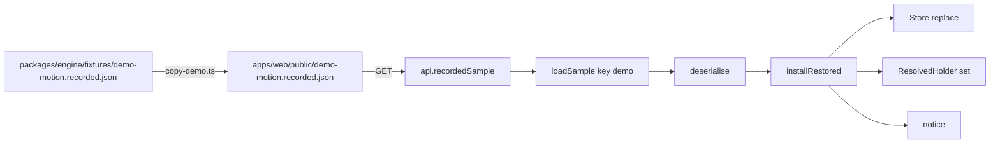

# Design Document

## Overview

"Load demo motion" fetches `/demo-motion.recorded.json`, restores it with the existing `deserialise`, and installs it the way a mount-time restore installs an autosaved draft. Nothing in the saved-draft format, the Engine, the Verifier or the server changes.

Least-code choices (each goes in BUILD_LOG.md):

- **Delivery by copy and fetch, not import.** `copy-demo.ts` already copies two fixtures to `apps/web/public/` and `api.ts` already fetches them as text. A third pair and one `ApiClient` method reuse that path. Bundling the JSON by import would reach outside the web package and add a bundler rule.
- **File stays at `packages/engine/fixtures/`.** It sits beside the two text samples the build copies. Moving it gains nothing.
- **No new component or CSS.** Load_Demo_Control, the Confirm_Dialog and the notice are the existing ones; only what `loadSample` does for key `demo` changes.
- **No new request on load.** The only request is a GET of the static file from the site's own origin, as the demo text is fetched today. No `/api/*` route is called.
- **Restore step shared, not copied.** The restore dispatch and the session-info seeding in `loadAutosave` move into one exported function that `loadAutosave` and the sample install both call.
- **Demo_Mode needs no new fixture.** Every citation of the Recorded_Sample (`556 U.S. 662`, `404 U.S. 519`, `1047 F.3d 212`, `1012 F. Supp. 2d 88`, `912 F. 4th 33`) and both quotation targets (clusters 145875 and 108432) are in `packages/verifier/fixtures/`, because the Recorded_Sample's text matches Demo_Text on those lines. The `Iqbal, 556 U.S. at 679` short form and `Id. at 221` resolve from the full citations before them. Task 1.1 confirms this in a test.

## Architecture

## Components and Interfaces

- `apps/web/scripts/copy-demo.ts`: `DEFAULT_PAIRS` gains `demo-motion.recorded.json`.
- `apps/web/src/client/api.ts`: `ApiClient.recordedSample(): Promise<Result<string, ApiError>>` using `readText` on `/demo-motion.recorded.json`. `services.ts` `lazyApi` forwards it. Test fakes that list every member gain one line.
- `apps/web/src/components/use-autosave.ts`: new export `installRestored(store: Store, restored: Restored, holder?: ResolvedHolder): void`. It dispatches `replace` with the document, run log, `verifiedAt` and declaration, then seeds the holder with `{ epoch, info }` when `storableInfo` is not empty. `loadAutosave` calls it.
- `apps/web/src/notices.ts`: `RECORDED_SAMPLE_LOADED = "Loaded the demo motion as recorded in this editor on 21 November 2026."`.
- `apps/web/src/components/use-document-actions.tsx`: `Deps` gains `holder: ResolvedHolder`. For key `demo`, `loadSample` calls `svc.api.recordedSample()`, then `deserialise`; on success it calls `installRestored` and then dispatches the notice (after `replace`, which clears notices). On a fetch or restore failure it dispatches `DEMO_FAILED`. The key `avianca` path is unchanged. `app-shell.tsx` passes `a.holder` in the one call.
- `.prettierignore`: add `packages/engine/fixtures/demo-motion.recorded.json`. `.gitignore`: add `apps/web/public/demo-motion.recorded.json`.
- `packages/engine/fixtures/README.md`: one line for the new file (source, date, digest).
- The "Load demo motion" link on the empty page keeps `href="/demo-motion.txt"` for open-in-new-tab use; it is unchanged.

## Data Models

No new type. `PersistedValue`, `Restored` and `RunLogEntry` are used as they are. The Recorded_Sample has no `declaration`, so `Restored.declaration` is `null` and the Export_Dialog asks.

## Correctness Properties

### Property 1: Install then save is the identity

For any Persisted_Value built by `serialise` from the existing arbitraries (`arbCheckedDocument`, `arbSavedEntries`, the run-log arbitrary of `persist-resolved.properties.test.ts`, a check date or null), restoring it with `deserialise`, installing it with `installRestored` into a fresh Store and holder, and serialising the Store state with the holder's info gives the original string.

**Validates: Requirements 8.1**

## Error Handling

| Failure | Result |
| --- | --- |
| Fetch of the file fails or answers a non-200 status | `DEMO_FAILED` notice, draft unchanged |
| `deserialise` returns an error | `DEMO_FAILED` notice, draft unchanged |
| Autosave fails after install | Existing `AUTOSAVE_FAILED` notice |

## Testing Strategy

Web test project only during tasks (`pnpm exec vitest run --project web <files>`); the full checks run once in the last task.

- `apps/web/test/recorded-sample.test.ts`: digest pin; loads through `deserialise`; origins HUM, PST, AI, AI>HUM present; one verified citation, one not-found citation, one failing quotation; a run-log entry with a model; a check date; no declaration; `copy-demo` copies the file byte for byte.
- `apps/web/test/recorded-sample-load.test.tsx`: load on an empty draft; the confirm on a non-empty draft and cancel; the notice; the Issues_Region shows the recorded Checked date; no `/api/*` request on load in Demo_Mode and Live_Mode; failure notice; Verify afterwards in Demo_Mode resolves from the fixtures; Export asks the Declaration question.
- `apps/web/test/recorded-sample.properties.test.ts`: Property 1.
- Tests moved to the recorded draft: the three "Load demo motion" cases of `document-actions.test.tsx` (lines 164 to 270), the Load demo case of `samples-declaration.test.tsx` (line 132), and the `copy-demo` case in `avianca.test.tsx` (adds the third file). Tests that stay on Demo_Text: `check-page.test.tsx`, `check-rows.test.ts`, `support/route-deps.ts`, `support/route-fetch.ts`, `support/persist-fixtures.ts`, `support/resolved-restore.tsx`, and every Engine, Verifier, Export and MCP test.
- `apps/web/test/static/inventory.test.ts` pins the `// Property N` comments; it gains the new one.
