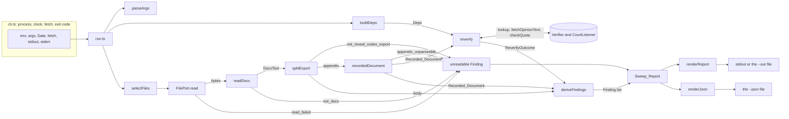

# Design Document: sentinel-sweep

## Overview

This design adds the sweep program of the Reveal Codes Sentinel to `crew/sentinel` (`@reveal-codes/sentinel`). It is a command line program, run from the repository root as `pnpm sentinel sweep <dir>` or `pnpm sentinel check <file.docx>`. It reads exported `.docx` filings, takes the Provenance Appendix back out of each file, rebuilds the Recorded_Document with the Engine's `parse`, asks the Verifier the same questions the editor asks, and reports every place where the answer differs from the record the file carries.

The shape of the work follows `structure.md` and `tech.md`. The Engine and the Verifier do the thinking and are not changed. The Sentinel is plain data and functions: a reader for one XML part, a splitter, a re-verifier, a finding builder, two renderers, and a thin runner. Every function returns a `Result` or a value; the only `try/catch` blocks convert a thrown error into a value or into an exit code. `cli.ts` is the only module that touches `process`, the real clock, and the real `fetch`. Everything else receives them as arguments, so every test runs against recorded fixtures with zero network requests.

Changes outside `crew/sentinel`: three added named exports in `packages/export/src/index.ts` (`STATEMENT_TITLE`, `STATEMENT_TITLES`, `APPENDIX_TITLE`), one root script, one hook file, edits to `structure.md`, `tech.md`, `README.md`, `docs/KIRO_USAGE.md` and `BUILD_LOG.md`, and, only on the fallback of Requirement 12 criterion 17, two moved test-support files. No `app.json` is created.

### Decisions this design fixes

| # | Decision | Reason |
|---|---|---|
| D1 | **Page break rule.** `titleParagraph` in `docx-blocks.ts` builds one `Paragraph` whose children are `[new PageBreak(), bodyRun(text, true)]`, so the `w:br w:type="page"` run sits inside the title paragraph and no separate empty paragraph is emitted. `statementElements` starts with the title block (`render-statement.ts` emits `{ kind: "title", text: statementTitle(...) }` first, which is `STATEMENT_TITLE` or the selected entry's `caption.text`, always a member of `STATEMENT_TITLES`), and `docx.ts` puts `...document.text.split("\n").map(filingParagraph)` directly before it. So `body` is every paragraph before the first paragraph equal to a member of `STATEMENT_TITLES`, with nothing trimmed or dropped. `readDocx` adds no text for a `w:br` of type `page` or `column`, so the title paragraph reads as exactly one member of `STATEMENT_TITLES`: `STATEMENT_TITLE`, or, when the author selected a court whose instrument names the statement, that entry's `caption.text`. | The rule is read from the code, not assumed. Trimming a trailing empty paragraph would lose a real empty last line of the filing (a Document whose text ends in `\n`). |
| D2 | **`override_stale` is computed from the Recorded_Document's overrides, tested against `issues(reverified)`.** The Reverified_Document is used for the `issues` call and nothing else; it is never shown or reported. | `setVerification` and `setQuoteCheck` drop an override when the status changes (`verification.ts`), so the Reverified_Document no longer holds the overrides that the file recorded. A stale override is exactly one whose record changed status, so reading overrides from the Reverified_Document would find none. |
| D3 | **Findings order:** `body_edited` first; then `citation_changed`, `quote_changed` and `override_stale` together by the position of the touched record in the Recorded_Document text, with the kind order `citation_changed`, `quote_changed`, `override_stale` as the tiebreak; then `recheck_unavailable` last. `unreadable` stands alone. An override whose record is absent sorts after every positioned Finding of the middle group. The sort is stable over the construction order. | Requirement 6, criterion 11. A change to the certified text puts every later Finding in doubt, so it leads. |
| D4 | **Table labels:** `Citation changed`, `Quote changed`, `Override no longer needed`, `Body edited`, `Recheck unavailable`, `Unreadable`. For `recheck_unavailable`, `after` is `retry after <local YYYY-MM-DD HH:MM>` (the Export_Package's `localDateTime` of the latest `waitUntil`) or `unavailable`. | Requirement 9, criterion 4 and Requirement 6, criterion 9. |
| D5 | **Time.** JSON `sweptAt` is an ISO instant (`Date.prototype.toISOString()`). The Markdown heading is `localDateTime(report.sweptAt)`, the Export_Package function, on the same `Date`. The Date comes from an injected `Clock`; `new Date()` appears once, in `cli.ts`. | Requirement 9, criteria 7 and 8, Requirement 10, criterion 6. A machine field stays in UTC, a human heading stays local, as in the export package (`time.ts`). |
| D6 | **Environment.** Four variables: `COURTLISTENER_TOKEN`, `REVEAL_CODES_FIXTURES_ONLY`, `REVEAL_CODES_CACHE_DIR`, `COURTLISTENER_BASE_URL`. `cli.ts` is the only reader of `process.env`; it passes it to the pure `buildDeps(env, io)`, which has the same shape as `readServerConfig(env)` plus `buildServerDeps(config, io)` of `apps/web/src/server/deps.ts` in one call. Tests call `buildDeps` with a plain object. | Requirement 7. One token, one cache directory and one mode rule serve the editor and the Sentinel. |
| D7 | **Fixtures mode.** The Markdown report prints the Fixtures_Notice, "Citations outside the recorded set read as not found in fixtures mode.", after the summary line and one blank line. It is absent in live mode. No Finding is suppressed in either mode. | Requirement 9, criteria 2 and 11, limitation L6. The mode is stated on the second line of the report, and the notice says what the mode means. |
| D8 | **File selection.** `sweep` lists the non-directory entries directly in `<dir>`, keeps names that end in `.docx` (compared case-insensitively), drops Word lock files `~$*.docx` silently, then sorts the rest with `localeCompare(b, "en")`. A lock file is not a Finding and is not counted. `check` on a `~$` file analyses it like any file. | Requirement 10, criterion 1, limitation L7. |
| D9 | **Exit codes.** 0: the run completed (with or without Findings). 2: a usage error, a missing or non-directory `<dir>`, or a missing or non-file `check` operand; nothing is written to standard output and no file is written. 1: an unexpected crash, with the Token replaced by `[redacted]` in the message. A file that vanishes between the listing and the read is an `unreadable` Finding with `after` `read_failed`, not an exit code. | Requirement 10, criteria 7 to 15. |
| D10 | **Property 1 compares with `toEqual`, with no `normalise` step.** The output of `parse` is canonical. Test-support modules (`buildDemoDocument`, `buildDemoDocumentStatement`) are imported by relative path from `packages/export/test/support/`, through one re-export module in the Sentinel test folder. If `tsc -b` ever rejects that import, the two support files move to `packages/export/src/testing/` with the subpath export `@reveal-codes/export/testing`, and only the re-export module changes. `BUILD_LOG.md` records which happened. | Requirement 4, criterion 6 and Requirement 12, criteria 4 and 17. The probe in "Facts checked" says the relative import is the likely outcome. |
| D11 | **pnpm and `--`.** The root script is `pnpm --filter @reveal-codes/sentinel run cli`, with no trailing `--`. pnpm 10 passes the arguments after the script name through unchanged, and a trailing `--` in the script reaches the CLI as a literal `--` token. The final checkpoint runs `pnpm sentinel check <file>` and confirms `check` is `process.argv[2]` in `cli.ts`. | Requirement 10, criteria 13 and 16. Probed today: see "Facts checked". |
| D12 | **Node imports.** The Sentinel imports `node:fs`, `node:path` and `node:os` and no other `node:` module. File access uses `import { promises } from "node:fs"`, not the specifier `node:fs/promises`, which is a different module name. | Requirement 1, criterion 8. A static test scans import specifiers, so the literal specifier matters. |
| D13 | **The runner is split from the entry.** `run(argv, io): Promise<number>` in `run.ts` holds all behavior and takes every effect as an argument (environment, `fetch`, clock, `sleep`, home directory, a `FilePort`, and two text writers). `cli.ts` builds the real `io`, calls `run`, and sets `process.exitCode`. | The sweep test of Requirement 12, criterion 11 needs to call the whole command with a temporary directory, a fixed clock and recorded fetch, and to read the exit code. Importing `cli.ts` in a test would run it. |
| D14 | **A non-Export_File `.docx` in tests is a `buildDocx` output with its two title paragraphs renamed through `fflate`.** The `docx` package is not resolvable from `crew/sentinel` (checked below), and Requirement 1, criterion 3 allows no devDependency besides `vitest` and `fast-check`, so tests do not import `docx` (Requirement 12, criterion 1). | Requirement 12, criteria 1 and 5. `fflate` is a runtime dependency, so `unzipSync` and `zipSync` are available to tests and no new package is needed. |
| D15 | **The test fetch records a miss as well as throwing.** `recordedFetch` throws an error naming the unmatched request (Requirement 12, criterion 3), and also records it and registers an `onTestFinished` check, because the Verifier turns a rejecting `fetch` into `unchecked` (`transport.ts`: `() => NETWORK`) and a throw alone would not fail the test. | Without the recorded miss, an unrecorded request would pass as `recheck_unavailable`. |
| D16 | **"Differs" for a citation** means the status differs, or both are `verified` and the cluster ids differ (Requirement 6, criterion 5). A change in the candidate count of two `ambiguous` results is not a change. | Requirement 6, criteria 3 and 5 name no other case. |
| D17 | **`analyseFile` has a last-resort `catch`** that turns an unexpected thrown error into one `unreadable` Finding with `after` `read_failed`, and the run continues with the next file (Requirement 8, criterion 8). A run-level failure outside `analyseFile`, including a failed `--out` or `--json` write, is an unexpected error: a message with the Token replaced by `[redacted]` on standard error, exit 1 (Requirement 10, criterion 17). | Requirement 8, criteria 1 and 8; Requirement 10, criteria 11 and 17. Tests: Requirement 12, criteria 19 and 20. |
| D18 | **`body_edited` excerpts are windows over one span (Requirement 14).** When both lines fit in 80 code units they are shown whole. Otherwise both are cut from the same start, 30 code units before the first differing index (0 when that index is under 30), moved back by one when it would split a surrogate pair, prefixed with "…" when above 0, and ended by the Export_Package's `ellipsize` to 80. A line that fits is windowed too when the other line does not, so the two cells always show the same span. | The old cut took both lines from index 0, so an edit past character 79 gave two identical cells. A shared start keeps the cells comparable by eye; the first difference always lands in the first 32 characters of both. |

### Facts checked in the repository

- **Vitest project.** `vitest.config.ts` already holds `project("sentinel", "crew/sentinel")` (include `test/**/*.test.ts`, the shared setup file with the 60 s timeout for `*.properties.test.ts`). The hook's `--project sentinel` works with no config change. `process.env.TZ` is set at the top of `vitest.config.ts`, so workers inherit it; Sentinel tests still compute every expected local string from the local getters or from `localDateTime`, so they do not depend on it.
- **Workspace, typecheck, lint.** `pnpm-workspace.yaml` lists `crew/*`. The root `tsconfig.json` already references `crew/sentinel`. `eslint .` and `prettier --check .` cover the folder. `pnpm-lock.yaml` holds `crew/sentinel: {}` as an importer today. After the `package.json` edit, `pnpm install` rewrites that importer entry and adds no package, because `fflate@0.8.3`, `vitest@5.1.0` and `fast-check@4.10.2` are already in the lockfile. CI runs `pnpm install --frozen-lockfile`, so the updated lockfile is committed.
- **`crew/sentinel/tsconfig.json` today** extends the base with `outDir: dist` and no `types` and no `references`. The base sets `types: []`, so `node:fs` would not typecheck. The file changes to `types: ["node"]` and references `../../packages/engine`, `../../packages/verifier`, `../../packages/export` and `../../packages/export/test`.
- **Relative import of export test support (Requirement 12, criterion 4).** Probed with a throwaway project under `crew/` (deleted): with the four references above, `tsc -b` accepts `import … from "../../packages/export/test/support/demo-document"`, `demo-statement` and the Engine's `src/testing/arb-document`. Without the `packages/export/test` reference it fails with TS6307 (file not listed in the project) and TS6059 (outside `rootDir`). So the fallback is **not** likely, provided the reference is present. The task list adds the reference first and records the result in `BUILD_LOG.md`.
- **jiti.** `jiti@2.7.0` is a root `devDependency`. `apps/web` runs `node --import jiti/register scripts/copy-demo.ts` without declaring it. pnpm runs a package script with the package directory as the working directory, and Node resolves `jiti/register` by walking up to the root `node_modules`. Probed: `node --import jiti/register` from `packages/export` loaded `@reveal-codes/export`, `@reveal-codes/engine` and `@reveal-codes/verifier` (including its `with { type: "json" }` fixture imports) and ran a fixture lookup to `verified`. No devDependency is needed.
- **pnpm `--`.** Probed with pnpm 10.34.9 using a throwaway workspace package and a temporary root script (both removed): `pnpm probe check "a b.docx" --json j.json` with the script `pnpm --filter … run cli --` delivered the arguments intact in that probe, but the final checkpoint found that the real root script with a trailing `--` passes the literal `--` to the CLI as `argv[2]`. The script therefore has no trailing `--` (D11).
- **`docx` is not resolvable from `crew/sentinel`.** The root `node_modules` holds `@eslint`, `@types`, `eslint`, `eslint-config-prettier`, `jiti`, `prettier`, `typescript`, `typescript-eslint` and `vitest` only. `docx` lives in `packages/export/node_modules`. `fflate` is a runtime dependency of the Sentinel, so `unzipSync`/`zipSync` are available to tests.
- **`fflate` on bad input.** `unzipSync` throws "invalid zip data" for an empty array, for three arbitrary bytes, and for `PK\x03\x04` followed by text. `readDocx` converts every throw into `not_docx`.
- **Verifier behavior the Sentinel relies on.** `lookup` never rejects and returns one result per full record; a throttled chunk becomes `unchecked` with `waitUntil` from the body's `wait_until` or the `Retry-After` header. `fetchOpinionText` returns `null` on any failure. A rejecting `fetch` is turned into a network outcome inside `requestOnce`. The retry delay calls `deps.sleep(ms)` with no signal; the 15 s timeout race calls `deps.sleep(15000, signal)` with a signal. A test sleep therefore resolves at once when no signal is given and is a real abortable timer when a signal is given (an instantly resolving timeout sleep would win every race).
- **Recorded fixtures.** `packages/verifier/fixtures/manifest.json` lists the lookup lines, cluster paths and opinion paths that `createFixtureFetch` serves. `fixtures/http/throttle-429.json` is the recorded 429 (`Retry-After: 30`, `wait_until: 2026-11-02T12:00:30Z`).
- **Engine facts.** `issues(doc)` omits verified citations, matching quotes and linked short forms. `Override` is `{ key, reason, timestamp }`. `parse(text)` returns `Result<Document, EngineError>` and never throws; for `malformed_codes` the error holds `index` and `rule`. The full form of a citation reads `[CIT ✓{k=k0;cl=145875}]…[/CIT]`, so a test can rewrite it to `[CIT ✘{k=k0}]` with one string replacement.
- **Export facts.** `buildAppendix(document)` returns `{ title, intro, lines }` with `intro` of two sentences and `lines` equal to `render(document, "full").text.split("\n")`. `ellipsize(text, 80)` returns the first 79 units and `…` when longer. `localDateTime(d)` is local `YYYY-MM-DD HH:MM`.
- **Runtime import of the Export_Package.** `split.ts`, `findings.ts` and `report.ts` import `STATEMENT_TITLES`, `APPENDIX_TITLE`, `buildAppendix`, `ellipsize` and `localDateTime` from `@reveal-codes/export` at run time, and its `index.ts` also loads `docx`. `@reveal-codes/export` is therefore a runtime dependency of the Sentinel (Requirement 1, criteria 2 and 15), consistent with the use. The Engine remains the only workspace package with zero dependencies.

## Architecture

### Module layout: `crew/sentinel`

```
crew/sentinel/
  package.json           name @reveal-codes/sentinel; scripts.cli; dependencies (engine, export, verifier, fflate) and devDependencies (vitest, fast-check) of Requirement 1
  tsconfig.json          extends the base; types ["node"]; references engine, verifier, export, export/test
  src/
    index.ts             named re-exports of the public surface (about 40 lines)
    types.ts             SentinelError, DocxText, ExportParts, Finding, FileReport, SweepReport, Mode, Clock (about 90)
    xml-text.ts          decodeEntities, paragraphsOf: the tokenizer over w:p, w:t, w:tab, w:br (about 100)
    docx-read.ts         readDocx: unzip one entry, call xml-text (about 40)
    split.ts             splitExport (about 60)
    recorded.ts          recordedDocument: parse the Appendix, name the Engine error (about 40)
    owners.ts            ownerCluster, verifiedCluster, quotesByCluster: copy of apps/web/src/client/verify-flow.ts (about 40)
    reverify.ts          reverify: lookup once, apply, then opinions one by one (about 120)
    status-text.ts       statusText, quoteText (about 30)
    lines.ts             lineAt, firstDifferingLine (about 30)
    findings.ts          deriveFindings and its parts (about 200)
    excerpt.ts           excerptPair: the shared-start windows of D18 (about 40)
    analyse.ts           analyseFile (about 50)
    sleep.ts             realSleep: copy of apps/web/src/server/deps.ts (about 25)
    deps.ts              SentinelEnv, readSentinelConfig, buildDeps (about 70)
    redact.ts            redact (about 10)
    report.ts            renderReport, renderJson, sortFiles (about 100)
    report-table.ts      labels, cell, row (about 50)
    args.ts              parseArgs, USAGE (about 70)
    files.ts             FilePort, nodeFiles: the only module that imports node:fs (about 60)
    sweep.ts             selectFiles, analyseAll (about 60)
    run.ts               RunIo, run (about 120)
    cli.ts               the only reader of process.env, argv, the real clock, fetch and exit code (about 40)
  test/
    tsconfig.json        none: the package tsconfig includes src and test
    support/
      export-support.ts  re-exports buildDemoDocument, buildDemoDocumentStatement, buildAppendix helpers by relative path
      recorded-fetch.ts  recordedFetch, throttleFetch: fixture-backed fetches that throw on an unrecorded request
      test-deps.ts       testDeps, throwingDeps, throwOnceDeps, testSleep, FIXED_NOW
      docx-edit.ts       editDocumentXml, renameTitles, zipWithout: fflate edits of a .docx (no docx import)
      fc.ts              runs, docxRuns, FC_NUM_RUNS handling
      arbitraries.ts     arbFinding, arbSweepReport
      scan.ts            re-exports the export package's scan helpers
    docx-read.properties.test.ts   Property 1
    report.properties.test.ts      Property 2
    excerpt.properties.test.ts     Property 3
    docx-read.test.ts, xml-text.test.ts, split.test.ts, recorded.test.ts, owners.test.ts, reverify.test.ts,
    findings.test.ts, excerpt.test.ts, analyse.test.ts, deps.test.ts, report.test.ts, args.test.ts, sweep.test.ts,
    redact.test.ts, recorded-fetch.test.ts, fc.test.ts
    static/boundaries.test.ts, static/package.test.ts
```

Every module stays under 300 lines and every function under 40; the estimates above leave a wide margin. `findings.ts` is the largest and splits into `findings.ts` and `findings-order.ts` if it grows near the limit.

### Data flow



Trust boundary: the only outbound requests are the Verifier's own, made through `Deps.fetch`. They carry citation strings and cluster ids; the Sentinel adds no request and sends no draft text. The Token lives only inside `Deps`. `verifierStatus(deps)` has no token field, a Finding holds only statuses, line numbers and reasons, and error text goes through `redact`.

### Dependency rules

- Workspace dependency rule: `@reveal-codes/engine` remains the only workspace package with zero dependencies; the Sentinel depends at run time on the Engine, the Export_Package, the Verifier and `fflate`, and its dev dependencies are `vitest` and `fast-check` only.
- `types.ts`, `xml-text.ts`, `docx-read.ts` (imports `fflate`), `split.ts`, `recorded.ts`, `owners.ts`, `status-text.ts`, `lines.ts`, `findings.ts`, `report.ts`, `report-table.ts`, `args.ts` and `redact.ts` are pure: no `node:` import, no clock, no environment, no network.
- `reverify.ts` and `analyse.ts` reach the network only through the `Deps` they receive.
- `files.ts` is the only module that imports `node:fs` (and `node:path` for `basename`). `run.ts` and `sweep.ts` receive a `FilePort`. `deps.ts` imports `node:path` for `join` only. `node:os` is imported by `cli.ts` only (`homedir()`).
- `cli.ts` is the only module that names `process`, `new Date()` and the global `fetch`.

## Components and Interfaces

Shared imports: `Result`, `ok`, `err` and the Document types come from `@reveal-codes/engine`. `Deps`, `FetchLike` and the verifier functions come from `@reveal-codes/verifier`. `ellipsize`, `localDateTime`, `STATEMENT_TITLES`, `APPENDIX_TITLE` and `buildAppendix` come from `@reveal-codes/export`.

### `xml-text.ts` and `docx-read.ts`

```ts
/** Single left-to-right pass: &amp; &lt; &gt; &quot; &apos; and numeric references. */
export function decodeEntities(text: string): string;
/** One entry per w:p in tag order, from the XML of word/document.xml. Total. */
export function paragraphsOf(xml: string): readonly string[];

export function readDocx(bytes: Uint8Array): Result<DocxText, SentinelError>;
```

`readDocx` calls `unzipSync(bytes, { filter: (f) => f.name === "word/document.xml" })`, which inflates only that entry. The `unzipSync` call and the `strFromU8` decode sit inside one `try/catch` whose block returns `err({ kind: "not_docx" })`; the `catch` also covers a zip without the entry (the property is `undefined`, returned as `not_docx` outside the `catch`) and an entry that cannot be inflated. No other archive entry is read.

`paragraphsOf` scans `xml` with one global regular expression (a tokenizer over exactly five tags, no XML library):

```ts
const TOKEN =
  /<w:p(?=[\s/>])[^>]*?(\/?)>|<\/w:p>|<w:t(?=[\s/>])[^>]*?(\/?)>([^<]*)|<w:tab(?=[\s/>])[^>]*>|<w:br(?=[\s/>])([^>]*)>/g;
```

The lookahead `(?=[\s/>])` after each tag name makes the match complete: `<w:pPr` is not `w:p`, and `<w:tab`, `<w:tbl`, `<w:tc`, `<w:tr`, `<w:tcPr` are not `w:t`. The scan keeps a list of paragraphs and an `open` flag:

- `<w:p …>`: push `""` and set `open`. `<w:p/>` (the first group is `/`): push `""`, leave `open` false.
- `</w:p>`: clear `open`.
- `<w:t …>text`: when not self-closing and `open`, append `decodeEntities(text)` to the last paragraph. `<w:t/>` adds nothing, and the text group is ignored for it.
- `<w:tab …>`: when `open`, append `"\t"`.
- `<w:br …>`: when `open` and the `w:type` attribute is absent or `textWrapping`, append `"\n"`. Types `page` and `column` add nothing; any other value adds nothing (Requirement 2, criterion 8, D1).

A `w:p` nested in another (limitation L4) opens a new entry in tag order; text after the inner `</w:p>` is dropped because `open` is false. A file the Export_Package produced has none.

`decodeEntities` uses `/&(?:(amp|lt|gt|quot|apos)|#([0-9]+)|#[xX]([0-9a-fA-F]+));/g` with one replacer, so `&amp;lt;` becomes `&lt;` and never `<`. For a numeric reference the replacer computes the code point with `Number.parseInt`; zero, a value above `0x10FFFF` (including `Infinity` from a very long digit string) and a value in `0xD800` to `0xDFFF` return the matched text unchanged (L3). Anything else becomes `String.fromCodePoint(cp)`.

### `split.ts`

```ts
export function splitExport(paragraphs: readonly string[]): Result<ExportParts, SentinelError>;
```

```ts
// buildAppendix of a Document with no content: only intro.length is used, so the count of intro
// sentences is read from the Export_Package and not written as a literal (Requirement 3, criterion 6).
const EMPTY_DOCUMENT: Document = { text: "", spans: [], runs: [], citations: [], quotes: [], overrides: [], keyCounter: 0 };
const INTRO_LENGTH = buildAppendix(EMPTY_DOCUMENT).intro.length;
```

`splitExport` finds `s = paragraphs.findIndex((p) => STATEMENT_TITLES.includes(p))`, then `a` as the first index after `s` of `APPENDIX_TITLE` (`indexOf(APPENDIX_TITLE, s + 1)`). If either is `-1`, including for an empty list, it returns `err({ kind: "not_reveal_codes_export" })`. Otherwise `body = paragraphs.slice(0, s)` and `appendix = paragraphs.slice(a + 1 + INTRO_LENGTH)`; `slice` past the end yields `[]` (criterion 7). The input is never modified and the function reads nothing else, so equal inputs give equal results.

### `recorded.ts`

```ts
export function recordedDocument(appendix: readonly string[]): Result<Document, SentinelError>;
```

Calls `parse(appendix.join("\n"))`. On `Err`, returns `{ kind: "appendix_unparseable", detail }` with `detail` = `engine error <kind>` and, for `malformed_codes`, ` at index <index>: <rule>` (always non-empty). Nothing else runs for that file.

### `owners.ts`

A copy of `verifiedCluster`, `ownerCluster` and `quotesByCluster` from `apps/web/src/client/verify-flow.ts`, at most 40 lines in all, with the comment `// Copy of verifiedCluster, ownerCluster and quotesByCluster in apps/web/src/client/verify-flow.ts. Keep the two in step.` The Sentinel does not import from `apps/web`.

```ts
export function quotesByCluster(document: Document): ReadonlyMap<string, readonly IssueKey[]>;
```

### `reverify.ts`

```ts
export type Unavailable = Readonly<{ waitUntil: string | null }>;

export type ReverifyOutcome = Readonly<{
  /** The Reverified_Document: used only as the argument of `issues`. */
  document: Document;
  /** Non-null when any re-check was unavailable; `waitUntil` is the latest one carried by an unchecked citation result. */
  unavailable: Unavailable | null;
  /** Keys whose setVerification or setQuoteCheck the Engine rejected (L9). No Finding is made for them. */
  notRechecked: readonly IssueKey[];
}>;

export async function reverify(document: Document, deps: Deps): Promise<ReverifyOutcome>;
```

Steps, each in its own function under 40 lines:

1. `const results = await lookup(document.citations, deps)`, called exactly once with all citation records.
2. `applyCitations(document, results)`: for each `kind: "full"` record in document order, `const result = results.get(key) ?? { status: "unchecked" }`. If `result.status === "unchecked"`, mark the re-check unavailable and fold its `waitUntil` into the running latest (compare with `Date.parse`; an unparseable value is ignored); the record keeps its Recorded_Status. Otherwise call `setVerification`; on `Ok` take the new Document, on `Err` add the key to `notRechecked` and continue.
3. `checkQuotes(afterCitations, deps)`: for each `[clusterId, keys]` of `quotesByCluster(afterCitations)` (first-encounter order), `await fetchOpinionText(clusterId, deps)`, strictly one after another. `null` marks the re-check unavailable once for that cluster and leaves its quotes at their Recorded_Status. A string is passed to `checkQuote(opinion, quote.quote.text)` for each quote key of the cluster (the same call `applyQuoteChecks` in the editor makes); a result with status `unchecked` is skipped; otherwise `setQuoteCheck`, with `Err` going to `notRechecked`.
4. Quotes without an owning cluster are skipped without a report (Requirement 5, criterion 10).

The input Document is never mutated: every Engine setter returns a new Document, and `reverify` returns `document.text` unchanged (Requirement 5, criterion 12).

### `status-text.ts` and `lines.ts`

```ts
/** `verified <clusterId>`, `not_found`, `ambiguous <n>`, `unchecked`. */
export function statusText(result: VerificationResult): string;
/** `match`, `mismatch`, `unchecked`. */
export function quoteText(result: QuoteCheckResult): string;

/** 1-based line of `offset` in `text`: 1 plus the number of "\n" before it. */
export function lineAt(text: string, offset: number): number;
/** 1-based number of the first line, split on "\n", at which the two texts differ; null when equal. */
export function firstDifferingLine(a: string, b: string): number | null;
```

### `findings.ts`

```ts
export type FindingInput = Readonly<{
  file: string;
  recorded: Document;
  bodyText: string;
  outcome: ReverifyOutcome;
}>;

export function deriveFindings(input: FindingInput): readonly Finding[];
export function unreadable(file: string, kind: SentinelError["kind"]): Finding;
```

`deriveFindings` is a pure function of `input`. It builds, in this order:

- `bodyFinding`: when `bodyText !== recorded.text` (exact code-unit equality), one `body_edited` with `line = firstDifferingLine(recorded.text, bodyText)`, `before` and `after` from `excerptPair(recordedLines[line - 1] ?? "", bodyLines[line - 1] ?? "", 80)` (D18; the plain `ellipsize` cut of the first version is superseded). Because the comparison is on the split lines, a body that only lacks a trailing empty paragraph yields a Finding whose `before` and `after` are both `""`; the line number still tells the reader where to look.
- `citationFindings`: for each full record of `recorded.citations`, find the record with the same key in `outcome.document.citations`. Make a `citation_changed` when `newResult.status !== "unchecked"` and either the statuses differ or both are `verified` with different `clusterId` (D16). `line = lineAt(recorded.text, citation.start)`, `before = statusText(old)`, `after = statusText(new)`.
- `quoteFindings`: for each record of `recorded.quotes`, find the same key in the Reverified_Document. A `quote_changed` when the new status is not `unchecked` and differs from the recorded one. `line = lineAt(recorded.text, quote.start)`, `before` and `after` from `quoteText`. A quote whose owner is no longer `verified`, or whose cluster text was unavailable, keeps its recorded result, so its statuses are equal and no Finding appears (Requirement 6, criteria 14 and 15).
- `overrideFindings` (D2): `const live = new Set(issues(outcome.document).map((i) => i.key))`. For each override of `recorded.overrides` whose key is not in `live`, one `override_stale` with `line` the `lineAt` of the start of the citation or quote record with that key in the Recorded_Document (or `null` when none), `before = ellipsize(reason, 80)`, `after = "no longer an issue"`.
- `unavailableFinding`: when `outcome.unavailable !== null`, one `recheck_unavailable` with `line: null`, `before: ""`, `waitUntil` the raw value or `null`, and `after` `retry after ${localDateTime(new Date(waitUntil))}` when `waitUntil` is a string with a valid date, else `unavailable`.

The middle three groups are tagged with `{ position, rank, index }` (`rank` 0, 1, 2 for citation, quote, override; `position` the start offset of the touched record, `Infinity` for an override with no record) and sorted with a stable comparison on `(position, rank, index)`. The final list is `[body_edited?, ...sortedMiddle, recheck_unavailable?]` (D3).

`unreadable(file, kind)` returns `{ kind: "unreadable", file, line: null, before: "", after: kind }`.

### `excerpt.ts`
```ts
export const LEAD = 30;
export function excerptPair(before: string, after: string, max: number): readonly [string, string];
```
Pure, imports `ellipsize` from `@reveal-codes/export` and nothing else. `findings.ts` calls it from `bodyFinding` with `max` 80 and keeps its own `MAX`.
- If `before.length <= max && after.length <= max`, return `[before, after]`.
- `d` is the length of the common prefix of the two strings in UTF-16 code units (the shorter length when one is a prefix of the other).
- `start = Math.max(0, d - LEAD)`. When `start > 0`, `isLow(before.charCodeAt(start))` and `isHigh(before.charCodeAt(start - 1))`, `start` is one less. The check reads `before` alone, because both strings are equal below `d` and `start < d`. `isHigh` and `isLow` are two one-line local helpers (the Export_Package's are not exported).
- Each excerpt is `` `${start > 0 ? "…" : ""}${ellipsize(text.slice(start), max)}` ``. `ellipsize` ends the text with "…" after `max - 1` code units, and its `clip` already steps back one unit rather than split a pair, so the end needs no code here.
Why the excerpts differ: the first difference sits at most 31 code units into `text.slice(start)`, and `ellipsize` keeps at least 78 units, so the unit at `d` (or the end of the shorter line) survives in both. Length: at most `1 + max` characters, within the 82 of Requirement 14. Worked case: line 30 of the demo motion with "timing alone is enough at the pleading stage" changed to "timing alone is always enough at every stage". `d` is 324, the index of "enough" against "always", so `start` is 294 and both cells begin "…xplained that timing alone is " and differ right after it (the cut falls inside "explained", which is why the leading character is missing; Requirement 14 allows it).
### `analyse.ts`

```ts
export async function analyseFile(file: string, bytes: Uint8Array, deps: Deps): Promise<readonly Finding[]>;
```

Runs `readDocx`, `splitExport`, `recordedDocument`, `reverify` and `deriveFindings` in that order. The first `Err` from the first three returns `[unreadable(file, error.kind)]` at once, so no `lookup` call is made for that file. The whole body runs inside `try { … } catch { return [unreadable(file, "read_failed")]; }` (D17); the `catch` block returns a value. `bytes` is read, never written; `fflate` and the tokenizer copy what they keep.

### `deps.ts`, `sleep.ts`, `redact.ts`

```ts
export type SentinelEnv = Readonly<Record<string, string | undefined>>;

export type SentinelConfig = Readonly<{
  mode: Mode;
  token: string | null;      // non-null only in live mode
  baseUrl: string;
  cacheDir: string | null;   // null means <home>/.reveal-codes/cache
}>;

export type SentinelIo = Readonly<{
  fetch: FetchLike;
  now: Clock;
  sleep: Deps["sleep"];
  homeDir: string;
}>;

export const DEFAULT_BASE_URL = "https://www.courtlistener.com/api/rest/v4";

export function readSentinelConfig(env: SentinelEnv): SentinelConfig;
export function buildDeps(env: SentinelEnv, io: SentinelIo): Readonly<{ mode: Mode; deps: Deps }>;
```

`readSentinelConfig` mirrors `readServerConfig`: an empty or absent value is `null`; `live` when `COURTLISTENER_TOKEN` is non-empty and `REVEAL_CODES_FIXTURES_ONLY` is not exactly `"1"`; otherwise `fixtures` with `token: null`. It reads only the four names. `buildDeps` mirrors `buildServerDeps`: in fixtures mode `createDeps({ fetch: createFixtureFetch(), now, sleep, baseUrl, cache: createMemoryCacheStore({ now }) })`; in live mode `createDeps({ fetch: io.fetch, now, sleep, baseUrl, cache: createFileCacheStore({ dir, now }), token })` with `dir = cacheDir ?? join(io.homeDir, ".reveal-codes", "cache")`. The result depends on `env` and `io` alone.

`sleep.ts` exports `realSleep(ms, signal?)`, a copy of the function of the same name in `apps/web/src/server/deps.ts` with the comment `// Copy of realSleep in apps/web/src/server/deps.ts. An instantly resolving sleep makes the Verifier's timeout win every race.`

```ts
/** Replaces every occurrence of a non-empty token with [redacted]; text unchanged when token is absent or empty. */
export function redact(text: string, token: string | undefined): string;
```

`redact` is `token === undefined || token === "" ? text : text.split(token).join("[redacted]")`, the rule of `packages/courtlistener-mcp/src/main.ts`. Redaction uses the value of `COURTLISTENER_TOKEN` whatever the mode (L11).

### `report.ts` and `report-table.ts`

```ts
export function renderReport(report: SweepReport): string;
export function renderJson(report: SweepReport): string;
```

Both sort a copy of `report.files` with `(a, b) => a.file.localeCompare(b.file, "en")` and never read the clock, file system or environment.

`renderReport` builds an array of blocks and joins them with `"\n\n"`, then appends one `"\n"`:

1. `# Sentinel sweep — ${localDateTime(report.sweptAt)}`
2. `${count} · ${withFindings} with findings · ${mode} mode`, with `count` written `1 file` or `${n} files` (so `0 files`), joined by ` · ` (U+00B7 with a space on each side).
3. In fixtures mode only: the Fixtures_Notice.
4. Per file: `## ${file}`, then either `No drift.` or the table block.

The table block is the header `| Finding | Line | Before | After |`, the separator `| --- | --- | --- | --- |`, and one row per Finding in list order, joined by `"\n"`. A row is `| ${cells.join(" | ")} |`; the first cell is the label of D4; the Line cell is the decimal number or `-`; every cell has `|` replaced by `\|` and every `"\n"` replaced by a space. An empty `before` leaves an empty cell (`|  |`).

Example (fixtures mode, one drifted file):

```
# Sentinel sweep — 2026-11-20 10:30

2 files · 1 with findings · fixtures mode

Citations outside the recorded set read as not found in fixtures mode.

## a.docx

No drift.

## b.docx

| Finding | Line | Before | After |
| --- | --- | --- | --- |
| Citation changed | 12 | not_found | verified 145875 |
| Recheck unavailable | - |  | retry after 2026-11-02 04:00 |
```

The text has no colour code, no emoji and no exclamation mark of its own. `renderJson` returns `JSON.stringify({ sweptAt: report.sweptAt.toISOString(), mode: report.mode, files }, null, 2) + "\n"` with `files` the sorted `{ file, findings }` entries. Findings are built by one constructor per kind, so property order is stable: `kind`, `file`, `line`, `before`, `after`, and `waitUntil` last for `recheck_unavailable`. `report.sweptAt` must be a valid Date; the only producer is the Clock.

### `args.ts`

```ts
export type Command =
  | Readonly<{ kind: "sweep"; dir: string; json: string | null; out: string | null }>
  | Readonly<{ kind: "check"; file: string; json: string | null; out: string | null }>;
export type UsageError = Readonly<{ message: string }>;
export const USAGE: string;
export function parseArgs(argv: readonly string[]): Result<Command, UsageError>;
```

`argv[0]` must be `sweep` or `check`. The remaining tokens are one operand and the options `--json <file>` and `--out <file>` in any order. An option with no value (or a value that starts with `--`), a repeated option, an unknown option, no operand, or a second operand is a `UsageError`. A literal `--` token is an unknown option; D11 explains why the root script has no trailing `--`. `USAGE` is two lines: `usage: sentinel sweep <dir> [--json <file>] [--out <file>]` and `       sentinel check <file.docx> [--json <file>] [--out <file>]`.

### `files.ts`

```ts
export type PathKind = "directory" | "file" | "missing" | "other";

export type FilePort = Readonly<{
  kind(path: string): Promise<PathKind>;
  /** Names of the entries of `dir` that are not directories. Rejects if `dir` cannot be listed. */
  list(dir: string): Promise<readonly string[]>;
  /** Opens for reading only. A failure becomes `{ kind: "read_failed", detail }`. */
  read(path: string): Promise<Result<Uint8Array, SentinelError>>;
  /** Writes UTF-8 text. Rejects on failure. */
  write(path: string, text: string): Promise<void>;
}>;

export const nodeFiles: FilePort;
```

`nodeFiles` uses `promises` from `node:fs`: `stat` (a failure with code `ENOENT` or `ENOTDIR` is `missing`), `readdir(dir, { withFileTypes: true })` filtered by `!isDirectory()`, `readFile`, `writeFile`. A symlink to a directory is listed and then fails to read as `read_failed`. The `catch` in `read` returns the error as a value.

### `sweep.ts`

```ts
export function selectFiles(names: readonly string[]): readonly string[];
export type Target = Readonly<{ file: string; path: string }>;
export async function analyseAll(targets: readonly Target[], port: FilePort, deps: Deps): Promise<readonly FileReport[]>;
```

`selectFiles` keeps names matching `/\.docx$/i`, drops names that start with `~$`, and sorts with `localeCompare(b, "en")`. `analyseAll` is a `for … of` loop with `await`: for each target it reads the file; a `read_failed` becomes `[unreadable(file, "read_failed")]`, otherwise `await analyseFile(...)`. The next file starts only after the previous one has settled, whatever it returned (Requirement 8, criteria 4 and 5).

### `run.ts` and `cli.ts`

```ts
export type RunIo = Readonly<{
  env: SentinelEnv;
  fetch: FetchLike;
  now: Clock;
  sleep: Deps["sleep"];
  homeDir: string;
  files: FilePort;
  stdout(text: string): void;
  stderr(text: string): void;
}>;

export async function run(argv: readonly string[], io: RunIo): Promise<number>;
```

`run` does, in order, with the whole body inside one `try/catch` that writes `sentinel: <redacted message>` to standard error and returns 1:

1. `parseArgs(argv)`. On `Err`: write the message and `USAGE` to standard error, return 2. Nothing else has happened, so nothing is written.
2. Check the operand with `io.files.kind`: for `sweep` it must be `directory`, for `check` it must be `file`. Otherwise write `sentinel: not a directory: <path>` or `sentinel: not a file: <path>` to standard error and return 2.
3. `const sweptAt = io.now()`, then `buildDeps(io.env, io)`.
4. Targets: for `sweep`, `selectFiles(await io.files.list(dir))` mapped to `{ file: name, path: join(dir, name) }`; for `check`, one target `{ file: basename(file), path: file }` (no lock-file filter, no extension filter).
5. `analyseAll`, then `renderReport` and `renderJson` on the `SweepReport`.
6. Write `--out` (when given) with the Markdown, then `--json` (when given) with the JSON. Without `--out`, `io.stdout(markdown)`. With `--out`, nothing goes to standard output.
7. Return 0.

`cli.ts` is the process entry. It builds `io` from `process.env`, `homedir()`, `new Date()`, the global `fetch` (`(url, init) => fetch(url, init)`), `realSleep`, `nodeFiles`, `process.stdout.write` and `process.stderr.write`; runs `run(process.argv.slice(2), io)`; sets `process.exitCode` to the result; and has a final `.catch` that writes the redacted message and sets exit code 1 (the shape of `main().catch` in `packages/courtlistener-mcp/src/main.ts`). It sets `process.exitCode` rather than calling `process.exit` so piped output is flushed.

### Package manifest, root script, hook

`crew/sentinel/package.json` (version specifiers copied from the packages that already pin them):

```json
{
  "name": "@reveal-codes/sentinel",
  "version": "0.0.0",
  "private": true,
  "description": "Sweep CLI that re-verifies the citations and quotations recorded in exported Reveal Codes filings.",
  "license": "Apache-2.0",
  "type": "module",
  "exports": "./src/index.ts",
  "scripts": { "cli": "node --import jiti/register src/cli.ts" },
  "dependencies": {
    "@reveal-codes/engine": "workspace:*",
    "@reveal-codes/export": "workspace:*",
    "@reveal-codes/verifier": "workspace:*",
    "fflate": "0.8.3"
  },
  "devDependencies": {
    "fast-check": "4.10.2",
    "vitest": "5.1.0"
  }
}
```

**Lockfile.** The package-setup task runs `pnpm install` after the `package.json` edit and commits the updated `pnpm-lock.yaml`. Only the importer entry for `crew/sentinel` changes (it gains the three workspace links, `fflate`, `fast-check` and `vitest`); no package besides what is already locked is added (`fflate@0.8.3`, `vitest@5.1.0`, `fast-check@4.10.2`). CI runs `pnpm install --frozen-lockfile`, so the committed lockfile must match.

The root `package.json` gains `"sentinel": "pnpm --filter @reveal-codes/sentinel run cli"` in `scripts`. `src/index.ts` drops `PACKAGE_NAME` and `PackageName`, `test/index.test.ts` is deleted, and a static test asserts that neither name appears anywhere under `crew/sentinel/src` and `crew/sentinel/test` (the old `dist/` folder is a build output, is git-ignored, and is not scanned).

`.kiro/hooks/sentinel-tests-on-save.json`:

```json
{
  "version": "v1",
  "hooks": [
    {
      "name": "Sentinel tests on save",
      "trigger": "PostFileSave",
      "matcher": "crew/sentinel/(src|test)/.*\\.ts$",
      "timeout_ms": 120000,
      "action": {
        "type": "command",
        "command": "perl -e 'alarm shift; exec @ARGV' 120 pnpm vitest run --project sentinel --passWithNoTests"
      }
    }
  ]
}
```

### Documentation and steering edits

- `README.md`: one section headed "Sentinel": the checks (body edited, citation changed, quote changed, override no longer needed, recheck unavailable, unreadable), the command `pnpm sentinel sweep ~/Filings`, the four variables with one line each, and one line saying the Kiro Crew app that schedules the Sentinel lives in a separate repository (`<crew app repo>`).
- `docs/KIRO_USAGE.md`: three new rows (the five spec files; the hook; the `structure.md` and `tech.md` edits), in the existing column layout, existing rows unchanged.
- `BUILD_LOG.md`: one dated entry (Requirement 13, criteria 3 and 4).
- `structure.md`: the `crew/sentinel` line reads "the sweep CLI that the Reveal Codes Sentinel Crew app (separate repository) runs on a schedule".
- `tech.md`: "Crew app: `crew/sentinel`" becomes the sweep CLI `crew/sentinel`; the Commands block gains `pnpm sentinel   # sweep a folder of exported .docx files for drift`.
- `.env.example` is not touched (Requirement 13, criterion 7); it already lists `COURTLISTENER_TOKEN`, `COURTLISTENER_BASE_URL`, `REVEAL_CODES_FIXTURES_ONLY` and `REVEAL_CODES_CACHE_DIR`.

## Data Models

```ts
export type Mode = "fixtures" | "live";
export type Clock = () => Date;

/** One entry per w:p of word/document.xml, in document order. */
export type DocxText = readonly string[];

export type ExportParts = Readonly<{
  /** Every paragraph before the Statement_Title, nothing removed (D1). */
  body: readonly string[];
  /** Every paragraph after the Appendix_Title, less the first INTRO_LENGTH. */
  appendix: readonly string[];
}>;

export type SentinelError =
  | Readonly<{ kind: "not_docx" }>
  | Readonly<{ kind: "not_reveal_codes_export" }>
  | Readonly<{ kind: "appendix_unparseable"; detail: string }>
  | Readonly<{ kind: "read_failed"; detail: string }>;

type FindingBase = Readonly<{
  file: string;
  /** Integer of at least 1, or null. */
  line: number | null;
  before: string;
  after: string;
}>;

export type Finding =
  | (FindingBase & Readonly<{ kind: "body_edited" }>)
  | (FindingBase & Readonly<{ kind: "citation_changed" }>)
  | (FindingBase & Readonly<{ kind: "quote_changed" }>)
  | (FindingBase & Readonly<{ kind: "override_stale" }>)
  | (FindingBase & Readonly<{ kind: "recheck_unavailable"; waitUntil: string | null }>)
  | (FindingBase & Readonly<{ kind: "unreadable" }>);

export type FileReport = Readonly<{ file: string; findings: readonly Finding[] }>;

export type SweepReport = Readonly<{
  sweptAt: Date;
  mode: Mode;
  files: readonly FileReport[];
}>;
```

The `detail` of `appendix_unparseable` and `read_failed` is for tests and the exit-1 path only; the Finding keeps only the `kind` in `after`, so neither report prints a path or an OS message.

Finding text by kind:

| Kind | Label | Line | Before | After |
|---|---|---|---|---|
| `body_edited` | Body edited | first differing line | `ellipsize` of the recorded line | `ellipsize` of the body line |
| `citation_changed` | Citation changed | line of the citation | `verified <id>`, `not_found`, `ambiguous <n>`, `unchecked` | same forms, never `unchecked` |
| `quote_changed` | Quote changed | line of the quote | `match`, `mismatch`, `unchecked` | `match` or `mismatch` |
| `override_stale` | Override no longer needed | line of the record, or `-` | `ellipsize` of the reason | `no longer an issue` |
| `recheck_unavailable` | Recheck unavailable | `-` | empty | `retry after <local YYYY-MM-DD HH:MM>` or `unavailable` |
| `unreadable` | Unreadable | `-` | empty | `not_docx`, `not_reveal_codes_export`, `appendix_unparseable` or `read_failed` |

### Test support data

- `export-support.ts`: `export { buildDemoDocument } from "../../../../packages/export/test/support/demo-document";` and the same for `buildDemoDocumentStatement` from `demo-statement` (D10). The only place the relative path appears.
- `recordedFetch(options?)` reads `packages/verifier/fixtures/manifest.json` with `readFileSync(new URL("…", import.meta.url))` and builds the set of recorded requests: each `kind: "lookup"` line (a `POST` to `…/citation-lookup/` whose decoded `text` lines are all in the set), each cluster `path` and each opinion `path` (`GET`). For a request in the set it delegates to `createFixtureFetch()`. For any other request it appends `"<METHOD> <url> [<lines>]"` to `misses`, and throws `Error("unrecorded request: …")`. Unless `options.failOnMiss === false`, it registers `onTestFinished(() => { if (misses.length > 0) throw new Error(…) })` (D15). It returns `{ fetch, misses }`.
- `throttleFetch()` answers every request with the recorded `fixtures/http/throttle-429.json` (status 429, header `Retry-After: 30`, the recorded body).
- `testSleep(ms, signal?)`: with a signal, a real abortable `setTimeout` that resolves on abort (`realSleep`); without one, resolves at once. `FIXED_NOW` is `new Date("2026-11-20T18:30:00.000Z")`. `throwingDeps(deps)` and `throwOnceDeps(deps)` return copies of a `Deps` whose `fetch` is a getter that throws on every read, or on the first read only (the injected failure of Requirement 12, criterion 19). `testDeps(fetch)` returns `createDeps({ fetch, now: () => FIXED_NOW, sleep: testSleep, cache: createMemoryCacheStore({ now }), baseUrl: DEFAULT_BASE_URL })`.
- `docx-edit.ts`: `editDocumentXml(bytes, edit)` unzips with `unzipSync`, applies `edit` to the `word/document.xml` string, and rezips with `zipSync`. `renameTitles(bytes)` is `editDocumentXml` with an edit that renames the text of both title paragraphs (`STATEMENT_TITLE` and `APPENDIX_TITLE`); applied to a real `buildDocx` output it yields the non-Export_File input of D14. No test imports `docx`. `zipWithout(bytes)` builds a zip with no `word/document.xml`.
- `fc.ts`: `runs(env)` is 200 locally, 500 when `CI` is set, or `FC_NUM_RUNS` when it is a positive integer (the pattern of `packages/export/test/support/arbitraries.ts`). `docxRuns(env)` is 50 when `FC_NUM_RUNS` is unset or not a positive integer, else `min(Number(FC_NUM_RUNS), 100)` (Requirement 12, criterion 15).
- `arbitraries.ts`: `arbFinding(file)`, `arbSweepReport` (distinct file names without `"\n"`, in any order; `sweptAt` from `fc.date({ noInvalidDate: true })`; both modes; Findings of all six kinds, with `|`, `\n` and `…` allowed in text). The Engine's `arbDocument` is imported by relative path from `packages/engine/src/testing/arb-document`, as the export tests do.

## Correctness Properties

*A property is a characteristic or behavior that should hold true across all valid executions of a system-essentially, a formal statement about what the system should do. Properties serve as the bridge between human-readable specifications and machine-verifiable correctness guarantees.*

Reflection on redundancy: Requirement 12, criterion 14 fixed the property set at two; Requirement 14, criterion 9 adds Property 3 and makes it three. Criteria 2.14 and 4.6 are one round trip and collapse into Property 1. Criterion 9.10 is Property 2. Other candidates (totality of `readDocx`, immutability of `splitExport`, the order of Findings, redaction) vary little with input or depend on the Verifier with recorded fixtures, so they are example and integration tests. A static test counts the `// Property N` comments and expects exactly three (1, 2 and 3) after Requirement 14.

### Property 1: Round trip

For any Document `d` from the Engine's `arbDocument` whose `text` contains no character below U+0020 other than `\n` and `\t` (the filter is a guard; `arbDocument` does not generate such characters), and the Statement `s` that `buildStatement(d, [], meta, null)` returns for a fixed valid `meta`: `readDocx(buildDocx(d, s))` is `Ok` and its Paragraph_List starts with `d.text.split("\n")`, followed at that index by a member of `STATEMENT_TITLES` and later by `APPENDIX_TITLE`; `splitExport` of it is `Ok` with `body.join("\n")` equal to `d.text`; and `parse(appendix.join("\n"))` is `Ok` with a value that satisfies `toEqual` against `d`, with no `normalise` step.

**Validates: Requirements 2.14, 4.6**

### Property 2: Sweep is a function of its inputs

For any Sweep_Report whose file names are distinct (and hold no line feed): `renderReport` and `renderJson` return the same text for a report and for a deep copy of it, and the same text for any reordering of `files`; the `## <file>` headings of the Markdown and the `file` values of the JSON each list every file exactly once, in `localeCompare(b, "en")` order; and for each file the section of the Markdown that begins at its heading contains the line `No drift.` if and only if that file's Findings list is empty. The JSON `sweptAt` equals `report.sweptAt.toISOString()` and the Markdown ends in exactly one line feed.

**Validates: Requirements 9.1, 9.2, 9.7, 9.8, 9.10**

### Property 3: Body_edited excerpts differ and stay inside their lines
For any two different strings `b` and `a` without a line feed, built from a shared prefix and two tails so that the first difference falls both inside and beyond the first 80 code units, over an alphabet that mixes ASCII, "…" and astral characters: `excerptPair(b, a, 80)` returns two different strings, each at most 82 characters long; each, with one leading and one trailing "…" removed when present, is a substring of its own line; and when `b` and `a` are well-formed UTF-16, both excerpts are well-formed.
**Validates: Requirements 14.4, 14.5, 14.6**
## Error Handling

The standing rule applies: a fault that affects only malformed input is a value or one line here. Nothing swallows an error: each `catch` returns a value, a Finding, or an exit code with a message.

| Condition | Value produced | Requirements |
|---|---|---|
| `bytes` empty, not a zip, no `word/document.xml`, or the entry will not inflate | `readDocx` returns `Err { kind: "not_docx" }`; no throw | 2.1 to 2.5 |
| Numeric character reference to zero, a surrogate, or above U+10FFFF | Reference text left as written in the paragraph (L3) | 2.11 |
| Paragraph list empty, or no member of `STATEMENT_TITLES`, or no `APPENDIX_TITLE` after it | `splitExport` returns `Err { kind: "not_reveal_codes_export" }` | 3.4 |
| `APPENDIX_TITLE` is last or followed by `INTRO_LENGTH` paragraphs or fewer | `Ok` with `appendix: []`; `parse("")` then fails with `malformed_codes`, so the file is `appendix_unparseable` | 3.7, 4.2 |
| `parse` returns `Err` | `Err { kind: "appendix_unparseable", detail }` naming the Engine error kind, and for `malformed_codes` its `index` and `rule`; no `lookup` call | 4.2, 8.2 |
| A filing paragraph equals a member of `STATEMENT_TITLES` | Body is cut there; the file reads as `body_edited`, `appendix_unparseable` or `not_reveal_codes_export` (L1) | 3.3 |
| Body text differs from the Recorded_Document text | One `body_edited` Finding; the other checks still run; later line numbers count lines of the Appendix text (L13) | 6.2 |
| Filing exported with an XML-illegal control character | `docx` dropped it, so the file reads as `body_edited` from the day of export (L2) | 6.2 |
| `lookup` returns `unchecked` for a full citation | Recorded_Status kept; `recheck_unavailable` with the latest `waitUntil`, or `unavailable` | 5.3, 6.9 |
| `fetchOpinionText` returns `null` | Quotes of that cluster keep their Recorded_Status; `recheck_unavailable` once; no `quote_changed` | 5.9, 6.15 |
| Engine rejects `setVerification` or `setQuoteCheck` | Record unchanged, key added to `notRechecked`, no Finding, next record (L9) | 5.4 |
| Quote has no owning cluster | Recorded_Status kept, nothing reported | 5.10, 6.14 |
| Override whose record is absent from the Recorded_Document | `override_stale` with `line: null`, sorted after positioned Findings | 6.7, D3 |
| Two `ambiguous` results with different candidate counts | No Finding (D16) | 6.3, 6.5 |
| File cannot be read, or vanishes between listing and read | `unreadable` Finding with `after` `read_failed`; the run continues | 8.3, 10.15 |
| Unexpected throw inside `analyseFile` (for example a throwing Verifier dependency) | One `unreadable` Finding with `after` `read_failed`; the run continues with the next file (D17) | 8.1, 8.8 |
| Unknown command, unknown or repeated option, missing option value, missing or extra operand | Usage message on standard error; nothing on standard output; no file written; exit 2 | 10.8 |
| `<dir>` missing or not a directory; `check` operand missing or not a file | `sentinel: not a directory: <path>` or `not a file: <path>` on standard error; exit 2 | 10.9, 10.14 |
| `--out` or `--json` file cannot be written | `sentinel: <message>` on standard error with the Token replaced by `[redacted]`; exit 1; nothing written to the unwritable path (D17) | 10.17 |
| Any other unexpected error outside `analyseFile` | `sentinel: <message>` on standard error with the Token replaced by `[redacted]`; exit 1 (D17) | 10.11 |
| Lock file `~$x.docx` in a sweep | Skipped silently, not counted (L7) | 10.1 |
| Token present and error text printed | Every occurrence replaced by `[redacted]`; a transformed copy (URL-encoded) is not recognised (L11) | 7.8, 7.9 |
| File name holds a line feed | Markdown heading breaks (L12); JSON keeps the name | 9.2 |
| Fixtures mode and a real citation outside the recorded set | Reported as changed (not found); the Fixtures_Notice explains it (L6) | 9.11 |
| A test request has no recorded fixture | `recordedFetch` throws naming the request and records the miss; the test fails at its end (D15) | 12.3 |

## Testing Strategy

Property-based testing applies to three pure behaviors: the file round trip, the report renderers and the excerpt windows. It does not apply to the Verifier calls (INTEGRATION against recorded fixtures), to the file system and exit codes (examples with a temporary directory), or to the manifest, hook and documentation checks (SMOKE).

**Library and configuration.** fast-check with vitest, in files named `<module>.properties.test.ts`. Each property is one `fc.assert(fc.property(...))` (an `asyncProperty` for Property 1), preceded by `// Property N`, inside a `describe` whose title ends in `_Requirements: x.y_`. Property 1 uses `numRuns: docxRuns(process.env)`: 50 when `FC_NUM_RUNS` is unset, else `min(FC_NUM_RUNS, 100)`, with a comment that packing a `.docx` is slow. Property 2 uses `runs(process.env)` (200 locally, 500 in CI, or `FC_NUM_RUNS`). Seeds print on failure and reproduce with `fc.assert(..., { seed })`. Each tag reads: Feature: sentinel-sweep, Property N: title.

**Property tests**

| File | Property | Input | Output asserted |
|---|---|---|---|
| `docx-read.properties.test.ts` | 1 | `arbDocument` filtered, `buildStatement` with a fixed `meta`, `buildDocx` | paragraph prefix, titles, `body.join("\n")` equals `text`, `parse(appendix.join("\n"))` `toEqual` `d` |
| `report.properties.test.ts` | 2 | `arbSweepReport` | equal text for deep copies and reorderings; each file once in order; `No drift.` iff no Findings; `sweptAt` ISO; one trailing line feed |
| `excerpt.properties.test.ts` | 3 | `b = prefix + tailB`, `a = prefix + tailA`, filtered to `a !== b`, over ASCII, "…" and astral characters | different strings; at most 82 characters; substring after removing the marks; well-formed in, well-formed out |

**Example and integration tests** (all `.docx` inputs come from `buildDocx`; all lookups from recorded fixtures through `recordedFetch`, with zero network requests)

- `docx-read.test.ts` (R12.4, R12.6): `readDocx` of the `buildDocx` output of `buildDemoDocument()` and `buildDemoDocumentStatement()` returns the filing lines (`doc.text.split("\n")`) first, then `STATEMENT_TITLE`, then `APPENDIX_TITLE`, and ends with `buildAppendix(doc).lines`, each in document order. A zip without `word/document.xml` (`zipWithout`), a non-zip byte sequence, an empty array, and a zip whose entry is corrupt each return `not_docx`.
- `xml-text.test.ts`: `<w:pPr>` is not `w:p`; `<w:tab/>`, `<w:tbl>`, `<w:tc>`, `<w:tr>`, `<w:tcPr>` are not `w:t`; `<w:p/>` reads as `""`; a paragraph in a table cell is listed in order; `w:br` plain, `textWrapping`, `page` and `column`; `&amp;lt;` decodes to `&lt;`; decimal and hexadecimal references; references to 0, `&#xD800;` and `&#x110000;` stay as written; a very long digit string stays as written.
- `split.test.ts` (R12.5): a `buildDocx` output with both titles renamed by `renameTitles` returns `not_reveal_codes_export`; an empty list, a list without the Appendix title after the Statement title, a title before its counterpart, an Appendix title that is last, and one followed by fewer than `INTRO_LENGTH` paragraphs; the input list is unchanged after the call; `body` keeps an empty last paragraph (D1).
- `recorded.test.ts`: a malformed Appendix returns `appendix_unparseable` with a non-empty `detail` naming the Engine kind, `index` and `rule`; the body text comparison treats trailing whitespace, a tab versus spaces, and NFC versus NFD as different, and `""` equal to `""`.
- `owners.test.ts`: the copy gives the same groups as `quotesByCluster` of `apps/web` for the demo Document (the test reproduces the expected map by hand: Haines quote under `108432`, Iqbal quote under `145875`, short-form quote owned by its target).
- `reverify.test.ts`: `lookup` is called once (wrapped `fetch` counts the POSTs); opinion fetches run one at a time in first-encounter order (the wrapper records start and end events and asserts no overlap); a 429 for everything leaves statuses in place with `unavailable.waitUntil` set; `null` opinions are reported once per cluster; a Lexis citation that the Engine rejects goes to `notRechecked`; `document.text` is unchanged; the input Document equals a clone taken before the call.
- `excerpt.test.ts` (R14.3, R14.4, R14.5, R14.7, R14.8): the demo motion case (line 30 edited as in Requirement 14, criterion 7) through `deriveFindings`, asserting two different cells that both contain "timing alone is", both start with "…", each at most 82 characters; both lines at or under 80 shown whole; a difference at index 0, 29, 30 and 31 of a long line (start 0 up to index 30, then "…" and a start of 1 at index 31); one line a prefix of the other; an absent line against a long line; a pair whose low surrogate sits at the computed start (the excerpt starts at the pair), and a pair that straddles the cut at 79 (the excerpt ends before it); and a body that lacks a trailing empty paragraph still gives `""` and `""`. The existing 200-character case in `findings.test.ts` keeps passing because its first difference is at index 0.
- `findings.test.ts`: order (`body_edited` first, tiebreak kinds at one position, `recheck_unavailable` last, `unreadable` alone); `override_stale` is computed from the Recorded_Document's overrides while the Reverified_Document has dropped them (D2); verified-to-verified with another cluster is `citation_changed`; ambiguous with a changed count is not (D16); a quote with an unverified owner produces nothing; `body_edited` line and the 79-plus-`…` cut at 80; an absent line reads as `""`; the `after` of `recheck_unavailable` for a `waitUntil` and for none.
- `analyse.test.ts`: `body_edited` (R12.7): one body paragraph changed in the XML before reading; the Finding names that paragraph's 1-based line and carries the two ellipsized strings. `citation_changed` (R12.8): `[CIT ✓{k=k0;cl=145875}]` rewritten to `[CIT ✘{k=k0}]` in the Appendix paragraph; the Finding reads `not_found` then `verified 145875`, on the line the test computes from `doc.text`; it is the only Finding. `recheck_unavailable` (R12.9): `throttleFetch` for every request; one Finding with `waitUntil` `2026-11-02T12:00:30.000Z` and `after` `retry after ` plus `localDateTime` of it. `override_stale` (R12.10): the demo Document with `k0` set to `not_found` and an override recorded on it, then exported; the sweep reports `citation_changed` then `override_stale` for `k0`, the latter with the override reason as `before` and `no longer an issue` as `after`. An unmodified demo export gives no Finding. A non-docx file, a renamed-title file and a bad Appendix each give exactly one `unreadable` Finding, and the wrapped `fetch` records no call for them. `citation_changed` identity (R12.18, D16): a recorded `ambiguous` citation that the fixtures resolve as `ambiguous` with a different candidate count (Appendix text edited to another count) produces no `citation_changed` Finding, and a recorded `verified` citation whose cluster id is edited to another id produces exactly one `citation_changed` Finding reading `verified <recorded id>` then `verified <fixture id>`. Thrown dependency (R12.19, D17): a rejecting `fetch` is not enough, because the Verifier turns it into `unchecked`; the test passes `throwingDeps(deps)` from `test-deps.ts`, a copy of `testDeps` whose `fetch` is a getter that throws when the Verifier reads it, so the throw happens inside `reverify` and escapes the Verifier; `analyseFile` returns exactly one `unreadable` Finding with `after` `read_failed` and does not reject. `bytes` is deep-equal to its clone after the call; two calls with the same inputs and a fresh `testDeps` give equal results.
- `deps.test.ts` (R12.13): `buildDeps` with a plain object, in fixtures mode without a Token and in live mode with a Token; the mode table of `readSentinelConfig` (token absent, empty, present with `REVEAL_CODES_FIXTURES_ONLY` of `1`, `0`, absent); live uses the injected `fetch` and a file cache under `<home>/.reveal-codes/cache` or `REVEAL_CODES_CACHE_DIR` (temporary directory, removed afterwards); `COURTLISTENER_BASE_URL` used when non-empty. `JSON.stringify(verifierStatus(deps))` and the text of every error (a `run` that crashes on a throwing `fetch`) do not contain the Token string. A timer test races `realSleep(15000)` against a 50 ms real timer and aborts it, as the editor-app `deps.test.ts` does.
- `redact.test.ts`: Token replaced everywhere; unchanged when absent or empty.
- `report.test.ts`: heading with `localDateTime`, the summary line for 0, 1 and 2 files, the Fixtures_Notice present in fixtures mode after one blank line and absent in live mode, `No drift.`, the table header and separator, labels, `-` for a null line, `|` escaped, line feeds replaced, empty `before`, exactly one trailing line feed, no `!`, JSON indentation and trailing line feed, empty `files`.
- `args.test.ts`: both commands with and without options in either order; each usage error of Requirement 10, criterion 8 (the `parseArgs` rules).
- `sweep.test.ts` (R12.11, R12.12): a temporary directory (`mkdtempSync` under `tmpdir()`, removed in `afterEach`) holding `b-bad.docx` (a text file), `A-good.docx` (the demo export), `~$A-good.docx`, `notes.txt`, `sub/` with a `.docx` in it, and an upper-case `C.DOCX`. A wrapper `FilePort` logs reads, so the test asserts the order is the `localeCompare("en")` order of the kept names and that each analysis ended before the next read began. With a fixed Clock (`new Date(2026, 10, 20, 10, 30)`) it asserts exit code 0, the exact Markdown (computed in the test, with the Fixtures_Notice) and the parsed JSON. A second case lists a name that is then removed before its read: `unreadable` with `read_failed`, exit 0. Sizes, modification times and bytes of the analysed files are unchanged. `check` runs on one file and on a `~$` file; missing and non-file operands, a missing directory, and a usage error each exit 2 with empty standard output and no file written; `--out` suppresses standard output; `--json` writes the JSON; a throwing `FilePort.write` exits 1 with the Token redacted. Continue after a throw (R12.19): `analyseAll` over a demo export `a-throws.docx` and a demo export `b-good.docx`, with `throwOnceDeps(deps)` from `test-deps.ts` (a copy of `testDeps` whose `fetch` getter throws on its first read and returns the recorded fetch afterwards); the result holds one `unreadable` Finding with `after` `read_failed` for the first file and the normal result for the second, and the read log shows `b-good.docx` was read after the first settled. Unwritable output (R12.20): a run with `--out` set to a path inside a directory that does not exist, and a run with `--json` set to the same kind of path, each with a live-mode environment holding a Token; each exits 1, standard error is non-empty and does not contain the Token string, and `existsSync` of the unwritable path is false (an unwritable `--json` path leaves the Markdown on standard output, since `--out` is absent). A second variant injects a `FilePort` whose `write` rejects with an error whose message contains the Token, and asserts `[redacted]` in standard error.
- `recorded-fetch.test.ts`: a recorded request is answered, an unrecorded request throws an error naming it and appears in `misses` (with `failOnMiss: false`).
- `static/boundaries.test.ts` (R1.5, R1.8 to R1.12, R12.16, using the export package's `scan.ts` helpers through `support/scan.ts`): `process.env` appears only in `cli.ts` and only the four names are read from the `SentinelEnv`; `node:` specifiers only `node:fs`, `node:path`, `node:os` in `src`; no `any`; no default exports; no `try/catch` with an empty block or a block that neither returns, rethrows nor records; each module at most 300 lines and each function at most 40; no `PACKAGE_NAME` and no `index.test.ts`; no `app.json`; no snapshot test; no `expect(true)`; no `new Date()` outside `cli.ts`; exactly three `// Property N` comments (1, 2 and 3, after Requirement 14).
- `static/package.test.ts` (R1, R11, R13): exact dependency lists and versions; the `cli` script; the root `sentinel` script; the hook file (name, trigger, timeout, command) and its matcher accepting `crew/sentinel/src/run.ts` and `crew/sentinel/test/report.test.ts` and rejecting `crew/sentinel/package.json` and `packages/export/src/index.ts`; the Export_Package exports `STATEMENT_TITLE`, `STATEMENT_TITLES` and `APPENDIX_TITLE` with their values; the README has exactly one "Sentinel" section with the four variable names; `docs/KIRO_USAGE.md` has the three rows; `.env.example` contains each of the four names `COURTLISTENER_TOKEN`, `COURTLISTENER_BASE_URL`, `REVEAL_CODES_FIXTURES_ONLY` and `REVEAL_CODES_CACHE_DIR`, and the test asserts nothing more about it.

**Requirement 12 coverage.** Every criterion maps to at least one file.

| Criterion | What it requires | Test file |
|---|---|---|
| 12.1 | `.docx` inputs from `buildDocx`; non-Export_File by `fflate` rename; no `docx` import or devDependency | `split.test.ts` (rename), `static/boundaries.test.ts` (no `docx` import), `static/package.test.ts` (devDependencies exactly `vitest` and `fast-check`) |
| 12.2 | Recorded fixtures, injected `fetch`, zero network | `recorded-fetch.test.ts`, with `recordedFetch` used by `reverify.test.ts`, `analyse.test.ts`, `sweep.test.ts` |
| 12.3 | Unrecorded request throws an error naming it | `recorded-fetch.test.ts` |
| 12.4 | `readDocx` of the demo export: filing lines, Statement_Title, Appendix_Lines in order | `docx-read.test.ts` |
| 12.5 | `splitExport` of a non-Export_File returns `not_reveal_codes_export` | `split.test.ts` |
| 12.6 | Zip without `word/document.xml` and non-zip bytes return `not_docx` | `docx-read.test.ts` |
| 12.7 | `body_edited` | `analyse.test.ts` |
| 12.8 | `citation_changed` from a `CIT ✘` rewrite | `analyse.test.ts` |
| 12.9 | `recheck_unavailable` with `waitUntil` | `analyse.test.ts` |
| 12.10 | `override_stale` | `analyse.test.ts` |
| 12.11 | Sweep of a temporary directory: order, exit code, Markdown, JSON | `sweep.test.ts` |
| 12.12 | Temporary directory deleted | `sweep.test.ts` (`afterEach`), `deps.test.ts` (cache directory) |
| 12.13 | `buildDeps` in fixtures and live mode; Token absent from `verifierStatus` and errors | `deps.test.ts`, `redact.test.ts` |
| 12.14 (amended by 14.9) | Properties 1, 2 and 3 present | `docx-read.properties.test.ts`, `report.properties.test.ts`, `static/boundaries.test.ts` (exactly three `// Property N`) |
| 12.15 | `numRuns` 50, or `min(FC_NUM_RUNS, 100)` | `docx-read.properties.test.ts` (`docxRuns`), `fc.test.ts` for the `docxRuns` function over a table of environments |
| 12.16 | `tech.md` and `testing.md` conventions | `static/boundaries.test.ts` |
| 12.17 | Relative import of export test support, or the fallback | `export-support.ts` compiled by `pnpm typecheck`; outcome in `BUILD_LOG.md` (checked by `static/package.test.ts`) |
| 12.18 | Ambiguous count change is not drift; two `verified` ids differ is drift | `analyse.test.ts` (end to end), `findings.test.ts` (unit) |
| 12.19 | Thrown dependency inside `analyseFile` gives one `unreadable` `read_failed` and the sweep continues | `analyse.test.ts` (single file), `sweep.test.ts` (continuation) |
| 12.20 | Unwritable `--out` and `--json`: exit 1, redacted message, nothing written | `sweep.test.ts` |

**Fixtures.** No new recorded file is added. The tests read `packages/verifier/fixtures/manifest.json` and `fixtures/http/throttle-429.json`, and `packages/engine/fixtures/demo-motion.txt` through the demo builder.

**Final checkpoint** (Requirement 10, criterion 16; Requirement 12, criterion 17): run `pnpm install`, `pnpm lint`, `pnpm typecheck`, `pnpm test`, `pnpm test:pbt`; build a real export of the demo Document and run `pnpm sentinel check <file>` and `pnpm sentinel sweep <dir>` from the repository root; confirm `check` arrives as the first argument; record in `BUILD_LOG.md` the relative-path or `@reveal-codes/export/testing` outcome, the `pnpm` result, and anything Kiro got wrong.

**Task order that the plan should follow.**
1. `package.json`, `tsconfig.json` (with the four references), root script, `pnpm install`, delete the placeholder; a smoke test of the relative import under `tsc -b` (decides D10).
2. `types.ts`, `xml-text.ts`, `docx-read.ts`, the two Export_Package exports, `split.ts`, `recorded.ts`; test support (`export-support.ts`, `docx-edit.ts`, `fc.ts`); Property 1.
3. `owners.ts`, `sleep.ts`, `deps.ts`, `redact.ts`, `reverify.ts`, `recorded-fetch.ts`, `test-deps.ts`.
4. `status-text.ts`, `lines.ts`, `findings.ts`, `analyse.ts`.
5. `report.ts`, `report-table.ts`, arbitraries, Property 2.
6. `args.ts`, `files.ts`, `sweep.ts`, `run.ts`, `cli.ts`, `index.ts`, the sweep test.
7. Hook, static tests, README, `docs/KIRO_USAGE.md`, steering edits, `BUILD_LOG.md`, final checkpoint.

### Group 5: coverage of Requirement 14
| Criterion | What it requires | Test file |
|---|---|---|
| 14.1, 14.2 | Only `before` and `after` of `body_edited` change; the line stays | `findings.test.ts` (existing case), `analyse.test.ts` (existing one-paragraph case, whole lines) |
| 14.3, 14.4 | Whole when both fit; shared start 30 before the first difference, "…" prefix | `excerpt.test.ts` |
| 14.5 | No split surrogate pair at either end | `excerpt.test.ts`, `excerpt.properties.test.ts` |
| 14.6 | Property 3 | `excerpt.properties.test.ts` |
| 14.7 | The demo motion case | `excerpt.test.ts` |
| 14.8 | The listed edge cases | `excerpt.test.ts` |
| 14.9 | Three properties, counted by the static test | `static/boundaries.test.ts` |
| 14.10 to 14.13 | README link and sentence, trimmed sentences, Sentinel section, `KIRO_USAGE.md` row | `static/package.test.ts` |
| 14.14, 14.15 | `BUILD_LOG.md` entry, checkpoint, push, CI | final checkpoint 5.5 |
