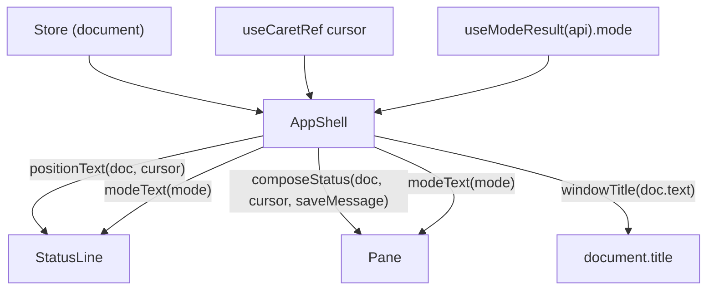

# Design Document

## Overview

This design implements the shell polish of `requirements.md`: a wordmark, grouped toolbar buttons, a Status_Line under the editor while the Pane is closed, a sheet-like Page, an Issues heading with a blocking count, a 32px Assistant_Strip, a Window_Title, a favicon, uniform Modal titles, and a commit-hook scope fix. It changes layout, labels and text placement only. The Store, the Verify flow, the Export flow, the Pane contents, the Engine, the Verifier and the Export_Package are untouched. No dependency is added.

Decisions taken from the review of the requirements (all binding on this design):

- The F7_Prompt stays plain text in the Pane_Status_Line. The title rule applies only to the three `Modal` dialogs (Export, Override, New document and Load demo motion, which all go through `Modal`).
- The Dialog_Title block has 12px padding and a 1px bottom rule. The dialog body keeps its own 12px.
- The commit hook ignores only `.kiro/**` and `docs/**`. A docs-only commit therefore reads `feat(repo): ...`. A change that touches `BUILD_LOG.md` gives `repo`.
- The hook test is exactly one example test that runs the scope function on three path sets.
- The existing Assistant disclosure button with `aria-expanded` is kept. It becomes the strip when collapsed.
- The Window_Title follows R10 with the two known limitations L1 and L2.
- The Status_Line has no live region. Its accessible name is "Status line".

Two choices that go slightly past the literal requirements, both to make the rules read as one line:

- The Issues_Region spans grid rows 2 to 3 (as the Assistant_Column already does), so its new 1px left rule runs the full height in both Pane states. Without this, the rule would stop above the 22px Status_Line row and above the Pane.
- `mode-badge.tsx` is renamed `use-server-mode.ts` because the badge component goes away. Only the hooks and a text function remain.

## Architecture

### What changes, by component

| Area | Change |
| ---- | ------ |
| `components/toolbar.tsx`, `toolbar.module.css` | Wordmark first; three `role="group"` runs; `badge` prop removed; Codes_Toggle label depends on `paneOpen`. |
| `components/mode-badge.tsx`, `mode-badge.module.css` | Renamed to `use-server-mode.ts`. `ModeBadge`, `BADGE_TEXT` and the CSS module are deleted. `modeText(mode)` is added. `useServerMode`, `useModeResult`, `ServerMode`, `ModeResult` are kept as they are. |
| `components/status-line.tsx`, `status-line.module.css` | New. Presentational. Position left, Mode_Text middle, Key_Legend right. |
| `components/use-pane.ts` | `positionText(doc, cursor)` added next to `composeStatus`. No change to `composeStatus` or the F7 logic. |
| `pane/pane.tsx`, `pane/pane.module.css` | New optional prop `modeText`. The status div becomes a flex row with the left text and the Mode_Text. |
| `components/use-document-title.ts` | New. `captionOf`, `windowTitle` (pure) and `useDocumentTitle` (one effect). |
| `components/app-shell.tsx` | Calls `useDocumentTitle`, renders `StatusLine` while the Pane is closed, passes `modeText` to `Pane`, stops passing `badge`. |
| `components/editor-surface.tsx`, `.module.css` | New placeholder text; the Page becomes a fixed sheet. |
| `components/issues-region.tsx`, `.module.css` | `issuesHeading(blocking)`; heading and body split so the heading rule spans the region; left rule; same background as the Editor_Column. |
| `components/assistant-column.tsx`, `.module.css`, `assistant-panel.tsx`, `.module.css` | Collapsed strip with vertical text; expanded heading in the Issues form. |
| `components/modal.tsx`, `modal.module.css` | Title block with padding and bottom rule; children wrapped in a body with 12px padding. |
| `app/globals.css` | Four new variables; grid rows and columns for the status row and the strip. |
| `app/icon.svg` | New favicon. |
| `scripts/commit-task.sh` | Scope selection moves into a function; `--print-scope` flag for tests. |
| `.kiro/steering/ui.md`, `BUILD_LOG.md`, `docs/KIRO_USAGE.md` | Amendments listed under Documentation. |

### Layout in `globals.css`

The grid keeps its three rows. Row 3 is now always present: 22px for the Status_Line, 40vh when the Pane is open.

```css
.app {
  grid-template-rows: var(--toolbar-h) minmax(0, 1fr) var(--status-h);
  grid-template-columns: [main] minmax(0, 1fr) [issues] var(--right-w);
}
.app[data-pane="open"] {
  grid-template-rows: var(--toolbar-h) minmax(0, 1fr) var(--pane-h);
}
.app[data-assistant="closed"] {
  grid-template-columns: [assistant] var(--strip-w) [main] minmax(0, 1fr) [issues] var(--right-w);
}
.app[data-assistant="open"] {
  grid-template-columns: [assistant] var(--left-w) [main] minmax(0, 1fr) [issues] var(--right-w);
}
.app > [aria-label="Reveal Codes"] {
  grid-column: main;
}
```

The generic `.app[data-assistant]` rule (column `auto`) is removed. The Status_Line sets `grid-column: main` in its own module, as the Issues_Region sets `grid-column: issues`. Both the Pane and the Status_Line land in row 3 by auto-placement (definite column, row already taken by the editor), which is how the Pane is placed today. The Issues_Region adds `grid-row: 2 / 4`.

### Data flow for the Status_Line and the Pane status line



- `composeStatus` still returns the F7 text, or the position text plus divergence words inside a mismatched quote, or `null`. The Pane keeps its `?? statusText(...)` fallback. This is unchanged, so the F7 tests keep their meaning.
- `positionText(doc, cursor)` is `composeStatus(doc, cursor, null) ?? statusText(doc.text, cursor)`. It is the Position_Text of the glossary. The Status_Line and the Pane therefore share one source for the divergence words.
- `modeText(mode)` is the only place that maps a mode to words. Mode_Text appears only in `StatusLine` and `Pane` (R4.10). The Toolbar receives no mode.
- The server mode comes from the existing single `useModeResult(svc.api)` call in `AppShell`. No second request is made.
- AppShell renders `<StatusLine>` when `paneControl.open` is false and leaves `<Pane open={paneControl.open}>` as it is. Exactly one of the two shows content at any time.

### Window_Title

`useDocumentTitle(doc.text)` runs in `AppShell`. `windowTitle(text)` is pure. The effect depends on the computed title string, so it runs on mount (R10.4: the empty Document gives "Reveal Codes") and again after the mount-time autosave load or any edit changes the string (R10.3). The static title `Reveal Codes` in `app/layout.tsx` metadata stays; it is what the server renders and equals the empty-Document value.

## Components and Interfaces

### Toolbar

```ts
export type ToolbarProps = Readonly<{
  notice: string | null;
  paneOpen: boolean;
  verifyDisabled: boolean;
  verifyRunning?: boolean;
  blockingCount?: number;
  // badge removed
  onNew?: () => void;
  onLoadDemo?: () => void;
  onVerify?: () => void;
  onTogglePane?: () => void;
  onExport?: () => void;
}>;
```

Markup, in order, inside the existing `role="toolbar"` div:

1. `<span className={styles["wordmark"]}>Reveal Codes</span>`. Text only, no image. It carries the rule to its right (`border-right: 1px solid var(--rule)` with padding), which is the single rule of R1.3.
2. `<div role="group" className={styles["group"]}>` with New and Load demo motion.
3. `<div role="group" className={styles["group"]}>` with Verify.
4. `<div role="group" className={styles["group"]}>` with the Codes_Toggle and Export.
5. The notice `div` (`role="status"`, `aria-live="polite"`), unchanged.

Rules between groups: `.group + .group { border-left: 1px solid var(--rule); padding-left: 8px; }`. This gives a rule between adjacent groups and none before the first or after the last (R2.2). A group is `display: flex; gap: 8px; align-items: center; align-self: stretch; margin: 4px 0`, so a rule is shorter than the 32px bar. The groups are unnamed on purpose: the toolbar already has the name "Document actions", and no new copy is added.

The toggle label is a pure ternary, `props.paneOpen ? "Hide codes (Alt-F3)" : "Show codes (Alt-F3)"`, with `aria-pressed={props.paneOpen}` kept. The notice keeps `flex: 1; min-width: 0; overflow: hidden; text-overflow: ellipsis; white-space: nowrap`, which satisfies R2.7. The bar keeps its fixed 32px row (R2.9). The `.badge` class is removed. `exportLabel` is unchanged.

Wordmark CSS: `font-family: var(--font-editor); font-size: var(--size-wordmark); font-weight: 700; color: var(--ink); white-space: nowrap;`. `ShellToolbar` in `app-shell.tsx` loses its `mode` prop and the `badge` line.

### use-server-mode.ts (was mode-badge.tsx)

```ts
export type ServerMode = "loading" | "fixtures" | "live" | "unreachable";

const MODE_TEXT = {
  fixtures: "Demo mode: recorded CourtListener responses",
  live: "Live CourtListener lookups",
  unreachable: "Server unreachable",
} as const;

/** The words for a mode; `loading` has none. */
export function modeText(mode: ServerMode): string | null {
  return mode === "loading" ? null : MODE_TEXT[mode];
}
// useServerMode, useModeResult, ModeResult: unchanged.
```

The file keeps the `"use client"` directive because the hooks use `useEffect` and `useState`. It is a `.ts` file once the JSX is gone. The move updates the import in `app-shell.tsx`.

### StatusLine

```ts
export const KEY_LEGEND = "Alt-F3 Codes   F7 Exit"; // three spaces

export type StatusLineProps = Readonly<{
  /** Position_Text from positionText(). */
  position: string;
  /** Mode_Text, or null while the mode is loading. */
  mode: string | null;
}>;

export function StatusLine({ position, mode }: StatusLineProps) {
  return (
    <section role="region" aria-label="Status line" className={styles["statusLine"]}>
      <span className={styles["position"]}>{position}</span>
      <span className={styles["mode"]}>{mode}</span>
      <span className={styles["legend"]}>{KEY_LEGEND}</span>
    </section>
  );
}
```

`role="region"` mirrors the Pane, which is also `section role="region"`. There is no `aria-live`, so keystroke updates are not announced (decision 7). The middle span is always rendered, empty while loading, so the legend stays at the right.

CSS: `grid-column: main; display: flex; align-items: center; gap: 16px; padding: 0 8px; border-top: 1px solid var(--rule); background: var(--ui-bg); font-family: var(--font-pane); font-size: var(--size-status); white-space: pre; overflow: hidden;`. `.position` and `.legend` take `flex: 1 1 0; min-width: 0`; `.position` truncates with an ellipsis (a divergence phrase can be long); `.legend` has `text-align: right`; `.mode` has `white-space: nowrap`. The row height comes from `--status-h`.

### Pane and use-pane

```ts
// pane.tsx
export type PaneProps = Readonly<{
  /* existing props unchanged */
  /** Mode_Text for the right end of the status line; null or absent shows nothing. */
  modeText?: string | null;
}>;
```

The status block becomes:

```tsx
<div className={cls("status")}>
  <span>{statusOverride ?? statusText(document.text, cursorOffset)}</span>
  {modeText == null ? null : <span className={cls("modeText")}>{modeText}</span>}
</div>
```

CSS: `.status` gains `display: flex; justify-content: space-between; gap: 16px;` and keeps its palette and `white-space: pre`. `.modeText { white-space: nowrap; }` has no colour of its own, so the CGA family table is untouched. The Pane stylesheet stays at the Pane font size and is exempt from the UI palette rules.

`positionText` in `use-pane.ts`:

```ts
export function positionText(doc: Document, cursor: number): string {
  return composeStatus(doc, cursor, null) ?? statusText(doc.text, cursor);
}
```

### use-document-title.ts

```ts
const MAX_CAPTION = 60;
const SUFFIX = "Reveal Codes";

/** First non-blank line, trimmed, at most 60 UTF-16 code units; null when none. */
export function captionOf(text: string): string | null {
  const match = /\S[^\n]*/.exec(text);
  if (match === null) return null;
  return match[0].trim().slice(0, MAX_CAPTION);
}

export function windowTitle(text: string): string {
  const caption = captionOf(text);
  return caption === null ? SUFFIX : `${caption} \u2014 ${SUFFIX}`;
}

export function useDocumentTitle(text: string): void {
  const title = windowTitle(text);
  useEffect(() => {
    document.title = title;
  }, [title]);
}
```

`/\S[^\n]*/` starts at the first non-whitespace character, so blank and whitespace-only leading lines are skipped without splitting the whole text on every keystroke. Cutting after the trim follows R-glossary order ("trimmed, and cut"), so a cut can leave a trailing space before the dash. L1 and L2 stay as recorded.

### EditorSurface

- `EDITOR_PLACEHOLDER` becomes `"Type or paste your filing here. Load demo motion to see a worked example."`.
- `.main`: `padding: 0; background: var(--ui-bg); overflow: auto;` and no `border-right` (the Issues_Region now owns the rule).
- `.page`: `width: 100%; max-width: var(--page-max); min-height: 11in; margin: 24px auto; padding: 1in; border: 1px solid var(--rule); background: var(--paper);`. The existing font family, 12pt size (`var(--size-editor)`) and `line-height: var(--line-editor)` (1.5) stay. With `box-sizing: border-box` from the global reset, `width: 100%` capped at 8.5in gives R6.1 and R6.2. The `--page-max` variable already holds `8.5in`.
- `.placeholder`: `top: 1in; left: 1in; right: 1in;`. The Page is `position: relative`, so offsets are from the padding box, which is where the first typed character appears (R7.2).

### IssuesRegion

```ts
/** "Issues" at zero; "Issues — <n> blocking" above zero (U+2014, one space each side). */
export function issuesHeading(blocking: number): string {
  return blocking > 0 ? `Issues \u2014 ${String(blocking)} blocking` : "Issues";
}
```

`IssuesRegion` computes `blockingIssues(document).length` (the Engine function `use-export.tsx` already uses) and renders `issuesHeading(n)` in the existing `h2#issues-heading`. Because `aside` is `aria-labelledby="issues-heading"`, the landmark name follows the heading; the empty Document keeps the name "Issues".

Markup: `aside > h2.heading` then `div.body` holding the demo note, the list and the Override_Dialog host. CSS:

- `.issues`: `grid-column: issues; grid-row: 2 / 4; padding: 0; overflow: auto; border-left: 1px solid var(--rule); background: var(--ui-bg);`
- `.heading`: `margin: 0; padding: 8px; border-bottom: 1px solid var(--rule); font-size: var(--size-ui); font-weight: 700;`
- `.body`: `padding: 8px;`

### Assistant column and panel

`AssistantColumn` keeps its props and its single `button` with `aria-expanded`. Its class depends on `open`:

- collapsed: the button is the strip. `flex: 1; margin: 0; writing-mode: vertical-rl;` and the standard button border and padding of `ui.md` (no exception to the button rule). The column has no border of its own in this state.
- expanded: the button keeps `margin: 8px` at the top of the column, and the column has `border-right: 1px solid var(--rule)`.

The column element gets a second class for the collapsed state (`styles["closed"]`), chosen from `open`. `useAssistantSlot`, `data-assistant="open|closed"` and its callers are unchanged. With no assistant there is no column and no strip (R9.7).

`AssistantPanel` keeps `aside`, `h2#assistant-heading` and all behavior. Its markup splits like the Issues_Region: `.panel` gets `padding: 0; gap: 0;`; `.heading` gets `width: 100%; padding: 8px; border-bottom: 1px solid var(--rule)` (same form as the Issues heading, R9.5); everything after the heading moves into `<div className={styles["body"]}>` with `display: flex; flex-direction: column; align-items: flex-start; gap: 8px; width: 100%; flex: 1; min-height: 0; padding: 8px;`. The stream box keeps `flex: 1` inside that body.

### Modal

`Modal` keeps its API (`title`, `onClose`, `restoreFocus`, `children`). Its markup changes in two places:

```tsx
<h2 id={titleId} className={styles["title"]}>{title}</h2>
<div className={styles["body"]}>{children}</div>
```

CSS in `modal.module.css`:

- `.dialog`: `padding: 0` (was 12px).
- `.title`: `margin: 0; padding: 12px; border-bottom: 1px solid var(--rule); font-size: var(--size-ui); font-weight: 700;`
- `.body`: `padding: 12px;`

The title is defined once, so Export, Override, New document and Load demo motion cannot differ (R12.4). `ModalActions`, the focus trap, Escape handling and the focus lifecycle do not change. `ConfirmDialog`, `ExportDialog` and `OverrideDialog` need no edit. The F7_Prompt does not use `Modal`.

### Favicon

`app/icon.svg` is a file-convention icon: Next.js serves it and adds the link tag without a metadata entry.

```svg
<svg xmlns="http://www.w3.org/2000/svg" viewBox="0 0 32 32" width="32" height="32">
  <rect x="0.5" y="0.5" width="31" height="31" fill="#FFFFFF" stroke="#111111" stroke-width="1"/>
  <text x="16" y="22" text-anchor="middle" font-family="Georgia, 'Times New Roman', serif" font-weight="700" font-size="16" fill="#111111">RC</text>
</svg>
```

It has the paper fill, a 1px ink border inside the edge, and the letters "RC" only (R11).

### Hook script scope

The scope rule moves into a function in `scripts/commit-task.sh`. The function reads NUL-separated paths on stdin and prints the scope. It prints nothing when it receives no path at all, so the existing "nothing staged" exit stays.

```bash
scope_of() {
  local key="" k rest path any=0
  while IFS= read -r -d '' path; do
    any=1
    case "$path" in .kiro/*|docs/*) continue ;; esac
    case "$path" in
      packages/*/*) rest="${path#packages/}"; k="packages/${rest%%/*}" ;;
      apps/*/*)     rest="${path#apps/}";     k="apps/${rest%%/*}" ;;
      *) key="repo"; break ;;
    esac
    if [ -z "$key" ]; then key="$k"
    elif [ "$key" != "$k" ]; then key="repo"; break; fi
  done
  if [ "$any" = 1 ] && [ -z "$key" ]; then key="repo"; fi
  case "$key" in "" | repo) printf '%s' "$key" ;; *) printf '%s' "${key#*/}" ;; esac
}
```

- R3.1: `.kiro/*` and `docs/*` are skipped, anchored at the repository root.
- R3.2 and R3.3: every non-ignored path has the same `packages/<name>` or `apps/<name>` key, and the output is `<name>` as written.
- R3.4: the key carries its parent, so `packages/engine` and `apps/engine` differ and give `repo`.
- R3.5: a path that matches neither pattern (a root file, or a file directly under `packages/` or `apps/`) sets `repo` at once.
- R3.6: paths were seen but all were ignored gives `repo`.
- A literal package named `repo` prints `repo`, which is the same word, so no ambiguity reaches the commit subject.

How it is testable (R3.8): `--print-scope` is handled before anything else the script does with git or stdin.

```bash
if [ "${1:-}" = "--print-scope" ]; then
  tr '\n' '\0' | scope_of
  exit 0
fi
```

It sits after the function definitions and before `cd "$(dirname "$0")/.."` and `payload="$(cat)"`. The hook runs the script with no argument, so it never takes this branch. In the commit path the old loop becomes:

```bash
scope="$(git diff --cached --name-only -z | scope_of)"
if [ -z "$scope" ]; then exit 0; fi
```

Everything else is untouched: payload parsing, title cleanup, the `git status` early exit, `git add -A`, the 72-character cap with the full title in the body, `git commit` without push or amend. The `--print-scope` input is newline separated, which is enough for the test; the hook path still uses `-z`.

## Data Models

### CSS variables

New in `:root` of `app/globals.css`, with the same values asserted in the Css_Scan:

| Variable | Value | Used by |
| -------- | ----- | ------- |
| `--size-wordmark` | `15px` | Wordmark |
| `--size-status` | `12px` | Status_Line |
| `--status-h` | `22px` | grid row 3 while the Pane is closed |
| `--strip-w` | `32px` | collapsed Assistant column |

Unchanged and reused: `--page-max` (8.5in), `--left-w` (260px), `--right-w` (300px), `--pane-h`, `--toolbar-h`, `--rule`, `--ui-bg`, `--paper`.

### Css_Scan change

In `test/static/css-rules.test.ts`:

- `VARIABLE_VALUES` gains the four entries above.
- `typeViolations` accepts `12px`, `15px`, `var(--size-status)` and `var(--size-wordmark)` in addition to `13px`, `var(--size-ui)` and `inherit` (and the editor sizes in the two sheets that already allow them). Any other size is still reported with its path and line.
- The violation message changes from "font-size must be 13px" to "font-size must be 12px, 13px or 15px", and the planted-violation test that expects the old text is updated to the new text.
- Every other rule is untouched: palette, accent, banned properties, font families and weights, hover, focus, button and disabled rules.

Check against the rules for the new CSS: no shadow, no radius, no transition, no new colour (only `var(--rule)`, `var(--ui-bg)`, `var(--paper)`, `var(--ink)`), no outline removal, font families only through the three variables, weights 400 or 700. The strip's `writing-mode` and the Page's `in` units are not covered by any rule.

### ui.md amendments (R13)

- Build: add `The favicon (the letters "RC" in Georgia bold) is the only place where letters serve as a mark.`
- Type: list exactly `UI: system sans at 13px`, `Editor: Georgia at 12pt`, `Wordmark: the editor family at 15px`, `Status line: the pane family at 12px`.
- Layout: replace the fixed-grid line with the 32px toolbar, the 22px Status_Line under the editor while the Pane is closed, the 32px Assistant_Strip while collapsed and the 260px left panel while expanded, the 300px right panel, and the pane at 40% of the viewport height when open. Add that the Page is a fixed 8.5in sheet with 1in padding and that the Issues_Region has a 1px left rule.
- Copy: `State is shown as text in the toolbar, the status line under the editor, or the pane status line.`

### Documentation (R15)

- `BUILD_LOG.md`: append one entry headed `## <date> shell-polish` with one sentence for before and after. Existing entries are not edited.
- `docs/KIRO_USAGE.md`: update the existing hook row to state the scope rule (`packages/<name>` or `apps/<name>` when every non-ignored path shares it, `.kiro/` and `docs/` ignored, `repo` otherwise or when nothing is left, and the `--print-scope` flag). Add one Spec row for shell-polish and one Steering row for the ui.md edit. The Spec row lists every file in the spec directory by path, including `.config.kiro`, because the inventory scan requires every spec file to appear in the document. No second hook row is added.
- README screenshot placeholder: not touched.

## Correctness Properties

There are no correctness properties in this spec, and no property-based test is written.

A correctness property needs a universally quantified statement over generated input that relates an input to an output: a round trip, an invariant or an idempotence. This feature has none that a generated input could break. Its content is layout, labels, static text and a three-way path classification, which the user chose to cover with exactly one example test. The one pure function with real input variety, `captionOf`, has a four-case example list in the requirements (R14.4) and its limits are recorded as L1 and L2. Per the testing rules in this repository, a property that only checks "does not throw" is not a property, so none is added to fill the section. All tests below are example tests.

## Error Handling

No new error handling is added.

- `modeText` is total over `ServerMode`; `loading` returns `null` and the Status_Line and Pane render nothing for it. A failed mode request is already `unreachable`.
- `useDocumentTitle` runs only in an effect, so server rendering never touches `document`. Storage failures are still handled by the existing mount-time load; the title then stays "Reveal Codes".
- `windowTitle` is total: any string yields a title, including text with no non-blank line.
- `scope_of` has no failure path. Empty stdin gives empty output, which keeps the existing "nothing to commit" exit. Unknown path shapes give `repo`.

## Testing Strategy

All tests are example tests. There is no property test, no new `vi.mock`, and nothing mocks the Engine or the Verifier. Tests use the existing helpers `renderUi`, `modeApi`, `createManualTimers` and `createMemoryStorage`, and the server mode is set with `modeApi("fixtures" | "live" | "down")`. The testing rule "no `try/catch` that swallows errors" applies.

### New tests

| Test | File | Requirements |
| ---- | ---- | ------------ |
| One `it` that runs `scripts/commit-task.sh --print-scope` through `spawnSync("bash", ...)` with stdin for three path sets: `apps/web/...` plus `.kiro/specs/...` gives `web`; `packages/engine/...` plus `packages/verifier/...` gives `repo`; `BUILD_LOG.md` alone gives `repo`. It follows the `copy-demo.test.ts` pattern for spawning a process. | `commit-scope.test.ts` (new) | 3.1 to 3.6, 3.8, 14.8 |
| Toolbar shows "Show codes (Alt-F3)" when closed and "Hide codes (Alt-F3)" when open; `aria-pressed` follows. | `toolbar.test.tsx` | 2.3, 2.4, 2.5, 14.1 |
| Toolbar has the Wordmark text first, then exactly three `group` elements holding the buttons in the order New, Load demo motion / Verify / the toggle, Export; the toolbar text contains no Mode_Text. | `toolbar.test.tsx` | 1.1, 1.4, 2.1, 2.8, 14.1 |
| `modeText` returns the three strings for `fixtures`, `live`, `unreachable` and `null` for `loading`. | `use-server-mode.test.tsx` | 4.6, 4.7, 5.1, 5.2 |
| Pane closed: a region named "Status line" is present, has no live attribute, shows the Position_Text and the Key_Legend. Pane opened with Alt-F3: that region is absent. | `app-shell.test.tsx` | 4.1, 4.2, 4.5, 4.8, 14.2 |
| `it.each` over `fixtures`, `live` and `down`: the Status_Line contains the Mode_Text, and the toolbar does not. | `app-shell.test.tsx` | 4.6, 4.10, 2.8, 14.2 |
| Pane open: the Pane status line contains the Mode_Text for the current mode. | `app-shell.test.tsx` | 5.1, 14.3 |
| `it.each` for four stored documents, reading `document.title` after mount: empty; first line blank (`"\n  \nText"` gives "Text — Reveal Codes"); a plain Caption; a first line of 61 or more characters cut to 60. | `app-shell.test.tsx` | 10.1 to 10.4, 14.4 |
| `IssuesRegion` heading reads "Issues" for a Document with no blocking issue and "Issues — 4 blocking" for a Document with four citations. | `issues-list.test.tsx` (the existing `IssuesRegion` describe) | 8.1, 8.2, 14.5 |

### Existing tests that must be updated

| Test file | Change | Requirements |
| --------- | ------ | ------------ |
| `toolbar.test.tsx` | The button-order test uses the new label. The "puts the badge ..." test is replaced by the group test above. The `aria-pressed` test looks up the new label. | 2, 14.7 |
| `app-shell.test.tsx` | The layout-order test expects `["toolbar", "main", "aside", "region"]` (the Status_Line is the last child while the Pane is closed). The toolbar-button order, the three placeholder assertions and the `aria-pressed` lookup use the new strings. The "mode badge" describe asserts the Mode_Text in the Status_Line, not the toolbar. The `statusLine()` helper reads the first child of the Pane status block, so the F7 assertions still compare only the left text. | 2, 4, 5, 7, 14.7 |
| `document-actions.test.tsx` | The click on the Codes_Toggle uses "Show codes (Alt-F3)". | 2.3, 14.7 |
| `mode-badge.test.tsx` | Renamed `use-server-mode.test.tsx`. The `ModeBadge` cases become `modeText` cases plus the existing hook cases (`down` gives `unreachable`; a pending request stays `loading`). | 4.6, 4.7 |
| `editor-surface.test.tsx` | The literal expected placeholder uses the new text. | 7.1, 14.7 |
| `static/css-rules.test.ts` | `VARIABLE_VALUES`, the accepted sizes and the message change as described under Data Models; the planted font-size case expects the new message; one added assertion shows `15px` and `12px` are accepted. | 13.6, 13.7, 14.6 |

Tests that stay as they are and must still pass: `pane.test.tsx` (the new prop is optional), `modal.test.tsx`, `export-dialog.test.tsx`, `override-dialog.test.tsx`, `assistant-panel.test.tsx` (the button name "Assistant", `aria-expanded` and `data-assistant` are unchanged), `demo-path.test.tsx`, `export-shell.test.tsx`, and the static scans for limits, module size, boundaries, copy, forbidden constructs and inventory. New modules stay under 40 lines per function and 300 lines per module. `app-shell.tsx` stays under 300 lines because the title logic and the status line live in their own modules. `static/inventory.test.ts` passes once the Spec row in `KIRO_USAGE.md` lists every file of this spec.

### What the tests cannot see

jsdom does not compute the CSS modules, so these are checked by the Css_Scan for palette and type and by the walk in a browser at the final checkpoint, not by an assertion: the Wordmark font and size (R1.2), the vertical rules (R1.3, R2.2), the 22px row and the 12px type (R4.4), the Page dimensions (R6), the Issues rules (R8.4, R8.5), the 32px strip and vertical text (R9.1, R9.2), the Modal title padding and rule (R12), and the favicon (R11). The checkpoint runs lint, typecheck, test and `next build --webpack`, all with exit code 0 (R15.6).
